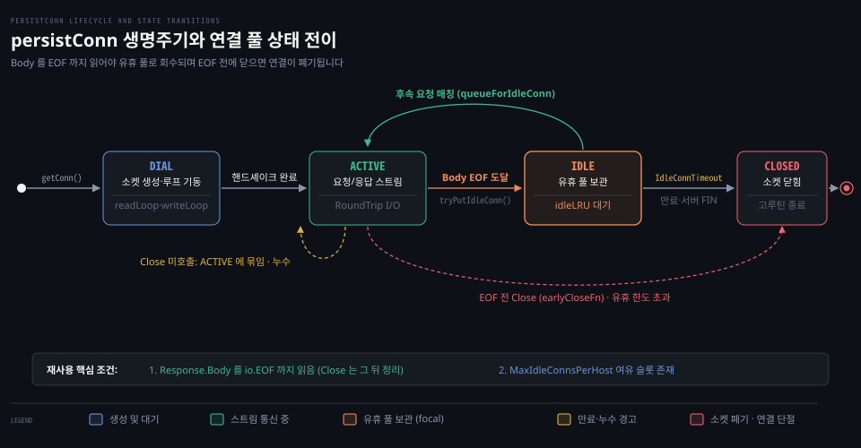
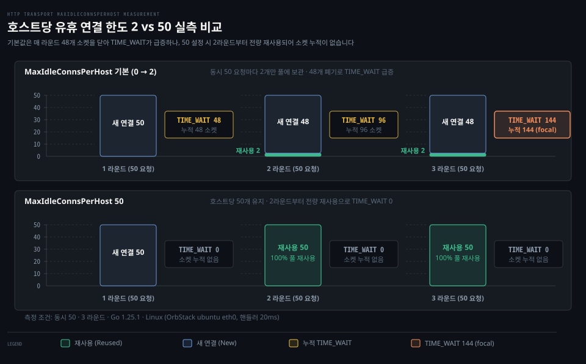
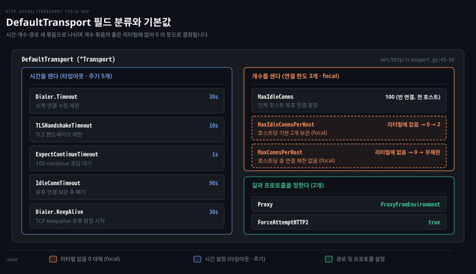
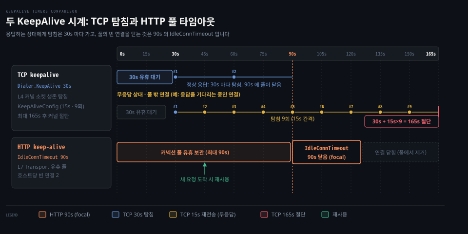
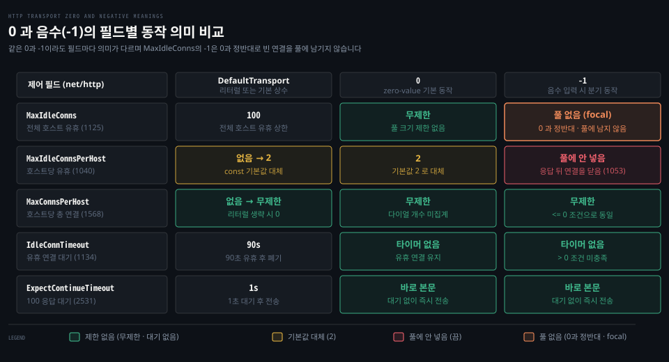
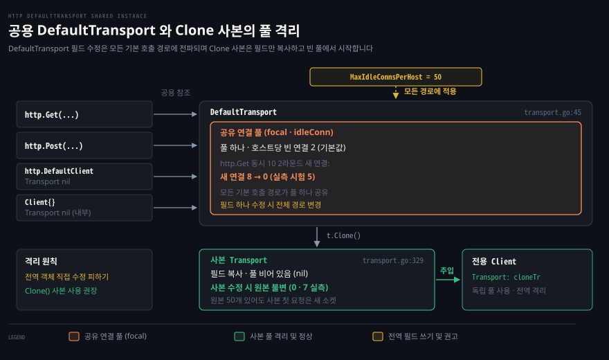
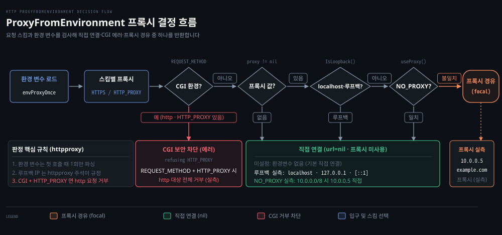

# Client·Transport

---

> Go 의 HTTP 클라이언트는 상위 트랜잭션 흐름을 관장하는 Client 와 TCP 지속 연결(keep-alive) 풀을 관리하는 Transport 로 계층을 분리해 소켓 자원을 보존합니다.

## 핵심 요약

> Client 와 Transport 는 HTTP 통신의 고수준 오케스트레이션과 저수준 커넥션 풀링을 분리하여 안전하고 효율적인 지속 연결을 보장합니다. Transport 는 내부에 호스트별 유휴 연결 큐와 전용 I/O 루프를 둔 persistConn 구조체를 유지하여 매 요청마다 TCP 핸드셰이크를 반복하는 비용을 제거합니다.

이 재사용 메커니즘이 원활히 동작하려면 호출자가 `Response.Body` 를 반드시 `io.EOF` 까지 모두 읽고 닫아야 합니다. 본문을 끝까지 소비하지 않으면 내부 `readLoop` 고루틴이 유휴 큐로 소켓을 회수하지 못하고 연결을 버립니다.

기본 설정에서 호스트당 유휴 연결 한도(`DefaultMaxIdleConnsPerHost`)는 2개에 불과합니다. 높은 동시성을 요구하는 분산 환경에서는 이 한도를 적절히 늘리지 않으면 지속 연결이 즉시 파기되어 소켓 고갈이 일어납니다.


## 학습 목표

> 이 편을 읽고 나면 아래 여섯 가지를 스스로 해낼 수 있습니다.

1. `Client` 구조체와 `Transport` 구조체의 핵심 필드별 역할과 책임을 구분할 수 있습니다.
2. `Transport` 내부의 `getConn`, `queueForIdleConn`, `tryPutIdleConn` 커넥션 풀링 흐름을 설명할 수 있습니다.
3. `persistConn` 의 생명주기와 `readLoop`, `writeLoop` 고루틴의 동작 방식을 설명할 수 있습니다.
4. `Response.Body` 를 `io.EOF` 까지 다 읽고 닫아야만 소켓이 재사용되는 소스 코드 수준의 근거를 설명할 수 있습니다.
5. 기본값 `DefaultMaxIdleConnsPerHost = 2` 가 대규모 동시 요청 환경에서 유발하는 소켓 재연결 문제를 진단하고 튜닝할 수 있습니다.
6. `DefaultTransport` 리터럴의 필드마다 무엇을 세고 재는지, 0 일 때 무엇이 되는지 구분할 수 있습니다.


## 1. Transport 커넥션 풀과 지속 연결

> HTTP 요청마다 소켓을 열고 닫으면 핸드셰이크 지연과 포트 고갈이 발생하므로 Transport 가 연결 풀을 유지합니다.

요청마다 TCP(Transmission Control Protocol) 연결을 새로 맺으면 매번 3-way 핸드셰이크 왕복을 기다려야 하고 먼저 닫은 쪽에 쌓인 `TIME_WAIT` 소켓이 로컬 포트를 붙잡아 포트가 고갈될 수 있습니다. Transport 는 응답이 끝난 연결을 닫지 않고 풀에 보관했다가 다음 요청에 다시 배정해 이 비용을 줄입니다. 아래 도식은 단일 TCP 연결을 추상화한 `persistConn` 이 생성되어 요청을 처리하고 유휴 풀에 보관되거나 폐기되는 전체 상태 전이를 나타냅니다.



HTTP/1.1(HyperText Transfer Protocol 1.1) 은 동일 호스트에 대한 반복 요청에서 연결을 끊지 않고 재사용하는 keep-alive 를 기본으로 지원합니다. Go 의 [Transport](https://pkg.go.dev/net/http#Transport) 는 이 지속 연결을 캐싱하여 다음 요청에 즉시 투입합니다.

### 공식 계약: 연결 풀 제어 필드와 기본값

[Client](https://pkg.go.dev/net/http#Client) 구조체는 상위 정책을 정의합니다.

```go
type Client struct {
    Transport     RoundTripper
    CheckRedirect func(req *Request, via []*Request) error
    Jar           CookieJar
    Timeout       time.Duration
}
```

실제 네트워크 연결의 수명과 풀링 설정은 [Transport](https://pkg.go.dev/net/http#Transport) 의 필드가 담당합니다.

```go
type Transport struct {
    DialContext           func(ctx context.Context, network, addr string) (net.Conn, error)
    DisableKeepAlives     bool
    MaxIdleConns          int
    MaxIdleConnsPerHost   int
    MaxConnsPerHost       int
    IdleConnTimeout       time.Duration
    ForceAttemptHTTP2     bool
    // ...
}
```

공식 문서는 연결 풀링의 동작 규칙을 다음과 같이 명시합니다.

> "By default, Transport caches connections for future re-use. This may leave many open connections when accessing many hosts. This behavior can be managed using Transport.CloseIdleConnections method and the [Transport.MaxIdleConnsPerHost] and [Transport.DisableKeepAlives] fields."
>
> — [net/http Transport](https://pkg.go.dev/net/http#Transport)

호스트당 보관할 수 있는 유휴 연결 수의 기본값은 [DefaultMaxIdleConnsPerHost](https://pkg.go.dev/net/http#DefaultMaxIdleConnsPerHost) 상수가 규정합니다.

```go
const DefaultMaxIdleConnsPerHost = 2
```

`MaxIdleConns` 는 전체 호스트를 통틀어 유지할 수 있는 유휴 연결의 총합입니다. 반면 `MaxIdleConnsPerHost` 는 특정 호스트(`host:port`) 단위로 남겨둘 유휴 연결의 최대치입니다. `MaxConnsPerHost` 는 유휴·활성 상태를 모두 합친 호스트당 최대 연결 한도이며 이 한도에 도달하면 신규 다이얼이 블로킹됩니다.

### 내부 동작: getConn 과 persistConn 고루틴 쌍

`Transport.RoundTrip` 이 호출되면 내부에서 [`src/net/http/transport.go:1484`](https://github.com/golang/go/blob/go1.25.1/src/net/http/transport.go#L1484) 의 `getConn` 메서드를 실행합니다.

1. 먼저 [`src/net/http/transport.go:1148`](https://github.com/golang/go/blob/go1.25.1/src/net/http/transport.go#L1148) 의 `queueForIdleConn` 을 호출하여 내부 `idleConn` 맵에서 유휴 상태인 `persistConn` 을 조회합니다.
2. 캐시된 유휴 연결이 유효하면 해당 연결을 즉시 반환받아 재사용합니다.
3. 재사용 가능한 연결이 없으면 `queueForDial`(`transport.go:1562`)이 `go t.dialConnFor(w)`(`transport.go:1607`)로 별도 고루틴을 띄웁니다. 그 안에서 [`src/net/http/transport.go:1736`](https://github.com/golang/go/blob/go1.25.1/src/net/http/transport.go#L1736) 의 `t.dialConn` 이 [../net/02-01.Dial·Dialer.md](../net/02-01.Dial·Dialer.md) 편의 다이얼러로 새 소켓을 엽니다.
4. `dialConn` 은 다이얼하기 전에 [`src/net/http/transport.go:2065`](https://github.com/golang/go/blob/go1.25.1/src/net/http/transport.go#L2065) 의 `persistConn` 구조체를 먼저 만들고 소켓이 열리면 두 개의 전용 고루틴을 띄웁니다([`src/net/http/transport.go:1944`](https://github.com/golang/go/blob/go1.25.1/src/net/http/transport.go#L1944)).
   - `go pconn.readLoop()` ([`src/net/http/transport.go:2239`](https://github.com/golang/go/blob/go1.25.1/src/net/http/transport.go#L2239)): 소켓에서 응답 헤더와 본문을 읽어 들입니다.
   - `go pconn.writeLoop()` ([`src/net/http/transport.go:2594`](https://github.com/golang/go/blob/go1.25.1/src/net/http/transport.go#L2594)): 요청 채널로부터 요청을 받아 소켓으로 전송합니다.

하나의 TCP 연결마다 읽기와 쓰기를 전담하는 고루틴 쌍이 독립적으로 루프를 돕니다. 다만 한 연결에서 동시에 처리하는 요청은 하나뿐이며 HTTP 파이프라이닝은 하지 않습니다. `readLoop` 는 호출자가 본문을 다 소비했다는 신호(`waitForBodyRead`)를 받기 전에는 다음 응답을 읽지 않고 연결은 그 뒤에야 유휴 풀로 돌아가 다음 요청에 배정됩니다([`src/net/http/transport.go:2395`](https://github.com/golang/go/blob/go1.25.1/src/net/http/transport.go#L2395)).

### 함정·관찰: DefaultMaxIdleConnsPerHost=2

`DefaultMaxIdleConnsPerHost` 의 기본값 2는 단일 클라이언트가 하나의 서버로 수십 개 이상의 동시 요청을 보낼 때 연결을 매번 새로 맺게 만들어 성능을 떨어뜨립니다.

예를 들어 특정 API 서버로 50개의 동시 요청이 발생하면 `Transport` 는 50개의 TCP 소켓을 생성합니다. 50개의 요청이 모두 완료되어 풀로 돌아갈 때 `MaxIdleConnsPerHost` 가 기본값인 2로 남아 있으면 단 2개의 연결만 유휴 큐에 보관되고 나머지 48개의 연결은 즉시 닫힙니다.

이어서 다음 50개의 요청이 들어오면 유휴 연결 2개만 재사용되고 나머지 48개는 다시 3-way 핸드셰이크를 거쳐 새로 맺어야 합니다. 이 과정이 반복되면 수많은 소켓이 `TIME_WAIT` 상태로 쌓여 커널 로컬 포트가 고갈되고 불필요한 네트워크 왕복 지연이 누적됩니다.

동시 요청 50개를 보냈을 때 연결 2개만 풀에 보관하고 48개를 즉시 닫는다는 앞선 설명은 실측과 일치합니다. 이 노트의 실측(Go 1.25.1, Linux, 동시 50 요청 3 라운드)에서 기본값은 라운드마다 새 연결이 50개, 48개, 48개 발생했습니다. 유휴 풀에 남은 연결은 매번 2개였고 클라이언트 `TIME_WAIT` 소켓은 48개, 96개, 144개로 누적되었습니다. 반면 `MaxIdleConnsPerHost` 를 50으로 올리자 2라운드부터 신규 연결이 0개였고 `TIME_WAIT` 도 발생하지 않았습니다.

운영 규모에서는 호스트당 빈 연결 2개와 호스트당 연결 무제한이라는 두 기본값이 함께 포트 고갈 장애로 이어질 수 있습니다([npg-lab 리허설 I3 기록](../../../../02_os/project/npg-lab/01-01.기본값%20리버스%20프록시가%20겪는%20장애%20-%20느린%20검색·포트%20고갈·POST%20502·회복%20지연·중복%20등록.md#i3-닫은-연결이-출발-포트를-채웠다)). 해당 리허설은 `DefaultTransport` 를 그대로 쓴 프록시에 같은 조건의 동시 50 부하를 두 번 걸었습니다. 한 번은 초반 새 연결이 초당 1,364개였고, `TIME_WAIT` 소켓이 28,213개까지 차 출발 포트 범위(약 28,232개)에 닿자 다이얼이 실패했습니다. 다른 60초 실행에서는 88,831개 요청 가운데 37,381개가 502 였습니다.



마이크로서비스 간 통신이나 백엔드 연동 클라이언트에서는 예상 동시성 수준에 맞춰 `MaxIdleConnsPerHost` 를 최소 동시 요청 수 이상으로 설정해야 합니다.


## 2. Response.Body 소비와 연결 반환

> HTTP/1.1 연결 재사용은 응답 바이트 스트림이 완전히 끝났음을 확인하는 절차에 종속됩니다.

소켓 스트림에서 이전 응답의 바이트가 남은 채로 다음 요청을 보내면 응답 데이터가 섞입니다. 따라서 표준 라이브러리는 응답 본문이 끝까지 읽혔는지 엄격하게 검증합니다.

### 공식 계약: Body 종료와 지속 연결 재사용의 인과 관계

공식 문서 [Response](https://pkg.go.dev/net/http#Response) 는 본문 소비 의무를 명확히 선언합니다.

> "The http Client and Transport guarantee that Body is always non-nil, even on responses without a body or responses with a zero-length body. It is the caller's responsibility to close Body. The default HTTP client's Transport may not reuse HTTP/1.x "keep-alive" TCP connections if the Body is not read to completion and closed."
>
> — [net/http Response](https://pkg.go.dev/net/http#Response)

응답에 본문이 없거나 길이가 0이어도 `resp.Body` 는 항상 non-nil 이며 호출자가 반드시 닫아야 합니다. 본문을 끝까지 읽지 않고 닫으면 기본 `Transport` 는 지속 연결을 재사용하지 못합니다.

### 내부 동작: bodyEOFSignal·readLoop 회수 조건

표준 라이브러리는 이 규칙을 보장하기 위해 [`src/net/http/transport.go:2975`](https://github.com/golang/go/blob/go1.25.1/src/net/http/transport.go#L2975) 의 `bodyEOFSignal` 구조체를 사용합니다.

```go
// src/net/http/transport.go:2975
type bodyEOFSignal struct {
    body         io.ReadCloser
    mu           sync.Mutex
    closed       bool
    rerr         error
    fn           func(error) error
    earlyCloseFn func() error
}
```

`readLoop` 는 응답을 생성할 때 원본 본문을 `bodyEOFSignal` 로 감싸서 반환합니다([`src/net/http/transport.go:2355`](https://github.com/golang/go/blob/go1.25.1/src/net/http/transport.go#L2355)).

1. 호출자가 `resp.Body.Read` 를 반복하여 본문의 끝에 도달하면 `fn` 콜백이 실행되고 `waitForBodyRead <- true` 신호를 보냅니다.
2. 본문을 다 읽지 않은 채 `resp.Body.Close()` 를 호출하면 `earlyCloseFn` 이 실행되어 `waitForBodyRead <- false` 신호를 보냅니다.
3. `readLoop` 는 이 신호를 기다립니다([`src/net/http/transport.go:2395`](https://github.com/golang/go/blob/go1.25.1/src/net/http/transport.go#L2395)).

```go
// src/net/http/transport.go:2395
select {
case bodyEOF := <-waitForBodyRead:
    alive = alive &&
        bodyEOF &&
        !pc.sawEOF &&
        pc.wroteRequest() &&
        tryPutIdleConn(rc.treq)
    if bodyEOF {
        eofc <- struct{}{}
    }
case <-rc.treq.ctx.Done():
    alive = false
    pc.cancelRequest(context.Cause(rc.treq.ctx))
case <-pc.closech:
    alive = false
}
```

`bodyEOF` 가 `false` 이면 `alive` 변수가 `false` 가 됩니다. `&&` 단락 평가 때문에 [`src/net/http/transport.go:1052`](https://github.com/golang/go/blob/go1.25.1/src/net/http/transport.go#L1052) 의 `tryPutIdleConn` 은 아예 호출되지 않고 `readLoop` 루프가 끝나면서 소켓이 닫힙니다.

반대로 호출자가 `resp.Body.Close()` 를 아예 호출하지 않으면 `waitForBodyRead` 채널에서 신호가 오지 않아 `readLoop` 고루틴이 영구히 대기 상태에 갇힙니다. 연결도 유휴 풀로 돌아가지 못하고 누수됩니다.

### 함정·관찰: io.Copy·Discard 소비 패턴

응답 본문의 내용이 비즈니스 로직에 필요하지 않더라도 지속 연결을 재사용하려면 본문을 끝까지 비워야 합니다.

```go
resp, err := client.Get("https://api.example.com/health")
if err != nil {
    return err
}
// 올바른 소비 패턴: 잔여 본문을 모두 버리고 닫음
_, _ = io.Copy(io.Discard, resp.Body)
_ = resp.Body.Close()
```

본문을 읽지 않고 `resp.Body.Close()` 만 호출하면 `earlyCloseFn` 에 의해 TCP 연결이 즉시 파기됩니다. 반면 `io.Copy(io.Discard, resp.Body)` 로 잔여 바이트를 끝까지 읽어 내면 `io.EOF` 가 발생하여 `persistConn` 이 안전하게 유휴 풀로 회수됩니다.

연결이 제때 풀로 회수되지 않아 발생하는 FD 누수와 고루틴 정체 문제는 [gonet-lab 01-01](../../../../02_os/project/gonet-lab/01-01.%EC%A1%B0%EC%9A%A9%ED%95%9C%20%EC%97%B0%EA%B2%B0%EC%9D%B4%20%EC%84%9C%EB%B2%84%EB%A5%BC%20%EB%A9%88%EC%B6%98%EB%8B%A4%20-%20goroutine%C2%B7FD%C2%B7idle%20timeout.md) 편에서 다룬 관찰 결과와 일치합니다.


## 3. DefaultTransport 기본값 읽기

> DefaultTransport 는 Transport 구조체에 값 일곱 개를 채워 선언한 패키지 전역 인스턴스입니다. 같은 숫자 0이나 같은 이름을 쓰더라도 필드마다 세고 재는 대상과 수명주기 구간이 다릅니다.



DefaultTransport 리터럴에 적힌 수치를 그대로 읽으면 서로 다른 계층의 설정과 헷갈려 장애 분석이 꼬입니다. 다이얼러의 KeepAlive 30초를 HTTP 커넥션 풀의 재사용 시간으로 보거나 MaxIdleConns 100을 전체 소켓 한도로 오판하기 쉽습니다. 필드마다 무엇을 세고 어느 구간을 재는지 분리해 보지 않으면 운영 환경에서 일어나는 소켓 고갈의 진짜 원인을 찾지 못합니다.

### 공식 계약: DefaultTransport 리터럴

공식 주석은 DefaultTransport 가 프록시 환경 변수를 따르고 재사용 연결을 캐싱하는 기본 구현체라고 명시합니다.

> "DefaultTransport is the default implementation of Transport and is used by DefaultClient. It establishes network connections as needed and caches them for reuse by subsequent calls. It uses HTTP proxies as directed by the environment variables HTTP_PROXY, HTTPS_PROXY and NO_PROXY (or the lowercase versions thereof)."
>
> — [`src/net/http/transport.go:40`](https://github.com/golang/go/blob/go1.25.1/src/net/http/transport.go#L40)

패키지 초기화 코드 [`src/net/http/transport.go:45`](https://github.com/golang/go/blob/go1.25.1/src/net/http/transport.go#L45) 는 아래와 같이 일곱 개의 설정을 직접 채웁니다.

```go
// src/net/http/transport.go:45
var DefaultTransport RoundTripper = &Transport{
	Proxy: ProxyFromEnvironment,
	DialContext: defaultTransportDialContext(&net.Dialer{
		Timeout:   30 * time.Second,
		KeepAlive: 30 * time.Second,
	}),
	ForceAttemptHTTP2:     true,
	MaxIdleConns:          100,
	IdleConnTimeout:       90 * time.Second,
	TLSHandshakeTimeout:   10 * time.Second,
	ExpectContinueTimeout: 1 * time.Second,
}
```

| 필드 | 리터럴 값 | 무엇을 세거나 재나 | 연결 일생의 구간 | `Transport{}` 일 때 |
|---|---|---|---|---|
| `Proxy` | `ProxyFromEnvironment` | 환경 변수(`HTTP_PROXY`, `HTTPS_PROXY`, `NO_PROXY`) 기반 프록시 결정 | 연결 맺기 전 | `nil` (프록시 미사용) |
| `DialContext` 의 `Timeout` | `30 * time.Second` | DNS 해석과 TCP 핸드셰이크 완료 제한 시간 | 연결 맺기 | 기한 없음 (운영체제 기본값) |
| `DialContext` 의 `KeepAlive` | `30 * time.Second` | TCP keepalive 첫 탐침 전송까지의 유휴 대기 시간 | 연결 유지 | 기본 15초 탐침 (`zeroDialer`) |
| `TLSHandshakeTimeout` | `10 * time.Second` | TLS 핸드셰이크 완료 제한 시간 | TLS 맺기 | 기한 없음 (0) |
| `ForceAttemptHTTP2` | `true` | 커스텀 다이얼 환경에서 HTTP/2 업그레이드 시도 여부 | 프로토콜 협상 | `false` |
| `ExpectContinueTimeout` | `1 * time.Second` | `Expect: 100-continue` 전송 후 서버 승인 대기 시간 | 요청 전송 | 대기 없음 (즉시 본문 전송) |
| `MaxIdleConns` | `100` | 모든 호스트를 합쳐 풀에 남겨둘 최대 유휴 연결 수 | 빈 채 보관 | 무제한 (0) |
| `IdleConnTimeout` | `90 * time.Second` | 풀에 들어간 유휴 연결의 최대 대기 시간 | 빈 채 보관 | 기한 없음 (0, 영구 보관 시도) |
| `MaxIdleConnsPerHost` (미지정) | `0` (내부에서 2 적용) | 단일 호스트(`host:port`) 단위 최대 유휴 연결 수 | 빈 채 보관 | 2 (`DefaultMaxIdleConnsPerHost`) |
| `MaxConnsPerHost` (미지정) | `0` (제한 없음) | 단일 호스트에 열 수 있는 활성·유휴 연결 총합 상한 | 연결 일생 전체 | 무제한 (0) |

각 필드가 적용되는 구간은 [02-02 §1](./02-02.Client.Timeout·Transport%20%ED%83%80%EC%9E%84%EC%95%84%EC%9B%83·httptrace.md#공식-계약-clienttransport-타임아웃-필드) 의 타임아웃 간트와 이 문서 [§1 상태도](#1-transport-커넥션-풀과-지속-연결)에서 확인할 수 있습니다.

MaxIdleConns 100 은 유휴 풀에 머무는 빈 연결만 세며 요청을 처리 중인 연결은 세지 않습니다. Transport 에는 프로세스 전체 소켓 수를 제한하는 전역 상한이 없으며 오직 호스트 단위 상한인 MaxConnsPerHost 만 제공합니다. 따라서 여러 호스트로 동시에 수백 개의 요청을 보내면 활성 연결은 상한 없이 계속 생성될 수 있습니다.

리터럴에 명시되지 않은 MaxIdleConnsPerHost 와 MaxConnsPerHost 는 zero-value 인 0 으로 설정됩니다. 이때 내부 로직에 의해 호스트당 빈 연결 2개 보관과 호스트당 총 연결 수 무제한이 적용됩니다. 이 기본값 2 때문에 고동시성 환경에서 소켓이 파기되고 재생성되는 문제는 [앞선 §1 함정 절](#함정관찰-defaultmaxidleconnsperhost2)의 분석과 직결됩니다.

아무 값도 채우지 않은 zero-value 구조체 &http.Transport{} 는 DefaultTransport 와 기본 동작이 크게 다릅니다. Proxy 가 nil 이어서 환경 변수를 반영하지 않습니다. 전체 빈 연결 수와 보관 시간에도 상한이 없어 유휴 타이머가 돌지 않습니다. 남는 상한은 호스트당 빈 연결 2개뿐입니다. TLS 핸드셰이크에는 기한이 없고, Expect 100-continue 는 기다리지 않고 본문을 바로 보냅니다. zero-value 인스턴스에서 발생하는 소켓 누수와 동작 분기는 [01-01 §1 함정 절](./01-01.Client·Transport·Server·Handler.md#함정관찰-인스턴스-매번-생성에-따른-소켓-고갈)에 정리되어 있습니다.

### 함정·관찰: 이름이 같은 두 KeepAlive

net.Dialer 의 KeepAlive 필드와 Transport 의 지속 연결을 같은 메커니즘으로 혼동하면 타임아웃 튜닝이 어긋납니다. 리터럴의 KeepAlive 30초를 보고 HTTP 연결이 풀에서 30초 동안만 재사용된다고 오해하는 것이 대표적입니다. 두 설정은 이름이 같을 뿐 하나는 OS 소켓의 생존을 확인하는 장치이고 다른 하나는 애플리케이션의 연결 캐싱 메커니즘입니다.

TCP keepalive 는 커널이 상대 호스트의 생존 여부를 주기적으로 확인하는 소켓 옵션입니다. 데이터 송수신이 없는 유휴 상태가 30초 동안 이어지면 커널이 첫 탐침(probe) 패킷을 보냅니다. Go 의 Dialer 는 Interval 과 Count 를 비워 둘 때 기본값을 적용합니다. 탐침에 응답이 오면 다음 탐침은 다시 30초 유휴 뒤에 나가고, 응답이 없을 때만 15초 간격으로 최대 9회까지 다시 보냅니다([`src/net/tcpsock.go:136-148`](https://github.com/golang/go/blob/go1.25.1/src/net/tcpsock.go#L136-L148), [`src/net/tcpsock.go:289`](https://github.com/golang/go/blob/go1.25.1/src/net/tcpsock.go#L289)). 상대 호스트가 꺼지거나 네트워크가 끊겨 탐침 9회가 모두 응답을 받지 못하면 커널이 연결을 끊습니다.

반면 HTTP 지속 연결(keep-alive)은 응답이 끝난 TCP 연결을 닫지 않고 풀에 보관해 다음 요청에 재사용하는 기술입니다. 이 기능을 끄는 스위치는 Transport 의 DisableKeepAlives 필드입니다. 풀 안에서 대기하는 최대 보관 시간은 IdleConnTimeout 의 90초입니다. 보관 가능한 연결 개수는 MaxIdleConns 와 MaxIdleConnsPerHost 가 결정합니다.

두 타이머는 완전히 독립적으로 동작합니다. 연결이 유휴 풀에 보관되어 있어도 30초 동안 패킷이 없으면 커널 수준의 TCP keepalive 탐침이 전송되는 것으로 보입니다. 그 연결이 풀에서 90초 동안 다시 쓰이지 않으면 Transport 의 유휴 타이머가 그 연결을 닫습니다. Dialer 의 세부 동작과 KeepAliveConfig 설정 방식은 [../net/02-01.Dial·Dialer.md](../net/02-01.Dial·Dialer.md#공식-계약-dialer-구조체-필드와-dialcontext) 편을 참고합니다.



### 함정·관찰: 필드마다 다른 0

커넥션 풀과 타임아웃을 제어하는 다섯 필드는 모두 정수나 시간 단위입니다. 특정 기능을 끄거나 제한을 풀려는 목적으로 0 이나 -1 을 일관된 규칙 없이 넣으면 의도와 정반대로 동작하기 쉽습니다. 어떤 필드는 0이 무제한이지만 다른 필드는 0에 별도 기본값이 숨어 있고, 음수를 넣었을 때 풀 자체가 무력화되기도 합니다.

| 필드 | 0 | -1 | 근거 줄 |
|---|---|---|---|
| `MaxIdleConns` | 제한 없음 (풀 전체 무제한) | 빈 연결이 풀에 남지 않음 (기다리는 요청에 바로 넘길 때만 재사용) | [`src/net/http/transport.go:1125`](https://github.com/golang/go/blob/go1.25.1/src/net/http/transport.go#L1125) |
| `MaxIdleConnsPerHost` | 호스트당 2개 (`DefaultMaxIdleConnsPerHost`) | 빈 연결을 풀에 넣지 않음 | [`src/net/http/transport.go:1040`](https://github.com/golang/go/blob/go1.25.1/src/net/http/transport.go#L1040), [`src/net/http/transport.go:1053`](https://github.com/golang/go/blob/go1.25.1/src/net/http/transport.go#L1053) |
| `MaxConnsPerHost` | 제한 없음 | 제한 없음 (0과 동일) | [`src/net/http/transport.go:1568`](https://github.com/golang/go/blob/go1.25.1/src/net/http/transport.go#L1568), [`src/net/http/transport.go:1631`](https://github.com/golang/go/blob/go1.25.1/src/net/http/transport.go#L1631) |
| `IdleConnTimeout` | 타이머 없음 (빈 연결 유지) | 타이머 없음 (0과 동일) | [`src/net/http/transport.go:1134`](https://github.com/golang/go/blob/go1.25.1/src/net/http/transport.go#L1134), [`src/net/http/transport.go:1169`](https://github.com/golang/go/blob/go1.25.1/src/net/http/transport.go#L1169) |
| `ExpectContinueTimeout` | 대기 없이 즉시 본문 전송 | 대기 없이 즉시 본문 전송 (0과 동일) | [`src/net/http/transport.go:2531`](https://github.com/golang/go/blob/go1.25.1/src/net/http/transport.go#L2531) |

표에 정리한 필드 주석은 0이 갖는 의미만 설명할 뿐 음수 동작은 전혀 언급하지 않습니다. 음수 칸에 적힌 동작은 Go 1.25.1 소스 코드의 조건 분기와 실측으로만 확인한 규약입니다.

`MaxIdleConns` 에 -1 을 지정하면 0 의 무제한 설정과 정반대의 결과가 나타납니다. 빈 연결을 풀에 반환할 때 전체 유휴 수를 점검하는 조건문이 항상 참으로 평가됩니다([`src/net/http/transport.go:1125`](https://github.com/golang/go/blob/go1.25.1/src/net/http/transport.go#L1125)). 그 결과 방금 풀에 등록한 빈 연결이 다음 라인에서 즉시 닫혀 유휴 연결이 하나도 남지 않습니다. 다만 빈 연결을 기다리는 요청이 있으면 이 검사보다 먼저 그 요청에 연결을 넘기므로([`src/net/http/transport.go:1071`](https://github.com/golang/go/blob/go1.25.1/src/net/http/transport.go#L1071)) 재사용이 아예 막히지는 않습니다.

`ExpectContinueTimeout` 을 0으로 두었을 때 본문이 지연 없이 전송되는 과정도 주의가 필요합니다. 내부 구현은 대기 분기를 건너뛰지 않고 0초 기간의 타이머를 생성합니다([`src/net/http/transport.go:2531`](https://github.com/golang/go/blob/go1.25.1/src/net/http/transport.go#L2531)). 타이머 채널이 즉시 만료 신호를 방출해 곧바로 본문 전송으로 진입합니다([`src/net/http/transport.go:2538`](https://github.com/golang/go/blob/go1.25.1/src/net/http/transport.go#L2538)). 겉보기 결과는 즉시 전송으로 같지만 0일 때 타이머 자체를 걸지 않는다고 해석하면 내부 동작과 틀립니다.

유휴 풀이나 지속 연결을 끄려면 정수 필드에 음수를 대입하기보다 `DisableKeepAlives` 처럼 의도가 분명한 필드를 쓰는 편을 권합니다.



### 함정·관찰: 공용 전역 객체 수정

`http.DefaultTransport` 는 패키지 전역 변수로 공유되는 포인터 인스턴스입니다. 한 컴포넌트에서 전역 인스턴스를 꺼내 필드를 수정하면 `DefaultTransport` 를 함께 쓰는 다른 호출(`http.Get`, `DefaultClient`, `Transport` 를 비운 `Client`)도 예고 없이 함께 바뀝니다.

`http.DefaultClient` 구조체의 `Transport` 필드는 기본값이 `nil` 로 선언되어 있습니다. 이 필드가 `nil` 이면 내부에서 전역 `DefaultTransport` 로 요청을 위임합니다. 최상위 편의 함수인 `http.Get` 이나 `http.Post` 역시 `DefaultClient` 를 그대로 사용합니다. 실측에서 `MaxIdleConnsPerHost` 를 50으로 올리자 `http.Get` 동시 10 요청의 2라운드 신규 연결이 8개에서 0개로 줄었습니다.

DefaultTransport 설정을 안전하게 쓰려면 `Clone()` 메서드를 호출합니다([`src/net/http/transport.go:329`](https://github.com/golang/go/blob/go1.25.1/src/net/http/transport.go#L329)). `Clone()` 메서드는 필드 값만 복사하고 내부 풀은 복사하지 않습니다. 풀의 내부 필드(`idleConn`·`idleLRU`·`connsPerHost`)는 복사되지 않고 빈 상태로 시작합니다(99·101·110줄). 실측에서도 복제본의 `MaxIdleConnsPerHost` 를 7로 바꾸어도 원본은 0을 유지했습니다. 원본 풀에 유휴 연결 50개가 있어도 새로 만든 복제본의 첫 요청은 새 연결을 맺었습니다.

```go
customTransport := http.DefaultTransport.(*http.Transport).Clone()
customTransport.MaxIdleConnsPerHost = 50 // 숫자는 예시입니다.
customTransport.MaxConnsPerHost = 100    // 숫자는 예시입니다.

client := &http.Client{
	Transport: customTransport,
	Timeout:   10 * time.Second,
}
```

어떤 방식을 선택할지는 기본값의 상속 필요성에 달려 있습니다. 프록시 환경 변수, HTTP/2 시도, 다이얼 기한 같은 기본값을 그대로 이어받고 싶을 때는 `Clone()` 을 쓰는 쪽이 안전합니다. 반대로 zero-value 의 뜻(`Proxy` `nil` 등)을 알고 직접 고를 때는 `&http.Transport{}` 로 새로 쓰는 쪽이 안전합니다.



### 함정·관찰: 환경 변수 프록시

서버나 게이트웨이 프로세스에 `HTTP_PROXY` 환경 변수가 걸려 있으면 http 로 부르는 내부 업스트림 호출이 의도치 않게 프록시로 전달되어 장애로 이어질 수 있습니다. `http.DefaultTransport` 의 `Proxy` 필드가 기본값으로 `http.ProxyFromEnvironment` 를 가리키기 때문입니다. 이 함수는 프로세스 환경 변수를 읽어 대상 URL 마다 프록시 경유 여부를 자동으로 결정합니다.

판정 로직은 요청 스킴에 맞춰 프록시 환경 변수를 고르고 CGI 환경 여부를 확인합니다([`proxy.go:127-145`](https://github.com/golang/go/blob/go1.25.1/src/vendor/golang.org/x/net/http/httpproxy/proxy.go#L127-L145)). 프록시 변수 값이 없으면 대상 호스트로 직접 연결합니다. 값이 있더라도 대상이 localhost 나 루프백 IP 주소이면 직접 연결합니다([`proxy.go:170-185`](https://github.com/golang/go/blob/go1.25.1/src/vendor/golang.org/x/net/http/httpproxy/proxy.go#L170-L185)). 이어 대상 주소가 `NO_PROXY` 목록에 부합하면 직접 연결하고 일치하지 않는 나머지 대상만 프록시로 보냅니다.

이 규칙은 실측에서도 일치했습니다. `HTTP_PROXY` 만 둔 프로세스에서 localhost 와 `127.0.0.1`, `[::1]` 은 직접 연결되었습니다. 반면 `10.0.0.5` 와 `example.com` 호출은 프록시로 향했습니다. 여기에 `NO_PROXY=10.0.0.0/8` 을 더하자 `10.0.0.5` 도 직접 연결되었습니다. http 로 부르는 사내 대역 업스트림은 루프백 IP 가 아니므로 `NO_PROXY` 에 등록하지 않으면 프록시로 전달됩니다(https 대상은 `HTTPS_PROXY` 를 봅니다).

환경 변수는 프로세스의 첫 호출 때 한 번만 읽어 캐시합니다([`src/net/http/transport.go:955-966`](https://github.com/golang/go/blob/go1.25.1/src/net/http/transport.go#L955-L966)). 실측에서도 첫 호출 뒤 `os.Setenv` 로 환경 변수를 바꾸어도 반영되지 않았습니다. `REQUEST_METHOD` 가 선언된 CGI 환경에 `HTTP_PROXY` 까지 있으면 루프백 판정보다 앞서 거부 분기가 동작합니다([`proxy.go:133-134`](https://github.com/golang/go/blob/go1.25.1/src/vendor/golang.org/x/net/http/httpproxy/proxy.go#L133-L134)). 그 결과 대상 주소와 관계없이 http 요청 전체에서 거부 에러가 반환됩니다.

net/http 의 `ProxyFromEnvironment` 주석([`transport.go:497`](https://github.com/golang/go/blob/go1.25.1/src/net/http/transport.go#L497))은 localhost 만 적고, 루프백 IP 를 뺀다는 내용은 `httpproxy` 주석([`proxy.go:116`](https://github.com/golang/go/blob/go1.25.1/src/vendor/golang.org/x/net/http/httpproxy/proxy.go#L116))에 있습니다. 프록시를 확실히 끄려면 전용 `Transport` 의 `Proxy` 필드에 `nil` 을 둡니다([`src/net/http/transport.go:127`](https://github.com/golang/go/blob/go1.25.1/src/net/http/transport.go#L127)). 필드 주석대로 `Proxy` 가 `nil` 이면 프록시 판정을 거치지 않고 직접 연결합니다.


