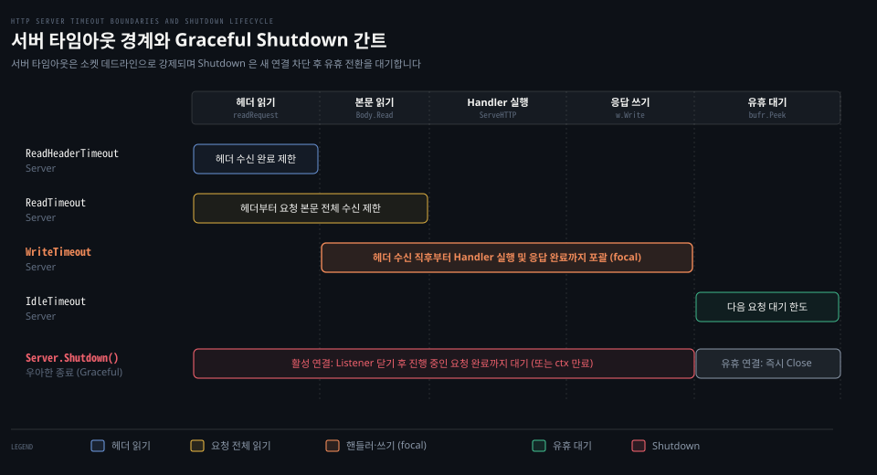

# Server 타임아웃·Shutdown

---

> Go HTTP 서버는 소켓 데드라인을 기반으로 요청 수명주기별 타임아웃을 강제하며 Shutdown 은 신규 수신을 닫고 활성 연결의 완료를 기다려 안전하게 프로세스를 종료합니다.

## 핵심 요약

> Server 의 4대 타임아웃(ReadHeaderTimeout·ReadTimeout·WriteTimeout·IdleTimeout)은 net 패키지의 소켓 데드라인 메커니즘 위에서 동작하며 비정상 클라이언트의 연결 점유를 방지합니다. 서비스 재배포나 중단 시에는 Shutdown 메서드를 통해 신규 연결 수락을 즉시 차단하고 유휴 소켓을 회수한 뒤 활성 트랜잭션이 완료될 때까지 안전하게 대기할 수 있습니다.

HTTP(HyperText Transfer Protocol) 서버는 외부의 지연과 악의적인 슬로우 공격(Slowloris)에 노출됩니다. 소켓 데드라인 기초는 [../net/03-02.SetDeadline·SetReadDeadline·SetWriteDeadline.md](../net/03-02.SetDeadline·SetReadDeadline·SetWriteDeadline.md) 편에서 다룹니다. 표준 라이브러리는 이 데드라인을 `server.go` 의 요청 생명주기에 맞춰 걸어 두었습니다.

서버를 내릴 때는 프로세스를 바로 강제 종료하지 않고 `Shutdown` 을 호출합니다. 리스너를 먼저 닫아 새 요청을 거부하고 유휴 연결을 정리한 뒤, 진행 중인 비즈니스 핸들러가 반환될 때까지 기다릴 수 있습니다.


## 학습 목표

> 이 편을 읽고 나면 아래 다섯 가지를 스스로 해낼 수 있습니다.

1. `Server` 의 4대 타임아웃 필드가 적용되는 프로토콜 구간과 기본값을 설명할 수 있습니다.
2. `server.go` 내부에서 `readRequest` 와 `conn.serve` 가 소켓 데드라인을 설정하고 해제하는 위치를 추적할 수 있습니다.
3. `WriteTimeout` 이 응답 전송 시간뿐 아니라 핸들러 연산 시간까지 덮는 원리를 설명할 수 있습니다.
4. `Server.Shutdown` 과 `Server.Close` 가 어떻게 다르게 동작하는지, `closeIdleConns` 루프가 어떻게 도는지 설명할 수 있습니다.
5. 클라이언트 소켓이 끊길 때 `Request.Context` 취소가 전파되는지 확인하고, 슬로우로리스 공격에 대응하는 타임아웃 전략을 세울 수 있습니다.


## 1. 서버 타임아웃은 연결 데드라인 위에 얹힌 계층적 방어선입니다

> HTTP 요청의 각 단계는 서로 다른 성격의 지연을 가지므로 세분화된 소켓 데드라인으로 방어해야 합니다.

아래 도식에는 HTTP 요청 하나의 처리 단계와 4대 타임아웃이 유효한 구간이 나옵니다. Graceful Shutdown 시점에 연결 상태마다 처리 방식이 어떻게 갈리는지도 함께 담았습니다.



네트워크 환경에서 타임아웃 하나만으로는 느린 헤더 전송 공격과 대용량 본문 업로드를 동시에 유연하게 다루기 어렵습니다. Go 는 헤더, 본문, 핸들러 연산, 유휴 대기 구간마다 시간 한도를 따로 나누었습니다.

### 공식 계약: Server 의 4대 타임아웃 필드 주석 전문

공식 문서 [Server](https://pkg.go.dev/net/http#Server) 구조체는 핵심 타임아웃 필드 4개의 계약을 자세히 명시합니다.

첫째는 요청 전체 읽기를 제어하는 [ReadTimeout](https://pkg.go.dev/net/http#Server) 입니다.

> "ReadTimeout is the maximum duration for reading the entire request, including the body. A zero or negative value means there will be no timeout."
>
> "Because ReadTimeout does not let Handlers make per-request decisions on each request body's acceptable deadline or upload rate, most users will prefer to use ReadHeaderTimeout. It is valid to use them both."
>
> — [net/http Server.ReadTimeout](https://pkg.go.dev/net/http#Server)

둘째는 헤더 수신 한도만을 규정하는 [ReadHeaderTimeout](https://pkg.go.dev/net/http#Server) 입니다.

> "ReadHeaderTimeout is the amount of time allowed to read request headers. The connection's read deadline is reset after reading the headers and the Handler can decide what is considered too slow for the body. If zero, the value of ReadTimeout is used. If negative, or if zero and ReadTimeout is zero or negative, there is no timeout."
>
> — [net/http Server.ReadHeaderTimeout](https://pkg.go.dev/net/http#Server)

셋째는 핸들러 실행과 응답 작성을 감싸는 [WriteTimeout](https://pkg.go.dev/net/http#Server) 입니다.

> "WriteTimeout is the maximum duration before timing out writes of the response. It is reset whenever a new request's header is read. Like ReadTimeout, it does not let Handlers make decisions on a per-request basis. A zero or negative value means there will be no timeout."
>
> — [net/http Server.WriteTimeout](https://pkg.go.dev/net/http#Server)

넷째는 Keep-Alive 유지 시간을 통제하는 [IdleTimeout](https://pkg.go.dev/net/http#Server) 입니다.

> "IdleTimeout is the maximum amount of time to wait for the next request when keep-alives are enabled. If zero, the value of ReadTimeout is used. If negative, or if zero and ReadTimeout is zero or negative, there is no timeout."
>
> — [net/http Server.IdleTimeout](https://pkg.go.dev/net/http#Server)

네 설정은 모두 [../net/03-02.SetDeadline·SetReadDeadline·SetWriteDeadline.md](../net/03-02.SetDeadline·SetReadDeadline·SetWriteDeadline.md) 편에서 살펴본 연결 데드라인(`SetReadDeadline`·`SetWriteDeadline`)을 조작하는 방식으로 동작합니다. Go 의 데드라인은 커널 소켓 옵션이 아니라 런타임 netpoller 의 타이머로 구현됩니다([`src/internal/poll/fd_poll_runtime.go:162`](https://github.com/golang/go/blob/go1.25.1/src/internal/poll/fd_poll_runtime.go#L162) 의 `runtime_pollSetDeadline`).

### 내부 동작: readRequest 의 SetReadDeadline 과 SetWriteDeadline 설정

`server.go` 내부에서 이 타임아웃들이 소켓에 적용되는 자리는 [`src/net/http/server.go:1011`](https://github.com/golang/go/blob/go1.25.1/src/net/http/server.go#L1011) 의 `c.readRequest` 메서드입니다.

```go
// src/net/http/server.go:1020
t0 := time.Now()
if d := c.server.readHeaderTimeout(); d > 0 {
    hdrDeadline = t0.Add(d)
}
if d := c.server.ReadTimeout; d > 0 {
    wholeReqDeadline = t0.Add(d)
}
c.rwc.SetReadDeadline(hdrDeadline)
if d := c.server.WriteTimeout; d > 0 {
    defer func() {
        c.rwc.SetWriteDeadline(time.Now().Add(d))
    }()
}
```

1. 헤더를 파싱하기 전에 `c.rwc.SetReadDeadline(hdrDeadline)` 을 걸어 헤더를 언제까지 다 받아야 하는지 정합니다.
2. 헤더 파싱이 끝나면 [`src/net/http/server.go:1086`](https://github.com/golang/go/blob/go1.25.1/src/net/http/server.go#L1086) 에서 `c.rwc.SetReadDeadline(wholeReqDeadline)` 으로 데드라인을 늘려 다시 잡습니다.
3. `readRequest` 가 반환할 때 `defer` 로 등록한 함수가 돌면서 `c.rwc.SetWriteDeadline(time.Now().Add(d))` 를 설정합니다.

`WriteTimeout` 은 헤더 읽기가 끝난 직후부터 시간을 재기 시작합니다. 그 뒤 `serverHandler.ServeHTTP` 가 실행되고 비즈니스 핸들러가 응답 바이트를 쓰는 과정 전체가 이 데드라인 안에서 일어납니다.

요청 처리가 끝나면 [`src/net/http/server.go:2116`](https://github.com/golang/go/blob/go1.25.1/src/net/http/server.go#L2116) 에서 `w.finishRequest()` 가 호출됩니다. 그 직후 [`src/net/http/server.go:2117`](https://github.com/golang/go/blob/go1.25.1/src/net/http/server.go#L2117) 에서 `conn.serve` 가 `c.rwc.SetWriteDeadline(time.Time{})` 으로 쓰기 데드라인을 초기화합니다. 이후 [`src/net/http/server.go:2135`](https://github.com/golang/go/blob/go1.25.1/src/net/http/server.go#L2135) 에서 `IdleTimeout` 이 있으면 `c.rwc.SetReadDeadline(time.Now().Add(d))` 를 걸고 다음 요청을 기다립니다.

### 함정·관찰: WriteTimeout 의 핸들러 포괄 범위와 ReadHeaderTimeout 누락

실무에서 가장 흔히 오해하는 지점은 `WriteTimeout` 의 적용 범위입니다. 이름만 보면 응답 바이트를 네트워크로 내보내는 시간만 잴 것처럼 보이지만, 실제로는 `readRequest` 가 반환한 직후부터 걸립니다. 핸들러가 복잡한 데이터베이스 조회로 시간을 끌면 응답을 아직 한 바이트도 쓰지 않았더라도 데드라인은 이미 지나 있습니다.

다만 데드라인이 지난다고 소켓이 그 순간 닫히지는 않습니다. 핸들러는 끝까지 실행됩니다. 만료 뒤 처음으로 소켓에 실제 쓰기가 일어날 때 그 쓰기가 실패하며 연결이 닫힙니다. go1.25.1 에서 `WriteTimeout` 을 500ms 로 두고 핸들러가 1500ms 잠든 뒤 쓰게 해 보았습니다. 핸들러 안 `w.Write` 는 버퍼에 쓰여 에러 없이 돌아왔고, 클라이언트는 500ms 가 아니라 핸들러가 반환한 1.5초 시점에 `EOF` 를 받았습니다. 그래서 `WriteTimeout` 은 응답을 끊을 뿐 핸들러 연산을 멈추지 않습니다.

또 다른 함정은 `ReadHeaderTimeout` 과 `ReadTimeout` 을 둘 다 0(기본값)으로 두는 경우입니다. 이때는 헤더 읽기에 시간 한도가 없어 느린 헤더 공격(Slowloris)에 그대로 노출됩니다.

`ReadTimeout` 만 설정하고 `ReadHeaderTimeout` 을 0 으로 두면 헤더 구간에도 `ReadTimeout` 이 적용되므로 헤더 공격은 막힙니다. 근거는 [`src/net/http/server.go:3643`](https://github.com/golang/go/blob/go1.25.1/src/net/http/server.go#L3643) 의 `readHeaderTimeout` 입니다. 이 경우의 단점은 다른 데 있습니다. 공식 문서가 경고하듯 `ReadTimeout` 은 본문까지 한 데드라인으로 묶어, 핸들러가 요청 본문 크기나 업로드 속도를 보고 데드라인을 따로 늘릴 기회를 주지 않습니다.

반면 `ReadHeaderTimeout` 만 걸어 두면 느린 헤더 공격은 원천 차단하고, 본문 읽기는 핸들러가 컨텍스트나 자체 타이머로 조절할 수 있습니다. 특별한 이유가 없다면 프로덕션 서버에는 반드시 `ReadHeaderTimeout` 을 명시적으로 설정해야 합니다.


## 2. Shutdown 은 새 연결을 차단하고 기존 연결의 유휴 전환을 대기합니다

> 서버 프로세스 종료 시에는 새 연결을 끊고 활성 트랜잭션이 안전하게 끝나도록 드레이닝해야 합니다.

SIGTERM(종료를 요청하는 시그널)을 받자마자 프로세스를 끝내면 진행 중이던 결제나 파일 쓰기 트랜잭션이 중간에 끊깁니다. Go 표준 라이브러리는 프로세스를 안전하게 전환하도록 `Shutdown` 메커니즘을 제공합니다.

### 공식 계약: Shutdown 과 Close 및 클라이언트 취소 전파

공식 문서 [Server.Shutdown](https://pkg.go.dev/net/http#Server.Shutdown) 은 우아한 종료 규약을 이렇게 정의합니다.

> "Shutdown gracefully shuts down the server without interrupting any active connections. Shutdown works by first closing all open listeners, then closing all idle connections, and then waiting indefinitely for connections to return to idle and then shut down. If the provided context expires before the shutdown is complete, Shutdown returns the context's error, otherwise it returns any error returned from closing the Server's underlying Listener(s)."
>
> "When Shutdown is called, Serve, ServeTLS, ListenAndServe, and ListenAndServeTLS immediately return ErrServerClosed. Make sure the program doesn't exit and waits instead for Shutdown to return."
>
> "Shutdown does not attempt to close nor wait for hijacked connections such as WebSockets. The caller of Shutdown should separately notify such long-lived connections of shutdown and wait for them to close, if desired. See Server.RegisterOnShutdown for a way to register shutdown notification functions."
>
> — [net/http Server.Shutdown](https://pkg.go.dev/net/http#Server.Shutdown)

반면 [Server.Close](https://pkg.go.dev/net/http#Server.Close) 는 기다리지 않고 소켓을 바로 닫습니다.

> "Close immediately closes all active net.Listeners and any connections in state StateNew, StateActive, or StateIdle. For a graceful shutdown, use Server.Shutdown."
>
> — [net/http Server.Close](https://pkg.go.dev/net/http#Server.Close)

종료 시점에 특정 자원을 해제하거나 하이재킹된 연결에 종료를 알리려면 [RegisterOnShutdown](https://pkg.go.dev/net/http#Server.RegisterOnShutdown) 을 사용합니다.

> "RegisterOnShutdown registers a function to call on Server.Shutdown. This can be used to gracefully shutdown connections that have undergone ALPN protocol upgrade or that have been hijacked. This function should start protocol-specific graceful shutdown, but should not wait for shutdown to complete."
>
> — [net/http Server.RegisterOnShutdown](https://pkg.go.dev/net/http#Server.RegisterOnShutdown)

정상 종료가 시작되면 서버를 돌리는 메서드들은 [ErrServerClosed](https://pkg.go.dev/net/http#ErrServerClosed) 센티널 에러를 반환합니다.

> "ErrServerClosed is returned by the Server.Serve, ServeTLS, ListenAndServe, and ListenAndServeTLS methods after a call to Server.Shutdown or Server.Close."
>
> — [net/http ErrServerClosed](https://pkg.go.dev/net/http#ErrServerClosed)

서버가 클라이언트 상태를 알아채는 핵심 수단은 [Request.Context](https://pkg.go.dev/net/http#Request.Context) 입니다.

> "For incoming server requests, the context is canceled when the client's connection closes, the request is canceled (with HTTP/2), or when the ServeHTTP method returns."
>
> — [net/http Request.Context](https://pkg.go.dev/net/http#Request.Context)

클라이언트가 응답을 다 받기 전에 연결을 끊으면 서버 핸들러가 쥐고 있는 `r.Context()` 가 취소됩니다. 다만 HTTP/1 에서 끊김을 알아채는 백그라운드 읽기는 요청 본문을 끝까지 읽은 뒤에야 시작합니다([`src/net/http/server.go:2095`](https://github.com/golang/go/blob/go1.25.1/src/net/http/server.go#L2095)).

go1.25.1 에서 본문 없는 GET 을 보낸 뒤 연결을 끊으면 컨텍스트가 바로 취소됐습니다. 반면 `Content-Length: 1000` 에 3바이트만 보내고 끊은 POST 는 핸들러가 본문을 읽지 않는 동안 2초가 지나도 취소되지 않았습니다. 취소 컨텍스트 활용법은 [Learning Go 14-02](../../../book/lgo_learning-go/14-02.%EC%B7%A8%EC%86%8C%ED%95%A0%20%EC%88%98%20%EC%9E%88%EB%8A%94%20context%20%EB%8A%94%20cancel%20%EC%9D%84%20%EA%BC%AD%20%EB%B6%80%EB%A5%B4%EA%B3%A0%20Done%20%EC%B1%84%EB%84%90%EB%A1%9C%20%EB%A9%88%EC%B6%94%EB%A9%B0%20Cause%20%EB%A1%9C%20%EC%9D%B4%EC%9C%A0%EB%A5%BC%20%EB%82%A8%EA%B9%81%EB%8B%88%EB%8B%A4.md) 편을 참고합니다.

### 내부 동작: closeListenersLocked 와 closeIdleConns 루프

우아한 종료의 실제 흐름은 [`src/net/http/server.go:3179`](https://github.com/golang/go/blob/go1.25.1/src/net/http/server.go#L3179) 의 `Server.Shutdown` 구현에 담겨 있습니다.

```go
// src/net/http/server.go:3180
s.inShutdown.Store(true)

s.mu.Lock()
lnerr := s.closeListenersLocked()
for _, f := range s.onShutdown {
	go f()
}
s.mu.Unlock()
s.listenerGroup.Wait()
```

1. `s.inShutdown` 원자적 플래그를 true 로 켜서 서버가 종료 중임을 기록합니다.
2. `s.closeListenersLocked()` 를 실행해 모든 `net.Listener` 를 닫습니다. 이 시점부터 새 TCP(Transmission Control Protocol) 연결 수락(`Accept`)은 곧바로 에러를 반환하고 멈춥니다.
3. 등록된 `onShutdown` 콜백을 각각 별도 고루틴으로 띄웁니다.

그다음 서버는 폴링 루프에 들어가 활성 연결이 유휴 상태로 내려오기를 기다립니다.

```go
// src/net/http/server.go:3204
for {
	if s.closeIdleConns() {
		return lnerr
	}
	select {
	case <-ctx.Done():
		return ctx.Err()
	case <-timer.C:
		timer.Reset(nextPollInterval())
	}
}
```

[`src/net/http/server.go:3230`](https://github.com/golang/go/blob/go1.25.1/src/net/http/server.go#L3230) 의 `s.closeIdleConns()` 메서드는 `s.activeConn` 맵 전체를 순회합니다.

- 상태가 `StateIdle` 인 연결은 보는 즉시 `c.rwc.Close()` 를 호출하고 맵에서 지웁니다. 첫 요청 헤더를 5초 넘게 받지 못한 `StateNew` 연결도 유휴로 보고 같이 닫습니다([`src/net/http/server.go:3239`](https://github.com/golang/go/blob/go1.25.1/src/net/http/server.go#L3239)).
- 상태가 `StateActive` 인 연결이 하나라도 남아 있으면 `quiescent` 플래그가 false 가 되어 루프가 계속 돕니다.
- 진행 중이던 핸들러가 반환되면 연결은 `StateIdle` 로 가지 않고 `conn.serve` 가 스스로 닫습니다. Shutdown 중에는 keep-alive 가 꺼져 응답에 `Connection: close` 가 붙습니다. 그 분기는 [`src/net/http/server.go:1389`](https://github.com/golang/go/blob/go1.25.1/src/net/http/server.go#L1389) 입니다. 그래서 `shouldReuseConnection` 이 false 가 되고 루프를 빠져나가 연결을 닫습니다. 그 지점은 [`src/net/http/server.go:2118`](https://github.com/golang/go/blob/go1.25.1/src/net/http/server.go#L2118) 입니다. go1.25.1 에서 Shutdown 도중 끝난 요청의 연결 상태는 `new → active → closed` 로 바뀌었고 idle 을 거치지 않았습니다. 닫힌 연결이 `activeConn` 에서 빠지면 다음 폴링 회차에서 `quiescent` 가 true 가 되어 `Shutdown` 이 반환됩니다.

### 함정·관찰: main 고루틴 조기 종료와 하이재킹 소켓 누수

`Shutdown` 을 쓸 때 가장 흔한 실수는 `ListenAndServe` 가 돌려준 에러를 장애로 보고 곧바로 프로세스를 끝내는 것입니다.

`Shutdown` 이 리스너를 닫는 순간 실행 중이던 `ListenAndServe` 는 바로 `ErrServerClosed` 를 반환하며 풀려납니다. 메인 고루틴이 이를 보고 `os.Exit(0)` 이나 로그 패닉으로 프로세스를 끝내 버리면, 진행 중이던 요청을 기다리려던 `Shutdown` 로직이 통째로 소용없어집니다. 메인 함수는 `errors.Is(err, http.ErrServerClosed)` 이면 정상 종료로 보고 `Shutdown` 이 반환될 때까지 끝까지 기다려야 합니다.

또 다른 주의점은 웹소켓처럼 소켓을 가로챈 하이재킹(`Hijacker`) 연결입니다. 공식 문서가 밝히듯 `Shutdown` 은 하이재킹된 소켓의 존재를 추적하거나 기다리지 못합니다. 웹소켓 같은 장기 연결은 `RegisterOnShutdown` 에 콜백을 등록해, 애플리케이션 계층에서 종료 프레임을 직접 보내고 소켓을 손수 닫아야 누수를 막을 수 있습니다.
