# 라우터는 안에서 무엇을 하는가

---

> 3장까지는 종단 시스템의 이야기였습니다. 이제 그 사이의 상자를 엽니다.

상자 안에서 벌어지는 일은 나노초 단위이고 그 상자를 조종하는 일은 초 단위입니다.

## 핵심 요약

> 이 편이 매달린 하나의 생각은 네트워크 층의 두 기능이 시간 척도가 다르고 그래서 구현 방식도 갈린다는 것입니다. 하나는 나노초의 하드웨어이고 다른 하나는 초의 소프트웨어입니다.

원문은 두 단어를 엄격하게 구별합니다. 많은 저자가 혼용하지만, 이 책은 둘을 분명히 가르겠다고 선언합니다.

| | 포워딩 | 라우팅 |
|---|---|---|
| 무엇 | 입력 링크 인터페이스에서 알맞은 출력 링크 인터페이스로 패킷을 옮기는 **라우터 내부의 행동** | 출발지에서 목적지까지의 경로를 정하는 **망 전체의 과정** |
| 시간 척도 | 보통 몇 나노초 | 보통 몇 초 |
| 구현 | 대개 하드웨어 | 대개 소프트웨어 |
| 어느 평면 | 데이터 평면 | 제어 평면 |

원문은 이 구분을 운전에 빗댑니다. 포워딩은 나들목 하나를 통과하는 일이고 라우팅은 펜실베이니아에서 플로리다까지의 여정을 계획하는 일입니다.

이 편의 나머지는 이 시간 척도의 차이에서 나옵니다. 100 Gbps 링크에 64바이트 데이터그램이 들어오면 다음 데이터그램이 오기까지 5.12 나노초뿐입니다. 소프트웨어로는 감당할 수 없기 때문에 입력 포트·스위칭 패브릭·출력 포트는 거의 언제나 하드웨어로 구현합니다.

그리고 이 편의 끝에 이 장 전체를 관통하는 추상이 하나 나옵니다. **일치 후 동작**입니다. 라우터도 스위치도 방화벽도 NAT도 전부 이 하나의 틀로 설명됩니다.


## 학습 목표

> 이 편을 읽고 나면 아래 다섯 가지를 스스로 해낼 수 있습니다.

1. 포워딩과 라우팅을 시간 척도와 범위로 구별할 수 있습니다.
2. 전통적 제어 평면과 SDN 제어 평면의 차이를 말할 수 있습니다.
3. 인터넷의 네트워크 서비스 모델이 무엇이고 무엇을 보장하지 않는지 답할 수 있습니다.
4. 라우터의 네 구성 요소와 각각의 역할을 설명할 수 있습니다.
5. 최장 접두 일치 규칙을 예를 들어 적용할 수 있습니다.

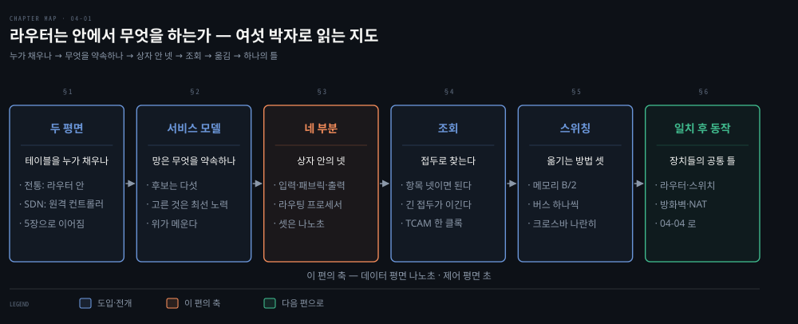

여섯 절이 한 줄로 이어집니다. 첫 절은 포워딩 테이블을 누가 채우는가를 묻습니다. 둘째 절은 망이 무엇을 약속하는지 확인합니다. 셋째부터 다섯째는 상자를 열어 네 부분·조회·스위칭을 봅니다. 마지막 절이 그 모든 장치를 한 틀로 읽는 추상에 닿습니다.

이 편에서 새로 만나는 낱말입니다. `어디서` 는 그 낱말이 실제로 설명되는 절입니다.

| 키워드 | 뜻 | 학습 포인트·연결 개념 | 어디서 |
|---|---|---|---|
| 포워딩 (forwarding) | 라우터 하나 안에서 출력 포트로 옮김 | 나노초 · 하드웨어 · 데이터 평면 | §1 |
| 라우팅 (routing) | 망 전체에서 경로를 정하는 과정 | 초 · 소프트웨어 · 제어 평면 | §1 |
| 데이터 평면 · 제어 평면 | 앞은 라우터 하나 안, 뒤는 망 전체 | SDN 은 제어 평면을 원격 컨트롤러로 뺌 | §1 |
| 최장 접두 일치 (LPM) | 겹치면 접두가 긴 쪽이 이김 | 예외 한 줄이 집약을 안 깨게 하는 규칙 | §4 |
| 스위칭 패브릭 | 입력 포트와 출력 포트를 잇는 속 | 메모리·버스·상호연결망 셋 | §3 |
| 일치 후 동작 (match-plus-action) | 무엇을 보고 무엇을 할지의 한 틀 | 라우터·스위치·방화벽·NAT 이 같은 틀 | §6 |


## 1. 두 평면

> 포워딩 테이블은 어디서 오는가. 이 물음의 답이 둘이고, 둘째 답이 이 장 끝의 일반화 포워딩까지 이어집니다.

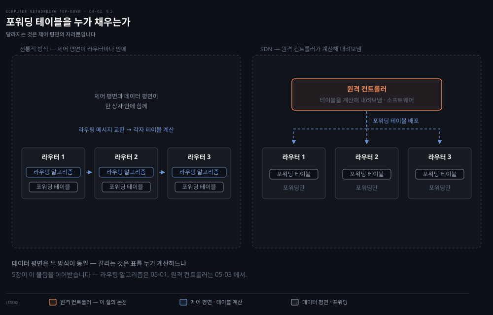

패킷이 들어왔을 때 어느 출력 포트로 내보내야 할까요? 이 결정을 내리는 기준표가 포워딩 테이블입니다. 그렇다면 이 표를 채우는 주체는 어디에 있을까요? 그 위치에 따라 네트워크는 두 가지 방식으로 나뉩니다. 도식의 왼쪽은 라우터마다 내부에서 계산하고, 오른쪽은 망 외부의 원격 컨트롤러 하나가 일괄 계산해 내려보냅니다. 아래 세 줄의 라우터가 수행하는 데이터 평면 작업은 양쪽이 같습니다.

### 전통적 방식

라우팅 알고리즘이 라우터마다 하나씩 돌면서 다른 라우터의 라우팅 알고리즘과 대화합니다. 대화의 수단은 라우팅 프로토콜에 따라 라우팅 정보를 담아 주고받는 **라우팅 메시지**입니다. 포워딩과 라우팅이 한 상자 안에 함께 있습니다.

원문은 이 구분을 선명하게 드러내고자 가상 상황을 하나 제시합니다. 모든 포워딩 테이블을 사람이 라우터 앞에 직접 가서 설정한다고 가정해 봅시다. 그러면 라우팅 프로토콜은 아예 필요 없습니다.

물론 사람끼리 서로 소통하여 패킷이 목적지에 올바르게 도달하도록 설정을 맞춰야 합니다. 하지만 사람이 직접 설정하면 실수가 잦고 망의 위상 변화에 기민하게 반응하기 어렵습니다. 그래서 실제로는 라우팅 프로토콜이 알아서 경로를 계산해 주는 편이 훨씬 안전하다고 원문은 덧붙입니다.

### SDN 방식

그런데 방금의 사고 실험에 힌트가 있습니다. 포워딩 테이블을 채우는 주체가 꼭 그 라우터 안에 있을 필요는 없습니다.

물리적으로 분리된 **원격 컨트롤러**가 망 안 모든 라우터의 포워딩 테이블을 계산해 내려보냅니다. 이 방식을 원문은 **SDN**(Software-Defined Networking, 소프트웨어로 정의하는 네트워킹)이라 부릅니다. 데이터 평면은 두 방식이 완전히 같습니다. 달라지는 것은 제어 평면뿐입니다. 라우팅 장치는 포워딩만 하고 원격 컨트롤러가 테이블을 계산해 배포합니다.

컨트롤러는 신뢰성과 이중화를 갖춘 원격 데이터센터에 둘 수 있습니다. 운영은 ISP가 할 수도 제삼자가 할 수도 있습니다.

이름의 뜻도 원문이 밝힙니다. 망이 소프트웨어로 정의된다고 하는 것은 컨트롤러가 소프트웨어로 구현되기 때문입니다. 그 컨트롤러가 포워딩 테이블을 계산하고 라우터와 대화합니다. 게다가 그 소프트웨어가 점점 오픈소스로 공개되고 있어서 리눅스 코드처럼 누구나 보고 수정할 수 있습니다.


## 2. 인터넷이 주는 서비스는 하나뿐입니다

> 네트워크 층이 줄 수 있었던 서비스는 여럿입니다. 인터넷이 고른 것은 그중 가장 적게 약속하는 것입니다.

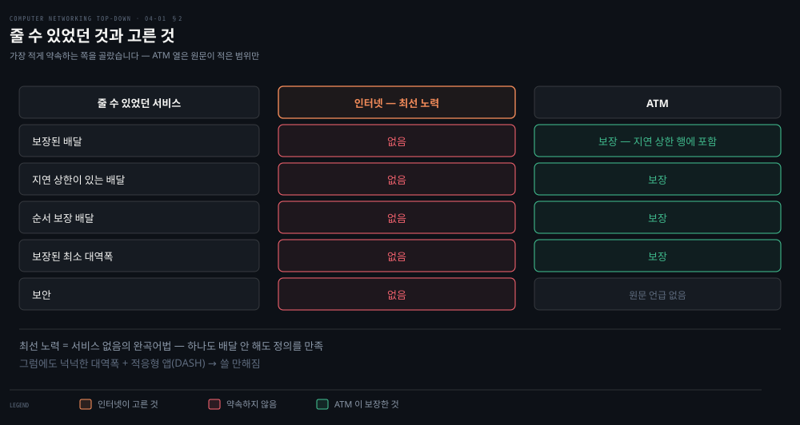

왼쪽 열은 네트워크 계층이 제공할 수 있었던 다섯 가지 서비스 후보이고, 가운데 인터넷 열은 전부 비어 있습니다. 아래에서 그 다섯을 하나씩 살펴본 뒤 인터넷이 왜 아무런 보장도 없는 빈 열을 택했는지 알아봅니다.

### 줄 수 있었던 것들

원문이 꼽는 가능한 서비스는 다섯입니다.

- **보장된 배달**: 출발지가 보낸 패킷이 결국 목적지에 도착합니다.
- **지연 상한이 있는 보장된 배달**: 도착할 뿐 아니라 정해진 시간 안에, 예컨대 100 밀리초 안에 도착합니다.
- **순서 보장 배달**: 보낸 순서대로 도착합니다.
- **보장된 최소 대역폭**: 정해진 비트율의 전송 링크를 흉내 냅니다. 그 아래로 보내는 한 모든 패킷이 결국 도착합니다.
- **보안**: 출발지에서 암호화하고 목적지에서 복호화합니다.

### 인터넷이 고른 것

인터넷의 네트워크 계층은 **최선 노력 서비스** 단 하나만 제공합니다. 패킷의 순서도, 배달 자체도 보장하지 않으며 지연 상한이나 최소 대역폭도 약속하지 않습니다.

원문은 이 서비스 모델의 허점을 다음과 같이 역설적으로 꼬집습니다.

> 최선 노력 서비스가 서비스가 없다는 말의 완곡어법처럼 보일 수 있습니다. 목적지에 패킷을 하나도 배달하지 않는 망도 최선 노력 배달 서비스의 정의를 만족하기 때문입니다.

- 대안이 없었던 것도 아닙니다. **ATM**(Asynchronous Transfer Mode, 비동기 전송 모드)은 순서·지연 상한·최소 대역폭을 보장했고, 인터넷 진영에서도 Intserv 같은 확장 제안이 있었습니다.
- 하지만 실제 역사는 다르게 전개되었습니다. 잘 설계된 대안들이 존재했음에도, 넉넉한 대역폭 확보와 대역폭 적응형 애플리케이션 프로토콜을 결합한 최선 노력 서비스 조합이 실무에서 충분히 훌륭하게 작동한다는 사실이 증명되었습니다. 원문이 예로 든 적응형 프로토콜이 바로 [02-04](./02-04.영상은%20어떻게%20끊기지%20않는가.md)의 DASH입니다.

> **노트의 읽기**: 이 대목이 2장에서 본 사실과 짝을 이룹니다. [02-01](./02-01.앱은%20무엇을%20고르고%20무엇을%20못%20고르는가.md) §3 에서 인터넷은 처리량 보장도 타이밍 보장도 주지 않는다고 했고, 그 자리에서 부족한 것을 애플리케이션이 스스로 메웁니다.
>
> 4장은 같은 사실을 아래층에서 다시 말합니다. 아래가 적게 약속했기 때문에 위가 많이 만들어야 했고, 결과적으로 위가 유연해졌습니다. 보장을 주는 망을 골랐다면 DASH 처럼 위에서 속도를 맞추는 장치가 덜 필요했겠지만, 대신 새 응용이 나올 때마다 망을 고쳐야 했을 것입니다.


## 3. 라우터의 네 부분

> 상자를 엽니다. 안에 네 덩어리가 있고, 그중 셋은 하드웨어이며 하나만 소프트웨어입니다.

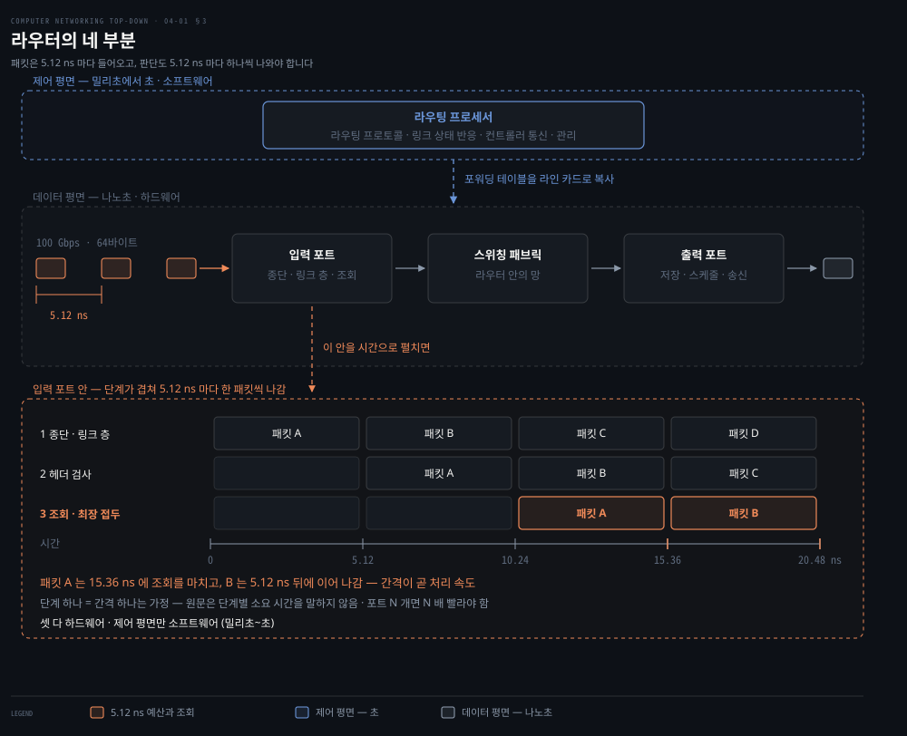

위쪽 점선 영역이 제어 평면이고 가운데가 데이터 평면입니다. 왼쪽 링크 위에 패킷이 연달아 들어오는데, 패킷 사이의 간격이 곧 입력 포트에 주어진 처리 시간 예산입니다. 아래 칸은 입력 포트 내부의 처리 단계를 시간축으로 펼친 모습입니다. 원문은 입력 포트가 다음 데이터그램이 도착하기 전인 5.12 나노초 안에 처리를 끝내야 한다고 설명합니다. 다만 이 예산은 패킷 하나가 전체를 통과하는 데 걸리는 지연 시간이 아니라, 5.12 나노초마다 패킷 하나씩 배출해야 하는 처리 속도(Throughput) 기준이라는 점을 아래에서 자세히 살펴봅니다.

- **입력 포트**: 물리 계층 종단과 링크 계층 처리를 수행하며, 가장 핵심적으로 목적지 조회를 담당합니다. 포워딩 테이블을 검색해 이 패킷이 나갈 출력 포트를 결정하고, 라우팅 프로토콜 정보를 나르는 제어 패킷은 라우팅 프로세서로 전달합니다.
- **스위칭 패브릭**: 입력 포트와 출력 포트를 물리적으로 연결합니다. 원문 표현을 빌리면 '라우터 내부의 네트워크'입니다.
- **출력 포트**: 스위칭 패브릭에서 건너온 패킷을 버퍼에 저장했다가 출력 링크로 내보냅니다. 링크가 양방향이면 보통 동일한 라인 카드 안에서 입력 포트와 한 쌍을 이룹니다.
- **라우팅 프로세서**: 제어 평면 기능을 전담합니다. 전통적 라우터에서는 라우팅 프로토콜을 실행하고 포워딩 테이블을 계산합니다. SDN 라우터에서는 원격 컨트롤러와 통신해 전달받은 테이블 항목을 입력 포트에 심어 줍니다.

원문은 용어 혼동을 막기 위해 짚고 넘어갑니다. 여기서의 포트는 물리적인 입출력 인터페이스를 가리키며, 2·3장에서 다룬 소켓의 논리적 소프트웨어 포트와는 완전히 다릅니다.

덧붙이자면, 4장의 일반화 포워딩에서는 둘을 한 표에서 함께 다룹니다. 따라서 이 문서에서는 물리적 연결 지점을 '입력 포트'·'출력 포트'로, 소프트웨어 식별자를 '포트 번호'로 명확히 구별합니다.

### 왜 하드웨어여야 하나

이유는 숫자 하나로 충분합니다. 100 Gbps 입력 링크에 64바이트 IP 데이터그램이면 다음 데이터그램이 오기까지 5.12 나노초뿐입니다.

```python
64 * 8 / 100e9 * 1e9      # 5.12    나노초 — 다음 데이터그램까지의 간격
1 / 3e9 * 1e9             # 0.333   나노초 — 3 GHz 로 잡은 CPU 의 클록 하나
5.12 / (1 / 3e9 * 1e9)    # 15.36   클록   — 예산 안에 쓸 수 있는 전부
```

둘째 줄의 3 GHz는 원문에 나온 수치가 아니라 최신 서버 CPU를 넉넉하게 가정한 값입니다. 그렇게 높게 잡아도 가용 시간 예산 전체가 15클록 남짓에 불과합니다. 함수 하나를 호출하고 반환받는 데 전부 소진되는 짧은 시간입니다. 여러 포트를 한 기판에 얹은 **라인 카드**에 포트 N개가 묶여 있다면 파이프라인이 N배 빨라져야 하므로, 포트당 가용 시간 예산은 다시 N분의 1로 줄어듭니다.

소프트웨어로 처리하면 어떻게 되는지는 이 편 뒤에서 두 번 확인됩니다.

- **§5 의 메모리 교환 방식**이 바로 그 시도였습니다. 패킷마다 인터럽트로 프로세서를 호출하고, 패킷을 메모리에 한 번 썼다가 다시 읽어 출력 포트로 옮깁니다. 패킷마다 메모리에 두 번 접근하므로 전체 포워딩 처리량이 메모리 대역폭의 절반 이하로 제한됩니다.
- **§4 의 조회**도 마찬가지입니다. 일반 메모리에 담긴 접두 표를 처음부터 하나씩 순차 검색하면 항목마다 최소 1클록이 소요됩니다. 항목이 100만 개라면 필요한 클록도 100만 번이어서, 15클록이라는 시간 예산과 자릿수가 5개나 어긋납니다.
- 실제 소프트웨어 기반 조회는 그렇게 훑지 않고 트라이(Trie)라는 트리 구조로 접두를 한 비트씩 따라 내려갑니다. 32비트 주소면 최악의 경우 32번 메모리에 접근합니다[^gupta-trie]. 단계를 겹치면 메모리 접근 한 번마다 조회 결과 하나를 낼 수 있지만, 그러려면 32단 파이프라인이 필요합니다. 원문도 이러한 알고리즘 방식이 실무에 쓰인다고 적습니다.

하드웨어가 빠른 비결은 단순히 동작 클록이 높아서가 아니라, 작업을 순차적으로 처리하지 않는다는 점에 있습니다. §4에서 살펴볼 TCAM은 내용으로 검색하는 특수 메모리입니다. 모든 항목이 동시에 일치 여부를 비교하므로 항목 수가 늘어나도 단 1클록에 검색이 끝납니다.

또한 파이프라인은 앞 패킷의 조회가 끝나기를 기다리지 않고 단계마다 서로 다른 패킷을 물고 처리합니다. 따라서 패킷 하나가 전체 파이프라인을 통과하는 시간은 5.12 나노초를 넘길 수 있어도, 파이프라인 덕분에 5.12 나노초마다 패킷을 하나씩 연속으로 내보낼 수 있습니다. 앞 도식의 아래 칸이 바로 이 중첩 처리를 그린 것입니다. 패킷 A가 조회 단계에 있을 때 패킷 B는 헤더를 검사하고, 패킷 C는 물리 계층 종단을 거칩니다.

### 제어 기능은 초 단위라서 소프트웨어로 됩니다

같은 상자 안에 있으면서도 라우팅 프로세서만 소프트웨어로 동작하는 이유는, 그쪽이 맡은 일이 실시간 패킷 전송이 아니라 망의 상태를 관리하는 작업이기 때문입니다. 원문이 제시하는 작업은 다음 네 가지입니다.

- **라우팅 프로토콜 실행**: 이웃 라우터와 라우팅 메시지를 주고받고 그 결과로 포워딩 테이블을 다시 계산합니다. 어떤 프로토콜이 어떻게 계산하는지는 5장에서 자세히 다룹니다.
- **링크 상태 변화(Up/Down) 대응**: 인터페이스 하나가 다운되면 그 링크를 지나는 경로를 표에서 제외하고 다시 계산해 각 라인 카드로 내려보냅니다.
- **원격 컨트롤러와의 통신**: SDN 환경이라면 표를 직접 계산하지 않고 컨트롤러가 보낸 항목을 받아 입력 포트에 심어 줍니다.
- **관리 기능**: 설정을 변경하고 성능 계수기를 읽으며 장비 상태를 모니터링해 보고합니다.

네 작업 모두 패킷이 도착할 때마다 일어나는 일이 아니라 망의 상태가 변경될 때 일어나는 일입니다. 링크가 끊기는 사건은 초 단위로 일어납니다. 프로세서가 표를 다시 계산하는 동안에도 입력 링크로 밀려드는 패킷들은 라인 카드에 미리 복사된 포워딩 테이블로 막힘없이 처리됩니다. 따라서 제어 평면은 반응이 몇 밀리초 정도 늦어져도 전체 네트워크가 무너지지 않습니다.

두 시간 척도가 얼마나 벌어져 있는지 비교해 보면, 1밀리초는 5.12 나노초의 약 20만 배에 이릅니다. 같은 상자 안에 들어 있어도 하드웨어와 소프트웨어로 구현 방식이 나뉠 수밖에 없는 압도적인 시간 격차입니다.

```python
1e-3 / 5.12e-9            # 195312.5  배 — 밀리초 하나가 5.12 ns 의 몇 배인가
```

### 회전교차로 비유

원문이 이 장 내내 사용하는 비유를 여기서 짚고 넘어갑니다. 차가 고속도로 진입소에 서서 최종 목적지를 말하면 안내원이 나갈 나들목(램프)을 알려 주는 모습에 빗댑니다.

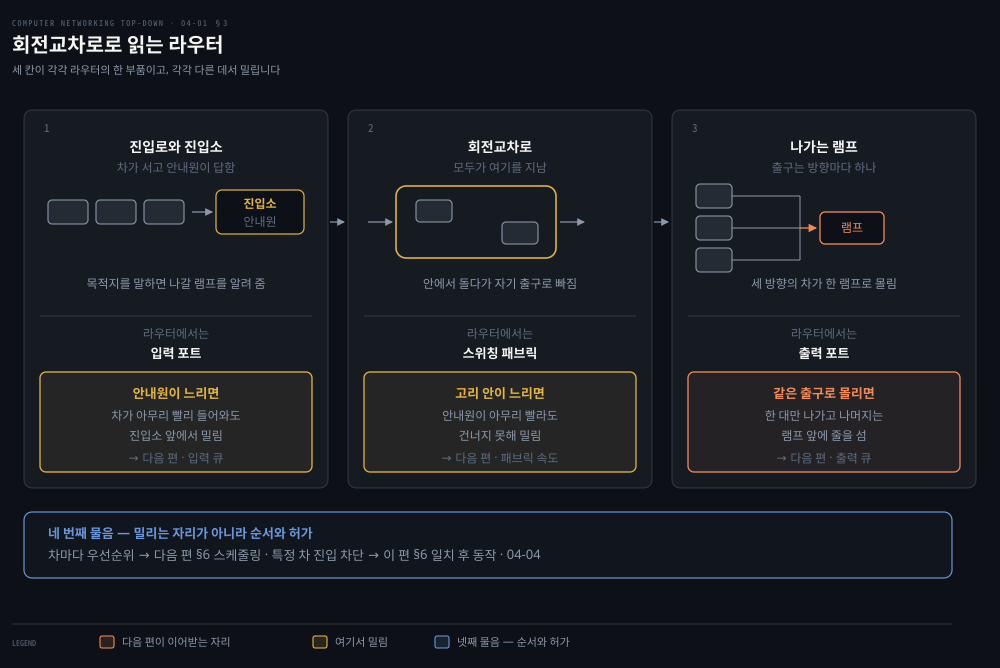

비유가 유용한 이유는 각 요소의 일대일 대응 때문만이 아니라, 병목이 생길 위치를 직관적으로 질문하게 만들기 때문입니다. 도식의 세 칸 아래에 붙은 물음들이 바로 원문이 던지는 핵심 질문입니다. 세 물음 모두 다음 편의 큐잉 이야기로 자연스럽게 이어집니다.

아래 띠의 넷째 물음은 줄이 어디서 길어지느냐가 아니라 누구를 먼저 보내고 누구를 차단할 것인가입니다. 원문은 차마다 통행 우선순위를 매기는 일과 특정 차량의 진입을 막는 일을 함께 묻습니다. 우선순위 처리는 다음 편 §6의 패킷 스케줄링에서 다루고, 진입 차단은 이 편 끝의 '일치 후 동작'과 04-04의 일반화 포워딩으로 이어집니다.


## 4. 조회 — 최장 접두 일치

> 32비트 주소마다 항목을 하나씩 두면 40억 개가 넘습니다. 그래서 주소가 아니라 접두를 봅니다.

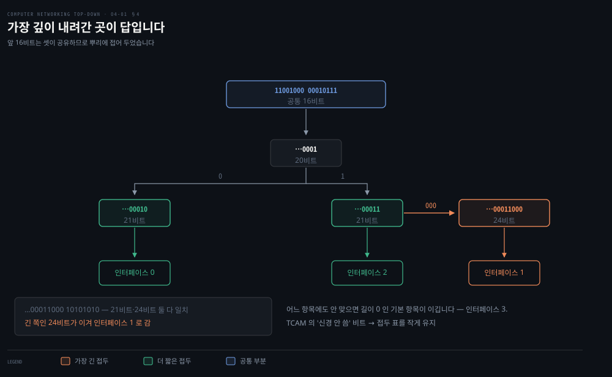

### 접두로 줄입니다

원문의 예제를 그대로 살펴보겠습니다. 라우터에 링크 인터페이스가 4개 있고 주소 범위가 다음과 같이 배정되어 있습니다.

| 목적지 주소 범위 | 링크 인터페이스 |
|---|---|
| `11001000 00010111 00010000 00000000` ~ `11001000 00010111 00010111 11111111` | 0 |
| `11001000 00010111 00011000 00000000` ~ `11001000 00010111 00011000 11111111` | 1 |
| `11001000 00010111 00011001 00000000` ~ `11001000 00010111 00011111 11111111` | 2 |
| 그 밖의 모든 주소 | 3 |

40억 개가 아니라 네 항목이면 충분합니다.

| 접두 | 링크 인터페이스 |
|---|---|
| `11001000 00010111 00010` | 0 |
| `11001000 00010111 00011000` | 1 |
| `11001000 00010111 00011` | 2 |
| 그 밖 | 3 |

### 겹치면 긴 쪽이 이깁니다

여기서 원문이 중요하게 짚는 세부사항이 등장합니다. 하나의 목적지 주소가 표의 여러 항목과 동시에 일치할 수 있다는 점입니다.

예컨대 `11001000 00010111 00011000 10101010`을 보면 앞 24비트가 둘째 항목에 일치하고, 앞 21비트가 셋째 항목에도 일치합니다. 이럴 때 라우터는 **최장 접두 일치** 규칙을 적용합니다. 가장 길게 일치하는 접두 항목을 찾아 해당 인터페이스로 패킷을 보냅니다.

표와 예제의 동작을 아래 파이썬 코드로 검증했습니다. 실행해 보면 원문의 매핑 결과와 정확히 일치합니다.

```python
table = [("11001000 00010111 00010", 0),
         ("11001000 00010111 00011000", 1),
         ("11001000 00010111 00011", 2)]

def lpm(addr):
    a = addr.replace(" ", "")
    hits = [(len(p.replace(" ", "")), link) for p, link in table
            if a.startswith(p.replace(" ", ""))]
    return max(hits) if hits else (0, 3)   # 맞는 항목이 없으면 기본 인터페이스 3

for addr in ["11001000 00010111 00010110 10100001",
             "11001000 00010111 00011000 10101010",
             "11001000 00010111 00011001 00000001",
             "11001000 00010111 00100000 00000001"]:
    print(addr, "→", lpm(addr))
# 11001000 00010111 00010110 10100001 → (21, 0)
# 11001000 00010111 00011000 10101010 → (24, 1)
# 11001000 00010111 00011001 00000001 → (21, 2)
# 11001000 00010111 00100000 00000001 → (0, 3)
```

- 주소 범위 표와 접두 표의 일치 여부도 확인했습니다. 세 범위의 공통 접두 길이는 각각 21비트, 24비트, 21비트입니다.
- 다만 셋째 범위는 21비트 접두가 포괄하는 `00011000`~`00011111`에서 둘째 줄의 `00011000`을 제외한 것입니다. 이 예외 처리를 최장 접두 일치가 자연스럽게 해결해 주기 때문에 두 표가 동등해집니다.

### 나노초 안에 찾으려면

개념은 단순하지만 속도가 관건입니다. 앞서 살펴본 5.12 나노초 안에 이 조회를 끝내야 합니다.

따라서 조회에 사용하는 포워딩 테이블은 입력 포트와 가장 가까운 하드웨어에 복사해 둡니다. 이 표는 라우팅 프로세서가 계산하거나 SDN 컨트롤러로부터 수신합니다. 원문은 이 표를 별도 버스(예: PCI 버스)를 통해 라인 카드마다 복사해 둔다고 설명합니다. 이 복사본을 **그림자 사본(shadow copy)**이라 부릅니다. 덕분에 입력 포트는 패킷이 올 때마다 중앙 라우팅 프로세서를 호출하지 않고 라인 카드 제자리에서 즉각 포워딩을 판단합니다.

실무 라우터에서 널리 활용하는 부품이 바로 **TCAM**(Ternary Content Addressable Memory, 3원 연관 메모리)입니다. 32비트 주소를 TCAM에 입력하면 단 1클록 사이클 만에 일치하는 포워딩 테이블 항목의 내용을 찾아냅니다.

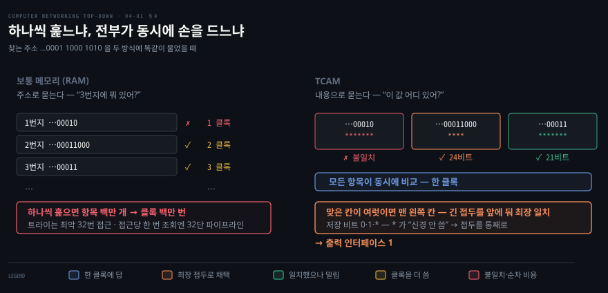

왼쪽은 일반 메모리입니다. 주소로 한 칸씩 읽어가며 접두와 비교하기를 처음부터 반복하면, 항목이 100만 개일 때 클록도 100만 번 소요됩니다. 오른쪽은 TCAM이며 탐색 방향이 반대입니다. 찾으려는 주소 값을 입력하면 모든 메모리 셀이 동시에 자기 항목과 일치하는지 비교합니다. 순차적으로 검색하지 않기 때문에 단 1클록에 조회가 끝납니다.

TCAM이 스스로 접두 길이를 재서 가장 긴 쪽을 직접 골라내는 것은 아닙니다. 일치하는 항목이 여럿이면 우선순위 인코더(Priority Encoder) 회로가 가장 낮은 메모리 주소, 즉 맨 위쪽 칸을 선택합니다.[^cam-priority] 따라서 길이가 긴 접두를 위쪽 주소에 미리 정렬해 두어야 우선순위 인코더의 선택 결과가 곧 최장 접두 일치가 됩니다. 도식에서는 칸을 가로로 배치했으므로 일치한 칸 중 맨 왼쪽이 그 자리에 해당합니다.

이름에 들어간 '삼진(Ternary)'이 핵심입니다. 일반 메모리는 0과 1 두 상태만 저장합니다. 반면 TCAM의 접두 비트는 0, 1, 그리고 '신경 안 씀(Don't Care, `*`)' 세 상태를 가질 수 있습니다. 조회할 주소는 0과 1로만 들어옵니다. 와일드카드 역할을 하는 `*` 비트 덕분에 거대한 주소 범위를 단 하나의 접두 항목으로 묶어 표를 작게 유지할 수 있습니다.

> **노트의 읽기**: 원문 문장은 조회하는 주소 쪽이 0·1·`*` 를 가질 수 있다고 적습니다. TCAM 은 검색어 쪽 비트도 가릴 수 있어서 그 문장도 성립합니다[^cam-ternary]. 다만 표를 작게 만드는 `*` 는 저장된 접두 쪽에 있으므로 이 노트는 저장 쪽으로 읽습니다.

물론 대가도 따릅니다. TCAM은 일반 메모리보다 가격이 비싸고 전력 소모와 발열이 큽니다. 그래서 원문은 정적 RAM(SRAM)과 결합한 혼합 방식이 꾸준히 제안되어 왔다고 설명합니다. 아울러 순수 알고리즘 기반의 트리 탐색 방식 역시 실무에서 널리 쓰인다고 덧붙입니다.

### 조회 말고도 하는 일

원문이 제시하는 입력 포트의 부가 작업은 조회 외에 세 가지입니다.

1. 물리 계층과 링크 계층 프로토콜 처리
2. 패킷 헤더의 버전 번호·체크섬·TTL(Time to Live) 필드 검사 및 TTL 감소에 따른 체크섬 재기록
3. 네트워크 관리용 성능 계수기(카운터) 갱신


## 5. 스위칭 — 세 가지 방식

> 입력에서 출력으로 실제로 옮기는 방법이 셋입니다. 셋이 각각 다른 자리에서 막힙니다.

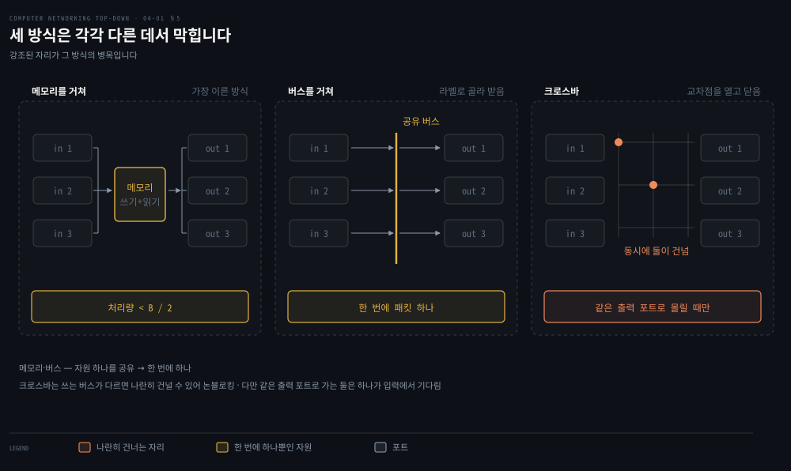

입력 포트에서 목적지를 찾은 패킷을 알맞은 출력 포트로 어떻게 빠르게 이동시킬 것인가? 이 물리적 통로가 바로 스위칭 패브릭입니다. 구현 방식은 크게 메모리, 버스, 상호연결망 세 가지로 나뉘며, 감당할 수 있는 대역폭의 한계는 '어떤 자원을 여러 포트가 공유하느냐'에서 비롯됩니다. 도식에서 강조된 자리가 바로 각 방식의 병목 자원입니다. 아래에서 방식마다 동작 순서와 장단점을 하나씩 살펴봅니다.

### 메모리를 거쳐

가장 단순하고 초기 라우터에서 사용하던 방식입니다. 초기 라우터는 일반 컴퓨터였고 입출력 포트는 운영체제의 I/O 장치처럼 동작했습니다. 패킷이 도착하면 입력 포트가 인터럽트로 라우팅 프로세서를 호출합니다. 프로세서는 패킷을 시스템 메모리로 복사해 포워딩 테이블을 조회한 뒤, 알맞은 출력 포트 버퍼로 다시 복사합니다.

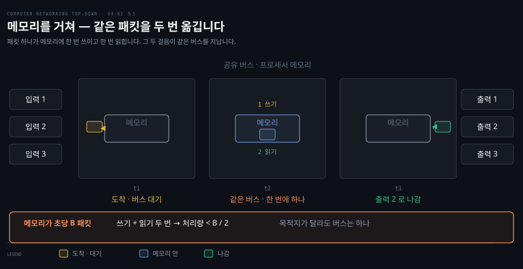

한계가 명확한 이유는 두 작업이 동일한 메모리를 공유하기 때문입니다. 메모리가 초당 B개의 패킷을 읽거나 쓸 수 있는 대역폭을 갖추었더라도, 패킷마다 쓰기 한 번과 읽기 한 번이 필요하므로 전체 포워딩 처리량은 `B/2` 이하로 제한됩니다. 게다가 공유 버스를 통해 한 번에 하나의 메모리 접근만 가능하므로 목적지가 서로 다르더라도 두 패킷을 동시에 전송할 수 없습니다.

현대 라우터 중에도 메모리 스위칭 방식을 쓰는 장비가 있지만 중요한 차이가 있습니다. 목적지 조회와 버퍼 저장을 각 라인 카드에서 직접 처리합니다. 패킷마다 중앙 프로세서를 호출하는 과정이 생략된 것입니다. 다만 원문은 이것만으로 위 도식의 공유 버스 대역폭 한계까지 해결된다고 보지는 않습니다.

### 버스를 거쳐

입력 포트가 라우팅 프로세서나 시스템 메모리를 거치지 않고, 공유 버스를 통해 출력 포트로 패킷을 직접 전달합니다. 동작 방식은 단순합니다. 입력 포트가 스위치 내부용 라벨(태그)을 패킷 앞에 붙여 버스에 실으면, 버스에 연결된 모든 출력 포트가 패킷을 수신하되 자신의 라벨과 일치하는 포트만 패킷을 버퍼에 보관합니다. 내부 라벨은 버스를 건너는 데만 필요하므로 출력 포트에서 제거됩니다.

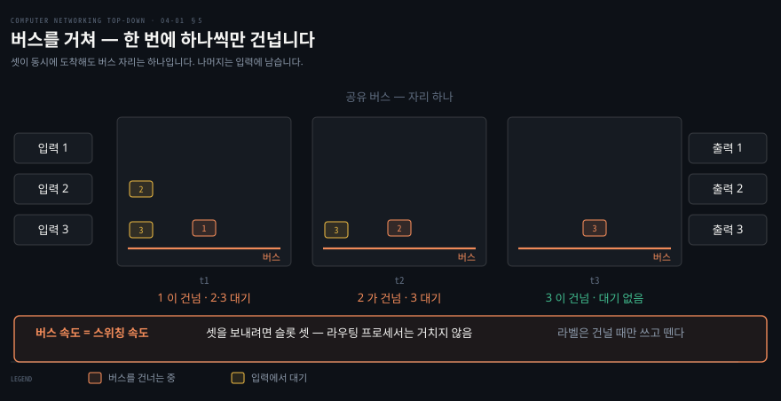

여기서 버스는 데이터를 저장하는 기억 장치가 아닙니다. RAM과 디스크가 데이터를 보관하는 부품이라면, 버스는 그 부품들이 함께 물려 있는 물리적 배선 다발입니다. 버스의 역할은 저장이 아니라 전송이므로 배선 위로는 전기 신호가 지나갈 뿐 데이터가 머무르지 않습니다. 메모리 방식이 패킷을 한 번 기록했다가 다시 읽는 두 단계였다면, 버스 방식은 그 기록 단계를 없애고 배선 통로만 남긴 것입니다.

한계는 분명합니다. 한 번에 패킷 하나만 버스를 건널 수 있으므로 라우터의 전체 스위칭 속도가 버스 대역폭에 종속됩니다. 회전교차로에 빗대면 한 번에 차량 한 대만 통과할 수 있는 1차로 회전교차로와 같습니다. 도식에서 입력 포트 2와 3이 자기 전송 차례를 대기하는 모습이 바로 이 병목의 대가입니다.

### 상호연결망을 거쳐

**크로스바 스위치**는 N개의 입력 버스와 N개의 출력 버스를 교차시킨 2N개의 배선으로 이루어집니다. 가로 배선과 세로 배선이 만나는 지점이 바로 **교차점(crosspoint)**이며, 패브릭 컨트롤러가 이 교차점 스위치를 열고 닫아 신호를 제어합니다.

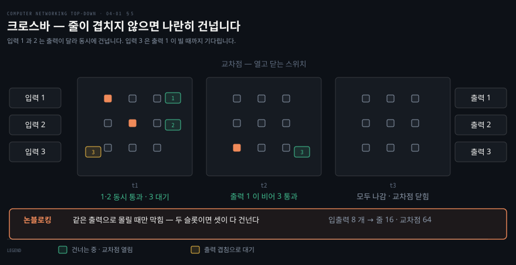

도식은 그 교차점을 입력 포트와 출력 포트의 격자 조합표로 펼친 것입니다. 닫힌(연결된) 교차점이 둘인데 서로 사용하는 배선이 겹치지 않아 두 패킷이 나란히 건너며, 세 번째 입력 포트만 이미 사용 중인 출력 포트를 기다립니다.

A에서 Y로 패킷을 보내려면 A 버스와 Y 버스의 교차점 스위치를 닫아(연결하여) 회로를 잇습니다. 이때 B에서 X로 향하는 패킷은 서로 다른 배선과 교차점을 사용하므로 동시에 전송할 수 있습니다. 앞의 메모리나 단일 버스 방식과 달리 여러 패킷을 병렬로 전송할 수 있습니다.

산수를 해 보면 앞선 방식들과의 결정적 차이가 드러납니다. 입력이 N개, 출력이 N개면 가로 버스 N줄과 세로 버스 N줄이 놓여 총 2N줄의 배선이 필요합니다. 가로줄과 세로줄이 만나는 교차점의 수는 N × N = N² 곳입니다. 입력과 출력이 각각 8개라면 배선은 16개이고 교차점은 64개에 이릅니다. 원문은 2N개의 버스 배선까지만 명시하며, 교차점의 수는 기하학적 정의에서 자연스럽게 도출됩니다.

이름은 똑같이 버스이지만 앞선 공유 버스 방식과의 결정적 차이는 단순히 배선 수가 많다는 데 있지 않습니다. 배선마다 전용 주인이 정해져 있다는 점입니다. 공유 버스는 단 하나의 배선을 모든 포트가 번갈아 사용하므로 누군가 쓰는 동안 나머지는 대기해야 합니다. 반면 크로스바는 입력과 출력마다 독립된 전용 배선이 있고 그 사이를 교차점이 연결합니다. 따라서 A에서 Y로 가는 패킷과 B에서 X로 가는 패킷이 서로 다른 배선 4개와 교차점 2곳을 사용하며 동시에 전송됩니다.

교차점의 수 역시 같은 기하학적 구조에서 도출됩니다. 배선 수는 2N으로 선형 증가하지만 교차점 수는 N²으로 증가하므로, 포트 수를 두 배로 늘리면 필요한 교차점은 네 배가 됩니다.

크로스바는 원칙적으로 **논블로킹(non-blocking)**입니다. 다만 전제 조건이 붙습니다. 서로 다른 입력 포트에서 들어온 패킷들이 동시에 동일한 출력 포트로 향하지 않아야 합니다. 두 입력 포트의 패킷이 같은 출력 포트로 몰리면, 어느 하나는 입력 측에서 전송을 기다려야 합니다.

| 방식 | 강점 | 어디에서 막히나 | 상한 |
|---|---|---|---|
| 메모리 | 별도 패브릭 하드웨어가 필요 없음 | 메모리 대역폭 | `B/2` |
| 버스 | 프로세서와 메모리 왕복 과정을 생략 | 버스 전송 속도 | 한 번에 패킷 하나 |
| 크로스바 | 여러 포트 쌍이 병렬로 전송 가능 | 동일 출력 포트로 트래픽이 몰릴 때 | 출력 포트당 하나 |

더 정교한 상호연결망은 여러 단계의 다단 스위칭 소자(Multistage Switch)를 활용하여, 서로 다른 입력에서 들어온 패킷들이 동일한 출력 포트로 동시에 나아갈 수 있도록 지원합니다. 패브릭 자체를 여러 개 병렬로 가동하여 용량을 확장하기도 합니다. 입력 포트가 패킷을 K개의 작은 조각(Cell)으로 쪼개어 여러 패브릭에 고루 분산 전송하고, 출력 포트에서 이를 다시 온전한 패킷으로 재조립하는 방식입니다.


## 6. 일치 후 동작 — 이 장의 추상

> 라우터와 스위치와 방화벽과 NAT는 하는 일이 제각각입니다. 그런데 만드는 쪽에서 보면 같은 틀 위에 얹힙니다.

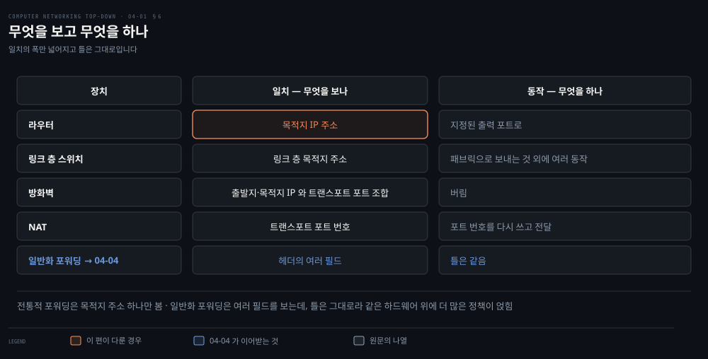

행마다 장치 하나를 배치했고 열은 단 둘뿐입니다. 무엇을 검사하는가, 그리고 어떤 동작을 취하는가. 도식의 다섯 번째 행은 원문의 분류에는 없는 행이지만, 04-04(일반화 포워딩)와의 연결을 위해 미리 배치한 행입니다.

서로 다른 네트워크 장비들을 어떻게 동일한 하드웨어 구조 위에 구현할 수 있을까요? 원문은 절을 마무리하며 명쾌한 답을 제시합니다. 목적지 IP 주소를 조회하고(일치) 지정된 출력 포트로 패킷을 전송하는(동작) 과정은, 라우터뿐만 아니라 현대의 수많은 네트워크 장치에서 수행되는 더 일반적인 설계 추상의 특수한 한 사례에 불과합니다.

원문이 동일한 틀로 바라보는 네트워크 장치들은 다음과 같습니다.

| 장치 | 일치 | 동작 |
|---|---|---|
| 라우터 | 목적지 IP 주소 | 지정된 출력 포트로 전달 |
| 링크 층 스위치 | 링크 층 목적지 주소 | 패브릭으로 보내는 것 외에 여러 동작 |
| 방화벽 | 출발지·목적지 IP와 트랜스포트 포트의 조합 | 패킷 폐기(Drop) 또는 허용 |
| NAT | 트랜스포트 포트 번호 | 포트 번호 재기록 및 전달 |

원문의 표현을 빌리면 이 추상은 오늘날의 네트워크 장비 전반에 걸쳐 강력하고 폭넓게 쓰이고 있으며, 뒤에서 다룰 일반화 포워딩 개념의 핵심 뼈대입니다.

> **노트의 읽기**: 이 추상이 왜 중요한지는 일치의 폭을 보면 알 수 있습니다. 전통적 포워딩은 목적지 주소 하나만 봅니다. 일반화 포워딩은 헤더의 여러 필드를 봅니다. 그런데 틀 자체는 바뀌지 않습니다. 그래서 같은 하드웨어 구조 위에서 훨씬 다양한 정책을 표현할 수 있게 되고, 그것이 SDN 을 가능하게 한 기술적 토대입니다. 04-04 가 그 이야기를 이어받습니다.


## 라우터 치트시트

> 두 평면의 구별과 라우터 안의 병목 자리를 두 장으로 줄였습니다.

두 평면

| 물음 | 데이터 평면 | 제어 평면 |
|---|---|---|
| 하는 일 | 포워딩 | 라우팅 |
| 범위 | 라우터 하나 안 | 망 전체 |
| 시간 | 나노초 | 초 |
| 구현 | 하드웨어 | 소프트웨어 |
| 어디에 있나 | 언제나 라우터 안 | 라우터 안(전통) 또는 원격 컨트롤러(SDN) |

라우터 안에서 막히는 자리

| 자리 | 왜 막히나 | 어디서 다루나 |
|---|---|---|
| 입력 포트의 조회 | 5.12 ns 안에 최장 접두 일치를 끝내야 함 | 이 편 §4 |
| 스위칭 패브릭 | 메모리·버스·교차점의 용량 | 이 편 §5 |
| 같은 출력 포트로 몰림 | 출력 링크가 하나뿐 | 다음 편 |


## 심화 학습

> 최장 접두 일치는 자기 기계의 라우팅 테이블에서 바로 볼 수 있습니다.

```bash
# 이 기계의 포워딩 테이블 — 접두 길이가 다른 항목들이 섞여 있습니다
netstat -rn -f inet | head -12
# 리눅스라면
# ip route show

# 특정 목적지에 어느 항목이 뽑히는지 — 최장 접두 일치의 결과입니다
route -n get 8.8.8.8 2>/dev/null | head -6
# 리눅스라면
# ip route get 8.8.8.8

# 기본 경로(0.0.0.0/0)가 곧 원문 표의 "그 밖" 항목입니다
netstat -rn -f inet | awk '$1=="default"'
```

`netstat -rn`의 출력에서 접두 길이가 긴 항목과 짧은 항목이 함께 있는 것을 보면 왜 "가장 긴 것이 이긴다"는 규칙이 필요한지 바로 보입니다. 기본 경로는 길이가 0이므로 다른 어떤 항목도 일치하지 않을 때만 선택됩니다.


## 면접 대비

> 이 편에서 실제로 묻는 자리는 포워딩과 라우팅의 구별, 최장 접두 일치, 그리고 크로스바가 언제 막히는가입니다.

### 한 줄 정의

- **포워딩**: 라우터 하나 안에서 입력 인터페이스의 패킷을 알맞은 출력 인터페이스로 옮기는 일입니다.
- **라우팅**: 출발지에서 목적지까지의 경로를 정하는 망 전체의 과정입니다.
- **최장 접두 일치**: 여러 항목이 맞을 때 가장 긴 접두를 가진 항목을 고르는 규칙입니다.
- **일치 후 동작**: 헤더 필드를 보고 정해진 동작을 하는 네트워크 장치의 공통 추상입니다.

### 핵심 포인트 세 가지

1. 두 기능의 차이는 범위와 시간 척도입니다. 나노초의 라우터 내부와 초의 망 전체입니다.
2. 인터넷의 네트워크 층은 최선 노력 하나만 줍니다. 나머지는 전부 위층이 만듭니다.
3. 크로스바는 논블로킹이지만 같은 출력 포트로 몰리면 막힙니다.

### 자주 묻는 질문

"포워딩 테이블과 라우팅 테이블은 같습니까?" 아닙니다. 라우팅 테이블은 제어 평면이 유지하는 경로 정보이고 포워딩 테이블은 그것에서 계산돼 각 라인 카드에 복사된 조회용 표입니다. 원문의 표현으로 라인 카드마다 그림자 사본을 두어 패킷마다 중앙 프로세서를 부르지 않습니다.

"데이터 평면을 소프트웨어로 만들면 왜 안 됩니까?" 시간 예산(time budget)이 극도로 촉박하기 때문입니다.

100 Gbps 링크에 64바이트 데이터그램이 들어오면 패킷 사이 간격은 5.12 나노초에 불과합니다. 3 GHz CPU 기준으로 15클록 남짓이며 그 짧은 간격마다 종단·검사·조회를 마친 패킷이 하나씩 나와야 합니다. 소프트웨어는 모든 과정을 순차적으로 밟기 때문에 이 시간 제약을 맞출 수 없습니다. 반면 하드웨어는 TCAM으로 모든 항목을 동시에 비교하고 파이프라인으로 단계마다 다른 패킷을 물고 처리합니다. 따라서 패킷 하나의 통과 지연 시간이 시간 예산보다 길더라도 매 5.12 나노초마다 패킷을 하나씩 연속으로 배출해 낼 수 있습니다.

"왜 TCAM을 씁니까?" 단 1클록 사이클에 조회가 끝나기 때문입니다. 삼진 메모리로서 '신경 안 씀(`*`)' 비트를 사용할 수 있어 접두 표의 크기를 작게 유지합니다. 대신 일반 메모리에 비해 가격이 비싸고 전력 소모가 큽니다.

"SDN에서 라우터는 무엇을 합니까?" 포워딩만 수행합니다. 원격 컨트롤러가 포워딩 테이블 항목을 계산해 보내면 라우팅 프로세서가 이를 받아 입력 포트에 심어 줍니다.


## 핵심 개념 체크리스트

> 아래를 보지 않고 말할 수 있으면 이 편은 통과입니다.

- [ ] 포워딩과 라우팅을 범위와 시간 척도로 구별할 수 있습니다.
- [ ] 전통적 제어 평면과 SDN 제어 평면의 차이를 말할 수 있습니다.
- [ ] SDN 에서 데이터 평면이 바뀌지 않는다는 것을 압니다.
- [ ] 네트워크 층이 줄 수 있었던 서비스 다섯을 댈 수 있습니다.
- [ ] 최선 노력 서비스가 보장하지 않는 것을 셀 수 있습니다.
- [ ] 라우터의 네 구성 요소와 각각의 역할을 말할 수 있습니다.
- [ ] 왜 데이터 평면이 하드웨어여야 하는지 숫자로 설명할 수 있습니다.
- [ ] 라우팅 프로세서가 맡는 제어 기능 넷을 댈 수 있습니다.
- [ ] 접두 표가 왜 40억 항목보다 작은지 설명할 수 있습니다.
- [ ] 최장 접두 일치를 예에 적용할 수 있습니다.
- [ ] TCAM의 삼진이 무엇을 뜻하는지 말할 수 있습니다.
- [ ] 세 스위칭 방식의 강점과 한계를 각각 댈 수 있습니다.
- [ ] 크로스바가 논블로킹인 조건을 말할 수 있습니다.
- [ ] 일치 후 동작 추상으로 라우터·스위치·방화벽·NAT를 설명할 수 있습니다.


## 관련 문서

- [03-05 혼잡을 어떻게 다스리는가](./03-05.혼잡을%20어떻게%20다스리는가.md) — 앞 장의 끝. 라우터 버퍼가 넘치는 것이 왜 문제였는지
- [04-02 줄은 어디에 서고 누가 먼저 나가는가](./04-02.줄은%20어디에%20서고%20누가%20먼저%20나가는가.md) — 이 편의 다음. 큐가 생기는 자리와 스케줄링
- [02-04 영상은 어떻게 끊기지 않는가](./02-04.영상은%20어떻게%20끊기지%20않는가.md) — 최선 노력 위에서 응용이 스스로 적응한 사례
- [Computer Networking — 정독 인덱스](./README.md) — 8개 장 전체 지도


## 참고 자료

- 원본: 《Computer Networking: A Top-Down Approach》 9판 (James F. Kurose · Keith W. Ross, Pearson)
- 다룬 범위: §4.1 Overview of Network Layer · §4.2.1 Input Port Processing · §4.2.2 Switching · §4.2.3 Output Port Processing
- [RFC 1633 — Integrated Services in the Internet Architecture](https://www.rfc-editor.org/info/rfc1633) — 원문이 최선 노력의 대안으로 드는 Intserv

[^gupta-trie]: Gupta·Lin·McKeown, "Routing Lookups in Hardware at Memory Access Speeds", IEEE INFOCOM 1998 — "Tries, in general, have a worst case searching time of 32 memory accesses (for a 32-bit IP address), leading to a wasteful 32-stage pipeline if we desire one lookup per memory access time" http://yuba.stanford.edu/~nickm/papers/Infocom98_lookup.pdf (2026-09-28 조회)
[^cam-priority]: Pagiamtzis·Sheikholeslami, "Content-Addressable Memory (CAM) Circuits and Architectures: A Tutorial and Survey", IEEE JSSC 41(3), 2006 — "A priority encoder selects the highest priority matching location to map to the match result, with words in lower address locations receiving higher priority." / "two locations match, with the (priority) encoder choosing the upper entry and generating the match location 01, which corresponds to the most-direct route." https://www.pagiamtzis.com/pubs/pagiamtzis-jssc2006.pdf (2026-09-28 조회)
[^cam-ternary]: 같은 논문 §D — "Ternary cells, in addition, store an “X” value. … In addition to storing an “X”, the cell allows searching for an “X” … This is an external don’t care that forces a match of a bit regardless" https://www.pagiamtzis.com/pubs/pagiamtzis-jssc2006.pdf (2026-09-28 조회)
