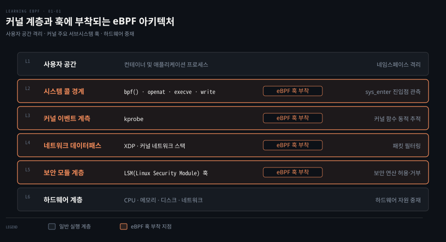
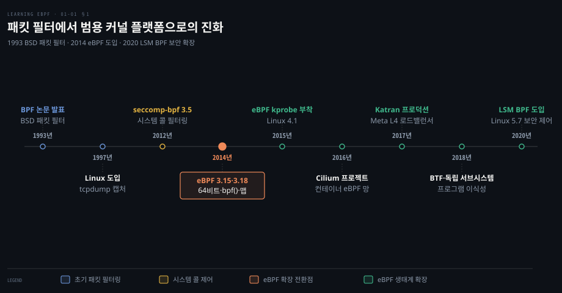
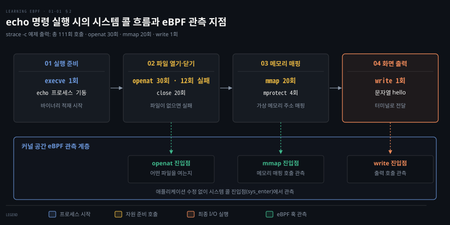
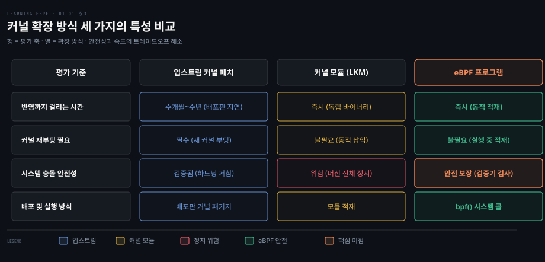
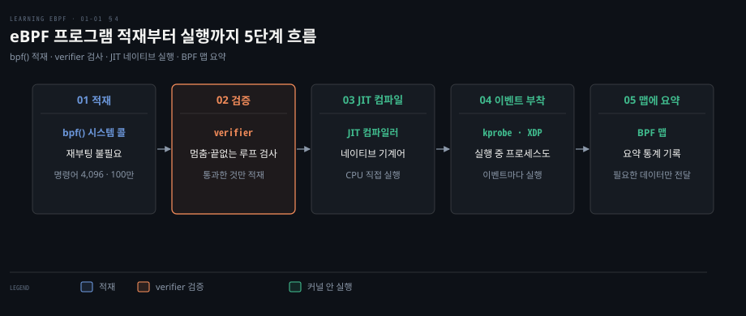
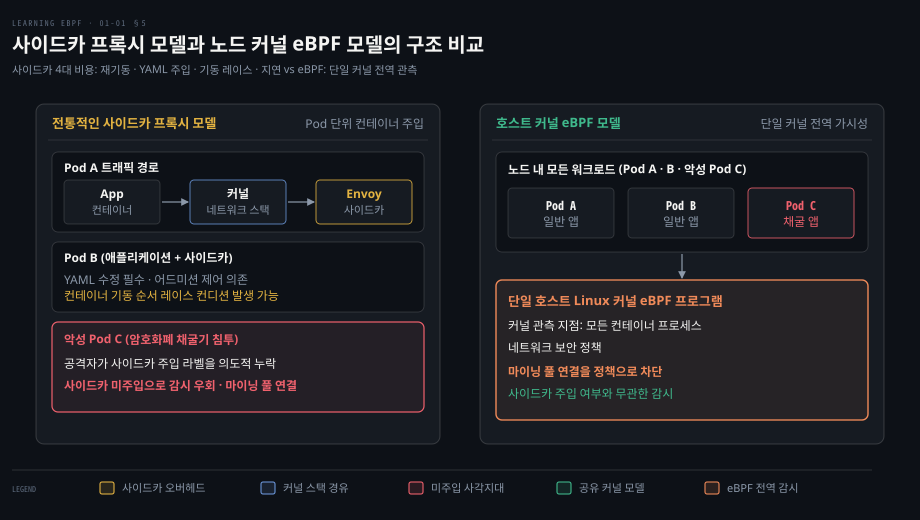

# eBPF 는 커널을 고치거나 재부팅하지 않고 커널에 안전한 프로그램을 싣는다

---

> 커널 소스코드를 고치거나 재부팅하지 않고도 커널 내부 훅에 사용자 정의 프로그램을 안전하고 동적으로 적재하여 관측·네트워킹·보안 기능을 수행합니다.


## 핵심 요약

> eBPF 의 본질은 커널 공간에 검증된 바이트코드를 동적으로 주입하여 운영체제의 기본 동작 방식을 안전하게 확장하는 데 있습니다.

애플리케이션은 파일 접근, 네트워크 송수신, 새 메모리 영역 받기처럼 커널만 할 수 있는 일을 시스템 콜로 커널에 요청합니다. 커널의 시스템 콜 경계와 내부 훅에 eBPF 프로그램을 부착하면 시스템 전반의 동작을 실시간으로 추적하고 통제할 수 있습니다. 대상 프로세스를 수정하거나 재시작할 필요도 없습니다.

과거에는 커널 기능을 확장하려면 수년이 걸리는 업스트림 기여를 거치거나 충돌 위험을 감수하고 커널 모듈을 작성해야 했습니다. eBPF 는 엄격한 커널 검증기(verifier)와 JIT(Just-In-Time) 컴파일러를 갖추었습니다. 이 두 장치 덕분에 시스템 충돌 위험 없이 네이티브 기계어 속도로 안전한 확장을 제공합니다.


## 학습 목표

> 이 편을 읽고 나면 다음을 설명할 수 있습니다.

1. 1993년 BPF 패킷 필터에서 2014년 eBPF 범용 가상 머신으로의 명령어 세트 및 인프라 확장을 설명할 수 있습니다.
2. 애플리케이션의 시스템 콜 호출 특성을 관측하여 코드 변경 없이 동작을 파악하는 원리를 설명할 수 있습니다.
3. 업스트림 커널 패치, 커널 모듈, eBPF 세 가지 커널 확장 방식의 안전성 및 배포 주기 차이를 비교할 수 있습니다.
4. 커널 검증기(verifier)와 JIT 컴파일러가 동적 적재 환경에서 안전성과 성능을 보장하는 과정을 설명할 수 있습니다.
5. 쿠버네티스 환경에서 사이드카 프록시 모델의 4대 비용을 분석하고 단일 커널 eBPF 모델의 구조적 이점을 설명할 수 있습니다.

아래 그림은 사용자 공간부터 하드웨어까지 여섯 계층 사이에서 eBPF 훅이 부착되는 위치를 보여 줍니다. 플랫폼 발전과 시스템 콜 경계는 1·2절, 커널 확장 방식과 검증 적재는 3·4절, 전역 가시성은 5절이 다룹니다.




## 1. 패킷 필터와 범용 커널 플랫폼

> 단순한 네트워크 패킷 필터링 가상 머신으로 출발한 BPF 는 64비트 아키텍처 지원과 맵 구조, 검증기를 흡수하면서 리눅스 커널 전반을 프로그래밍하는 범용 플랫폼으로 진화했습니다.

네트워크를 오가는 대량의 패킷 중 필요한 것만 골라낼 때 매번 사용자 공간으로 복사하면 오버헤드가 커지는 문제가 있습니다. 필터를 커널 안에서 돌리면 필요 없는 패킷을 사용자 공간으로 복사하지 않습니다. 1993년 Steven McCanne 과 Van Jacobson 이 **BPF**(BSD Packet Filter)를 고안했습니다. 커널 안에서 패킷 수락 여부를 직접 판정하는 작은 가상 머신입니다. BPF 는 이후 Berkeley Packet Filter 의 약자로 불리게 됩니다. 당시 BPF 는 32비트 명령어 세트로 이더넷 패킷 헤더를 검사했습니다.

```pseudocode
// 오프셋 12(0부터 셈)에서 2바이트(EtherType) 로드
ldh        [12]
// IPv4 EtherType(0x0800)과 일치하는지 비교하여 분기
jeq        #ETHERTYPE_IP, L1, L2
// 일치하면 패킷 수락
L1: ret    #TRUE
// 불일치하면 패킷 거부(드롭)
L2: ret    #0
```

이더넷 프레임은 MAC 주소 두 개를 합쳐 12바이트로 시작합니다. 그래서 이더타입(EtherType)은 오프셋 12에서 2바이트로 이어집니다. 위 코드는 `ldh [12]` 로 그 2바이트를 읽어 `jeq` 로 IPv4 상수와 비교합니다. 일치하면 참을 반환하여 패킷을 받고 다르면 0을 반환하여 즉시 버립니다.

리눅스는 1997년 tcpdump 패킷 캡처를 가속하기 위해 BPF 를 도입했습니다. 2012년 [Linux 3.5](https://github.com/torvalds/linux/blob/v3.5/kernel/seccomp.c)에서는 seccomp-bpf 가 등장하여 사용자 프로세스의 시스템 콜 필터링으로 확장되었습니다. BPF 의 역사와 운영체제 발전 과정은 [운영체제 발전사와 BPF](../systems-performance/03-03.운영체제%20—%20커널%20구현·Linux%20발전사·BPF.md)에서도 확인할 수 있습니다.

2014년 eBPF 로 넘어가며 범용 플랫폼으로 전환되었습니다. 6월의 [Linux 3.15](https://github.com/torvalds/linux/blob/v3.15/include/linux/filter.h#L41)에서 명령어 세트를 64비트용으로 다시 짰습니다. 레지스터는 32비트 A·X 두 개에서 64비트 11개(범용 10개와 읽기 전용 프레임 포인터, [문서](https://docs.kernel.org/bpf/classic_vs_extended.html))로 늘었습니다. 12월의 [Linux 3.18](https://github.com/torvalds/linux/blob/v3.18/kernel/bpf/syscall.c)에서는 제어용 `bpf()` 시스템 콜과 BPF 맵을 다루는 틀, 충돌을 막는 검증기(verifier)가 들어왔습니다. 실제로 쓸 수 있는 해시·배열 맵과 커널 기능을 빌려 쓰는 첫 헬퍼 함수는 2015년 2월의 [Linux 3.19](https://github.com/torvalds/linux/blob/v3.19/include/uapi/linux/bpf.h)에서 더해졌습니다.

kprobe 는 2005년부터 있었습니다. 2015년 [Linux 4.1](https://github.com/torvalds/linux/blob/v4.1/include/uapi/linux/bpf.h)에서 eBPF 프로그램을 붙일 수 있게 되면서 추적 방식이 달라졌습니다. 2016년에는 컨테이너 환경의 데이터패스 전체를 eBPF 로 바꾼 첫 네트워킹 프로젝트 Cilium 이 발표되었습니다. 2017년부터 Facebook(현 Meta)은 L4 로드밸런서 Katran 으로 트래픽을 처리했습니다. Katran 은 eBPF/XDP(eXpress Data Path, 드라이버가 패킷을 받자마자 실행되는 훅) 기반으로 동작하며 2018년 [오픈소스로 공개](https://engineering.fb.com/2018/05/22/open-source/open-sourcing-katran-a-scalable-network-load-balancer/)되었습니다.

2018년 eBPF 는 별도 커널 서브시스템이 되었습니다. 같은 해 [BTF](https://github.com/torvalds/linux/blob/v4.18/kernel/bpf/btf.c)가 들어와 프로그램 이식성의 바탕이 되었습니다. 2020년 [Linux 5.7](https://github.com/torvalds/linux/blob/v5.7/kernel/bpf/bpf_lsm.c)에서는 [LSM BPF](https://docs.kernel.org/bpf/prog_lsm.html)가 도입되어 보안 영역까지 확장되었습니다. 동적 트레이싱 발전 계보는 [BPF 개요와 도구 생태계](../systems-performance/15-01.BPF%20—%20개요·BCC%20vs%20bpftrace·BCC.md)에서 살펴볼 수 있습니다.



명령어 한도도 늘어났습니다. `CAP_BPF`(또는 `CAP_SYS_ADMIN`) 없이 적재하는 프로그램은 과거와 같은 4,096개 한도인 [`BPF_MAXINSNS`](https://github.com/torvalds/linux/blob/v7.2/include/uapi/linux/bpf_common.h#L54) 를 적용받습니다. 반면 이 권한을 가진 프로세스가 적재하는 프로그램은 1,000,000개 한도인 [`BPF_COMPLEXITY_LIMIT_INSNS`](https://github.com/torvalds/linux/blob/v7.2/include/linux/bpf.h#L2386) 까지 허용됩니다([검사 위치](https://github.com/torvalds/linux/blob/v7.2/kernel/bpf/syscall.c#L3034)). 이런 프로그램은 함수 호출과 테일 콜로 대규모 로직을 구동합니다. 다만 `kernel.unprivileged_bpf_disabled` 가 켜져 있으면 권한 없는 적재 자체가 거부됩니다.

지금은 eBPF 와 BPF 를 거의 같은 뜻으로 씁니다. 커널 소스는 `bpf()` 시스템 콜과 `bpf_`·`BPF_PROG_TYPE_` 으로 시작하는 헬퍼·프로그램 유형에 BPF 라는 이름을 유지합니다. 커널 밖에서는 [ebpf.io](https://ebpf.io) 처럼 eBPF 라는 이름이 굳었습니다.


## 2. 애플리케이션과 시스템 콜 경계

> 애플리케이션은 하드웨어 자원을 직접 만질 수 없어 모든 I/O 와 상태 변경을 시스템 콜로 커널에 부탁하므로, 커널 경계를 관측하면 앱을 수정하지 않고도 앱이 커널에 맡기는 일을 볼 수 있습니다.

리눅스 애플리케이션은 비특권 계층인 사용자 공간에서 격리되어 실행되므로 하드웨어 자원을 직접 다루지 못합니다. 디스크 읽기, 네트워크 통신, 프로세스에 새 메모리 영역을 붙이는 일은 특권 계층인 커널만 수행할 수 있습니다. 그래서 사용자 프로그램은 시스템 콜로 커널에 대행을 요청합니다. 이미 받아 둔 힙에서 나눠 주는 `malloc` 은 시스템 콜 없이 끝나기도 합니다. 커널과 사용자 공간의 기본 원리는 [커널은 전부를 하지만 운영체제는 아니다](../learning-modern-linux/02-01.커널은%20전부를%20하지만%20운영체제는%20아니다.md)에서 다루고 있습니다.

애플리케이션이 부르는 시스템 콜은 라이브러리 뒤에 가려져 있어 얼마나 많이 불리는지 체감하기 어렵습니다. 문자열 출력 명령인 `echo "hello"` 를 `strace -c` 로 계측할 수 있습니다. 예제를 돌린 출력은 다음과 같습니다. 이 환경에서는 시스템 콜이 111회 불렸으며 횟수는 배포판·libc·로캘 설정에 따라 달라집니다.

```bash
strace -c echo "hello"
hello
% time     seconds usecs/call      calls    errors syscall
------ ----------- ----------- --------- --------- ----------------
 24.62    0.001693          56        30        12 openat
 17.49    0.001203          60        20           mmap
 15.92    0.001095          57        19           newfstatat
 15.66    0.001077          53        20           close
 10.35    0.000712         712         1           execve
  3.04    0.000209          52         4           mprotect
  2.52    0.000173          57         3           read
  2.33    0.000160          53         3           brk
  2.09    0.000144          48         3           munmap
  1.11    0.000076          76         1           write
  0.96    0.000066          66         1         1 faccessat
  0.76    0.000052          52         1           getrandom
  0.68    0.000047          47         1           rseq
  0.65    0.000045          45         1           set_robust_list
  0.63    0.000043          43         1           prlimit64
  0.61    0.000042          42         1           set_tid_address
  0.58    0.000040          40         1           futex
------ ----------- ----------- --------- --------- ----------------
100.00    0.006877          61       111        13 total
```

단어 하나를 화면에 띄울 때도 `openat` 이 30회(이 중 12회는 파일이 없어 실패) 불리고 `close` 가 20회 불립니다. 메모리 매핑을 위해 `mmap` 20회와 `mprotect` 4회가 실행됩니다. 화면 출력 `write` 는 1회이고 이 예제의 합계는 111회입니다.

이러한 커널 의존성은 관측에 이상적인 길목이 됩니다. `openat` 같은 시스템 콜 진입점(`sys_enter`)을 커널 수준에서 가로채면 어느 프로세스가 어떤 파일에 접근하는지 즉시 드러납니다. 애플리케이션을 재컴파일하지 않아도 커널이라는 단일 관문에서 모든 프로세스가 커널에 맡기는 일을 관측할 수 있습니다.




## 3. 업스트림과 커널 모듈

> 업스트림 커널 패치는 반영과 배포판 전파까지 수년이 걸리며 커널 모듈은 사소한 오류로도 전체 머신을 멈추는 위험이 있어 커널 확장의 진입 장벽이 높았습니다.

새로운 운영체제 기능이나 관측 도구가 필요할 때 과거 개발자가 택할 수 있던 길은 둘뿐이었습니다. 커널 소스코드를 고쳐 공식 메인라인에 넣거나 커널 모듈을 작성해야 했습니다. 그러나 리눅스 커널은 수천만 줄에 달하는 방대한 코드베이스입니다.

업스트림 기여는 거버넌스의 벽이 높습니다. 패치가 전 세계 사용자에게 유익하다는 합의를 얻어야 하므로, 제출된 패치의 약 3분의 1만 채택된다는 [연구](https://doi.org/10.1109/MSR.2013.6624016)가 있습니다.

패치가 채택되더라도 프로덕션 서버에 닿기까지는 수년이 걸립니다. 예를 들어 2026년 5월 출시된 RHEL 9.8 의 커널 기준 버전은 2021년 8월의 Linux 5.14(`5.14.0-687.5.1.el9_8`)입니다.

현재 메이저 RHEL 10.2 는 Linux 6.12(`6.12.0-211.7.1.el10_2`)입니다([Red Hat Enterprise Linux Release Dates](https://access.redhat.com/articles/3078)).

배포판은 메이저 버전 동안 기준 버전을 유지하므로 새 기능이 현장에 닿기까지 몇 년이 걸립니다. 여러 환경에서 몇 달씩 돌려 문제를 걸러 낸(하드닝) 커널을 내보내려는 이유도 있으며 새 커널은 재부팅해야 쓸 수 있습니다.

두 번째 길인 **커널 모듈**(LKM)은 독립 배포가 가능해 업스트림 채택을 기다릴 필요가 없습니다.

하지만 커널 모듈은 시스템 안정성에 큰 위험을 안깁니다. 모듈 코드는 커널 특권으로 돌기 때문에, 모듈이 죽으면 머신과 그 위의 모든 것이 함께 멈출 수 있습니다. 그래서 사용자들은 오래전부터 커널 모듈을 조심스럽게 써 왔습니다.

안전하다는 말에는 보안도 들어갑니다. 커널 코드는 머신의 모든 데이터에 닿을 수 있어, 모듈에 취약점이 있거나 작성자가 악성 코드를 넣었다면 머신 전체가 위험해집니다. 모듈과 eBPF 가 겹치는 곳과 갈리는 곳은 [커널을 늘리는 두 길](../learning-modern-linux/02-01.커널은%20전부를%20하지만%20운영체제는%20아니다.md#8-커널을-늘리는-두-길)에서 다룹니다. eBPF 는 다른 리눅스 사용자 모두가 같은 변경을 받아들이기를 기다리지 않아도 됩니다. 재부팅 없이 즉시 적재되면서도 안전성을 검증받는 제3의 길을 열었습니다.




## 4. verifier·동적 적재·JIT

> verifier·동적 적재·JIT 세 장치가 eBPF 를 안전하고 빠르게 만들고, 커널 안 필터링이 사용자 공간으로 넘기는 양을 줄입니다. 검증기가 프로그램의 무한 루프와 메모리 침범을 사전에 막고, JIT 컴파일러가 네이티브 기계어로 바꾸어 빠르게 돌립니다.

커널에 외부 코드를 주입할 때는 시스템 패닉을 방지하면서 높은 처리량을 유지해야 합니다. eBPF 프로그램은 `bpf()` 시스템 콜로 실행 중인 커널에 동적으로 적재됩니다. 재부팅이 필요 없으며 적재 후 이벤트에 부착하는 순간부터 기존 프로세스가 일으킨 이벤트도 곧바로 잡힙니다. 프로그램은 프로세스가 아니라 이벤트에 붙기 때문에 파일 열기 시스템 콜에 붙이면 어느 프로세스가 파일을 열든 그때마다 실행됩니다.

동적 적재를 뒷받침하는 핵심 안전장치는 **검증기**(verifier)입니다. 적재 전에 프로그램이 머신을 멈추거나 끝없는 루프에 빠지거나 데이터를 침범하지 않는지 검사합니다([verifier 문서](https://docs.kernel.org/bpf/verifier.html)). 검증을 통과한 프로그램만 적재됩니다.

검증을 통과한 바이트코드는 JIT 컴파일러에 의해 네이티브 기계어로 변환되어 CPU 에서 직접 실행됩니다.

또한 커널 안에서 이벤트를 걸러냅니다. 이벤트마다 데이터를 사용자 공간으로 복사하고 문맥을 전환하는 대신, 요약 통계를 BPF 맵에 기록하고 필요한 데이터만 올려 보내 부하를 낮춥니다.



실측 성능도 입증되었습니다. 2018년 [XDP 논문](https://dl.acm.org/doi/10.1145/3281411.3281443) 에 따르면 XDP 패킷 라우팅은 기본 리눅스 스택 대비 2.5배 높은 처리량을 냈습니다. 로드밸런싱도 IPVS 대비 약 4.3배 향상되었습니다.


## 5. 단일 커널과 전역 가시성

> 쿠버네티스 노드 위의 모든 컨테이너는 단 하나의 커널을 공유하므로, 커널에 설치된 eBPF 프로그램은 사이드카 주입 오버헤드 없이 전역 가시성을 확보하며 공격자가 감시를 피해 가기도 어렵습니다.

한 노드에서 컨테이너 수백 개가 뜰 때 관측성과 보안 에이전트를 Pod 마다 프록시 컨테이너로 띄우는 사이드카 방식은 비용 문제가 큽니다. 네임스페이스로 격리되어 있어도 노드 위의 모든 컨테이너는 단일 리눅스 커널을 공유합니다.

공유 커널에 eBPF 프로그램을 설치하면 노드 내 모든 컨테이너 내부 프로세스가 커널 관측 지점에 바로 잡힙니다. 앱이나 이미지를 바꾸지 않고 실행 중인 컨테이너를 관측합니다.

이는 쿠버네티스의 사이드카 프록시 모델과 대비됩니다. 사이드카 모델은 네 가지 본질적 비용을 치릅니다.

첫째, 사이드카 추가·갱신 시 애플리케이션 Pod 를 재기동해야 합니다. 둘째, YAML 명세가 늘어나고 어드미션 주입 실패 시 감시망에서 누락됩니다. 셋째, 프록시가 뜨기 전에는 앱의 트래픽이 버려질 수 있어 앱 컨테이너가 이를 견뎌야 하는 기동 레이스 컨디션이 생길 수 있습니다. 쿠버네티스 1.29 부터 기본으로 켜진 [네이티브 사이드카](https://kubernetes.io/docs/concepts/workloads/pods/sidecar-containers/)는 사이드카를 init 컨테이너 순서에 넣어 앱보다 먼저 띄우므로 이 문제를 줄입니다.

넷째, 앱 컨테이너를 드나드는 모든 트래픽이 Envoy 같은 프록시 컨테이너에 닿으려고 커널 네트워크 스택을 한 번 더 거치므로 지연이 늘어납니다. [Cilium 의 사이드카 없는 서비스 메시](../../../08_cloud/book/cilium-up-and-running/01-01.Cilium%20은%20eBPF%20데이터패스로%20iptables%20기반%20CNI%20의%20한계를%20넘는다.md#4-사이드카-없는-서비스-메시는-프록시를-노드로-옮긴다)는 프록시를 노드로 옮깁니다.

보안 관점에서도 차이가 큽니다. 공격자가 노드에 침투해 몰래 암호화폐 채굴 컨테이너를 띄우면 사이드카 주입 라벨을 달지 않습니다. 사이드카 기반 도구는 이 채굴 파드를 감시하지 못합니다. 반면 eBPF 로 구현한 네트워크 보안은 호스트의 모든 트래픽을 단속할 수 있어, 사이드카 없는 채굴 앱의 마이닝 풀 연결도 정책으로 막을 수 있습니다.




## 면접 대비

> 아래 질문에 답하면서 eBPF 가 커널 확장과 클라우드 네이티브 아키텍처에 가져온 변화를 설명해 보세요.

1. 1993년의 클래식 BPF 와 2014년에 도입된 eBPF 는 가상 머신 구조와 기능 면에서 어떤 차이가 있습니까?
2. 애플리케이션 코드나 바이너리를 변경하지 않고도 eBPF 가 애플리케이션이 커널에 요청하는 일을 관측할 수 있는 이유는 무엇입니까?
3. 리눅스 커널에 기능을 추가하는 전통적 방식인 업스트림 패치 기여와 커널 모듈(LKM) 개발이 안고 있던 한계는 각각 무엇입니까?
4. eBPF 프로그램이 커널에 동적으로 적재되어 실행될 때 시스템 패닉을 일으키지 않는 원리와 사용자 공간 전송 오버헤드를 줄이는 방법은 무엇입니까?
5. 쿠버네티스 환경에서 관측성 및 서비스 메시 구축 시 사이드카 프록시 모델이 초래하는 4가지 구조적 비용과 eBPF 호스트 커널 모델이 이를 해결하는 방식은 무엇입니까?


## 정답 (자답 후 펼치기)

> 위 §면접 대비의 질문에 먼저 스스로 답한 뒤 읽으세요.

### 정답 1 — 64비트 레지스터와 범용 플랫폼 확장

클래식 BPF 는 32비트 레지스터 2개(A·X)로 패킷을 받을지, 시스템 콜을 허용할지만 판정하는 단순 필터였습니다. 2014년 eBPF 는 11개의 64비트 레지스터와 전면 개편된 명령어 세트를 갖추고 `bpf()` 시스템 콜, BPF 맵의 틀, 안전성을 검증하는 verifier 를 추가했으며 이듬해 초 해시·배열 맵과 커널 헬퍼 함수가 더해졌습니다. 이를 통해 네트워크를 넘어 시스템 추적과 보안 전반을 아우르는 범용 커널 플랫폼으로 확장되었습니다.

### 정답 2 — 시스템 콜 경계와 특권 격리

사용자 공간 프로세스는 비특권 계층에서 실행되어 파일 I/O, 메모리 매핑, 네트워크 통신 시 반드시 시스템 콜을 거쳐야 합니다. 단순한 `echo "hello"` 명령도 예제 환경에서는 111회의 시스템 콜을 유발합니다. 커널의 시스템 콜 진입점(`sys_enter`)에 eBPF 프로그램을 부착하면 애플리케이션 수정이나 재기동 없이 모든 프로세스가 부르는 시스템 콜을 관측할 수 있습니다.

### 정답 3 — 배포판 지연과 커널 패닉 위험

업스트림 기여는 합의가 어려워 패치 채택률이 약 3분의 1에 그치며 승인 후에도 RHEL 등 엔터프라이즈 배포판에 탑재되기까지 몇 년이 걸립니다. 반면 커널 모듈(LKM)은 독립 배포가 가능하지만 커널 특권으로 실행되어, 모듈이 죽으면 머신 전체가 멈출 수 있습니다.

### 정답 4 — 커널 검증기와 인커널 필터링

커널 적재 시 검증기(verifier)가 프로그램이 머신을 멈추거나 끝없는 루프에 빠지거나 데이터를 침범하지 않는지 적재 전에 검사하므로, 검증을 통과한 프로그램만 실행됩니다. 검증 후에는 JIT 컴파일러가 네이티브 기계어로 즉시 변환합니다. 또한 이벤트를 매번 사용자 공간으로 복사하지 않고 커널 안에서 걸러 필요한 데이터만 올려 보내거나 BPF 맵에 집계한 요약을 넘겨, 문맥 전환과 I/O 오버헤드를 줄입니다.

### 정답 5 — 사이드카 4대 비용과 단일 커널 전역 가시성

사이드카 모델은 Pod 재기동 강제, YAML 수정 및 주입 누락, 프록시 기동 전 패킷 유실(레이스 컨디션), 프록시에 닿으려는 커널 네트워크 스택 추가 경유(지연)라는 4대 비용을 치릅니다. 사이드카가 없는 채굴 컨테이너를 놓치는 보안 허점도 있습니다. eBPF 는 노드의 모든 컨테이너가 커널을 공유한다는 점을 활용해 호스트 커널에서 직접 전역 가시성을 확보하므로 재기동과 YAML 수정이 필요 없고 악성 파드 통신도 정책으로 막을 수 있습니다.


## 참고 자료

> 본문에서 인용한 논문, 커널 소스, 문서입니다.

- Liz Rice, 《Learning eBPF》, O'Reilly, 2023, ISBN 978-1-098-13512-6.
- Steven McCanne · Van Jacobson, [The BSD Packet Filter: A New Architecture for User-level Packet Capture](https://www.usenix.org/legacy/publications/library/proceedings/sd93/mccanne.pdf), USENIX Winter 1993.
- Toke Høiland-Jørgensen 외, [The eXpress data path: fast programmable packet processing in the operating system kernel](https://dl.acm.org/doi/10.1145/3281411.3281443), CoNEXT '18, 2018.
- Linux Kernel Source v7.2, [include/linux/bpf.h](https://github.com/torvalds/linux/blob/v7.2/include/linux/bpf.h#L2386) — `BPF_COMPLEXITY_LIMIT_INSNS` (1M 명령어 복잡도 한도).
- Linux Kernel Source v7.2, [include/uapi/linux/bpf_common.h](https://github.com/torvalds/linux/blob/v7.2/include/uapi/linux/bpf_common.h#L54) — `BPF_MAXINSNS` (4096 명령어 한도).
- Linux Kernel Documentation, [LSM BPF](https://docs.kernel.org/bpf/prog_lsm.html), [Classic vs eBPF](https://docs.kernel.org/bpf/classic_vs_extended.html), [verifier](https://docs.kernel.org/bpf/verifier.html).
- Linux 소스, [v5.7 bpf_lsm.c](https://github.com/torvalds/linux/blob/v5.7/kernel/bpf/bpf_lsm.c) · [v3.18 syscall.c](https://github.com/torvalds/linux/blob/v3.18/kernel/bpf/syscall.c) · [v3.19 bpf.h](https://github.com/torvalds/linux/blob/v3.19/include/uapi/linux/bpf.h) · [v3.15 filter.h](https://github.com/torvalds/linux/blob/v3.15/include/linux/filter.h#L41) · [v4.1 bpf.h](https://github.com/torvalds/linux/blob/v4.1/include/uapi/linux/bpf.h) · [v4.18 btf.c](https://github.com/torvalds/linux/blob/v4.18/kernel/bpf/btf.c) · [v3.5 seccomp.c](https://github.com/torvalds/linux/blob/v3.5/kernel/seccomp.c) · [v7.2 syscall.c](https://github.com/torvalds/linux/blob/v7.2/kernel/bpf/syscall.c#L3034).
- Red Hat, [Red Hat Enterprise Linux Release Dates](https://access.redhat.com/articles/3078) — RHEL 9.8·10.2 의 커널 버전과 릴리스 날짜.
- Facebook, [Open-sourcing Katran](https://engineering.fb.com/2018/05/22/open-source/open-sourcing-katran-a-scalable-network-load-balancer/), 2018.
- Jiang · Adams · German, [Will My Patch Make It? And How Fast?](https://doi.org/10.1109/MSR.2013.6624016), MSR 2013.


## 관련 문서

> 커널 아키텍처와 네트워크 데이터패스, BPF 추적 도구의 심화 내용을 다룬 정독 노트입니다.

- [03-03. 운영체제 — 커널 구현·Linux 발전사·BPF](../systems-performance/03-03.운영체제%20—%20커널%20구현·Linux%20발전사·BPF.md) — 유닉스부터 eBPF 까지의 운영체제 진화입니다.
- [15-01. BPF — 개요·BCC vs bpftrace·BCC](../systems-performance/15-01.BPF%20—%20개요·BCC%20vs%20bpftrace·BCC.md) — 동적 트레이싱 도구와 BCC·bpftrace 입니다.
- [02-01. 커널은 전부를 하지만 운영체제는 아니다](../learning-modern-linux/02-01.커널은%20전부를%20하지만%20운영체제는%20아니다.md) — 커널·사용자 공간의 권한 분리와 시스템 콜 경계입니다.
- [01-01. Cilium 은 eBPF 데이터패스로 iptables 기반 CNI 의 한계를 넘는다](../../../08_cloud/book/cilium-up-and-running/01-01.Cilium%20은%20eBPF%20데이터패스로%20iptables%20기반%20CNI%20의%20한계를%20넘는다.md) — iptables 의 한계를 넘는 eBPF 데이터패스입니다.
