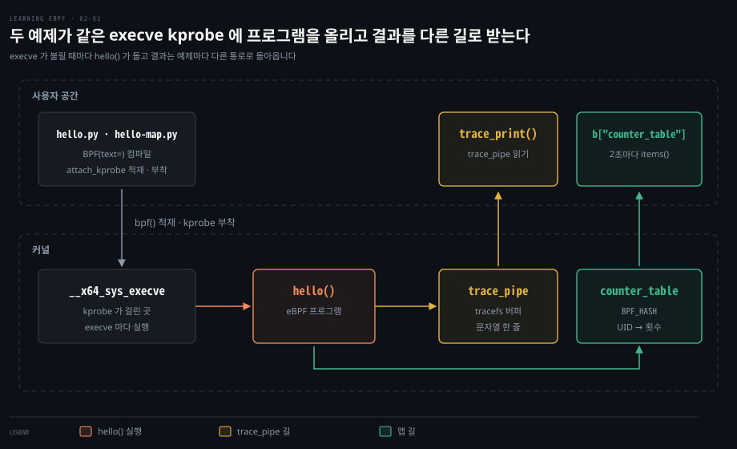
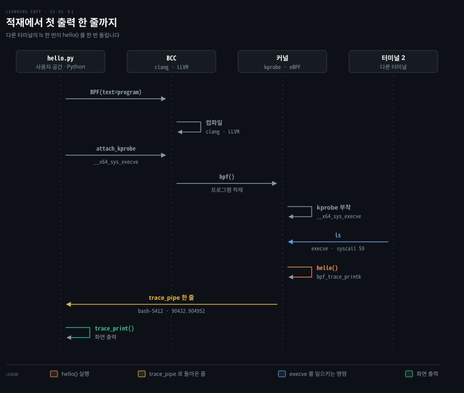
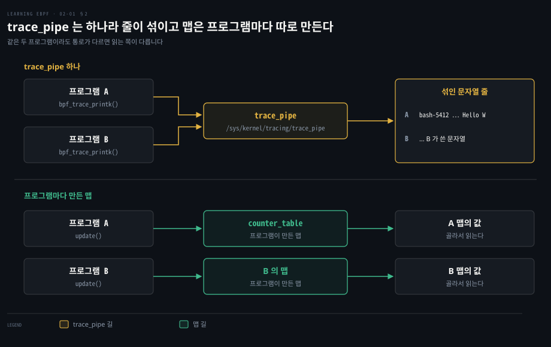
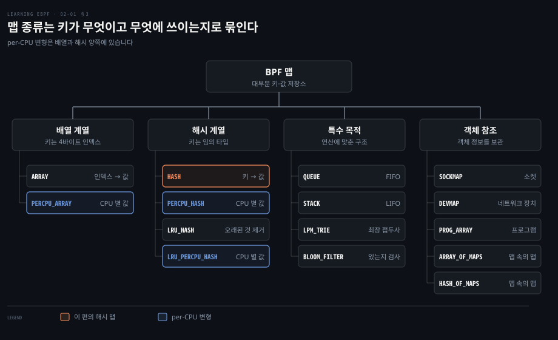
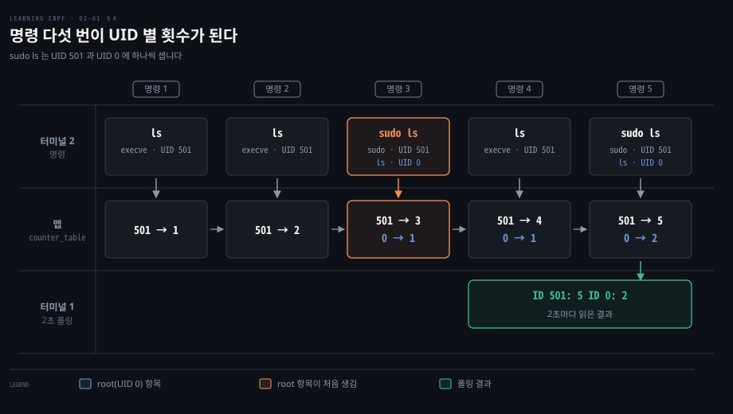

# BCC Hello World 는 execve 에 kprobe 를 걸고 결과를 trace_pipe 와 해시 맵으로 꺼낸다

---

> 파이썬 파일 한 개가 C 문자열을 컴파일하고 커널에 올려 execve 에 걸어 두면, 프로그램이 실행될 때마다 커널 안의 hello() 가 돌고 결과는 trace_pipe 나 해시 맵을 통해 사용자 공간으로 돌아옵니다.


## 핵심 요약

> 이 편의 중심 생각은 eBPF 앱이 커널 프로그램과 그것을 싣고 결과를 읽는 사용자 공간 프로그램으로 나뉘며 출력 통로가 맵이 되면 문자열이 구조화된 값이 된다는 것입니다.

`hello.py` 는 BCC 로 C 문자열을 컴파일하고 execve 를 구현한 커널 함수에 kprobe 로 붙입니다. execve 시스템 콜로 프로그램을 실행하면 모두 이 함수를 지나므로 이미 떠 있던 프로세스도 관측됩니다.

가장 쉬운 출력 통로는 trace_pipe 입니다. 문자열만 나르고 머신 전체에 하나뿐이라 프로그램이 여럿이면 줄이 섞입니다. 맵은 커널과 사용자 공간이 함께 읽고 쓰는 키-값 저장소입니다. 해시 맵으로 UID(사용자 ID) 별 execve 횟수를 커널 안에서 세면 사용자 공간은 값만 읽습니다. 주기적으로 들여다봐야 하는 한계는 남습니다.




## 학습 목표

> 이 편을 읽고 나면 다음을 설명할 수 있습니다.

1. `hello.py` 의 각 줄이 컴파일·적재와 부착·읽기 중 무엇인지 구분할 수 있습니다.
2. execve 의 커널 함수 이름이 아키텍처마다 다른 이유와 BCC 가 맞추는 방식을 설명할 수 있습니다.
3. 권한 요구와 이미 떠 있던 프로세스가 잡히는 이유와 trace_pipe 출력 한 줄의 각 칸을 설명할 수 있습니다.
4. 맵의 전형적인 쓰임과 종류별로 푸는 문제를 말할 수 있습니다.
5. 해시 맵 예제가 UID 별 execve 횟수를 세는 과정과 폴링의 한계를 설명할 수 있습니다.


## 1. 커널 프로그램과 사용자 공간 프로그램

> eBPF 앱은 커널 프로그램과 이를 싣는 사용자 공간 프로그램 둘로 나뉩니다. 파이썬 파일 안 C 문자열은 커널에서 돌고 나머지 파이썬 코드는 프로그램을 컴파일해 싣고 결과를 읽습니다.

`hello.py` 는 파이썬 파일인데 한가운데 C 함수가 문자열로 들어 있습니다. 이 파일을 실행하면 어느 줄이 어디서 돌까요? 아래는 예제 저장소의 `chapter2/hello.py` 입니다.

```python
#!/usr/bin/env python3
from bcc import BPF
import sys

# 커널에서 도는 eBPF 프로그램을 C 문자열로 든다
program = r"""
int hello(void *ctx) {
    bpf_trace_printk("Hello World!");
    return 0;
}
"""

# C 문자열을 BCC 가 컴파일한다
b = BPF(text=program)
# execve 를 구현한 커널 함수의 이름을 찾는다
syscall = b.get_syscall_fnname("execve")
# hello 를 커널에 싣고 그 함수의 진입점에 kprobe 로 붙인다
b.attach_kprobe(event=syscall, fn_name="hello")

# trace_pipe 를 읽어 화면에 계속 출력한다
try:
    b.trace_print()
except KeyboardInterrupt:
    sys.exit(0)
```

`hello()` 는 eBPF 프로그램 본체이고 커널 안에서 돕니다. 하는 일은 헬퍼 함수 `bpf_trace_printk()` 로 한 줄 쓰는 것뿐입니다. 헬퍼는 eBPF 프로그램이 시스템과 상호작용하려고 부르는 커널 제공 함수입니다. 이 헬퍼는 디버깅용이라 운영에는 쓰지 말라고 커널 헤더에 적혀 있습니다([bpf.h](https://github.com/torvalds/linux/blob/v7.2/include/uapi/linux/bpf.h#L2021-L2072)).

나머지 파이썬 줄은 모두 사용자 공간에서 돕니다.

- `BPF(text=program)` 은 C 문자열을 컴파일해 BPF 모듈을 만듭니다. 컴파일은 실행할 때마다 BCC 가 합니다. 그래서 BCC 는 첫걸음에는 편하지만 런타임 부담과 컴파일러를 품은 큰 바이너리가 따릅니다. 그 부담 때문에 배포용 앱은 보통 libbpf 와 CO-RE(Compile Once – Run Everywhere)로 미리 컴파일해 씁니다([libbpf 개요](https://docs.kernel.org/bpf/libbpf/libbpf_overview.html)).
- `get_syscall_fnname("execve")` 는 execve 를 구현한 커널 함수의 이름을 돌려줍니다.
- `attach_kprobe(event=syscall, fn_name="hello")` 는 `hello` 를 `bpf()` 시스템 콜로 커널에 싣고 그 함수에 붙입니다([__init__.py](https://github.com/iovisor/bcc/blob/v0.37.0/src/python/bcc/__init__.py#L878-L880)).
- `trace_print()` 는 trace_pipe 를 열어 한 줄씩 읽어 출력하는 무한 루프입니다.

**kprobe** 는 커널 코드의 거의 어느 주소에나 거는 [후크](https://github.com/torvalds/linux/blob/v7.2/Documentation/trace/kprobes.rst#L28-L31)입니다. `attach_kprobe()` 는 오프셋 `event_off` 의 [기본값이 0](https://github.com/iovisor/bcc/blob/v0.37.0/src/python/bcc/__init__.py#L855) 이라 함수 진입점에 겁니다. 새 프로그램을 execve 시스템 콜로 실행하면 이곳을 지납니다. 다만 다른 진입점으로 실행하는 경로는 따로 걸어야 합니다. execveat 나 x86_64 위 32비트 프로세스가 부르는 execve 가 여기에 해당합니다([syscall_64.tbl](https://github.com/torvalds/linux/blob/v7.2/arch/x86/entry/syscalls/syscall_64.tbl#L334), [syscall_32.tbl](https://github.com/torvalds/linux/blob/v7.2/arch/x86/entry/syscalls/syscall_32.tbl#L26)).

### 아키텍처별 execve 커널 함수 이름

커널은 execve 를 [`SYSCALL_DEFINE3(execve, …)`](https://github.com/torvalds/linux/blob/v7.2/fs/exec.c#L1943) 로 정의합니다. x86_64·arm64·s390·riscv 등 시스템 콜 래퍼를 두는 아키텍처는 `struct pt_regs` 하나만 받는 진입 스텁을 자기 접두사로 만듭니다. x86_64 는 `__x64_sys_*` 이고 arm64 는 `__arm64_sys_*` 입니다([x86](https://github.com/torvalds/linux/blob/v7.2/arch/x86/include/asm/syscall_wrapper.h#L15-L17), [arm64](https://github.com/torvalds/linux/blob/v7.2/arch/arm64/include/asm/syscall_wrapper.h#L49-L54)).

래퍼가 없는 mips·arm 같은 아키텍처는 접두사 없는 `sys_execve` 를 씁니다([syscalls.h](https://github.com/torvalds/linux/blob/v7.2/include/linux/syscalls.h#L245-L256)).

그래서 같은 execve 가 `__x64_sys_execve` 와 `__arm64_sys_execve` 로 갈립니다. BCC 는 후보 접두사 중 `<접두사>bpf` 심볼이 커널에 있는 것을 골라 `execve` 앞에 붙입니다([get_syscall_prefix](https://github.com/iovisor/bcc/blob/v0.37.0/src/python/bcc/__init__.py#L832-L845)).

덕분에 목록에 있는 아키텍처(x86_64·arm64·s390·riscv 등)에서는 같은 `hello.py` 가 고치지 않고 돕니다.

### 적재부터 첫 출력까지

다른 터미널에서 `ls` 를 치면 일어나는 순서입니다.



도식의 `syscall 59` 는 x86_64 의 execve 번호입니다([syscall_64.tbl](https://github.com/torvalds/linux/blob/v7.2/arch/x86/entry/syscalls/syscall_64.tbl#L71)).

커널과 사용자 공간의 구분은 [커널은 전부를 하지만 운영체제는 아니다](../learning-modern-linux/02-01.커널은%20전부를%20하지만%20운영체제는%20아니다.md)에서 다룹니다.


## 2. 권한과 trace_pipe 출력 통로

> 추적 프로그램을 올리려면 권한이 필요하고, 출력은 머신에 하나뿐인 trace_pipe 로 나옵니다. 가장 쉬운 통로이지만 문자열만 나르고 프로그램끼리 줄이 섞입니다.

권한 없이 실행해 "Operation not permitted" 같은 오류로 막히면 먼저 root 로 실행했는지 봅니다. eBPF 는 커널 안에서 도는 코드를 올리는 일이라 이 예제 같은 추적 프로그램에는 특권이 필요합니다.

권한은 root 하나가 아니라 capability 로 쪼개져 있습니다. 추적 프로그램에는 `CAP_PERFMON` 과 `CAP_BPF` 가 필요합니다. 네트워킹 프로그램에는 `CAP_NET_ADMIN` 과 `CAP_BPF` 가 필요합니다([capability.h](https://github.com/torvalds/linux/blob/v7.2/include/uapi/linux/capability.h#L411-L414)). `CAP_BPF` 와 `CAP_PERFMON` 은 리눅스 5.8 에서 생겼습니다([capabilities(7)](https://man7.org/linux/man-pages/man7/capabilities.7.html)).

### 이미 떠 있던 프로세스의 execve

`hello.py` 를 시작하자마자 trace 줄이 쏟아질 수 있습니다. 다른 프로세스가 이미 execve 를 부르고 있었기 때문입니다.

eBPF 는 재부팅이나 프로세스 재시작 없이 이벤트에 붙는 순간부터 효력이 생깁니다. kprobe 는 프로세스가 아니라 커널 함수에 걸려 있어서 셸과 스크립트와 실행 파일 어느 것도 손대지 않아도 됩니다.

다만 `echo` 같은 셸 내장 명령은 새 프로그램을 실행하지 않고 셸 프로세스 안에서 돕니다. 그래서 execve 가 불리지 않고 trace 줄도 생기지 않습니다.

### trace_pipe 출력 필드 구조

예제를 돌린 출력은 이런 모양입니다.

```bash
b'        bash-5412          [001] .... 90432.904952: 0: bpf_trace_printk: Hello W
```

`trace_print()` 는 [trace_pipe 를 바이너리 모드로 열고](https://github.com/iovisor/bcc/blob/v0.37.0/src/python/bcc/__init__.py#L1574) [읽은 bytes 를 그대로 찍으므로](https://github.com/iovisor/bcc/blob/v0.37.0/src/python/bcc/__init__.py#L1641-L1649) `b'` 가 앞에 붙습니다. 여기 실은 줄은 메시지 칸을 앞부분만 보이고, `hello()` 가 넘긴 문자열은 `Hello World!` 전체입니다.

| 칸 | 값 | 뜻 |
|---|---|---|
| 태스크 이름-PID | `bash-5412` | execve 를 부른 프로세스의 이름과 PID |
| CPU | `[001]` | 실행 중인 CPU 번호 |
| 플래그 | `....` | 인터럽트 꺼짐·재스케줄 요청·hardirq/softirq·선점 깊이를 한 글자씩 나타낸 칸 |
| 타임스탬프 | `90432.904952` | 초 단위 시각 |
| 이벤트 이름 | `bpf_trace_printk:` | 헬퍼가 쓰는 트레이스 이벤트 |
| 메시지 | `Hello World!` | `hello()` 가 넘긴 문자열이고 위 줄에는 앞부분만 보입니다 |

타임스탬프 뒤의 `0:` 는 이 예제를 돌린 커널의 출력 형식에 있던 칸입니다. 지금 커널의 `bpf_trace_printk` 이벤트는 이벤트 이름 뒤에 메시지만 찍습니다([bpf_trace.h](https://github.com/torvalds/linux/blob/v7.2/kernel/trace/bpf_trace.h#L11-L25)). 앞의 칸들은 트레이싱 인프라가 붙이는 문맥 정보입니다([bpf.h](https://github.com/torvalds/linux/blob/v7.2/include/uapi/linux/bpf.h#L2041-L2056)).

이 예제를 돌린 커널의 플래그 칸은 네 글자였습니다. 이후 [리눅스 5.15](https://github.com/torvalds/linux/blob/v5.15/kernel/trace/trace_output.c#L492-L503) 에서 migrate-disable 깊이가 더해졌습니다. 지금 커널은 다섯 글자를 찍습니다([trace_output.c](https://github.com/torvalds/linux/blob/v7.2/kernel/trace/trace_output.c#L538-L549), [trace.c](https://github.com/torvalds/linux/blob/v7.2/kernel/trace/trace.c#L2886-L2892)). irqs-off·need-resched·hardirq/softirq·선점 깊이·migrate-disable 깊이 순서입니다.

이벤트 이름은 헬퍼가 `trace_bpf_trace_printk()` 를 부르는 데서 옵니다([bpf_trace.c](https://github.com/torvalds/linux/blob/v7.2/kernel/trace/bpf_trace.c#L392-L409)).

### tracefs 의 trace_pipe 파일

이 줄이 흘러나오는 곳이 **trace_pipe** 입니다. 헬퍼는 tracefs 의 트레이스 버퍼에 한 줄을 씁니다. `/sys/kernel/tracing/trace_pipe` 는 그 버퍼를 소비하며 읽는 파일입니다([bpf.h](https://github.com/torvalds/linux/blob/v7.2/include/uapi/linux/bpf.h#L2021-L2032)).

debugfs 를 마운트하면 같은 파일이 `/sys/kernel/debug/tracing` 아래에도 보입니다([ftrace 문서](https://github.com/torvalds/linux/blob/v7.2/Documentation/trace/ftrace.rst#L49-L77)). BCC 는 그 경로가 있으면 그 아래 `trace_pipe` 를 엽니다([__init__.py](https://github.com/iovisor/bcc/blob/v0.37.0/src/python/bcc/__init__.py#L48-L51)).

trace_pipe 는 소비형이라 한 번 읽힌 줄은 다시 읽히지 않습니다([ftrace 문서](https://github.com/torvalds/linux/blob/v7.2/Documentation/trace/ftrace.rst#L136-L146)).



이 통로는 출력 형식을 거의 고를 수 없고 문자열만 싣습니다. 더 큰 문제는 모든 프로그램의 `bpf_trace_printk()` 가 머신에 하나뿐인 최상위 트레이스 버퍼에 쓴다는 점입니다. 프로그램 A 와 B 가 함께 돌면 두 줄이 한 흐름으로 섞여 누구 것인지 가리기 어렵습니다. 맵은 프로그램마다 따로 만들 수 있어, 사용자 공간이 필요한 맵만 골라 구조화된 값으로 읽습니다.


## 3. 공유 키-값 저장소 BPF 맵

> BPF 맵은 eBPF 프로그램과 사용자 공간이 함께 읽고 쓰는 키-값 저장소입니다. 종류는 키의 형태와 최적화된 연산, 가리키는 대상에 따라 나뉩니다.

trace_pipe 의 한계를 풀려면 값이 구조를 가진 채 프로그램마다 따로 만든 맵에 쌓이고 사용자 공간이 필요할 때 읽어 갈 수 있어야 합니다. **BPF 맵**이 그 자리입니다. 맵은 커널과 사용자 공간 사이에서 데이터를 공유하는 범용 저장소입니다([BPF maps](https://github.com/torvalds/linux/blob/v7.2/Documentation/bpf/maps.rst)). 프로그램은 헬퍼로 맵을 다루고 사용자 공간은 `bpf()` 시스템 콜로 다룹니다.

전형적인 쓰임은 셋입니다.

- 사용자 공간이 설정을 쓰고 프로그램이 읽습니다.
- 프로그램이 상태를 저장하고 다른 프로그램이나 다음 실행이 읽습니다.
- 프로그램이 결과나 지표를 쓰고 사용자 공간 앱이 읽습니다.

### 푸는 문제별 맵 종류

맵 종류는 커널 헤더의 `enum bpf_map_type` 에 모여 있고([bpf.h](https://github.com/torvalds/linux/blob/v7.2/include/uapi/linux/bpf.h#L1001-L1050)) 항목별 설명은 [커널 문서](https://docs.kernel.org/bpf/maps.html)에 있습니다. 대부분 키-값 저장소이고(큐·스택·블룸 필터는 키 없이 값만 다룹니다), 푸는 문제에 따라 네 묶음으로 가를 수 있습니다.

| 묶음 | 종류 | 푸는 문제 |
|---|---|---|
| 배열 계열 | `ARRAY`, `PERCPU_ARRAY` | 4바이트 정수 인덱스 키·고정 크기·원소 0 으로 미리 할당([map_array](https://github.com/torvalds/linux/blob/v7.2/Documentation/bpf/map_array.rst)) |
| 해시 계열 | `HASH`, `PERCPU_HASH`, `LRU_HASH`, `LRU_PERCPU_HASH` | 임의 타입의 키와 값·LRU 변형은 가득 차면 가장 오래 안 쓴 항목 제거([map_hash](https://github.com/torvalds/linux/blob/v7.2/Documentation/bpf/map_hash.rst)) |
| 특수 목적 | `QUEUE`, `STACK`, `LPM_TRIE`, `BLOOM_FILTER` | FIFO·LIFO 꺼내기·IP 최장 접두사 일치·원소 존재의 확률적 검사 |
| 객체 참조 | `SOCKMAP`, `DEVMAP`, `PROG_ARRAY`, `ARRAY_OF_MAPS`, `HASH_OF_MAPS` | 소켓·네트워크 장치·tail call 대상 프로그램·다른 맵에 대한 참조 |



### per-CPU 변형과 CPU별 메모리

배열과 해시에는 per-CPU 변형이 있습니다. 커널이 CPU 코어마다 다른 메모리 블록을 두므로 코어끼리 같은 칸을 두고 다툴 일이 없습니다. 그렇지 않은 맵은 여러 CPU 의 프로그램이 같은 값에 동시에 접근할 수 있습니다. 리눅스 5.1 부터 일부 맵 값에서 `struct bpf_spin_lock` 으로 접근을 맞출 수 있습니다([map_hash.rst](https://github.com/torvalds/linux/blob/v7.2/Documentation/bpf/map_hash.rst#L113-L116)).


## 4. 해시 맵과 사용자별 execve 횟수

> 해시 맵은 키를 UID, 값을 execve 횟수로 두고 커널 안에서 셉니다. 사용자 공간은 2초마다 맵을 읽어 UID 별 합계를 보여 줍니다.

trace_pipe 로는 사용자 공간이 줄을 파싱해 세야 하는 한계가 있습니다. 반면 커널 안에서 미리 횟수를 세어 두면 사용자 공간은 그 값만 읽으면 됩니다. 이 예제는 UID 를 키로 execve 횟수를 값으로 두는 **해시 맵**을 씁니다. 해시 맵은 키와 값에 임의 타입을 쓸 수 있는 맵입니다. 아래는 `chapter2/hello-map.py` 입니다.

```python
#!/usr/bin/env python3
from bcc import BPF
from time import sleep

program = r"""
BPF_HASH(counter_table);

int hello(void *ctx) {
   u64 uid;
   u64 counter = 0;
   u64 *p;

   // 반환값의 하위 32비트가 UID 다
   uid = bpf_get_current_uid_gid() & 0xFFFFFFFF;
   // 이 UID 의 항목을 찾는다. 없으면 0 이 돌아온다
   p = counter_table.lookup(&uid);
   if (p != 0) {
      counter = *p;
   }
   counter++;
   // 증가한 값을 같은 키에 쓴다
   counter_table.update(&uid, &counter);
   return 0;
}
"""

b = BPF(text=program)
syscall = b.get_syscall_fnname("execve")
b.attach_kprobe(event=syscall, fn_name="hello")

# 2초마다 맵의 모든 항목을 읽어 한 줄로 출력한다
while True:
    sleep(2)
    s = ""
    for k,v in b["counter_table"].items():
        s += f"ID {k.value}: {v.value}\t"
    print(s)
```

`BPF_HASH(counter_table)` 는 해시 맵을 선언하는 BCC 매크로입니다. 파이썬 쪽의 `b["counter_table"]` 은 BCC 가 이 맵을 나타내려고 자동으로 만든 객체입니다. `items()` 로 맵의 키와 값을 모두 꺼내 한 줄로 출력합니다.

키가 정수라 배열 맵을 써도 됩니다. 다만 배열은 키가 4바이트 인덱스이고 칸을 미리 모두 잡아 두므로 UID 범위만큼 크기를 정해야 합니다([map_array.rst](https://github.com/torvalds/linux/blob/v7.2/Documentation/bpf/map_array.rst)). 해시 맵은 키에 임의 타입을 쓸 수 있어서 UID 처럼 듬성듬성한 키에 알맞습니다.

### 하위 32비트만 취하는 이유

`bpf_get_current_uid_gid()` 는 64비트 값 하나에 GID 와 UID 를 담아 돌려줍니다. 위 32비트가 GID 이고 아래 32비트가 UID 입니다([bpf.h](https://github.com/torvalds/linux/blob/v7.2/include/uapi/linux/bpf.h#L2248-L2253)). `& 0xFFFFFFFF` 가 GID 를 지워 UID 만 남기므로 GID 가 달라도 키가 갈리지 않습니다.

### BCC 의 lookup 과 update 문법 변환

`counter_table.lookup(&uid)` 는 구조체에 메서드를 붙이는 문법이라 C 가 아닙니다. BCC 는 컴파일러에 넘기기 전에 이 문법을 다시 씁니다. `lookup` 은 `bpf_map_lookup_elem` 으로 바뀝니다. `update` 는 `bpf_map_update_elem(…, BPF_ANY)` 로 바뀝니다([b_frontend_action.cc](https://github.com/iovisor/bcc/blob/v0.37.0/src/cc/frontends/clang/b_frontend_action.cc#L1132-L1140)).

`lookup` 은 값을 가리키는 포인터를 돌려주고 항목이 없으면 0 입니다. 읽고 증가시키고 쓰는 세 단계는 원자적이지 않아 두 CPU 가 같은 UID 를 동시에 세면 한쪽 증가가 덮어써질 수 있습니다([map_hash.rst](https://github.com/torvalds/linux/blob/v7.2/Documentation/bpf/map_hash.rst#L113-L116)).

### 출력 표를 읽는 법

왼쪽은 출력이고 오른쪽은 다른 터미널에서 친 명령입니다.

```bash
Terminal 1                                      Terminal 2
./hello-map.py
                                                [blank line(s) until I run something]
ID 501: 1                                       ls
ID 501: 1
ID 501: 2                                       ls
ID 501: 3            ID 0: 1                    sudo ls
ID 501: 4            ID 0: 1                    ls
ID 501: 4            ID 0: 1
ID 501: 5            ID 0: 2                    sudo ls
```

이 예제는 일이 없어도 2초마다 한 줄을 냅니다. 마지막에 맵에는 키 501 의 값 5 와 키 0 의 값 2 가 남습니다.

터미널 2 의 사용자 UID 는 501 이라 `ls` 를 칠 때마다 501 의 횟수가 오릅니다. `sudo ls` 는 execve 를 두 번 부릅니다. 하나는 UID 501 아래에서 돈 `sudo` 의 실행이고 다른 하나는 root 의 UID 0 으로 돈 `ls` 의 실행입니다. 그래서 한 번의 `sudo ls` 가 501 에 하나 0 에 하나씩 셉니다.



### 폴링의 한계

한계는 사용자 공간이 맵을 주기적으로 들여다봐야 한다는 점입니다. 위 예제는 2초마다 읽으므로 그 사이의 일은 합계로만 보입니다. 이벤트를 구조체 그대로 즉시 밀어 넣으려면 perf 버퍼와 그 후속인 BPF ring buffer 를 씁니다. 그 흐름은 [링 버퍼는 이벤트를 밀어 주고 tail call 은 프로그램을 갈아 끼운다](./02-02.링%20버퍼는%20이벤트를%20밀어%20주고%20tail%20call%20은%20프로그램을%20갈아%20끼운다.md)에서 다룹니다.


## 면접 대비

> BCC Hello World 와 해시 맵 예제에 관한 면접 질문입니다.

1. `hello.py` 의 C 문자열, `BPF(text=)`, `get_syscall_fnname`, `attach_kprobe`, `trace_print` 는 각각 무엇을 하고 어느 쪽에서 실행됩니까?
2. execve 의 커널 함수 이름이 아키텍처마다 다른 이유와 BCC 가 이를 맞추는 방법을 설명해 보십시오.
3. 일반 사용자는 왜 이 예제의 kprobe 프로그램을 올리지 못하고 이미 떠 있던 프로세스의 execve 는 왜 바로 잡힙니까?
4. 여러 eBPF 프로그램이 `bpf_trace_printk()` 로 출력하면 어떤 문제가 생기고 맵은 이를 어떻게 풉니까?
5. 해시 맵 예제의 `& 0xFFFFFFFF` 의 이유와 `sudo ls` 가 키 둘에 세어지는 이유와 폴링의 한계를 설명해 보십시오.


## 정답 (자답 후 펼치기)

> 면접 질문에 대한 키워드 중심의 모범 답안입니다.

### 정답 1 — 문자열은 커널, 파이썬 줄은 사용자 공간

C 문자열의 `hello()` 만 커널에서 돕니다. 나머지는 사용자 공간에서 컴파일, 함수 이름 조회, 적재와 부착(`attach_kprobe`), trace_pipe 읽기를 합니다.

### 정답 2 — 아키텍처별 접두사와 심볼 조회

아키텍처마다 진입 스텁의 접두사가 다릅니다. x86_64 는 `__x64_sys_execve`, arm64 는 `__arm64_sys_execve` 입니다. BCC 는 `<접두사>bpf` 심볼이 커널에 있는 접두사를 골라 `execve` 앞에 붙입니다.

### 정답 3 — capability 와 함수에 걸린 kprobe

커널 안에서 도는 코드를 올리므로 특권이 필요합니다. 추적은 `CAP_PERFMON` 과 `CAP_BPF`, 네트워킹은 `CAP_NET_ADMIN` 과 `CAP_BPF` 입니다. kprobe 는 프로세스가 아니라 커널 함수에 걸려 부착한 순간부터 그 함수를 지나는 모든 프로세스에 효력이 있습니다.

### 정답 4 — 하나뿐인 파이프와 프로그램별 맵

trace_pipe 는 머신에 하나라 줄이 섞이고 문자열만 나릅니다. 맵은 프로그램마다 따로 만들 수 있고 구조화된 값을 담으며 사용자 공간이 필요한 맵만 골라 읽습니다.

### 정답 5 — 하위 32비트·두 번의 execve·폴링

반환값이 `gid << 32 | uid` 라 마스크로 GID 를 지워 키를 UID 만으로 정합니다. `sudo ls` 는 UID 501 의 `sudo` 와 UID 0 의 `ls` 로 execve 를 두 번 부릅니다. 한계는 사용자 공간이 주기적으로 읽어야 한다는 점이며 즉시 밀어 주려면 perf 버퍼나 ring buffer 를 씁니다.


## 참고 자료

- Liz Rice, 《Learning eBPF》, O'Reilly Media, 2023, ISBN 978-1-098-13512-6, Chapter 2 "eBPF's Hello World".
- 커널 v7.2 소스와 문서: https://github.com/torvalds/linux/tree/v7.2
- BCC v0.37.0: https://github.com/iovisor/bcc/tree/v0.37.0


## 관련 문서

- [BPF — 개요·BCC vs bpftrace·BCC](../systems-performance/15-01.BPF%20—%20개요·BCC%20vs%20bpftrace·BCC.md)
- [커널은 전부를 하지만 운영체제는 아니다](../learning-modern-linux/02-01.커널은%20전부를%20하지만%20운영체제는%20아니다.md)
- [eBPF 는 커널을 고치거나 재부팅하지 않고 커널에 안전한 프로그램을 싣는다](./01-01.eBPF%20는%20커널을%20고치거나%20재부팅하지%20않고%20커널에%20안전한%20프로그램을%20싣는다.md)
- [링 버퍼는 이벤트를 밀어 주고 tail call 은 프로그램을 갈아 끼운다](./02-02.링%20버퍼는%20이벤트를%20밀어%20주고%20tail%20call%20은%20프로그램을%20갈아%20끼운다.md)
