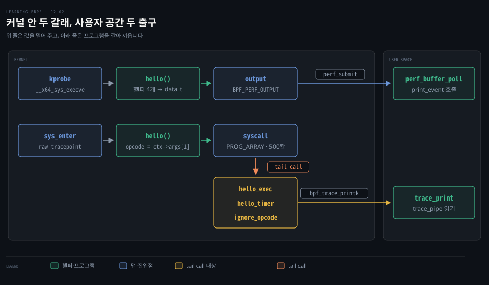
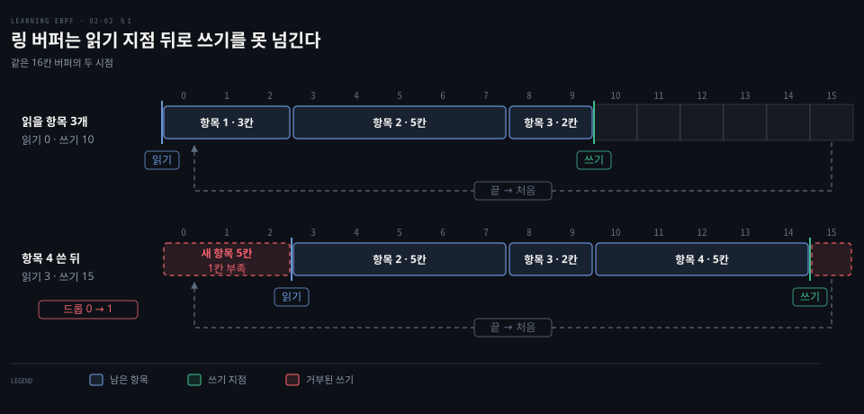
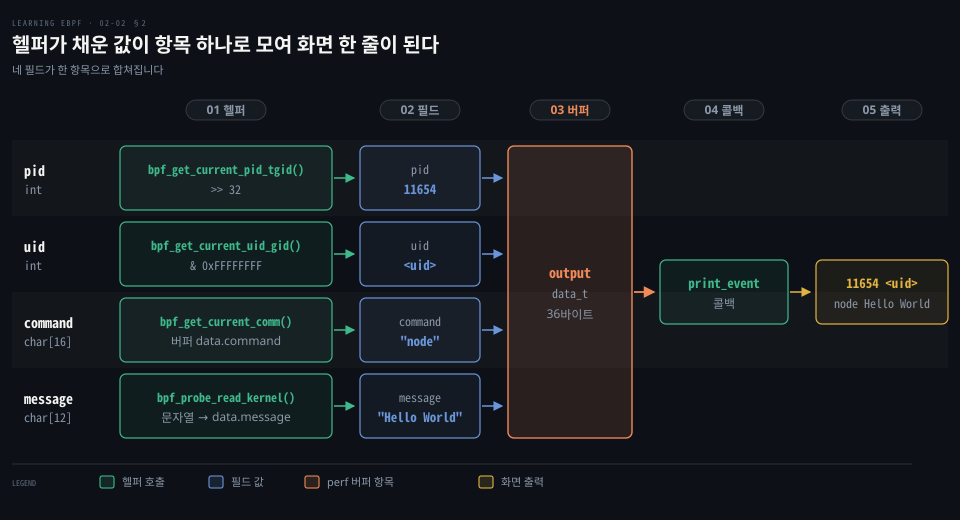
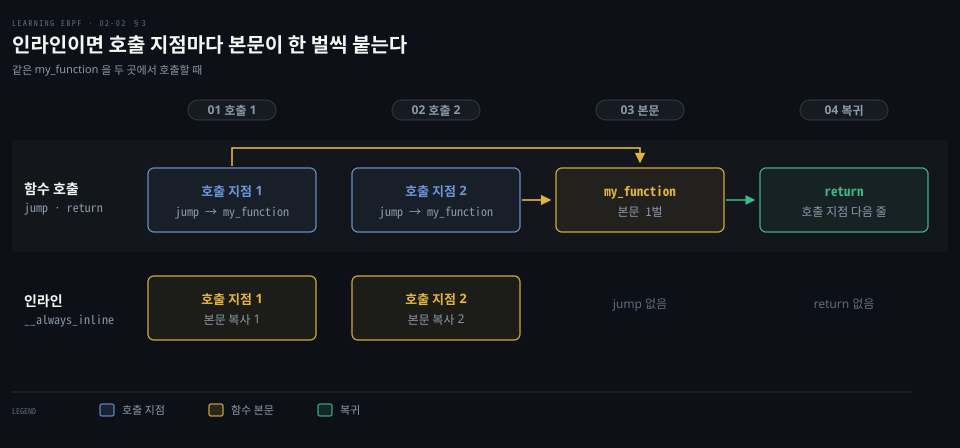
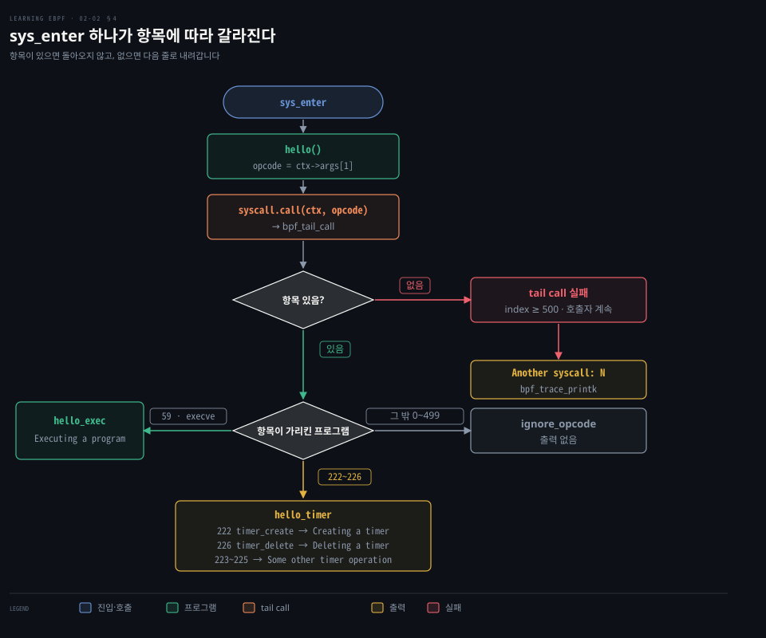

# 링 버퍼는 이벤트를 밀어 주고 tail call 은 프로그램을 갈아 끼운다

---

> eBPF 프로그램은 헬퍼로 모은 값을 perf 버퍼에 밀어 사용자 공간 콜백으로 넘기고 일이 커지면 tail call 로 다른 프로그램에 실행을 넘깁니다.


## 핵심 요약

> 이 편의 중심 생각은 커널 안의 eBPF 프로그램이 값을 사용자 공간으로 내보내는 길(링 버퍼)과 실행을 다른 프로그램에 넘기는 길(tail call)이 서로 다르다는 것입니다.

이벤트마다 다른 값을 순서대로 받으려면 해시 맵을 주기적으로 읽는 대신 링 버퍼를 씁니다. 커널 프로그램이 헬퍼로 PID·UID·명령 이름을 구조체에 채워 `perf_submit` 합니다. `perf_buffer_poll` 로 기다리던 사용자 공간은 콜백으로 항목을 받아 출력합니다. 버퍼가 가득 차면 새 항목은 유실로 집계됩니다.

프로그램을 나누는 길도 둘입니다. 인라인은 본문을 호출 지점마다 복사하고 지금은 BPF 서브프로그램으로 한 벌에 jump 할 수 있습니다. tail call 은 돌아오지 않는 호출이라 prog array 맵의 번호로 프로그램을 갈아 끼웁니다.




## 학습 목표

> 이 편을 읽고 나면 다음을 설명할 수 있습니다.

1. 해시 맵 폴링이 이벤트 전달에 맞지 않는 이유와 perf 버퍼가 푸는 방식을 설명할 수 있습니다.
2. 링 버퍼의 읽기·쓰기 지점 규칙과 쓰기가 읽기를 앞지를 때의 동작을 말할 수 있습니다.
3. `bpf_get_current_pid_tgid() >> 32` 가 꺼내는 값과 하위 32비트를 구분할 수 있습니다.
4. `__always_inline` 이 바꾸는 것과 BPF 서브프로그램이 푼 제약을 설명할 수 있습니다.
5. tail call 이 일반 호출과 다른 점, 실패했을 때의 동작, 쓰는 이유를 설명할 수 있습니다.


## 1. 링 버퍼와 이벤트 밀어 주기

> 해시 맵은 사용자 공간이 주기적으로 읽으러 가야 값이 보이지만, perf 버퍼는 이벤트가 생길 때마다 커널이 항목을 밀어 넣고 `perf_buffer_poll` 로 기다리던 사용자 공간의 콜백이 불립니다. 쓰기가 읽기를 앞지르게 되는 항목은 기록되지 않고 유실로 셉니다.

이벤트 발생 순서대로 개별 값을 온전히 받으려면 해시 맵 폴링만으로는 부족합니다. [해시 맵](./02-01.BCC%20Hello%20World%20는%20execve%20에%20kprobe%20를%20걸고%20결과를%20trace_pipe%20와%20해시%20맵으로%20꺼낸다.md)은 키마다 값을 덮어쓰거나 더하는 자리입니다. 읽는 쪽이 값을 가져가기 전에 같은 키에 다시 쓰면 이전 값은 사라지고 이벤트 순서도 남지 않습니다.

이벤트를 하나씩 넘기려면 커널이 쓰고 사용자 공간이 가져가는 대기열이 필요합니다. eBPF 는 그 역할로 perf 버퍼와 후속인 BPF 링 버퍼를 제공합니다.

**링 버퍼**는 메모리를 고리 모양으로 돌려 쓰는 자료구조입니다. 쓰기 지점과 읽기 지점이 따로 있고 길이가 제각각인 항목마다 길이 헤더가 붙습니다. 쓰기 지점은 쓴 만큼 앞으로 갑니다. 읽기 지점은 헤더가 알려 주는 길이만큼 읽고 같은 방향으로 따라갑니다. 읽기가 쓰기를 따라잡으면 읽을 항목이 없다는 뜻입니다.

반대로 쓰기가 읽기 지점을 넘어서려 하면 항목을 쓰지 않고 드롭 카운터를 올립니다. 도식의 위 행은 항목 셋이 읽기를 기다리는 모습입니다. 아래 행은 항목 1 을 읽고 항목 4 를 쓴 뒤, 빈 칸이 네 칸(15·0·1·2)뿐일 때 끝을 넘어 감아 쓸 5칸짜리 새 항목이 거부되는 모습입니다. 칸 수는 예시입니다.



perf 버퍼의 유실은 `PERF_RECORD_LOST` 레코드의 `lost` 필드로 전달됩니다. BCC 는 이를 `open_perf_buffer` 의 `lost_cb` 콜백으로 올려 줍니다. 아래 예제처럼 `lost_cb` 를 넘기지 않으면 표준 오류에 `Possibly lost N samples` 한 줄을 찍습니다.[^perf-lost]

읽기와 쓰기가 늘 같은 간격으로 같은 양만 오간다면 이론상 그 양에 딱 맞는 버퍼로도 버틸 수 있습니다. 실제로는 대부분 읽기나 쓰기의 간격이 들쭉날쭉하므로 버퍼 크기는 그 변동을 견디도록 맞춰야 합니다. 모자라면 위처럼 쓰기가 거부되어 이벤트를 잃을 수 있습니다. BCC 의 `open_perf_buffer` 는 `page_cnt`(CPU 당 페이지 수, 기본 8, 2의 거듭제곱)로 크기를 정합니다.[^bcc-pagecnt]

perf 버퍼는 CPU 마다 하나씩 따로 있어서 메모리를 CPU 수만큼 쓰고 여러 CPU 의 이벤트 순서가 섞입니다. 5.8 에서 들어온 BPF 링 버퍼는 하나를 모든 CPU 가 공유해 메모리를 아끼고 시간 순서를 지킵니다.[^kernel-ringbuf] 공간이 모자라면 예약이 실패하고 기다리지 않는 점은 같습니다. 5.8 이상[^bcc-versions]이라면 메모리와 순서 두 문제를 함께 푸는 링 버퍼를 먼저 고려할 만합니다.


## 2. 헬퍼 함수와 PID·UID·명령 이름

> kprobe 에 걸린 `hello()` 가 받는 `ctx` 는 호출 시점의 레지스터라서, 누가 `execve` 를 불렀는지는 담고 있지 않습니다. 그 값은 헬퍼가 현재 태스크에서 꺼내 구조체에 채우고, 그 구조체가 perf 버퍼를 거쳐 사용자 공간 콜백의 한 줄이 됩니다.

`execve` 에 걸린 프로그램은 어느 프로세스가 불렀는지를 `ctx` 에서 얻을 수 없습니다. 커널이 eBPF 프로그램에 제공하는 헬퍼 함수가 지금 실행 중인 태스크를 바탕으로 값을 돌려줍니다. BCC 가 C 코드를 컴파일해 싣는 흐름은 [BPF — 개요·BCC vs bpftrace·BCC](../systems-performance/15-01.BPF%20—%20개요·BCC%20vs%20bpftrace·BCC.md)에서 다뤘습니다.

예제 저장소의 `hello-buffer.py` 가 싣는 C 프로그램입니다.[^repo]

```c
// perf 버퍼 맵 output 을 만드는 BCC 매크로입니다.
BPF_PERF_OUTPUT(output);

// 이벤트 하나가 나르는 값이며 36바이트입니다.
struct data_t {
   int pid;
   int uid;
   char command[16];
   char message[12];
};

int hello(void *ctx) {
   struct data_t data = {};
   char message[12] = "Hello World";

   // 상위 32비트가 tgid, 사용자 공간이 말하는 PID 입니다.
   data.pid = bpf_get_current_pid_tgid() >> 32;
   // 하위 32비트가 uid 입니다.
   data.uid = bpf_get_current_uid_gid() & 0xFFFFFFFF;

   // 배열 이름이 곧 주소라서 헬퍼가 명령 이름을 채웁니다.
   bpf_get_current_comm(data.command, sizeof(data.command));
   // 문자열을 data.message 로 복사합니다.
   bpf_probe_read_kernel(data.message, sizeof(data.message), message);

   // data 한 벌을 perf 버퍼 output 에 밀어 넣습니다.
   output.perf_submit(ctx, &data, sizeof(data));

   return 0;
}
```

`bpf_get_current_pid_tgid()` 는 64비트 값 하나에 두 숫자를 담아 돌려줍니다. 커널 소스는 `task->tgid << 32 | task->pid` 로 만듭니다.[^kernel-ids] 사용자 공간이 PID 라고 부르는 값은 같은 프로세스의 스레드가 공유하는 tgid 입니다. 이 값이 상위 32비트에 들어 있어서 `>> 32` 로 꺼냅니다. 하위 32비트는 스레드마다 다른 ID 입니다.

`bpf_get_current_uid_gid()` 는 반대로 하위 32비트가 uid, 상위 32비트가 gid 입니다. `& 0xFFFFFFFF` 가 하위 32비트만 남깁니다.

문자열은 C 에서 `=` 로 옮길 수 없습니다. 그래서 `bpf_get_current_comm()` 은 채울 버퍼의 주소를 받아 실행 파일 이름을 쓰고 NUL 로 끝맺습니다. 실패하면 버퍼를 0 으로 채웁니다.[^kernel-comm] `bpf_probe_read_kernel()` 은 문자열을 `data.message` 에 복사하는 데 쓰였습니다. 스택의 `message` 문자열도 같은 이유로 `=` 로 넣을 수 없어서, 이 헬퍼가 `data.message` 자리로 바이트를 옮깁니다.



쓸 수 있는 헬퍼와 컨텍스트는 프로그램 유형과 붙은 이벤트에 따라 다릅니다. verifier 는 유형별 `get_func_proto` 로 허용 여부를 가립니다.[^kernel-proto] 네 헬퍼의 결과가 `output` 에 항목 하나로 들어가고, 사용자 공간 콜백이 그 항목을 한 줄로 풉니다. 도식의 `<uid>` 는 `print_event` 가 찍는 형식에서 uid 가 놓이는 자리입니다.

부착 방법은 [BCC Hello World](./02-01.BCC%20Hello%20World%20는%20execve%20에%20kprobe%20를%20걸고%20결과를%20trace_pipe%20와%20해시%20맵으로%20꺼낸다.md)와 같습니다. `b.get_syscall_fnname("execve")` 는 x86_64 에서 `__x64_sys_execve` 를 돌려줍니다.[^bcc-syscall]

```python
# 적재와 execve kprobe 부착은 생략했습니다.

# 항목이 있을 때마다 BCC 가 부르는 콜백입니다.
def print_event(cpu, data, size):
   data = b["output"].event(data)
   print(f"{data.pid} {data.uid} {data.command.decode()} {data.message.decode()}")

# 콜백을 등록하고 버퍼를 계속 폴링합니다.
b["output"].open_perf_buffer(print_event)
while True:
   b.perf_buffer_poll()
```

`event(data)` 가 바이트를 `data_t` 모양으로 풀어 줍니다. `print_event` 는 pid, uid, 명령 이름, 메시지 순서로 한 줄을 찍습니다. 예제를 돌린 출력은 다음과 같습니다.

```bash
sudo ./hello-buffer.py
11654 node Hello World
11655 sh Hello World
...
```

이 출력에는 uid 칸이 없습니다. 하지만 위 `print_event` 는 pid 와 명령 이름 사이에 uid 를 찍으므로, 코드를 돌리면 그 자리에 uid 숫자가 하나 더 나옵니다. 도식의 `<uid>` 가 그 자리입니다.


## 3. 함수 인라인과 BPF 서브프로그램

> 초기 eBPF 는 헬퍼 말고 다른 함수를 부를 수 없어서 `__always_inline` 으로 본문을 호출 지점마다 복사했습니다. 지금은 BPF 서브프로그램으로 본문 한 벌에 jump 할 수 있습니다.

같은 코드를 여러 곳에서 쓰려면 함수로 빼는 것이 보통입니다. 그런데 eBPF 프로그램은 한동안 헬퍼가 아닌 함수를 부를 수 없어서 컴파일러에게 항상 인라인하라고 지시했습니다.

```c
static __always_inline void my_function(void *ctx, int val)
```

보통의 함수 호출은 컴파일되면 jump 명령이 됩니다. 실행이 함수 본문으로 건너뛰었다가 끝나면 호출한 자리 다음으로 돌아옵니다. 인라인된 함수에는 jump 가 없고 본문 명령어가 호출한 쪽에 그대로 복사됩니다.



컴파일러는 최적화로 함수를 마음대로 인라인하기도 합니다. 커널 문서에 따르면 인라인될 수 있는 함수에 프로브를 걸어도 모든 인라인 사본을 찾아 걸지는 않습니다.[^kernel-kprobes]

커널 4.16 과 LLVM 6.0 부터는 BPF 서브프로그램, 곧 BPF 프로그램 안의 함수 호출(BPF to BPF function call)이 가능합니다.[^bcc-versions] BCC 예제는 지금도 인라인 함수를 씁니다. BCC 튜토리얼은 프로브에서 실행되지 않는 도우미 함수를 `static inline` 으로 정의하라고 안내합니다. 컴파일 단계의 `annotate_light()` 는 `noinline` 이 붙지 않은 함수에 `always_inline` 을 붙입니다.[^bcc-inline]


## 4. tail call 과 프로그램 연결

> tail call 은 호출한 프로그램에 돌아오지 않고 같은 스택으로 다른 프로그램을 실행합니다. prog array 맵에서 번호로 프로그램을 고르며 항목이 없어 실패하면 호출자가 다음 줄을 계속 실행합니다.

프로그램을 여러 조각으로 나누면 호출이 깊어질수록 스택 사용량이 늘어납니다. 스택이 512바이트뿐인 eBPF 에서는 이 제한이 먼저 문제가 됩니다.[^kernel-tailcall] tail call 은 호출한 프로그램을 새 프로그램으로 바꿔 넣고 같은 스택 프레임을 이어 씁니다. 호출한 쪽의 값은 새 프로그램에서 보이지 않고 실행은 돌아오지 않습니다.[^kernel-tailcall]

```c
long bpf_tail_call(void *ctx, struct bpf_map *prog_array_map, u32 index)
```

`ctx` 는 컨텍스트로 새 프로그램에 그대로 넘어갑니다. `prog_array_map` 은 `BPF_MAP_TYPE_PROG_ARRAY` 맵입니다. 사용자 공간이 프로그램 fd 로 채우면 커널은 그 프로그램을 가리키는 항목으로 보관합니다. `index` 는 그중 호출할 프로그램을 가리킵니다. 실패하면 헬퍼는 아무 효과가 없고 호출한 프로그램이 다음 명령부터 계속 실행됩니다. 지정한 번호에 프로그램이 없거나 이어 붙인 tail call 이 상한에 닿은 경우입니다.[^kernel-tailcall]

상한은 33번입니다.[^kernel-tailcall] verifier 가 프로그램 하나를 검사하며 처리하는 명령어는 100만 개까지입니다. 그래서 tail call 로 프로그램을 33번까지 이어 붙이면 커널 안에서만 도는 꽤 복잡한 코드도 짤 수 있습니다.[^kernel-insns]

tail call 은 4.2 부터 있었고 서브프로그램 호출과 섞어 쓰는 일은 x86_64 에서 5.10, arm64 에서 6.0 부터 가능합니다.[^bcc-versions] 대상 프로그램은 호출자와 같은 유형이어야 합니다. 커널은 prog array 를 처음 쓰는 프로그램의 유형·JIT 여부·attach 유형 등을 기억해 이후 프로그램과 맞는지 확인합니다.[^kernel-map-compat]

예제 저장소의 `hello-tail.py` 는 모든 시스템 콜의 입구인 `sys_enter` raw tracepoint 에 프로그램을 겁니다. 이 프로그램이 시스템 콜 번호로 tail call 합니다.[^repo]

```c
// 시스템 콜 번호 500칸짜리 prog array 입니다.
BPF_PROG_ARRAY(syscall, 500);

int hello(struct bpf_raw_tracepoint_args *ctx) {
    // sys_enter 의 args[1] 이 시스템 콜 번호입니다.
    int opcode = ctx->args[1];
    // BCC 가 bpf_tail_call() 로 바꾸며, 항목이 있으면 돌아오지 않습니다.
    syscall.call(ctx, opcode);
    // tail call 이 실패했을 때만 이 줄에 닿습니다.
    bpf_trace_printk("Another syscall: %d", opcode);
    return 0;
}

int hello_timer(struct bpf_raw_tracepoint_args *ctx) {
    int opcode = ctx->args[1];
    switch (opcode) {
        case 222:
            bpf_trace_printk("Creating a timer");
            break;
        // ... 226 은 "Deleting a timer", 그 밖은 "Some other timer operation" 을 찍습니다.
    }
    return 0;
}
```

사용자 공간은 프로그램을 평소처럼 싣고 prog array 를 직접 채웁니다.

```python
# tail call 대상도 독립된 프로그램이라 각각 적재합니다.
ignore_fn = b.load_func("ignore_opcode", BPF.RAW_TRACEPOINT)
exec_fn = b.load_func("hello_exec", BPF.RAW_TRACEPOINT)
timer_fn = b.load_func("hello_timer", BPF.RAW_TRACEPOINT)

prog_array = b.get_table("syscall")

# 모든 칸을 먼저 ignore_opcode 로 채웁니다.
for i in range(len(prog_array)):
    prog_array[ct.c_int(i)] = ct.c_int(ignore_fn.fd)

prog_array[ct.c_int(59)] = ct.c_int(exec_fn.fd)
prog_array[ct.c_int(222)] = ct.c_int(timer_fn.fd)
# ... 223, 224, 225 도 timer_fn 에 연결합니다.
prog_array[ct.c_int(226)] = ct.c_int(timer_fn.fd)

# 맵을 채운 뒤에 진입 프로그램을 붙입니다.
b.attach_raw_tracepoint(tp="sys_enter", fn_name="hello")

b.trace_print()
```

`hello_exec` 는 `Executing a program` 한 줄을 찍고, `ignore_opcode` 는 아무것도 하지 않고 끝납니다.

`trace_print` 는 tracefs 의 `trace_pipe` 를 읽어 찍습니다.[^bcc-trace]

세 프로그램이 모두 `BPF.RAW_TRACEPOINT` 인 것은 같은 유형 규칙 때문입니다. 여러 번호가 같은 프로그램을 가리켜도 되어서 `hello_timer` 는 222~226 다섯 칸에 걸렸습니다. x86_64 에서 59 는 `execve` 입니다. 222 는 `timer_create`, 223 은 `timer_settime`, 224 는 `timer_gettime` 입니다. 225 는 `timer_getoverrun`, 226 은 `timer_delete` 입니다.[^kernel-syscall]

저장소의 코드는 0~499 모든 칸을 먼저 `ignore_opcode` 로 채웁니다. x86_64 의 64비트 시스템 콜 번호는 최대 471 이라 전부 칸 안에 들어갑니다.[^kernel-syscall] 따라서 59·222~226 이 아닌 번호는 아무것도 출력하지 않습니다. `Another syscall: N` 은 index 가 500 이상일 때만 나옵니다. 예제를 돌린 출력의 일부는 다음과 같습니다.

```bash
b'                    bash-2626       ... Executing a program'
...
b'                    <...>-2774      ... Creating a timer'
...
b'                    <...>-2774      ... Deleting a timer'
...
```




## 면접 대비

> 링 버퍼와 헬퍼 함수, 함수 호출 방식, tail call 에 관한 면접 질문입니다.

1. 해시 맵 폴링으로 이벤트를 하나씩 받기 어려운 이유와 perf 버퍼가 이를 푸는 방식을 설명해 보십시오.
2. `bpf_get_current_pid_tgid() >> 32` 는 무엇을 꺼냅니까? 하위 32비트는 무엇이고, PID 가 홀수일 때와 짝수일 때 다른 메시지를 내려면 어디를 고칩니까?
3. `__always_inline` 은 컴파일 결과를 어떻게 바꾸고, 인라인이 kprobe 를 못 거는 이유가 되는 까닭은 무엇입니까?
4. tail call 은 일반 함수 호출과 무엇이 다르고, 항목이 없어 실패하면 어떻게 됩니까?
5. `sys_enter` 에 붙은 프로그램은 모든 시스템 콜에서 불립니다. UID 별 시스템 콜 횟수를 세려면 어떤 맵과 헬퍼를 쓰겠습니까?


## 정답 (자답 후 펼치기)

> 면접 질문에 대한 키워드 중심의 모범 답안입니다.

### 정답 1 — 덮어쓰는 맵과 이벤트 대기열

해시 맵은 키별 값을 갱신하는 자리라서 읽기 전에 다시 쓰이면 앞의 이벤트가 사라지고 순서도 남지 않습니다. perf 버퍼는 이벤트마다 항목을 밀어 넣는 링 버퍼이고 `perf_buffer_poll` 이 등록된 콜백을 부릅니다. 쓰지 못한 항목은 유실로 세어 `lost_cb` 로 알립니다.

### 정답 2 — 상위 32비트 tgid, 하위 32비트 스레드 ID

`>> 32` 는 `tgid << 32 | pid` 에서 사용자 공간의 PID 인 tgid 를 꺼내고, 하위 32비트는 스레드 ID 입니다. 홀짝 분기는 `data.pid & 1` 로 갈라 `message` 에 서로 다른 문자열을 복사하면 됩니다.

### 정답 3 — 본문 복사와 독립 진입점 없음

`__always_inline` 은 jump 대신 본문을 호출 지점마다 복사해 지점이 둘이면 본문도 두 벌입니다. 컴파일러가 커널 함수를 인라인하면 독립된 진입점이 없어 kprobe 가 모든 사본에 걸리지 않습니다. 4.16 의 BPF 서브프로그램은 eBPF 프로그램 쪽의 인라인 강제를 풀었을 뿐이고, 인라인된 커널 함수에 kprobe 가 다 걸리지 않는 문제는 그대로입니다.

### 정답 4 — 돌아오지 않는 jump 와 실패 시 계속 실행

tail call 은 같은 스택 프레임에서 호출한 프로그램을 새 프로그램으로 바꿔 넣고 돌아오지 않습니다. 대상 항목이 없거나 체인 상한 33 에 닿으면 호출자가 다음 줄을 계속 실행합니다. 대상은 prog array 의 `index` 로 고르고 유형이 같아야 합니다.

### 정답 5 — uid 를 키로 하는 해시 맵

`bpf_get_current_uid_gid() & 0xFFFFFFFF` 로 구한 uid 를 해시 맵의 키로 쓰고, 불릴 때마다 그 키의 값을 하나씩 올립니다. 사용자 공간이 맵을 읽어 UID 별 횟수를 보여 줍니다.


## 참고 자료

- Liz Rice, 《Learning eBPF》, O'Reilly Media, 2023, ISBN 978-1-098-13512-6.
- 다룬 범위는 Chapter 2 "eBPF's 'Hello World'" 의 Perf and Ring Buffer Maps · Function Calls · Tail Calls 입니다.
- 예제 저장소: https://github.com/lizrice/learning-ebpf/tree/91ded4a/chapter2
- Linux v7.2: https://github.com/torvalds/linux/tree/v7.2
- BCC v0.37.0: https://github.com/iovisor/bcc/tree/v0.37.0


## 관련 문서

- [eBPF 는 커널을 고치거나 재부팅하지 않고 커널에 안전한 프로그램을 싣는다](./01-01.eBPF%20는%20커널을%20고치거나%20재부팅하지%20않고%20커널에%20안전한%20프로그램을%20싣는다.md)
- [BCC Hello World 는 execve 에 kprobe 를 걸고 결과를 trace_pipe 와 해시 맵으로 꺼낸다](./02-01.BCC%20Hello%20World%20는%20execve%20에%20kprobe%20를%20걸고%20결과를%20trace_pipe%20와%20해시%20맵으로%20꺼낸다.md)
- [BPF — 개요·BCC vs bpftrace·BCC](../systems-performance/15-01.BPF%20—%20개요·BCC%20vs%20bpftrace·BCC.md)

[^perf-lost]: <https://github.com/torvalds/linux/blob/v7.2/include/uapi/linux/perf_event.h#L905-L914>, <https://github.com/iovisor/bcc/blob/v0.37.0/src/cc/perf_reader.c#L194-L205>
[^kernel-ringbuf]: Linux v7.2 `ringbuf.rst` L8-L26, L70-L78: <https://github.com/torvalds/linux/blob/v7.2/Documentation/bpf/ringbuf.rst>
[^bcc-versions]: BCC `kernel-versions.md` L49(tail call 4.2)·L71(서브프로그램 4.16)·L93-L94(혼용 5.10·6.0)·L172(링 버퍼 5.8): <https://github.com/iovisor/bcc/blob/v0.37.0/docs/kernel-versions.md>
[^repo]: 예제 저장소 커밋 `91ded4a`: <https://github.com/lizrice/learning-ebpf/tree/91ded4a/chapter2>
[^kernel-ids]: Linux v7.2 `helpers.c` L225-L233(pid_tgid), L241-L253(uid_gid): <https://github.com/torvalds/linux/blob/v7.2/kernel/bpf/helpers.c#L225-L253>
[^kernel-comm]: Linux v7.2 `uapi/linux/bpf.h` `bpf_get_current_comm`: <https://github.com/torvalds/linux/blob/v7.2/include/uapi/linux/bpf.h#L2255-L2264>
[^kernel-kprobes]: Linux v7.2 `kprobes.rst`: <https://github.com/torvalds/linux/blob/v7.2/Documentation/trace/kprobes.rst#L552-L556>
[^bcc-inline]: <https://github.com/iovisor/bcc/blob/v0.37.0/docs/tutorial_bcc_python_developer.md#L98>, <https://github.com/iovisor/bcc/blob/v0.37.0/src/cc/bpf_module.cc#L234-L237>
[^kernel-tailcall]: Linux v7.2 `uapi/linux/bpf.h` L2182-L2206(`bpf_tail_call`): <https://github.com/torvalds/linux/blob/v7.2/include/uapi/linux/bpf.h#L2182-L2206>, `filter.h` L100(스택 512): <https://github.com/torvalds/linux/blob/v7.2/include/linux/filter.h#L100>, `bpf.h` L2387(상한 33): <https://github.com/torvalds/linux/blob/v7.2/include/linux/bpf.h#L2387>
[^kernel-insns]: Linux v7.2 `include/linux/bpf.h` L2386(`BPF_COMPLEXITY_LIMIT_INSNS`), `kernel/bpf/verifier.c` L17367-L17371: <https://github.com/torvalds/linux/blob/v7.2/include/linux/bpf.h#L2386>, <https://github.com/torvalds/linux/blob/v7.2/kernel/bpf/verifier.c#L17367-L17371>
[^kernel-map-compat]: Linux v7.2 `core.c` `__bpf_prog_map_compatible` L2495-L2559, `bpf_check_tail_call` L2574-L2595: <https://github.com/torvalds/linux/blob/v7.2/kernel/bpf/core.c#L2495-L2595>
[^bcc-syscall]: BCC `__init__.py` `get_syscall_fnname`·접두사 목록: <https://github.com/iovisor/bcc/blob/v0.37.0/src/python/bcc/__init__.py#L309-L318>, <https://github.com/iovisor/bcc/blob/v0.37.0/src/python/bcc/__init__.py#L832-L843>
[^bcc-trace]: BCC `__init__.py` `trace_open`·`trace_print`: <https://github.com/iovisor/bcc/blob/v0.37.0/src/python/bcc/__init__.py#L1568-L1640>
[^kernel-syscall]: Linux v7.2 `syscall_64.tbl` L71, L234-L238: <https://github.com/torvalds/linux/blob/v7.2/arch/x86/entry/syscalls/syscall_64.tbl>
[^bcc-pagecnt]: BCC `table.py` L973(`page_cnt=8`)·L979-L984(2의 거듭제곱): <https://github.com/iovisor/bcc/blob/v0.37.0/src/python/bcc/table.py#L973-L984>
[^kernel-proto]: Linux v7.2 `include/linux/bpf.h` L1141-L1146(`bpf_verifier_ops.get_func_proto`): <https://github.com/torvalds/linux/blob/v7.2/include/linux/bpf.h#L1141-L1146>
