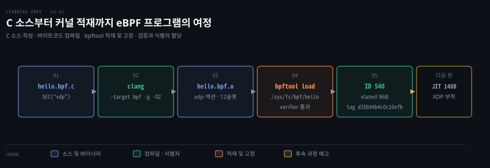
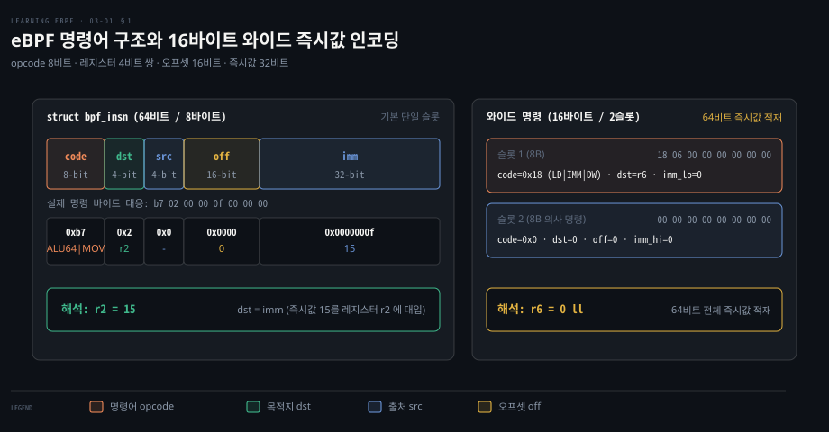
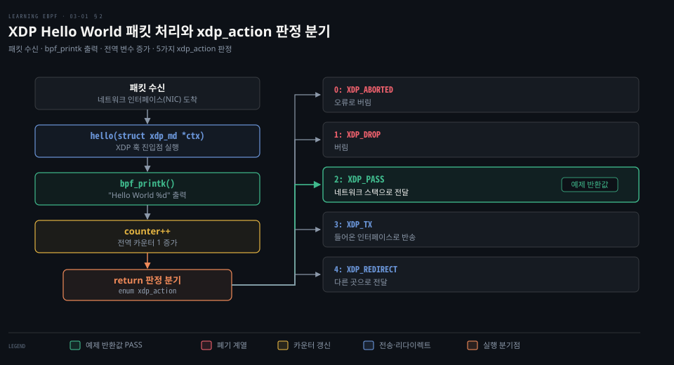
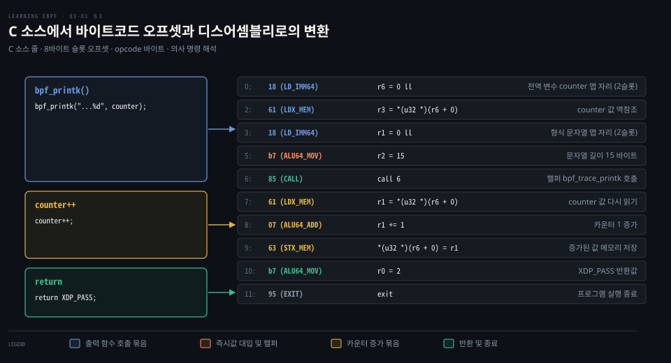
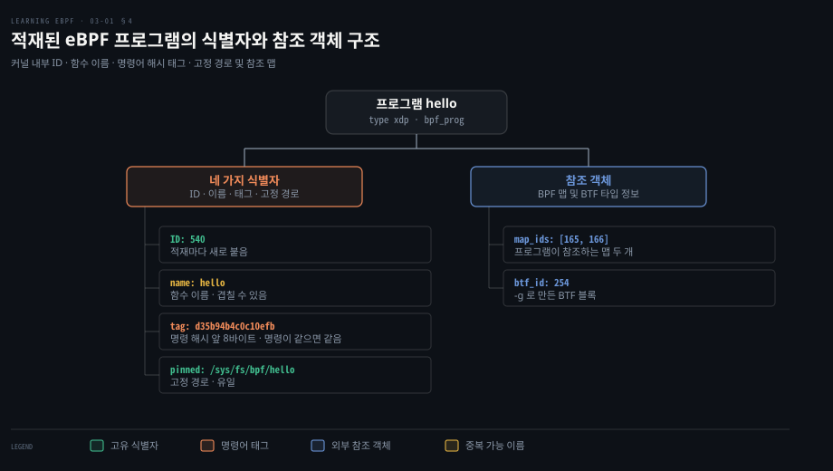

# C 소스는 clang 으로 eBPF 바이트코드가 되고 bpftool 이 적재해 ID 와 태그를 붙인다

---

> C 로 쓴 XDP 프로그램을 clang 이 8바이트 명령의 바이트코드로 컴파일합니다. bpftool 이 verifier 를 거쳐 커널에 싣고 나면 ID·이름·태그·고정 경로 네 가지로 가리킬 수 있습니다.


## 핵심 요약

> 프로그램은 소스, 오브젝트 파일, 커널에 적재된 프로그램의 세 모습을 거칩니다. 모습마다 같은 명령을 다른 방식으로 읽을 수 있습니다.

eBPF 가상 머신은 레지스터 11개와 8바이트 명령으로 돕니다. 64비트 상수만 16바이트 와이드 명령을 씁니다. 그래서 디스어셈블리의 오프셋은 바이트가 아니라 명령 슬롯 번호입니다. 와이드 명령 뒤에서는 번호가 하나 건너뜁니다.

clang 은 `-target bpf` 로 `hello.bpf.o` 를 만듭니다. 이 파일에서 맵 참조 자리는 0 으로 비어 있습니다.

적재할 때 로더가 그 자리에 맵 fd 를 넣고 [verifier 가 맵 값의 커널 주소로 바꾸며](https://github.com/torvalds/linux/blob/v7.2/kernel/bpf/verifier.c#L18216-L18217), 덤프는 그 주소를 [`map[id:…]`](https://github.com/torvalds/linux/blob/v7.2/kernel/bpf/syscall.c#L5114) 로 보여 줍니다. 헬퍼 번호는 커널 주소 기준 상대값으로 바뀝니다.


## 학습 목표

1. 레지스터 r0·r1·r6~r9·r10 의 역할과 `struct bpf_insn` 다섯 필드를 설명할 수 있습니다.
2. `SEC("xdp")`·라이선스 섹션·`xdp_action` 반환값이 각각 무엇을 정하는지 설명할 수 있습니다.
3. `llvm-objdump` 출력의 오프셋이 슬롯 번호임을 근거로 명령 바이트를 해독할 수 있습니다.
4. `bpftool prog show` 필드와 태그·ID·이름·고정 경로의 차이를 구별할 수 있습니다.
5. 적재 전후 덤프에서 바뀐 두 곳(맵 참조, 헬퍼 호출)을 짚을 수 있습니다.

아래 그림은 C 소스가 바이트코드로 컴파일되어 커널에 적재되고 식별자를 받기까지의 과정을 보여 줍니다. 명령 형식과 XDP 소스는 1·2절, 컴파일과 역어셈블은 3절, bpftool 적재와 프로그램 식별자는 4절이 다룹니다.




## 1. eBPF 레지스터와 명령 형식

> eBPF 가상 머신은 레지스터 11개와 8바이트 명령으로 돕니다. 레지스터와 명령 형식이 실제 CPU 에 일대일로 대응하도록 설계되었습니다.

초기에는 인터프리터가 실행할 때마다 명령을 해석해야 했습니다. 이 방식은 실행 비용이 들 뿐 아니라 인터프리터가 Spectre 계열 취약점에 노출될 수 있는 한계가 있었습니다. 그래서 지금은 대부분 적재할 때 한 번 기계어로 바꾸는 JIT 가 맡습니다.

JIT 가 어떻게 기계어를 만드는지는 [03-02](./03-02.JIT%20가%20바이트코드를%20기계어로%20바꾸고%20XDP%20에%20붙인%20프로그램은%20전역%20변수를%20맵에%20둔다.md)에서 봅니다. verifier 와 JIT 개괄은 [01-01](./01-01.eBPF%20는%20커널을%20고치거나%20재부팅하지%20않고%20커널에%20안전한%20프로그램을%20싣는다.md) §4, 명령 집합의 역사는 [Systems Performance 03-03](../systems-performance/03-03.운영체제%20—%20커널%20구현·Linux%20발전사·BPF.md) §6 에 있습니다.

레지스터는 `r0`~`r10` 입니다. 커널 헤더는 [`BPF_REG_0` 부터 `BPF_REG_10`](https://github.com/torvalds/linux/blob/v7.2/include/uapi/linux/bpf.h#L63-L73)까지 열거합니다. 소프트웨어로 정의된 값이지만 [x86_64·aarch64 의 물리 레지스터에 일대일로 대응](https://docs.kernel.org/bpf/classic_vs_extended.html)하도록 설계했습니다. 역할은 호출 규약으로 정해집니다. [커널 문서](https://docs.kernel.org/bpf/classic_vs_extended.html)에 따르면 호출 뒤 `r1`~`r5` 는 읽을 수 없는 상태로 돌아가고 `r6`~`r9` 는 보존됩니다.

| 레지스터 | 역할 |
|---|---|
| `r0` | 반환값. 헬퍼 호출의 결과도 여기에 담깁니다 |
| `r1` | 프로그램 진입 시 컨텍스트, 호출 시 첫 인자 |
| `r2`~`r5` | 둘째~다섯째 호출 인자. 인자는 `r1` 부터 최대 5개입니다 |
| `r6`~`r9` | 호출 뒤에도 보존되는 범용 레지스터 |
| `r10` | 읽기 전용 프레임 포인터. 스택은 [512바이트](https://github.com/torvalds/linux/blob/v7.2/include/linux/filter.h#L100)입니다 |

명령 하나는 [`struct bpf_insn`](https://github.com/torvalds/linux/blob/v7.2/include/uapi/linux/bpf.h#L80-L86) 구조체입니다. 8비트 `code`, 4비트 `dst_reg`, 4비트 `src_reg`, 16비트 `off`, 32비트 `imm` 을 합쳐 정확히 64비트입니다. 명령을 8바이트 하나로 고정하면 흔한 CPU 명령으로 옮기기 쉽습니다. 대신 32비트 `imm` 에는 64비트 상수가 들어가지 않습니다. 그래서 64비트 즉시값 적재(`BPF_LD | BPF_IMM | BPF_DW`, opcode `0x18`)만 슬롯 두 개를 이어 [와이드 명령 인코딩](https://www.rfc-editor.org/rfc/rfc9669.html#section-3.2)으로 씁니다. 첫 슬롯의 `imm` 에 하위 32비트가, 둘째 슬롯의 `imm` 에 상위 32비트가 놓입니다.

```c
// 8바이트 한 슬롯. 필드 폭은 8 + 4 + 4 + 16 + 32 = 64비트
struct bpf_insn {
    __u8  code;
    __u8  dst_reg:4;
    __u8  src_reg:4;
    __s16 off;
    __s32 imm;
};
```



명령 집합은 이제 표준 문서가 정본입니다. 2024년 10월 [RFC 9669](https://www.rfc-editor.org/info/rfc9669)로 발행됐고 [커널 문서](https://docs.kernel.org/bpf/standardization/instruction-set.html)가 같은 내용을 싣습니다. opcode 는 레지스터·메모리 적재, 저장, 산술, 점프로 갈립니다. `code` 만으로 연산이 정해지지 않는 명령도 있습니다. 원자 명령은 어떤 연산(`ADD`·`OR`·`AND`·`XOR`, `XCHG`·`CMPXCHG` 등)을 할지 `imm` 에 넣습니다([표준 문서](https://www.rfc-editor.org/rfc/rfc9669.html#section-5.3)). Rust 컴파일러도 BPF 를 타깃으로 지원하므로 C 만이 유일한 입구는 아닙니다.


## 2. XDP Hello World 와 패킷 판정

> 네트워크 인터페이스에 도착한 패킷마다 카운터를 찍고 XDP_PASS 를 반환하는 XDP 프로그램을 C 와 libbpf 로 작성합니다.

[BCC 판 Hello World](./02-01.BCC%20Hello%20World%20는%20execve%20에%20kprobe%20를%20걸고%20결과를%20trace_pipe%20와%20해시%20맵으로%20꺼낸다.md)는 `execve` 에 kprobe 를 걸었습니다. 이번에는 BCC 없이 C 와 libbpf(eBPF 프로그램을 적재·관리하는 C 라이브러리)로 패킷이 도착할 때마다 한 줄을 찍는 프로그램을 씁니다.

```c
#include <linux/bpf.h>
#include <bpf/bpf_helpers.h>

// 전역 변수. 맵으로 구현되며 03-02 에서 다룹니다
int counter = 0;

// ELF 섹션 이름 xdp 가 프로그램 유형을 정한다
SEC("xdp")
int hello(struct xdp_md *ctx) {
    bpf_printk("Hello World %d", counter);
    counter++;
    // 패킷을 정상대로 네트워크 스택으로 넘긴다
    return XDP_PASS;
}

// GPL 전용 헬퍼를 쓰려면 호환 라이선스가 필요하다
char LICENSE[] SEC("license") = "Dual BSD/GPL";
```

`SEC("xdp")` 는 함수를 `xdp` 라는 ELF(Executable and Linkable Format, 리눅스 목적 파일 형식) 섹션에 넣습니다. 로더가 섹션 이름으로 프로그램 유형을 고르므로, 이 이름이 곧 XDP 프로그램이라는 선언입니다. 프로그램 이름은 함수 이름이어서 `hello` 입니다.

라이선스 섹션이 필수인 이유는 일부 헬퍼가 GPL 전용이기 때문입니다. BPF LSM 처럼 유형 자체가 GPL 호환 라이선스를 요구하는 프로그램도 있기 때문입니다. 호환되지 않는 라이선스로 그 헬퍼를 부르면 verifier 가 [`cannot call GPL-restricted function from non-GPL compatible program`](https://github.com/torvalds/linux/blob/v7.2/kernel/bpf/verifier.c#L10200-L10203)으로 적재를 거부합니다. LSM 프로그램은 라이선스가 맞지 않으면 [`LSM programs must have a GPL compatible license`](https://github.com/torvalds/linux/blob/v7.2/kernel/bpf/bpf_lsm.c#L125-L128)로 거부됩니다.

`bpf_printk` 는 libbpf 매크로이고 BCC 의 `bpf_trace_printk` 와 같은 헬퍼로 이어집니다. 인자가 3개 이하면 [`bpf_trace_printk`](https://github.com/torvalds/linux/blob/v7.2/tools/lib/bpf/bpf_helpers.h#L293-L341)를, 그보다 많으면 `bpf_trace_vprintk` 를 부르도록 매크로가 갈라 줍니다. 일부 NIC(네트워크 카드)는 XDP 프로그램을 카드 위에서 실행하는 오프로드를 지원해 패킷이 CPU 에 닿기 전에 처리하기도 합니다.

반환값은 커널이 패킷을 어떻게 할지 정하는 판정입니다. [`enum xdp_action`](https://github.com/torvalds/linux/blob/v7.2/include/uapi/linux/bpf.h#L6576-L6582)의 다섯 값 중 하나여야 합니다.

C 관례로는 0 이 성공이지만 여기서 0 은 `XDP_ABORTED` 입니다. 

나머지 판정은 이렇습니다. `XDP_DROP` 은 패킷을 버립니다. `XDP_TX` 는 들어온 인터페이스로 되돌려 보냅니다. `XDP_REDIRECT` 는 다른 곳으로 넘깁니다. 그 CPU 에서 패킷을 곧바로 네트워크 스택으로 넘기는 값은 `XDP_PASS` 입니다. `XDP_REDIRECT` 로 [cpumap](https://github.com/torvalds/linux/blob/v7.2/kernel/bpf/cpumap.c#L12-L14) 에 보내면 다른 CPU 가 `sk_buff` 를 만들어 스택으로 올립니다.

그래서 `return 0;` 으로 바꾸면 패킷이 오류로 버려집니다.




## 3. clang 컴파일과 바이트코드 역어셈블

> clang 이 `-target bpf` 로 만든 ELF 오브젝트는 `llvm-objdump` 로 열면 8바이트 슬롯 단위로 바이트코드를 읽을 수 있습니다.

```makefile
%.bpf.o: %.bpf.c
	clang \
	    -target bpf \
	    -I/usr/include/$(shell uname -m)-linux-gnu \
	    -g \
	    -O2 -o $@ -c $<
```

커널에 적재하려면 clang 에 `-target bpf` 를 주어 호스트 CPU 가 아니라 eBPF 명령을 만들게 해야 합니다. `-g` 는 디버그 정보를 넣습니다. 이 정보가 BTF 의 재료가 되므로 소스 줄과 타입을 커널이 알아볼 수 있습니다(BTF 는 별도 편에서 다룹니다). `-O2` 는 최적화 수준입니다.

```bash
file hello.bpf.o
```

```bash
hello.bpf.o: ELF 64-bit LSB relocatable, eBPF, version 1 (SYSV), ...
```

여기서 LSB 는 **리틀 엔디언**, 곧 최하위 바이트가 먼저 오는 저장 방식입니다. [`elf(5)`](https://man7.org/linux/man-pages/man5/elf.5.html)에서 `EI_DATA` 의 값 `ELFDATA2LSB` 가 이것입니다.

```bash
llvm-objdump -S hello.bpf.o
```

```bash
hello.bpf.o:	file format elf64-bpf

Disassembly of section xdp:

0000000000000000 <hello>:
;   bpf_printk("Hello World %d", counter);
       0:	18 06 00 00 00 00 00 00 00 00 00 00 00 00 00 00	r6 = 0 ll
       2:	61 63 00 00 00 00 00 00	r3 = *(u32 *)(r6 + 0)
       3:	18 01 00 00 00 00 00 00 00 00 00 00 00 00 00 00	r1 = 0 ll
       5:	b7 02 00 00 0f 00 00 00	r2 = 15
       6:	85 00 00 00 06 00 00 00	call 6
;   counter++;
       7:	61 61 00 00 00 00 00 00	r1 = *(u32 *)(r6 + 0)
       8:	07 01 00 00 01 00 00 00	r1 += 1
       9:	63 16 00 00 00 00 00 00	*(u32 *)(r6 + 0) = r1
;   return XDP_PASS;
      10:	b7 00 00 00 02 00 00 00	r0 = 2
      11:	95 00 00 00 00 00 00 00	exit
```

왼쪽 번호가 0 에서 2 로, 3 에서 5 로 뛰는 이유는 번호가 바이트 위치가 아니라 **8바이트 명령 슬롯 번호**이기 때문입니다. `0x18` 명령이 슬롯 두 개를 차지하니 0 다음은 2, 3 다음은 5 입니다. 마지막 `exit` 가 11 이므로 슬롯은 모두 12개입니다. 이 값은 §4 의 96바이트(12 × 8)와 맞아떨어집니다.

첫 바이트가 opcode 이므로 바이트열을 직접 풀 수 있습니다.

슬롯 5 의 `b7 02 00 00 0f 00 00 00` 에서 `0xb7` 은 `dst = imm` 입니다. 둘째 바이트 `02` 는 dst 가 `r2`, `imm` 은 `0x0f` 라서 `r2 = 15` 가 됩니다. 15 는 형식 문자열 `"Hello World %d"` 14바이트와 끝 NUL 1바이트를 합친 길이로 헬퍼에 넘기는 크기 인자입니다. 슬롯 6 의 `85` 는 호출이고 `imm` 6 은 헬퍼 번호입니다. 커널이 사용자 공간에 공개하는 uapi 헤더에서 [`FN(trace_printk, 6, ...)`](https://github.com/torvalds/linux/blob/v7.2/include/uapi/linux/bpf.h#L5939)이 그 헬퍼입니다.

슬롯 10 은 같은 `0xb7` 로 `r0 = 2`, 곧 `XDP_PASS` 입니다. 슬롯 0 과 3 의 `r6 = 0 ll`, `r1 = 0 ll` 에서 `ll` 은 64비트 즉시값을 싣는 와이드 명령(`0x18`)이라는 표시입니다. 0 은 아직 채워지지 않은 맵 자리입니다. `r6` 자리는 전역 변수 `counter` 를, `r1` 자리는 상수 형식 문자열을 담은 맵을 가리킵니다([`____fmt[] = fmt`](https://github.com/torvalds/linux/blob/v7.2/tools/lib/bpf/bpf_helpers.h#L295)). 적재되면 이 자리가 바뀝니다.

나머지 바이트도 같은 방식으로 읽힙니다. 도식에 적은 이름은 커널이 명령을 부르는 이름입니다. `18` 은 64비트 즉시값 적재 [`LD_IMM64`](https://github.com/torvalds/linux/blob/v7.2/include/linux/filter.h#L268)입니다.

`61` 은 메모리 읽기 [`LDX_MEM`](https://github.com/torvalds/linux/blob/v7.2/include/linux/filter.h#L329)이고 `63` 은 메모리 쓰기 [`STX_MEM`](https://github.com/torvalds/linux/blob/v7.2/include/linux/filter.h#L349)입니다. `b7` 과 `07` 은 64비트 산술 [`ALU64`](https://github.com/torvalds/linux/blob/v7.2/include/linux/filter.h#L137)의 `MOV`(`dst = imm`)와 `ADD`(`r1 += 1`)입니다.

`85` 는 [`CALL`](https://github.com/torvalds/linux/blob/v7.2/include/uapi/linux/bpf.h#L46)이고 `95` 는 [`EXIT`](https://github.com/torvalds/linux/blob/v7.2/include/uapi/linux/bpf.h#L47)입니다.




## 4. bpftool 적재와 프로그램 식별자

> bpftool 로 프로그램을 적재하면 커널이 번호와 지문을 붙입니다. 사용자는 ID·이름·태그·고정 경로 네 가지 중 무엇으로든 같은 프로그램을 가리킬 수 있습니다.

```bash
# verifier 를 거쳐 적재하고 /sys/fs/bpf/hello 에 고정한다
bpftool prog load hello.bpf.o /sys/fs/bpf/hello
```

`bpftool` 은 고정(pin) 없이는 적재하지 않습니다. 프로그램은 참조 카운트가 0 이 되면 사라지는데 `bpftool` 은 적재 직후 종료합니다. 그래서 열어 둔 fd 가 닫히면 프로그램도 함께 사라집니다. 파일시스템의 고정 경로가 참조 하나를 유지합니다. 수명 규칙은 [04-01](./04-01.bpf%28%29%20시스템%20콜은%20BTF·맵·프로그램을%20적재하고%20참조%20카운트와%20고정·링크가%20수명을%20정한다.md)에서 다룹니다.

```bash
bpftool prog show id 540 --pretty
```

```json
{
    "id": 540,
    "type": "xdp",
    "name": "hello",
    "tag": "d35b94b4c0c10efb",
    "gpl_compatible": true,
    ...
    "uid": 0,
    "bytes_xlated": 96,
    "jited": true,
    "bytes_jited": 148,
    "bytes_memlock": 4096,
    "map_ids": [165,166],
    "btf_id": 254
}
```

예제를 돌린 출력은 위와 같고(`...` 자리의 `loaded_at` 은 생략), 필드는 이렇게 읽습니다.

`id` 는 적재할 때마다 새로 붙는 번호입니다.

`type` 이 `xdp` 라서 XDP 훅에 붙일 수 있습니다. `name` 은 함수 이름입니다. `gpl_compatible` 은 라이선스 섹션의 결과이고 `uid` 는 적재한 사용자입니다.

`bytes_xlated` 96 은 verifier 를 지난 바이트코드의 크기입니다. `jited` 와 `bytes_jited` 148 은 기계어로 바뀐 결과입니다.

`bytes_memlock` 4096 은 커널이 프로그램 구조체와 명령을 담으려 [올림해 잡은 페이지 수](https://github.com/torvalds/linux/blob/v7.2/kernel/bpf/core.c#L106)에 [페이지 크기를 곱한 값](https://github.com/torvalds/linux/blob/v7.2/kernel/bpf/syscall.c#L2580)으로 여기서는 한 페이지입니다. [`bpftool` 은 이 값을 fdinfo 의 `memlock`](https://github.com/torvalds/linux/blob/v7.2/tools/bpf/bpftool/prog.c#L475) 에서 읽어 보여 줍니다. `map_ids` 의 두 맵이 소스에 없던 이유와 `bytes_jited` 의 정체는 03-02 에서 다룹니다. `btf_id` 는 `-g` 로 만든 BTF 블록의 번호입니다.

태그는 명령 바이트열의 해시입니다. v7.2 의 [`bpf_prog_calc_tag`](https://github.com/torvalds/linux/blob/v7.2/kernel/bpf/core.c#L301-L337)는 맵 fd 를 싣는 와이드 명령의 `imm` 을 0 으로 지운 사본에 SHA-256 을 계산합니다. 그리고 앞 8바이트([`BPF_TAG_SIZE`](https://github.com/torvalds/linux/blob/v7.2/include/uapi/linux/bpf.h#L6687))를 태그로 씁니다. 맵 fd 는 사용자 공간에서 적재할 때마다 달라지므로 빼야 같은 프로그램이 같은 태그를 갖습니다.

이 해시는 2025년 9월 [커널 패치](https://github.com/torvalds/linux/commit/603b44162325)로 SHA-1 에서 SHA-256 으로 바뀌었습니다. 그래서 위 예제의 태그 `d35b94b4c0c10efb` 는 SHA-1 로 계산하던 커널(`loaded_at` 2022-08)에서 나온 값입니다. 같은 프로그램도 v7.2 에서는 다른 태그를 받습니다.

| 식별자 | 성질 |
|---|---|
| ID 540 | 적재마다 새로 붙습니다 |
| 이름 `hello` | 겹칠 수 있습니다 |
| 태그 `d35b94b4c0c10efb` | 명령이 같으면 같으며 여러 인스턴스가 공유할 수 있습니다 |
| 고정 경로 `/sys/fs/bpf/hello` | 유일합니다 |

조회 명령 `bpftool prog show` 는 네 식별자 중 무엇으로든 받습니다. `id 540` 이나 `name hello` 로 찾을 수 있습니다. `tag d35b94b4c0c10efb` 나 `pinned /sys/fs/bpf/hello` 로도 찾습니다.



실행 중인 BCC 예제도 같은 명령으로 볼 수 있습니다. 원서는 `hello-map.py` 를 돌리는 동안 `bpftool prog show name hello` 로 `197: kprobe name hello tag ba73a317e9480a37 gpl` 을 보였습니다. 끝줄의 `pids hello-map.py(2785)` 는 프로그램 fd 를 쥔 프로세스입니다.

```bash
bpftool prog dump xlated name hello
```

```bash
int hello(struct xdp_md * ctx):
; bpf_printk("Hello World %d", counter);
   0: (18) r6 = map[id:165][0]+0
   2: (61) r3 = *(u32 *)(r6 +0)
   3: (18) r1 = map[id:166][0]+0
   5: (b7) r2 = 15
   6: (85) call bpf_trace_printk#-78032
...
```

§3 의 오브젝트와 비교하면 바뀐 곳은 두 군데입니다. 슬롯 0 과 3 의 `0 ll` 은 로더가 맵 fd 를 넣고 verifier 가 맵 값의 커널 주소로 바꾼 자리입니다. 덤프는 이를 `map[id:165][0]+0`, `map[id:166][0]+0` 으로 보여 줍니다.

슬롯 6 의 `call 6` 은 `call bpf_trace_printk#-78032` 로 바뀝니다. verifier 의 후처리가 [헬퍼 주소에서 `__bpf_call_base` 를 뺀 값을 `imm` 에 넣기](https://github.com/torvalds/linux/blob/v7.2/kernel/bpf/fixups.c#L2341) 때문입니다. `-78032` 가 그 값입니다. 덤프 도구가 `__bpf_call_base + imm` 주소를 커널 심볼로 찾아 이름을 붙입니다. 오프셋과 나머지 명령은 같습니다.


## 면접 대비

1. 인터프리터를 JIT 가 대체한 이유 두 가지를 밝히고 `r0`·`r1`·`r10` 의 역할을 설명하세요.
2. `struct bpf_insn` 의 다섯 필드와 크기를 제시하고 64비트 상수는 왜 16바이트 명령을 쓰는지 설명하세요.
3. `SEC("xdp")` 와 라이선스 섹션이 각각 무엇을 정하는지, 그리고 `return 0;` 을 하면 어떻게 되는지 설명하세요.
4. `llvm-objdump` 오프셋이 0, 2, 3, 5 로 뛰는 이유와 `b7 02 00 00 0f 00 00 00` 의 뜻을 설명하세요.
5. `bpftool prog load` 가 고정을 요구하는 이유와, 실행 중인 BCC 예제를 `bpftool prog show name hello` 로 볼 때 나오는 정보, 그리고 태그가 ID 와 다른 점을 설명하세요.


## 정답 (자답 후 펼치기)

### 정답 1 — JIT 와 레지스터 규약

성능과 보안입니다. 적재할 때 한 번 기계어로 바꾸면 실행마다 해석하는 비용이 들지 않고 인터프리터에 있던 Spectre 계열 취약점 가능성도 피합니다. `r0` 은 반환값, `r1` 은 진입 시 컨텍스트와 호출의 첫 인자, `r10` 은 읽기 전용 프레임 포인터입니다. `r6`~`r9` 는 호출 뒤에도 보존됩니다.

### 정답 2 — 명령 형식

8비트 code, 4비트 dst, 4비트 src, 16비트 off, 32비트 imm 으로 64비트 한 슬롯입니다. `imm` 이 32비트라 64비트 상수가 들어가지 않으므로 `0x18` 명령은 슬롯 두 개를 이어 하위·상위 32비트를 각각의 `imm` 에 둡니다.

### 정답 3 — 섹션과 반환값

`SEC("xdp")` 는 함수를 `xdp` 섹션에 넣어 프로그램 유형을 정합니다. 프로그램 이름은 함수 이름이 됩니다. 라이선스 섹션은 GPL 전용 헬퍼를 쓸 수 있는지, LSM 처럼 GPL 호환을 요구하는 유형으로 적재할 수 있는지 verifier 가 판단하는 근거입니다. 0 은 `XDP_ABORTED` 라서 패킷이 오류로 버려집니다.

### 정답 4 — 오프셋과 바이트 해독

오프셋은 8바이트 슬롯 번호이고 `0x18` 이 슬롯 두 개를 쓰므로 번호가 건너뜁니다. `b7` 은 `dst = imm`, `02` 는 `r2`, `0f` 는 15 이므로 `r2 = 15` 입니다.

### 정답 5 — 고정과 식별자

`bpftool` 은 적재 직후 종료하므로 열어 둔 fd 가 닫히면 참조 카운트가 0 이 되어 프로그램이 사라집니다. 그래서 고정 경로가 참조 하나를 유지합니다. BCC 예제를 돌린 출력은 `197: kprobe name hello tag ba73a317e9480a37 gpl` 로 시작했습니다. 뒤이어 `xlated 296B jited 328B`, `map_ids 65`, `btf_id 179` 와 함께 `pids hello-map.py(2785)` 가 보였습니다. 이름과 태그에 더해 프로그램 fd 를 쥔 프로세스까지 알 수 있습니다. ID 는 적재마다 새로 붙지만 태그는 명령이 같으면 같습니다.


## 참고 자료

- Liz Rice, 《Learning eBPF》, O'Reilly Media, 2023, ISBN 978-1-098-13512-6, Chapter 3 "Anatomy of an eBPF Program".
- 예제 저장소: https://github.com/lizrice/learning-ebpf/tree/main/chapter3
- RFC 9669, BPF Instruction Set Architecture: https://www.rfc-editor.org/info/rfc9669
- 커널 문서, BPF Instruction Set: https://docs.kernel.org/bpf/standardization/instruction-set.html
- 커널 문서, Classic BPF vs eBPF: https://docs.kernel.org/bpf/classic_vs_extended.html
- 커널 v7.2 소스: https://github.com/torvalds/linux/tree/v7.2
- elf(5): https://man7.org/linux/man-pages/man5/elf.5.html


## 관련 문서

- [01-01.eBPF 는 커널을 고치거나 재부팅하지 않고 커널에 안전한 프로그램을 싣는다](./01-01.eBPF%20는%20커널을%20고치거나%20재부팅하지%20않고%20커널에%20안전한%20프로그램을%20싣는다.md)
- [02-01.BCC Hello World 는 execve 에 kprobe 를 걸고 결과를 trace_pipe 와 해시 맵으로 꺼낸다](./02-01.BCC%20Hello%20World%20는%20execve%20에%20kprobe%20를%20걸고%20결과를%20trace_pipe%20와%20해시%20맵으로%20꺼낸다.md)
- [03-02.JIT 가 바이트코드를 기계어로 바꾸고 XDP 에 붙인 프로그램은 전역 변수를 맵에 둔다](./03-02.JIT%20가%20바이트코드를%20기계어로%20바꾸고%20XDP%20에%20붙인%20프로그램은%20전역%20변수를%20맵에%20둔다.md)
- [04-01.bpf() 시스템 콜은 BTF·맵·프로그램을 적재하고 참조 카운트와 고정·링크가 수명을 정한다](./04-01.bpf%28%29%20시스템%20콜은%20BTF·맵·프로그램을%20적재하고%20참조%20카운트와%20고정·링크가%20수명을%20정한다.md)
- [Systems Performance 03-03.운영체제 — 커널 구현·Linux 발전사·BPF](../systems-performance/03-03.운영체제%20—%20커널%20구현·Linux%20발전사·BPF.md)
