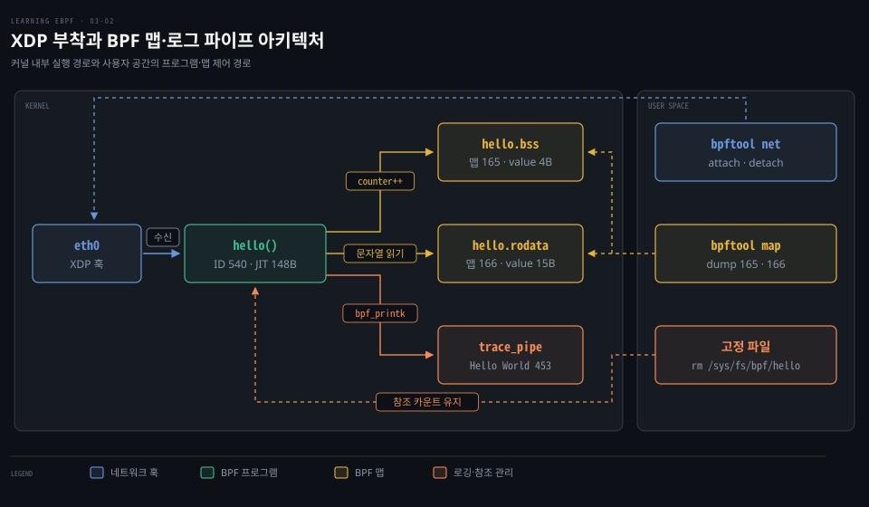
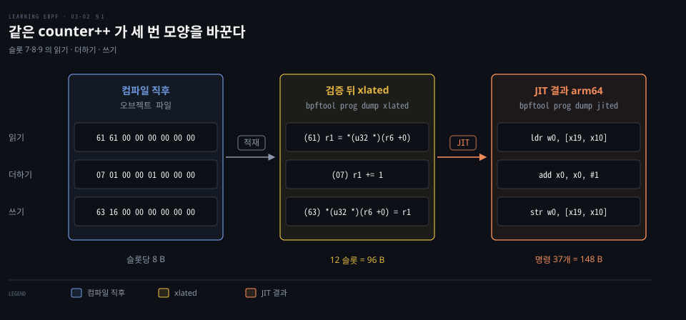
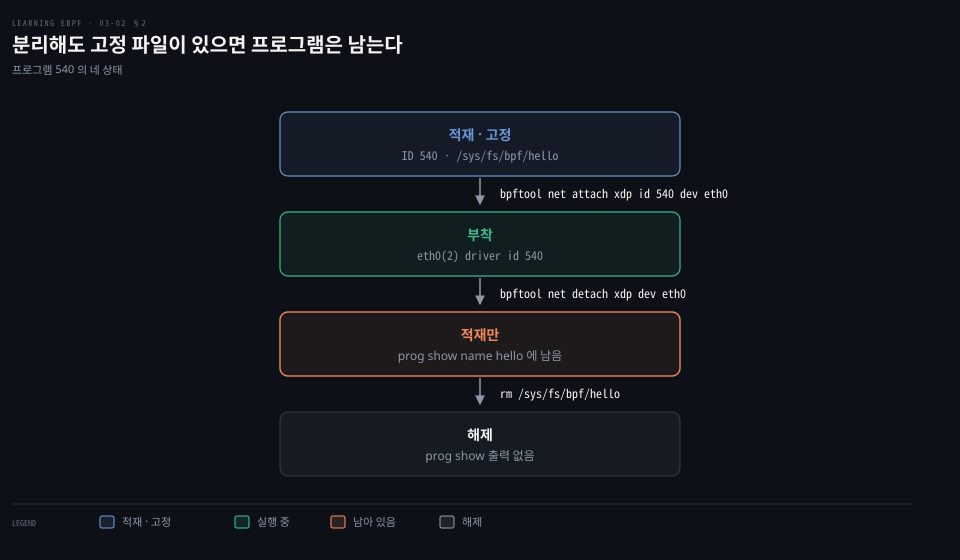
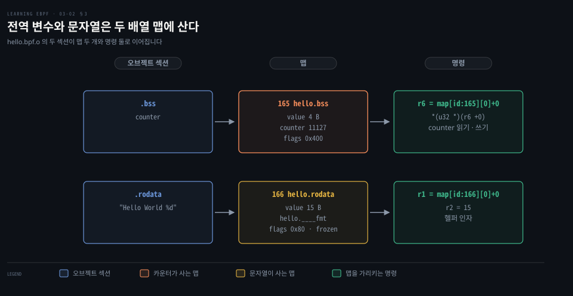
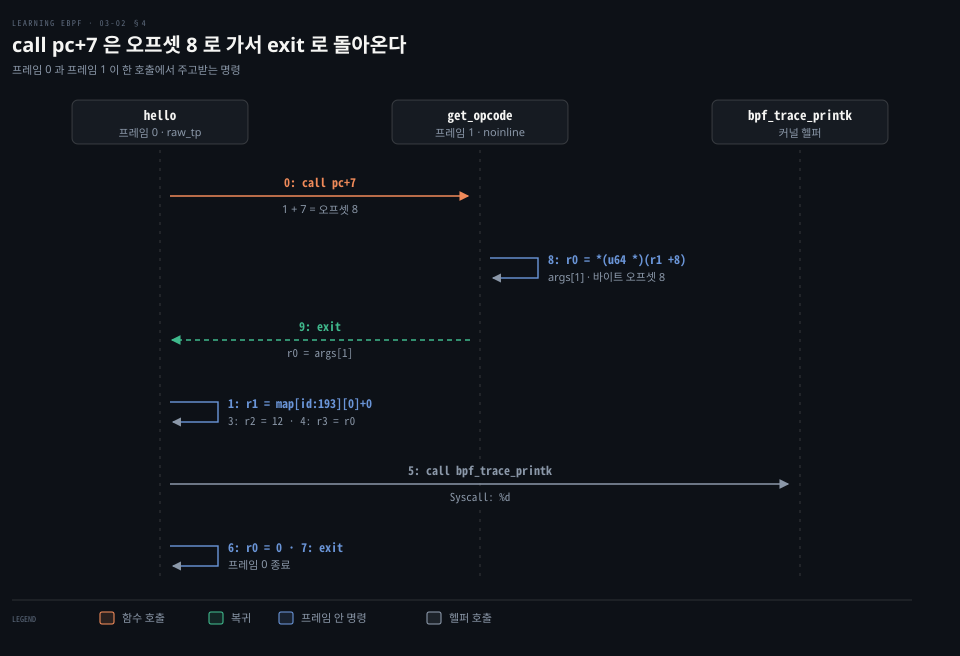

# JIT 가 바이트코드를 기계어로 바꾸고 XDP 에 붙인 프로그램은 전역 변수를 맵에 둔다

---

> JIT 가 바이트코드를 CPU 명령으로 한 번 옮기고, XDP 프로그램은 장치에 붙어야 돌며, 전역 변수와 문자열 상수는 배열 맵 두 개에 담깁니다.


## 핵심 요약

> 검증을 마친 프로그램은 JIT 로 기계어가 되고, 이벤트에 붙은 뒤에야 실행되며, 실행 사이의 상태는 맵이 맡습니다.

xlated 96B 는 바이트코드 슬롯 12개의 크기이고 jited 148B 는 JIT 가 arm64 명령 37개로 옮긴 크기입니다. 변환은 적재할 때 한 번 일어납니다.

적재만으로는 실행되지 않습니다. XDP 프로그램은 장치에 붙어야 패킷마다 돕니다. 떼어도 고정 파일이 참조를 쥐고 있으면 남고 파일을 지워야 해제됩니다.

`counter` 는 `hello.bss` 맵에, 형식 문자열은 얼려 둔 `hello.rodata` 맵에 있습니다. 함수 호출은 `call pc+7` 이 오프셋 8 로 갔다가 `exit` 로 돌아옵니다.




## 학습 목표

1. xlated·jited 크기가 무엇의 크기인지 설명하고 JIT 덤프에서 읽기·호출·반환을 짚을 수 있습니다.
2. `CONFIG_BPF_JIT_ALWAYS_ON` 이 인터프리터에 미치는 영향을 설명할 수 있습니다.
3. XDP 프로그램을 붙이고 떼는 명령과 단계별 출력을 짝지을 수 있습니다.
4. 전역 변수와 문자열 상수가 `.bss`·`.rodata` 맵이 되고 flags·frozen 의 뜻을 설명할 수 있습니다.
5. `call pc+7` 이 오프셋 8 로 가는 이유와 BPF to BPF 호출의 스택 한계를 설명할 수 있습니다.


## 1. JIT 컴파일과 xlated·jited 크기

> JIT 는 검증을 마친 바이트코드를 CPU 명령으로 한 번 옮깁니다. xlated 는 검증기를 지난 바이트코드의 크기이고 jited 는 그것이 CPU 명령이 된 크기입니다.

[03-01 편](./03-01.C%20소스는%20clang%20으로%20eBPF%20바이트코드가%20되고%20bpftool%20이%20적재해%20ID%20와%20태그를%20붙인다.md)의 `bpftool prog show` 에는 `xlated 96B jited 148B` 가 함께 있었습니다. 같은 프로그램인데 숫자가 둘인 이유는 바이트코드의 크기와 그것이 CPU 명령이 된 크기를 따로 보이기 때문입니다. xlated 덤프는 오프셋 0~11 이었고 와이드 명령이 두 슬롯을 차지했으니 슬롯 12개 × 8B 가 96B 입니다. jited 148B 는 JIT 컴파일러가 그 바이트코드를 대상 CPU 명령으로 옮긴 결과이며, 변환은 [검증기를 통과한 다음](https://github.com/torvalds/linux/blob/v7.2/Documentation/admin-guide/sysctl/net.rst?plain=1#L57-L59)에 일어납니다. 덤프의 명령(`stp`·`ldr`·`blr`)으로 보아 arm64 머신에서 돌린 덤프이며 `...` 는 줄인 곳입니다.

```bash
bpftool prog dump jited name hello
int hello(struct xdp_md * ctx):
bpf_prog_d35b94b4c0c10efb_hello:
; bpf_printk("Hello World %d", counter);
   0:   hint    #34
   4:   stp     x29, x30, [sp, #-16]!
...
  38:   ldr     w2, [x19, x10]
...
  48:   mov     x1, #15
...
  58:   blr     x10
  5c:   add     x7, x0, #0
; counter++;
  60:   mov     x10, #0
  64:   ldr     w0, [x19, x10]
  68:   add     x0, x0, #1
  6c:   mov     x10, #0
  70:   str     w0, [x19, x10]
; return XDP_PASS;
  74:   mov     x7, #2
...
  8c:   add     x0, x7, #0
  90:   ret
```

arm64 명령은 모두 4B 입니다. 오프셋 `0`~`90`(16진수)의 명령 37개라 37 × 4 = 148B 입니다. 짚을 곳은 넷입니다.

- 읽기: `ldr w2, [x19, x10]` 은 `r3 = *(u32 *)(r6 +0)` 이고 `x19` 가 `r6`(맵 값 주소)입니다.
- 호출: `blr x10` 이 `bpf_trace_printk` 주소로 분기하고 앞의 `mov x1, #15` 가 `r2 = 15` 입니다.
- 증가: `ldr w0` · `add x0, x0, #1` · `str w0` 가 `counter++` 의 읽기·더하기·쓰기입니다.
- 반환: `mov x7, #2` 가 `r0 = 2`(XDP_PASS)이고 `add x0, x7, #0` 과 `ret` 가 CPU 의 반환 레지스터로 옮깁니다.

첫머리의 `stp` 와 끝의 `ldp` 는 호출 규약에 맞춰 JIT 가 덧붙인 명령입니다. 레지스터 대응도 JIT 가 정합니다. 이 출력은 `r0` 가 `x7` 이지만 v7.2 의 arm64 표에서는 `x8` 이라 버전마다 다를 수 있습니다.[^arm64-map]

같은 `counter++` 는 오브젝트 파일에서 슬롯 7·8·9 의 `61 61 …`·`07 01 …`·`63 16 …` 바이트를 차지합니다. xlated 에서는 `(61) r1 = *(u32 *)(r6 +0)` 같은 줄로 나타납니다. JIT 뒤에는 오프셋 0 을 `x10` 에 싣는 `mov` 두 줄이 붙어 arm64 명령 다섯 줄이 됩니다.



JIT 는 `CONFIG_BPF_JIT` 로 빌드한 커널에서만 쓸 수 있습니다. 이 설정이 켜져 있어야 JIT 를 켜고 끄는 `net.core.bpf_jit_enable` 이 생깁니다.[^jit-config] 이 값은 0 이 끔, 1 이 켬, 2 가 켜고 커널 로그에 추적을 남기는 모드입니다. 기본값은 `CONFIG_BPF_JIT_DEFAULT_ON` 이 정합니다.[^jit-doc] `CONFIG_BPF_JIT_ALWAYS_ON` 이 켜진 커널은 인터프리터를 빌드에서 빼고 이 값을 1 로 고정합니다. 인터프리터가 추측 실행에 노출되는 것을 피하려는 설정입니다.[^jit-always]

덤프를 만드는 `bpftool` 은 v7.1.0 부터 LLVM 디스어셈블러를 기본으로 쓰고 libbfd 는 대안입니다.[^bpftool-llvm]


## 2. XDP 프로그램의 부착과 해제

> XDP 프로그램은 네트워크 장치에 붙어야 실행되며, 장치에서 떼어도 고정 파일이 참조를 쥐고 있으면 커널에 남습니다.

프로그램 540 은 적재만 했을 뿐 어떤 이벤트와도 이어지지 않아 아직 실행되지 않습니다. 실행 계기는 프로그램 유형이 결정합니다. XDP 프로그램의 컨텍스트는 `struct xdp_md` 입니다. 반면 이 편 마지막 절의 raw tracepoint 프로그램은 `struct bpf_raw_tracepoint_args` 를 씁니다. 유형이 컨텍스트와 붙을 훅을 함께 정하므로 XDP 프로그램은 XDP 훅에만 붙습니다.

```bash
bpftool net attach xdp id 540 dev eth0
bpftool net list
xdp:
eth0(2) driver id 540

tc:

flow_dissector:
```

`xdp` 유형은 드라이버가 XDP 를 지원하면 드라이버 수신 경로에서 도는 native 모드로 붙습니다. 드라이버가 지원하지 않으면 커널이 패킷을 소켓 버퍼(`sk_buff`)로 만든 뒤에 도는 generic 모드로 붙습니다.[^bpftool-net]

출력의 `tc:` 와 `flow_dissector:` 는 TC(트래픽 제어) 훅과 flow dissector 에 붙은 프로그램을 보여 줍니다. flow dissector 는 패킷 헤더에서 흐름 정보를 뽑는 커널 코드입니다. 여기서는 두 칸 모두 비어 있습니다. 지금의 bpftool 은 그 뒤에 netfilter 훅에 붙은 프로그램을 보이는 `netfilter:` 칸도 찍습니다. `eth0(2)` 의 `(2)` 는 인터페이스 번호입니다. `ip link` 에서도 `eth0` 에 `xdp` 플래그와 `prog/xdp id 540 ... jited` 줄이 보입니다.

`ip link set dev eth0 xdp obj hello.bpf.o sec xdp` 로 붙이고 `xdp off` 로 떼는 방법도 있습니다. 이 경로는 `bpftool prog load` 와 달리 `ip` 가 오브젝트를 직접 올립니다.[^iplink]

`bpftool prog load` 의 `autoattach` 는 오브젝트 파일에서 부착 대상을 알아낼 수 있는 유형에만 동작하고 나머지는 고정만 합니다.[^bpftool-autoattach] XDP 는 붙일 장치를 오브젝트 파일 안에서 알 수 없습니다. libbpf 의 `xdp` 섹션 정의에도 자동 부착 함수가 없어 `net attach` 가 필요합니다.[^libbpf-xdp]

붙은 프로그램은 패킷마다 돌고 `bpf_printk` 결과가 `/sys/kernel/tracing/trace_pipe` 에 쌓입니다. 이 파일은 [02-01 BCC Hello World](./02-01.BCC%20Hello%20World%20는%20execve%20에%20kprobe%20를%20걸고%20결과를%20trace_pipe%20와%20해시%20맵으로%20꺼낸다.md) 편에서 다뤘고 `bpftool prog tracelog` 도 이 파이프를 읽습니다.

```bash
cat /sys/kernel/tracing/trace_pipe
<idle>-0             [003] d.s.. 655370.944105: bpf_trace_printk: Hello World 453
...
```

execve kprobe 의 줄은 task 칸에 `bash-5412` 처럼 명령을 실행한 프로세스가 찍혔지만 이번 줄은 `<idle>-0` 입니다. task 칸은 이벤트 순간 그 CPU 를 쓰던 태스크일 뿐 패킷을 보낸 프로세스가 아닙니다. 플래그 `s` 는 소프트 인터럽트 문맥이라는 뜻이고[^ftrace-flags] 놀고 있던 CPU 에서 수신이 처리되면 `<idle>-0` 이 찍힙니다. `counter++` 로 늘어난 값은 맵에 남아 다음 실행으로 이어지며, 증가는 아래 §3 의 `map dump` 로 드러납니다. 위 출력은 줄마다 값이 모두 453 으로 같습니다.

장치에서 떼는 명령은 붙일 때 쓴 유형을 그대로 받습니다.[^bpftool-net]

```bash
bpftool net detach xdp dev eth0
```

장치에서는 떨어졌지만 프로그램은 커널에 남아 `bpftool prog show name hello` 에 계속 나옵니다. 고정 파일 `/sys/fs/bpf/hello` 가 참조를 쥐고 있기 때문입니다. 아래는 다른 때 적재한 프로그램(ID 395)을 장치에서 뗀 뒤 본 출력이라 크기와 태그가 540 과 다릅니다.

```bash
bpftool prog show name hello
395: xdp     name hello tag 9d0e949f89f1a82c gpl
        loaded_at 2022-12-19T18:20:32+0000 uid 0
        xlated 48B jited 108B memlock 4096B map_ids 4
```

`bpftool prog` 에는 `load` 의 반대 명령이 없습니다.[^bpftool-prog] 고정 파일을 지워 참조가 0 이 되면 커널이 프로그램을 내립니다.

```bash
rm /sys/fs/bpf/hello
bpftool prog show name hello
```

두 번째 명령은 출력이 없습니다. 참조 카운트가 수명을 정하는 규칙은 [04-01 편](./04-01.bpf%28%29%20시스템%20콜은%20BTF·맵·프로그램을%20적재하고%20참조%20카운트와%20고정·링크가%20수명을%20정한다.md)이 다룹니다.



Cilium 은 `loadBalancer.acceleration=native` 설정으로 로드밸런서를 XDP 로 가속합니다. 자세한 내용은 [DSR·Maglev·netkit 편](../../../08_cloud/book/cilium-up-and-running/08-02.DSR·Maglev·netkit%20은%20응답%20경로와%20백엔드%20선택과%20Pod%20연결의%20비용을%20줄인다.md)에서 다룹니다.


## 3. 전역 변수와 .bss·.rodata 배열 맵

> 전역 변수와 문자열 상수는 .bss·.rodata 배열 맵에 저장됩니다. 스택과 달리 실행이 끝나도 값이 유지되며, 변수 선언은 컴파일러와 로더가 맵 접근으로 바꿉니다.

`counter++` 는 패킷마다 돌지만 스택은 실행이 끝나면 사라져 상태를 보존하지 못합니다. 패킷마다 실행이 끝나도 값이 이어지는 이유는 맵이 커널에 남기 때문입니다. 한 맵은 같은 프로그램의 여러 실행이 쓰고 여러 프로그램이 공유할 수도 있어서 전역 변수를 맵으로 구현합니다. 이 지원은 커널 5.2 부터입니다.[^global-data] 프로그램 540 의 `map_ids` 가 165·166 입니다.

```bash
bpftool map list
165: array  name hello.bss  flags 0x400
        key 4B  value 4B  max_entries 1  memlock 4096B
        btf_id 254
166: array  name hello.rodata  flags 0x80
        key 4B  value 15B  max_entries 1  memlock 4096B
        btf_id 254  frozen
```

두 맵은 키가 4B 이고 항목이 하나인 배열 맵이며 이름은 오브젝트 이름에 섹션 이름을 이은 것입니다. `.bss`("block started by symbol")는 보통 전역 변수가 들어가는 섹션이며 이 예제에서는 `counter` 가 들어갑니다. `.rodata` 는 읽기 전용 데이터가 들어가는 섹션입니다.

flags 는 두 맵의 성질을 가릅니다. `0x400` 은 사용자 공간이 값을 메모리에 매핑할 수 있다는 `BPF_F_MMAPABLE` 입니다. `0x80` 은 프로그램이 쓸 수 없다는 `BPF_F_RDONLY_PROG` 입니다.[^uapi-flags] `.rodata` 에 `0x400` 이 없는 까닭은 libbpf 의 제약 때문입니다. libbpf 는 `static` 이 아닌 변수가 있는 섹션만 매핑 가능하게 만듭니다. 형식 문자열은 `static` 입니다.[^libbpf-mmap]

`frozen` 은 libbpf 가 `.rodata` 를 채운 뒤 `BPF_MAP_FREEZE` 로 얼려 사용자 공간의 쓰기를 막았다는 표시입니다.[^libbpf-freeze] 

두 맵의 내용은 `map dump` 로 봅니다. `-g` 로 만든 BTF 가 있으면 변수 이름이 붙어 나옵니다. `.bss` 맵에는 `counter` 가 있습니다.

```bash
bpftool map dump name hello.bss
[{
  "value": {
    ".bss": [{
        "counter": 11127
      }
    ]
  }
}]
```

`bpftool map dump id 165` 로도 같은 내용이 나옵니다. 같은 명령을 다시 돌리면 패킷을 받을 때마다 프로그램이 실행되므로 `counter` 값이 커져 있습니다. `.rodata` 맵에는 트레이스에 쓰는 형식 문자열이 들어 있습니다.

```bash
bpftool map dump name hello.rodata
[{
  "value": {
    ".rodata": [{
        "hello.____fmt": "Hello World %d"
      }
    ]
  }
}]
```

`-g` 를 빼고 빌드하면 BTF 가 없어 두 맵의 덤프가 아래처럼 바이트만 보여 줍니다. 값 281 은 위 목록의 적재(`"counter": 11127`)와 다른 실행에서 나온 값입니다.

```bash
bpftool map dump name hello.bss
key: 00 00 00 00 value: 19 01 00 00
Found 1 element

bpftool map dump id 166
key: 00 00 00 00 value: 48 65 6c 6c 6f 20 57 6f 72 6c 64 20 25 64 00
Found 1 element
```

커널에 올라간 맵에서 변수 이름을 알려 주는 정보는 BTF 뿐이라 `-g` 없이 빌드하면 위처럼 바이트만 보입니다. `19 01 00 00` 은 최하위 바이트가 앞에 오는 리틀 엔디언이라 `0x119`, 곧 281 입니다. 두 번째 덤프의 바이트는 글자 14개에 NUL 한 바이트를 더한 15개이고 `value 15B` 와 맞습니다. 앞 편의 `r2 = 15` 가 이 길이입니다.

프로그램에서 두 맵은 명령 둘로 나타납니다. `r6 = map[id:165][0]+0` 은 `counter` 의 주소를 레지스터에 담습니다. `r1 = map[id:166][0]+0` 은 형식 문자열의 주소를 담습니다. 컴파일 직후 0 이던 자리에는 적재 때 [libbpf 가 맵 fd 를 넣고](https://github.com/libbpf/libbpf/blob/v1.8.0/src/libbpf.c#L6757) verifier 가 맵 값의 커널 주소로 바꿨습니다. 덤프가 그 주소를 맵 ID 로 보여 준 것입니다(03-01 편 §4 와 같은 설명입니다).




## 4. BPF to BPF 함수 호출과 스택 프레임

> BPF to BPF 호출은 스택 프레임을 쌓고 돌아옵니다. 바이트코드 안의 함수 호출은 `call` 이 다음 명령에서 상대 오프셋만큼 건너뛰고 `exit` 가 돌아오며, 프레임마다 스택을 써서 호출 깊이에 한계가 있습니다.

프로그램 하나 안에서 함수를 나누어도 컴파일러가 인라인하면 바이트코드에 호출이 남지 않습니다. 호출 지점이 하나뿐인 작은 함수는 보통 인라인되므로 예제는 `noinline` 으로 막았습니다. 예제 저장소의 `hello-func.bpf.c` 입니다.[^repo-func]

```c
static __attribute((noinline)) int get_opcode(struct bpf_raw_tracepoint_args *ctx) {
    return ctx->args[1];
}

SEC("raw_tp/")
int hello(struct bpf_raw_tracepoint_args *ctx) {
    int opcode = get_opcode(ctx);
    bpf_printk("Syscall: %d", opcode);
    return 0;
}
```

적재한 뒤 xlated 를 보면 함수 두 개가 이어 붙어 있습니다. 소스 줄 주석은 뺐습니다.

```bash
bpftool prog dump xlated name hello
int hello(struct bpf_raw_tracepoint_args * ctx):
   0: (85) call pc+7#bpf_prog_cbacc90865b1b9a5_get_opcode
   1: (18) r1 = map[id:193][0]+0
   3: (b7) r2 = 12
   4: (bf) r3 = r0
   5: (85) call bpf_trace_printk#-73584
   6: (b7) r0 = 0
   7: (95) exit
int get_opcode(struct bpf_raw_tracepoint_args * ctx):
   8: (79) r0 = *(u64 *)(r1 +8)
   9: (95) exit
```

같은 프로그램의 함수를 부르는 `call` 은 오프셋을 호출 다음 명령 기준으로 `imm` 에 담습니다.[^isa-local] 다음 명령이 1 이고 7 을 더하면 8 이라 `get_opcode` 의 첫 명령으로 갑니다. 그 본문은 컨텍스트의 8B 뒤 값을 `r0` 에 읽습니다. `args` 가 `u64` 배열이라 `args[1]` 의 바이트 오프셋이 8 입니다.[^uapi-rawtp] `exit` 는 호출한 쪽의 오프셋 1 로 돌아옵니다. 호출한 쪽의 `r2 = 12` 는 `"Syscall: %d"` 의 길이(글자 11개와 NUL)입니다. `r3 = r0` 은 함수에서 돌려받은 값을 헬퍼의 세 번째 인자로 옮깁니다.



호출은 스택 프레임을 하나 더 만듭니다. 한 프로그램의 스택은 512B 이고 검증기는 호출 사슬이 쓰는 스택의 합이 이를 넘으면 거부합니다. 프레임 수 상한은 v7.2 에서 16 이며 넘으면 `E2BIG` 로 거부합니다.[^frames]

JIT 가 private stack 을 지원하면 kprobe·tracepoint·perf_event·raw tracepoint 프로그램이 대상입니다. 조건이 맞으면 tracing·LSM·struct_ops 프로그램도 대상에 들어갑니다. private stack 은 서브프로그램마다 따로 두는 스택입니다. LSM 은 리눅스 보안 모듈 훅에 붙는 유형입니다. struct_ops 는 커널의 함수 포인터 표를 eBPF 프로그램으로 채우는 유형입니다. 스택이 64B 이상인 서브프로그램은 전용 스택을 받아 512B 를 따로 잽니다.[^max-stack] 다만 x86-64 에서 인자를 스택으로 주고받는 서브프로그램은 빠집니다.

함수 호출의 역사는 [02-02 편 §3](./02-02.링%20버퍼는%20이벤트를%20밀어%20주고%20tail%20call%20은%20프로그램을%20갈아%20끼운다.md#3-함수-인라인과-bpf-서브프로그램), tail call 은 [§4](./02-02.링%20버퍼는%20이벤트를%20밀어%20주고%20tail%20call%20은%20프로그램을%20갈아%20끼운다.md#4-tail-call-과-프로그램-연결)에서 풀었습니다. tail call 대상인 `hello_exec` 같은 프로그램은 각자 적재되어 `bpftool prog list` 에 따로 올라옵니다. 반면 `get_opcode` 는 `hello` 의 일부라 목록에 따로 나오지 않습니다. 02-02 편의 `hello-tail.py` 를 돌리는 동안 본 출력의 일부입니다.

```bash
bpftool prog list
...
121: raw_tracepoint name ignore_opcode tag a04f5eef06a7f555 gpl
122: raw_tracepoint name hello_exec tag 931f578bd09da154 gpl
123: raw_tracepoint name hello_timer tag 6c3378ebb7d3a617 gpl
...
```

함수 두 개를 합친 바이트코드는 오프셋 0~9 에 와이드 명령 하나가 두 슬롯을 차지해 슬롯 10개, 곧 80B 가 됩니다. 다른 적재(ID 893)의 `bpftool prog list` 에서도 `xlated 80B` 로 나옵니다.


## 면접 대비

1. `xlated 96B` 와 `jited 148B` 는 각각 무엇의 크기이고 왜 다른가요? `CONFIG_BPF_JIT_ALWAYS_ON` 은 무엇을 바꾸나요?
2. 프로그램 유형과 부착 이벤트는 왜 맞아야 하고 XDP 프로그램의 trace 줄에는 왜 `<idle>-0` 이 찍히나요?
3. XDP 프로그램을 장치에서 떼면 프로그램이 사라지나요? 완전히 내리려면 무엇을 해야 하나요?
4. `counter` 와 문자열 상수는 어디에 저장되며 flags `0x400`·`0x80` 과 `frozen` 은 무엇을 뜻하나요?
5. `noinline` 함수 호출이 `call pc+7` 로 보일 때 오프셋 8 로 가는 이유와 호출 중첩의 한계는 무엇인가요?


## 정답 (자답 후 펼치기)

### 정답 1 — xlated·jited 크기와 ALWAYS_ON

xlated 는 검증기를 지난 바이트코드로 슬롯 12개 × 8B 인 96B 이고 jited 는 JIT 가 옮긴 arm64 명령 37개 × 4B 인 148B 입니다. 같은 로직을 다른 명령 체계로 적어 크기가 다릅니다. `CONFIG_BPF_JIT_ALWAYS_ON` 은 인터프리터를 빼고 `bpf_jit_enable` 을 1 로 고정합니다.

### 정답 2 — 프로그램 유형과 `<idle>-0`

유형은 컨텍스트 구조와 붙을 훅을 함께 정하므로 XDP 와 raw tracepoint 프로그램은 서로의 훅에 붙지 못합니다. task 칸은 이벤트 순간 그 CPU 를 쓰던 태스크이고 패킷 수신은 소프트 인터럽트 문맥(`s`)에서 돕니다. 놀던 CPU 면 `<idle>-0` 이 찍힙니다.

### 정답 3 — 분리와 해제

`net detach` 는 장치에서만 뗍니다. `/sys/fs/bpf/hello` 가 참조를 쥐고 있어 프로그램이 남습니다. 고정 파일을 `rm` 으로 지우면 참조 카운트가 0 이 되어 커널이 내립니다.

### 정답 4 — 전역 변수의 위치와 flags

`counter` 는 `hello.bss`(값 4B), 문자열은 `hello.rodata`(값 15B) 배열 맵에 있어 실행 사이에 값이 이어집니다. `0x400` 은 `BPF_F_MMAPABLE` 로 `.bss` 에, `0x80` 은 `BPF_F_RDONLY_PROG` 로 `.rodata` 에 붙습니다. `frozen` 은 채운 뒤 `BPF_MAP_FREEZE` 로 사용자 공간의 쓰기를 막았다는 표시입니다.

### 정답 5 — call pc+7 과 스택 한계

오프셋은 호출 다음 명령(1)을 기준으로 하므로 1 + 7 = 8 에서 `get_opcode` 가 시작합니다. 호출 사슬의 스택 합이 512B 를 넘거나(private stack 을 쓰지 않을 때) 프레임이 16개를 넘으면 거부됩니다.


## 참고 자료

- [Learning eBPF 예제 저장소 chapter3](https://github.com/lizrice/learning-ebpf/tree/main/chapter3)
- [Linux Kernel Documentation: /proc/sys/net/ — bpf_jit_enable](https://docs.kernel.org/admin-guide/sysctl/net.html)
- [bpftool v7.7.0 docs](https://github.com/libbpf/bpftool/tree/v7.7.0/docs)


## 관련 문서

- [03-01 편](./03-01.C%20소스는%20clang%20으로%20eBPF%20바이트코드가%20되고%20bpftool%20이%20적재해%20ID%20와%20태그를%20붙인다.md)


[^jit-doc]: 값의 뜻은 [커널 문서](https://docs.kernel.org/admin-guide/sysctl/net.html) 입니다. 기본값은 문서의 `0` 이 아니라 [`core.c` L548](https://github.com/torvalds/linux/blob/v7.2/kernel/bpf/core.c#L548) 의 `IS_BUILTIN(CONFIG_BPF_JIT_DEFAULT_ON)` 이 정합니다.
[^jit-config]: [`sysctl_net_core.c` v7.2 L375](https://github.com/torvalds/linux/blob/v7.2/net/core/sysctl_net_core.c#L375)·[L484-L486](https://github.com/torvalds/linux/blob/v7.2/net/core/sysctl_net_core.c#L484-L486) 의 `#ifdef CONFIG_BPF_JIT` 와 [`core.c` L546](https://github.com/torvalds/linux/blob/v7.2/kernel/bpf/core.c#L546).
[^arm64-map]: [`bpf_jit_comp.c` v7.2 L48-L76](https://github.com/torvalds/linux/blob/v7.2/arch/arm64/net/bpf_jit_comp.c#L48-L76).
[^jit-always]: [`Kconfig` L58-L71](https://github.com/torvalds/linux/blob/v7.2/kernel/bpf/Kconfig#L58-L71), 인터프리터 본체의 `#ifndef` 는 [`core.c` L1833](https://github.com/torvalds/linux/blob/v7.2/kernel/bpf/core.c#L1833), 인터프리터를 고르는 분기는 [L2597-L2618](https://github.com/torvalds/linux/blob/v7.2/kernel/bpf/core.c#L2597-L2618) 입니다.
[^bpftool-llvm]: [bpftool v7.1.0 릴리스 노트](https://github.com/libbpf/bpftool/releases/tag/v7.1.0).
[^bpftool-net]: [`bpftool-net.rst` v7.7.0 L61-L84](https://github.com/libbpf/bpftool/blob/v7.7.0/docs/bpftool-net.rst#L61-L84).
[^iplink]: [ip-link 매뉴얼 v7.2.0](https://git.kernel.org/pub/scm/network/iproute2/iproute2.git/tree/man/man8/ip-link.8.in?h=v7.2.0#n2584).
[^bpftool-autoattach]: [`bpftool-prog.rst` v7.7.0 L148-L155](https://github.com/libbpf/bpftool/blob/v7.7.0/docs/bpftool-prog.rst#L148-L155).
[^libbpf-xdp]: [`libbpf.c` v1.8.0 L10727](https://github.com/libbpf/libbpf/blob/v1.8.0/src/libbpf.c#L10727).
[^ftrace-flags]: [`ftrace.rst` v7.2 L1067-L1085](https://github.com/torvalds/linux/blob/v7.2/Documentation/trace/ftrace.rst#L1067-L1085).
[^bpftool-prog]: [`bpftool-prog.rst` v7.7.0 L25-L50](https://github.com/libbpf/bpftool/blob/v7.7.0/docs/bpftool-prog.rst#L25-L50).
[^global-data]: 두 커밋 모두 v5.1 에는 없고 v5.2 에 있습니다. [커널](https://github.com/torvalds/linux/commit/d8eca5bbb2be), [libbpf](https://github.com/torvalds/linux/commit/d859900c4c56).
[^uapi-flags]: [`bpf.h` v7.2 L1433-L1441](https://github.com/torvalds/linux/blob/v7.2/include/uapi/linux/bpf.h#L1433-L1441).
[^libbpf-mmap]: `map_is_mmapable` 은 `static` 이 아닌 변수가 있으면 참입니다. [`libbpf.c` v1.8.0 L1989-L2059](https://github.com/libbpf/libbpf/blob/v1.8.0/src/libbpf.c#L1989-L2059). `bpf_printk` 의 형식 문자열은 `static const char ____fmt[]` 입니다. [`bpf_helpers.h` v1.8.0 L288-L296](https://github.com/libbpf/libbpf/blob/v1.8.0/src/bpf_helpers.h#L288-L296).
[^libbpf-freeze]: [`libbpf.c` v1.8.0 L5404-L5407](https://github.com/libbpf/libbpf/blob/v1.8.0/src/libbpf.c#L5404-L5407).
[^repo-func]: 저장소의 섹션 이름은 `raw_tp/` 입니다. [`hello-func.bpf.c`](https://github.com/lizrice/learning-ebpf/blob/main/chapter3/hello-func.bpf.c).
[^isa-local]: [BPF Instruction Set](https://docs.kernel.org/bpf/standardization/instruction-set.html).
[^uapi-rawtp]: [`bpf.h` v7.2 L7316-L7318](https://github.com/torvalds/linux/blob/v7.2/include/uapi/linux/bpf.h#L7316-L7318).
[^max-stack]: [`filter.h` v7.2 L100](https://github.com/torvalds/linux/blob/v7.2/include/linux/filter.h#L100)(512), 합산 검사 [`verifier.c` L5143-L5153](https://github.com/torvalds/linux/blob/v7.2/kernel/bpf/verifier.c#L5143-L5153), 프로그램 유형별 분기 [L5026-L5051](https://github.com/torvalds/linux/blob/v7.2/kernel/bpf/verifier.c#L5026-L5051)·64B 기준 [L5128-L5131](https://github.com/torvalds/linux/blob/v7.2/kernel/bpf/verifier.c#L5128-L5131)(`BPF_PRIV_STACK_MIN_SIZE` 는 [L201](https://github.com/torvalds/linux/blob/v7.2/kernel/bpf/verifier.c#L201))·[L5120-L5152](https://github.com/torvalds/linux/blob/v7.2/kernel/bpf/verifier.c#L5120-L5152).
[^frames]: [`bpf_verifier.h` v7.2 L407](https://github.com/torvalds/linux/blob/v7.2/include/linux/bpf_verifier.h#L407)(16), 거부 [`verifier.c` L5220-L5224](https://github.com/torvalds/linux/blob/v7.2/kernel/bpf/verifier.c#L5220-L5224).
