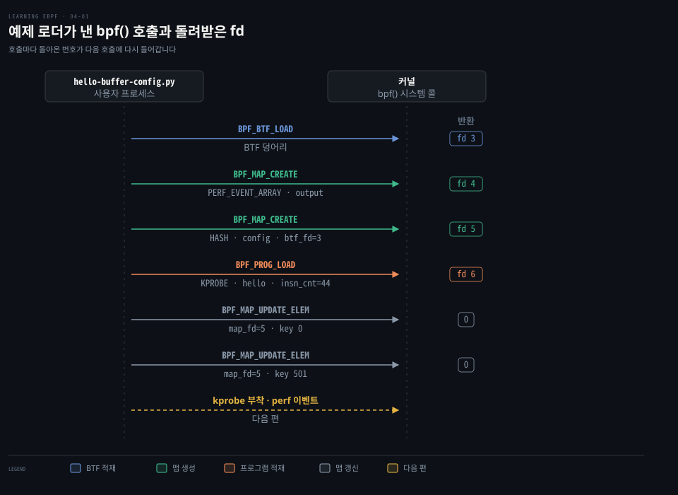
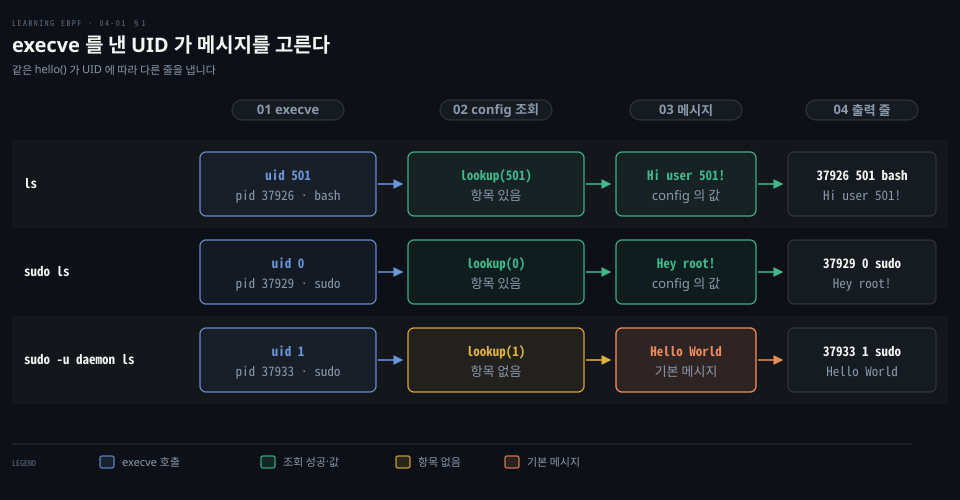
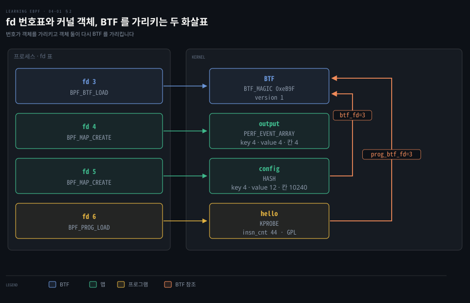
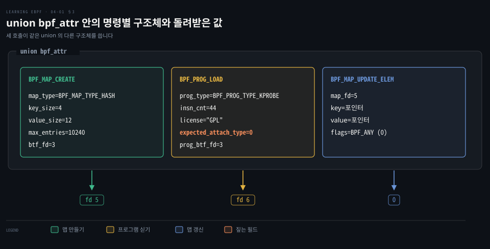
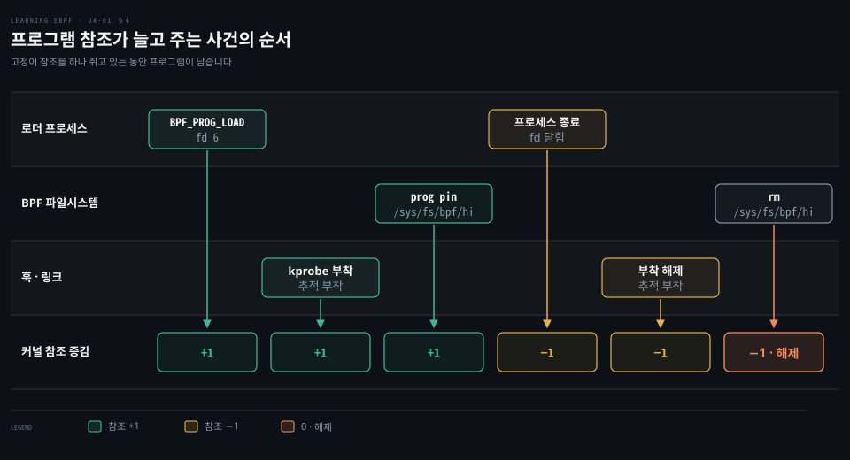

# bpf() 시스템 콜은 BTF·맵·프로그램을 적재하고 참조 카운트와 고정·링크가 수명을 정한다

---

> `bpf()` 는 명령 번호 하나로 BTF 적재·맵 생성·프로그램 적재·맵 갱신을 받고, 이렇게 만든 객체는 참조가 남아 있는 동안만 커널에 머뭅니다.


## 핵심 요약

> 이 편의 중심 생각은 사용자 공간이 eBPF 객체를 싣고 만들고 맵 원소를 키로 읽고 쓸 때 `bpf()` 를 부르며 객체의 수명은 fd·고정·링크가 쥔 참조의 개수가 정한다는 것입니다.

예제 로더의 호출은 BTF 를 싣고 맵 둘을 만든 뒤 프로그램을 싣고 맵에 값을 두 번 넣습니다. 그 뒤의 perf 버퍼 설정 호출은 [다음 편](./04-02.kprobe%20는%20perf%20이벤트로%20붙고%20perf%20버퍼는%20CPU%20마다,%20링%20버퍼는%20하나로%20사용자%20공간에%20넘긴다.md)에서 다룹니다. 돌아온 fd 3·4·5·6 은 이후 호출의 인자로 들어가 객체끼리 서로를 가리킵니다.

fd 는 참조라서 로더가 끝나 fd 가 닫히면 참조가 줄고, 0 이 되면 커널이 객체를 치웁니다. 고정 경로나 고정한 BPF 링크는 로더가 끝난 뒤에도 참조를 남깁니다.




## 학습 목표

> 이 편을 읽고 나면 다음을 설명할 수 있습니다.

1. `bpf()` 의 세 인자와, 커널 안의 프로그램이 이 호출 대신 헬퍼로 맵을 읽는 이유를 설명할 수 있습니다.
2. `BPF_BTF_LOAD`·`BPF_MAP_CREATE`·`BPF_PROG_LOAD` 가 돌려준 fd 가 이후 호출에서 쓰이는 방식을 따라갈 수 있습니다.
3. `insn_cnt`·`license`·`expected_attach_type` 이 나타내는 바를 말할 수 있습니다.
4. fd 가 프로세스마다 따로이고 `BPF_MAP_UPDATE_ELEM` 이 fd 로 맵을 고른다는 점을 설명할 수 있습니다.
5. 프로그램과 맵이 사라지는 조건, 그리고 고정·링크가 그 조건을 바꾸는 방식을 설명할 수 있습니다.


## 1. 사용자 공간은 bpf() 하나에 명령 번호를 바꿔 가며 eBPF 객체를 다룬다

> `cmd` 가 일을 고르고, `attr` 가 그 일의 인자를 담고, `size` 가 `attr` 의 바이트 수입니다. 이 호출은 사용자 공간 전용이라 커널 안의 프로그램은 헬퍼로 맵을 읽습니다.

프로그램을 싣고 맵을 만들고 값을 읽고 쓰는 일은 모두 커널 객체에 대한 요청입니다. 일마다 시스템 콜을 따로 두었을까요? 아닙니다. 시그니처는 하나입니다.

```c
int bpf(int cmd, union bpf_attr *attr, unsigned int size);
```

`attr` 는 명령마다 다른 인자를 담는 `union bpf_attr` 를 가리킵니다. 맵을 만들 때는 `map_type`·`key_size`·`value_size` 를, 프로그램을 실을 때는 `prog_type`·`insn_cnt` 를 채우는 식으로 명령별 구조체가 갈립니다.

명령 목록은 v7.2 [`enum bpf_cmd`](https://github.com/torvalds/linux/blob/v7.2/include/uapi/linux/bpf.h#L955-L998)가 정본이고, `__MAX_BPF_CMD` 앞까지 세면 39개입니다. 같은 값인 별칭 `BPF_PROG_RUN` 은 뺀 수입니다. [bpf(2) man page](https://man7.org/linux/man-pages/man2/bpf.2.html)는 맵 명령 다섯과 `BPF_PROG_LOAD` 만 설명하므로(man-pages 6.19 기준) 나머지 명령은 같은 헤더의 [앞부분 주석](https://github.com/torvalds/linux/blob/v7.2/include/uapi/linux/bpf.h#L167)이 더 완전합니다.

커널 안에서 도는 프로그램은 시스템 콜 대신 [헬퍼 함수(§2)](./02-02.링%20버퍼는%20이벤트를%20밀어%20주고%20tail%20call%20은%20프로그램을%20갈아%20끼운다.md)로 맵을 읽고 씁니다. 시스템 콜의 기본은 [시스템 콜 절(§2)](./01-01.eBPF%20는%20커널을%20고치거나%20재부팅하지%20않고%20커널에%20안전한%20프로그램을%20싣는다.md)에서 다뤘습니다.

### 예제는 사용자 ID 별 메시지를 맵에 두고 perf 버퍼로 내보낸다

`hello-buffer-config.py` 는 execve 마다 [perf 버퍼](./02-02.링%20버퍼는%20이벤트를%20밀어%20주고%20tail%20call%20은%20프로그램을%20갈아%20끼운다.md)(§1)로 한 줄을 보내는 앞선 예제에 UID 별 메시지 설정을 더한 것이라 새로 생긴 `config` 맵만 봅니다.

```c
// UID 별 메시지를 담을 값 형식
struct user_msg_t {
  char message[13];
};

// 키는 u32(UID), 값은 user_msg_t 인 해시 맵
BPF_HASH(config, u32, struct user_msg_t);
...
    // 호출한 UID 로 config 를 찾아 항목이 있으면 그 메시지를 쓴다
    p = config.lookup(&data.uid);
    if (p != 0) {
       bpf_probe_read_kernel(data.message, sizeof(data.message), p->message);
    } else {
       bpf_probe_read_kernel(data.message, sizeof(data.message), message);
    }
```

로더는 Python 두 줄로 UID 0 과 501 의 메시지를 맵에 넣습니다. ctypes 로 키와 값을 C 정의와 같은 형식으로 넘깁니다.

```python
b["config"][ct.c_int(0)] = ct.create_string_buffer(b"Hey root!")
b["config"][ct.c_int(501)] = ct.create_string_buffer(b"Hi user 501!")
```

예제를 돌린 출력입니다. 오른쪽 열은 다른 터미널에서 친 명령입니다.

```bash
Terminal 1                                    Terminal 2
./hello-buffer-config.py
37926 501 bash Hi user 501!                   ls
37927 501 bash Hi user 501!                   sudo ls
37929 0 sudo Hey root!
37931 501 bash Hi user 501!                   sudo -u daemon ls
37933 1 sudo Hello World
```

`sudo ls` 한 번이 두 줄을 만드는 것은 execve 가 두 번 불리기 때문입니다. bash 가 sudo 를 띄울 때의 UID 는 501, sudo 가 ls 를 띄울 때는 0 입니다. 마지막 줄은 UID 1(daemon)의 항목이 `config` 에 없어 기본 메시지가 나온 경우입니다.



`strace -e bpf` 로 걸러 낸 호출을 순서대로 풉니다.


## 2. BTF 를 먼저 싣고 맵은 그 BTF 를 가리키며 만들어진다

> `BPF_BTF_LOAD` 가 돌려준 3 은 방금 실은 BTF 를 가리키는 fd 입니다. `config` 맵은 이 번호를 `btf_fd` 로 넘겨 값의 필드 구성을 커널에 알립니다.

`bpftool map dump name config` 는 값을 `{"message": "Hey root!"}` 처럼 필드 이름이 붙은 JSON 으로 보여 줍니다. 맵은 바이트만 가졌는데 필드 이름은 어디서 올까요? 첫 호출이 싣는 BTF 에서 옵니다.

```bash
bpf(BPF_BTF_LOAD, {btf="\237\353\1\0...}, 128) = 3
```

`btf=` 의 앞 두 바이트 `\237\353` 은 8진수로 0x9f 0xeb 이고, [`BTF_MAGIC`](https://github.com/torvalds/linux/blob/v7.2/include/uapi/linux/btf.h#L8)(`0xeB9F`)을 리틀 엔디언으로 쓴 값입니다. 뒤의 `\1\0` 은 `struct btf_header` 의 `version`(1)과 `flags`(0)입니다.

반환값 3 은 **파일 디스크립터**, 곧 프로세스 안에서 객체를 가리키는 번호입니다. BTF 는 파일이 아니지만 이후 호출이 가리킬 수 있도록 번호를 받습니다. [이 fd 를 `BPF_PROG_LOAD` 나 `BPF_MAP_CREATE` 에 넘기면 BTF 가 그 객체에 연결](https://github.com/torvalds/linux/blob/v7.2/include/uapi/linux/bpf.h#L541-L543)됩니다.

BTF 형식과 `BPF_BTF_LOAD` 는 커널 4.18 에 들어왔습니다. [v4.18 `bpf.h`](https://github.com/torvalds/linux/blob/v4.18/include/uapi/linux/bpf.h#L98)에 이 명령이 있고 v4.17 에는 `btf.h` 자체가 없습니다. 형식은 [커널 BTF 문서](https://docs.kernel.org/bpf/btf.html)에 있습니다.

### config 맵은 btf_fd 로 BTF 를 가리키며 만들어진다

```bash
bpf(BPF_MAP_CREATE, {map_type=BPF_MAP_TYPE_PERF_EVENT_ARRAY, , key_size=4,
value_size=4, max_entries=4, ... map_name="output", ...}, 128) = 4
bpf(BPF_MAP_CREATE, {map_type=BPF_MAP_TYPE_HASH, key_size=4, value_size=12,
max_entries=10240... map_name="config", ...btf_fd=3,...}, 128) = 5
```

`output` 은 perf 버퍼를 나르는 PERF_EVENT_ARRAY 이고 키·값이 4바이트입니다. 칸이 4개인 이유는 [다음 편](./04-02.kprobe%20는%20perf%20이벤트로%20붙고%20perf%20버퍼는%20CPU%20마다,%20링%20버퍼는%20하나로%20사용자%20공간에%20넘긴다.md)에서 풉니다. `config` 는 해시 맵이고 키 4바이트는 `u32` UID, 값 12바이트는 이 출력을 찍을 때의 `user_msg_t` 크기입니다. 저장소의 perf 버퍼판은 `message` 가 13바이트라 `Hi user 501!` 12글자와 끝 NUL 이 모두 들어가며, 지금 돌리면 `value_size` 도 13 으로 찍힙니다. `max_entries=10240` 은 크기를 생략하면 들어가는 [BCC 기본값](https://github.com/iovisor/bcc/blob/v0.37.0/src/cc/export/helpers.h#L279-L280)입니다.

`config` 호출에는 `btf_fd=3` 이 실려 있습니다. 맵 정의에 BTF 를 붙이면 커널과 bpftool 이 키와 값을 구조체로 읽을 수 있습니다. bpftool 이 필드 이름을 아는 이유가 이것입니다. BTF 가 이 정보를 담는 방식은 BTF 편의 몫입니다.

여기에 프로그램이 받는 6 을 더하면 번호표가 완성됩니다. 그림은 번호표와 커널 객체의 대응, 그리고 BTF 를 가리키는 화살표를 보입니다.




## 3. BPF_PROG_LOAD 는 명령 배열과 라이선스를 넘기고 맵 갱신은 fd 로 대상을 고른다

> 프로그램을 싣는 호출은 바이트코드의 주소와 개수, 라이선스, BTF fd 를 넘기고 fd 6 을 받습니다. 맵에 값을 넣는 호출은 맵을 이름이 아닌 fd 로 고르고 키와 값은 포인터로 넘깁니다.

kprobe 프로그램인데 인자에 `expected_attach_type=BPF_CGROUP_INET_INGRESS` 가 찍힙니다. 네트워크 ingress 와 무관한 프로그램에 이 값은 왜 보일까요?

```bash
bpf(BPF_PROG_LOAD, {prog_type=BPF_PROG_TYPE_KPROBE, insn_cnt=44,
insns=0xffffa836abe8, license="GPL", ... prog_name="hello", ...
expected_attach_type=BPF_CGROUP_INET_INGRESS, prog_btf_fd=3,...}, 128) = 6
```

`prog_type` 은 프로그램이 붙을 자리의 종류로 여기서는 kprobe 입니다. `insn_cnt=44` 는 바이트코드 명령 수이고 `insns` 는 명령 배열이 놓인 사용자 공간 주소입니다. 명령 하나는 8바이트인 [`struct bpf_insn`](https://github.com/torvalds/linux/blob/v7.2/include/uapi/linux/bpf.h#L80-L86)이며 배열은 주소로 넘기므로 개수를 따로 알려야 합니다.

`license="GPL"` 은 검증에 쓰입니다. [`gpl_only`](https://github.com/torvalds/linux/blob/v7.2/include/linux/bpf.h#L970) 헬퍼를 GPL 호환이 아닌 프로그램이 부르면 [verifier 가 거부](https://github.com/torvalds/linux/blob/v7.2/kernel/bpf/verifier.c#L10200-L10201)합니다. `prog_name` 은 함수 이름 `hello` 이고 `prog_btf_fd=3` 은 `config` 가 쓴 것과 같은 BTF 입니다.

`expected_attach_type` 이 이상해 보이는 것은 열거형의 첫 값 때문입니다. [`enum bpf_attach_type`](https://github.com/torvalds/linux/blob/v7.2/include/uapi/linux/bpf.h#L1099-L1100)의 첫째가 `BPF_CGROUP_INET_INGRESS` 라 `expected_attach_type=0` 과 같고, 일반 kprobe 는 이 필드를 채우지 않아 0 이 그 이름으로 찍혔습니다. 이 자리가 의미를 갖는 유형도 있어서 multi-kprobe 는 [`BPF_TRACE_KPROBE_MULTI`](https://github.com/torvalds/linux/blob/v7.2/kernel/bpf/syscall.c#L4565-L4571)를 담습니다.

검증을 통과하지 못하면 음수를 돌려줍니다. 상세는 verifier 편의 몫입니다.



### BPF_MAP_UPDATE_ELEM 은 fd 로 대상 맵을 고른다

Python 두 줄이 UID 0, 501 순서로 맵 갱신 호출 두 번(key 0, key 501)이 됩니다.

```bash
bpf(BPF_MAP_UPDATE_ELEM, {map_fd=5, key=0xffffa7842490, value=0xffffa7a2b41
flags=BPF_ANY}, 128) = 0
```

`map_fd=5` 가 `config` 를 고릅니다. 키와 값은 포인터라 strace 에서 숫자를 읽을 수 없고, 내용은 bpftool 로 봅니다. `flags` 의 [`BPF_ANY`](https://github.com/torvalds/linux/blob/v7.2/include/uapi/linux/bpf.h#L1400-L1405)는 0 이고 키가 없으면 만들고 있으면 덮어씁니다. 같은 자리에 `BPF_NOEXIST`(1, 없을 때만 만듦)와 `BPF_EXIST`(2, 있을 때만 갱신)가 있습니다.

fd 번호는 프로세스마다 커널이 따로 매깁니다. 이 로더의 5 는 이 프로세스 안에서만 `config` 를 뜻합니다. 같은 맵을 연 다른 프로세스는 다른 번호를 받을 수 있고, 두 프로세스의 같은 번호가 서로 다른 맵일 수도 있습니다.

`strace -e bpf` 가 보여 준 호출 가운데 프로그램을 이벤트에 붙이는 것은 없습니다. 이 예제의 BCC 는 `attach_kprobe` 안에서 프로그램을 싣자마자 kprobe 를 `perf_event_open` 과 `ioctl` 로 붙이고, 이 호출은 `config` 갱신보다 먼저 나갑니다. 붙이는 방식은 유형마다 달라서 raw tracepoint 는 `BPF_RAW_TRACEPOINT_OPEN` 한 번으로 붙습니다.


## 4. 참조가 하나라도 남아 있으면 프로그램과 맵은 커널에 남는다

> 커널은 프로그램과 맵의 참조를 세어 0 이 되면 치웁니다. fd·고정·부착·BPF 링크가 참조를 하나씩 쥐고, 어떤 참조는 로더와 함께 사라지고 어떤 참조는 남습니다.

로더 스크립트를 종료하면 프로그램과 맵이 내려갑니다. 아무도 치우라고 하지 않았는데 무엇이 이 일을 할까요? 커널이 객체마다 참조 개수를 세기 때문입니다. `bpf()` 가 돌려준 fd 는 그 객체의 참조이고, fd 가 닫힘과 함께 개수가 하나 줄어 0 이 되면 객체가 해제됩니다. 참조를 쥐는 것은 fd 말고도 고정 경로·훅 부착·링크가 있고 각각 +1, 사라질 때 −1 입니다.

### 고정은 파일 경로에 참조 하나를 더한다

**고정**(pinning)은 객체를 BPF 파일시스템의 경로에 묶는 일이고 보통 `/sys/fs/bpf` 아래에 합니다. 헤더 주석이 효과를 적었습니다. [`BPF_OBJ_PIN` 이 성공하면 경로가 객체의 참조를 유지해 fd 가 닫혀도 객체가 해제되지 않고, 경로를 unlink 하면 참조가 사라집니다](https://github.com/torvalds/linux/blob/v7.2/include/uapi/linux/bpf.h#L276-L290). 이 경로는 디스크에 저장되지 않는 메모리 위 의사 파일시스템이라 재부팅하면 사라집니다.

그래서 `bpftool prog load hello.bpf.o /sys/fs/bpf/hello` 는 늘 고정하고, 고정이 없으면 bpftool 이 끝나는 순간 프로그램이 사라집니다. [적재 편](./03-01.C%20소스는%20clang%20으로%20eBPF%20바이트코드가%20되고%20bpftool%20이%20적재해%20ID%20와%20태그를%20붙인다.md)과 고정 파일을 지워 해제하는 [JIT 편](./03-02.JIT%20가%20바이트코드를%20기계어로%20바꾸고%20XDP%20에%20붙인%20프로그램은%20전역%20변수를%20맵에%20둔다.md)이 다룹니다.

```bash
# 돌고 있는 hello 를 고정한 뒤 예제를 종료하고 남았는지 본다
bpftool prog pin name hello /sys/fs/bpf/hi
bpftool prog list
# 고정을 풀어 참조를 없앤다
rm /sys/fs/bpf/hi
```

### 부착이 만든 참조는 붙인 방식을 따른다

프로그램을 훅에 붙이면 참조가 하나 더 생기고, 이 참조가 언제 사라지느냐는 어떤 방식으로 붙였느냐가 정합니다. kprobe·tracepoint 같은 추적 부착은 부착한 프로세스와 묶여 프로세스가 끝나면 줄어듭니다. 반대로 `ip link` 로 장치에 직접 붙인 XDP 는 명령이 끝나도 남습니다.

```bash
ip link set dev eth0 xdp obj hello.bpf.o sec xdp
```

```bash
bpftool prog list
...
1255: xdp     name hello      tag 9d0e949f89f1a82c         gpl
...
```

`ip` 명령은 끝났고 고정 경로도 없는데 프로그램이 남아 있습니다. 같은 XDP 라도 BPF 링크로 붙이면 달라집니다. 링크 기반 XDP 부착은 커널 5.9 에 들어왔고([v5.9 `bpf.h`](https://github.com/torvalds/linux/blob/v5.9/include/uapi/linux/bpf.h#L253)), 도입 커밋은 이 링크가 [마지막 링크 fd 가 닫힐 때에야 떨어진다](https://github.com/torvalds/linux/commit/aa8d3a716b59db6c1ad6c68fb8aa05e31980da60)고 적었습니다.

### 맵도 같은 규칙이고 쓰이지 않는 맵은 BIND_MAP 이 붙잡는다

맵도 참조가 0 이면 치워집니다. 맵을 쓰는 프로그램마다, 사용자 공간이 쥔 맵 fd 마다 참조가 하나씩 생기고 고정도 됩니다. 예외는 코드가 쓰지 않는 맵입니다. 메타데이터를 담은 전역 변수는 맵에 저장되는데, 프로그램이 그 맵을 참조하지 않으면 로더가 끝날 때 맵이 사라집니다. `BPF_PROG_BIND_MAP` 이 이 틈을 메워 [맵을 프로그램 수명에 묶습니다](https://github.com/torvalds/linux/blob/v7.2/include/uapi/linux/bpf.h#L873-L880). 이 명령은 커널 5.10 에 들어왔습니다([v5.10 `bpf.h`](https://github.com/torvalds/linux/blob/v5.10/include/uapi/linux/bpf.h#L127), v5.9 에는 없습니다).

### BPF 링크는 부착 자체를 고정할 수 있는 객체다

**BPF 링크**는 프로그램과 붙은 이벤트 사이에 놓이는 객체입니다. 링크도 fd 로 다뤄져 고정할 수 있고, 고정한 링크가 프로그램을 붙잡으면 로더가 fd 를 놓아도 프로그램이 남습니다. 도입 커밋의 의도가 [링크를 BPF 파일시스템에 고정해 프로세스가 끝나도 프로그램이 떨어지지 않게 한다](https://github.com/torvalds/linux/commit/70ed506c3bbcfa846d4636b23051ca79fa4781f7)는 것이었습니다. 링크를 만드는 `BPF_LINK_CREATE` 는 커널 5.7 에 들어왔습니다([v5.7 `bpf.h`](https://github.com/torvalds/linux/blob/v5.7/include/uapi/linux/bpf.h#L114), v5.6 에는 없습니다).

BCC 의 libbpf 도구 opensnoop 을 돌리면 `bpftool link list` 에 `116: perf_event prog 1849` 같은 링크가 보이고, 도는 동안 링크 하나를 고정하면 종료 후에도 링크와 프로그램이 남습니다.

```bash
bpftool link pin id 116 /sys/fs/bpf/mylink
```




## 면접 대비

> 먼저 직접 답해 본 뒤 정답을 펼쳐 확인합니다.

1. `bpf()` 의 세 인자를 설명하고, 커널 안의 eBPF 프로그램이 맵에 접근할 때 이 시스템 콜을 쓰지 않는 이유를 말해 보십시오.
2. strace 에서 `BPF_MAP_CREATE` 가 돌려준 5 를 이후 호출이 어떻게 쓰는지, 같은 맵을 연 다른 프로세스에서도 5 인지 답해 보십시오.
3. kprobe 프로그램을 싣는 호출에 `expected_attach_type=BPF_CGROUP_INET_INGRESS` 가 찍히는 이유를 설명해 보십시오.
4. 로더를 종료하면 kprobe 프로그램은 사라지는데 `ip link` 로 붙인 XDP 는 남는 이유와, kprobe 프로그램을 남기는 방법을 말해 보십시오.
5. 프로그램이 쓰지 않는 맵을 로더 종료 후에도 남기는 수단 둘의 차이를 설명해 보십시오.


## 정답 (자답 후 펼치기)

> 면접 질문에 대한 키워드 중심의 모범 답안입니다.

### 정답 1 — cmd·attr·size, 헬퍼

`cmd` 는 명령 번호, `attr` 는 명령별 인자를 담은 `union bpf_attr` 의 주소, `size` 는 그 바이트 수입니다. 시스템 콜은 사용자 공간이 커널에 일을 시키는 문이라 커널 안의 프로그램은 `bpf_map_lookup_elem` 같은 헬퍼로 맵을 직접 읽고 씁니다.

### 정답 2 — fd 는 프로세스 내부 번호

`BPF_MAP_UPDATE_ELEM` 이 `map_fd=5` 로 `config` 를 고릅니다. fd 는 프로세스마다 따로 매겨져 다른 프로세스는 같은 맵에 다른 번호를 받을 수 있고, 같은 번호가 다른 맵일 수도 있습니다.

### 정답 3 — 열거형의 첫 값 0

일반 kprobe 는 이 필드를 채우지 않아 0 이고, `enum bpf_attach_type` 의 첫 값 `BPF_CGROUP_INET_INGRESS` 가 0 이라 strace 가 그 이름으로 풀어 찍을 뿐입니다. 네트워크 ingress 와는 관계가 없습니다.

### 정답 4 — 부착 방식이 수명을 정한다

kprobe 부착은 로더 프로세스와 함께 사라지고 fd 도 닫혀 참조가 0 이 됩니다. `ip link` 로 장치에 직접 붙인 XDP 는 프로세스와 무관해 남습니다. kprobe 프로그램을 남기려면 `bpftool prog pin` 으로 프로그램을 고정해 참조를 하나 더 쥐게 합니다. 이때 kprobe 부착은 풀립니다. 부착까지 남기려면 BPF 링크로 붙인 뒤 `bpftool link pin` 으로 링크를 고정합니다.

### 정답 5 — 경로 참조와 수명 연결

맵 고정은 경로가 참조를 쥐어 사용자 공간이 경로로 다시 열 수 있습니다. `BPF_PROG_BIND_MAP`(5.10)은 맵을 프로그램 수명에 묶어 프로그램이 해제될 때에야 맵이 해제되게 하므로 경로가 필요 없는 경우에 맞습니다.


## 참고 자료

- 《Learning eBPF》(Liz Rice, O'Reilly Media, 2023, ISBN 978-1-098-13512-6) Ch.4 — 예제 코드 [chapter4](https://github.com/lizrice/learning-ebpf/tree/1ccef6e/chapter4)
- [bpf(2) man page](https://man7.org/linux/man-pages/man2/bpf.2.html)
- [커널 v7.2 `bpf.h`](https://github.com/torvalds/linux/blob/v7.2/include/uapi/linux/bpf.h) · [`btf.h`](https://github.com/torvalds/linux/blob/v7.2/include/uapi/linux/btf.h) · [BTF 문서](https://docs.kernel.org/bpf/btf.html)
- 커널 커밋 [70ed506](https://github.com/torvalds/linux/commit/70ed506c3bbcfa846d4636b23051ca79fa4781f7)(pinnable bpf_link), [aa8d3a7](https://github.com/torvalds/linux/commit/aa8d3a716b59db6c1ad6c68fb8aa05e31980da60)(링크 기반 XDP)
- Alexei Starovoitov, [Lifetime of BPF Objects](https://facebookmicrosites.github.io/bpf/blog/2018/08/31/object-lifetime.html)


## 관련 문서

- [kprobe 부착과 perf·링 버퍼](./04-02.kprobe%20는%20perf%20이벤트로%20붙고%20perf%20버퍼는%20CPU%20마다,%20링%20버퍼는%20하나로%20사용자%20공간에%20넘긴다.md)
- [BPF 개요·BCC](../systems-performance/15-01.BPF%20—%20개요·BCC%20vs%20bpftrace·BCC.md)
