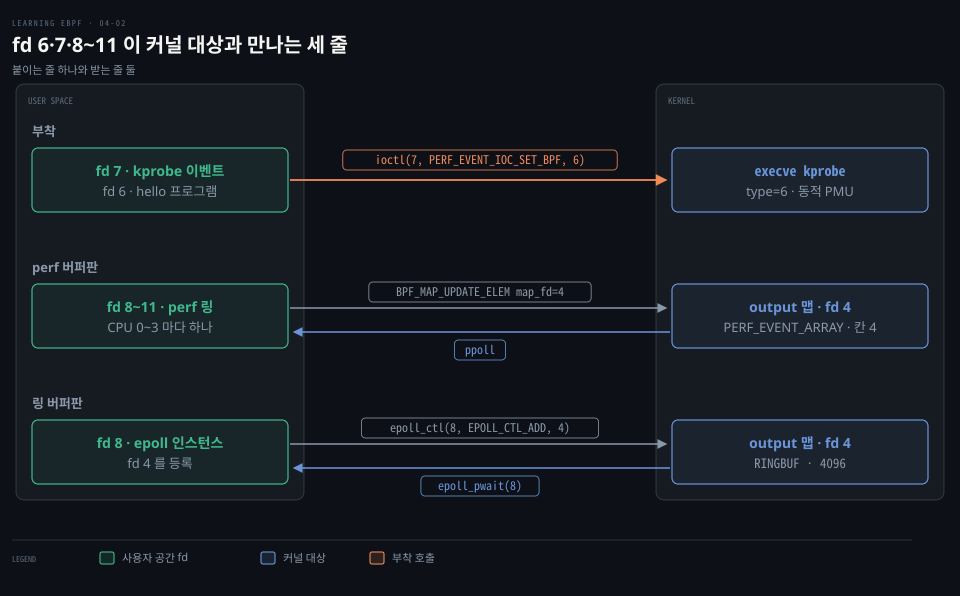
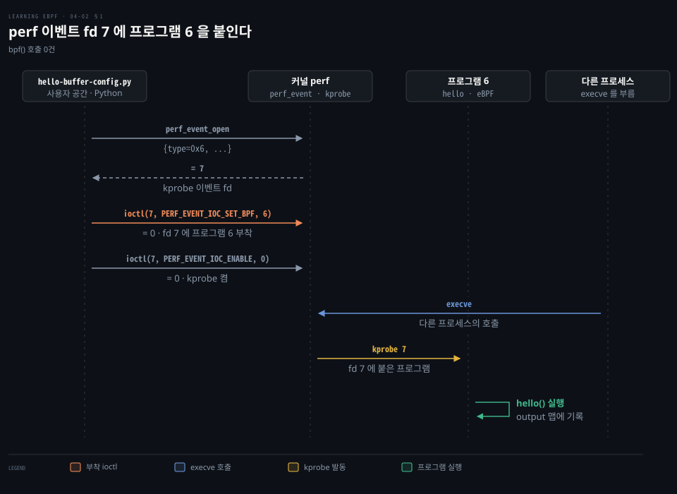
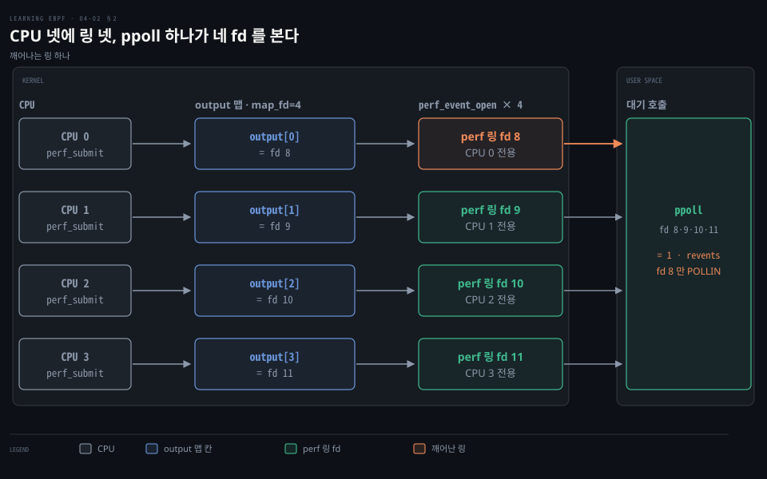
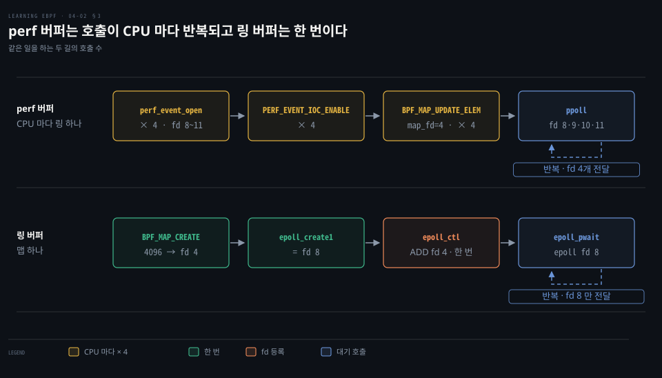
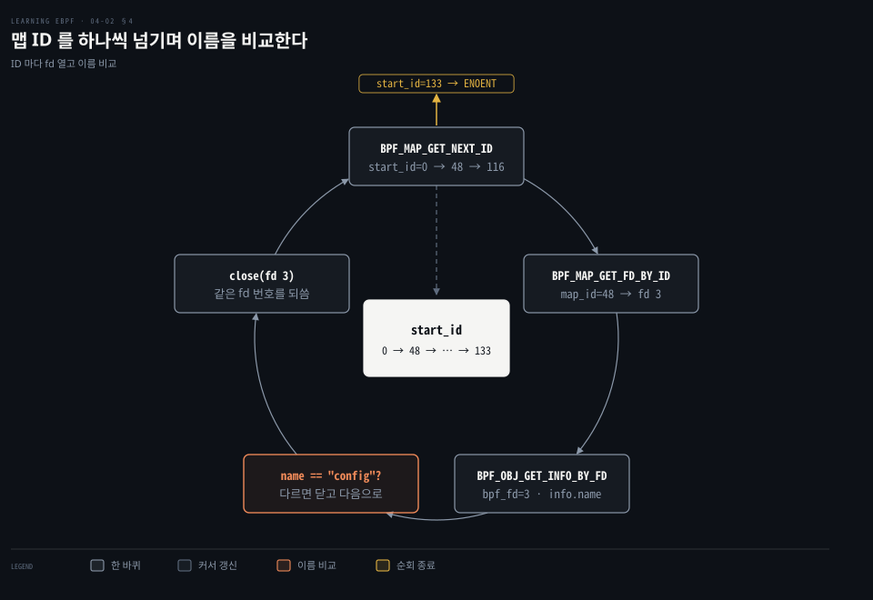
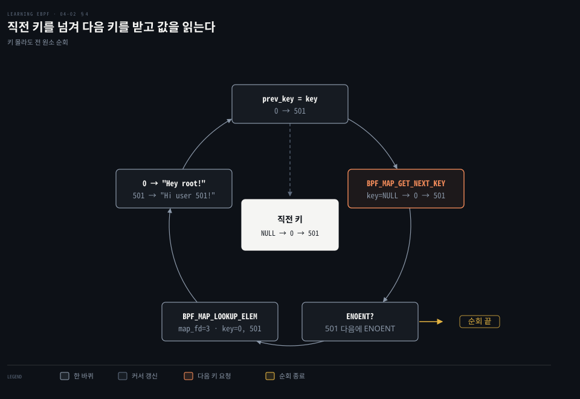

# kprobe 는 perf 이벤트로 붙고 perf 버퍼는 CPU 마다, 링 버퍼는 하나로 사용자 공간에 넘긴다

---

> kprobe 는 `bpf()` 가 아니라 `perf_event_open()` 이 돌려준 fd 에 `ioctl` 로 붙고, 사용자 공간으로 가는 출력은 perf 버퍼가 CPU 마다 링 하나와 `ppoll` 로, 링 버퍼가 맵 하나와 `epoll` 로 맡습니다.


## 핵심 요약

> 이 편의 중심 생각은 `bpf()` 호출 목록만으로는 프로그램이 어디에 붙었는지도 데이터가 어디로 나오는지도 보이지 않으며, 그 둘은 perf 이벤트 fd 와 대기 호출이 맡는다는 것입니다.

`bpf()` 는 프로그램을 싣는 데서 끝납니다. kprobe 에 거는 일은 `perf_event_open()` 의 fd 에 `ioctl` 두 번으로 이뤄져서 `strace -e bpf` 에는 안 보입니다.

출력 통로는 둘입니다. perf 버퍼는 CPU 마다 링을 열어 그 fd 를 맵 칸에 꽂고 `ppoll` 이 네 fd 를 감시합니다. 링 버퍼는 맵 하나를 epoll 인스턴스에 한 번 등록하면 끝납니다.

bpftool 은 ID 를 차례로 받아 이름을 비교합니다. 찾은 맵은 키를 차례로 받아 읽습니다.




## 학습 목표

> 이 편을 읽고 나면 다음을 설명할 수 있습니다.

1. kprobe 가 `perf_event_open` 과 `ioctl` 두 번으로 붙는 순서와 부착이 `bpf()` 목록에 없는 까닭을 설명할 수 있습니다.
2. `perf_event_open` 의 `type` 값이 sysfs 에서 오는 이유를 말할 수 있습니다.
3. perf 버퍼에서 `BPF_MAP_UPDATE_ELEM` 이 CPU 수만큼 반복되는 까닭을 설명할 수 있습니다.
4. `ppoll` 과 `epoll` 의 차이와 현재 BCC·libbpf 가 기다리는 방식을 구분할 수 있습니다.
5. bpftool 이 이름으로 맵을 찾아 원소를 읽는 호출 순서와 필요한 권한을 설명할 수 있습니다.


## 1. kprobe 부착은 bpf() 가 아니라 perf 이벤트 fd 와 ioctl 로 이뤄진다

> `bpf()` 는 프로그램을 싣기만 하고, kprobe 에 거는 일은 `perf_event_open()` 이 돌려준 fd 와 `ioctl` 이 맡습니다. 그래서 `strace -e bpf` 에는 부착이 나타나지 않습니다.

프로그램은 `bpf(BPF_PROG_LOAD)` 로 fd 6 이 되었는데, `execve` 가 불릴 때 그 프로그램이 도는 이유가 `bpf()` 호출 어디에도 없습니다. 어디서 붙은 것일까요?

예제 `hello-buffer-config.py` 는 `execve` 에 kprobe 를 걸고 `config` 맵의 메시지를 perf 버퍼로 내보냅니다.[^repo] 적재가 끝나면 fd 3 은 BTF, 4 는 `output` 맵, 5 는 `config` 맵, 6 은 `hello` 프로그램입니다. 번호가 매겨지는 과정은 [bpf() 시스템 콜 편](./04-01.bpf%28%29%20시스템%20콜은%20BTF·맵·프로그램을%20적재하고%20참조%20카운트와%20고정·링크가%20수명을%20정한다.md)에서 다뤘습니다.

`strace -e bpf,perf_event_open,ioctl,ppoll ./hello-buffer-config.py` 로 추적 대상을 넓히면 부착 세 줄이 나옵니다. eBPF 와 관계없는 `ioctl` 은 뺀 출력입니다.

```bash
# kprobe 용 perf 이벤트를 만들어 fd 7 을 돌려받습니다.
perf_event_open({type=0x6 /* PERF_TYPE_??? */, ...},...) = 7
# fd 7 에 프로그램 fd 6 을 붙입니다.
ioctl(7, PERF_EVENT_IOC_SET_BPF, 6)                  = 0
# fd 7 의 이벤트를 켭니다.
ioctl(7, PERF_EVENT_IOC_ENABLE, 0)                   = 0
```



### type 의 6 은 sysfs 가 정한 번호다

strace 가 `type=0x6` 을 `PERF_TYPE_???` 로 남긴 것은 6 이 고정 상수가 아니기 때문입니다. **동적 PMU** 는 커널이 이벤트 공급자를 등록할 때 번호를 붙이는 방식입니다. PMU(Performance Monitoring Unit)는 원래 CPU 의 성능 계수 장치를 가리키는 말이지만, 커널의 perf 서브시스템은 kprobe 같은 소프트웨어 이벤트 공급자도 PMU 로 등록합니다.

번호는 `/sys/bus/event_source/devices/<이름>/type` 파일에 적힙니다. 커널 함수에 거는 kprobe 와 사용자 공간 함수에 거는 uprobe 는 4.17 부터 이 방식으로 노출됩니다.[^man-perf]

```bash
# kprobe PMU 의 type 입니다. 예제를 돌린 기계에서는 6 이었습니다.
cat /sys/bus/event_source/devices/kprobe/type
# 6
```

번호가 기계마다 다를 수 있어서 라이브러리가 이 파일을 읽어 채웁니다. BCC 도 그렇게 합니다.[^bcc-attach]

어느 함수에 걸렸는지는 이 줄만으로 알 수 없습니다. 함수 이름이 든 `kprobe_func` 필드가 출력에 보이지 않기 때문입니다. `execve` 는 파이썬의 `attach_kprobe(event=syscall, …)` 에서 옵니다.

`PERF_EVENT_IOC_SET_BPF` 는 4.1 부터 있고 CAP_PERFMON(5.8 이후) 이나 CAP_SYS_ADMIN 이 필요합니다.[^man-perf] `PERF_EVENT_IOC_ENABLE` 이 켠 뒤로는 `execve` 가 불릴 때마다 fd 7 의 kprobe 가 프로그램 6 을 실행합니다.

요즘 libbpf 는 커널이 지원하면 같은 fd 를 `BPF_LINK_CREATE`(attach_type `BPF_PERF_EVENT`) 로 링크로 묶습니다. 지원하지 않으면 `ioctl` 로 돌아갑니다.[^libbpf-link] 여러 함수에 한 번에 거는 kprobe.multi 는 섹션 이름이 `kprobe.multi/<패턴>` 입니다.[^libbpf-docs] BCC v0.37.0 은 위의 `ioctl` 길 그대로여서 이 예제의 strace 에는 `BPF_LINK_CREATE` 가 없습니다.[^bcc-attach] kprobe 자체는 [perf — 이벤트 소스](../systems-performance/13-02.perf%20—%20이벤트%20소스.md)의 §5 에서 다뤘습니다.


## 2. perf 버퍼는 CPU 마다 하나씩 링을 열고 그 fd 를 맵에 꽂는다

> `output` 맵은 CPU 마다 칸이 하나씩 있는 배열이고, 사용자 공간이 CPU 마다 perf 링을 열어 그 fd 를 칸에 꽂습니다. `BPF_MAP_UPDATE_ELEM` 이 네 번인 까닭은 예제를 돌린 기계의 CPU 가 넷이어서입니다.

`BPF_MAP_UPDATE_ELEM map_fd=4` 가 네 번 나온 뒤로는 `bpf()` 호출이 더 보이지 않습니다. 그런데 프로그램은 이벤트마다 데이터를 내보냅니다. 네 번은 무엇이고 데이터는 어디로 나올까요?

```bash
# output 맵은 PERF_EVENT_ARRAY 이고 칸이 4개입니다.
bpf(BPF_MAP_CREATE, {map_type=BPF_MAP_TYPE_PERF_EVENT_ARRAY, key_size=4,
value_size=4, max_entries=4, ... map_name="output", ...}, 128) = 4
```

`perf_event_open` 과 `ioctl` 을 더해 추적하면 같은 묶음이 네 번 반복됩니다. X 는 CPU 번호 0~3 이고 Y 는 8~11 입니다.

```bash
# CPU X 의 BPF 출력 이벤트를 열어 fd Y 를 받고 켭니다.
perf_event_open({type=PERF_TYPE_SOFTWARE, size=0 /* PERF_ATTR_SIZE_??? */,
config=PERF_COUNT_SW_BPF_OUTPUT, ...}, -1, X, -1, PERF_FLAG_FD_CLOEXEC) = Y
ioctl(Y, PERF_EVENT_IOC_ENABLE, 0)                   = 0
# output 맵의 칸에 fd Y 를 꽂습니다.
bpf(BPF_MAP_UPDATE_ELEM, {map_fd=4, key=0xffffa7842490, value=0xffffa7a2b41
flags=BPF_ANY}, 128) = 0
```

`pid=-1` 에 `cpu=X` 를 주면 그 CPU 에서 도는 모든 프로세스와 스레드가 대상입니다. `PERF_COUNT_SW_BPF_OUTPUT` 은 BPF 프로그램이 쓰는 원시 데이터를 받는 전용 이벤트입니다.[^man-perf]

맵에 꽂는 규칙은 키가 CPU 번호이고 값이 그 CPU 링의 fd 입니다. BCC 가 online CPU 마다 링을 열어 `self[self.Key(cpu)] = self.Leaf(fd)` 로 넣습니다.[^bcc-perf] 맵 칸 수는 BCC 가 possible CPU 수로 잡습니다.[^bcc-entries] 예제를 돌린 기계에는 CPU 가 넷이어서 호출도 칸도 넷입니다. 이름의 `ARRAY` 는 맵 하나가 CPU 별 링의 배열이라는 뜻입니다.



커널 쪽에서는 BCC 가 `perf_submit` 을 `bpf_perf_event_output(…, CUR_CPU_IDENTIFIER, …)` 로 바꾸고 이 식별자는 `BPF_F_CURRENT_CPU` 입니다.[^bcc-cur-cpu] 이 플래그는 지금 도는 CPU 번호를 칸 번호로 쓰라는 뜻입니다.[^uapi-perf-out] 프로그램은 자기 CPU 의 링에만 씁니다. 메모리가 CPU 수만큼 들고 CPU 사이의 순서가 섞이는 한계는 [링 버퍼 편](./02-02.링%20버퍼는%20이벤트를%20밀어%20주고%20tail%20call%20은%20프로그램을%20갈아%20끼운다.md)의 §1 에서 다뤘습니다.

읽는 쪽은 네 fd 를 한꺼번에 기다립니다.

```bash
# fd 8~11 중 하나가 읽을 수 있게 되면 돌아옵니다.
ppoll([{fd=8, events=POLLIN}, {fd=9, events=POLLIN}, {fd=10, events=POLLIN},
{fd=11, events=POLLIN}], 4, NULL, NULL, 0) = 1 ([{fd=8, revents=POLLIN}])
```

반환값 1 은 준비된 fd 가 하나라는 뜻입니다. `revents=POLLIN` 이 붙은 fd 8 이 이번에 프로그램이 돈 CPU 의 링입니다.


## 3. 링 버퍼는 CPU 가 공유하는 버퍼 하나와 epoll 로 기다린다

> 링 버퍼판 예제는 출력 통로에 관한 코드가 네 줄 바뀌고, 커널에는 맵 하나와 사용자 공간에는 epoll 인스턴스 하나가 남습니다. CPU 마다 링을 열던 호출 묶음이 사라집니다.

링 버퍼판은 `output` 맵 하나만 만듭니다. CPU 마다 반복되던 `perf_event_open`·`ioctl`·`BPF_MAP_UPDATE_ELEM` 은 어디로 갔고, 사용자 공간은 무엇을 기다릴까요?

링 버퍼는 CPU 가 버퍼 하나를 공유해 CPU 별 메모리가 들지 않고 사용자 공간의 성능과 지연도 더 낫기 때문에 5.8 부터 권장됩니다.[^bcc-ringbuf] 순서 보존과 읽기·쓰기 지점 규칙은 [링 버퍼 편](./02-02.링%20버퍼는%20이벤트를%20밀어%20주고%20tail%20call%20은%20프로그램을%20갈아%20끼운다.md)의 §1 에서 다뤘습니다.

출력 통로에서 바뀐 네 줄입니다.[^repo] 커널 쪽은 선언과 제출입니다.

```c
// perf 버퍼판입니다.
BPF_PERF_OUTPUT(output);
output.perf_submit(ctx, &data, sizeof(data));

// 링 버퍼판은 페이지 수를 받고, 제출에 ctx 대신 플래그를 넘깁니다.
BPF_RINGBUF_OUTPUT(output, 1);
output.ringbuf_output(&data, sizeof(data), 0);
```

사용자 공간 쪽은 열기와 대기입니다.

```python
# perf 버퍼판입니다.
b["output"].open_perf_buffer(print_event)
b.perf_buffer_poll()

# 링 버퍼판입니다.
b["output"].open_ring_buffer(print_event)
b.ring_buffer_poll()
```

저장소의 링 버퍼판은 이 네 줄 밖에도 `user_msg_t` 의 `message` 크기가 13 에서 12 바이트로 다르고, `config` 맵에 키 0 만 넣어 키 501 항목이 없습니다.[^repo] 맵 생성 호출이 이렇게 달라집니다. `key_size=0` 이고 맵 fd 는 그대로 4 입니다.

```bash
# RINGBUF 맵입니다. 4096 은 1 페이지에 PAGE_SIZE 를 곱한 값입니다.
bpf(BPF_MAP_CREATE, {map_type=BPF_MAP_TYPE_RINGBUF, key_size=0, ...
max_entries=4096, ... map_name="output", ...}, 128) = 4
```

`BPF_RINGBUF_OUTPUT` 의 두 번째 인자는 페이지 수이고 BCC 는 `max_entries` 를 페이지 수에 `PAGE_SIZE` 를 곱해 정합니다.[^bcc-ringbuf] 커널은 이 값이 버퍼 크기이며 2의 거듭제곱이어야 한다고 정합니다.[^ringbuf-rst]

CPU 별 묶음이 사라진 것은 맵 fd 4 가 곧 읽을 대상이기 때문입니다. 바뀌는 것은 기다리는 방식입니다. `ppoll` 은 부를 때마다 fd 집합을 다시 넘기지만 **epoll** 은 집합을 커널의 epoll 인스턴스에 두고 한 번 등록합니다.

```bash
# epoll 인스턴스를 만들어 fd 8 을 받습니다.
epoll_create1(EPOLL_CLOEXEC) = 8
# 링 버퍼 맵 fd 4 를 한 번만 등록합니다.
epoll_ctl(8, EPOLL_CTL_ADD, 4, {events=EPOLLIN, data={u32=0, u64=0}}) = 0
# 기다릴 때는 인스턴스 fd 8 만 넘깁니다.
epoll_pwait(8, [{events=EPOLLIN, data={u32=0, u64=0}}], 1, -1, NULL, 8) = ...
```



perf 버퍼는 `ppoll`, 링 버퍼는 `epoll` 이라는 구분은 BCC 의 구현 사정입니다. v0.37.0 의 BCC 는 perf 버퍼를 `poll()` 로, 링 버퍼를 libbpf 의 `ring_buffer__poll` 로 기다립니다.[^bcc-poll] 

libbpf 자신은 `perf_buffer__poll` 과 `ring_buffer__poll` 모두 `epoll_wait` 를 씁니다.[^libbpf-poll]

`poll()`·`epoll_wait()` 시스템 콜은 아키텍처마다 있고 없습니다. x86_64 표에는 `poll`(7)·`epoll_wait`(232) 가 따로 있지만[^syscall-x86] 공용 시스템 콜 표에는 `epoll_pwait`·`ppoll` 만 있습니다.[^syscall-generic] 예제의 strace 에 `ppoll`·`epoll_pwait` 가 찍힌 것도 이 두 호출입니다.


## 4. 맵은 ID 를 차례로 넘겨 찾고 키를 차례로 넘겨 읽는다

> `bpftool map dump name config` 는 이름을 받지만 `bpf()` 에는 이름으로 맵을 찾는 명령이 없습니다. 맵 ID 를 하나씩 넘겨 fd 를 받아 이름을 비교하고, 찾은 맵은 키를 하나씩 넘겨 읽습니다.

맵에는 이름이 있는데 `bpf()` 에는 이름으로 찾는 명령이 없습니다. bpftool 은 `config` 를 어떻게 찾을까요? `strace -e bpf bpftool map dump name config` 로 보면 두 단계입니다.

### ID 를 차례로 넘겨 이름을 비교한다

첫 단계는 모든 맵을 훑는 반복입니다. 맵마다 세 호출이 한 묶음입니다.

```bash
# start_id 다음 맵 ID 를 받아, 그 ID 의 fd 를 열고, 맵 정보를 읽습니다.
bpf(BPF_MAP_GET_NEXT_ID, {start_id=0,...}, 12) = 0
bpf(BPF_MAP_GET_FD_BY_ID, {map_id=48...}, 12) = 3
bpf(BPF_OBJ_GET_INFO_BY_FD, {info={bpf_fd=3, ...}}, 16) = 0
# 이름이 다르면 다음 ID 로 반복합니다.
bpf(BPF_MAP_GET_NEXT_ID, {start_id=48, ...}, 12) = 0
bpf(BPF_MAP_GET_FD_BY_ID, {map_id=116, ...}, 12) = 3
...
# 마지막 ID 133 다음에는 ENOENT 가 돌아옵니다.
bpf(BPF_MAP_GET_NEXT_ID, {start_id=133,...}, 12) = -1 ENOENT (No such file or directory)
```

`BPF_OBJ_GET_INFO_BY_FD` 가 채우는 `info.name` 을 bpftool 이 `name == "config"` 로 비교합니다. 다르면 `close(fd 3)` 하고 넘어가서 두 묶음 모두 fd 가 3 입니다. v7.2 커널 소스 트리의 bpftool 도 `bpf_map_get_next_id` → 읽기 전용 fd → 정보 읽기 → `strncmp` 순서이고 `ENOENT` 에서 끝냅니다. 독립 릴리스 bpftool v7.7.0 의 같은 구간도 같습니다.[^bpftool-name]



이 반복에는 권한이 듭니다. `BPF_MAP_GET_NEXT_ID` 와 `BPF_MAP_GET_FD_BY_ID` 는 CAP_SYS_ADMIN 이 없으면 `-EPERM` 입니다.[^syscall-cap]

### 키를 차례로 넘겨 값을 읽는다

찾은 맵은 fd 3 입니다. 두 번째 단계는 원소를 훑는 반복입니다.

```bash
# key=NULL 이면 첫 키를 받고, 그 키로 값을 읽습니다. 값은 bpftool 이 JSON 으로 찍습니다.
bpf(BPF_MAP_GET_NEXT_KEY, {map_fd=3, key=NULL, next_key=0xaaaaf7a63960}, 24) = 0
bpf(BPF_MAP_LOOKUP_ELEM, {map_fd=3, key=0xaaaaf7a63960, value=0xaaaaf7a63980, flags=BPF_ANY}, 32) = 0
[{
            "key": 0,
            "value": {
                "message": "Hey root!"
            }
# 직전 키를 넘겨 다음 키를 받고 다시 값을 읽습니다.
bpf(BPF_MAP_GET_NEXT_KEY, {map_fd=3, key=0xaaaaf7a63960, next_key=0xaaaaf7a63960}, 24) = 0
bpf(BPF_MAP_LOOKUP_ELEM, {map_fd=3, key=0xaaaaf7a63960, value=0xaaaaf7a63980, flags=BPF_ANY}, 32) = 0
    },{
        "key": 501,
            "value": {
                "message": "Hi user 501!"
            }
# 더 이상 키가 없으면 ENOENT 입니다.
bpf(BPF_MAP_GET_NEXT_KEY, {map_fd=3, key=0xaaaaf7a63960, next_key=0xaaaaf7a63960}, 24) = -1 ENOENT (No such file or directory)
       }
]
+++ exited with 0 +++
```

키를 미리 알 수 없어 첫 요청은 `key=NULL` 이고, 이후에는 직전 키를 넘겨 다음 키를 받습니다.



v7.2 커널 소스 트리의 bpftool 덤프도 `prev_key` 를 `NULL` 로 시작해 원소마다 `bpf_map_get_next_key` 와 `bpf_map_lookup_elem` 을 부릅니다. 그 뒤 `prev_key = key` 로 넘기며 `ENOENT` 에서 끝납니다.[^bpftool-dump] 배치 호출은 쓰지 않으며 v7.7.0 의 같은 구간도 같습니다.

fd 번호는 프로세스마다 따로 매겨집니다. 같은 `config` 맵을 bpftool 은 fd 3 으로, `hello-buffer-config.py` 는 fd 5 로 가리킵니다.

### 부착 방식은 프로그램 유형마다 다르다

raw tracepoint 는 `bpf(BPF_RAW_TRACEPOINT_OPEN)` 한 번으로 이름과 프로그램 fd 를 넘겨 붙입니다. cgroup 등의 프로그램은 `BPF_PROG_ATTACH` 를 씁니다.[^uapi-attach] libbpf 로 만든 도구는 링크를 만들어 `bpftool link list` 에 나타나며, `opensnoop` 을 돌린 출력은 다음과 같습니다.

```bash
# perf_event 링크 116 이 프로그램 1849 를 붙이고 있습니다.
116: perf_event prog 1849
        bpf_cookie 0
        pids opensnoop(17711)
```


## 면접 대비

> kprobe 부착 경로, 두 버퍼의 호출 차이, 맵을 읽는 순서에 관한 면접 질문입니다.

1. `strace -e bpf` 에 kprobe 부착이 보이지 않는 이유와 더 추적할 호출을 설명해 보십시오.
2. `perf_event_open({type=0x6 …}) = 7` 의 6 은 어디서 오며 다른 기계에서도 6 일까요?
3. `BPF_MAP_UPDATE_ELEM map_fd=4` 가 네 번인 까닭과 프로그램이 링을 고르는 방식은 무엇입니까?
4. 링 버퍼에서 CPU 별 `perf_event_open` 묶음이 사라지는 까닭과 `epoll` 의 이점은 무엇입니까?
5. bpftool 은 이름만으로 맵을 어떻게 찾아 읽으며 비특권 사용자에게 왜 안 됩니까?


## 정답 (자답 후 펼치기)

> 면접 질문에 대한 키워드 중심의 모범 답안입니다.

### 정답 1 — bpf() 는 적재, 부착은 perf 이벤트와 ioctl

`bpf()` 는 프로그램을 싣고 fd 를 돌려줄 뿐입니다. 부착은 `perf_event_open()` 의 fd 에 `ioctl` 을 두 번 부르는 일이라 `bpf()` 목록에 없고 `strace -e bpf,perf_event_open,ioctl,ppoll` 로 넓혀야 보입니다.

### 정답 2 — 동적 PMU 의 type 은 sysfs 번호

`type` 은 `/sys/bus/event_source/devices/kprobe/type` 의 정수입니다. 커널이 PMU 를 등록할 때 붙이는 번호라 기계마다 다를 수 있습니다.

### 정답 3 — CPU 마다 링과 칸 하나

`output` 은 칸이 CPU 수만큼인 배열이라 CPU 마다 링을 열어 키 CPU 번호에 fd 를 꽂습니다. 프로그램은 `BPF_F_CURRENT_CPU` 로 지금 CPU 칸의 링에 씁니다.

### 정답 4 — 공유 맵 하나와 집합을 커널에 두는 epoll

링 버퍼는 CPU 가 공유하는 맵 하나라 링을 열어 꽂을 일이 없습니다. `epoll` 은 fd 집합을 커널에 한 번 등록합니다. libbpf 는 두 버퍼를 모두 epoll 로 기다립니다.

### 정답 5 — GET_NEXT_ID 로 훑어 이름 비교, CAP_SYS_ADMIN

`BPF_MAP_GET_NEXT_ID` 와 `BPF_MAP_GET_FD_BY_ID` 로 맵을 열어 `BPF_OBJ_GET_INFO_BY_FD` 의 이름을 비교합니다. 찾으면 `BPF_MAP_GET_NEXT_KEY` 와 `BPF_MAP_LOOKUP_ELEM` 을 `ENOENT` 까지 반복합니다. ID 호출에는 CAP_SYS_ADMIN 이 필요합니다.


## 참고 자료

- Liz Rice, 《Learning eBPF》, O'Reilly Media, 2023, Chapter 4 "The bpf() System Call" 후반.
- perf_event_open(2): https://man7.org/linux/man-pages/man2/perf_event_open.2.html


## 관련 문서

- [링 버퍼는 이벤트를 밀어 주고 tail call 은 프로그램을 갈아 끼운다](./02-02.링%20버퍼는%20이벤트를%20밀어%20주고%20tail%20call%20은%20프로그램을%20갈아%20끼운다.md)
- [bpf() 시스템 콜은 BTF·맵·프로그램을 적재하고 참조 카운트와 고정·링크가 수명을 정한다](./04-01.bpf%28%29%20시스템%20콜은%20BTF·맵·프로그램을%20적재하고%20참조%20카운트와%20고정·링크가%20수명을%20정한다.md)

[^repo]: 예제 저장소 `232a36a` `chapter4`: <https://github.com/lizrice/learning-ebpf/tree/232a36a/chapter4>
[^man-perf]: perf_event_open(2): <https://man7.org/linux/man-pages/man2/perf_event_open.2.html>
[^bcc-attach]: BCC v0.37.0 `libbpf.c` L1035-L1209: <https://github.com/iovisor/bcc/blob/v0.37.0/src/cc/libbpf.c#L1035-L1209>
[^libbpf-link]: v7.2 `libbpf.c` L11551-L11569: <https://github.com/torvalds/linux/blob/v7.2/tools/lib/bpf/libbpf.c#L11551-L11569>
[^libbpf-docs]: libbpf 섹션 이름: <https://docs.kernel.org/bpf/libbpf/program_types.html>
[^bcc-perf]: BCC v0.37.0 `table.py` L973-L1021: <https://github.com/iovisor/bcc/blob/v0.37.0/src/python/bcc/table.py#L973-L1021>
[^bcc-entries]: BCC v0.37.0 `b_frontend_action.cc` L1578-L1584: <https://github.com/iovisor/bcc/blob/v0.37.0/src/cc/frontends/clang/b_frontend_action.cc#L1578-L1584>
[^bcc-cur-cpu]: BCC v0.37.0 `b_frontend_action.cc` L1008-L1014: <https://github.com/iovisor/bcc/blob/v0.37.0/src/cc/frontends/clang/b_frontend_action.cc#L1008-L1014>, `helpers.h` L207-L214: <https://github.com/iovisor/bcc/blob/v0.37.0/src/cc/export/helpers.h#L207-L214>
[^uapi-perf-out]: v7.2 `bpf.h` L2487-L2500: <https://github.com/torvalds/linux/blob/v7.2/include/uapi/linux/bpf.h#L2487-L2500>
[^bcc-ringbuf]: BCC v0.37.0 `reference_guide.md` L748-L766: <https://github.com/iovisor/bcc/blob/v0.37.0/docs/reference_guide.md#L748-L766>, `helpers.h` L232-L249: <https://github.com/iovisor/bcc/blob/v0.37.0/src/cc/export/helpers.h#L232-L249>
[^ringbuf-rst]: v7.2 `ringbuf.rst` L69-L70: <https://github.com/torvalds/linux/blob/v7.2/Documentation/bpf/ringbuf.rst#L69-L70>
[^bcc-poll]: BCC v0.37.0 `perf_reader.c` L222-L238: <https://github.com/iovisor/bcc/blob/v0.37.0/src/cc/perf_reader.c#L222-L238>, `libbpf.c` L1870-L1891: <https://github.com/iovisor/bcc/blob/v0.37.0/src/cc/libbpf.c#L1870-L1891>
[^libbpf-poll]: v7.2 `libbpf.c` L14598-L14602: <https://github.com/torvalds/linux/blob/v7.2/tools/lib/bpf/libbpf.c#L14598-L14602>, `ringbuf.c` L336-L341: <https://github.com/torvalds/linux/blob/v7.2/tools/lib/bpf/ringbuf.c#L336-L341>
[^bpftool-name]: v7.2 bpftool `common.c` L973-L1021: <https://github.com/torvalds/linux/blob/v7.2/tools/bpf/bpftool/common.c#L973-L1021>, bpftool v7.7.0 `src/common.c` 같은 줄: <https://github.com/libbpf/bpftool/blob/v7.7.0/src/common.c#L973-L1021>
[^syscall-cap]: v7.2 `syscall.c` L4867-L4987: <https://github.com/torvalds/linux/blob/v7.2/kernel/bpf/syscall.c#L4867-L4987>
[^bpftool-dump]: v7.2 bpftool `map.c` L745-L877: <https://github.com/torvalds/linux/blob/v7.2/tools/bpf/bpftool/map.c#L745-L877>, bpftool v7.7.0 `src/map.c` 같은 줄: <https://github.com/libbpf/bpftool/blob/v7.7.0/src/map.c#L745-L877>
[^uapi-attach]: v7.2 `bpf.h` L310-L321: <https://github.com/torvalds/linux/blob/v7.2/include/uapi/linux/bpf.h#L310-L321>, L513-L520: <https://github.com/torvalds/linux/blob/v7.2/include/uapi/linux/bpf.h#L513-L520>
[^syscall-x86]: v7.2 `syscall_64.tbl` L19·L244: <https://github.com/torvalds/linux/blob/v7.2/arch/x86/entry/syscalls/syscall_64.tbl#L19>, <https://github.com/torvalds/linux/blob/v7.2/arch/x86/entry/syscalls/syscall_64.tbl#L244>
[^syscall-generic]: v7.2 `scripts/syscall.tbl` L34(`epoll_pwait`)·L95(`ppoll`): <https://github.com/torvalds/linux/blob/v7.2/scripts/syscall.tbl#L34>, <https://github.com/torvalds/linux/blob/v7.2/scripts/syscall.tbl#L95>
