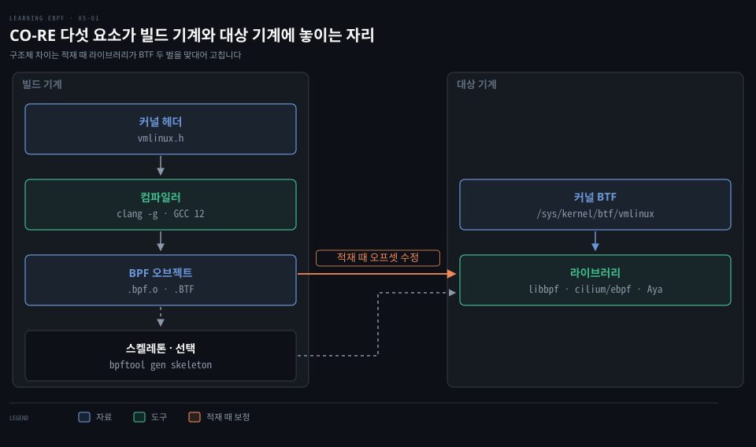
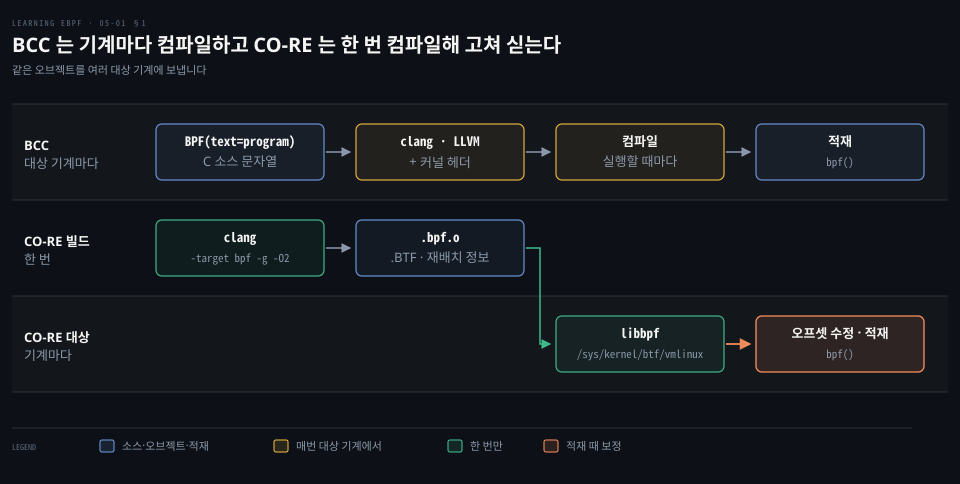
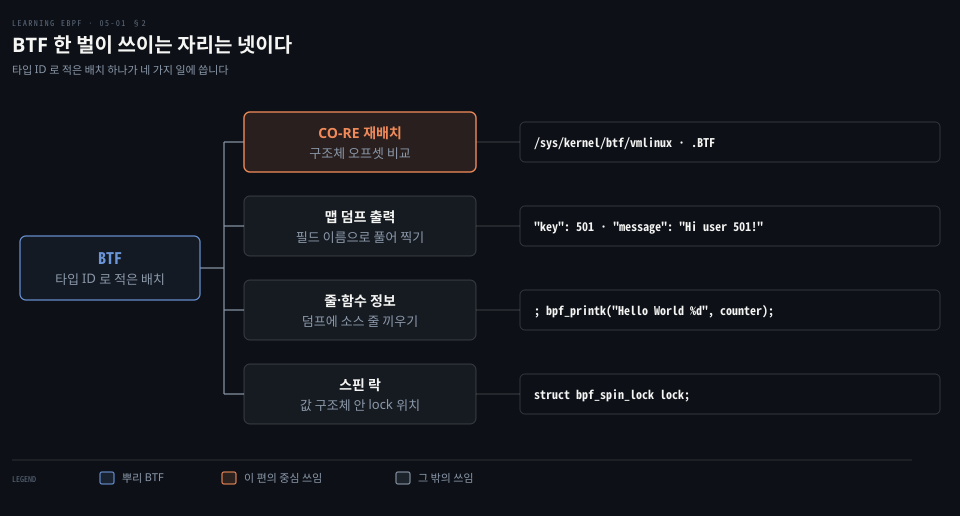
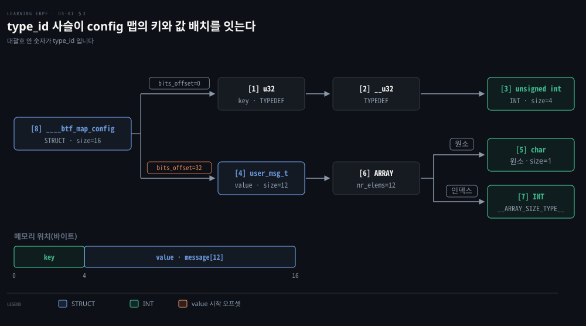
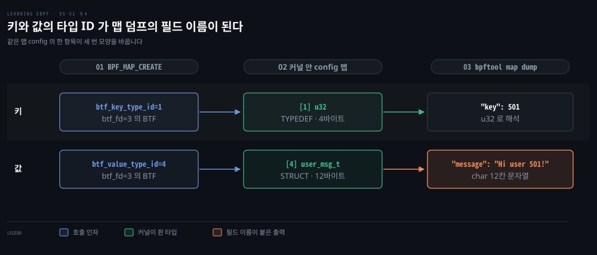

# 런타임 컴파일 대신 BTF 가 구조체 배치를 기록해 CO-RE 이식의 근거가 된다

---

> 커널 구조체 배치는 버전마다 달라질 수 있어 BCC 는 대상 기계에서 매번 컴파일했고, CO-RE 는 오브젝트에 배치 기록(BTF)을 싣고 적재 때 오프셋을 고쳐 한 번의 컴파일로 여러 커널을 맡습니다.


## 핵심 요약

> 이 편의 중심 생각은 컴파일할 때의 구조체 배치와 실행할 때의 배치를 BTF 로 둘 다 적어 두면, 두 배치의 차이만큼만 바이트코드를 고쳐 이식할 수 있다는 것입니다.

eBPF 프로그램이 커널 구조체 필드를 읽으면 바이트코드에는 필드 이름이 아니라 구조체 시작에서의 오프셋이 들어갑니다. 커널 배치가 달라지면 같은 오프셋이 다른 필드를 가리키므로 BCC 는 대상 기계에서 실행할 때마다 컴파일했습니다. 그 대가로 툴체인·헤더 설치와 시작 지연을 치렀습니다.

CO-RE 는 빌드 기계에서 한 번 컴파일하고, 적재 때 라이브러리가 오브젝트의 BTF 와 커널의 BTF 를 맞대어 오프셋을 고칩니다. **BTF**(BPF Type Format)는 타입마다 ID 를 매기고 타입끼리 ID 로 가리키는 목록이라 구조체 배치와 함수 시그니처를 담습니다. 맵과 함수도 같은 BTF 로 자기 모양을 커널에 알립니다.


## 학습 목표

> 이 편을 읽고 나면 다음을 설명할 수 있습니다.

1. 오브젝트를 배치가 다른 커널에 그대로 실을 수 없는 이유와 BCC 런타임 컴파일의 비용을 설명할 수 있습니다.
2. CO-RE 다섯 요소가 맡는 일과 놓이는 자리를 말할 수 있습니다.
3. BTF 형식과 커널 BTF 노출이 들어온 버전을 구분하고 BTF 의 쓰임을 말할 수 있습니다.
4. `bpftool btf dump` 출력에서 type ID 사슬을 따라 구조체의 메모리 배치를 복원할 수 있습니다.
5. `BPF_MAP_CREATE` 가 키와 값의 타입 ID 를 따로 넘기는 이유와 함수 BTF 의 모양을 설명할 수 있습니다.

아래 그림은 CO-RE 의 다섯 요소가 빌드 기계와 대상 기계에 나뉘어 놓이는 자리를 보여 줍니다. 대상 기계 컴파일의 비용은 1절, 다섯 요소의 역할은 2절, 구조체와 맵의 BTF 배치는 3·4절이 다룹니다.




## 1. 대상 기계 컴파일과 이식 비용

> 대상 기계에서 매번 컴파일하는 방식은 이식을 비싸게 만듭니다. 오프셋 계산에 쓴 헤더가 대상 커널과 어긋나면 오프셋이 틀리므로 BCC 는 대상 기계에서 컴파일하는 쪽을 택했습니다.

한 기계에서 컴파일한 오브젝트는 다른 기계의 커널에서 그대로 돌지 못할 수 있습니다. 컴파일러가 헤더의 구조체 정의를 보고 필드를 구조체 시작에서의 오프셋으로 바꿔 박기 때문입니다. 커널 내부 구조체 배치는 버전마다 바뀔 수 있어 같은 오프셋이 대상 커널에서는 다른 필드를 가리킬 수 있습니다. 어긋나는 것은 컴파일한 기계의 커널이 아니라 컴파일에 쓴 헤더입니다.

BCC 는 대상 기계에서 컴파일하는 것으로 이 문제를 풀었습니다. `b = BPF(text=program)` 한 줄이 소스 문자열을 실행 시점에 clang/LLVM 으로 컴파일합니다. 이어지는 `attach_kprobe` 호출이 그 결과를 커널에 싣습니다. 구조는 [BPF 개요·BCC 편 §2](../systems-performance/15-01.BPF%20—%20개요·BCC%20vs%20bpftrace·BCC.md)에 있어 비용만 봅니다.



| 비용 | 무엇이 드는가 |
|------|---------------|
| 툴체인·헤더 | 대상 기계마다 컴파일 도구와 커널 헤더를 설치해야 하고, 헤더는 기본으로 깔려 있지 않을 수 있습니다 |
| 시작 지연 | 도구를 띄울 때마다 컴파일이 끝나기를 기다리며 몇 초가 걸릴 수 있습니다 |
| 반복 컴파일 | 같은 기계가 많아도 기계마다 같은 컴파일을 되풀이합니다 |
| 컨테이너 배포 | 이미지에 담으면 나르기는 쉬우나 헤더 문제는 남고 이미지가 여럿이면 중복됩니다 |
| 임베디드 | 컴파일 단계를 돌릴 메모리가 모자랄 수 있습니다 |

BCC 저장소에는 두 판이 있습니다. 릴리스 [v0.37.0](https://github.com/iovisor/bcc/tree/v0.37.0)의 `tools/` 는 대부분 Python 도구입니다. [`libbpf-tools/`](https://github.com/iovisor/bcc/tree/v0.37.0/libbpf-tools)는 같은 일을 libbpf 와 CO-RE 로 하는 C 도구입니다. C 판은 [libbpf 를 정적 링크](https://github.com/iovisor/bcc/blob/v0.37.0/libbpf-tools/README.md#L18-L22)해 동적 의존이 libc·libelf·libz 뿐이고 대상 기계에서 컴파일하지 않습니다.


## 2. CO-RE 와 다섯 요소

> CO-RE 는 BTF·헤더·컴파일러·라이브러리·스켈레톤이 함께 만듭니다. 배치 기록은 BTF 가, 컴파일 때 쓸 정의는 헤더가, 재배치 정보 기록은 컴파일러가, 적재 때 바이트코드 수정은 라이브러리가 맡으며 스켈레톤은 선택입니다.

이식은 컴파일 단계와 적재 단계에 걸쳐 여러 요소가 나누어 맡습니다.

| 요소 | 맡는 일 | 구체 이름 |
|------|---------|-----------|
| BTF | 구조체 배치와 함수 시그니처를 기록합니다 | 커널은 `/sys/kernel/btf/vmlinux`, 오브젝트는 `.BTF` 섹션 |
| 커널 헤더 | 컴파일 때 쓸 구조체 정의를 줍니다 | `vmlinux.h` |
| 컴파일러 | 재배치 표시가 붙은 필드 접근마다 재배치 정보를 남깁니다 | clang `-g`, GCC 12 부터 |
| 라이브러리 | 적재 때 두 배치를 비교해 오프셋을 고칩니다 | libbpf(C), cilium/ebpf(Go), Aya(Rust) |
| 스켈레톤 | 열기·적재·부착·정리를 묶은 함수를 줍니다 | `bpftool gen skeleton` |

적재 때 라이브러리는 오브젝트의 컴파일 때 배치를 `/sys/kernel/btf/vmlinux` 의 지금 배치와 맞대어 달라진 필드 오프셋만 고칩니다. 대상 커널에 그 필드가 아예 없으면 고칠 수 없으므로 이식 범위는 필드가 있는 커널까지입니다. 절차는 [재배치 편](./05-03.libbpf%20는%20적재%20때%20CO-RE%20재배치를%20고치고%20스켈레톤이%20열기·적재·부착·정리를%20묶는다.md)에서 봅니다.

### BTF 형식과 커널 BTF 노출 버전

BTF 형식은 커널 4.18 에 들어왔습니다. [v4.18 `bpf.h`](https://github.com/torvalds/linux/blob/v4.18/include/uapi/linux/bpf.h#L98)에 `BPF_BTF_LOAD` 가 있고 v4.17 에는 `btf.h` 가 없습니다. CO-RE 는 대상 커널의 BTF 를 기준으로 하며, 보통 실행 중인 커널이 내놓는 BTF 를 씁니다. 커널이 내놓지 않으면 따로 만든 BTF 파일을 줄 수도 있습니다.

커널이 내놓는 쪽은 `CONFIG_DEBUG_INFO_BTF` 로 빌드하면 `/sys/kernel/btf/vmlinux` 로 노출됩니다. 옵션은 [v5.2 Kconfig](https://github.com/torvalds/linux/blob/v5.2/lib/Kconfig.debug#L223)에 있고 파일을 만드는 [`sysfs_btf.c`](https://github.com/torvalds/linux/blob/v5.4/kernel/bpf/sysfs_btf.c)는 v5.4 에서 처음 보입니다(v5.3 에는 없습니다). 그래서 BTF 지원은 형식이 있는 4.18 과 커널 BTF 를 내놓는 5.4 이후로 갈라 읽습니다.

### 컴파일러·라이브러리·스켈레톤의 역할

`vmlinux.h` 는 실행 중인 시스템에서 bpftool 로 만들며 [다음 편](./05-02.vmlinux.h%20와%20libbpf%20매크로로%20쓴%20eBPF%20프로그램은%20CO-RE%20재배치%20정보를%20품는다.md)에서 다룹니다. `clang -target bpf -g -O2` 로 컴파일하면 `.bpf.o` 오브젝트에 BTF 가 들어갑니다. 그리고 `vmlinux.h` 구조체처럼 재배치 표시가 붙은 필드를 접근할 때마다 CO-RE 재배치 정보가 남습니다. GCC 는 12 의 BPF 백엔드에 [CO-RE 지원이 추가](https://gcc.gnu.org/gcc-12/changes.html)됐습니다.

재배치는 라이브러리가 합니다. [libbpf 개요](https://docs.kernel.org/bpf/libbpf/libbpf_overview.html)가 BPF CO-RE 지원을 libbpf 의 기능으로 적습니다. Go 의 cilium/ebpf 와 Rust 의 Aya 는 같은 일을 직접 구현합니다. 구조는 [Go·Rust 라이브러리 편](./10-02.Go·Rust%20라이브러리는%20libbpf%20를%20감싸거나%20bpf%28%29%20를%20직접%20불러%20바이트코드를%20싣는다.md)에 있습니다. **스켈레톤**은 오브젝트에서 `bpftool gen skeleton` 이 만드는 코드입니다. 사용자 공간 프로그램이 BPF 프로그램을 열고 적재하고 부착하고 정리하는 함수를 묶어 줍니다. 없어도 CO-RE 는 동작하므로 선택입니다.

### 이식 밖의 BTF 쓰임



맵 덤프가 그 하나입니다. bpftool 은 맵 정보의 키·값 타입 ID 로 [타입을 풀어](https://github.com/torvalds/linux/blob/v7.2/tools/bpf/bpftool/map.c#L71-L94) 필드 이름과 문자열로 찍습니다.

```bash
# 예제의 config 맵을 덤프한 출력이다. UID 0 항목은 ... 로 줄였다
bpftool map dump name config
[{
        ...
    },{
        "key": 501,
        "value": {
            "message": "Hi user 501!"
        }
    }
]
```

줄과 함수 정보도 BTF 에 있습니다. 줄 정보는 명령이 소스 어느 줄에서 왔는지 적습니다. 그래서 xlated·JIT 덤프에는 `; bpf_printk("Hello World %d", counter);` 같은 소스 줄이 [끼어듭니다](https://github.com/torvalds/linux/blob/v7.2/tools/bpf/bpftool/Documentation/bpftool-prog.rst#L108-L110).
덤프 모양은 [적재 편](./03-01.C%20소스는%20clang%20으로%20eBPF%20바이트코드가%20되고%20bpftool%20이%20적재해%20ID%20와%20태그를%20붙인다.md)에 있습니다. verifier 로그도 [소스 줄을 끼웁니다](https://github.com/torvalds/linux/blob/v7.2/kernel/bpf/verifier.c#L17417-L17421).

### 스핀 락과 BTF 락 필드

스핀 락은 두 CPU 코어가 같은 맵 값을 동시에 만지지 못하게 막는 잠금입니다. 락은 맵 값 구조체 안의 필드입니다.

```c
// 락 필드는 값 구조체의 최상위에 둔다
struct my_value {
    ... <other fields>
    struct bpf_spin_lock lock;
    ... <other fields>
};
```

프로그램은 `bpf_spin_lock()` 과 `bpf_spin_unlock()` 헬퍼로 잠그고 풉니다. 커널이 락 필드의 위치를 알려면 BTF 가 있어야 하므로 이 헬퍼는 BTF 가 있는 맵에서만 쓸 수 있습니다. 스핀 락은 커널 5.1 에 들어왔습니다([v5.1](https://github.com/torvalds/linux/blob/v5.1/include/uapi/linux/bpf.h#L2346)에 헬퍼가 있고 v5.0 에는 없습니다). 제약은 v7.2 [헬퍼 주석](https://github.com/torvalds/linux/blob/v7.2/include/uapi/linux/bpf.h#L3951-L3994)에 있습니다. 맵 종류는 HASH 와 ARRAY 입니다(목록이 늘 수 있다고 덧붙입니다). 맵 값에 BTF 설명과 최상위 락 필드 하나가 있어야 합니다. 락은 한 번에 하나만 잡고 잡은 동안 함수·헬퍼 호출이 안 됩니다.

추적과 소켓 필터 프로그램은 이 맵을 쓰지 못합니다. verifier 의 [호환성 검사](https://github.com/torvalds/linux/blob/v7.2/kernel/bpf/verifier.c#L17757-L17764)는 소켓 필터를 `socket filter progs cannot use bpf_spin_lock yet` 으로 거부합니다. 추적 프로그램 역시 `tracing progs cannot use bpf_spin_lock yet` 으로 거부합니다. 여기서 추적 프로그램은 [kprobe·tracepoint·perf event·raw tracepoint 와 그 쓰기 가능 변형](https://github.com/torvalds/linux/blob/v7.2/kernel/bpf/verifier.c#L17715-L17727)입니다.


## 3. BTF 타입 ID 와 구조체 배치

> BTF 는 타입마다 ID 를 매겨 서로를 가리키며 구조체 배치를 적습니다. `bpftool btf list` 는 BTF 덩어리를 ID 별로 보이고 `btf dump` 는 그 안의 타입을 `[번호]` 로 풀어 보입니다.

오프셋 재배치에 쓰려면 구조체 배치가 BTF 안에 어떻게 기록되는지 알아야 합니다. 예제의 `config` 맵은 키가 `u32`, 값이 `struct user_msg_t` 인 해시 맵입니다. 이 두 타입이 BTF 안에 어떻게 적히는지 커널 목록과 타입 덤프로 차례로 확인합니다.

### bpftool btf list 로 커널 BTF 확인

먼저 BTF 덩어리가 커널 어디에 있는지 봅니다.

```bash
# 예제를 돌리는 동안 커널에 올라간 BTF 를 나열한다. 중간 항목은 줄였다
bpftool btf list
1: name [vmlinux]  size 5843164B
...
149: name <anon>  size 4372B  prog_ids 319  map_ids 103
        pids hello-buffer-co(7660)
...
```

1번 `vmlinux` 는 커널 자신의 BTF 입니다. bpftool 은 커널 BTF 의 이름을 대괄호로 묶고 이름 없는 BTF 는 [`<anon>`](https://github.com/torvalds/linux/blob/v7.2/tools/bpf/bpftool/btf.c#L1340-L1347)으로 찍습니다. 149번은 예제가 적재한 BTF 입니다. 크기는 4KB 남짓이고 프로그램 319 와 맵 103 이 이를 가리키며 `pids` 줄은 쓰는 프로세스(PID 7660)를 보입니다. 같은 프로그램을 `bpftool prog show name hello` 로 보면 `btf_id 149` 와 `map_ids 103,104` 가 나옵니다. 104 는 perf 이벤트 버퍼 맵이고 BTF 없이 만들어져 BTF 쪽 목록에는 없습니다.

이름이 15자에서 잘린 것은 `comm` 때문입니다. `pids` 를 모으는 bpftool 의 BPF 프로그램이 [`task->group_leader->comm` 을 복사](https://github.com/torvalds/linux/blob/v7.2/tools/bpf/bpftool/skeleton/pid_iter.bpf.c#L117-L118)하는데 그 대상이 [16바이트 버퍼](https://github.com/torvalds/linux/blob/v7.2/tools/bpf/bpftool/skeleton/pid_iter.h#L11)입니다. 커널의 `comm` 자체도 [`TASK_COMM_LEN`](https://github.com/torvalds/linux/blob/v7.2/include/linux/sched.h#L325) 16바이트라 끝의 NUL 을 빼면 15자가 남습니다. `hello-buffer-config` 가 `hello-buffer-co` 가 됩니다.

### type ID 사슬과 구조체 배치

이제 149번 BTF 의 타입을 풉니다. 예제 저장소의 지금 소스는 NUL 자리를 더한 `message[13]` 이라, 직접 돌리면 [4] 는 size=13, [8] 은 size=20 으로 나옵니다.

```c
// 이 출력을 낸 소스에서 message 는 12바이트다
struct user_msg_t {
     char message[12];
};

BPF_HASH(config, u32, struct user_msg_t);
```

```bash
# 대괄호 안 숫자가 type ID 다. 각 줄은 다른 타입을 type_id 로 가리킨다
bpftool btf dump id 149
[1] TYPEDEF 'u32' type_id=2
[2] TYPEDEF '__u32' type_id=3
[3] INT 'unsigned int' size=4 bits_offset=0 nr_bits=32 encoding=(none)
[4] STRUCT 'user_msg_t' size=12 vlen=1
        'message' type_id=6 bits_offset=0
[5] INT 'char' size=1 bits_offset=0 nr_bits=8 encoding=(none)
[6] ARRAY '(anon)' type_id=5 index_type_id=7 nr_elems=12
[7] INT '__ARRAY_SIZE_TYPE__' size=4 bits_offset=0 nr_bits=32 encoding=(none)
[8] STRUCT '____btf_map_config' size=16 vlen=2
        'key' type_id=1 bits_offset=0
        'value' type_id=4 bits_offset=32
...
```

type ID 는 1 부터 차례로 매겨지고 0 은 `void` 로 예약돼 있습니다([BTF 문서 Type Encoding](https://docs.kernel.org/bpf/btf.html#type-encoding)). [1]→[2]→[3] 은 32비트 정수의 별칭 사슬입니다. C 의 정수 길이는 플랫폼마다 달라서 리눅스가 `u32` 처럼 길이를 못 박은 별칭을 둡니다. 사용자 공간 코드는 `__u32` 를 씁니다. [4] 의 필드 `message` 는 [6] 이고, [6] 은 원소 [5] `char` 12칸에 인덱스 [7] 을 가진 배열입니다.



`value` 가 `bits_offset=32` 에서 시작하는 것은 앞의 32비트, 곧 4바이트를 `key` 가 차지하기 때문입니다. 그래서 [8] 은 키 4바이트와 값 12바이트를 합쳐 16바이트입니다. C 구조체는 필드를 경계에 맞춰 정렬하므로 필드 사이에 빈칸이 생길 수 있습니다. `char letter; u64 number;` 는 `letter` 뒤에 7바이트가 빕니다.


## 4. 맵과 함수의 BTF 타입 ID

> 맵과 함수는 BTF 타입 ID 로 자기 모양을 커널에 알립니다. 맵을 만들 때 BTF fd 와 키·값 타입 ID 를 넘기면 커널이 키와 값을 타입으로 알고, 함수 시그니처는 `FUNC_PROTO` 와 `FUNC` 타입으로 적힙니다.

BTF 가 없던 시절의 커널은 맵의 키와 값을 크기로만 다뤘습니다. `BPF_MAP_CREATE` 의 인자 구조체에 BTF 필드가 생기기 전에는 크기만 있었습니다. [v4.18](https://github.com/torvalds/linux/blob/v4.18/include/uapi/linux/bpf.h#L292-L294)에는 `btf_fd`·`btf_key_type_id`·`btf_value_type_id` 가 있고 v4.17 에는 없습니다. v7.2 의 [같은 구조체](https://github.com/torvalds/linux/blob/v7.2/include/uapi/linux/bpf.h#L1528-L1579)에는 이 셋 말고도 `btf_vmlinux_value_type_id`·`value_type_btf_obj_fd`·`map_extra`·`map_token_fd`·`excl_prog_hash` 같은 필드가 더 있습니다.

BTF 가 없으면 커널은 `key_size` 와 `value_size` 만큼의 바이트 덩어리로 키와 값을 다룹니다. 타입 정보가 따라오면 커널과 bpftool 이 모양을 알아 필드 이름으로 찍을 수 있습니다. BTF fd 가 3 이라는 사실은 [시스템 콜 편](./04-01.bpf%28%29%20시스템%20콜은%20BTF·맵·프로그램을%20적재하고%20참조%20카운트와%20고정·링크가%20수명을%20정한다.md) §2 에서 받았습니다.

키와 값의 타입 ID 가 따로 넘어갑니다. 앞에서 본 `____btf_map_config` 는 커널이 맵 정의로 쓰지 않습니다. BCC 의 [`BPF_ANNOTATE_KV_PAIR`](https://github.com/iovisor/bcc/blob/v0.37.0/src/cc/export/helpers.h#L79-L86) 매크로가 `key`·`value` 두 멤버를 가진 구조체를 만듭니다. [`get_map_tids`](https://github.com/iovisor/bcc/blob/v0.37.0/src/cc/bcc_btf.cc#L652-L693)가 두 멤버의 타입 ID(1 과 4)를 읽고, [맵 생성 코드](https://github.com/iovisor/bcc/blob/v0.37.0/src/cc/bpf_module.cc#L429-L430)가 이를 `BPF_MAP_CREATE` 의 두 필드에 넣습니다. 구조체 자체는 BTF 덩어리 안에만 남습니다.



함수도 BTF 에 적힙니다. 같은 BTF 덩어리의 `hello` 항목입니다.

```bash
# 같은 덤프에서 hello 에 관련된 줄만 남겼다
# FUNC 는 이름과 시그니처를, FUNC_PROTO 는 반환형과 매개변수를 적는다
...
[10] PTR '(anon)' type_id=0
...
[23] INT 'int' size=4 bits_offset=0 nr_bits=32 encoding=SIGNED
...
[31] FUNC_PROTO '(anon)' ret_type_id=23 vlen=1
        'ctx' type_id=10
[32] FUNC 'hello' type_id=31 linkage=static
```

소스 `int hello(void *ctx)` 와 대응시키면 이름 `hello` 는 [32], 시그니처는 [31] 입니다. 반환형 `int` 는 `ret_type_id=23` 이 가리키는 4바이트 부호 있는 [23] 입니다. 매개변수 `ctx` 는 [10] `PTR` 이며 `type_id=0` 은 `void` 입니다.

특정 맵이나 프로그램의 BTF 만 보려면 `bpftool btf dump map` 과 `btf dump prog` 를 씁니다.

```bash
# 키와 값에 해당하는 타입만 나온다
bpftool btf dump map name config
[1] TYPEDEF 'u32' type_id=2
[4] STRUCT 'user_msg_t' size=12 vlen=1
        'message' type_id=6 bits_offset=0
```

[8] 이 빠진 것은 맵에 기록된 타입 ID 가 키의 1 과 값의 4 뿐이기 때문입니다. 맵을 지정하고 `key`·`value`·`kv`·`all` 을 생략하면 [`kv` 로 간주](https://github.com/torvalds/linux/blob/v7.2/tools/bpf/bpftool/Documentation/bpftool-btf.rst#L52-L56)해 그 두 타입만 찍습니다. `btf dump prog` 는 프로그램에 붙은 BTF 를 보입니다. 이 BTF 로 헤더를 만들고 프로그램을 쓰는 단계는 다음 편이 이어받습니다.


## 면접 대비

> 먼저 직접 답해 본 뒤 정답을 펼쳐 확인합니다.

1. 컴파일한 오브젝트를 다른 커널에 그대로 실을 수 없는 이유와, BCC 가 이를 피한 방법의 비용 둘 이상을 말해 보십시오.
2. CO-RE 의 다섯 요소 중 적재 때 바이트코드를 고치는 요소는 무엇이며, 비교하는 두 BTF 는 각각 어디에 있습니까?
3. "BTF 는 커널 5.4 부터 지원한다" 가 부정확한 이유를 버전으로 설명해 보십시오.
4. `btf dump` 에서 `____btf_map_config` 의 `value` 가 `bits_offset=32` 이고 `user_msg_t` 가 12바이트인 이유를 type ID 사슬로 설명해 보십시오.
5. `BPF_MAP_CREATE` 가 키와 값의 타입 ID 를 따로 넘기는 이유와 `____btf_map_config` 의 쓰임을 답해 보십시오.


## 정답 (자답 후 펼치기)

> 면접 질문에 대한 키워드 중심의 모범 답안입니다.

### 정답 1 — 오프셋, 헤더 불일치, 런타임 컴파일

컴파일에 쓴 헤더가 대상 커널과 다르면 박힌 오프셋이 틀립니다. BCC 는 대상 기계에서 실행할 때마다 컴파일해 피했고, 비용은 툴체인·헤더 설치, 시작 지연, 반복 컴파일, 이미지 중복, 임베디드 메모리입니다.

### 정답 2 — 라이브러리와 두 BTF

라이브러리(libbpf, cilium/ebpf, Aya)가 오브젝트 `.BTF` 의 컴파일 때 배치와 `/sys/kernel/btf/vmlinux` 의 지금 배치를 비교해 달라진 오프셋만 고칩니다.

### 정답 3 — 형식 4.18, 커널 BTF 노출 5.4

형식과 `BPF_BTF_LOAD` 는 4.18 이고 `CONFIG_DEBUG_INFO_BTF` 옵션은 v5.2 에서 보입니다. 커널이 자기 BTF 를 `/sys/kernel/btf/vmlinux` 로 내놓는 `sysfs_btf.c` 는 v5.4 에서 처음 나타납니다. CO-RE 는 대상 커널의 BTF 를 기준으로 하며 보통 실행 중인 커널이 내놓는 것을 씁니다.

### 정답 4 — key 4바이트, message 12칸

`key` 는 [1]→[2]→[3] 을 따라 4바이트라 `value` 는 32비트 뒤에서 시작합니다. [4] 는 필드 `message` 하나이고 [6] 이 `char` 12칸 배열이라 12바이트이며, 합쳐 [8] 은 16바이트입니다.

### 정답 5 — 별도 ID, 커널은 쓰지 않음

`bpf_attr` 에 `btf_key_type_id` 와 `btf_value_type_id` 가 따로 있습니다. `____btf_map_config` 는 BCC 가 두 멤버의 타입 ID 를 찾는 용도이고 커널은 쓰지 않습니다. `btf dump map` 에 [8] 이 나오지 않는 것은 맵에 기록된 타입 ID 가 1 과 4 뿐이고 `kv` 가 기본이라 그 둘만 찍기 때문입니다.


## 참고 자료

- 《Learning eBPF》(Liz Rice, O'Reilly Media, 2023, ISBN 978-1-098-13512-6) Ch.5 — 예제 코드 [chapter4](https://github.com/lizrice/learning-ebpf/tree/91ded4a/chapter4)
- BCC [v0.37.0](https://github.com/iovisor/bcc/tree/v0.37.0) · [GCC 12 변경 사항](https://gcc.gnu.org/gcc-12/changes.html)


## 관련 문서

- [vmlinux.h 와 libbpf 매크로](./05-02.vmlinux.h%20와%20libbpf%20매크로로%20쓴%20eBPF%20프로그램은%20CO-RE%20재배치%20정보를%20품는다.md)
