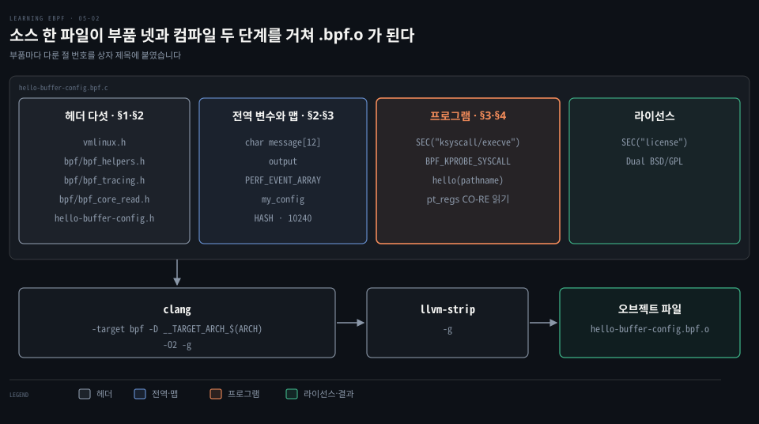
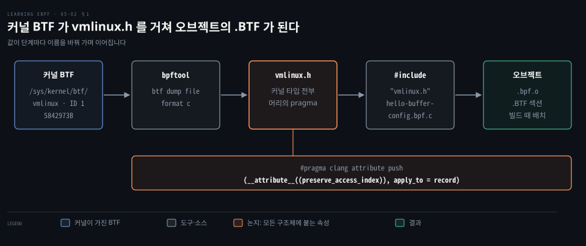
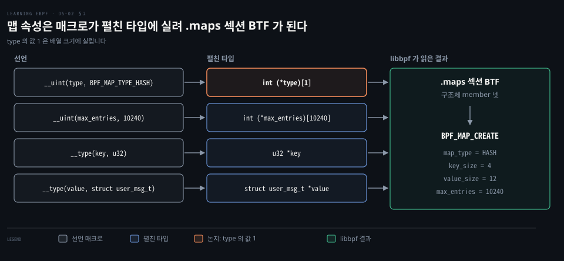
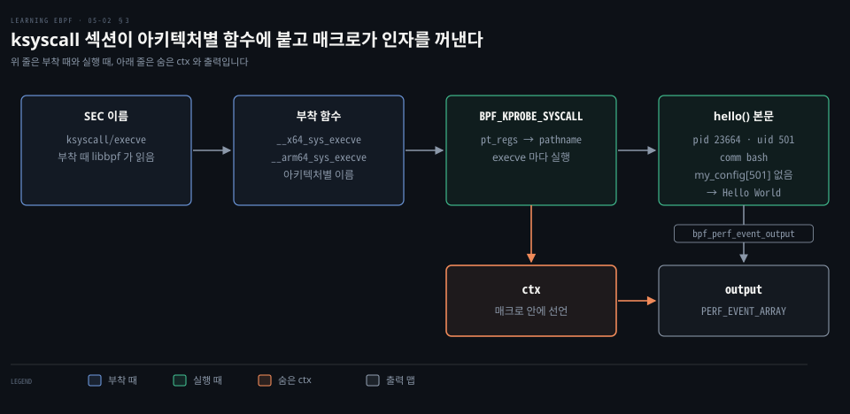
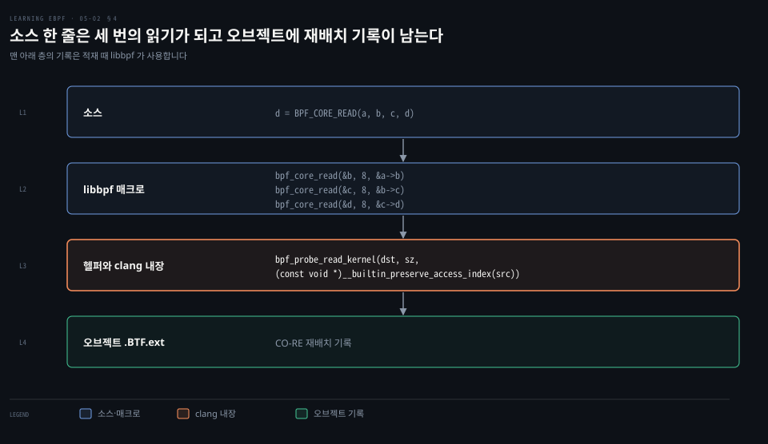

# vmlinux.h 와 libbpf 매크로로 쓴 eBPF 프로그램은 CO-RE 재배치 정보를 품는다

---

> `vmlinux.h` 가 커널 타입 정의를, libbpf 의 헤더와 매크로가 맵 선언·섹션 이름·인자 접근을 대신하고, 그렇게 컴파일한 오브젝트에는 필드 접근마다 재배치 기록이 남습니다.


## 핵심 요약

> 이 편의 중심 생각은 헤더 고르기와 맵·인자 접근의 수작업을 `vmlinux.h` 와 libbpf 매크로가 대신하고 그 대가로 오브젝트가 구조체 배치 기록을 품는다는 것입니다.

`vmlinux.h` 는 실행 중인 커널의 BTF 에서 뽑은 헤더입니다. 이 헤더의 타입으로 필드를 읽으면 clang 이 "어느 타입의 어느 멤버" 라는 기록을 남깁니다.

libbpf 헤더는 맵을 `.maps` 섹션의 구조체로 선언하게 합니다. `SEC()` 이름은 프로그램 유형과 부착 지점을 정하고, `BPF_KPROBE_SYSCALL` 은 시스템 콜 인자를 이름으로 꺼내 줍니다. 컴파일 옵션 셋은 이 기록의 전제를 만듭니다.




## 학습 목표

> 이 편을 읽고 나면 다음을 설명할 수 있습니다.

1. `vmlinux.h` 를 만들고 그 헤더가 오브젝트의 BTF 와 이어지는 방식을 설명할 수 있습니다.
2. 다섯 헤더가 각각 주는 것과 `vmlinux.h` 가 주지 못하는 것을 구분할 수 있습니다.
3. `__uint`·`__type` 맵 정의가 펼쳐지는 모양과 libbpf 가 읽는 방식을 설명할 수 있습니다.
4. `SEC("ksyscall/execve")` 와 `BPF_KPROBE_SYSCALL` 이 대신해 주는 일을 말할 수 있습니다.
5. `bpf_core_read` 와 컴파일 옵션 셋의 역할을 설명할 수 있습니다.


## 1. 커널 BTF 에서 vmlinux.h 를 뽑아 헤더 고르기를 없앤다

> 커널 구조체의 정의는 헤더를 찾아 맞추지 않고 실행 중인 커널의 BTF 에서 뽑습니다. 그 헤더로 컴파일해야 오브젝트에 빌드 때의 배치가 BTF 로 남습니다.

커널 구조체의 필드를 읽는 프로그램은 그 구조체의 정의를 어디서 구할까요? CO-RE 이전에는 정의가 든 헤더를 커널 소스에서 하나씩 찾아야 했습니다. 지금은 실행 중인 커널의 BTF 로 헤더를 만듭니다.

BTF 가 켜진 커널에서 `bpftool btf list` 를 돌리면 BTF 덩어리가 나옵니다.

```bash
bpftool btf list
# 1: name [vmlinux] size 5842973B
```

ID 1 의 `vmlinux` 가 이 커널이 쓰는 타입·구조체·함수 정의를 모두 담은 BTF 입니다. 이것을 C 헤더로 바꾸는 명령은 다음과 같고, 커널 문서의 [libbpf 개요](https://docs.kernel.org/bpf/libbpf/libbpf_overview.html)도 같은 명령을 안내합니다. 예제 저장소 [Makefile](https://github.com/lizrice/learning-ebpf/blob/1ccef6e/chapter5/Makefile#L25-L26)의 `vmlinux.h` 규칙도 같은 명령입니다.

```bash
# 실행 중인 커널의 BTF 를 C 헤더로 출력한다
bpftool btf dump file /sys/kernel/btf/vmlinux format c > vmlinux.h
```

생성된 헤더의 머리에는 include guard 바로 뒤에 다음 pragma 가 있고, `BPF_NO_PRESERVE_ACCESS_INDEX` 가 정의되지 않았을 때 켜집니다. `#pragma clang attribute push (__attribute__((preserve_access_index)), apply_to = record)`

출처는 [bpftool 의 btf.c](https://github.com/torvalds/linux/blob/v7.2/tools/bpf/bpftool/btf.c#L778-L783)입니다. 이 속성은 `-g` 가 있을 때 멤버 접근 정보를 보존하며 `__builtin_preserve_access_index()` 와 비슷한 효과를 냅니다.[^clang-attr] 그래서 이 헤더의 타입으로 쓴 `p->y` 는 "이 타입의 이 멤버" 라는 기록을 남깁니다.



헤더를 포함해 컴파일한 오브젝트의 BTF 에는 빌드 때의 배치가 담깁니다. 적재하는 쪽이 이것을 대상 커널의 BTF 와 견줘 어긋난 오프셋을 고치며, 그 과정은 [적재와 재배치 편](./05-03.libbpf%20는%20적재%20때%20CO-RE%20재배치를%20고치고%20스켈레톤이%20열기·적재·부착·정리를%20묶는다.md)이 다룹니다. BTF 의 타입 형식은 [BTF 형식 편](./05-01.런타임%20컴파일%20대신%20BTF%20가%20구조체%20배치를%20기록해%20CO-RE%20이식의%20근거가%20된다.md)에 있습니다.

`/sys/kernel/btf/vmlinux` 는 [`CONFIG_DEBUG_INFO_BTF` 로 빌드한 커널](https://github.com/torvalds/linux/blob/v7.2/kernel/bpf/Makefile#L41)에만 있습니다. 이 파일을 내보내는 [sysfs_btf.c](https://github.com/torvalds/linux/blob/v5.4/kernel/bpf/sysfs_btf.c)는 v5.4 에 처음 보입니다.

BTF 없이 나온 커널은 [BTFHub](https://github.com/aquasecurity/btfhub)가 길입니다. 배포판 커널의 BTF 를 모아 두며, 본 저장소는 2026-08-03 에 마지막으로 갱신됐고 보관 처리되지 않았습니다. BTF 파일이 든 [아카이브](https://github.com/aquasecurity/btfhub-archive)는 2026-10-01 에도 갱신됐습니다. 받은 BTF 파일은 libbpf 가 [`bpf_object_open_opts` 의 `btf_custom_path`](https://github.com/libbpf/libbpf/blob/v1.8.0/src/libbpf.h#L164-L170)로 받아 CO-RE 재배치에 씁니다.


## 2. libbpf 프로그램은 헤더 다섯 개와 .maps 섹션의 구조체로 맵을 선언한다

> 헤더 다섯은 각각 다른 것을 줍니다. 맵은 `.maps` 섹션의 익명 구조체로 선언하고 속성 값은 포인터가 가리키는 배열의 크기에 실려 BTF 로 읽힙니다.

헤더를 다섯 개나 포함하는 이유가 있을까요? 다섯이 하는 일이 서로 다릅니다.

```c
#include "vmlinux.h"
#include <bpf/bpf_helpers.h>
#include <bpf/bpf_tracing.h>
#include <bpf/bpf_core_read.h>
#include "hello-buffer-config.h"
```

- `vmlinux.h`: 커널 구조체·typedef·enum 정의
- `bpf/bpf_helpers.h`: 헬퍼 함수 선언, `SEC()`, `__uint`·`__type`
- `bpf/bpf_tracing.h`: `BPF_KPROBE`·`BPF_KPROBE_SYSCALL` 같은 kprobe 인자 매크로
- `bpf/bpf_core_read.h`: `bpf_core_read`·`BPF_CORE_READ`
- `hello-buffer-config.h`: 사용자 공간도 쓰는 이벤트 구조체 `data_t`(`path[16]` 포함)

`vmlinux.h` 에는 `#define` 상수가 없습니다. 매크로는 전처리에서 사라져 타입 정보인 BTF 에 담기지 않기 때문입니다. 이더넷 프로토콜 번호 `0x0800`(IP)과 `0x0806`(ARP)이 그 예이며 `if_ether.h` 를 포함하거나 직접 정의합니다. 이 예제에는 없으며 [XDP·TC 편](./08-01.XDP%20와%20TC%20는%20패킷을%20경계%20검사로%20파싱해%20반환%20코드로%20버리고%20고쳐%20되돌린다.md)의 패킷 해석 프로그램에서 다시 만납니다.

libbpf 는 사용자 공간 라이브러리이면서 커널 쪽 헤더도 줍니다. 1.0 은 [2022-08-22](https://github.com/libbpf/libbpf/releases/tag/v1.0.0)에 나왔고 최신은 [2026-10-05 의 v1.8.0](https://github.com/libbpf/libbpf/releases/tag/v1.8.0)입니다. [README](https://github.com/libbpf/libbpf/blob/v1.8.0/README.md#distributions)는 Fedora·Debian·Ubuntu 등이 패키지를 만든다고 적었습니다.

### 맵 선언은 익명 구조체와 매크로 넷이다

BCC 판의 맵은 [`BPF_HASH(config, u32, struct user_msg_t);`](https://github.com/lizrice/learning-ebpf/blob/1ccef6e/chapter4/hello-buffer-config.py#L11) 한 줄이었습니다. libbpf 에는 이 매크로가 없어 구조체로 풀어 쓰며, `config` 가 `vmlinux.h` 와 겹쳐 `my_config` 로 바꿨습니다.

```c
// perf 버퍼로 이벤트를 내보낼 PERF_EVENT_ARRAY. 키와 값은 4바이트다
struct {
    __uint(type, BPF_MAP_TYPE_PERF_EVENT_ARRAY);
    __uint(key_size, sizeof(u32));
    __uint(value_size, sizeof(u32));
} output SEC(".maps");

struct user_msg_t {
   char message[12];
};

// UID 별 메시지를 둘 해시 맵이다. 키는 u32, 값은 user_msg_t 다
struct {
    __uint(type, BPF_MAP_TYPE_HASH);
    __uint(max_entries, 10240);
    __type(key, u32);
    __type(value, struct user_msg_t);
} my_config SEC(".maps");
```

`__uint` 와 `__type` 은 [bpf_helpers.h](https://github.com/libbpf/libbpf/blob/v1.8.0/src/bpf_helpers.h#L13-L15)에 정의돼 있습니다.

```c
#define __uint(name, val) int (*name)[val]
#define __type(name, val) typeof(val) *name
#define __array(name, val) typeof(val) *name[]
```

`__uint(type, BPF_MAP_TYPE_HASH)` 는 `int (*type)[1]` 로 펼쳐집니다. 값 1 은 [v7.2 의 `enum bpf_map_type`](https://github.com/torvalds/linux/blob/v7.2/include/uapi/linux/bpf.h#L1000-L1002)에서 `BPF_MAP_TYPE_HASH` 의 값입니다.

숫자를 배열 크기에 싣는 이유는 libbpf 가 읽는 방식에 있습니다. [get_map_field_int](https://github.com/libbpf/libbpf/blob/v1.8.0/src/libbpf.c#L2539-L2573)는 멤버가 배열을 가리키는 포인터인지 확인하고 그 원소 수를 값으로 씁니다. 같은 곳의 주석에 따르면 이렇게 하면 값 전체가 BTF 타입 정의에 담기고 ELF 데이터 섹션에는 포인터 크기만 차지합니다.

나머지는 `int (*max_entries)[10240]`·`u32 *key`·`struct user_msg_t *value` 로 펼쳐지고, libbpf 는 포인터가 가리키는 타입의 크기를 `key_size`·`value_size` 로 씁니다. 선언에서 계산한 `BPF_MAP_CREATE` 인자는 `map_type=HASH`·`key_size=4`·`value_size=12`·`max_entries=10240` 입니다. 같은 인자로 BTF 를 붙여 맵을 만드는 호출(BCC 판)은 [bpf() 편](./04-01.bpf%28%29%20시스템%20콜은%20BTF·맵·프로그램을%20적재하고%20참조%20카운트와%20고정·링크가%20수명을%20정한다.md)의 strace 출력에 있습니다.




## 3. SEC 이름이 프로그램 유형과 부착 지점을 정하고 BPF_KPROBE_SYSCALL 이 인자를 꺼내 준다

> 섹션 이름 하나가 프로그램 유형과 자동 부착 대상을 함께 정합니다. `ksyscall` 은 아키텍처별 함수 이름을 libbpf 가 조립하게 하고 매크로는 `pt_regs` 에서 인자를 꺼내 이름을 붙입니다.

`SEC("kprobe")` 는 유형만 정하는데 `SEC("kprobe/__arm64_sys_execve")` 는 왜 아키텍처를 타고, `SEC("ksyscall/execve")` 는 무엇을 대신해 줄까요?

`SEC()` 는 함수를 그 이름의 ELF 섹션에 넣고 libbpf 는 섹션 이름으로 프로그램 유형을 정합니다. `SEC("kprobe")` 는 `BPF_PROG_TYPE_KPROBE` 입니다. `/extras` 를 붙이면 자동 부착 대상까지 정해지며 유효한 이름은 커널 문서의 [프로그램 유형과 ELF 섹션](https://docs.kernel.org/bpf/libbpf/program_types.html) 표가 정본입니다.

표에 없는 이름은 유형을 알 수 없습니다. [`missing BPF prog type, check ELF section name`](https://github.com/libbpf/libbpf/blob/v1.8.0/src/libbpf.c#L8441-L8443) 경고와 함께 `-EINVAL` 로 적재를 거부합니다. 1.0 이전 프로그램에는 표에 없는 느슨한 이름이 보이는데, [마이그레이션 안내](https://github.com/libbpf/libbpf/wiki/Libbpf-1.0-migration-guide)가 `xdp_cpumap` → `xdp/cpumap` 같은 대체 이름을 정리했습니다.

### ksyscall 은 아키텍처별 함수 이름을 대신 조립한다

시스템 콜 함수 이름은 아키텍처마다 다릅니다. x86-64 의 `execve` 는 `__x64_sys_execve`, arm64 는 `__arm64_sys_execve` 입니다. 이름을 소스에 적으면 그 아키텍처에서만 붙습니다.

```c
// 아키텍처별 이름을 직접 적는다. arm64 에서만 붙는다
SEC("kprobe/__arm64_sys_execve")

// 시스템 콜 이름만 적는다. libbpf 가 아키텍처별 함수로 풀어 붙인다
SEC("ksyscall/execve")
```

`ksyscall` 은 이 이름 풀이를 libbpf 에 맡깁니다. 커널에 syscall wrapper 가 있으면 libbpf 는 [빌드된 아키텍처로 접두를 고르고](https://github.com/libbpf/libbpf/blob/v1.8.0/src/libbpf.c#L12445-L12468) `__x64_sys_execve` 같은 이름으로, 없으면 [`__se_sys_execve`](https://github.com/libbpf/libbpf/blob/v1.8.0/src/libbpf.c#L12619-L12628)로 kprobe 를 겁니다. 이 섹션은 0.8.1 에는 없고 [1.0.0 릴리스 노트](https://github.com/libbpf/libbpf/releases/tag/v1.0.0)에 올라 있습니다.

### 매크로가 pt_regs 에서 인자를 이름으로 꺼낸다

kprobe 프로그램이 받는 것은 `pt_regs *` 하나입니다. `execve` 의 첫 인자 `pathname` 은 이 레지스터 묶음 안에 있고 위치는 아키텍처마다 다릅니다. [`BPF_KPROBE_SYSCALL`](https://github.com/libbpf/libbpf/blob/v1.8.0/src/bpf_tracing.h#L899-L920)은 `BPF_KSYSCALL` 의 별칭이며 syscall wrapper 유무를 가려 인자를 꺼내 이름을 붙입니다. 아래는 예제 저장소의 [커널 쪽 프로그램](https://github.com/lizrice/learning-ebpf/blob/1ccef6e/chapter5/hello-buffer-config.bpf.c#L26-L47)입니다.

```c
SEC("ksyscall/execve")
int BPF_KPROBE_SYSCALL(hello, const char *pathname)
{
   struct data_t data = {};
   struct user_msg_t *p;

   data.pid = bpf_get_current_pid_tgid() >> 32;
   data.uid = bpf_get_current_uid_gid() & 0xFFFFFFFF;

   bpf_get_current_comm(data.command, sizeof(data.command));

   // pathname 은 사용자 공간 포인터라 user 변형을 쓴다
   bpf_probe_read_user_str(data.path, sizeof(data.path), pathname);

   // UID 의 메시지가 맵에 있으면 그것을, 없으면 전역 message 를 쓴다
   p = bpf_map_lookup_elem(&my_config, &data.uid);
   if (p != 0) {
      bpf_probe_read_kernel_str(data.message, sizeof(data.message), p->message);
   } else {
      bpf_probe_read_kernel_str(data.message, sizeof(data.message), message);
   }

   // ctx 는 선언이 보이지 않지만 매크로 안에 있다
   bpf_perf_event_output(ctx, &output, BPF_F_CURRENT_CPU, &data, sizeof(data));
   return 0;
}
```

`ctx` 는 소스에 선언이 없는데도 쓰입니다. 매크로가 원래 컨텍스트를 `ctx` 라는 이름으로 남기며 `bpf_perf_event_output()` 같은 헬퍼에 필요하다고 [주석](https://github.com/libbpf/libbpf/blob/v1.8.0/src/bpf_tracing.h#L882-L883)이 적었습니다.

이 예제의 소스에는 `bpf_core_read` 호출이 없어도 오브젝트에는 CO-RE 재배치가 남습니다. 매크로가 wrapper 를 거친 인자를 [`BPF_CORE_READ` 로 읽기](https://github.com/libbpf/libbpf/blob/v1.8.0/src/bpf_tracing.h#L541) 때문이며, 헤더 주석도 [이 매크로가 BPF CO-RE 지원에 기댄다](https://github.com/libbpf/libbpf/blob/v1.8.0/src/bpf_tracing.h#L897)고 적었습니다.

BCC 판의 `my_config.lookup(&uid)` 와 `output.perf_submit(...)` 은 BCC 가 컴파일 전에 헬퍼 호출로 다시 써 주던 것입니다([BCC 편](./02-01.BCC%20Hello%20World%20는%20execve%20에%20kprobe%20를%20걸고%20결과를%20trace_pipe%20와%20해시%20맵으로%20꺼낸다.md)). libbpf 는 전처리 말고는 코드를 다시 쓰지 않으니 헬퍼를 직접 적습니다.

전역 변수 `message` 는 위 프로그램이 `else` 가지에서 읽는 값으로, 맵 정의 옆에 이렇게 선언합니다.

```c
// 맵에 UID 항목이 없을 때 쓰는 기본 메시지다
char message[12] = "Hello World";
```

[BCC 판 `hello()`](./04-01.bpf%28%29%20시스템%20콜은%20BTF·맵·프로그램을%20적재하고%20참조%20카운트와%20고정·링크가%20수명을%20정한다.md)에서는 이것이 지역 변수였습니다. 전역 변수의 적재는 [전역 변수 편](./03-02.JIT%20가%20바이트코드를%20기계어로%20바꾸고%20XDP%20에%20붙인%20프로그램은%20전역%20변수를%20맵에%20둔다.md)에 있습니다. 예제를 돌린 출력에서는 PID 23664 의 `bash`(UID 501)처럼 `my_config` 에 항목이 없는 UID 가 `Hello World` 를 찍습니다.




## 4. CO-RE 읽기는 포인터 접근에 재배치 기록을 붙이고 컴파일 옵션이 그 기록을 남긴다

> 추적 프로그램은 포인터를 직접 따라가지 못해 헬퍼로 읽습니다. `bpf_core_read` 는 그 호출에 clang 내장을 붙여 오브젝트에 재배치 기록을 남기게 하고 컴파일 옵션 셋이 이 기록의 전제를 만듭니다.

`x = p->y` 는 C 에서 가장 평범한 읽기인데 추적 프로그램은 왜 `bpf_probe_read_*()` 를 써야 할까요? verifier 가 일반 포인터 역참조를 막기 때문입니다. 검사 방식은 [verifier 편](./06-01.verifier%20는%20모든%20경로를%20따라가며%20레지스터%20타입과%20값%20범위를%20기록하고%20로그로%20보여%20준다.md)에서, 헬퍼로 메모리를 읽는 규칙은 [헬퍼·메모리 편](./06-02.헬퍼·메모리%20접근·루프는%20증명된%20범위%20안에서만%20verifier%20를%20통과한다.md)에서 봅니다.

예외는 BTF 를 아는 `tp_btf`·`fentry`·`fexit` 입니다.

네트워크 프로그램은 주로 패킷 메모리를 다루며, CAP_PERFMON 이 있으면 공용 헬퍼로 `bpf_probe_read_kernel()` 도 부를 수 있습니다([helpers.c](https://github.com/torvalds/linux/blob/v7.2/kernel/bpf/helpers.c#L2192-L2212)).

쓰기용 `bpf_probe_write_user()` 는 [헬퍼 설명](https://github.com/torvalds/linux/blob/v7.2/include/uapi/linux/bpf.h#L2744-L2748)이 실험용이라 적었고 부착하면 커널 로그에 경고를 남깁니다.

CO-RE 용 매크로가 [bpf_core_read.h](https://github.com/libbpf/libbpf/blob/v1.8.0/src/bpf_core_read.h#L296-L312)에 있고 현재 정의는 다음과 같습니다.

```c
// 읽을 주소 src 에 clang 내장을 씌워 재배치 기록을 남기게 하고 읽기는 일반 헬퍼에 맡긴다
#define bpf_core_read(dst, sz, src)					    \
	bpf_probe_read_kernel(dst, sz, (const void *)__builtin_preserve_access_index(src))
```

일반 `bpf_probe_read_kernel` 과 다른 점은 `src` 를 `__builtin_preserve_access_index()` 로 감싼 하나뿐입니다. 헤더 주석에 따르면 이 내장은 루트 구조체의 BTF 타입 ID 와 필드를 가리키는 접근자 문자열을 재배치 기록으로 남깁니다. 적재 때 libbpf 가 이것으로 대상 커널의 실제 오프셋을 찾아 명령을 고칩니다.

이 내장은 clang 의 확장입니다. 기록은 오브젝트의 `.BTF.ext` 섹션에 담기며 [커널 BTF 문서](https://docs.kernel.org/bpf/btf.html)가 이 섹션이 CO-RE 재배치를 담는다고 설명합니다.

포인터를 여러 번 따라가는 일은 매크로가 줄여 줍니다.

```c
// 손으로 풀면 포인터를 한 단계씩 읽는다. 8 은 포인터 크기다
bpf_core_read(&b, 8, &a->b);
bpf_core_read(&c, 8, &b->c);
bpf_core_read(&d, 8, &c->d);

// 매크로 한 줄이 같은 일을 하고 d 에 값이 담긴다
d = BPF_CORE_READ(a, b, c, d);
```

[`BPF_CORE_READ`](https://github.com/libbpf/libbpf/blob/v1.8.0/src/bpf_core_read.h#L501-L529)는 마지막 필드까지 읽어 `d` 에 그 값을 담습니다. `d` 가 포인터이면 그 너머는 `bpf_probe_read_kernel()` 로 다시 읽습니다. 접근자는 최대 9 단계까지 쓸 수 있습니다.



마지막 줄 `char LICENSE[] SEC("license") = "Dual BSD/GPL";` 의 쓰임은 [XDP Hello World 절](./03-01.C%20소스는%20clang%20으로%20eBPF%20바이트코드가%20되고%20bpftool%20이%20적재해%20ID%20와%20태그를%20붙인다.md)에 있습니다.

### 컴파일 옵션 셋은 이 기록의 전제를 만든다

[예제의 Makefile](https://github.com/lizrice/learning-ebpf/blob/1ccef6e/chapter5/Makefile#L14-L20)은 clang 에 `-target bpf -D __TARGET_ARCH_$(ARCH) -O2 -g` 를 주고 `llvm-strip -g` 를 돌립니다.

결과물은 `hello-buffer-config.bpf.o` 입니다. `-g` 는 BTF 를 만들려고 필요합니다. 함께 생기는 DWARF 는 쓸모가 없어 `llvm-strip -g` 가 지웁니다.

`-O2` 는 verifier 를 통과하는 코드를 위해 필요합니다. 최적화가 낮으면 clang 이 헬퍼를 `callx <register>` 로 부르는데 eBPF 는 이 호출을 받지 않습니다.

`-D __TARGET_ARCH_$(ARCH)` 는 `pt_regs` 의 아키텍처를 알리려고 필요합니다. 레지스터 묶음이라 정의가 아키텍처마다 달라서 `BPF_KPROBE_SYSCALL` 같은 매크로가 이 값에 기댑니다. [bpf_tracing.h](https://github.com/libbpf/libbpf/blob/v1.8.0/src/bpf_tracing.h#L8-L37)가 받는 값은 `x86`·`s390`·`arm`·`arm64`·`mips`·`powerpc`·`sparc`·`riscv`·`arc`·`loongarch` 입니다.

값은 `amd64` 가 아니라 `x86` 이고 Makefile 은 `uname -m` 의 `x86_64` 와 `aarch64` 를 `x86` 과 `arm64` 로 바꿉니다. 값을 주지 않고 매크로를 쓰면 [`Must specify a BPF target arch via __TARGET_ARCH_xxx`](https://github.com/libbpf/libbpf/blob/v1.8.0/src/bpf_tracing.h#L75-L76) 오류가 납니다.

`pt_regs` 매크로(`BPF_KPROBE*`·`PT_REGS_*`)를 쓰는 프로그램은 CO-RE 가 커널 버전 사이의 차이를 흡수해도 아키텍처마다 한 번씩은 컴파일해야 합니다.


## 면접 대비

> `vmlinux.h`·libbpf 매크로·CO-RE 읽기에 관한 질문입니다.

1. `vmlinux.h` 는 어떻게 만들고 오브젝트와 대상 커널 사이에서 무슨 일을 합니까?
2. 헤더를 다섯 개 포함하는 이유와 `vmlinux.h` 에 없는 것은 무엇입니까?
3. `__uint(type, BPF_MAP_TYPE_HASH)` 는 무엇으로 펼쳐지고 libbpf 는 그 값을 어떻게 읽습니까?
4. `SEC("kprobe/__arm64_sys_execve")` 와 `SEC("ksyscall/execve")` 는 무엇이 다르고 알 수 없는 섹션 이름은 어떻게 됩니까?
5. `bpf_core_read` 는 `bpf_probe_read_kernel` 에 무엇을 더했고 옵션 셋은 왜 필요합니까?


## 정답 (자답 후 펼치기)

> 면접 질문에 대한 키워드 중심의 모범 답안입니다.

### 정답 1 — bpftool btf dump 와 preserve_access_index

`bpftool btf dump file /sys/kernel/btf/vmlinux format c` 로 만듭니다. 헤더 머리 pragma 의 `preserve_access_index` 로 필드 접근이 재배치 기록으로 남고 적재 때 대상 커널의 BTF 와 견줘 고칩니다.

### 정답 2 — 헤더 다섯의 역할과 #define

커널 타입, 헬퍼와 `SEC`, kprobe 인자 매크로, CO-RE 읽기, 공유 구조체입니다. `vmlinux.h` 에는 `#define` 이 없어 `0x0800` 은 `if_ether.h` 로 얻습니다.

### 정답 3 — 배열 크기에 실린 값

`int (*type)[1]` 로 펼쳐지며 1 은 `HASH` 의 enum 값입니다. 숫자를 배열 원소 수에 실어 BTF 로 넘기고 libbpf 가 그 원소 수를 읽습니다.

### 정답 4 — 아키텍처 이름 풀이와 유형 판별

앞의 것은 arm64 함수 이름이라 그 아키텍처에서만 붙고, 뒤의 것은 libbpf 가 이름을 조립합니다. 표에 없는 이름은 `missing BPF prog type` 경고와 함께 적재가 거부됩니다.

### 정답 5 — 내장 하나와 컴파일 옵션 셋

읽을 주소를 `__builtin_preserve_access_index()` 로 감싸 재배치 기록을 남기게 합니다. `-g` 는 BTF 를, `-O2` 는 verifier 가 받을 코드를, `-D __TARGET_ARCH_*` 는 아키텍처별 `pt_regs` 를 위한 것입니다.


## 참고 자료

- Liz Rice, 《Learning eBPF》, O'Reilly Media, 2023, ISBN 978-1-098-13512-6, Chapter 5.
- 예제 저장소 `chapter5/`: https://github.com/lizrice/learning-ebpf/tree/1ccef6e/chapter5
- libbpf v1.8.0 `src/`: https://github.com/libbpf/libbpf/tree/v1.8.0
- Linux v7.2 `tools/bpf/bpftool/btf.c`·`include/uapi/linux/bpf.h`: https://github.com/torvalds/linux/tree/v7.2


## 관련 문서

- [BTF 형식 편](./05-01.런타임%20컴파일%20대신%20BTF%20가%20구조체%20배치를%20기록해%20CO-RE%20이식의%20근거가%20된다.md)
- [적재와 재배치 편](./05-03.libbpf%20는%20적재%20때%20CO-RE%20재배치를%20고치고%20스켈레톤이%20열기·적재·부착·정리를%20묶는다.md)

[^clang-attr]: Clang — `preserve_access_index` 속성. <https://clang.llvm.org/docs/AttributeReference.html#preserve-access-index>
