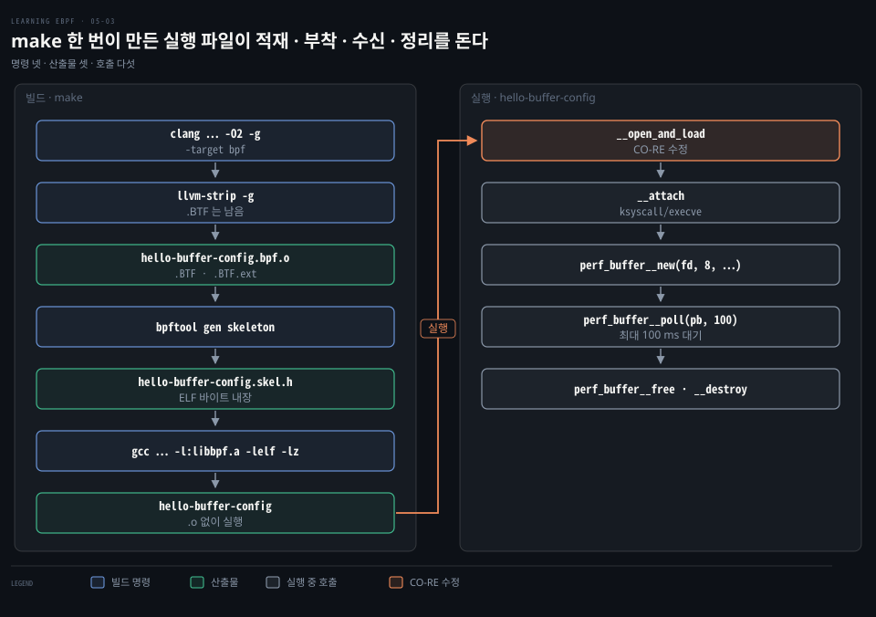
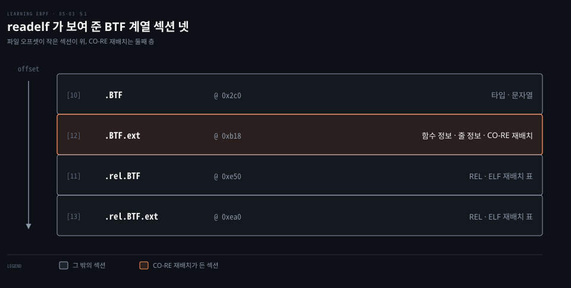
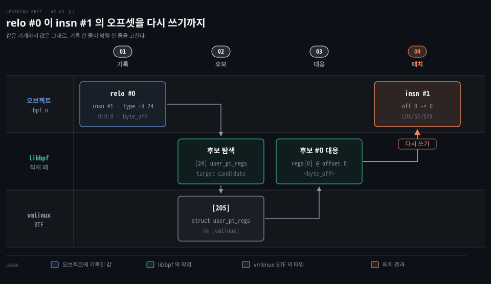
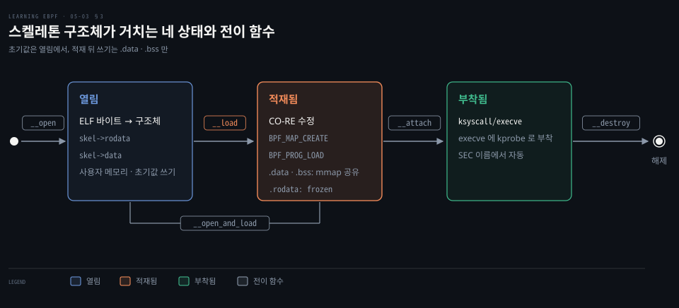
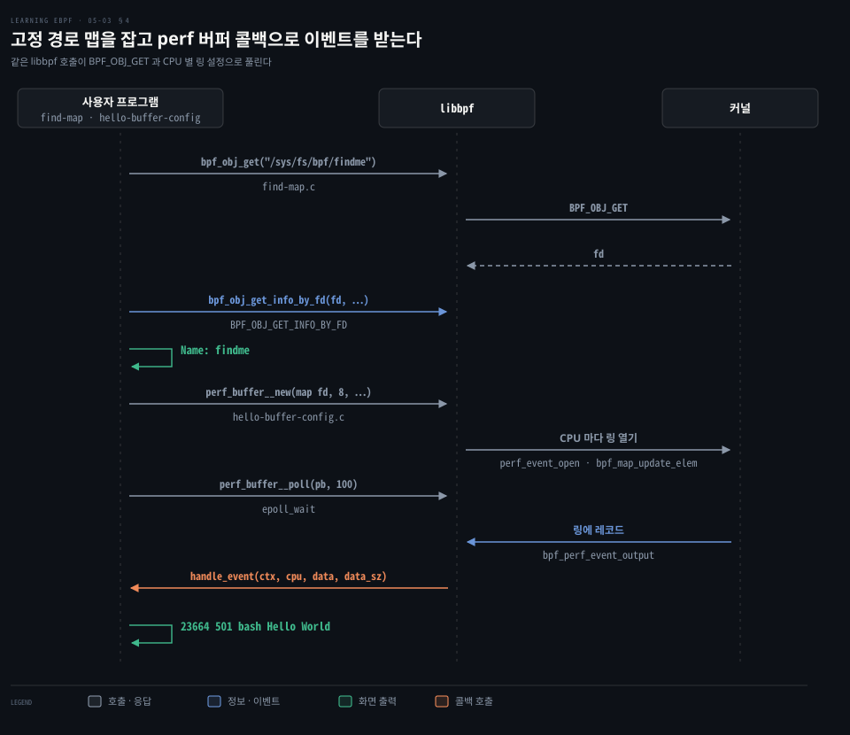

# libbpf 는 적재 때 CO-RE 재배치를 고치고 스켈레톤이 열기·적재·부착·정리를 묶는다

---

> libbpf 는 적재할 때 `.BTF.ext` 의 재배치 기록을 읽어 명령의 오프셋을 실행 중인 커널에 맞게 다시 씁니다. 스켈레톤은 ELF 바이트를 품은 헤더 하나로 열기·적재·부착·정리를 묶습니다.


## 핵심 요약

> 이 편의 중심 생각은 CO-RE 이식성이 적재 순간 libbpf 의 오프셋 수정으로 완성되고, 스켈레톤이 그 수명 전체를 헤더 하나에 담는다는 것입니다.

`.BTF.ext` 의 재배치 기록 하나는 명령 하나와 그 명령이 읽는 필드의 접근 경로를 가리킵니다. libbpf 가 적재할 때 커널의 vmlinux BTF 와 맞춰 오프셋을 다시 씁니다.

스켈레톤 헤더는 ELF 바이트를 품고 열기·적재·부착·정리 함수를 내놓습니다. 적재 뒤에도 사용자 공간에서 쓴 값이 프로그램에 보이는 전역은 `.data`·`.bss` 뿐이고 `.rodata` 는 얼려져 읽기만 됩니다. 이벤트는 perf 버퍼 콜백으로 받습니다.




## 학습 목표

> 이 편을 읽고 나면 다음을 설명할 수 있습니다.

1. `.BTF` 와 `.BTF.ext` 가 담는 것을 `readelf` 출력으로 구분할 수 있습니다.
2. `struct bpf_core_relo` 의 필드와 `bpftool -d` 의 `relo #0` 줄을 짝지어 읽을 수 있습니다.
3. 스켈레톤 함수와 수명 단계의 대응, 적재 전후로 전역 변수를 쓸 수 있는 범위를 설명할 수 있습니다.
4. 이미 있는 맵을 재사용하는 두 길(`bpf_map__reuse_fd`·`bpf_map__set_pin_path`)과 맵 자동 생성을 끄는 호출의 쓰임을 구분할 수 있습니다.
5. `perf_buffer__new`·`perf_buffer__poll` 의 인자와 콜백이 불리는 때를 설명할 수 있습니다.


## 1. 오브젝트의 .BTF 와 .BTF.ext 가 타입과 줄 정보를 싣는다

> 타입은 `.BTF` 가, 함수·줄 정보와 CO-RE 재배치 기록은 `.BTF.ext` 가 맡습니다.

적재 때 오프셋을 고치려면 구조체의 모양이 오브젝트 안에 적혀 있어야 합니다. 그 기록은 어느 섹션에 있을까요?

예제 저장소의 Makefile 은 오브젝트를 만드는 규칙 하나에 옵션을 모읍니다.[^repo-makefile] 옵션의 뜻은 [05-02 편](./05-02.vmlinux.h%20와%20libbpf%20매크로로%20쓴%20eBPF%20프로그램은%20CO-RE%20재배치%20정보를%20품는다.md)이 풉니다.

```bash
%.bpf.o: %.bpf.c vmlinux.h
# BPF 타깃으로 컴파일합니다. -g 가 있어야 .BTF 와 .BTF.ext 가 만들어집니다.
	clang \
	    -target bpf \
        -D __TARGET_ARCH_$(ARCH) \
	    -Wall \
	    -O2 -g -o $@ -c $<
# 디버그 정보를 벗깁니다.
	llvm-strip -g $@
```

clang 은 BPF 타깃에 한해 `-g` 만으로 두 섹션을 만듭니다.[^btf-ext] `llvm-strip -g` 를 거친 오브젝트에도 BTF 섹션이 네 개 남아 있습니다.

```bash
# BTF 섹션만 걸러 봅니다. 맨 오른쪽 열이 16진수 파일 안 위치입니다.
readelf -S hello-buffer-config.bpf.o | grep BTF
     [10] .BTF                   PROGBITS               0000000000000000    000002c0
     [11] .rel.BTF               REL                    0000000000000000    00000e50
     [12] .BTF.ext               PROGBITS               0000000000000000    00000b18
     [13] .rel.BTF.ext           REL                    0000000000000000    00000ea0
```



`.BTF` 는 타입과 문자열을, `.BTF.ext` 는 함수 정보·줄 정보와 CO-RE 재배치를 담습니다.[^btf-ext] 적재 때 libbpf 가 읽는 재배치 기록은 `.BTF.ext` 에 있습니다. 오브젝트 안의 BTF 는 `bpftool btf dump file hello-buffer-config.bpf.o` 로 풀어 볼 수 있습니다.

위치는 `.BTF` 0x2c0, `.BTF.ext` 0xb18, `.rel.BTF` 0xe50, `.rel.BTF.ext` 0xea0 입니다. 뒤의 둘은 ELF 의 `REL` 재배치 표(명시적 가수 없는 재배치 오프셋을 담는 섹션)이며 CO-RE 재배치와는 다른 것입니다.[^elf5]


## 2. 재배치 기록은 명령 하나와 접근 경로를 묶어 적재 때 오프셋을 다시 쓴다

> 재배치 레코드는 고칠 명령, 근거 타입, 접근 경로, 종류를 담고 libbpf 가 적재 때 대상 커널의 BTF 와 맞춰 오프셋을 다시 씁니다.

컴파일할 때 필드의 오프셋은 명령에 숫자로 들어갑니다. 다른 커널에서 구조체가 달라졌다면 무엇이 그 명령을 알아볼까요?

그 답이 `struct bpf_core_relo` 입니다. 재배치가 필요한 명령마다 하나가 `.BTF.ext` 에 들어갑니다.[^uapi-relo]

```c
struct bpf_core_relo {
	// 고칠 명령의 바이트 오프셋입니다.
	__u32 insn_off;
	// 접근의 뿌리가 되는 구조체의 BTF 타입 ID 입니다.
	__u32 type_id;
	// 접근 경로 문자열의 .BTF 문자열 섹션 안 오프셋입니다.
	__u32 access_str_off;
	// 무엇을 고칠지 정하는 종류입니다.
	enum bpf_core_relo_kind kind;
};
```

접근 경로 문자열은 필드와 배열 인덱스를 콜론으로 이은 열이며 헤더 예시에서 `s->a` 는 `0:0` 입니다. `kind` 는 필드의 바이트 오프셋 `BPF_CORE_FIELD_BYTE_OFFSET` 말고도 필드 크기·존재 여부·타입 크기 같은 종류를 가집니다.[^uapi-relo]

Clang 이 이 기록을 남기게 하는 것은 `vmlinux.h` 에서 `BPF_NO_PRESERVE_ACCESS_INDEX` 가 정의되지 않았을 때 켜지는 줄입니다. bpftool 이 머리 쪽에 `#pragma clang attribute push (__attribute__((preserve_access_index)), apply_to = record)` 를 찍고 맨 끝에 `pop` 을 둡니다.[^bpftool-pragma] 그 사이 구조체의 필드 접근은 컴파일한 쪽의 오프셋을 명령에 넣되, 적재 때 고칠 수 있게 재배치 기록을 함께 남깁니다.

적재 때 일어나는 일은 `bpftool -d prog load hello-buffer-config.bpf.o /sys/fs/bpf/hello` 로 볼 수 있습니다. 예제 오브젝트의 kprobe 는 인자를 `pt_regs` 에서 읽어 재배치 기록이 생깁니다. 예제를 돌린 출력에서 재배치 줄만 옮깁니다.

```bash
# 오브젝트 BTF 의 타입 24 와 이름이 같은 vmlinux 타입 205 를 후보로 찾습니다.
libbpf: CO-RE relocating [24] struct user_pt_regs: found target candidate [205] struct user_pt_regs in [vmlinux]
# 재배치 #0 은 byte_off 종류이고 접근 경로 0:0:0 의 오프셋은 0 입니다.
libbpf: prog 'hello': relo #0: <byte_off> [24] struct user_pt_regs.regs[0] (0:0:0 @ offset 0)
# 후보 #0 에서도 같은 필드가 오프셋 0 에 있습니다.
libbpf: prog 'hello': relo #0: matching candidate #0 <byte_off> [205] struct user_pt_regs.regs[0] (0:0:0 @ offset 0)
# 명령 #1 의 off 를 0 에서 0 으로 씁니다.
libbpf: prog 'hello': relo #0: patched insn #1 (LDX/ST/STX) off 0 -> 0
```



24 는 오브젝트 BTF 안의 타입 번호이고 205 는 vmlinux BTF 안의 번호입니다. 마지막 줄은 LDX·ST·STX 명령의 `off` 필드를 고쳤다는 로그입니다.[^relo-patch]

같은 기계에서 빌드하고 적재해 오프셋 0 이 그대로이며, 필드가 밀린 커널이라면 새 값이 달라집니다.

`insn #1` 은 명령 번호이고 `insn_off` 는 바이트 오프셋입니다. 명령 하나가 8바이트이므로 #1 의 `insn_off` 는 8이고, 커널도 이 값이 8 의 배수인지 검사합니다.[^kernel-check]

arm64 에서는 libbpf 가 kprobe 인자 `pt_regs` 를 `user_pt_regs` 로 읽기 때문에 출력에 `user_pt_regs` 가 나옵니다.[^pt-regs] 아키텍처별 인자는 [05-02 편](./05-02.vmlinux.h%20와%20libbpf%20매크로로%20쓴%20eBPF%20프로그램은%20CO-RE%20재배치%20정보를%20품는다.md)이 다룹니다.

재배치를 사용자 공간 libbpf 만 하는 것은 아닙니다. `BPF_PROG_LOAD` 속성의 `core_relos` 로 레코드를 받아 커널이 직접 적용할 수도 있습니다.[^kernel-check]


## 3. 스켈레톤은 ELF 바이트를 품고 열기와 적재를 나눠 준다

> 헤더는 ELF 바이트와 수명 함수를 담고, 초기값은 열기와 적재 사이에서 정하며 적재 뒤 쓰기가 프로그램에 보이는 전역은 `.data`·`.bss` 뿐입니다.

사용자 공간 프로그램이 오브젝트를 싣고 이벤트에 붙이려면 `bpf()` 호출을 하나하나 짜야 할까요?

libbpf 는 `bpf()` 와 관련 시스템 콜을 감싼 C 라이브러리이며 그 시스템 콜은 [bpf() 시스템 콜 편](./04-01.bpf%28%29%20시스템%20콜은%20BTF·맵·프로그램을%20적재하고%20참조%20카운트와%20고정·링크가%20수명을%20정한다.md)이 다뤘습니다.[^libbpf-overview] Go 의 cilium/ebpf·libbpfgo 와 Rust 의 Aya 도 같은 일을 합니다. 가장 쉬운 길은 **스켈레톤**입니다.

```bash
# 오브젝트를 읽어 스켈레톤 헤더를 만듭니다.
bpftool gen skeleton hello-buffer-config.bpf.o > hello-buffer-config.skel.h
```

헤더에는 구조체 `hello_buffer_config_bpf` 와 그 이름을 접두사로 삼은 `__open`·`__load`·`__open_and_load`·`__attach`·`__destroy` 함수가 만들어집니다.[^bpftool-gen] 끝의 `hello_buffer_config_bpf__elf_bytes` 가 ELF 바이트를 돌려주므로 `.bpf.o` 를 지워도 실행 파일은 돕니다.[^gen-elf-bytes] `make` 는 헤더와 `hello-buffer-config.c` 를 `gcc … -l:libbpf.a -lelf -lz` 로 링크합니다.[^repo-makefile]

예제의 `main()` 은 선언과 오류 처리를 줄이면 다음 순서입니다(줄인 곳은 `...`).[^repo-main] 스켈레톤 없이 ELF 에서 바로 읽을 때는 `bpf_object__open_file` 을 씁니다.[^open-file]

```c
...
// libbpf 의 로그를 찍을 함수를 등록합니다.
libbpf_set_print(libbpf_print_fn);
// 열기와 적재를 한 번에 합니다.
skel = hello_buffer_config_bpf__open_and_load();
...
// 프로그램을 SEC() 이벤트에 붙입니다.
err = hello_buffer_config_bpf__attach(skel);
...
// output 맵을 읽을 perf 버퍼를 만듭니다.
pb = perf_buffer__new(bpf_map__fd(skel->maps.output), 8, handle_event, lost_event, NULL, NULL);
...
// 최대 100 ms 기다리며 도착한 레코드를 콜백으로 넘깁니다.
while (true) {
    err = perf_buffer__poll(pb, 100);
    ...
}
perf_buffer__free(pb);
hello_buffer_config_bpf__destroy(skel);
return -err;
```

### 열기와 적재는 둘로 나뉘어 그 사이에서 초기값을 정한다

`__open` 은 ELF 를 읽어 프로그램과 맵을 구조체로 바꾸며 이때 `skel->rodata`·`skel->data` 는 사용자 메모리입니다. `__load` 는 맵을 만들고(`BPF_MAP_CREATE`) 프로그램을 검증해 싣습니다(`BPF_PROG_LOAD`).[^bpftool-gen] CO-RE 수정은 적재 단계에서 맵을 만들기 전에 일어납니다.[^load-order]



둘을 따로 부르면 그 사이에서 `skel->data->c = 10;` 처럼 초기값을 쓸 수 있습니다. `c` 는 예제에 없는 가정이며 예제의 `.data` 전역은 `message` 입니다.

열기 때 `.data`·`.bss` 의 초기값은 익명 메모리에 있습니다. libbpf 는 맵을 만든 뒤 이 이미지를 맵에 채우고 같은 주소 위에 맵의 fd 를 `MAP_FIXED` 로 다시 mmap 합니다. 주소는 그대로이고 메모리만 맵이 받칩니다.[^populate]

스켈레톤의 `data` 포인터도 이 매핑을 가리키도록 갱신되므로 적재 뒤에 `skel->data` 에 쓴 값은 프로그램에 보입니다.[^populate][^skel-doc] mmap 이 가능한 배열이어야 이 공유가 성립하며, 그 플래그가 [전역 변수 편](./03-02.JIT%20가%20바이트코드를%20기계어로%20바꾸고%20XDP%20에%20붙인%20프로그램은%20전역%20변수를%20맵에%20둔다.md)의 `hello.bss flags 0x400` 입니다.

`.rodata` 는 다릅니다. 채운 직후 맵을 얼려(frozen) 사용자 공간 쪽 쓰기를 막고 매핑도 읽기 전용이므로 값은 읽을 수 있어도 상수는 `__load` 앞에서만 정할 수 있습니다.[^populate]


## 4. 기존 맵은 고정 경로로 잡고 이벤트는 perf 버퍼 콜백으로 받는다

> 다른 프로그램의 맵은 고정 경로의 fd 로 받고, 이벤트는 perf 버퍼 콜백으로 받습니다.

### 이미 있는 맵은 고정 경로에서 fd 로 받는다

다른 프로그램이 이미 만든 맵을 같이 쓰려면 libbpf 가 오브젝트에 정의된 맵을 새로 만들지 않고 그 맵을 가리키게 해야 합니다. 어떻게 할까요?

적재 전에 `bpf_map__reuse_fd(map, fd)` 로 이미 있는 맵의 fd 를 넘기면 libbpf 는 새로 만들지 않고 그 맵을 씁니다.[^reuse-fd] 고정 경로를 쓰려면 `bpf_map__set_pin_path` 로 경로를 정해 두면 됩니다. 적재 때 libbpf 가 그 경로의 맵을 열어 종류·키와 값 크기·항목 수·플래그가 같으면 새로 만들지 않고 그 fd 를 씁니다.[^reuse-map]

`bpf_map__set_autocreate(map, false)` 는 공유 수단이 아닙니다. 맵을 만들지 않게만 하며, 커널이 지원하지 않는 맵 종류를 건너뛸 때 씁니다. 그 맵을 쓰는 코드는 verifier 가 죽은 코드로 알아봐야 합니다. 이미 적재했다면 `-EBUSY` 가 돌아옵니다.[^autocreate]

사용자 공간에서 고정 경로의 fd 를 직접 받는 코드는 예제의 `find-map.c` 이며 루트 권한으로 돌려야 합니다.[^repo-findmap] 고정과 fd 의 뜻은 [bpf() 시스템 콜 편](./04-01.bpf%28%29%20시스템%20콜은%20BTF·맵·프로그램을%20적재하고%20참조%20카운트와%20고정·링크가%20수명을%20정한다.md)이 다룹니다.

```c
// 맵 정보를 받을 구조체와 크기입니다.
struct bpf_map_info info = {};
unsigned int len = sizeof(info);

// 고정 경로에서 맵의 fd 를 받습니다.
int findme = bpf_obj_get("/sys/fs/bpf/findme");
if (findme <= 0) {
    printf("No FD\n");
} else {
    // fd 로 맵 정보를 읽어 이름을 찍습니다.
    bpf_obj_get_info_by_fd(findme, &info, &len);
    printf("Name: %s\n", info.name);
}
```

두 함수는 `BPF_OBJ_GET`·`BPF_OBJ_GET_INFO_BY_FD` 명령을 부릅니다.[^bpf-c] 아래 명령으로 맵을 만들어 두면 `find-map` 이 `Name: findme` 를 찍습니다.

```bash
# 고정 경로에 배열 맵을 만듭니다.
bpftool map create /sys/fs/bpf/findme type array key 4 value 32 entries 4 name findme
```

### 부착은 SEC() 이름이 정하고 직접 붙일 때는 attach 함수를 쓴다

`__attach` 는 자동 부착이 가능한 프로그램만 붙이고 어디에 붙일지는 `SEC()` 이름이 정합니다.[^attach-skeleton] 예제는 `SEC("ksyscall/execve")` 라서 execve 에 kprobe 로 붙습니다. 섹션 이름을 libbpf 가 모르는 이름으로 바꾸면 프로그램 유형을 정하지 못해 [적재가 실패](https://github.com/libbpf/libbpf/blob/v1.8.0/src/libbpf.c#L8441-L8443)합니다. 이때는 `bpf_program__set_type` 으로 유형을 직접 정해야 합니다.

부착점을 정하지 않았다면 `bpf_program__attach_kprobe`·`bpf_program__attach_xdp` 같은 함수로 직접 붙입니다.[^attach-fn]

### perf 버퍼는 CPU 마다 링을 열고 콜백이 레코드를 받는다

이벤트 출력은 스켈레톤이 아니라 libbpf 함수가 맡습니다. `perf_buffer__new` 는 맵 fd, CPU 별 버퍼 페이지 수 8, 레코드 콜백, 유실 콜백, 콜백 인자, 옵션을 받습니다.[^perf-new] 이 호출 하나에서 CPU 마다 `perf_event_open` 으로 링을 열고 그 fd 를 `bpf_map_update_elem` 으로 맵 칸에 꽂고 `epoll_ctl` 로 등록합니다.[^perf-per-cpu]

CPU 마다 링을 열어 맵 칸에 fd 를 꽂는 묶음은 BCC 예제로 [kprobe 와 perf 버퍼 편](./04-02.kprobe%20는%20perf%20이벤트로%20붙고%20perf%20버퍼는%20CPU%20마다,%20링%20버퍼는%20하나로%20사용자%20공간에%20넘긴다.md)의 §2 에서 봤고, libbpf 는 기다릴 때 `ppoll` 대신 `epoll` 을 씁니다.

커널 쪽 프로그램은 `bpf_perf_event_output` 으로 링에 레코드를 씁니다.[^repo-bpf] `perf_buffer__poll(pb, 100)` 은 `epoll_wait` 로 최대 100 ms 기다리다가 레코드가 오면 `handle_event(ctx, cpu, data, data_sz)` 를 부릅니다.[^perf-per-cpu] `lost_event` 는 커널이 쓸 자리가 없어 레코드를 잃었을 때 불립니다.[^perf-new]

음수 반환은 오류이고 예제는 Ctrl-C 가 만드는 `-EINTR` 만 정상 종료로 다룹니다.[^repo-main] 끝낼 때는 `perf_buffer__free(pb)` 로 버퍼를 풀고 `__destroy(skel)` 로 프로그램을 떼고 자원을 돌려줍니다.[^bpftool-gen]



예제를 돌린 출력입니다. 모든 줄이 `execve` 호출 하나입니다.

```bash
23664      501       bash                   Hello World
23665      501       bash                   Hello World
23667      0         cron                   Hello World
23668      0         sh                     Hello World
```

메시지가 모두 `Hello World` 인 까닭은 프로그램이 `my_config` 맵에서 호출한 사용자의 ID 항목을 찾다가 없으면 전역 `message` 를 쓰기 때문입니다.[^repo-bpf] `my_config` 에 사용자 ID 별 메시지를 넣는 코드를 사용자 공간에 더하면 줄마다 메시지가 달라집니다.


## 면접 대비

> 재배치 기록, 스켈레톤 수명, 맵 재사용, perf 버퍼에 관한 질문입니다.

1. `.BTF` 와 `.BTF.ext` 에는 각각 무엇이 들어 있고 오프셋을 고치는 데 직접 쓰이는 쪽은 어디입니까?
2. `struct bpf_core_relo` 의 네 필드는 무엇을 가리키며 `patched insn #1 … off 0 -> 0` 의 값이 안 바뀐 이유는 무엇입니까?
3. 스켈레톤이 `__open` 과 `__load` 로 나뉘는 이유와 적재 뒤 `skel->data`·`skel->rodata` 에 쓰면 어떻게 됩니까?
4. 다른 프로그램의 맵을 libbpf 가 새로 만들지 않고 쓰게 하는 방법 둘은 무엇이며 `bpf_map__set_autocreate(map, false)` 는 언제 씁니까?
5. `perf_buffer__new(fd, 8, …)` 의 8 과 `perf_buffer__poll(pb, 100)` 의 100 은 무엇이고 `lost_event` 는 언제 불립니까?


## 정답 (자답 후 펼치기)

> 키워드 중심의 모범 답안입니다.

### 정답 1 — .BTF 와 .BTF.ext

`.BTF` 는 타입과 문자열, `.BTF.ext` 는 함수·줄 정보와 CO-RE 재배치 레코드입니다. 오프셋 수정이 읽는 쪽은 `.BTF.ext` 입니다.

### 정답 2 — 명령·타입·경로·종류

`insn_off` 는 고칠 명령, `type_id` 는 뿌리 타입, `access_str_off` 는 접근 경로 문자열 위치, `kind` 는 고칠 값의 종류입니다. 같은 기계라 오프셋이 같아 값이 그대로입니다. BTFHub 같은 다른 커널의 `vmlinux.h` 로 빌드하면 명령에 들어간 원래 오프셋이 달라져, 적재 때 `off X -> Y` 처럼 값이 바뀌는 패치를 볼 수 있습니다.

### 정답 3 — .data 는 공유, .rodata 는 얼림

열기와 적재 사이에서 초기값을 정합니다. 커널이 mmap 가능한 배열을 지원하면 적재 뒤 `.data`·`.bss` 는 맵과 mmap 으로 겹쳐 쓴 값이 보이고 `.rodata` 는 얼려져 읽기만 됩니다.

### 정답 4 — fd 재사용과 고정 경로

적재 전에 `bpf_map__reuse_fd(map, fd)` 로 기존 맵의 fd 를 넘기거나 `bpf_map__set_pin_path` 로 경로를 정해 호환되는 맵의 fd 를 쓰게 합니다. `bpf_obj_get(path)` 는 fd 를 직접 받는 호출입니다. `bpf_map__set_autocreate(map, false)` 는 맵을 만들지 않게만 할 뿐이라 커널이 지원하지 않는 맵을 건너뛸 때 씁니다.

### 정답 5 — 페이지 수와 대기 시간

8 은 CPU 마다 할당하는 페이지 수이고 100 은 `epoll_wait` 의 대기 제한 100 ms 입니다. 레코드가 오면 100 ms 를 채우지 않고 곧바로 돌아옵니다. `lost_event` 는 커널이 자리가 없어 레코드를 잃었을 때 불립니다.


## 참고 자료

- Liz Rice, 《Learning eBPF》, O'Reilly Media, 2023, Chapter 5 "CO-RE, BTF, and Libbpf" 후반.
- libbpf-bootstrap: https://github.com/libbpf/libbpf-bootstrap
- BCC 의 libbpf 도구 모음: https://github.com/iovisor/bcc/tree/v0.37.0/libbpf-tools


## 관련 문서

- [런타임 컴파일 대신 BTF 가 구조체 배치를 기록해 CO-RE 이식의 근거가 된다](./05-01.런타임%20컴파일%20대신%20BTF%20가%20구조체%20배치를%20기록해%20CO-RE%20이식의%20근거가%20된다.md)
- [vmlinux.h 와 libbpf 매크로로 쓴 eBPF 프로그램은 CO-RE 재배치 정보를 품는다](./05-02.vmlinux.h%20와%20libbpf%20매크로로%20쓴%20eBPF%20프로그램은%20CO-RE%20재배치%20정보를%20품는다.md)

[^repo-makefile]: <https://github.com/lizrice/learning-ebpf/blob/91ded4a/chapter5/Makefile#L11-L20>
[^btf-ext]: <https://github.com/torvalds/linux/blob/v7.2/Documentation/bpf/btf.rst#L762-L774>, <https://github.com/torvalds/linux/blob/v7.2/Documentation/bpf/btf.rst#L1118-L1119>
[^elf5]: <https://manpages.debian.org/unstable/manpages/elf.5.en.html#SHT_REL>
[^uapi-relo]: <https://github.com/torvalds/linux/blob/v7.2/include/uapi/linux/bpf.h#L7612-L7685>
[^bpftool-pragma]: <https://github.com/torvalds/linux/blob/v7.2/tools/bpf/bpftool/btf.c#L782-L823>
[^relo-patch]: <https://github.com/libbpf/libbpf/blob/v1.8.0/src/relo_core.c#L1080-L1106>
[^kernel-check]: <https://github.com/torvalds/linux/blob/v7.2/kernel/bpf/check_btf.c#L341-L405>
[^pt-regs]: <https://github.com/libbpf/libbpf/blob/v1.8.0/src/bpf_tracing.h#L217-L228>
[^libbpf-overview]: <https://github.com/torvalds/linux/blob/v7.2/Documentation/bpf/libbpf/libbpf_overview.rst#L7-L18>
[^bpftool-gen]: <https://github.com/torvalds/linux/blob/v7.2/tools/bpf/bpftool/Documentation/bpftool-gen.rst#L100-L134>
[^gen-elf-bytes]: <https://github.com/torvalds/linux/blob/v7.2/tools/bpf/bpftool/gen.c#L1535>
[^open-file]: <https://github.com/libbpf/libbpf/blob/v1.8.0/src/libbpf.h#L257-L267>
[^repo-main]: <https://github.com/lizrice/learning-ebpf/blob/91ded4a/chapter5/hello-buffer-config.c#L28-L73>
[^load-order]: <https://github.com/libbpf/libbpf/blob/v1.8.0/src/libbpf.c#L9602-L9604>
[^skel-doc]: <https://github.com/torvalds/linux/blob/v7.2/Documentation/bpf/libbpf/libbpf_overview.rst#L101-L104>
[^populate]: <https://github.com/libbpf/libbpf/blob/v1.8.0/src/libbpf.c#L5380-L5445>, <https://github.com/libbpf/libbpf/blob/v1.8.0/src/libbpf.c#L15680-L15702>
[^autocreate]: <https://github.com/libbpf/libbpf/blob/v1.8.0/src/libbpf.h#L1131-L1149>
[^reuse-fd]: <https://github.com/libbpf/libbpf/blob/v1.8.0/src/libbpf.h#L1176>, <https://github.com/libbpf/libbpf/blob/v1.8.0/src/libbpf.c#L5117-L5170>
[^reuse-map]: <https://github.com/libbpf/libbpf/blob/v1.8.0/src/libbpf.c#L5334-L5377>, <https://github.com/libbpf/libbpf/blob/v1.8.0/src/libbpf.h#L1236-L1242>
[^repo-findmap]: <https://github.com/lizrice/learning-ebpf/blob/91ded4a/chapter5/find-map.c#L6-L18>
[^bpf-c]: <https://github.com/libbpf/libbpf/blob/v1.8.0/src/bpf.c#L664-L686>, <https://github.com/libbpf/libbpf/blob/v1.8.0/src/bpf.c#L1258-L1272>
[^attach-skeleton]: <https://github.com/libbpf/libbpf/blob/v1.8.0/src/libbpf.c#L15706-L15732>
[^attach-fn]: <https://github.com/libbpf/libbpf/blob/v1.8.0/src/libbpf.h#L586-L597>, <https://github.com/libbpf/libbpf/blob/v1.8.0/src/libbpf.h#L909>
[^perf-new]: <https://github.com/libbpf/libbpf/blob/v1.8.0/src/libbpf.h#L1713-L1741>
[^perf-per-cpu]: <https://github.com/libbpf/libbpf/blob/v1.8.0/src/libbpf.c#L15143-L15170>, <https://github.com/libbpf/libbpf/blob/v1.8.0/src/libbpf.c#L15250-L15256>
[^repo-bpf]: <https://github.com/lizrice/learning-ebpf/blob/91ded4a/chapter5/hello-buffer-config.bpf.c#L26-L45>
