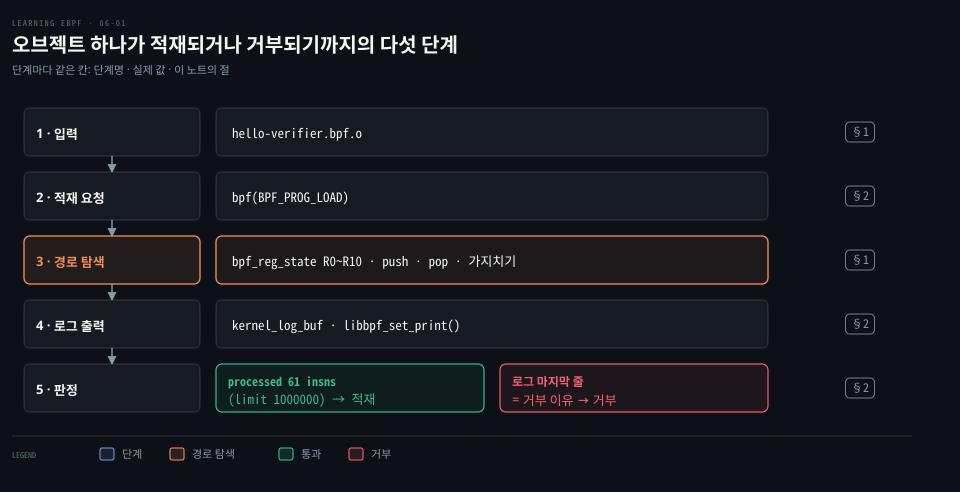
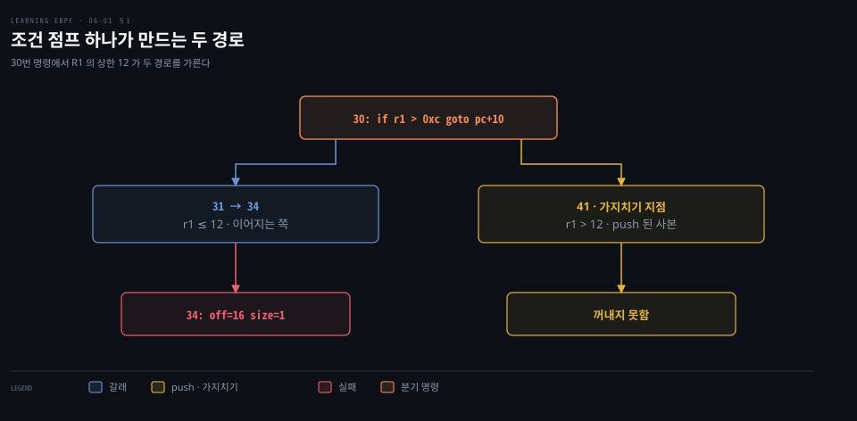
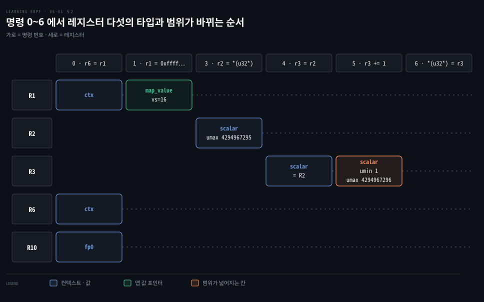

# verifier 는 모든 경로를 따라가며 레지스터 타입과 값 범위를 기록하고 로그로 보여 준다

---

> verifier 는 프로그램을 실행하지 않고 레지스터마다 타입과 값 범위를 적어 가며 가능한 모든 경로를 따라갑니다. 그 기록을 로그로 남기므로 거부 이유를 명령 단위로 거슬러 찾을 수 있습니다.


## 핵심 요약

> 이 편의 중심 생각은 verifier 의 판정이 실행이 아니라 레지스터 타입과 값 범위라는 기록에서 나온다는 것입니다.

verifier 는 소스가 아니라 바이트코드를 읽습니다. 명령을 실행하는 대신 `struct bpf_reg_state` 에 R0~R10 의 타입과 값 범위를 적습니다. 분기에서는 상태 사본을 스택에 넣고 갈래를 하나씩 끝까지 따라갑니다. 같은 위치에 같은 상태로 다시 오면 가지치기합니다. 처리한 명령이 1,000,000 개를 넘으면 거부합니다.

실패 로그의 마지막 줄이 이유이고 그 위의 레지스터 줄이 근거이므로, 로그를 거꾸로 읽으면 원인 명령에 닿습니다. 성공한 적재도 로그 버퍼를 넘기면 같은 기록을 남깁니다. 이 기록을 바탕으로 헬퍼 호출·메모리 접근·루프를 검사하는 방식은 [다음 편](./06-02.헬퍼·메모리%20접근·루프는%20증명된%20범위%20안에서만%20verifier%20를%20통과한다.md)이 이어서 다룹니다.




## 학습 목표

> 이 편을 읽고 나면 다음을 설명할 수 있습니다.

1. verifier 가 소스가 아닌 바이트코드를 보는 이유와 컴파일러 최적화가 판정을 바꿀 수 있는 이유를 설명할 수 있습니다.
2. `bpf_reg_state` 가 기록하는 것과 분기 push·pop·가지치기의 순서를 설명할 수 있습니다.
3. 로그의 레지스터 줄에서 타입과 값 범위를 읽고 거꾸로 따라가 실패 명령을 찾을 수 있습니다.
4. 처리 한도 1,000,000 과 프로그램 길이 상한 4,096 이 서로 다른 숫자임을 구분할 수 있습니다.
5. 실패·성공 로그를 얻는 방법과 마지막 통계 줄의 칸을 읽을 수 있습니다.


## 1. verifier 는 실행하지 않고 모든 경로를 따라가며 레지스터 상태를 기록한다

> verifier 는 clang 이 낸 바이트코드를 대상으로 레지스터 상태를 갱신하며 가능한 경로를 한 번씩 따라갑니다. 분기에서는 상태를 스택에 쌓고, 같은 상태로 다시 오면 중단합니다.

소스에서 안전해 보이던 코드가 거부되기도 합니다. verifier 가 소스를 보지 않기 때문입니다. 커널에 도착하는 것은 clang 이 최적화를 거쳐 낸 오브젝트(예제에서는 `hello-verifier.bpf.o`)의 명령입니다. 판정도 그 명령에 대해 이뤄집니다. 도달할 수 없는 명령은 거부 대상이지만 컴파일러가 먼저 지우면 verifier 는 그 존재를 모릅니다.

레지스터 11개와 명령 형식은 [바이트코드를 읽는 편](./03-01.C%20소스는%20clang%20으로%20eBPF%20바이트코드가%20되고%20bpftool%20이%20적재해%20ID%20와%20태그를%20붙인다.md)에서 다뤘으므로, 여기서는 verifier 가 그 레지스터에 무엇을 적는지만 봅니다. [커널 문서](https://docs.kernel.org/bpf/verifier.html)가 설명하는 검사는 두 단계입니다. 제어 흐름 그래프에서 구조 결함을 거릅니다. 이어 첫 명령에서 출발해 모든 경로를 내려가며 레지스터와 스택의 변화를 관찰합니다. 검사를 통과한 프로그램만 커널 훅에 붙는다는 큰 그림은 [kube-proxy 를 대체하는 eBPF 를 다룬 노트의 verifier 절](../../../08_cloud/book/networking-and-kubernetes/02-03.iptables·IPVS·eBPF%20—%20kube-proxy를%20이해하는%20세%20기술.md)과 [01-01 의 verifier 절](./01-01.eBPF%20는%20커널을%20고치거나%20재부팅하지%20않고%20커널에%20안전한%20프로그램을%20싣는다.md)에 있습니다.

### 레지스터 상태는 타입과 값 범위의 쌍이다

레지스터 하나마다 verifier 가 두는 기록이 **`struct bpf_reg_state`** 입니다. 가리키는 대상의 종류는 이 구조체의 `type` 필드에 `enum bpf_reg_type` 값으로 들어갑니다([bpf_verifier.h 40행](https://github.com/torvalds/linux/blob/v7.2/include/linux/bpf_verifier.h#L40), [열거형](https://github.com/torvalds/linux/blob/v7.2/include/linux/bpf.h#L1033)). 이 편에서 만나는 값은 다음과 같습니다.

- `NOT_INIT`: 아직 쓰이지 않은 레지스터
- `SCALAR_VALUE`: 포인터가 아닌 값
- `PTR_TO_CTX`, `PTR_TO_MAP_VALUE`, `PTR_TO_STACK`: 컨텍스트·맵 항목 값·스택 주소
- `PTR_TO_PACKET`, `PTR_TO_PACKET_END`: 패킷의 시작과 끝

`..._OR_NULL` 이름은 지금도 열거형에 남아 있지만 값은 기본 타입에 `PTR_MAYBE_NULL` 비트를 얹은 조합입니다([bpf.h 1070행](https://github.com/torvalds/linux/blob/v7.2/include/linux/bpf.h#L1070)). 로그의 `map_value_or_null` 이 그 조합을 글자로 찍은 것입니다.

타입 옆에는 최솟값·최댓값과 비트마다 알려진 값 `var_off` 가 붙습니다. 포인터에 더할 값의 상한을 모르면 접근이 객체 안에 머무는지 증명할 수 없으므로 이 범위가 판정의 근거입니다.

### 분기에서는 상태를 쌓고 끝에서 꺼낸다

조건 점프에서는 점프하는 쪽의 상태 사본을 스택에 넣고(`push_stack`), 이어지는 쪽을 `exit` 까지 따라갑니다. `exit` 에 닿으면 스택에서 하나를 꺼내(`pop_stack`) 이어 갑니다. 위험한 명령은 그 자리에서 실패합니다. 한 경로라도 걸리면 프로그램 전체가 거부됩니다.

같은 명령에 다른 경로로 다시 오면 또 처리한 것으로 셉니다. 이 횟수가 `BPF_COMPLEXITY_LIMIT_INSNS`, 곧 1,000,000 을 넘으면 `BPF program is too large. Processed %d insn` 으로 거부합니다([bpf.h 2386행](https://github.com/torvalds/linux/blob/v7.2/include/linux/bpf.h#L2386)).

프로그램 길이 상한은 다른 숫자입니다. 적재 요청의 명령 개수는 `CAP_BPF` 가 있으면 1,000,000 까지, 없으면 `BPF_MAXINSNS` 인 4,096 까지만 받습니다([syscall.c 3033행](https://github.com/torvalds/linux/blob/v7.2/kernel/bpf/syscall.c#L3033)).

### 같은 상태로 다시 도착하면 가지치기한다

경로를 전부 따라가면 비용이 폭발합니다. verifier 는 분기 목표 같은 가지치기 지점에서 상태를 저장해 둡니다. 나중에 같은 지점에 도착하면 비교합니다. 타입과 범위가 같거나 지금 상태가 저장된 상태에 포함되면 그 뒤쪽은 이미 안전하다고 확인된 것이므로 경로를 중단합니다.

저장 빈도는 휴리스틱입니다. 현재 커널은 직전 저장 뒤에 점프를 2개 이상, 명령을 8개 이상 처리했을 때 새 상태를 더하며, 강제 저장이 필요한 지점에서는 이 조건과 무관하게 더합니다([states.c 1259행](https://github.com/torvalds/linux/blob/v7.2/kernel/bpf/states.c#L1259)). 같은 곳의 주석에 따르면 이 제한이 검증 메모리를 최대 절반 줄입니다.



도식은 [06-02 §2](./06-02.헬퍼·메모리%20접근·루프는%20증명된%20범위%20안에서만%20verifier%20를%20통과한다.md)에서 다시 만나는 `30: if r1 > 0xc goto pc+10` 에서 경로가 갈라지는 모습입니다. 이어지는 쪽(r1 ≤ 12)은 곧바로 맵 값 접근에 닿아 34번에서 `off=16 size=1` 접근으로 실패합니다. 점프하는 쪽(r1 > 12)의 사본은 41번 명령을 가리킨 채 스택에 남습니다. 이어지는 쪽이 실패하면 검증이 거기서 끝나 사본은 꺼내지지 않습니다.

[06-02 §2](./06-02.헬퍼·메모리%20접근·루프는%20증명된%20범위%20안에서만%20verifier%20를%20통과한다.md) 처럼 비교를 `<` 로 고치면 이어지는 쪽이 통과하고, 그때 사본이 꺼내져 41번부터 `exit` 까지 따라갑니다.


## 2. verifier 로그는 명령마다 레지스터의 타입과 값 범위를 보여 준다

> 로그의 마지막 줄이 거부 이유이고, 그 위의 레지스터 줄이 근거입니다. 성공한 적재도 로그 버퍼를 넘기면 같은 기록을 남깁니다.

적재 요청(`bpf(BPF_PROG_LOAD)`)이 거부될 때 메시지 한 줄만으로는 어느 명령이 왜 틀렸는지 알 수 없을 때가 많습니다. 로그가 그 사이를 메웁니다.

`bpftool prog load` 는 로그를 stderr 로 내보냅니다. libbpf 는 `libbpf_set_print()` 로 등록한 핸들러가 받습니다. 성공 로그는 열기 옵션 `bpf_object_open_opts` 의 `kernel_log_buf`·`kernel_log_size`·`kernel_log_level` 에 64KiB 버퍼와 수준 1 을 넘겨 얻습니다. 수준이 0 이면 libbpf 는 먼저 로그 없이 적재합니다. 실패하면 수준 1 로 다시 시도해 로그를 받습니다([libbpf.h 194행](https://github.com/torvalds/linux/blob/v7.2/tools/lib/bpf/libbpf.h#L194)).

### 마지막 통계 줄은 작업량을 요약한다

```bash
processed 61 insns (limit 1000000) max_states_per_insn 0 total_states 4 peak_states 4 mark_read 3
```

`processed` 는 분석한 명령 수, `limit` 는 처리 한도 1,000,000 입니다. `total_states` 는 저장한 상태의 총수이고 `peak_states` 는 동시에 보관한 최대 수입니다. 저장한 상태 가운데 다시 맞을 일이 드물다고 본 것을 해제하면 peak 가 total 보다 작아집니다. `max_states_per_insn` 은 한 명령 위치에 쌓여 있던 저장 상태 수의 최댓값입니다.

`mark_read` 는 옛 커널에서 liveness(레지스터 값이 뒤에서 읽히는지 추적하는 생존 분석) 표시를 위해 거슬러 올라간 레지스터 부모 사슬의 가장 긴 길이였습니다. 사슬 기반 liveness 를 걷어낸 v6.18 부터는 칸만 남아 있어 현재 커널은 늘 0 으로 찍습니다. v7.2 소스에서 이 값은 통계 줄에서 읽기만 하고 갱신하는 곳이 없습니다([verifier.c 18612행](https://github.com/torvalds/linux/blob/v7.2/kernel/bpf/verifier.c#L18612)).

### R6 에 컨텍스트를 옮기는 이유와 범위 읽기

예제 프로그램 앞부분의 로그입니다. 레지스터 줄이 찍히는 시점은 명령마다 다릅니다. 맵 값 접근(3·6번) 아래 줄은 그 명령을 실행하기 직전의 상태이고, 조건 점프(30번, [06-02 §2](./06-02.헬퍼·메모리%20접근·루프는%20증명된%20범위%20안에서만%20verifier%20를%20통과한다.md)) 아래 줄은 이어지는 갈래로 범위를 좁힌 뒤의 상태입니다.

근거는 옛 커널의 출력 위치입니다([맵 값 접근 검사 중 출력](https://github.com/torvalds/linux/blob/v5.15/kernel/bpf/verifier.c#L3203), [조건 점프 끝 출력](https://github.com/torvalds/linux/blob/v5.15/kernel/bpf/verifier.c#L9126)). 명령 3 아래에 R2 가 없는 것이 직전 상태의 예입니다.

```bash
0: (bf) r6 = r1
; data.counter = c;
1: (18) r1 = 0xffff800008178000
3: (61) r2 = *(u32 *)(r1 +0)
 R1_w=map_value(id=0,off=0,ks=4,vs=16,imm=0) R6_w=ctx(id=0,off=0,imm=0)
 R10=fp0
; c++;
4: (bf) r3 = r2
5: (07) r3 += 1
6: (63) *(u32 *)(r1 +0) = r3
 R1_w=map_value(id=0,off=0,ks=4,vs=16,imm=0) R2_w=inv(id=1,umax_value=4294967295,
 var_off=(0x0; 0xffffffff)) R3_w=inv(id=0,umin_value=1,umax_value=4294967296,
 var_off=(0x0; 0x1ffffffff)) R6_w=ctx(id=0,off=0,imm=0) R10=fp0
```

현재 커널은 같은 자리를 `scalar(...)` 로 찍습니다([log.c 404행](https://github.com/torvalds/linux/blob/v7.2/kernel/bpf/log.c#L404)). 범위 칸 이름은 `umax` 이고, 값이 0 인 `id`·`off`·`imm` 칸은 생략합니다([log.c 664행](https://github.com/torvalds/linux/blob/v7.2/kernel/bpf/log.c#L664)).

명령이 읽거나 쓴 레지스터만 명령 줄 끝의 `;` 뒤에 같은 줄로 찍고, 그 값은 그 명령을 실행한 뒤의 상태입니다([log.c 814행](https://github.com/torvalds/linux/blob/v7.2/kernel/bpf/log.c#L814)).

첫 명령 `r6 = r1` 은 컨텍스트를 R6 에 옮깁니다. 시작할 때 R1 은 컨텍스트를 가리킵니다. 헬퍼의 인자는 R1~R5 로 넘기며 호출이 끝나면 이 다섯은 읽을 수 없게 됩니다. R6~R9 는 헬퍼가 건드리지 않으므로 R6 에 맡기면 헬퍼를 부른 뒤에도 컨텍스트를 쓸 수 있습니다. R0 는 반환값이고 R10 은 스택 프레임을 가리키는 읽기 전용 포인터입니다.

R2 는 `*(u32 *)` 로 읽었으므로 최솟값 0 은 로그에서 생략되고 최댓값이 4294967295, 곧 0xFFFFFFFF 입니다. 레지스터는 64비트이지만 32비트로 읽어서 상한이 거기서 멈춥니다. R3 은 R2 에 1 을 더한 값입니다. 64비트 덧셈이라 넘침 없이 최솟값 1, 최댓값 4294967296(0x100000000)이 됩니다.

도식은 명령마다 실행한 뒤의 값을 놓았으므로, 로그에서 명령 N 아래에 찍힌 줄을 한 칸 앞 명령 기준으로 옮긴 모습입니다.



verifier 가 따라가는 경로는 제어 흐름 그래프로 볼 수 있습니다. `visual` 옵션은 명령 목록 대신 그래프를 DOT 으로 내보내며 [현재 문서](https://github.com/libbpf/bpftool/blob/v7.8.0/docs/bpftool-prog.rst#L105)에도 남아 있습니다. `xlated` 는 verifier 가 실행에 맞게 고친 뒤의 명령이라, 해시 맵 조회가 `__htab_map_lookup_elem` 호출로 바뀌는 것처럼 [오브젝트와 다를 수 있습니다](https://github.com/torvalds/linux/blob/v7.2/kernel/bpf/fixups.c#L2002).

```bash
# kprobe_exec 프로그램의 제어 흐름을 DOT 으로 내보낸다
bpftool prog dump xlated name kprobe_exec visual > out.dot
# Graphviz 로 PNG 를 만든다
dot -Tpng out.dot > out.png
```


## 면접 대비

> verifier 가 상태를 기록하는 방식과 로그를 읽는 방법에 관한 면접 질문입니다.

1. verifier 는 왜 소스가 아니라 바이트코드를 보고, 분기에서는 어떤 순서로 경로를 따라갑니까?
2. 로그의 R3 줄(`umin_value=1`, `umax_value=4294967296`)은 무엇을 기록한 것이며, 실패 로그는 어떤 순서로 읽습니까?
3. 처리 한도 1,000,000 과 프로그램 길이 상한 4,096 은 어떻게 다르며 각각 어디에서 걸립니까?
4. 통계 줄에서 `peak_states` 가 `total_states` 보다 작으면 무엇을 알 수 있고, 가지치기는 어떤 조건에서 일어납니까?
5. 예제 로그의 첫 명령이 `r6 = r1` 인 이유와 R2 의 최댓값이 4294967295 인 이유는 무엇입니까?


## 정답 (자답 후 펼치기)

> 면접 질문에 대한 키워드 중심의 모범 답안입니다.

### 정답 1 — 최적화된 바이트코드와 push·pop

커널에 도착하는 것이 clang 이 최적화한 바이트코드라서 판정도 그것을 대상으로 합니다. 분기에서는 한쪽 상태 사본을 스택에 넣고 다른 쪽을 `exit` 까지 따라간 뒤 하나씩 꺼내 이어 갑니다. 같은 지점에 같거나 포함되는 상태로 다시 오면 가지치기합니다.

### 정답 2 — 타입·범위 기록과 거꾸로 읽기

레지스터의 타입, 값 범위, 비트 상태 `var_off` 를 기록한 줄이며 찍히는 시점은 명령마다 달라, 맵 값 접근 아래는 그 명령을 실행하기 직전이고 조건 점프 아래는 갈래로 좁힌 뒤의 상태입니다. 실패하면 마지막 오류 줄에서 출발해 문제의 레지스터가 어느 명령에서 어떤 범위로 만들어졌는지 위로 거슬러 올라갑니다. 소스 줄 주석이 변수와 레지스터를 이어 줍니다.

### 정답 3 — 처리 횟수 대 프로그램 길이

처리 한도는 `BPF_COMPLEXITY_LIMIT_INSNS`, 곧 1,000,000 입니다. 같은 명령에 다른 경로로 다시 와도 또 세므로, 이 횟수가 넘으면 `BPF program is too large. Processed %d insn` 으로 거부합니다. 프로그램 길이 상한은 적재 요청의 명령 개수에 걸립니다. `CAP_BPF` 가 있으면 1,000,000 까지, 없으면 `BPF_MAXINSNS` 인 4,096 까지만 받습니다.

### 정답 4 — peak 와 total, 가지치기 조건

저장한 상태 일부를 쓸모없다고 보고 해제하면 동시에 보관한 최대 수인 `peak_states` 가 저장한 총수인 `total_states` 보다 작아집니다. 가지치기는 같은 지점에 도착했을 때 타입과 범위가 같거나 지금 상태가 저장된 상태에 포함되면 일어납니다. 상태는 직전 저장 뒤 점프 2개 이상, 명령 8개 이상을 처리했을 때 새로 더하고, 강제 저장 지점에서는 조건 없이 더합니다.

### 정답 5 — R6 보존과 32비트 읽기

헬퍼의 인자는 R1~R5 로 넘기며 호출이 끝나면 이 다섯은 읽을 수 없게 됩니다. R6~R9 는 헬퍼가 건드리지 않으므로 컨텍스트를 R6 에 맡기면 헬퍼를 부른 뒤에도 쓸 수 있습니다. R2 는 `*(u32 *)` 로 읽었기 때문에 상한이 0xFFFFFFFF, 곧 4294967295 에서 멈춥니다. 레지스터 자체는 64비트입니다.


## 참고 자료

- Liz Rice, 《Learning eBPF》, O'Reilly Media, 2023, ISBN 978-1-098-13512-6, Chapter 6 "The eBPF Verifier".
- 예제 저장소 `chapter6/`: https://github.com/lizrice/learning-ebpf/tree/91ded4a/chapter6
- 커널 문서: https://docs.kernel.org/bpf/verifier.html
- 리눅스 v7.2 소스(`kernel/bpf/`, `include/linux/`, `tools/lib/bpf/`): https://github.com/torvalds/linux/tree/v7.2
- bpftool 문서(v7.8.0): https://github.com/libbpf/bpftool/blob/v7.8.0/docs/bpftool-prog.rst


## 관련 문서

- [헬퍼·메모리 접근·루프는 증명된 범위 안에서만 verifier 를 통과한다](./06-02.헬퍼·메모리%20접근·루프는%20증명된%20범위%20안에서만%20verifier%20를%20통과한다.md)
- [eBPF 는 커널을 고치거나 재부팅하지 않고 커널에 안전한 프로그램을 싣는다](./01-01.eBPF%20는%20커널을%20고치거나%20재부팅하지%20않고%20커널에%20안전한%20프로그램을%20싣는다.md)
- [C 소스는 clang 으로 eBPF 바이트코드가 되고 bpftool 이 적재해 ID 와 태그를 붙인다](./03-01.C%20소스는%20clang%20으로%20eBPF%20바이트코드가%20되고%20bpftool%20이%20적재해%20ID%20와%20태그를%20붙인다.md)
- [iptables·IPVS·eBPF — kube-proxy를 이해하는 세 기술](../../../08_cloud/book/networking-and-kubernetes/02-03.iptables·IPVS·eBPF%20—%20kube-proxy를%20이해하는%20세%20기술.md)
