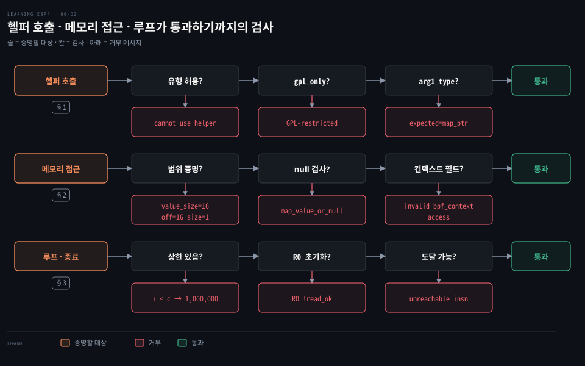
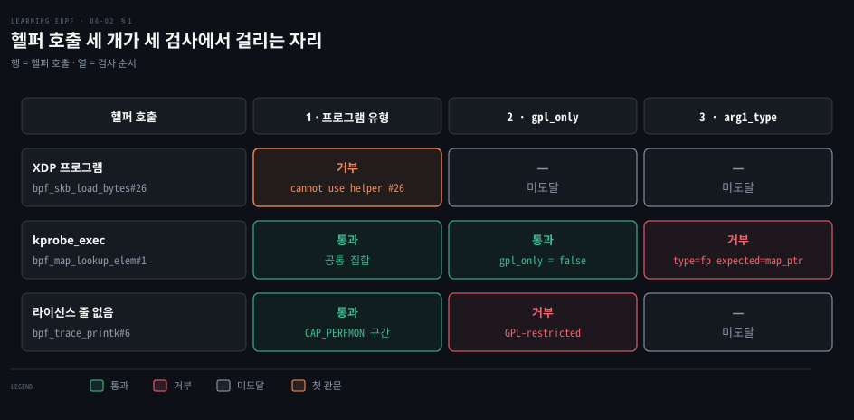
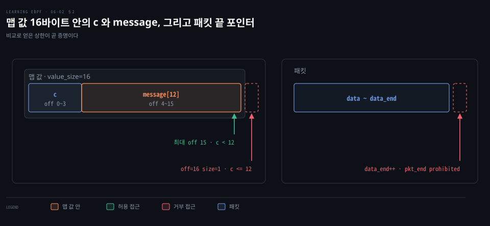
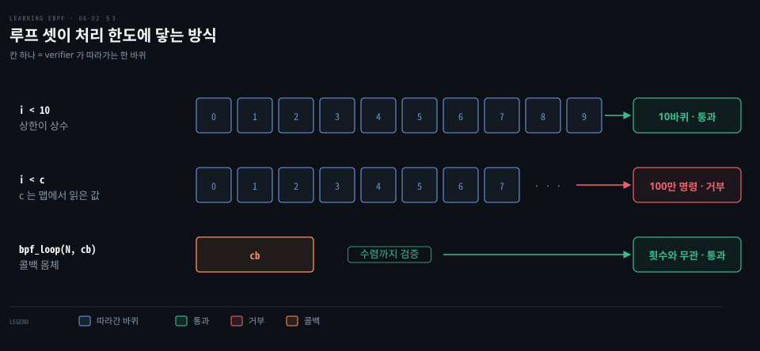

# 헬퍼·메모리 접근·루프는 증명된 범위 안에서만 verifier 를 통과한다

---

> verifier 는 헬퍼 호출을 유형·라이선스·인자 타입으로, 메모리 접근을 경계와 null 로, 종료를 처리 한도와 R0 로 검사합니다.


## 핵심 요약

> 이 편의 중심 생각은 헬퍼·메모리·루프의 거부가 프로그램이 증명하지 못한 곳을 가리킨다는 것입니다.

헬퍼 호출은 유형·라이선스·인자 타입 세 겹을 통과해야 합니다. 메모리 접근은 경계 증명과 null 검사를, 종료는 처리 한도 1,000,000 과 R0 초기화를 통과해야 합니다. 레지스터 기록과 로그 읽기는 [앞 편](./06-01.verifier%20는%20모든%20경로를%20따라가며%20레지스터%20타입과%20값%20범위를%20기록하고%20로그로%20보여%20준다.md)에서 다룹니다.


## 학습 목표

> 이 편을 읽고 나면 다음을 할 수 있습니다.

1. 헬퍼 호출이 거부되는 세 경로(유형·라이선스·인자 타입)를 오류 메시지로 구분할 수 있습니다.
2. 패킷 끝 포인터와 전역 배열 off-by-one 의 거부 메시지를 설명할 수 있습니다.
3. null 검사 전후로 R0 와 R7 의 타입이 달라지는 과정을 설명할 수 있습니다.
4. 상수 상한 루프, 변수 상한 루프, `bpf_loop` 가 처리 한도에 닿는 방식을 구분할 수 있습니다.
5. R0 초기화·모르는 opcode·도달 불가 명령의 거부를 말할 수 있습니다.

아래 그림은 헬퍼 호출과 메모리 접근 및 루프가 검증을 통과하기까지 거치는 검사 항목을 보여 줍니다. 헬퍼 호출의 세 겹 검사는 1절, 메모리 경계와 null 확인은 2절, 루프와 종료 조건은 3절이 다룹니다.




## 1. 헬퍼 호출의 세 겹 검사

> 프로그램은 커널 함수를 직접 부를 수 없고 헬퍼를 거칩니다. verifier 는 호출마다 유형 허용 여부, 라이선스, 인자 타입의 세 겹을 이 순서로 확인합니다.

임의의 커널 함수를 부를 수 있다면 안전을 증명할 수 없습니다. 그래서 허용된 통로인 헬퍼만 부릅니다. BPF 프로그램이 부를 수 있게 등록된 커널 함수인 kfunc 는 예외입니다. 유형마다 헬퍼가 다른 이유는 [링 버퍼를 다룬 편](./02-02.링%20버퍼는%20이벤트를%20밀어%20주고%20tail%20call%20은%20프로그램을%20갈아%20끼운다.md)과 [프로그램 유형을 다루는 편](./07-01.프로그램%20유형이%20컨텍스트와%20헬퍼를%20정하고%20kprobe·fentry·tracepoint%20는%20안정성과%20비용으로%20갈린다.md)이 맡습니다. 여기서는 verifier 가 그 규칙을 어떤 메시지로 집행하는지만 봅니다.

### 프로그램 유형과 프로토타입

헬퍼 호출을 만나면 verifier 는 먼저 그 유형의 `get_func_proto` 로 프로토타입을 찾습니다. 번호가 범위 밖이면 `invalid func` 로 거부합니다([verifier.c 10189행](https://github.com/torvalds/linux/blob/v7.2/kernel/bpf/verifier.c#L10189)). 그 유형이 허용하지 않으면 `program of this type cannot use helper` 로 거부합니다([10194행](https://github.com/torvalds/linux/blob/v7.2/kernel/bpf/verifier.c#L10194)).

허용 범위는 유형만으로 정해지지 않습니다. 공통 집합 `bpf_base_func_proto` 의 앞 구간은 누구에게나 열려 있습니다. `bpf_map_lookup_elem` 과 `bpf_get_current_pid_tgid` 가 여기 있습니다([helpers.c 2114행](https://github.com/torvalds/linux/blob/v7.2/kernel/bpf/helpers.c#L2114)). `bpf_trace_printk` 같은 헬퍼는 `CAP_PERFMON` 이 있어야 열립니다. XDP 용 집합도 기본값으로 공통 집합을 이어받으므로 XDP 프로그램이 `bpf_get_current_pid_tgid` 를 불러도 지금은 거부되지 않습니다.

유형에서 거부되는 예는 `bpf_skb_load_bytes`(#26)입니다. 커널이 패킷을 담는 소켓 버퍼 `sk_buff` 를 읽는 헬퍼지만 XDP 컨텍스트에는 `sk_buff` 가 없습니다. XDP 용 집합과 공통 집합 어디에도 들어 있지 않습니다([filter.c 8600행](https://github.com/torvalds/linux/blob/v7.2/net/core/filter.c#L8600)). XDP 용은 `bpf_xdp_load_bytes` 가 따로 있습니다.

이 호출이 든 XDP 프로그램을 적재하면 verifier 는 서식 `program of this type cannot use helper %s#%d` 에 따라 `...cannot use helper bpf_skb_load_bytes#26` 을 남깁니다.

### 라이선스와 gpl_only 헬퍼

프로토타입을 찾으면 다음은 라이선스입니다. `.gpl_only` 가 참인데 프로그램의 라이선스가 GPL 호환이 아니면 거부합니다. 메시지는 `cannot call GPL-restricted function from non-GPL compatible program` 입니다. 서식은 [verifier.c 10200행](https://github.com/torvalds/linux/blob/v7.2/kernel/bpf/verifier.c#L10200)에 있습니다. 호환 문자열은 `GPL`, `GPL v2`, `Dual BSD/GPL` 같은 정해진 목록입니다([license.h](https://github.com/torvalds/linux/blob/v7.2/include/linux/license.h)).

예제의 마지막 줄은 `char LICENSE[] SEC("license") = "Dual BSD/GPL";` 입니다. 이 줄을 지우면 GPL 전용 헬퍼를 처음 만나는 호출에서 멈춥니다.

`kprobe_exec` 소스에서 GPL 전용 헬퍼로 먼저 나오는 호출은 `bpf_printk` 입니다. 인자가 셋 이하이면 `bpf_trace_printk`(#6)로 풀립니다([bpf_helpers.h 341행](https://github.com/libbpf/libbpf/blob/v1.8.0/src/bpf_helpers.h#L341)).

이 헬퍼는 `.gpl_only = true` 입니다([bpf_trace.c 416행](https://github.com/torvalds/linux/blob/v7.2/kernel/trace/bpf_trace.c#L416)). 

`bpf_probe_read_kernel_str`(#115)도 마찬가지입니다([306행](https://github.com/torvalds/linux/blob/v7.2/kernel/trace/bpf_trace.c#L306)). 반대로 `bpf_map_lookup_elem` 은 `.gpl_only = false` 입니다.

### 인자 타입과 레지스터 타입 대조

마지막은 인자입니다. 헬퍼마다 `bpf_func_proto` 에 인자 타입과 반환 타입이 선언돼 있습니다([helpers.c 50행](https://github.com/torvalds/linux/blob/v7.2/kernel/bpf/helpers.c#L50)).

```c
const struct bpf_func_proto bpf_map_lookup_elem_proto = {
	.func		= bpf_map_lookup_elem,
	.gpl_only	= false,
	.pkt_access	= true,
	.ret_type	= RET_PTR_TO_MAP_VALUE_OR_NULL,
	.arg1_type	= ARG_CONST_MAP_PTR,
	.arg2_type	= ARG_PTR_TO_MAP_KEY,
};
```

예제에 주석으로 남은 `p = bpf_map_lookup_elem(&data, &uid);` 는 맵 대신 스택의 지역 변수 `data` 주소를 넘깁니다. 컴파일러는 문제 삼지 않습니다. 그러나 R1 이 스택 포인터라 `arg1_type` 과 맞지 않아 verifier 가 두 타입을 한 줄로 거부합니다([verifier.c 7882행](https://github.com/torvalds/linux/blob/v7.2/kernel/bpf/verifier.c#L7882)).

```bash
27: (85) call bpf_map_lookup_elem#1
R1 type=fp expected=map_ptr
```

`fp` 는 프레임 포인터, 곧 스택 쪽 주소의 로그 표기이고 `map_ptr` 는 맵 객체 포인터입니다.




## 2. 메모리 접근의 경계와 null 검사

> verifier 는 접근하는 주소가 허용된 범위 안이라고 레지스터 범위로 증명할 수 있어야 통과시킵니다. 증명에 쓸 비교문과 null 검사는 프로그램 코드로 직접 보여 줘야 합니다.

접근이 안전한지는 주소가 어느 객체 안인지, 그 안에서 범위를 벗어나지 않는지로 정해집니다. 둘 다 레지스터의 타입과 값 범위에서 나옵니다.

### 패킷과 data·data_end 경계

XDP 프로그램은 컨텍스트의 `data` 와 `data_end` 를 포인터로 바꿔 시작합니다. verifier 는 둘을 `PTR_TO_PACKET` 과 `PTR_TO_PACKET_END` 로 구분해 기록합니다. 읽을 끝이 `data_end` 를 넘지 않는다는 비교를 프로그램에 요구합니다. `data_end` 자체를 바꿔 속이는 것은 허용하지 않습니다.

예제의 `xdp_hello` 에 `data_end++;` 를 넣으면 컴파일러가 `r3 += 1` 을 냅니다. verifier 는 이를 `R3 pointer arithmetic on pkt_end prohibited` 로 거부합니다([verifier.c 13734행](https://github.com/torvalds/linux/blob/v7.2/kernel/bpf/verifier.c#L13734)).

### 전역 배열의 off-by-one 과 맵 값 범위

초기값이 있는 전역 변수는 `.data` 맵의 값 하나 안에 놓입니다([libbpf.c 545행](https://github.com/libbpf/libbpf/blob/v1.8.0/src/libbpf.c#L545), 전역 변수가 맵이 되는 원리는 [03-02 의 전역 변수 절](./03-02.JIT%20가%20바이트코드를%20기계어로%20바꾸고%20XDP%20에%20붙인%20프로그램은%20전역%20변수를%20맵에%20둔다.md)). 예제의 선언 두 줄을 합치면 16바이트입니다. `c` 는 오프셋 0~3, `message` 는 4~15 에 놓입니다.

```c
int c = 1;
char message[12] = "Hello World";

// 통과: c 는 11 이하라 접근 오프셋이 최대 4+11=15 다
if (c < sizeof(message)) {
    char a = message[c];
    bpf_printk("%c", a);
}

// 거부: c 가 12 일 수 있어 오프셋 16, 맵 값 바로 바깥이다
if (c <= sizeof(message)) {
    char a = message[c];
    bpf_printk("%c", a);
}
```

두 번째 코드는 거부됩니다. verifier 는 `invalid access to map value, value_size=16 off=16 size=1` 과 `R2 max value is outside of the allowed memory range` 메시지를 남깁니다. 앞 메시지의 형식은 [verifier.c 4175행](https://github.com/torvalds/linux/blob/v7.2/kernel/bpf/verifier.c#L4175)에 있습니다. 어느 줄 때문인지는 로그를 거꾸로 읽어 찾습니다(상태 줄 끝은 `...` 로 줄였습니다).

```bash
; if (c <= sizeof(message)) {
30: (25) if r1 > 0xc goto pc+10
 R0_w=map_value_or_null(id=2,off=0,ks=4,vs=12,imm=0) R1_w=inv(id=0,
 umax_value=12,var_off=(0x0; 0xf)) R6=ctx(id=0,off=0,imm=0) ...
; char a = message[c];
31: (18) r2 = 0xffff800008e00004
33: (0f) r2 += r1
last_idx 33 first_idx 19
regs=2 stack=0 before 31: (18) r2 = 0xffff800008e00004
regs=2 stack=0 before 30: (25) if r1 > 0xc goto pc+10
regs=2 stack=0 before 29: (61) r1 = *(u32 *)(r8 +0)
34: (71) r3 = *(u8 *)(r2 +0)
 R0_w=map_value_or_null(id=2,off=0,ks=4,vs=12,imm=0) R1_w=invP(id=0,
 umax_value=12,var_off=(0x0; 0xf)) R2_w=map_value(id=0,off=4,ks=4,vs=16,
 umax_value=12,var_off=(0x0; 0xf),s32_max_value=15,u32_max_value=15)
 R6=ctx(id=0,off=0,imm=0) ...
```

실패한 34번이 읽는 R2 는 `map_value(off=4, vs=16, umax_value=12)` 입니다. 기본 오프셋 4 에 최대 12 가 더해진다는 뜻입니다. 33번의 `r2 += r1` 과 31번이 그 값을 만들었습니다. 소스 줄 주석으로 R2 가 `message` 의 시작이고 R1 이 `c` 임을 알 수 있습니다. R1 의 상한 12 는 30번 아래 줄에 처음 찍힙니다. 점프의 이어지는 갈래로 범위를 좁힌 뒤의 상태이기 때문입니다.

`last_idx`·`regs=` 줄은 R1 의 값이 어디서 왔는지 29번까지 거슬러 올라간 흔적입니다. 길이 12 배열의 유효 인덱스는 0~11 이므로 비교를 `<` 로 고칩니다.



### 헬퍼 반환 포인터와 null 검사

`bpf_map_lookup_elem` 은 항목이 없으면 null 을 돌려줍니다. 반환 타입이 `RET_PTR_TO_MAP_VALUE_OR_NULL` 이라 verifier 는 R0 를 `map_value_or_null` 로 기록합니다. 이를 복사한 R7 도 같은 타입을 갖습니다. 검사 없이 읽으면 거부합니다([verifier.c 6322행](https://github.com/torvalds/linux/blob/v7.2/kernel/bpf/verifier.c#L6322)).

```bash
; p = bpf_map_lookup_elem(&my_config, &uid);
25: (18) r1 = 0xffff263ec2fe5000
27: (85) call bpf_map_lookup_elem#1
28: (bf) r7 = r0
; char a = p->message[0];
29: (71) r3 = *(u8 *)(r7 +0)
R7 invalid mem access 'map_value_or_null'
```

예제처럼 `if (p != 0)` 안에서 읽으면 verifier 는 그 갈래의 R7 을 null 이 아닌 `map_value` 로 바꿔 기록합니다. 그래서 같은 접근이 통과합니다.

일부 헬퍼는 안전을 인자 타입 대신 실행 시점의 동작에 맡깁니다. `bpf_probe_read_kernel` 의 셋째 인자 `unsafe_ptr` 는 `ARG_ANYTHING` 이라 verifier 가 타입을 따지지 않습니다. 선언은 [bpf_trace.c 277행](https://github.com/torvalds/linux/blob/v7.2/kernel/trace/bpf_trace.c#L277)에 있습니다.

대신 읽기에 실패하면 `dst` 를 0 으로 채우고 음수를 돌려줍니다. 구현은 [bpf.h 3573행](https://github.com/torvalds/linux/blob/v7.2/include/linux/bpf.h#L3573)에 있습니다. x86-64 는 null 같은 사용자 공간 주소를 읽기 전에 거절하므로 [폴트 없이 `-ERANGE` 가 됩니다](https://github.com/torvalds/linux/blob/v7.2/arch/x86/mm/maccess.c#L13-L18).

컨텍스트도 허용된 필드만 읽을 수 있습니다. 트레이스포인트 컨텍스트 앞쪽의 공통 필드 넷은 읽을 수 없습니다([bpf_trace.c 1490행](https://github.com/torvalds/linux/blob/v7.2/kernel/trace/bpf_trace.c#L1490)). 이를 어기면 `invalid bpf_context access` 로 거부합니다([verifier.c 4709행](https://github.com/torvalds/linux/blob/v7.2/kernel/bpf/verifier.c#L4709)). 필드 배치는 앞서 링크한 프로그램 유형 편이 맡습니다.


## 3. 루프·반환값·명령 검사

> verifier 는 끝나는 프로그램만 통과시킵니다. 무한 루프는 처리 한도로 막고 종료할 때 R0 초기화를 요구하며 모르는 opcode 와 도달 불가 명령은 거부합니다.

프로그램이 끝나지 않으면 CPU 를 붙잡습니다. 그런데 종료를 일반적으로 증명하는 일은 불가능하므로 verifier 는 더 단순하게 갑니다. 경로를 따라가는 처리가 한도 안에서 끝나는 프로그램만 받습니다. 그 한도 1,000,000 은 커널 소스에 박힌 상수라 sysctl 같은 설정이 없습니다.

### 루프 경로와 처리 한도

루프는 뒤쪽 명령으로 돌아가는 점프입니다. 커널 5.3 이전 verifier 는 이를 허용하지 않았습니다. 그래서 `#pragma unroll` 로 컴파일러가 같은 명령을 반복해서 내보내게 했습니다. 5.3 부터는 뒤로 가는 경로도 따라가며 한도 안에서 끝나는 루프를 받습니다([LWN 해설](https://lwn.net/Articles/794934/)). 이 허용은 지금도 `CAP_BPF` 를 가진 쪽이 적재한 프로그램에만 해당합니다. 없으면 `back-edge from insn %d to %d` 로 거부합니다([cfg.c 134행](https://github.com/torvalds/linux/blob/v7.2/kernel/bpf/cfg.c#L134)).

```c
// 상한이 상수 10: verifier 가 10바퀴를 따라가 통과한다
for (int i=0; i < 10; i++) {
   bpf_printk("Looping %d", i);
}

// 상한 c 는 맵에서 읽은 값이라 범위를 알 수 없다: 한도에 닿아 거부된다
for (int i=0; i < c; i++) {
   bpf_printk("Looping %d", i);
}
```

둘째 루프는 바퀴마다 새 경로를 따라가다 처리 한도에 닿습니다. 반복 변수는 헬퍼 호출 사이에 값이 살아 있어야 하므로 R6~R9 나 스택에 있습니다. 로그에서는 그 레지스터의 범위가 바퀴마다 바뀌는 것으로 찾을 수 있습니다.

### bpf_loop 와 콜백 반복

커널 5.17 에서 `bpf_loop()` 가 들어왔습니다([v5.17 헤더](https://github.com/torvalds/linux/blob/v5.17/include/uapi/linux/bpf.h#L5204)). 반복 횟수와 콜백 함수를 받아 콜백을 반복 호출하는 헬퍼입니다. verifier 는 콜백 몸체를 반복 횟수만큼 펼치지 않습니다. 콜백에서 돌아오면 호출 지점으로 되돌아가 상태가 수렴할 때까지만 다시 따라갑니다. 수렴하면 가지치기가 그 방문을 끝냅니다. 그래서 처리량이 반복 횟수에 비례하지 않습니다([verifier.c 9766행](https://github.com/torvalds/linux/blob/v7.2/kernel/bpf/verifier.c#L9766)).

콜백이 0 을 돌려주면 다음 바퀴로 가고 1 을 돌려주면 남은 반복을 건너뜁니다. 그 밖의 값은 verifier 가 거부합니다([헬퍼 설명](https://github.com/torvalds/linux/blob/v7.2/include/uapi/linux/bpf.h#L5512)). 횟수 상한은 `1 << 23` 입니다([헬퍼 설명](https://github.com/torvalds/linux/blob/v7.2/include/uapi/linux/bpf.h#L5497)).

맵 항목마다 콜백을 부르는 `bpf_for_each_map_elem()` 은 5.13 에서 들어왔습니다. 근거는 [v5.13 헤더](https://github.com/torvalds/linux/blob/v5.13/include/uapi/linux/bpf.h#L4904)입니다.

반복 구조를 코드 안에 쓰는 열린 반복자는 `bpf_iter_<type>_new/next/destroy` 세 kfunc 한 벌입니다. 상태는 BPF 스택에 둡니다([커널 문서](https://docs.kernel.org/bpf/bpf_iterators.html)).



### 프로그램 종료와 R0 초기화

프로그램의 반환값은 R0 에 담깁니다. `exit` 에서 R0 가 한 번도 쓰이지 않았다면 `R0 !read_ok` 로 거부합니다([verifier.c 3110행](https://github.com/torvalds/linux/blob/v7.2/kernel/bpf/verifier.c#L3110)). `xdp_hello` 에서 `bpf_printk` 와 `return XDP_PASS` 를 주석 처리하면 반환문이 없어 이 거부가 납니다. `bpf_printk` 줄만 되살려도 통과합니다. 헬퍼 호출이 R0 에 반환값을 채우기 때문입니다.

### 모르는 opcode 와 도달 불가 명령

알려지지 않은 opcode 는 `unknown opcode %02x` 로 거부합니다([verifier.c 18227행](https://github.com/torvalds/linux/blob/v7.2/kernel/bpf/verifier.c#L18227)). 컴파일러가 이런 바이트코드를 내면 버그라서, 손으로 바이트코드를 쓰지 않는 한 만나기 어렵습니다.

어떤 경로로도 닿지 않는 명령은 `unreachable insn %d` 로 거부합니다([cfg.c 626행](https://github.com/torvalds/linux/blob/v7.2/kernel/bpf/cfg.c#L626)). 이런 명령은 보통 컴파일러가 최적화하며 먼저 지웁니다.

새 명령은 낡은 커널에서 거부됩니다. 원자 연산의 `BPF_ATOMIC` 인코딩은 v5.12 헤더에 처음 나타났습니다([v5.12 헤더](https://github.com/torvalds/linux/blob/v5.12/include/uapi/linux/bpf.h#L22)). 그 전 커널은 같은 opcode 를 `BPF_XADD` 로 읽고 새 연산 필드를 예약 필드 위반으로 거부합니다([v5.11 verifier.c 3615행](https://github.com/torvalds/linux/blob/v5.11/kernel/bpf/verifier.c#L3615)).


## 면접 대비

> 헬퍼·메모리·루프·종료 검사에 관한 질문입니다.

1. 헬퍼 호출이 거부되는 세 경우를 오류 메시지와 함께 구분해 보십시오.
2. `if (c <= sizeof(message))` 와 `bpf_map_lookup_elem` 결과의 바로 역참조는 각각 왜 거부됩니까?
3. 상수 상한 루프, 변수 상한 루프, `bpf_loop` 는 처리 한도에서 어떻게 달라집니까?
4. 반환문이 없는 `xdp_hello` 는 왜 거부되고 `bpf_printk` 만 되살리면 통과합니까?
5. `bpf_probe_read_kernel` 의 `unsafe_ptr` 는 왜 타입으로 막지 않습니까?


## 정답 (자답 후 펼치기)

> 면접 질문의 키워드 중심 답안입니다.

### 정답 1 — 유형·라이선스·인자 타입

유형이 허용하지 않으면 `program of this type cannot use helper` 입니다. 라이선스가 맞지 않으면 `cannot call GPL-restricted function from non-GPL compatible program` 입니다. 인자 타입이 다르면 `R1 type=fp expected=map_ptr` 입니다.

### 정답 2 — 최댓값 증명과 null 가능 타입

`<=` 면 `c` 의 최댓값이 12 라서 오프셋 4 에서 시작하는 `message` 의 `off=16 size=1` 접근이 맵 값 16바이트를 벗어납니다. 조회 결과 `map_value_or_null` 은 `if (p != 0)` 안에서만 `map_value` 가 되므로 검사 없는 역참조는 `invalid mem access` 입니다.

### 정답 3 — 따라가는 경로 수와 콜백 수렴 검증

상수 상한 루프는 10바퀴를 따라가 끝납니다. 상한을 모르는 루프는 1,000,000 에 닿아 거부됩니다. `bpf_loop` 는 콜백을 펼치지 않고 상태가 수렴할 때까지만 따라갑니다.

### 정답 4 — R0 의 초기화

`exit` 에서 R0 가 한 번도 쓰이지 않았다면 `R0 !read_ok` 입니다. `bpf_printk` 줄을 되살리면 헬퍼 호출이 R0 를 채우므로 통과합니다.

### 정답 5 — ARG_ANYTHING 과 폴트 처리

`ARG_ANYTHING` 이라 타입을 따지지 않지만, 읽기에 실패하면 `dst` 를 0 으로 채우고 음수를 돌려줍니다. x86-64 에서 null 은 읽기 전에 거절돼 `-ERANGE` 가 됩니다.


## 참고 자료

- Liz Rice, 《Learning eBPF》, O'Reilly Media, 2023, ISBN 978-1-098-13512-6, Chapter 6 "The eBPF Verifier".
- 예제 저장소 `chapter6/`: https://github.com/lizrice/learning-ebpf/tree/91ded4a/chapter6
- 커널 문서: https://docs.kernel.org/bpf/bpf_iterators.html
- 리눅스 v7.2 소스: https://github.com/torvalds/linux/tree/v7.2
- LWN, "Bounded loops in BPF for the 5.3 kernel": https://lwn.net/Articles/794934/


## 관련 문서

- [verifier 는 모든 경로를 따라가며 레지스터 타입과 값 범위를 기록하고 로그로 보여 준다](./06-01.verifier%20는%20모든%20경로를%20따라가며%20레지스터%20타입과%20값%20범위를%20기록하고%20로그로%20보여%20준다.md)
- [링 버퍼는 이벤트를 밀어 주고 tail call 은 프로그램을 갈아 끼운다](./02-02.링%20버퍼는%20이벤트를%20밀어%20주고%20tail%20call%20은%20프로그램을%20갈아%20끼운다.md)
- [프로그램 유형이 컨텍스트와 헬퍼를 정하고 kprobe·fentry·tracepoint 는 안정성과 비용으로 갈린다](./07-01.프로그램%20유형이%20컨텍스트와%20헬퍼를%20정하고%20kprobe·fentry·tracepoint%20는%20안정성과%20비용으로%20갈린다.md)
