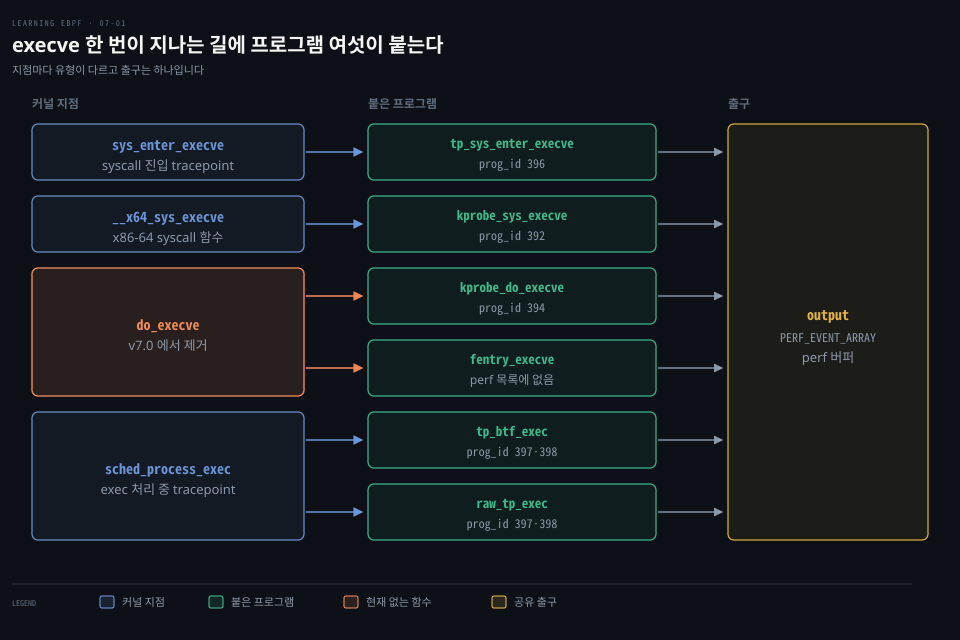
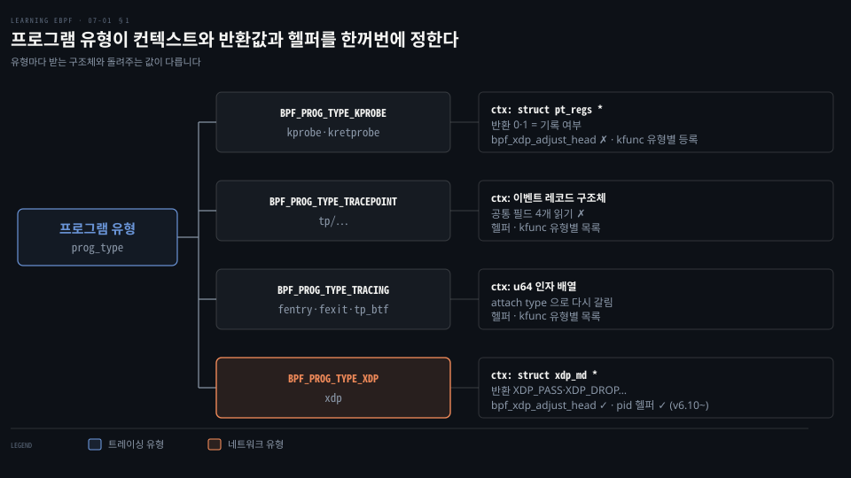
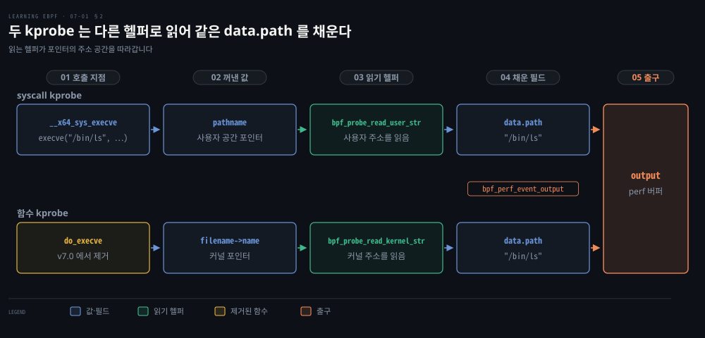
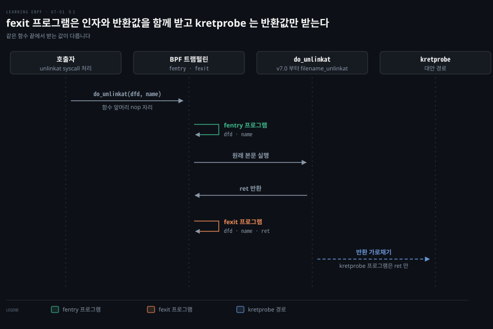
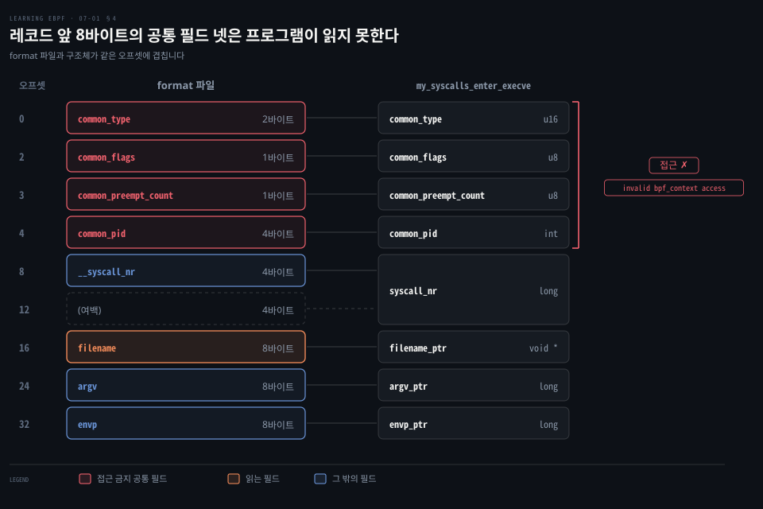

# 프로그램 유형이 컨텍스트와 헬퍼를 정하고 kprobe·fentry·tracepoint 는 안정성과 비용으로 갈린다

---

> 프로그램 유형은 컨텍스트 구조체와 헬퍼와 반환값의 뜻을 한꺼번에 정하고, 커널 안 트레이싱 훅은 함수 이름에 기대는 kprobe 에서 선언된 이벤트에 기대는 tracepoint 로 갈수록 덜 깨집니다.


## 핵심 요약

> 같은 `execve` 한 번에 프로그램 여섯이 붙을 수 있는 까닭은 유형마다 붙는 자리와 받는 값이 다르기 때문이며, 어디에 붙일지는 안정성과 비용의 선택입니다.

프로그램 유형은 `bpf()` 로 적재할 때 정해지고 컨텍스트 구조체와 부를 수 있는 헬퍼·kfunc 와 반환값의 의미를 함께 정합니다. 헬퍼는 UAPI 라 바뀌지 않지만 kfunc 는 커널 내부 API 라 관리자가 필요하다고 판단하면 바뀌거나 없어질 수 있습니다.

kprobe 는 거의 어디에나 붙지만 함수 이름과 인자가 버전마다 바뀝니다. fentry 는 트램펄린으로 더 싸게 붙고 함수 끝에서도 인자를 봅니다. tracepoint 는 커널이 이벤트를 선언해 두어 덜 깨집니다. 예제가 붙는 `do_execve()` 는 v7.0 에서 사라졌습니다.


## 학습 목표

> 이 편을 읽고 나면 다음을 설명할 수 있습니다.

1. 프로그램 유형과 attach type 이 각각 정하는 것을 구분하고 유형마다 컨텍스트와 반환값의 뜻이 다른 까닭을 설명할 수 있습니다.
2. 헬퍼가 UAPI 로서 안정적이고 kfunc 가 호환성을 보장하지 않는 까닭을 설명할 수 있습니다.
3. syscall kprobe 와 함수 kprobe 의 컨텍스트 차이를 읽는 헬퍼로 구분하고 함수 이름 kprobe 가 깨진 사례를 들 수 있습니다.
4. fentry·fexit 가 kprobe·kretprobe 보다 효율적인 이유와 fexit 가 인자까지 보는 이유를 설명할 수 있습니다.
5. tracepoint 의 format 파일로 구조체를 맞추고 raw tracepoint 와 BTF tracepoint 의 컨텍스트 차이를 설명할 수 있습니다.

아래 그림은 execve 호출 한 번이 지나는 커널 지점마다 여섯 프로그램이 붙어 하나의 perf 버퍼로 나가는 구조를 보입니다. 프로그램 유형의 원리는 1절, kprobe 는 2절, fentry 는 3절, tracepoint 는 4절이 다룹니다.




## 1. 프로그램 유형과 컨텍스트·헬퍼·반환값

> 프로그램 유형은 컨텍스트가 가리키는 구조체와 쓸 수 있는 헬퍼와 반환값의 의미를 함께 정합니다. attach type 은 같은 유형이 붙을 자리가 여럿일 때 그중 어디인지를 더 좁힙니다.

같은 `bpf()` 로 적재해도 XDP 는 패킷 앞머리를 옮기는 `bpf_xdp_adjust_head()` 를 부를 수 있습니다. 하지만 kprobe 프로그램은 부를 수 없습니다. 이 차이를 정하는 기준은 적재할 때 건네는 프로그램 유형입니다. 컨텍스트 인자는 어느 유형이든 포인터 하나지만 가리키는 구조체가 다릅니다. kprobe 는 레지스터 묶음 `struct pt_regs *` 를 받습니다.[^bpf-tracing] 반면 XDP 는 패킷 메타데이터 `struct xdp_md *` 를 받습니다.[^xdp]

헬퍼 허용 목록도 유형마다 따로 있어 `bpf_xdp_adjust_head()` 는 XDP 목록에만 있고 kprobe 목록에는 없습니다.[^proto] 목록이 겹치기도 합니다. `bpf_get_current_pid_tgid()` 는 v6.10 전에는 XDP 에서 거부됐지만 v6.10 부터는 권한 검사 없이 모든 유형에 열려 있습니다.[^pid-helper] verifier 가 유형에 맞게 헬퍼와 접근을 검사해 거부하며, 거부 메시지와 검사 과정은 [verifier 편](./06-02.헬퍼·메모리%20접근·루프는%20증명된%20범위%20안에서만%20verifier%20를%20통과한다.md)이 맡습니다.



반환값의 뜻도 유형이 정합니다. XDP 는 패킷을 어떻게 할지를 `XDP_ABORTED`·`XDP_DROP`·`XDP_PASS`·`XDP_TX`·`XDP_REDIRECT` 로 돌려줍니다.[^xdp] 트레이싱 유형의 반환값은 대개 이런 처리 지시가 아닙니다. kprobe 프로그램의 0 은 이벤트를 기록하지 않고 1 은 기록하는 것으로 읽힐 뿐 커널이 하던 일을 바꾸지 않습니다.[^trace-call] 예외로 같은 TRACING 유형의 fmod_ret 프로그램이 0 이 아닌 값을 돌려주면 트램펄린이 원래 본문을 건너뜁니다.[^prog-types]

### 프로그램 유형과 attach type 의 수

v7.2 의 `include/uapi/linux/bpf.h` 에서 `enum bpf_prog_type` 은 `UNSPEC` 과 `__MAX_BPF_PROG_TYPE` 을 빼고 32개입니다. `enum bpf_attach_type` 은 `__MAX_BPF_ATTACH_TYPE` 을 빼고 62개입니다.[^uapi-enum]

유형만으로 붙는 자리가 정해지는 경우가 많지만 같은 유형이 여러 자리에 붙으면 attach type 이 필요합니다. `BPF_PROG_TYPE_TRACING` 이 `BPF_TRACE_FENTRY`·`BPF_TRACE_FEXIT`·`BPF_TRACE_RAW_TP`(tp_btf) 로 갈라지는 것이 그 예입니다.[^prog-types]

### 헬퍼의 UAPI 안정성과 kfunc

헬퍼는 커널이 사용자 공간에 약속한 UAPI 의 일부라 한 번 정의되면 바뀌지 않습니다. 목록은 `bpf-helpers(7)` man page 에 있습니다.[^man-helpers] 이 커널에서 유형마다 쓸 수 있는 헬퍼는 `bpftool feature probe` 로 봅니다.[^bpftool-feature]

kfunc 는 커널 내부 함수를 BPF 서브시스템에 등록해 verifier 가 호출을 허용하게 한 것입니다. 등록은 프로그램 유형마다 따로 합니다. 문서는 kfunc 를 `EXPORT_SYMBOL_GPL` 과 비슷하게 보라고 합니다. 서브시스템 관리자가 필요하다고 판단하면 바꾸거나 없앨 수 있고, 다만 정당한 이유 없이는 바꾸지 않는다고 문서는 적습니다. 그래서 쓰는 프로그램은 커널 버전 사이의 변화를 감안해야 합니다.[^kfuncs]

v7.2 문서 기준 core kfunc 는 `task_struct`·`cgroup` 참조를 얻고 놓는 함수와 `cpumask` 를 만들고 다루는 함수로 나뉩니다.[^kfuncs]


## 2. kprobe 와 커널 함수 이름·인자

> kprobe 는 `kprobes` 가 허용하는 한 거의 어느 함수에든 붙지만 붙는 대상이 커널 내부 구현이라 이름과 인자와 존재가 버전마다 바뀝니다. 예제의 `do_execve()` 가 v7.0 에서 사라진 것이 그 사례입니다.

트레이싱 유형 프로그램을 적재하려면 `CAP_PERFMON` 과 `CAP_BPF` 또는 `CAP_SYS_ADMIN` 이 필요합니다.[^caps] 예제 [`hello.bpf.c`](https://github.com/lizrice/learning-ebpf/blob/91ded4a/chapter7/hello.bpf.c) 를 돌려 원서가 보여 준 `bpftool perf show` 출력은 다음과 같습니다. 둘째 줄의 `do_execve` 는 v7.0 이후 커널에는 없습니다.

```bash
sudo bpftool perf show
pid 232272  fd 16: prog_id 392  kprobe  func __x64_sys_execve  offset 0
pid 232272  fd 17: prog_id 394  kprobe  func do_execve  offset 0
pid 232272  fd 19: prog_id 396  tracepoint  sys_enter_execve
pid 232272  fd 20: prog_id 397  raw_tracepoint  sched_process_exec
pid 232272  fd 21: prog_id 398  raw_tracepoint  sched_process_exec
```

한 줄은 프로세스 id, 그 프로세스 안의 fd, 프로그램 ID, 붙은 종류, 대상 이름 순입니다. kprobe 줄에는 함수 이름 뒤에 오프셋이 붙습니다. `bpftool perf list` 는 `show` 의 별칭입니다.[^bpftool-perf] raw tracepoint·tracepoint·kprobe·uprobe 에 붙은 대상을 나열합니다. 그래서 fentry 는 목록에 없고 tp_btf 와 raw_tp 는 둘 다 `raw_tracepoint sched_process_exec` 로 보입니다.

### 오프셋 kprobe 와 인라인 함수

kprobe 는 보통 함수 진입에, kretprobe 는 반환에 붙입니다. 진입 이후의 오프셋에도 붙일 수 있지만 그 오프셋에 원하는 명령이 있다는 보장은 빌드마다 다릅니다. libbpf 는 `kprobe/<function>[+<offset>]` 형식을 지원합니다.[^libbpf-sec]

함수가 인라인되면 본문이 호출 지점마다 복사돼 진입점이 없어집니다. 커널은 재귀 트랩을 일으킬 수 있는 함수를 `NOKPROBE_SYMBOL()` 로 표시합니다. 그 목록은 `/sys/kernel/debug/kprobes/blacklist` 에서 root 만 읽습니다.[^blacklist]

### syscall kprobe 와 함수 kprobe

시스템 콜 입구에 붙이는 프로그램은 다음과 같이 선언합니다.

```c
// ksyscall 은 libbpf 가 플랫폼별 syscall 함수(x86-64 는 __x64_sys_execve)에 붙여 줍니다.
SEC("ksyscall/execve")
int BPF_KPROBE_SYSCALL(kprobe_sys_execve, const char *pathname)
```

`BPF_KPROBE_SYSCALL` 은 현재 libbpf 헤더에서 `BPF_KSYSCALL` 의 별칭입니다.[^bpf-tracing] 인자 꺼내기와 이름 조립은 [vmlinux.h 와 libbpf 매크로 편](./05-02.vmlinux.h%20와%20libbpf%20매크로로%20쓴%20eBPF%20프로그램은%20CO-RE%20재배치%20정보를%20품는다.md)이 다룹니다. 시스템 콜은 사용자 공간과의 약속이라 번호가 유지되며 x86-64 에서 `execve` 는 59 번입니다.[^syscall-tbl]

일반 커널 함수에 붙이는 프로그램은 `SEC` 이름 형식이 같고 매크로만 `BPF_KPROBE` 로 바뀝니다.

```c
SEC("kprobe/do_execve")
int BPF_KPROBE(kprobe_do_execve, struct filename *filename)
```

차이는 컨텍스트에 있습니다. syscall kprobe 의 `pathname` 은 사용자 공간이 넘긴 값이라 `bpf_probe_read_user_str()` 로 읽습니다.

함수 kprobe 의 `filename` 은 커널이 내부에서 만든 `struct filename` 입니다. 그래서 `BPF_CORE_READ(filename, name)` 으로 이름 포인터를 꺼낸 뒤 `bpf_probe_read_kernel_str()` 로 읽습니다.[^repo] v7.2 에서 `name` 은 `struct filename` 앞머리에 내장된 `struct __filename_head` 의 첫 필드입니다. 따라서 `filename->name` 으로 그대로 읽힙니다.[^fs-filename]



예를 들어 `execve("/bin/ls", …)` 이면 두 경로 모두 `data.path` 에 `/bin/ls` 가 담깁니다.

두 경로 모두 `bpf_perf_event_output()` 으로 `output` 에 값을 보냅니다. 여기서 `output` 은 `BPF_MAP_TYPE_PERF_EVENT_ARRAY` 맵이 만드는 perf 버퍼입니다.[^repo] `BPF_KPROBE` 는 선언한 인자를 첫째부터 차례로 레지스터에 대응시킵니다. 그래서 뒤쪽 인자는 생략할 수 있어도 앞 인자를 건너뛰고 뒤 인자만 쓸 수는 없습니다.[^bpf-tracing] kretprobe 는 함수가 반환할 때 불리며 인자가 아니라 반환값만 봅니다.

### v7.0 에서 사라진 do_execve

예제가 붙는 `do_execve()` 는 v6.19 `fs/exec.c` 에 `static int do_execve(...)` 로 정의돼 있었습니다. 하지만 v7.0 부터는 커널에 없습니다. v7.2 에서는 `execve` 시스템 콜 정의가 `do_execveat_common()` 을 바로 부릅니다.[^exec] 그래서 `kprobe/do_execve` 와 `fentry/do_execve` 는 현재 커널에서 붙을 대상이 없습니다.

예제 저장소 README 도 ARM 에서 `do_execve+0x0` 에 kprobe 를 만들지 못해 `No such file or directory` 가 난다고 적습니다.[^repo] 함수 이름으로 거는 방식은 이렇게 기계와 버전마다 대상이 있고 없을 수 있습니다. kprobe 의 불안정한 API 성격은 [관측 소스 편](../systems-performance/04-02.관측%20도구%20—%20관측%20소스.md)의 §7 kprobes 절에도 있습니다.


## 3. fentry·fexit 와 트램펄린

> fentry 와 fexit 는 함수 앞머리 nop 자리를 BPF 트램펄린으로 바꿔 프로그램을 직접 부르므로 kprobe 보다 효율적이고, fexit 는 반환값과 함께 입력 인자까지 봅니다.

kretprobe 로 함수 끝에서 무언가를 하면 반환값만 보고 함수에 들어간 인자는 잃습니다. fentry 와 fexit 는 `BPF_PROG_TYPE_TRACING` 에 속하며, 그중 fexit 는 인자와 반환값을 함께 봅니다.

커널은 함수 앞에 비워 둔 5바이트 nop(아무 일도 하지 않는 명령)을 `call generated_bpf_trampoline` 으로 바꿉니다. 트램펄린은 프로그램을 붙일 때 커널이 그 함수용으로 만드는 작은 중계 코드입니다. 트램펄린이 fentry 프로그램을 부르고 원래 본문을 실행한 뒤 fexit 프로그램을 부릅니다. v5.5 x86 JIT 소스의 주석이 이 순서를 어셈블리로 보여 줍니다.[^jit]

fentry 가 권장되는 조건은 커널 버전입니다. x86 은 v5.5 의 `arch/x86/net/bpf_jit_comp.c` 에 `arch_prepare_bpf_trampoline()` 이 처음 보입니다. arm64 는 v6.0 에서 같은 이름의 함수가 들어옵니다. 이전 태그인 v5.4 와 v5.19 에는 없습니다.[^jit] 예제 저장소 주석도 ARM 의 fentry 지원이 6.0 부터라고 적습니다.[^repo]

```c
SEC("fentry/do_execve")
int BPF_PROG(fentry_execve, struct filename *filename)
```

`BPF_PROG` 은 일반 컨텍스트 포인터 대신 타입이 붙은 인자를 받게 해 주는 매크로입니다. 컨텍스트가 `unsigned long long *` 배열이라 매크로가 인자를 하나씩 꺼내 줍니다.[^bpf-tracing] fentry·fexit·tp_btf 처럼 인자를 `u64` 배열로 받는 유형이 같은 매크로를 씁니다. `do_execve` 가 사라졌으므로 이 예제도 같은 처지입니다. fentry 는 적재할 때 대상의 BTF ID 를 찾으므로, v7.0 이후 커널에서는 `hello_bpf__load()` 가 실패해 예제 전체가 돌지 않습니다.

kretprobe 와 fexit 의 차이는 libbpf-bootstrap 예제 두 개를 나란히 보면 분명합니다. 둘 다 `do_unlinkat()` 의 끝에 붙습니다.[^lbb]

```c
SEC("kretprobe/do_unlinkat")
int BPF_KRETPROBE(do_unlinkat_exit, long ret)

SEC("fexit/do_unlinkat")
int BPF_PROG(do_unlinkat_exit, int dfd, struct filename *name, long ret)
```

kretprobe 프로그램은 `ret` 하나를 받고 fexit 프로그램은 `dfd`·`name` 과 `ret` 을 모두 받습니다.



이 예제도 이름 문제를 피하지 못합니다. v6.19 의 `fs/namei.c` 에는 `int do_unlinkat(int dfd, struct filename *name)` 가 있었습니다. v7.0 부터는 `do_unlinkat` 이 없고 같은 시그니처의 `filename_unlinkat` 이 있으며 v7.2 도 같습니다.[^namei]


## 4. tracepoint 와 BTF 판

> tracepoint 는 커널이 이름과 필드를 선언해 둔 지점이라 함수 이름보다 덜 깨집니다. 컨텍스트는 format 파일을 보고 레코드 구조체를 손으로 맞추거나, tp_btf 로 tracepoint 인자를 BTF 타입째 받습니다.

`do_execve` 함수가 사라진 커널에서는 kprobe 나 fentry 를 붙일 수 없습니다. 하지만 `sched_process_exec` 이벤트는 남아 있습니다. v5.15 와 v6.19 와 v7.2 의 `include/trace/events/sched.h` 에 모두 정의돼 있습니다.[^sched-exec] `TRACE_EVENT` 가 이벤트 이름과 기록할 필드를 선언하므로 구현 함수가 바뀌어도 같은 이벤트를 남기려는 지점입니다.

사용할 수 있는 이벤트는 `/sys/kernel/tracing/available_events` 에 `<서브시스템>:<이름>` 으로 나열됩니다. 원서 저자의 v5.15 커널에는 이 목록에 1,400개가 넘는 tracepoint 가 있었습니다. 섹션 이름은 이 항목을 `SEC("tp/<서브시스템>/<이름>")` 형식으로 옮긴 것이어야 libbpf 가 알아서 붙입니다. tracefs 경로는 [BCC Hello World 편](./02-01.BCC%20Hello%20World%20는%20execve%20에%20kprobe%20를%20걸고%20결과를%20trace_pipe%20와%20해시%20맵으로%20꺼낸다.md)에서 다뤘고 kprobe 와의 비교는 [관측 소스 편](../systems-performance/04-02.관측%20도구%20—%20관측%20소스.md)의 §6 tracepoints 절에 있습니다.

### format 파일과 구조체 오프셋

컨텍스트 구조체는 이벤트마다 다릅니다. 예제 주석에 옮겨 둔 `sys_enter_execve` 의 format 파일은 다음과 같습니다.[^repo]

```bash
cat /sys/kernel/tracing/events/syscalls/sys_enter_execve/format
name: sys_enter_execve
ID: 622
format:
        field:unsigned short common_type;       offset:0;       size:2; signed:0;
        field:unsigned char common_flags;       offset:2;       size:1; signed:0;
        field:unsigned char common_preempt_count;       offset:3;       size:1; signed:0;
        field:int common_pid;   offset:4;       size:4; signed:1;

        field:int __syscall_nr; offset:8;       size:4; signed:1;
        field:const char * filename;    offset:16;      size:8; signed:0;
        field:const char *const * argv; offset:24;      size:8; signed:0;
        field:const char *const * envp; offset:32;      size:8; signed:0;
...
```

예제는 이 오프셋에 맞춰 구조체를 손으로 선언합니다.[^repo]

```c
struct my_syscalls_enter_execve {
    unsigned short common_type;
    unsigned char common_flags;
    unsigned char common_preempt_count;
    int common_pid;

    long syscall_nr;
    void *filename_ptr;
    long argv_ptr;
    long envp_ptr;
};
```

`__syscall_nr` 는 4바이트 `int` 인데 구조체는 `long syscall_nr` 로 8바이트를 잡습니다. 4바이트 필드와 4바이트 여백을 한 칸으로 덮어 `filename_ptr` 이 16 에 놓이게 하려는 선택입니다.

앞의 네 `common_*` 필드는 프로그램이 읽을 수 없습니다. tracepoint 유형의 `is_valid_access` 가 오프셋 8 미만의 접근을 거부합니다.[^tp-valid] 이를 읽으려 하면 verifier 가 `invalid bpf_context access` 로 적재를 막습니다. 거부 과정은 [verifier 편](./06-02.헬퍼·메모리%20접근·루프는%20증명된%20범위%20안에서만%20verifier%20를%20통과한다.md)이 맡습니다.



이 구조체를 받는 프로그램은 `filename_ptr` 을 사용자 주소로 읽습니다.

```c
SEC("tp/syscalls/sys_enter_execve")
int tp_sys_enter_execve(struct my_syscalls_enter_execve *ctx) {
...
   bpf_probe_read_user_str(data.path, sizeof(data.path), ctx->filename_ptr);
```

### raw tracepoint 와 BTF 판

`tp` 유형은 커널이 원시 인자를 레코드 구조체로 옮긴 뒤 프로그램을 부릅니다. 이 가공을 아끼려면 `SEC("raw_tp/…")` 유형을 씁니다. 컨텍스트는 `__u64` 배열을 감싼 `struct bpf_raw_tracepoint_args` 입니다. 인자는 tracepoint 가 쓰는 타입으로 직접 바꿔 읽어야 합니다.[^raw-args] 시스템 콜 진입 tracepoint 의 인자는 아키텍처에 따라 다릅니다.

BTF tracepoint 는 `SEC("tp_btf/<이름>")` 으로 선언하며 attach type 은 `BPF_TRACE_RAW_TP` 입니다.[^prog-types] 레코드 구조체 이름은 이벤트 클래스 이름 앞에 `trace_event_raw_` 를 붙인 것이고 `vmlinux.h` 에 있습니다. `TRACE_EVENT` 로 선언한 `sched_process_exec` 는 클래스 이름이 이벤트 이름과 같습니다.[^raw-struct]

```c
SEC("tp_btf/sched_process_exec")
int tp_btf_exec(struct trace_event_raw_sched_process_exec *ctx)
```

이 예제는 `ctx` 의 필드를 읽지 않습니다. `ctx->pid` 읽기는 주석으로 막혀 있고 이유는 8바이트 경계에 맞지 않는 데이터 접근 문제라고 적혀 있습니다.[^repo]

까닭은 컨텍스트에 있습니다. tp_btf 의 컨텍스트는 레코드 구조체가 아니라 tracepoint 의 `TP_PROTO` 인자를 담은 배열입니다. `sched_process_exec` 의 인자는 `struct task_struct *p` 와 `pid_t old_pid` 와 `struct linux_binprm *bprm` 셋입니다.[^sched-exec] 레코드 구조체에서 `pid` 는 오프셋 12 인데 컨텍스트 접근은 8의 배수여야 해서 verifier 가 막습니다.[^btf-ctx] 값을 읽으려면 구조체가 아니라 이 인자 목록을 타입 인자로 선언합니다.

uprobe·USDT·LSM 과 네트워크 유형은 [다음 편](./07-02.사용자%20공간·LSM·네트워크%20훅은%20붙는%20자리가%20컨텍스트와%20반환값의%20뜻을%20정한다.md)이 맡습니다.


## 면접 대비

> 이 편의 네 절에서 고른 질문입니다. 먼저 자기 말로 답한 뒤 아래 정답과 견줍니다.

1. 프로그램 유형과 attach type 은 각각 무엇을 정하며 같은 헬퍼가 유형에 따라 되기도 하고 안 되기도 하는 이유는 무엇입니까?
2. 헬퍼와 kfunc 는 호환성 면에서 어떻게 다르며 kfunc 를 쓰는 프로그램은 무엇을 감수해야 합니까?
3. syscall kprobe 와 함수 kprobe 의 컨텍스트는 어떻게 다르고 함수 이름 kprobe 가 깨진 사례를 하나 들 수 있습니까?
4. fentry 가 kprobe 보다 효율적인 이유와 fexit 가 kretprobe 보다 나은 점은 무엇입니까?
5. tracepoint 구조체를 손으로 맞출 때 무엇을 보고 어디를 조심해야 하며 tp_btf 의 컨텍스트는 무엇이 다릅니까?


## 정답 (자답 후 펼치기)

> 면접 질문에 대한 키워드 중심의 모범 답안입니다.

### 정답 1 — 유형과 attach type

유형은 컨텍스트 구조체와 허용 헬퍼·kfunc 와 반환값의 뜻을, attach type 은 붙을 여러 자리 중 하나를 정합니다. `bpf_xdp_adjust_head()` 는 XDP 의 헬퍼 목록에만 있어 kprobe 에서는 verifier 가 거부합니다.

### 정답 2 — 헬퍼는 UAPI, kfunc 는 보장 없음

헬퍼는 UAPI 라 바뀌지 않습니다. kfunc 는 `EXPORT_SYMBOL_GPL` 처럼 관리자가 바꾸거나 없앨 수 있어 버전 변화를 감안해야 합니다.

### 정답 3 — 사용자 값·커널 구조체와 do_execve

syscall kprobe 는 사용자 값을 `bpf_probe_read_user_str()` 로, 함수 kprobe 는 커널 구조체를 `BPF_CORE_READ` 와 `bpf_probe_read_kernel_str()` 로 읽습니다. `do_execve()` 가 v7.0 에서 없어졌습니다.

### 정답 4 — 트램펄린 직접 호출, fexit 는 인자도

fentry 는 nop 자리를 트램펄린 호출로 바꿔 프로그램을 직접 부릅니다. fexit 는 인자와 반환값을 함께 받고 kretprobe 는 반환값만 받습니다. x86 은 v5.5, arm64 는 v6.0 부터입니다.

### 정답 5 — format 오프셋·앞 8바이트와 tp_btf

format 의 오프셋과 `__syscall_nr` 뒤 여백까지 맞춥니다. 앞의 네 `common_*` 필드는 읽을 수 없습니다. tp_btf 의 컨텍스트는 `TP_PROTO` 인자 배열이라 타입 인자로 읽습니다.


## 참고 자료

- Liz Rice, 《Learning eBPF》, O'Reilly Media, 2023, Chapter 7 "eBPF Program and Attachment Types" 앞부분.
- Alan Maguire, "BPF: A Tour of Program Types": https://blogs.oracle.com/linux/bpf-a-tour-of-program-types
- bpf-helpers(7): https://git.kernel.org/pub/scm/docs/man-pages/man-pages.git/tree/man/man7/bpf-helpers.7
- BPF kernel functions (kfuncs): https://docs.kernel.org/bpf/kfuncs.html


## 관련 문서

- [BCC Hello World 는 execve 에 kprobe 를 걸고 결과를 trace_pipe 와 해시 맵으로 꺼낸다](./02-01.BCC%20Hello%20World%20는%20execve%20에%20kprobe%20를%20걸고%20결과를%20trace_pipe%20와%20해시%20맵으로%20꺼낸다.md)
- [vmlinux.h 와 libbpf 매크로로 쓴 eBPF 프로그램은 CO-RE 재배치 정보를 품는다](./05-02.vmlinux.h%20와%20libbpf%20매크로로%20쓴%20eBPF%20프로그램은%20CO-RE%20재배치%20정보를%20품는다.md)
- [사용자 공간·LSM·네트워크 훅은 붙는 자리가 컨텍스트와 반환값의 뜻을 정한다](./07-02.사용자%20공간·LSM·네트워크%20훅은%20붙는%20자리가%20컨텍스트와%20반환값의%20뜻을%20정한다.md)

[^proto]: v7.2 `net/core/filter.c` L8600-L8654(`xdp_func_proto`, L8609 `bpf_xdp_adjust_head`): <https://github.com/torvalds/linux/blob/v7.2/net/core/filter.c#L8600-L8654>, `kernel/trace/bpf_trace.c` L1343(`kprobe_prog_func_proto`): <https://github.com/torvalds/linux/blob/v7.2/kernel/trace/bpf_trace.c#L1343>
[^pid-helper]: v7.2 `kernel/bpf/helpers.c` L2114-L2125(권한 검사 앞): <https://github.com/torvalds/linux/blob/v7.2/kernel/bpf/helpers.c#L2114-L2125>, `net/core/filter.c` L8653-L8654(XDP 기본 분기에서 `bpf_sk_base_func_proto` 를 거쳐 `bpf_base_func_proto` 로 이어짐), v6.10 `helpers.c` L1939(v6.9 에는 이 case 없음): <https://github.com/torvalds/linux/blob/v6.10/kernel/bpf/helpers.c#L1939>
[^xdp]: v7.2 `bpf.h` L6576-L6587(`enum xdp_action`·`struct xdp_md`): <https://github.com/torvalds/linux/blob/v7.2/include/uapi/linux/bpf.h#L6576-L6587>
[^trace-call]: v7.2 `kernel/trace/bpf_trace.c` L104-L110: <https://github.com/torvalds/linux/blob/v7.2/kernel/trace/bpf_trace.c#L104-L110>
[^uapi-enum]: v7.2 `bpf.h` L1062-L1163: <https://github.com/torvalds/linux/blob/v7.2/include/uapi/linux/bpf.h#L1062-L1163>
[^prog-types]: v7.2 `program_types.rst` L198-L218: <https://github.com/torvalds/linux/blob/v7.2/Documentation/bpf/libbpf/program_types.rst#L198-L218>
[^man-helpers]: bpf-helpers(7): <https://git.kernel.org/pub/scm/docs/man-pages/man-pages.git/tree/man/man7/bpf-helpers.7>
[^bpftool-feature]: v7.2 `bpftool-feature.rst` L35-L41: <https://github.com/torvalds/linux/blob/v7.2/tools/bpf/bpftool/Documentation/bpftool-feature.rst#L35-L41>
[^kfuncs]: v7.2 `kfuncs.rst` §2.6 L417-L438(유형별 등록)·§3 L499-L514(`EXPORT_SYMBOL_GPL`·정당한 이유)·§4 L590-L596(core kfunc)·L597(task)·L710(cgroup)·L761-L766(cpumask): <https://github.com/torvalds/linux/blob/v7.2/Documentation/bpf/kfuncs.rst#L499-L507>
[^caps]: v7.2 `capability.h` L278(`CAP_SYS_ADMIN`)·L411(`CAP_PERFMON`·`CAP_BPF`): <https://github.com/torvalds/linux/blob/v7.2/include/uapi/linux/capability.h#L411>
[^repo]: 예제 저장소 `91ded4a` `chapter7/hello.bpf.c`: <https://github.com/lizrice/learning-ebpf/blob/91ded4a/chapter7/hello.bpf.c>, `README.md`: <https://github.com/lizrice/learning-ebpf/blob/91ded4a/chapter7/README.md>
[^bpftool-perf]: v7.2 `bpftool-perf.rst` L22-L40: <https://github.com/torvalds/linux/blob/v7.2/tools/bpf/bpftool/Documentation/bpftool-perf.rst#L22-L40>
[^libbpf-sec]: v7.2 `program_types.rst` L237-L239: <https://github.com/torvalds/linux/blob/v7.2/Documentation/bpf/libbpf/program_types.rst#L237-L239>
[^blacklist]: v7.2 `kprobes.rst` L291-L305: <https://github.com/torvalds/linux/blob/v7.2/Documentation/trace/kprobes.rst#L291-L305>, `kernel/kprobes.c` L3062-L3069: <https://github.com/torvalds/linux/blob/v7.2/kernel/kprobes.c#L3062-L3069>
[^bpf-tracing]: v7.2 `bpf_tracing.h` L657-L660(`BPF_PROG` 대상 유형)·L672(`BPF_PROG`)·L796-L828(`BPF_KPROBE` 와 인자별 `PT_REGS_PARMn`)·L920(`BPF_KPROBE_SYSCALL`): <https://github.com/torvalds/linux/blob/v7.2/tools/lib/bpf/bpf_tracing.h#L796-L828>
[^syscall-tbl]: v7.2 `syscall_64.tbl` L71: <https://github.com/torvalds/linux/blob/v7.2/arch/x86/entry/syscalls/syscall_64.tbl#L71>
[^fs-filename]: v7.2 `fs.h` L2429-L2438: <https://github.com/torvalds/linux/blob/v7.2/include/linux/fs.h#L2429-L2438>
[^exec]: v6.19 `fs/exec.c` L1927-L1934: <https://github.com/torvalds/linux/blob/v6.19/fs/exec.c#L1927-L1934>, v7.2 `fs/exec.c` L1943-L1951: <https://github.com/torvalds/linux/blob/v7.2/fs/exec.c#L1943-L1951>
[^jit]: v5.5 `arch/x86/net/bpf_jit_comp.c` L1397-L1457: <https://github.com/torvalds/linux/blob/v5.5/arch/x86/net/bpf_jit_comp.c#L1397-L1457>, v6.0 `arch/arm64/net/bpf_jit_comp.c` L1968: <https://github.com/torvalds/linux/blob/v6.0/arch/arm64/net/bpf_jit_comp.c#L1968>
[^lbb]: libbpf-bootstrap `6ca4009` `examples/c/kprobe.bpf.c`: <https://github.com/libbpf/libbpf-bootstrap/blob/6ca4009/examples/c/kprobe.bpf.c>, `fentry.bpf.c`: <https://github.com/libbpf/libbpf-bootstrap/blob/6ca4009/examples/c/fentry.bpf.c>
[^namei]: v7.0 `fs/namei.c` L5504: <https://github.com/torvalds/linux/blob/v7.0/fs/namei.c#L5504>, v6.19 `fs/namei.c` L5406: <https://github.com/torvalds/linux/blob/v6.19/fs/namei.c#L5406>, v7.2 `fs/namei.c` L5543: <https://github.com/torvalds/linux/blob/v7.2/fs/namei.c#L5543>
[^sched-exec]: v7.2 `sched.h` L424-L446: <https://github.com/torvalds/linux/blob/v7.2/include/trace/events/sched.h#L424-L446>, v6.19 L424: <https://github.com/torvalds/linux/blob/v6.19/include/trace/events/sched.h#L424>, v5.15 L397: <https://github.com/torvalds/linux/blob/v5.15/include/trace/events/sched.h#L397>
[^tp-valid]: v7.2 `kernel/trace/bpf_trace.c` L1486-L1499: <https://github.com/torvalds/linux/blob/v7.2/kernel/trace/bpf_trace.c#L1486-L1499>
[^raw-args]: v7.2 `bpf.h` L7316-L7318: <https://github.com/torvalds/linux/blob/v7.2/include/uapi/linux/bpf.h#L7316-L7318>
[^raw-struct]: v7.2 `trace_events.h` L39-L46(`TRACE_EVENT` 가 이름=클래스인 `DEFINE_EVENT` 를 만듦)·L62(`trace_event_raw_##name`)·`sched.h` L424(`TRACE_EVENT(sched_process_exec`): <https://github.com/torvalds/linux/blob/v7.2/include/trace/trace_events.h#L62>
[^btf-ctx]: v7.2 `kernel/bpf/btf.c` L6867-L6870: <https://github.com/torvalds/linux/blob/v7.2/kernel/bpf/btf.c#L6867-L6870>
