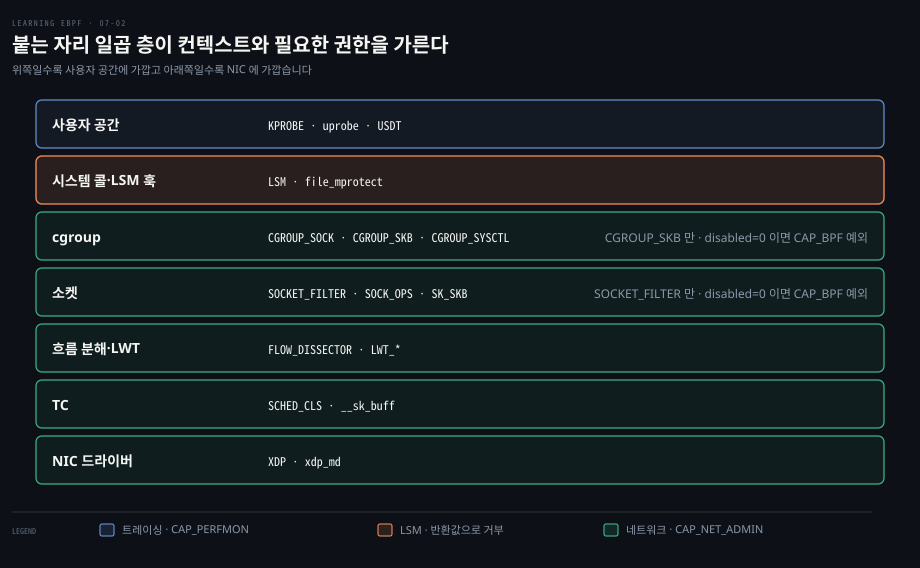
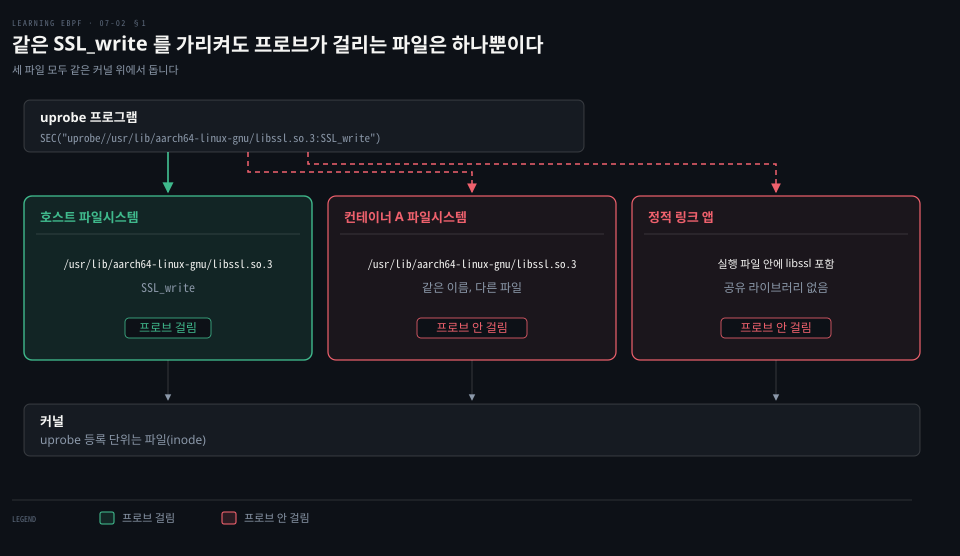
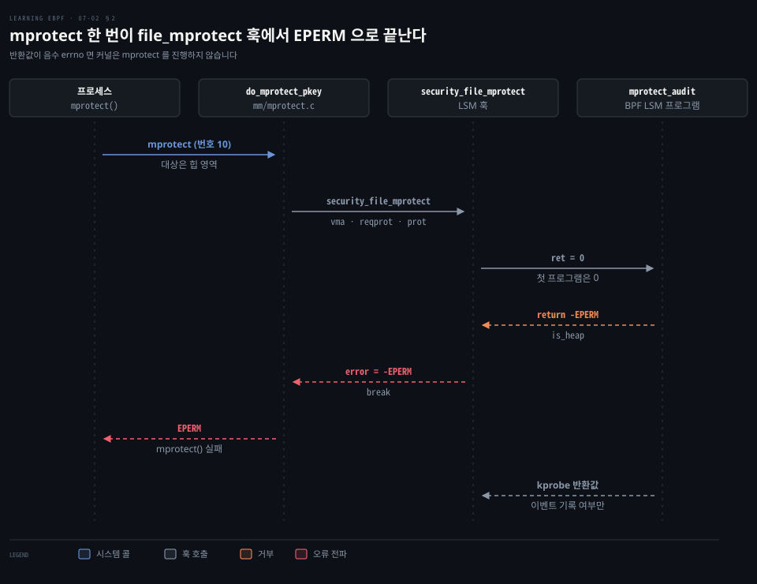
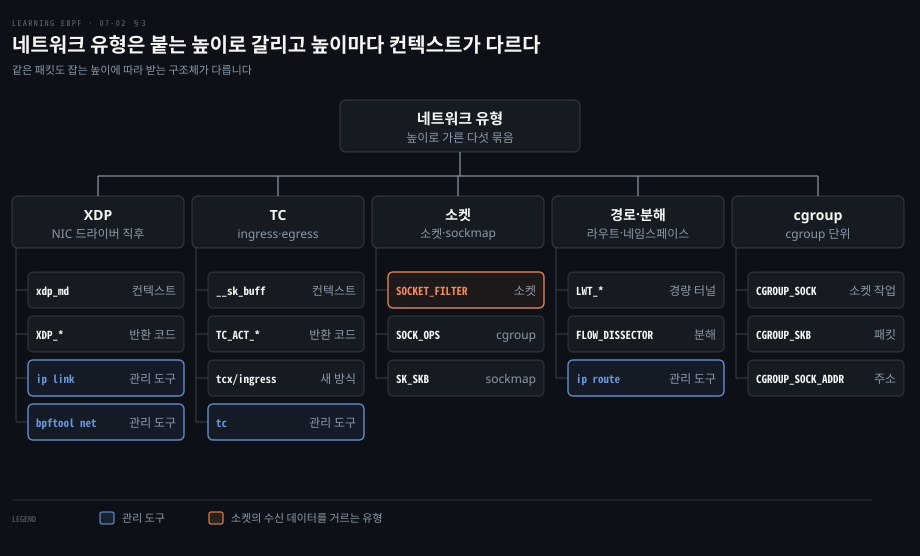
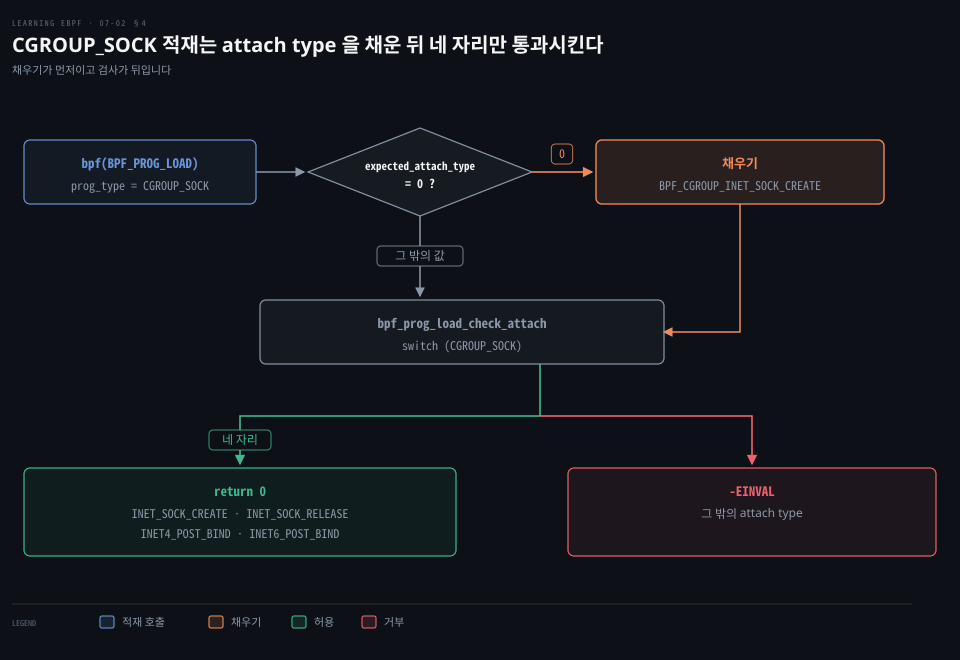

# 사용자 공간·LSM·네트워크 훅은 붙는 자리가 컨텍스트와 반환값의 뜻을 정한다

---

> 같은 `bpf()` 로 적재해도 사용자 공간 함수, LSM 훅, 네트워크 스택, cgroup 은 서로 다른 컨텍스트를 건네고 반환값에 서로 다른 효력을 줍니다.


## 핵심 요약

> 이 편의 중심 생각은 프로그램 유형이 붙는 자리를 고르면 그 자리가 입력(컨텍스트)의 모양과 출력(반환값)의 효력을 정한다는 것입니다.

uprobe 는 사용자 공간 함수에서 걸린 레지스터를 받아 기록합니다. LSM 프로그램은 음수 errno 를 돌려 커널이 하려던 작업을 막습니다. 네트워크 유형은 스택의 높이에 따라 `xdp_md`, `__sk_buff`, `bpf_sock_ops` 처럼 다른 구조체를 받습니다. 반환 코드가 패킷의 운명을 정합니다.

cgroup 에 붙이면 그 cgroup 의 프로세스에만 적용되고 attach type 이 붙을 자리를 더 좁힙니다. 필요한 권한도 층마다 달라서 트레이싱 쪽은 `CAP_PERFMON` 이, 네트워크 쪽은 `CAP_NET_ADMIN` 이 `CAP_BPF` 와 함께 따라옵니다.


## 학습 목표

> 이 편을 읽고 나면 다음을 설명할 수 있습니다.

1. uprobe·USDT 가 `BPF_PROG_TYPE_KPROBE` 를 쓰는 이유와 섹션 이름 형식을 설명할 수 있습니다.
2. 사용자 공간 프로브가 빗나가는 다섯 가지 경우를 구분할 수 있습니다.
3. LSM 반환값이 트레이싱 프로그램과 다르게 작용하는 방식을 말할 수 있습니다.
4. 네트워크 프로그램 유형을 붙는 높이와 컨텍스트 구조체로 분류하고 필요한 권한을 댈 수 있습니다.
5. attach type 이 붙을 자리를 좁히는 방식을 `bpf_prog_load_check_attach` 로 설명할 수 있습니다.

아래 그림은 사용자 공간부터 NIC 드라이버까지 일곱 층에 붙는 프로그램 유형과 필요한 권한을 보입니다. 사용자 공간 프로브는 1절, LSM 은 2절, 네트워크 스택은 3절, cgroup 과 부착 유형은 4절이 다룹니다.




## 1. uprobe·USDT 는 사용자 공간 함수에 붙지만 경로·링크 방식·언어에 따라 놓친다

> uprobe 와 uretprobe 는 사용자 공간 함수의 진입과 반환에 붙고 USDT 는 앱이 심어 둔 추적점에 붙습니다. 모두 kprobe 와 같은 유형이라 달라지는 것은 붙는 자리뿐이며 그 자리가 파일이라서 함정이 생깁니다.

OpenSSL 의 `SSL_write()` 가 암호화하기 전의 평문을 보려면 커널 함수가 아니라 `libssl.so.3` 안의 함수에 붙어야 합니다. 어떤 유형을 쓰고 무엇을 지정해야 할까요?

**uprobe** 와 uretprobe 는 사용자 공간 함수의 진입점과 반환점에 거는 동적 프로브입니다. **USDT**(user statically defined tracepoint)는 앱이나 라이브러리가 코드에 박아 둔 정적 추적점입니다.

셋 모두 `BPF_PROG_TYPE_KPROBE` 유형이라[^kprobe-sec] 컨텍스트가 중단점이 걸린 시점의 레지스터 집합 `struct pt_regs` 이고 적재에 `CAP_PERFMON` 과 `CAP_BPF` 가 필요합니다.[^kprobe-ctx] 유형이 컨텍스트와 헬퍼를 정하는 원리는 [07-01](./07-01.프로그램%20유형이%20컨텍스트와%20헬퍼를%20정하고%20kprobe·fentry·tracepoint%20는%20안정성과%20비용으로%20갈린다.md)이, uprobe 의 오버헤드와 USDT 의 정의는 [관측 소스 §8](../systems-performance/04-02.관측%20도구%20—%20관측%20소스.md)이 맡습니다.

자동 부착 섹션 이름은 `u[ret]probe/binary:function[+offset]` 형식입니다.[^uprobe-fmt] 경로가 `/` 로 시작하므로 `uprobe` 뒤에 슬래시가 둘 이어집니다.

```c
// uprobe/바이너리:함수 형식입니다. 경로의 첫 / 때문에 슬래시가 둘입니다
SEC("uprobe//usr/lib/aarch64-linux-gnu/libssl.so.3:SSL_write")
```

라이브러리 파일 이름(`.so`)만 적으면 libbpf 가 `LD_LIBRARY_PATH`, `/usr/lib64:/usr/lib`, 아키텍처별 경로 순서로 찾고, 실행 파일 이름은 `PATH` 와 `/usr/bin:/usr/sbin` 에서 찾습니다.[^resolve] USDT 는 `usdt/<path>:<provider>:<name>` 형식입니다.



사용자 공간 프로브가 빗나가는 경우는 다섯입니다.

1. 라이브러리 경로가 아키텍처마다 다릅니다. arm64 의 `/usr/lib/aarch64-linux-gnu/` 는 x86-64 에서 `/lib/x86_64-linux-gnu` 계열이 됩니다.
2. 대상 머신에 무엇이 설치돼 있는지 모릅니다. `libssl.so.3` 이 있다는 보장이 없습니다.
3. 정적 링크 바이너리에는 공유 라이브러리가 없습니다. 라이브러리를 실행 파일에 넣어 빌드한 앱에서는 `libssl.so.3` 에 건 프로브가 걸리지 않습니다.
4. 컨테이너는 자기 파일시스템을 갖습니다. uprobe 는 경로 문자열이 아니라 그 경로가 가리키는 파일(inode)에 등록되므로 컨테이너 이미지의 `libssl.so.3` 은 호스트 경로의 프로브에 걸리지 않습니다.[^inode]
5. Go 는 1.17 에서 amd64 에, 1.18 에서 arm64 까지 레지스터 호출 규약을 도입했고 그 전에는 스택이었습니다. amd64 에서는 Go 의 첫 인자가 `RAX` 이고 C 의 첫 인자 레지스터는 `rdi` 여서 C 용 `pt_regs` 매크로로는 맞는 값을 읽지 못합니다.[^go-abi]

사용자 공간 애플리케이션을 eBPF 로 보는 도구에는 지속 프로파일링 도구 [Parca](https://www.parca.dev/) 가 있습니다. SSL 평문을 실제로 읽는 예제는 [08-02](./08-02.uprobe%20는%20암호화%20전후의%20평문을%20읽고%20쿠버네티스%20네트워킹은%20iptables%20대신%20eBPF%20맵으로%20정책을%20건다.md)가 맡습니다.


## 2. LSM 프로그램은 반환값으로 커널의 동작을 거부한다

> **LSM**(Linux Security Module) 훅은 커널이 작업을 하기 직전의 검사 지점이라, 거기 붙은 프로그램이 음수 errno 를 돌려주면 커널은 그 작업을 하지 않습니다. 트레이싱 유형이 지켜보기만 하는 것과 갈리는 지점입니다.

트레이싱 프로그램은 일어난 일을 기록합니다. 커널이 `mprotect()` 로 메모리 권한을 바꾸기 직전에 막으려면 어디에 붙어야 할까요?

LSM API 는 보안 모듈이 정책을 강제하려고 쓰는 커널 안의 훅 묶음입니다. 커널 내부 함수라 훅 목록과 인자가 버전마다 달라집니다([lsm_hook_defs.h](https://github.com/torvalds/linux/blob/v7.2/include/linux/lsm_hook_defs.h)). `BPF_PROG_TYPE_LSM` 은 그 훅에 프로그램을 붙여 시스템 전체의 강제 접근 통제와 감사 정책을 구현하게 합니다.[^lsm-doc] 문서의 예제는 `file_mprotect` 훅에 붙습니다.

```c
// file_mprotect 훅에 붙습니다. ret 은 앞선 프로그램의 반환값이고 첫 프로그램이면 0 입니다
SEC("lsm/file_mprotect")
int BPF_PROG(mprotect_audit, struct vm_area_struct *vma,
             unsigned long reqprot, unsigned long prot, int ret)
{
    if (ret != 0)
        return ret;

    int is_heap = (vma->vm_start >= vma->vm_mm->start_brk &&
                   vma->vm_end <= vma->vm_mm->brk);

    // brk 힙 안의 vma 면 -EPERM 으로 거부합니다
    if (is_heap)
        return -EPERM;
    return 0;
}
```

VMA(`struct vm_area_struct`)는 프로세스 가상 메모리의 연속 구간입니다. `mprotect()` 는 `do_mprotect_pkey()` 안에서 VMA 마다 `security_file_mprotect` 를 부르고 `error` 가 0 이 아니면 루프를 `break` 로 빠져나옵니다. x86-64 에서 시스템 콜 번호는 10 입니다.[^mprotect] 프로그램이 `-EPERM` 을 돌려주면 `mprotect()` 가 `EPERM` 으로 실패합니다. 코드의 `start_brk`·`brk` 는 힙의 시작 주소와 현재 끝 주소라서, 그 사이에 든 VMA 를 힙으로 봅니다.



int 를 돌려주는 대부분의 훅에서 0 은 통과이고 음수 errno 는 그 작업을 못 하게 하는 거부입니다. 돌려줄 수 있는 범위는 verifier 가 강제합니다. kprobe 프로그램의 반환값은 perf 이벤트를 남길지만 정할 뿐 감시 대상 작업을 막지 못합니다.[^kprobe-ret] 이 점이 LSM 유형을 트레이싱 유형과 가릅니다.

허용 범위를 verifier 가 강제하는 방식, 필요한 커널 설정, `chmod` 경로의 실제 흐름은 [09-01 §4](./09-01.시스템%20콜%20입구%20검사는%20TOCTOU%20에%20뚫려%20보안%20도구는%20LSM%20훅과%20커널%20함수에서%20판정하고%20SIGKILL%20로%20막는다.md)에서 다룹니다.

부착은 `bpf(BPF_RAW_TRACEPOINT_OPEN)` 으로 합니다. 훅은 적재할 때 BTF ID 로 정해져 있어서 raw tracepoint 이름을 따로 넘기면 `-EINVAL` 입니다. `BPF_LINK_CREATE` 도 attach type 이 `BPF_LSM_MAC` 이면 같은 `bpf_tracing_prog_attach` 로, `BPF_LSM_CGROUP` 이면 cgroup 쪽 링크로 갑니다.[^lsm-attach] 권한은 트레이싱 쪽과 같은 `CAP_PERFMON` 과 `CAP_BPF` 입니다.


## 3. 네트워크 프로그램 유형은 스택의 높이마다 다른 모양의 패킷을 받는다

> 네트워크 유형은 패킷이 스택의 어디를 지나는지에 따라 `xdp_md`, `__sk_buff`, `bpf_sock_ops` 같은 다른 컨텍스트를 받습니다. 트레이싱과 달리 반환 코드로 패킷의 운명을 정하고 패킷과 소켓 설정을 고칠 수 있습니다.

NIC 드라이버 바로 뒤에서 잡은 패킷과 소켓에 닿기 직전에 잡은 패킷은 같은 패킷인데 프로그램이 받는 구조체도 같을까요? 다릅니다. 아래쪽에는 L2 패킷이 바이트열로 있고 위쪽에서는 커널이 소켓 버퍼를 만들어 다루기 때문입니다. 계층 모델은 [XDP·TC·소켓 훅의 어태치 지점](../../../08_cloud/book/networking-and-kubernetes/02-03.iptables·IPVS·eBPF%20—%20kube-proxy를%20이해하는%20세%20기술.md)에서 정리했습니다.



권한은 대체로 `CAP_NET_ADMIN` 과 `CAP_BPF` 입니다. 적재할 때 아래 예외 둘을 뺀 모든 유형에 `CAP_BPF` 를 확인하고, 그중 `is_net_admin_prog_type()` 목록의 유형은 `CAP_NET_ADMIN` 도 확인합니다. `CAP_SYS_ADMIN` 이 둘 다 대신합니다.[^caps]

예외가 둘 있습니다. `SOCKET_FILTER` 와 `CGROUP_SKB` 는 `kernel.unprivileged_bpf_disabled=0` 일 때만 `CAP_BPF` 없이 적재됩니다. 기본 설정(`CONFIG_BPF_UNPRIV_DEFAULT_OFF=y`)에서는 이 값이 2 라서 두 유형도 `CAP_BPF` 가 필요합니다.[^unpriv] `CGROUP_SKB` 는 대신 붙일 때 `CAP_NET_ADMIN` 을 봅니다.[^cgskb]

### 소켓 층은 소켓 하나의 데이터나 소켓 이벤트를 다룬다

`BPF_PROG_TYPE_SOCKET_FILTER` 는 열거형에서 `UNSPEC` 다음의 첫 유형입니다. 소켓에 `SO_ATTACH_BPF` 로 프로그램 fd 를 붙이면 그 소켓이 받는 패킷마다 돕니다. 반환값은 남길 바이트 수이고 0 이면 패킷을 버립니다.[^so-attach]

관측 도구로 가는 사본만 거르는 유형이 아니라 붙은 소켓의 수신 데이터를 거르거나 자르는 유형입니다. tcpdump 는 이 길이 아니라 libpcap 이 만든 classic BPF 필터를 `SO_ATTACH_FILTER` 로 `PF_PACKET` 소켓에 붙입니다([Linux Socket Filtering](https://docs.kernel.org/networking/filter.html)).

`BPF_PROG_TYPE_SOCK_OPS` 는 TCP 연결 같은 소켓 이벤트를 가로채 타임아웃 같은 파라미터를 정합니다. 소켓은 연결의 끝점에만 있어 중간 장비에서는 돌지 않고 붙는 대상은 cgroup 입니다. `BPF_PROG_TYPE_SK_SKB` 는 sockmap 에 붙어 소켓 층에서 트래픽을 다른 소켓으로 리다이렉트합니다.

### TC 는 인터페이스의 ingress·egress 에 분류기를 붙인다

`BPF_PROG_TYPE_SCHED_CLS` 는 트래픽 제어의 분류기 자리에 붙고 컨텍스트는 `__sk_buff` 입니다. 새 부착 방식 tcx 는 v6.6 에 들어왔고 attach type `BPF_TCX_INGRESS`·`BPF_TCX_EGRESS` 를 씁니다. libbpf 는 `tcx/ingress`·`tcx/egress` 섹션을 쓰고 옛 `tc` 섹션에는 deprecated 주석을 붙여 두었습니다.[^tcx]

### XDP 는 인터페이스마다 붙는다

`BPF_PROG_TYPE_XDP` 는 NIC 드라이버 바로 뒤에서 `xdp_md` 를 받고 `XDP_DROP`·`XDP_PASS`·`XDP_TX`·`XDP_REDIRECT` 같은 코드를 돌려줍니다. TC 쪽은 `TC_ACT_OK`·`TC_ACT_SHOT` 같은 코드입니다.[^codes] 코드별 동작과 파싱은 [08-01](./08-01.XDP%20와%20TC%20는%20패킷을%20경계%20검사로%20파싱해%20반환%20코드로%20버리고%20고쳐%20되돌린다.md)이 맡습니다.

```bash
# xdp 섹션을 읽어 eth0 에 붙이고 ip link 로 확인합니다
ip link set dev eth0 xdp obj hello.bpf.o sec xdp
ip link show dev eth0
# 2: eth0: <BROADCAST,MULTICAST,UP,LOWER_UP> mtu 1500 xdpgeneric ...
#     prog/xdp id 1255 tag 9d0e949f89f1a82c jited
# 떼어 냅니다
ip link set dev eth0 xdp off
# bpftool 로는 고정한 프로그램 id 로 붙입니다
bpftool net attach xdp id 540 dev eth0
```

`xdpgeneric` 은 드라이버 지원 없이 skb 단계에서 도는 모드이고 native 모드와는 한 인터페이스에서 동시에 켤 수 없습니다. 프로그램이 이미 붙은 인터페이스에 `XDP_FLAGS_UPDATE_IF_NOEXIST` 로 또 붙이면 `-EBUSY` 와 `XDP program already attached` 가 돌아옵니다. bpftool 의 `net attach` 는 `overwrite` 를 주지 않으면 이 플래그를 켭니다. 플래그가 없으면 같은 모드에서 링크 없이 붙은 기존 프로그램을 바꾸지만, 링크로 붙은 프로그램은 바꾸지 못해 `-EBUSY` 입니다.[^xdp-attach]

### 경로·흐름 분해·넷필터는 스택 중간의 자리를 맡는다

`BPF_PROG_TYPE_FLOW_DISSECTOR` 는 패킷 헤더에서 흐름 정보를 뽑는 분해를 직접 구현합니다. 붙는 대상은 인터페이스가 아니라 네트워크 네임스페이스입니다. `BPF_PROG_TYPE_LWT_*` 는 라우팅 경로마다 캡슐화를 붙이는 경량 터널(Lightweight Tunnel)을 구현하고 `ip route` 로 다루며 쓰임은 드뭅니다. iptables 의 바탕인 커널 패킷 필터링 틀, 넷필터(netfilter)의 훅에 붙는 `BPF_PROG_TYPE_NETFILTER` 는 v6.4 에 들어왔습니다.[^netns]


## 4. cgroup 프로그램과 attach type 은 같은 유형을 붙일 자리를 더 좁힌다

> cgroup 에 붙은 프로그램은 그 cgroup 의 프로세스에만 적용됩니다. 같은 유형이라도 **attach type** 이 붙을 자리를 다시 좁히고 적재할 때 커널이 둘의 조합이 유효한지 검사합니다.

컨테이너 하나에만 소켓 정책을 걸려면 프로그램을 어디에 붙여야 할까요? cgroup 은 컨테이너나 Pod 를 서로 가르는 장치의 하나이고 컨테이너 밖의 프로세스도 모두 어떤 cgroup 에 속합니다. 원리는 [cgroups 절](../learning-modern-linux/06-02.컨테이너의%20새로움은%20재료가%20아니라%20조합에%20있다.md)에서 다뤘습니다.

v7.2 에서 cgroup 에 붙는 유형은 `CGROUP_DEVICE`·`CGROUP_SKB`·`CGROUP_SOCK`·`CGROUP_SOCK_ADDR`·`CGROUP_SOCKOPT`·`CGROUP_SYSCTL`·`SOCK_OPS` 입니다. LSM 도 attach type 이 `BPF_LSM_CGROUP` 이면 같은 길을 탑니다.[^cgprog]

- `CGROUP_SOCK`·`CGROUP_SKB`: 그 cgroup 이 소켓 작업이나 데이터 전송을 해도 되는지 판정해 네트워크 보안 정책을 강제합니다.
- `CGROUP_SOCK_ADDR`: `connect`·`bind`·`sendmsg` 의 주소를 바꿔, 호출한 프로세스가 모르게 다른 목적지에 연결시킵니다.
- `CGROUP_SYSCTL`: 그 cgroup 이 건드리는 sysctl(`/proc/sys` 아래의 커널 설정값) 접근을 가로챕니다. 프로그램 유형은 `BPF_PROG_TYPE_CGROUP_SYSCTL` 이고 `BPF_CGROUP_SYSCTL` 은 attach type 입니다.[^sysctl]

트레이싱·네트워크 어느 쪽에도 안 드는 유형도 있습니다. `BPF_PROG_TYPE_LIRC_MODE2` 는 적외선 컨트롤러 장치의 fd 에 붙어 프로토콜 디코딩을 맡습니다. 적재에는 `CAP_BPF` 만 있으면 되고 붙일 때는 장치 파일을 쓰기 모드로 열어야 합니다.[^lirc]

### attach type 은 적재할 때 유형과의 조합이 검사된다

attach type 은 적재 때 `expected_attach_type` 으로 전달합니다. `bpf_prog_load_check_attach()` 가 유형별 switch 로 허용 값을 확인합니다. `CGROUP_SOCK` 이 받는 attach type 은 네 개입니다. 소켓 생성은 `BPF_CGROUP_INET_SOCK_CREATE`, 해제는 `BPF_CGROUP_INET_SOCK_RELEASE` 이고 bind 직후는 `BPF_CGROUP_INET4_POST_BIND`·`BPF_CGROUP_INET6_POST_BIND` 입니다. 나머지는 `-EINVAL` 입니다.[^chk]

미지정(0)은 열거형 첫 값 `BPF_CGROUP_INET_INGRESS` 와 같은 숫자이고 `UNSPEC` 이 따로 없습니다. 그래서 0 인지로 판단해 `BPF_CGROUP_INET_SOCK_CREATE` 로 채웁니다. 이 채우기(`bpf_prog_load_fixup_attach_type()`)가 검사보다 먼저 불립니다.[^fixup]



attach type 은 컨텍스트 접근도 좁힙니다. `bpf_sock` 의 `src_ip4` 는 `BPF_CGROUP_INET4_POST_BIND` 일 때만, `src_port` 는 두 post_bind 에서만 읽을 수 있습니다.[^sockacc] 유형과 attach type 에 짝지어진 섹션 이름은 [libbpf 섹션 표](https://docs.kernel.org/bpf/libbpf/program_types.html)에서 찾습니다.


## 면접 대비

> 사용자 공간·LSM·네트워크·cgroup 훅의 붙는 자리와 반환값에 관한 면접 질문입니다.

1. uprobe 와 kprobe 는 같은 유형인데 호스트에서 컨테이너 안 앱의 `SSL_write` 를 추적하려 하면 프로브가 걸리지 않을 수 있는 이유는 무엇입니까?
2. LSM 프로그램의 반환값은 트레이싱 프로그램의 반환값과 어떻게 다르게 작용합니까?
3. `SOCKET_FILTER` 프로그램은 무엇을 거르고 tcpdump 의 필터는 어떤 방식으로 붙습니까?
4. XDP 프로그램이 이미 붙은 인터페이스에 두 번째 XDP 프로그램을 붙이면 어떻게 됩니까?
5. attach type 이 필요한 이유와 지정하지 않은 `CGROUP_SOCK` 프로그램의 처리를 설명해 보십시오.


## 정답 (자답 후 펼치기)

> 면접 질문에 대한 키워드 중심의 모범 답안입니다.

### 정답 1 — 파일 단위 등록

uprobe 는 경로 문자열이 아니라 파일(inode)에 등록됩니다. 컨테이너 이미지의 `libssl.so.3` 은 이름만 같은 다른 파일이어서 호스트 경로의 프로브는 걸리지 않고, 정적 링크 앱도 마찬가지입니다.

### 정답 2 — 거부 권한

int 를 돌려주는 대부분의 LSM 훅에서 프로그램이 0 이면 통과이고, 음수 errno 면 커널이 그 작업을 하지 않아 호출이 그 오류로 실패합니다. kprobe 는 반환값이 perf 이벤트를 남길지만 정할 뿐 감시 대상 작업을 막지 못합니다.

### 정답 3 — 붙은 소켓의 수신 데이터

`SO_ATTACH_BPF` 로 붙은 소켓이 받는 패킷마다 돌아 반환값만큼만 남기고 0 이면 버립니다. tcpdump 는 libpcap 이 만든 classic BPF 필터를 `SO_ATTACH_FILTER` 로 `PF_PACKET` 소켓에 붙입니다.

### 정답 4 — 플래그에 따라 -EBUSY 이거나 교체

`XDP_FLAGS_UPDATE_IF_NOEXIST` 가 있으면 `-EBUSY`(`Device or resource busy`)와 `XDP program already attached` 가 돌아옵니다. bpftool 의 `net attach` 는 `overwrite` 가 없으면 이 플래그를 켭니다. 플래그가 없으면 같은 모드에서 링크 없이 붙은 기존 프로그램을 바꾸고, 링크로 붙은 프로그램은 바꾸지 못해 `-EBUSY` 입니다. native 와 generic 모드는 동시에 켤 수 없습니다.

### 정답 5 — 유형별 허용 목록과 0 의 채움

`bpf_prog_load_check_attach` 가 유형별 허용 attach type 을 검사하고 읽을 수 있는 컨텍스트 필드도 attach type 으로 갈립니다. `CGROUP_SOCK` 에서 0 으로 두면 `BPF_CGROUP_INET_SOCK_CREATE` 로 채운 뒤 검사합니다.


## 참고 자료

- 《Learning eBPF》(Liz Rice, O'Reilly, 2023, ISBN 978-1-098-13512-6) Ch.7 eBPF Program and Attachment Types
- 리눅스 커널 v7.2 소스 https://github.com/torvalds/linux/tree/v7.2 (줄 단위 근거는 각주)
- [libbpf 섹션 표](https://docs.kernel.org/bpf/libbpf/program_types.html) · [LSM BPF 프로그램](https://docs.kernel.org/bpf/prog_lsm.html) · [Linux Socket Filtering](https://docs.kernel.org/networking/filter.html) · [Parca](https://www.parca.dev/)


## 관련 문서

- [07-01 프로그램 유형과 kprobe·fentry·tracepoint](./07-01.프로그램%20유형이%20컨텍스트와%20헬퍼를%20정하고%20kprobe·fentry·tracepoint%20는%20안정성과%20비용으로%20갈린다.md) · [08-01 XDP·TC 동작 예제](./08-01.XDP%20와%20TC%20는%20패킷을%20경계%20검사로%20파싱해%20반환%20코드로%20버리고%20고쳐%20되돌린다.md)

[^kprobe-sec]: <https://github.com/torvalds/linux/blob/v7.2/tools/lib/bpf/libbpf.c#L10081-L10098>
[^kprobe-ctx]: <https://github.com/torvalds/linux/blob/v7.2/include/linux/bpf_types.h#L39-L40> · <https://github.com/torvalds/linux/blob/v7.2/kernel/bpf/syscall.c#L2871-L2885>
[^uprobe-fmt]: <https://github.com/torvalds/linux/blob/v7.2/tools/lib/bpf/libbpf.c#L13281-L13289>
[^resolve]: <https://github.com/torvalds/linux/blob/v7.2/tools/lib/bpf/libbpf.c#L12938-L13012>
[^inode]: <https://github.com/torvalds/linux/blob/v7.2/kernel/trace/trace_uprobe.c#L1105-L1109>
[^go-abi]: <https://github.com/torvalds/linux/blob/v7.2/tools/lib/bpf/bpf_tracing.h#L81-L88> · <https://go.dev/doc/go1.17> · <https://go.dev/doc/go1.18> · <https://github.com/golang/go/blob/go1.24.0/src/cmd/compile/abi-internal.md>
[^lsm-doc]: <https://docs.kernel.org/bpf/prog_lsm.html>
[^mprotect]: <https://github.com/torvalds/linux/blob/v7.2/mm/mprotect.c#L836> · <https://github.com/torvalds/linux/blob/v7.2/mm/mprotect.c#L953-L955> · <https://github.com/torvalds/linux/blob/v7.2/arch/x86/entry/syscalls/syscall_64.tbl#L22>
[^lsm-attach]: <https://github.com/torvalds/linux/blob/v7.2/kernel/bpf/syscall.c#L4366-L4377> · <https://github.com/torvalds/linux/blob/v7.2/kernel/bpf/syscall.c#L5881-L5898> · <https://github.com/torvalds/linux/blob/v7.2/kernel/bpf/bpf_lsm.c#L423-L473>
[^unpriv]: <https://github.com/torvalds/linux/blob/v7.2/kernel/bpf/syscall.c#L69-L70> · <https://github.com/torvalds/linux/blob/v7.2/kernel/bpf/syscall.c#L3030-L3041> · <https://github.com/torvalds/linux/blob/v7.2/kernel/bpf/Kconfig#L73-L75>
[^kprobe-ret]: <https://github.com/torvalds/linux/blob/v7.2/kernel/trace/trace_kprobe.c#L1691-L1706>
[^caps]: <https://github.com/torvalds/linux/blob/v7.2/kernel/bpf/syscall.c#L2840-L2869> · <https://github.com/torvalds/linux/blob/v7.2/kernel/bpf/syscall.c#L3038-L3046> · <https://github.com/torvalds/linux/blob/v7.2/kernel/bpf/token.c#L12-L15>
[^cgskb]: <https://github.com/torvalds/linux/blob/v7.2/kernel/bpf/syscall.c#L3038-L3041> · <https://github.com/torvalds/linux/blob/v7.2/kernel/bpf/syscall.c#L4540-L4545>
[^so-attach]: <https://github.com/torvalds/linux/blob/v7.2/include/uapi/linux/bpf.h#L1063-L1064> · <https://github.com/torvalds/linux/blob/v7.2/net/core/sock.c#L1464-L1488> · <https://github.com/torvalds/linux/blob/v7.2/net/core/filter.c#L118-L174>
[^tcx]: <https://github.com/torvalds/linux/blob/v7.2/include/uapi/linux/bpf.h#L1146-L1147> · <https://github.com/torvalds/linux/blob/v6.6/kernel/bpf/tcx.c> · <https://github.com/torvalds/linux/blob/v7.2/tools/lib/bpf/libbpf.c#L10099-L10103>
[^codes]: <https://github.com/torvalds/linux/blob/v7.2/include/uapi/linux/bpf.h#L6577-L6581> · <https://github.com/torvalds/linux/blob/v7.2/include/uapi/linux/pkt_cls.h#L64-L66>
[^xdp-attach]: <https://github.com/torvalds/linux/blob/v7.2/net/core/dev.c#L10445-L10449> · <https://github.com/torvalds/linux/blob/v7.2/net/core/dev.c#L10479-L10485> · <https://github.com/torvalds/linux/blob/v7.2/tools/bpf/bpftool/net.c#L643-L650>
[^netns]: <https://github.com/torvalds/linux/blob/v7.2/kernel/bpf/syscall.c#L4683> · <https://github.com/torvalds/linux/blob/v7.2/include/uapi/linux/bpf.h#L1095> · <https://github.com/torvalds/linux/blob/v6.4/net/netfilter/nf_bpf_link.c>
[^cgprog]: <https://github.com/torvalds/linux/blob/v7.2/kernel/bpf/syscall.c#L4600-L4617>
[^sysctl]: <https://github.com/torvalds/linux/blob/v7.2/include/uapi/linux/bpf.h#L1086> · <https://github.com/torvalds/linux/blob/v7.2/include/uapi/linux/bpf.h#L1118>
[^lirc]: <https://github.com/torvalds/linux/blob/v7.2/kernel/bpf/syscall.c#L2840-L2887> · <https://github.com/torvalds/linux/blob/v7.2/kernel/bpf/syscall.c#L3038-L3041> · <https://github.com/torvalds/linux/blob/v7.2/drivers/media/rc/lirc_dev.c#L817-L830> · <https://github.com/torvalds/linux/blob/v7.2/drivers/media/rc/bpf-lirc.c#L248-L265>
[^chk]: <https://github.com/torvalds/linux/blob/v7.2/kernel/bpf/syscall.c#L2725> · <https://github.com/torvalds/linux/blob/v7.2/kernel/bpf/syscall.c#L2765-L2774>
[^fixup]: <https://github.com/torvalds/linux/blob/v7.2/kernel/bpf/syscall.c#L2705-L2715> · <https://github.com/torvalds/linux/blob/v7.2/kernel/bpf/syscall.c#L2997> · <https://github.com/torvalds/linux/blob/v7.2/kernel/bpf/syscall.c#L3085>
[^sockacc]: <https://github.com/torvalds/linux/blob/v7.2/net/core/filter.c#L9079-L9122>
