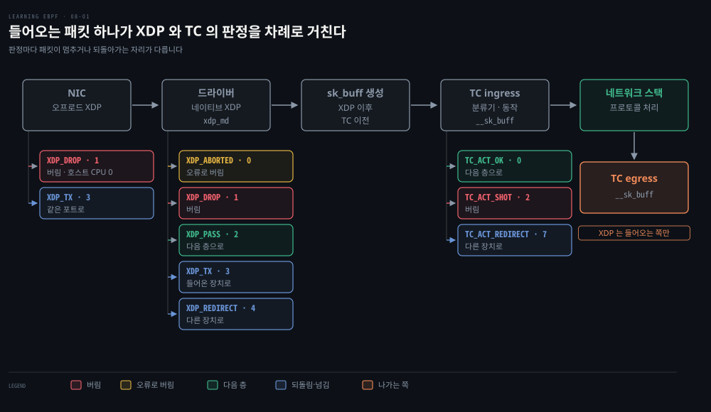
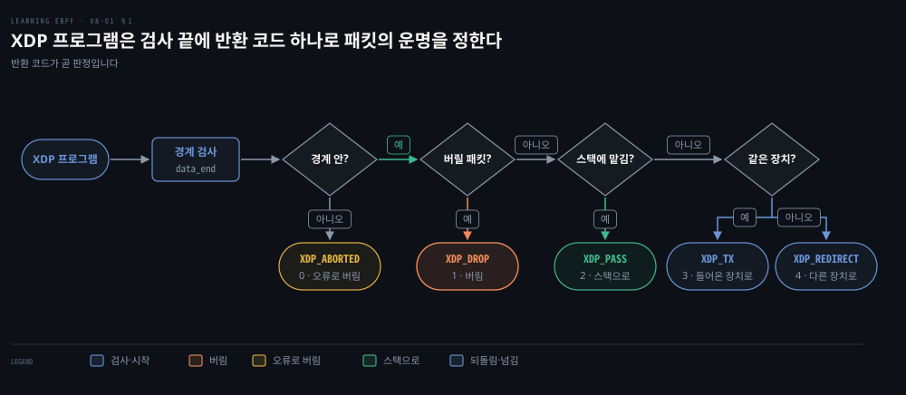
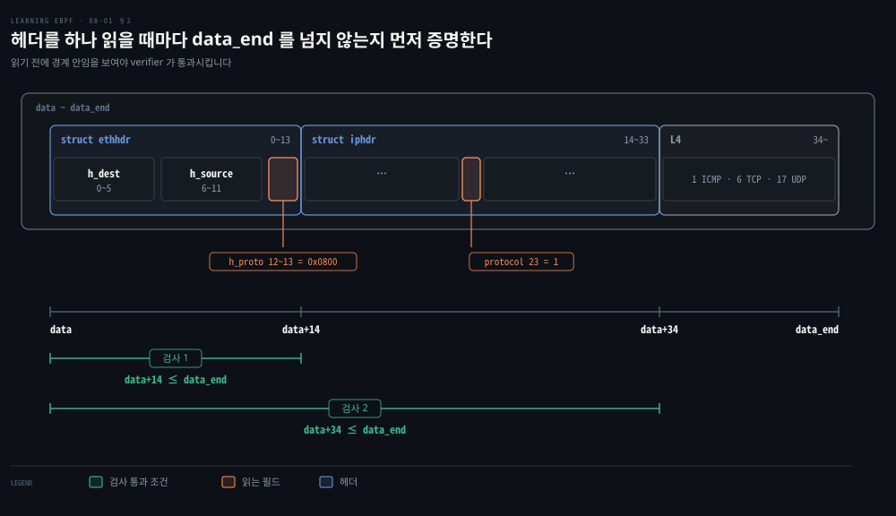
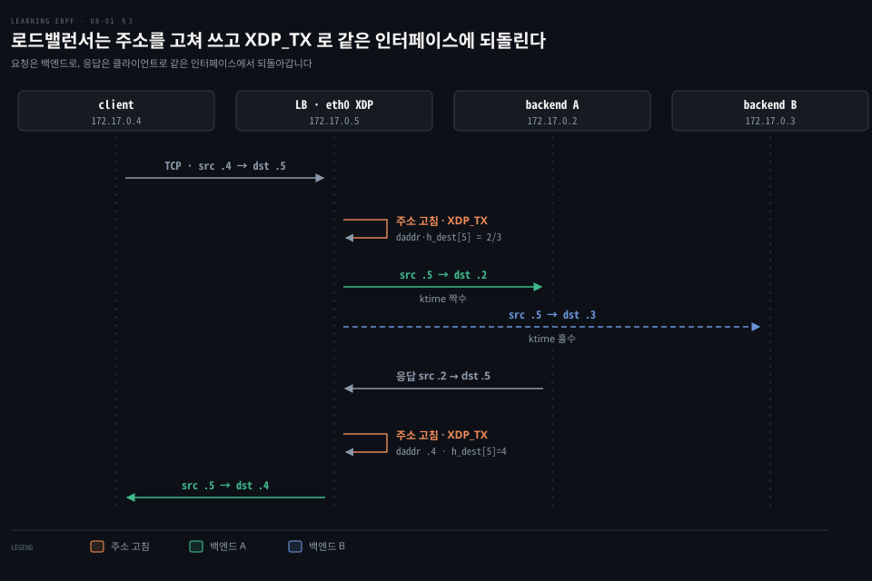
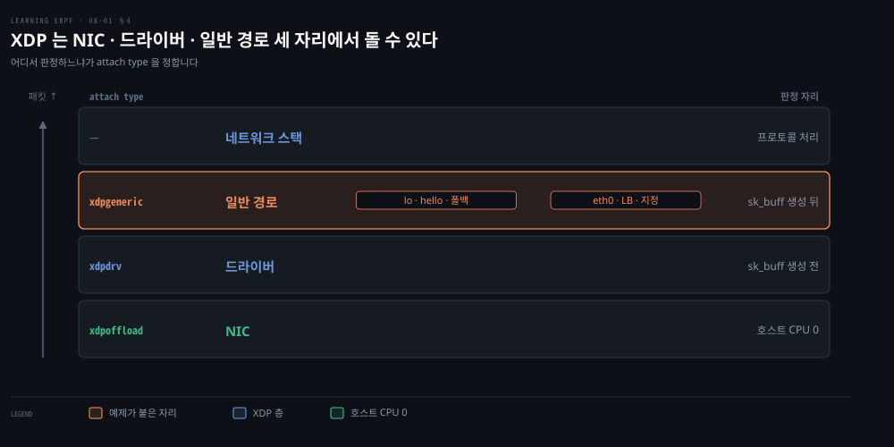
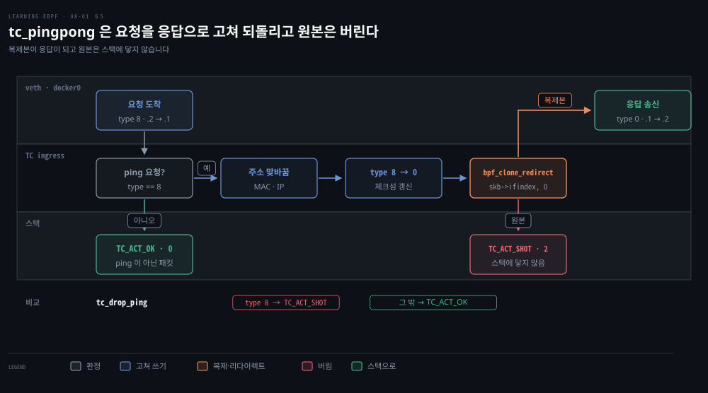

# XDP 와 TC 는 패킷을 경계 검사로 파싱해 반환 코드로 버리고 고쳐 되돌린다

---

> 패킷을 버리는 방화벽도 주소를 고쳐 쓰는 로드밸런서도 프로그램이 하는 일은 같습니다. 바이트를 경계 검사로 읽고 반환 코드 하나로 패킷의 운명을 정합니다.


## 핵심 요약

> 네이티브 XDP 는 패킷이 드라이버에 닿자마자, TC(Traffic Control, 커널의 트래픽 제어 계층) 는 `sk_buff` 가 만들어진 뒤에 같은 방식으로 판정합니다. 둘의 차이는 실행 자리와 컨텍스트에서 나옵니다.

XDP 프로그램은 `data` 와 `data_end` 사이만 읽고 반환 코드 다섯 중 하나로 패킷을 버리거나 넘기거나 되돌립니다. 주소를 고쳐 `XDP_TX` 로 되돌리면 로드밸런서가 됩니다.

TC 프로그램은 `sk_buff` 를 받아 들어오고 나가는 양쪽에서 돕니다. 복제본을 응답으로 내보내고 원본을 버려 커널 스택 대신 답합니다.


## 학습 목표

> 이 편을 읽고 나면 다음을 설명할 수 있습니다.

1. 패킷 버리기가 보안 기능의 공통 동작인 까닭과 XDP 반환 코드의 값을 설명할 수 있습니다.
2. 경계 검사와 `bpf_ntohs` 가 필요한 까닭을 설명할 수 있습니다.
3. 주소를 고쳐 `XDP_TX` 로 되돌리는 로드밸런서의 패킷 변화를 설명할 수 있습니다.
4. XDP 의 세 실행 자리와 attach type 의 대응을 설명할 수 있습니다.
5. TC 가 `sk_buff` 를 받는 까닭과 반환 코드를 설명할 수 있습니다.

아래 그림은 들어오는 패킷이 XDP 와 TC 에서 판정을 거치며 버려지거나 다음 층으로 흐르는 길을 보입니다. XDP 반환 코드와 파싱·활용은 1·2·3·4절이, sk_buff 를 다루는 TC 는 5절이 다룹니다.




## 1. 패킷 도착과 XDP 반환 코드

> 방화벽·DDoS 방어·packet-of-death 완화는 모두 "이 패킷을 버릴까"로 모입니다. XDP 는 패킷이 도착하자마자 반환 코드 하나로 운명을 정하며 커널 교체나 재부팅 없이, 네이티브 모드에서는 드라이버 수신 경로에서 이 판정을 내립니다.

방화벽은 주소와 포트로, DDoS 방어는 도착 속도와 내용으로 패킷을 가립니다. packet-of-death 는 특정 모양의 패킷을 커널이 안전하게 처리하지 못하는 취약점입니다. 세 기능은 패킷을 가리는 기준이 달라도 마지막 동작은 패킷을 버리는 것으로 같습니다.

packet-of-death 는 전통적으로 고쳐진 커널을 설치해야 막을 수 있어 호스트를 멈춰야 했습니다. XDP 프로그램은 실행 중에 적재되므로 그런 패킷을 버리는 코드를 올리는 즉시 애플리케이션을 건드리지 않고 호스트를 지킵니다. Meta 에서는 2017년 이후 Facebook 으로 오가는 모든 패킷이 XDP 를 지나고 Cloudflare 는 DDoS 방어에 eBPF 를 씁니다. Cilium 도입 조직 목록에는 예시를 뺀 177곳이 올라 있습니다.[^users]

### 반환 코드 다섯의 값

반환 코드 다섯은 값까지 정해져 있습니다. 반환값이 곧 판정이며 목록에 없는 값은 경고와 함께 버려집니다.[^xdp-action]

| 코드 | 값 | 판정 |
|------|----|------|
| `XDP_ABORTED` | 0 | 오류로 버림 |
| `XDP_DROP` | 1 | 버림 |
| `XDP_PASS` | 2 | 네트워크 스택으로 보냄 |
| `XDP_TX` | 3 | 들어온 인터페이스로 되돌림 |
| `XDP_REDIRECT` | 4 | 다른 인터페이스로 보냄 |

`XDP_ABORTED` 도 패킷을 버리지만 정상 판정이 아니라 오류 신호입니다. 일반 경로(generic 모드)와 veth 같은 네이티브 드라이버는 이 값에서 `xdp:xdp_exception` tracepoint 를 발생시킵니다. 반면 `XDP_DROP` 에서는 발생시키지 않습니다.[^xdp-exc] 경계 검사가 실패했을 때 `XDP_ABORTED` 로 알리는 프로그램도 있으며 §3 의 로드밸런서가 그렇습니다.[^lb-src]



### xdp_md 의 data 포인터

```c
struct xdp_md {
    __u32 data;
    __u32 data_end;
    __u32 data_meta;
    ...
};
```

앞 세 필드는 `__u32` 로 선언돼 있어도 포인터로 씁니다. `data` 는 패킷의 시작이고 `data_end` 는 끝입니다. 커널이 적재할 때 `ctx->data` 읽기를 `xdp_buff` 의 `data` 필드 로드로 바꿔 놓기 때문에 읽힌 값이 실제 포인터입니다.[^xdp-ctx] 범위 밖 접근은 verifier 가 거부합니다([06-02](./06-02.헬퍼·메모리%20접근·루프는%20증명된%20범위%20안에서만%20verifier%20를%20통과한다.md)).

`data_meta` 부터 `data` 까지는 메타데이터 영역입니다. XDP 가 적은 값을 이어지는 TC 프로그램이 읽는 식의 협조에 씁니다.[^cilium-prog]


## 2. 패킷 파싱과 data_end 증명

> 이더넷 헤더가 14바이트라고 해서 도착한 패킷이 14바이트 이상이라는 보장은 없습니다. 패킷 파싱은 헤더를 읽을 때마다 data_end 를 넘지 않는지 먼저 증명해야 하며 이를 증명하지 못하는 프로그램은 적재되지 않습니다.

ICMP 를 알아보려면 `h_proto` 가 IP 인지, IP 헤더의 `protocol` 이 1 인지 확인해야 합니다. 이때 두 번 모두 읽기 전에 해당 바이트가 버퍼 안에 있음을 보여야 합니다.[^hello-repo] verifier 가 패킷 포인터와 끝 포인터의 비교로 이를 따지는 방식은 [06-02 의 패킷 절](./06-02.헬퍼·메모리%20접근·루프는%20증명된%20범위%20안에서만%20verifier%20를%20통과한다.md#패킷과-datadata_end-경계)에 있습니다.

```c
SEC("xdp")
int ping(struct xdp_md *ctx) {
    long protocol = lookup_protocol(ctx);
    if (protocol == 1)
    {
        bpf_printk("Hello ping");
        // return XDP_DROP;
    }
    return XDP_PASS;
}

unsigned char lookup_protocol(struct xdp_md *ctx)
{
    unsigned char protocol = 0;

    void *data = (void *)(long)ctx->data;
    void *data_end = (void *)(long)ctx->data_end;
    struct ethhdr *eth = data;
    if (data + sizeof(struct ethhdr) > data_end)
        return 0;

    if (bpf_ntohs(eth->h_proto) == ETH_P_IP)
    {
        // 1 = ICMP, 6 = TCP, 17 = UDP
        struct iphdr *iph = data + sizeof(struct ethhdr);
        if (data + sizeof(struct ethhdr) + sizeof(struct iphdr) <= data_end)
            protocol = iph->protocol;
    }
    return protocol;
}
```



이더넷 헤더는 14바이트(`h_dest` 0~5, `h_source` 6~11, `h_proto` 12~13)입니다. `h_proto` 의 `ETH_P_IP` 는 0x0800 입니다. 옵션 없는 IPv4 헤더는 20바이트입니다. 첫 검사는 `data+14` 가, 둘째 검사는 `data+34` 가 `data_end` 이하임을 확인합니다. `protocol` 은 패킷 오프셋 23 에 있습니다. 필드의 의미는 [IP·라우팅·Ethernet](../../../08_cloud/book/networking-and-kubernetes/01-03.IP·라우팅·Ethernet%20—%20패킷이%20길을%20찾는%20법.md)에 있습니다.

네트워크 프로토콜은 big-endian 이고 대부분의 프로세서는 little-endian 입니다. 그래서 2바이트 이상의 필드(`h_proto`)는 `bpf_ntohs()` 로 바꿔 비교합니다. 1바이트인 `protocol` 에는 필요 없습니다.

### XDP_DROP 과 사라지는 응답

`make` 는 빌드한 뒤 `bpftool net attach xdp pinned /sys/fs/bpf/hello dev lo` 로 루프백에 붙입니다.[^hello-repo] 다른 터미널에서 `ping localhost` 를 실행합니다. `cat /sys/kernel/tracing/trace_pipe` 를 읽으면 원서에 실린 출력처럼 초마다 두 줄이 나옵니다. `lo` 가 요청과 응답을 둘 다 수신하기 때문입니다.

```bash
ping-26622         [000] d.s11 276880.862408: bpf_trace_printk: Hello ping
ping-26622         [000] d.s11 276880.862459: bpf_trace_printk: Hello ping
...
```

`// return XDP_DROP;` 의 주석을 풀면 출력이 초마다 한 줄이 됩니다. 요청이 스택에 닿기 전에 버려져 응답이 만들어지지 않습니다.


## 3. 로드밸런서의 주소 고쳐 쓰기와 XDP_TX

> 소켓을 열지 않고 요청을 백엔드로 넘기려면 패킷 헤더의 주소를 고쳐 쓰고 XDP_TX 로 같은 인터페이스에 되돌리면 됩니다. 응답이 로드밸런서를 거치도록 출발지도 함께 고칩니다.

컨테이너 네트워크에서 패킷 하나는 어떻게 바뀔까요?

client 172.17.0.4, 로드밸런서(LB) 172.17.0.5, 백엔드 A 172.17.0.2 와 B 172.17.0.3 을 가정합니다. 도식은 마지막 숫자만 `.4` 처럼 씁니다. 별도의 `lb-from-scratch` 저장소 예제이며 주소를 하드코딩한 학습용입니다.[^lb-src]



```c
#define IP_ADDRESS(x) (unsigned int)(172 + (17 << 8) + (0 << 16) + (x << 24))

#define BACKEND_A 2
#define BACKEND_B 3
#define CLIENT 4
#define LB 5

SEC("xdp")
int xdp_load_balancer(struct xdp_md *ctx)
{
    // ... 이더넷·IP 헤더의 경계 검사, 실패하면 XDP_ABORTED
    if (iph->protocol != IPPROTO_TCP)
        return XDP_PASS;

    if (iph->saddr == IP_ADDRESS(CLIENT))
    {
        char be = BACKEND_A;
        if (bpf_ktime_get_ns() % 2)
            be = BACKEND_B;

        iph->daddr = IP_ADDRESS(be);
        eth->h_dest[5] = be;
    }
    else
    {
        iph->daddr = IP_ADDRESS(CLIENT);
        eth->h_dest[5] = CLIENT;
    }
    iph->saddr = IP_ADDRESS(LB);
    eth->h_source[5] = LB;

    iph->check = iph_csum(iph);

    return XDP_TX;
}
```

TCP 가 아니면 스택으로 넘깁니다. 출발지가 client 면 부팅 뒤 흐른 시간을 나노초로 돌려주는 `bpf_ktime_get_ns()` 의 홀짝으로 백엔드를 고릅니다. client 가 아니면 백엔드의 응답으로 보고 client 로 돌려보냅니다. 출발지는 어느 쪽이든 LB 로 고치므로 백엔드의 응답이 LB 로 오고 LB 가 다시 고쳐 client 에게 `XDP_TX` 합니다.

주소가 바뀌었으니 `iph_csum()` 이 IP 헤더 체크섬을 다시 계산합니다. `check` 를 0 으로 둡니다. 두 메모리 구간의 체크섬 차이를 내는 헬퍼 `bpf_csum_diff` 에 앞 구간을 비워 넘겨 헤더의 합을 구한 뒤 16비트로 접습니다.

`eth->h_dest[5] = be` 는 MAC 의 마지막 바이트가 IP 의 마지막 바이트와 같다는 전제입니다. Docker v27.0.1 의 bridge 드라이버는 MAC 을 IPv4 주소에서 만들었지만 v29.9.0 은 무작위로 만듭니다.[^docker-mac] 그래서 지금은 컨테이너 MAC 을 IP 에 맞춰야 이 코드가 동작합니다.

Makefile 맨 위의 `TARGET` 은 저장소에서 `xdp_liz` 로 지정돼 있습니다. `xdp_lb` 로 바꾸고 소스의 `SEC("xdp_lb")` 를 아래 이유로 `SEC("xdp")` 로 고칩니다. 그 뒤 LB 컨테이너 안에서 `make` 를 실행합니다. Makefile 에 따라 `bpftool net attach xdpgeneric pinned /sys/fs/bpf/$(TARGET) dev eth0` 로 붙습니다.[^lb-src]

프로그램은 커널에 하나지만 붙는 자리는 네트워크 네임스페이스 안이라 그 안에서만 보입니다. veth 와 네임스페이스는 [커널이 패킷을 주고받는 자리](../../../08_cloud/book/networking-and-kubernetes/02-01.커널이%20패킷을%20주고받는%20자리%20—%20소켓·인터페이스·veth·브리지.md)를 봅니다.

`bpftool prog load` 는 ELF 섹션 이름으로 프로그램 유형을 추론합니다. libbpf 의 정의표에서 `xdp` 항목은 이름이 정확히 같아야 맞습니다. `xdp.frags`·`xdp/devmap` 같은 변형은 따로 정의돼 있고 저장소의 섹션 이름 `xdp_lb` 에 맞는 정의는 없어 유형을 추론하지 못합니다. 그래서 본문 코드는 `SEC("xdp")` 입니다.[^sec-def]

운영용 L4 로드밸런서의 백엔드 선택은 [Maglev](../../../08_cloud/book/cilium-up-and-running/08-02.DSR·Maglev·netkit%20은%20응답%20경로와%20백엔드%20선택과%20Pod%20연결의%20비용을%20줄인다.md#2-maglev-는-진입-노드가-바뀌어도-같은-백엔드를-고른다)가 다룹니다.


## 4. XDP 의 세 실행 자리

> XDP 는 NIC·드라이버·일반 경로 세 자리에서 돌 수 있습니다. 프로그램이 같아도 어디서 도느냐에 따라 호스트 CPU 사용 여부와 `sk_buff` 유무가 달라지며 attach type 이 그 자리를 고릅니다.

오프로드 XDP 는 프로그램을 NIC 의 프로세서에서 돌리므로 드랍하거나 같은 포트로 되돌리는 패킷에 호스트 CPU 를 쓰지 않습니다.[^cilium-prog]

네이티브 XDP 는 드라이버 수신 경로의 가장 이른 지점, 패킷이 아직 드라이버 버퍼에 있을 때 판정합니다. 그래서 버릴 패킷을 위해 `sk_buff` 를 할당하거나 데이터를 옮기는 일이 생기지 않습니다.[^bpftool-net][^cilium-prog] 드라이버 지원이 없으면 `sk_buff` 로 수신 경로에 들어온 뒤 도는 일반 경로를 씁니다. 속도가 느려 주로 개발과 시험에 씁니다. 이 경로에서도 프로그램이 받는 컨텍스트는 `xdp_md` 입니다.[^cilium-prog][^generic-xdp] 세 자리는 attach type `xdpoffload`·`xdpdrv`·`xdpgeneric` 이 고릅니다.



이 편의 XDP 예제 `hello` 와 로드밸런서는 둘 다 일반 경로에 붙지만 이유가 다릅니다. `bpftool net attach xdp` 는 네이티브를 시도하다 지원이 없으면 일반 경로로 폴백합니다.[^bpftool-net] 커널은 모드 플래그가 없을 때 드라이버에 XDP 설치 요청을 받는 콜백 `ndo_bpf` 가 있으면 드라이버 모드를 고릅니다.[^dev-mode] 루프백 `lo` 에는 `ndo_bpf` 가 없어서 `hello.bpf.c` 가 일반 경로로 붙습니다.

컨테이너 `eth0` 인 veth 는 `ndo_bpf` 가 있어 네이티브 모드가 가능합니다.[^dev-mode] 하지만 LB 의 Makefile 이 `xdpgeneric` 을 지정합니다.

모드마다 인터페이스당 프로그램 하나만 붙습니다.[^xdp-slots] 네이티브와 일반 경로를 동시에 켤 수 없다는 제약과 `ip link` 로 붙이는 방법은 [07-02](./07-02.사용자%20공간·LSM·네트워크%20훅은%20붙는%20자리가%20컨텍스트와%20반환값의%20뜻을%20정한다.md)에 있습니다.


## 5. TC 의 양방향 패킷 처리와 sk_buff

> TC 는 `sk_buff` 를 받아 들어오고 나가는 양쪽에서 패킷을 고치고 되돌립니다. 네이티브 XDP 는 `sk_buff` 가 만들어지기 전이고 들어오는 쪽뿐이라 `sk_buff` 가 필요하거나 나가는 패킷을 다룰 때는 TC 를 씁니다.

TC 프로그램이 `__sk_buff` 를 받고 XDP 가 받지 못하는 이유는 실행 시점의 차이입니다. XDP 는 네이티브 모드에서 스택이 그 구조체를 만들기 전에 불려 컨텍스트가 `xdp_md` 로 정해져 있습니다. TC 는 그 구조체를 만든 뒤에 불립니다.[^cilium-prog] 일반 경로처럼 `sk_buff` 가 이미 있어도 XDP 프로그램은 `xdp_md` 만 받습니다.[^generic-xdp] TC 프로그램은 `sk_buff` 의 메타데이터를 읽고 고칠 수 있고 나가는 쪽에도 붙습니다.

### direct action 과 반환 코드

트래픽 제어는 패킷을 가르는 **분류기**, 결과에 따라 처리하는 동작, 이를 묶는 qdisc 로 나뉩니다. eBPF 프로그램은 분류기로 붙으면서 반환 코드로 동작까지 정합니다. 이를 direct action 이라 하고 붙일 때 `da=True` 로 이 모드를 켭니다.[^da][^tc-repo] 반환 코드의 값은 다음과 같습니다.[^pkt-cls]

| 코드 | 값 | 뜻 |
|------|----|----|
| `TC_ACT_UNSPEC` | -1 | 없던 일로 하고 다음 분류기로 |
| `TC_ACT_OK` | 0 | 다음 층으로 |
| `TC_ACT_SHOT` | 2 | 버림 |
| `TC_ACT_REDIRECT` | 7 | 다른 장치의 ingress 나 egress 로 |

### tc_pingpong 의 패킷 복제와 원본 폐기

예제는 BCC 코드이며 `network.py` 가 `docker0`(172.17.0.1)에 ingress qdisc 를 만들고 `da=True` 로 붙입니다. pingbox(172.17.0.2) 컨테이너에서 `ping 172.17.0.1` 을 보내면 요청은 veth 를 지나 `docker0` 로 들어옵니다.[^tc-repo] 이 스크립트는 TC 보다 먼저 같은 `docker0` 에 ping 요청을 버리는 `xdp()` 도 붙입니다. 따라서 `tc_pingpong` 이 응답하게 하려면 그 XDP 부착 줄을 주석으로 막아야 합니다. 그러면 `tc_pingpong` 이 ping 요청에 스택보다 먼저 응답합니다.

```c
int tc_pingpong(struct __sk_buff *skb) {
    ...
    if (!is_icmp_ping_request(data, data_end)) {
        return TC_ACT_OK;
    }
    ...
    swap_mac_addresses(skb);
    swap_ip_addresses(skb);
    // ICMP type 8(요청)을 0(응답)으로 바꾸고 체크섬을 갱신한다
    update_icmp_type(skb, 8, 0);
    // 복제본을 들어온 인터페이스로 내보낸다
    bpf_clone_redirect(skb, skb->ifindex, 0);
    // 원본은 버린다
    return TC_ACT_SHOT;
}
```

`bpf_clone_redirect` 는 패킷을 복제해 `ifindex` 의 장치로 보냅니다. 이때 `BPF_F_INGRESS` 플래그가 없으면 egress 경로로 나갑니다. 복제본이 응답이므로 원본을 `TC_ACT_SHOT` 으로 버려야 스택이 요청을 또 처리하지 않습니다. 복제 비용이 들지만 프로그램 안에서 바로 보내며 `bpf_redirect` 는 반환 뒤에 보내 더 효율적입니다.[^clone] 같은 파일의 `tc_drop_ping` 은 type 8 이면 `TC_ACT_SHOT`, 아니면 `TC_ACT_OK` 입니다.



사용자 공간 서비스를 옮기면 커널과 사용자 공간 사이의 전환이 사라져 빨라집니다. 복잡한 패킷은 `TC_ACT_OK` 로 넘기면 기존 경로가 이어 맡습니다.

TC 에는 여러 프로그램을 붙일 수 있고 최신 방식은 v6.6 의 tcx 링크입니다. attach type 은 `BPF_TCX_INGRESS` 와 `BPF_TCX_EGRESS` 이며 앞뒤 순서를 지정해 붙입니다.[^tcx]


## 면접 대비

> 다섯 절에서 하나씩 고른 질문입니다. 먼저 자기 말로 답한 뒤 정답과 견줍니다.

1. XDP 반환 코드 다섯과 `XDP_ABORTED` 가 `XDP_DROP` 과 다른 점은 무엇입니까?
2. 왜 `data_end` 경계 검사를 해야 하며 `bpf_ntohs` 는 왜 필요합니까?
3. XDP 로드밸런서는 패킷의 무엇을 고치며 왜 출발지도 바꿉니까?
4. 오프로드·네이티브·일반 경로 XDP 는 어떻게 다르며 `xdp` attach type 은 어느 쪽에 붙습니까?
5. XDP 대신 TC 를 쓰는 이유와 `tc_pingpong` 이 원본을 버리는 이유는 무엇입니까?


## 정답 (자답 후 펼치기)

> 키워드 중심의 모범 답안입니다.

### 정답 1 — 0~4, 오류 신호

0 ABORTED, 1 DROP, 2 PASS, 3 TX, 4 REDIRECT 입니다. `XDP_ABORTED` 는 오류 신호라 `xdp:xdp_exception` 이 발생합니다.

### 정답 2 — verifier 증명, 바이트 순서

읽기 전에 `data+14`, `data+34` 가 `data_end` 이하임을 보여야 verifier 가 통과시킵니다. 2바이트 필드는 big-endian 이라 `bpf_ntohs` 로 바꿉니다.

### 정답 3 — daddr·h_dest·saddr·체크섬

목적지 IP·MAC 을 백엔드로, 출발지를 LB 로 고치고 체크섬을 다시 계산해 `XDP_TX` 합니다. 출발지가 LB 여야 응답이 LB 로 옵니다.

### 정답 4 — 호스트 CPU, sk_buff 전후, 폴백

오프로드는 NIC 에서, 네이티브는 `sk_buff` 전 드라이버에서, 일반 경로는 `sk_buff` 뒤에서 돕니다. `xdp` 는 네이티브를 시도하다 일반 경로로 폴백합니다.

### 정답 5 — sk_buff·egress, 복제 후 원본 폐기

XDP 는 네이티브 기준으로 `sk_buff` 전이고 들어오는 쪽뿐입니다. 복제본이 응답이므로 원본을 버려야 스택이 요청을 또 처리하지 않습니다.


## 참고 자료

- Liz Rice, 《Learning eBPF》, O'Reilly Media, 2023, Chapter 8 "eBPF for Networking" 앞부분(Meta·Cloudflare 근거).
- Cilium, BPF and XDP Reference Guide, Program types(XDP 지원 드라이버 표 포함): https://docs.cilium.io/en/stable/reference-guides/bpf/progtypes/
- Quentin Monnet, "Understanding tc “direct action” mode for BPF": https://qmonnet.github.io/whirl-offload/2020/04/11/tc-bpf-direct-action/


## 관련 문서

- [07-02 네트워크 훅의 붙는 자리와 attach type](./07-02.사용자%20공간·LSM·네트워크%20훅은%20붙는%20자리가%20컨텍스트와%20반환값의%20뜻을%20정한다.md)
- [08-02 uprobe 평문 읽기와 쿠버네티스 네트워킹](./08-02.uprobe%20는%20암호화%20전후의%20평문을%20읽고%20쿠버네티스%20네트워킹은%20iptables%20대신%20eBPF%20맵으로%20정책을%20건다.md)

[^users]: Cilium `USERS.md` 의 `Users (Alphabetically)` 아래 `* N:` 항목 수(커밋 `c973d50`): <https://github.com/cilium/cilium/blob/c973d50/USERS.md>
[^xdp-action]: v7.2 `bpf.h` L6571-L6582: <https://github.com/torvalds/linux/blob/v7.2/include/uapi/linux/bpf.h#L6571-L6582>
[^xdp-exc]: v7.2 `dev.c` L5619-L5634: <https://github.com/torvalds/linux/blob/v7.2/net/core/dev.c#L5619-L5634>, `trace/events/xdp.h` L29: <https://github.com/torvalds/linux/blob/v7.2/include/trace/events/xdp.h#L29>, `veth.c` L687-L691: <https://github.com/torvalds/linux/blob/v7.2/drivers/net/veth.c#L687-L691>
[^xdp-ctx]: v7.2 `bpf.h` L6587-L6596: <https://github.com/torvalds/linux/blob/v7.2/include/uapi/linux/bpf.h#L6587-L6596>, `net/core/filter.c` L10452-L10456: <https://github.com/torvalds/linux/blob/v7.2/net/core/filter.c#L10452-L10456>
[^cilium-prog]: Cilium BPF and XDP Reference Guide, XDP 와 tc 비교: <https://docs.cilium.io/en/stable/reference-guides/bpf/progtypes/>
[^hello-repo]: 예제 저장소 `chapter8/hello.bpf.c` L6-L15: <https://github.com/lizrice/learning-ebpf/blob/91ded4a/chapter8/hello.bpf.c#L6-L15>, `packet.h` L21-L43: <https://github.com/lizrice/learning-ebpf/blob/91ded4a/chapter8/packet.h#L21-L43>, `Makefile` L10-L14: <https://github.com/lizrice/learning-ebpf/blob/91ded4a/chapter8/Makefile#L10-L14>
[^lb-src]: `lb-from-scratch` `xdp_lb_kern.c` L3-L56: <https://github.com/lizrice/lb-from-scratch/blob/6f57f1c/xdp_lb_kern.c#L3-L56>, `xdp_lb_kern.h` L9-L28: <https://github.com/lizrice/lb-from-scratch/blob/6f57f1c/xdp_lb_kern.h#L9-L28>, `Makefile` L1-L16: <https://github.com/lizrice/lb-from-scratch/blob/6f57f1c/Makefile#L1-L16>
[^docker-mac]: moby v27.0.1 `bridge_linux.go` L1147-L1155: <https://github.com/moby/moby/blob/v27.0.1/libnetwork/drivers/bridge/bridge_linux.go#L1147-L1155>, docker-v29.9.0 L1198-L1202: <https://github.com/moby/moby/blob/docker-v29.9.0/daemon/libnetwork/drivers/bridge/bridge_linux.go#L1198-L1202>
[^sec-def]: v7.2 `libbpf.c` 정의표 L10141-L10146: <https://github.com/torvalds/linux/blob/v7.2/tools/lib/bpf/libbpf.c#L10141-L10146>, 이름 일치 규칙 L10284-L10310: <https://github.com/torvalds/linux/blob/v7.2/tools/lib/bpf/libbpf.c#L10284-L10310>, bpftool `prog.c` L1760-L1768: <https://github.com/torvalds/linux/blob/v7.2/tools/bpf/bpftool/prog.c#L1760-L1768>
[^bpftool-net]: v7.2 `bpftool-net.rst` L66-L69: <https://github.com/torvalds/linux/blob/v7.2/tools/bpf/bpftool/Documentation/bpftool-net.rst#L66-L69>
[^dev-mode]: v7.2 `dev.c` L10220-L10229: <https://github.com/torvalds/linux/blob/v7.2/net/core/dev.c#L10220-L10229>, `loopback.c` L154-L159: <https://github.com/torvalds/linux/blob/v7.2/drivers/net/loopback.c#L154-L159>, `veth.c` L1725: <https://github.com/torvalds/linux/blob/v7.2/drivers/net/veth.c#L1725>
[^xdp-slots]: v7.2 `netdevice.h` L2531(`xdp_state`): <https://github.com/torvalds/linux/blob/v7.2/include/linux/netdevice.h#L2531>
[^tc-repo]: 예제 저장소 `chapter8/network.bpf.c` L50-L100: <https://github.com/lizrice/learning-ebpf/blob/91ded4a/chapter8/network.bpf.c#L50-L100>, `network.py` L29-L51: <https://github.com/lizrice/learning-ebpf/blob/91ded4a/chapter8/network.py#L29-L51>, `network.bpf.c` L35-L48 의 `xdp()`: <https://github.com/lizrice/learning-ebpf/blob/91ded4a/chapter8/network.bpf.c#L35-L48>, `chapter8/README.md` L46-L66, L85-L97: <https://github.com/lizrice/learning-ebpf/blob/91ded4a/chapter8/README.md#L46-L66>
[^da]: Quentin Monnet, "Understanding tc “direct action” mode for BPF" 의 "Concept of the direct-action" 절: <https://qmonnet.github.io/whirl-offload/2020/04/11/tc-bpf-direct-action/>
[^generic-xdp]: v7.2 `net/core/dev.c` L5618 `bpf_prog_run_generic_xdp(*pskb, xdp, xdp_prog)`: <https://github.com/torvalds/linux/blob/v7.2/net/core/dev.c#L5618>, `bpftool-net.rst` L67: <https://github.com/torvalds/linux/blob/v7.2/tools/bpf/bpftool/Documentation/bpftool-net.rst#L67>
[^pkt-cls]: v7.2 `pkt_cls.h` L63-L71: <https://github.com/torvalds/linux/blob/v7.2/include/uapi/linux/pkt_cls.h#L63-L71>
[^clone]: v7.2 `bpf.h` L2213-L2237: <https://github.com/torvalds/linux/blob/v7.2/include/uapi/linux/bpf.h#L2213-L2237>
[^tcx]: v6.6 `kernel/bpf/tcx.c`: <https://github.com/torvalds/linux/blob/v6.6/kernel/bpf/tcx.c>, v7.2 `kernel/bpf/mprog.c` L260-L270: <https://github.com/torvalds/linux/blob/v7.2/kernel/bpf/mprog.c#L260-L270>
