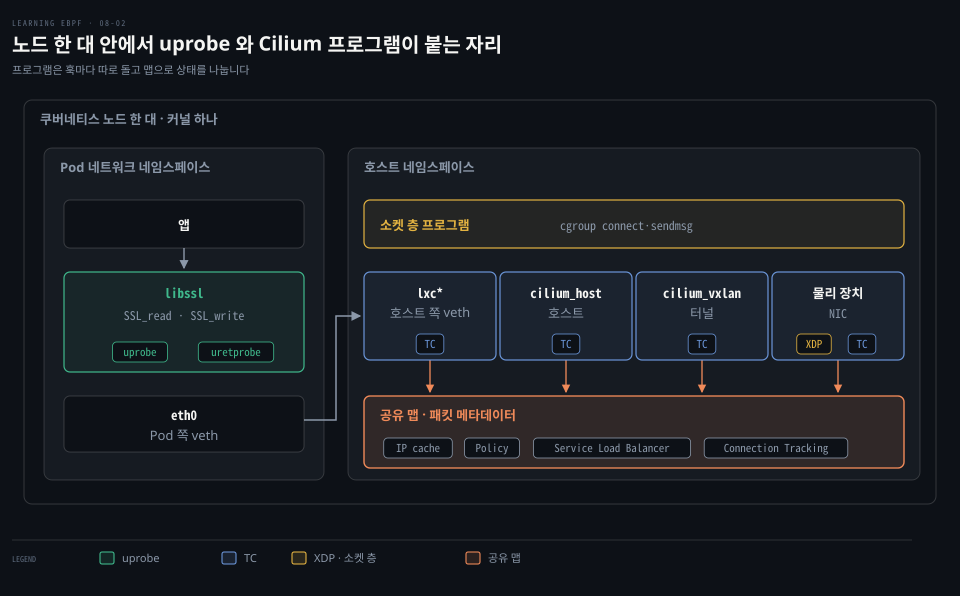
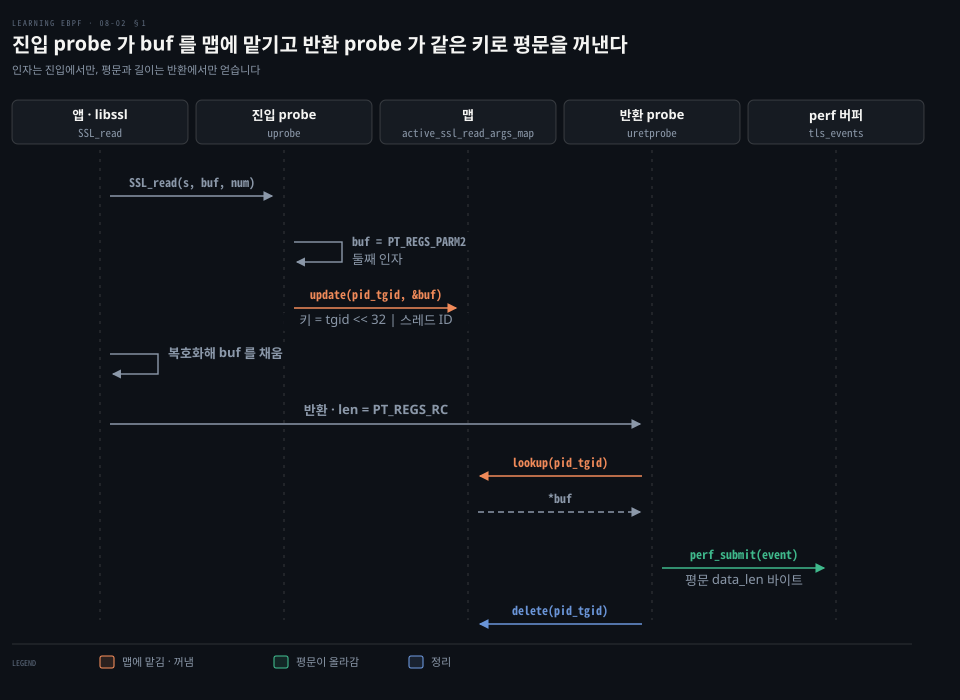
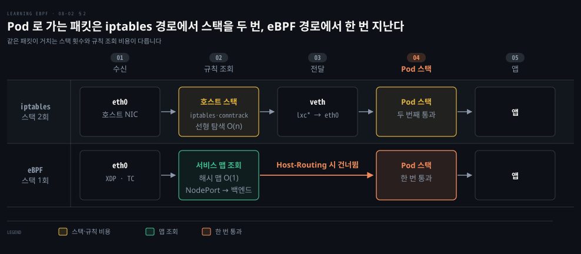
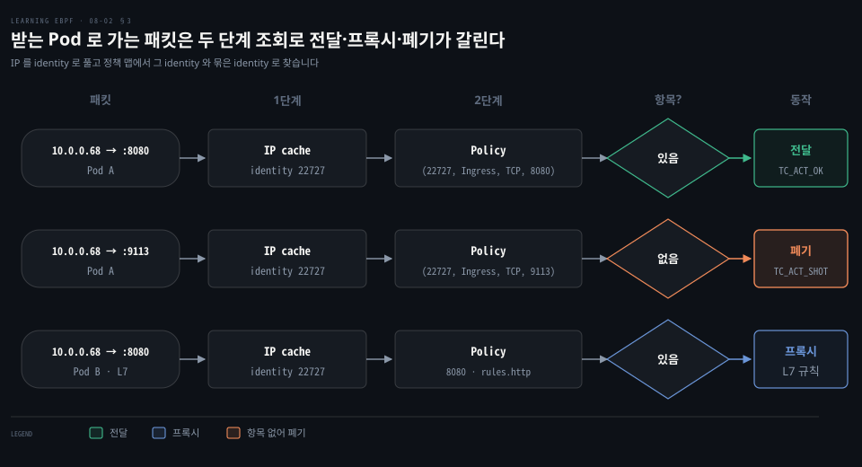
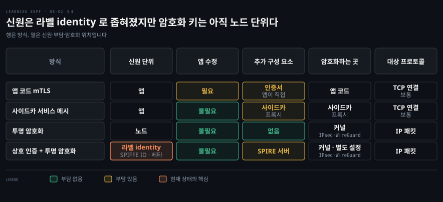

# uprobe 는 암호화 전후의 평문을 읽고 쿠버네티스 네트워킹은 iptables 대신 eBPF 맵으로 정책을 건다

---

> 평문은 암호 라이브러리 함수의 인자와 반환 사이에 잠깐 있어서 uprobe 가 키 없이 읽고, 쿠버네티스 노드에서는 iptables 규칙 목록 대신 eBPF 맵 조회가 패킷을 나르고 거릅니다.


## 핵심 요약

> 이 편의 중심 생각은 eBPF 가 라이브러리와 네트워크 스택의 지나가는 자리에 붙어 암호화를 건드리지 않고 평문을 보고, 규칙 목록 없이 맵으로 판정한다는 것입니다.

`SSL_read()` 의 진입과 반환에 프로브를 짝지어 걸면 평문이 키 없이 보입니다. 버퍼 포인터는 진입에서, 평문은 반환에서 얻으므로 맵으로 이어야 합니다.

쿠버네티스 노드에서는 패킷이 같은 커널의 스택을 두 번 지나고 iptables 는 규칙을 순서대로 훑습니다. Cilium 은 소켓 층·TC·XDP 의 프로그램을 맵으로 협조시켜 서비스와 정책을 맵 조회로 판정하며, 정책의 기준은 라벨에서 만든 identity 입니다.

노드 사이 투명 암호화는 노드 신원으로 맺는 IPsec·WireGuard 터널이고, 앱 신원을 확인하는 상호 인증은 베타입니다.


## 학습 목표

> 이 편을 읽고 나면 다음을 설명할 수 있습니다.

1. 평문이 어디에 있고 왜 키 없이 읽을 수 있는지 말할 수 있습니다.
2. 진입·반환 probe 를 짝지어야 하는 이유와 맵 키를 `pid_tgid` 로 잡는 이유를 설명할 수 있습니다.
3. Pod 패킷이 스택을 두 번 지나는 이유와 iptables 의 규모 비용 둘을 구분할 수 있습니다.
4. Cilium 이 프로그램을 여러 훅에 나누는 이유와 프로그램 사이의 통신 수단 둘을 댈 수 있습니다.
5. 투명 암호화와 상호 인증의 신원 단위 차이를 말할 수 있습니다.

아래 그림은 노드 한 대 안에서 uprobe 와 Cilium 의 각 훅 프로그램이 공유 맵으로 엮이는 구조를 보입니다. uprobe 평문 수집은 1절, 패킷 경로와 iptables 한계는 2절, Cilium 의 훅 협조는 3·4절이 다룹니다.




## 1. SSL_read 와 진입·반환 uprobe

> 암호화 전과 복호화 뒤의 데이터는 사용자 공간 라이브러리 안에 평문으로 있습니다. SSL_read 같은 그 함수의 진입과 반환에 uprobe 를 짝지어 걸면 인증서나 키 없이 평문을 읽을 수 있습니다.

TLS 트래픽을 네트워크에서 잡으면 암호문뿐입니다. 하지만 앱은 평문을 다룹니다. 앱은 보낼 데이터를 OpenSSL 이나 BoringSSL 같은 라이브러리의 `SSL_write()` 에 넘깁니다. 받은 데이터는 `SSL_read()` 가 복호화해 앱의 버퍼에 채웁니다. 라이브러리가 사용자 공간에서 암호화하면 소켓(사용자 공간과 커널의 경계)에 닿을 때는 이미 암호문입니다. 커널이 암호화하는 kTLS 는 예외입니다.([문서](https://docs.kernel.org/networking/tls.html))

그래서 사용자 공간에서 암호화하는 경우 평문을 확실히 붙잡을 자리는 라이브러리 함수의 인자와 반환입니다. 이 함수들에 uprobe 를 걸면 읽을 수 있고 키는 앱이 이미 건넸습니다. Pixie 의 데모 `openssl-tracer` 가 이를 작게 보여 줍니다. eBPF 쪽 코드는 `openssl_tracer_bpf_funcs.c` 에 있습니다.[^pixie]

평문을 올리는 함수는 `process_SSL_data()` 입니다. 복호화된 바이트 수는 반환값 `PT_REGS_RC(ctx)` 에서 얻고, 음수면 아무것도 올리지 않고 끝냅니다. 0 이상이면 `MAX_DATA_SIZE` 까지로 자른 길이를 `data_len` 으로 삼습니다. 그만큼 `bpf_probe_read(event->data, event->data_len, buf)` 로 평문을 복사합니다. 복사한 평문은 `tls_events.perf_submit()` 으로 올립니다. 이 함수는 읽기용과 쓰기용 반환 probe 에서 하나씩 불리므로 `buf` 는 평문 버퍼입니다. 읽기 쪽의 순서는 아래와 같습니다.



```c
// 시그니처: int SSL_read(SSL *s, void *buf, int num)
int probe_entry_SSL_read(struct pt_regs* ctx) {
  // 스레드마다 다른 값이라 맵의 키로 씁니다
  uint64_t current_pid_tgid = bpf_get_current_pid_tgid();
  ...
  // 둘째 인자 buf 포인터를 맵에 맡깁니다
  const char* buf = (const char*)PT_REGS_PARM2(ctx);
  active_ssl_read_args_map.update(&current_pid_tgid, &buf);
  return 0;
}

int probe_ret_SSL_read(struct pt_regs* ctx) {
  uint64_t current_pid_tgid = bpf_get_current_pid_tgid();
  ...
  // 이 시점의 buf 에는 복호화된 평문이 차 있습니다
  const char** buf = active_ssl_read_args_map.lookup(&current_pid_tgid);
  if (buf != NULL) {
    process_SSL_data(ctx, current_pid_tgid, kSSLRead, *buf);
  }
  // 진입마다 반환이 짝이므로 항목을 지웁니다
  active_ssl_read_args_map.delete(&current_pid_tgid);
  return 0;
}
```

짝지어야 하는 이유는 필요한 두 값이 다른 시점에 있기 때문입니다. 인자 `buf` 포인터는 함수가 도는 동안 레지스터가 덮어 쓰일 수 있어 진입 probe 에서만 믿고 읽을 수 있습니다. 평문은 함수가 반환해야 차고 바이트 수도 반환값이라 반환 probe 에서만 얻습니다. 진입 probe 가 포인터를 해시 맵에 맡기고 반환 probe 가 꺼내 쓰는 것이 두 시점을 잇는 길입니다.

키를 `bpf_get_current_pid_tgid()` 로 잡는 이유는 이 값이 `tgid << 32 | 스레드 ID` 라서 스레드마다 다르기 때문입니다.[^pidtgid] 여러 스레드가 동시에 `SSL_read()` 를 불러도 항목이 섞이지 않습니다. 데모는 `-DTRACE_PID` 로 받은 PID 하나만 추적합니다.[^pixie]

예제의 `bpf_probe_read()` 는 지금은 쓰지 않는 쪽입니다. 커널 헤더는 `bpf_probe_read_user()` 나 `bpf_probe_read_kernel()` 을 쓰라고 안내합니다.[^probe-read] 여기서 `buf` 는 앱의 사용자 메모리이므로 `bpf_probe_read_user()` 입니다.

BCC 의 `sslsniff` 는 같은 원리로 세 종류의 라이브러리만 지원합니다.[^sslsniff]

- OpenSSL: `SSL_read`·`SSL_write`
- GnuTLS: `gnutls_record_recv`·`gnutls_record_send`
- NSS: `PR_Read`·`PR_Recv`·`PR_Write`·`PR_Send`

`--extra-lib` 는 세 종류 중 하나의 함수 이름을 내보내는 라이브러리 파일 경로를 더할 뿐입니다. 다른 라이브러리나 직접 만든 암호화에는 붙을 함수가 없습니다. 정적 링크 앱과 컨테이너마다 다른 복사본은 프로브가 걸리는 파일이 달라 놓칩니다. 원리는 [07-02 §1](./07-02.사용자%20공간·LSM·네트워크%20훅은%20붙는%20자리가%20컨텍스트와%20반환값의%20뜻을%20정한다.md)이 맡습니다.


## 2. Pod 패킷 경로와 iptables 의 한계

> Pod 마다 네임스페이스와 veth 를 두면 바깥 패킷이 호스트 스택과 Pod 스택을 차례로 지나 같은 커널이 같은 일을 두 번 합니다. iptables 는 규칙을 순서대로 훑고 바꿀 때의 비용도 규칙 수와 함께 늘어납니다.

Pod 하나로 가는 바깥 패킷은 커널의 네트워크 스택을 두 번 지납니다. Pod 는 보통 자기 네트워크 네임스페이스와 IP 를 갖고 호스트와 veth 쌍으로 이어지기 때문입니다(`hostNetwork` Pod 는 예외). 호스트 스택을 지난 패킷은 veth 를 건너 Pod 스택을 한 번 더 지납니다. 같은 일을 두 번 하는 만큼 지연이 늡니다. 구조는 [Cilium 데이터패스 §1](../../../08_cloud/book/cilium-up-and-running/05-01.Cilium%20데이터패스는%20같은%20노드는%20eBPF%20로%20바로%20넘기고%20다른%20노드는%20라우팅이나%20터널로%20잇는다.md)이 맡습니다.



iptables 경로는 호스트 스택에서 규칙을 선형 탐색 O(n) 으로 훑고 스택을 2회 지납니다.

NodePort 는 노드의 포트로 서비스를 바깥에 엽니다. eBPF 경로는 NodePort 로 들어온 패킷을 eth0 의 XDP·TC 에서 서비스 맵을 해시 맵 O(1) 로 조회해 NodePort → 백엔드를 정합니다. Pod 가 부르는 클러스터 안 가상 IP 인 ClusterIP 는 `connect()` 때 바뀌며 §3 이 다룹니다.

eBPF Host-Routing 이 켜져 있으면 호스트 스택을 건너뛰고 Pod 스택을 1회만 지납니다. 꺼져 있으면 iptables 훅에 의존하는 기능을 위해 호스트 스택 일부를 지납니다. 요건은 eBPF kube-proxy 대체와 마스커레이딩(나가는 패킷의 출발지 주소를 노드 주소로 바꾸는 NAT)이며 커널이 지원하면 자동으로 켜집니다.[^kpr] 한편 veth 는 호스트 쪽 `lxc*` 와 Pod 쪽 `eth0` 가 한 쌍입니다.

iptables 는 kube-proxy 의 서비스 로드밸런싱과 일부 CNI(Pod 네트워크를 구성하는 플러그인)의 IP·포트 단위(L3/L4) 정책에 쓰입니다. 여기서 비용은 두 갈래로 나옵니다.

- 갱신 비용: Pod 가 오가면 규칙을 고쳐 써야 합니다. 2017년 KubeCon 에서 Haibin Xie 와 Quinton Hoole 이 사례 하나를 발표했습니다. 그 발표에서는 서비스 20,000개에서 규칙 하나를 바꾸는 데 다섯 시간이 걸렸습니다. 그 뒤 kube-proxy 의 갱신 최적화(`MinimizeIPTablesRestore`)가 v1.28 에서 정식이 됐습니다.[^k8s] 그래도 규칙이 수만 개가 되면 갱신이 오래 걸릴 수 있다고 문서가 적습니다.
- 조회 비용: 순서대로 훑는 선형 탐색이라 규칙 수에 비례하지만, Cilium 은 조회 표를 맵으로 두어 비례해 늘지 않게 합니다.

체인 구조는 [02-03 §1](../../../08_cloud/book/networking-and-kubernetes/02-03.iptables·IPVS·eBPF%20—%20kube-proxy를%20이해하는%20세%20기술.md), kube-proxy 규칙과 IPVS 는 같은 편 §3·§4 가, 규칙이 선형으로 느는 모습은 [06-01 §2](../../../08_cloud/book/cilium-up-and-running/06-01.Cilium%20은%20kube-proxy%20를%20eBPF%20로%20대신하고%20외부%20서비스에%20IP%20와%20경로를%20붙인다.md)가 맡습니다. kube-proxy 도 달라져 nftables 모드가 v1.33 에서 정식이 됐습니다. IPVS 모드는 v1.35 에서 폐기 예정이 되어 문서가 nftables 를 그 대체로 권합니다.[^k8s] Calico 의 eBPF 데이터플레인과의 비교는 참고 자료의 Cilium 블로그 글에 있습니다.


## 3. Cilium 의 여러 훅과 라벨 기반 정책

> Cilium 은 훅마다 볼 수 있는 것이 달라 여러 프로그램을 맵과 패킷 메타데이터로 엮어 씁니다. 정책 판정은 출발지 IP 를 라벨 identity 로 푸는 조회와 그 identity 로 정책 맵을 찾는 조회의 두 단계입니다.

복잡한 네트워킹은 프로그램 하나로 처리하지 못합니다. 붙는 자리마다 컨텍스트와 반환 코드가 다르고, 평면 라우팅이냐 터널이냐에 따라 도는 프로그램도 달라지기 때문입니다. 모드별 경로는 [Cilium 데이터패스 §2·§3](../../../08_cloud/book/cilium-up-and-running/05-01.Cilium%20데이터패스는%20같은%20노드는%20eBPF%20로%20바로%20넘기고%20다른%20노드는%20라우팅이나%20터널로%20잇는다.md)이 맡습니다.

원칙은 가능한 한 빨리 가로채는 것입니다. 나가는 쪽은 앱에 가까운 소켓 층에서 잡고 들어오는 쪽은 XDP 에서 잡습니다. 지금의 Cilium 은 소켓 층에서 cgroup 에 붙인 `connect()`·`sendmsg()`·`recvmsg()` 훅을 씁니다. 이 훅으로 서비스 주소를 백엔드 주소로 바꿔 패킷이 생기기 전에 변환을 끝냅니다.[^socklb][^kpr] 상세는 [Cilium kube-proxy 대체 편의 소켓 변환 절](../../../08_cloud/book/cilium-up-and-running/06-01.Cilium%20은%20kube-proxy%20를%20eBPF%20로%20대신하고%20외부%20서비스에%20IP%20와%20경로를%20붙인다.md#변환은-connect-시점에-일어나-소켓이-백엔드-주소를-안다)이 맡습니다.

XDP 에는 CIDR 맵으로 먼저 거르는 prefilter 와, 켜면 NodePort·LoadBalancer 를 가속하는 프로그램이 붙습니다.[^cilium-intro][^kpr]
TC 프로그램은 Pod 의 veth 호스트 쪽(`lxc*`)과 터널 장치(vxlan 모드의 `cilium_vxlan`)에 붙습니다. 물리 장치와 호스트 장치(`cilium_host`)에도 붙습니다. 프로그램 사이는 함께 읽고 쓰는 맵과, 패킷에 붙여 다음 훅으로 가져가는 메타데이터로 이어집니다. 메타데이터는 [08-01 §1](./08-01.XDP%20와%20TC%20는%20패킷을%20경계%20검사로%20파싱해%20반환%20코드로%20버리고%20고쳐%20되돌린다.md), TC 에서 버리는 방식은 [08-01 §5](./08-01.XDP%20와%20TC%20는%20패킷을%20경계%20검사로%20파싱해%20반환%20코드로%20버리고%20고쳐%20되돌린다.md#5-tc-의-양방향-패킷-처리와-sk_buff)이 맡습니다.

정책을 라벨로 거는 이유는 IP 가 계속 바뀌어 오늘 한 앱의 주소가 내일 다른 앱의 것이 되기 때문입니다. NetworkPolicy 는 Pod 라벨로 규칙을 쓰지만 집행은 CNI 가 맡고, 지원하지 않는 CNI 에서는 규칙이 효력 없이 남습니다.([문서](https://kubernetes.io/docs/concepts/services-networking/network-policies/)) Cilium 은 표준에 없는 DNS 이름 규칙과, 같은 URL 의 HTTP GET 은 허용하고 POST 는 거부하는 L7 규칙을 지원합니다. 표준 문법은 [NetworkPolicy 편](../../../08_cloud/book/networking-and-kubernetes/04-03.NetworkPolicy와%20DNS%20—%20클러스터%20안의%20방화벽과%20이름.md), DNS 규칙은 [FQDN 편](../../../08_cloud/book/cilium-up-and-running/13-02.FQDN%20정책은%20DNS%20프록시가%20본%20응답%20IP%20를%20정책%20identity%20로%20바꾼다.md), L7 규칙은 [L7 편](../../../08_cloud/book/cilium-up-and-running/13-01.L7%20정책은%20Envoy%20로%20HTTP%20메서드와%20경로를%20검사한다.md)이 맡습니다.

버리는 방식은 08-01 과 같고 달라지는 것은 규칙을 찾는 방식입니다. Cilium 은 Pod 의 라벨로 identity 를 만듭니다. 출발지 IP 는 IP cache 맵(`cilium_ipcache_v2`)이 identity 로 풉니다. 그다음 엔드포인트마다 둔 Policy 맵(`cilium_policy_v3_` 접두사)에서 identity·방향·프로토콜·포트 조합의 동작을 찾습니다.[^cilium-maps]

서비스 변환과 연결 상태는 Service Load Balancer 와 Connection Tracking 맵이 맡습니다. 에이전트가 미리 계산해 두므로 정책 판정에는 IP cache 조회와 Policy 맵 조회 두 단계만 남습니다. Policy 맵은 identity 그대로 찾은 항목과 묶은(aggregate) identity 로 찾은 항목 가운데 우선순위가 높은 쪽을 고릅니다. 맵은 키로 찾는 표여서 비용이 규칙 수에 따르지 않습니다. identity 와 판정의 상세는 [Cilium 정책 편 §3](../../../08_cloud/book/cilium-up-and-running/12-01.Cilium%20정책은%20라벨에서%20만든%20identity%20로%20허용을%20판정하고%20정책이%20붙으면%20기본%20거부가%20된다.md)이 맡습니다.



앞의 두 갈래 값은 정책 편의 예시와 같습니다. Pod A 로 가는 출발지 `10.0.0.68` 은 identity `22727` 로 풀립니다. `(22727, Ingress, TCP, 8080)` 항목이 있으면 전달(`TC_ACT_OK`)됩니다. 항목이 없는 `9113` 은 기본 거부로 폐기되며 TC 에서는 `TC_ACT_SHOT` 입니다.[^shot] 셋째 갈래는 L7 규칙(`toPorts` 아래 `rules.http`)이 붙은 경우이며 같은 identity 를 가정한 예입니다. Pod B 의 `8080` 이 프록시로 갑니다.


## 4. 투명 암호화와 상호 인증

> 투명 암호화는 노드 사이 터널로 암호화를 네트워크 층으로 내려 앱을 고치지 않아도 되지만 신원이 노드로 넓어집니다. 앱 신원까지 확인하는 상호 인증은 현재 베타이고 암호화와 아직 합쳐지지 않았습니다.

앱 코드의 mTLS(mutual Transport Layer Security)는 양쪽 앱의 신원을 인증서로 확인한 뒤 연결을 암호화합니다. 이 방식은 앱마다 직접 해야 하는 한계가 있습니다. 서비스 메시로 넘기면 사이드카 같은 구성 요소가 더 필요해 자원·지연·운영 복잡도가 늡니다. 앱 단 mTLS 는 보통 TCP 연결마다 맺습니다(QUIC 처럼 UDP 위에서 TLS 1.3 을 쓰는 경우도 있습니다).[^rfc]

**투명 암호화**는 이 일을 네트워크 층으로 내립니다. 앱은 암호화를 알 필요가 없고 쿠버네티스에 구성 요소를 더하지도 않습니다. 커널의 IPsec 이나 WireGuard 가 두 노드 사이에 터널을 맺고 CNI 가 Pod 의 eBPF 끝점을 이 터널로 이어 줍니다. 터널은 양 끝 노드의 신원으로 맺으며 그 신원은 쿠버네티스가 이미 관리합니다. IP 패킷이면 프로토콜을 가리지 않는 점이 앱 단 mTLS 와 다릅니다. 같은 노드 Pod 사이는 건너뛰는 등의 적용 범위는 [투명 암호화 편](../../../08_cloud/book/cilium-up-and-running/14-01.Transparent%20Encryption%20은%20노드%20사이%20트래픽을%20WireGuard%20로%20감싼다.md)이 맡습니다.

노드 단위로는 부족한 멀티테넌트 환경은 인증서로 앱 단위 신원을 확인해야 합니다. 서비스 메시가 맡던 이 일을 네트워크로 가져오려는 접근이 **상호 인증**(mutual authentication)입니다. Cilium 문서에 따르면 베타이며 이렇게 동작합니다.[^mutual]

- 신원: 워크로드는 Cilium identity(라벨 묶음)이고 SPIFFE ID 로 표현합니다. 규격은 [신원 규격 부록](../../../08_cloud/book/istio-in-action/a0-03.부록%20—%20신원을%20문서로%20만드는%20네%20규격.md)이 맡습니다.
- 구성 요소: SPIRE 서버가 필요하며 Helm 차트에 설치 옵션이 있습니다.
- 정책: CiliumNetworkPolicy 의 ingress·egress 규칙에 `authentication.mode: "required"` 를 넣습니다.
- 핸드셰이크: 에이전트끼리 연결 밖에서 맺고 identity 쌍 단위로 결과를 캐시합니다.



표의 행은 앱 코드 mTLS·사이드카 서비스 메시·투명 암호화·상호 인증 + 투명 암호화입니다. 신원 단위는 앞의 두 행이 앱, 투명 암호화가 노드이고 앱 수정은 앱 코드 mTLS 만 필요합니다. 암호화는 앱 코드 mTLS 가 앱 코드에서, 메시가 사이드카 프록시에서, 투명 암호화가 커널 IPsec·WireGuard 에서 합니다. 추가 구성 요소는 메시의 사이드카 프록시와 상호 인증의 SPIRE 서버이고, 앱 코드 mTLS 는 앱이 인증서를 직접 다룹니다. 대상은 앞의 두 행이 보통 TCP 연결, 투명 암호화가 IP 패킷입니다.

마지막 행이 현재 상태입니다. 신원 단위는 라벨 identity 로 좁혀졌지만 암호화는 별도로 켜는 커널 IPsec·WireGuard 라서 키는 여전히 노드 단위입니다. 인증 결과를 암호화 키로 쓰는 일은 아직 할 일입니다. 사이드카 없이 메시 기능을 노드로 옮기는 배경은 [Cilium 개요 §4](../../../08_cloud/book/cilium-up-and-running/01-01.Cilium%20은%20eBPF%20데이터패스로%20iptables%20기반%20CNI%20의%20한계를%20넘는다.md)가 맡습니다.


## 면접 대비

> 평문 읽기와 쿠버네티스 네트워킹의 면접 질문입니다.

1. `SSL_read()` 에 uretprobe 를 짝짓는 이유와 잇는 방법을 설명해 보십시오.
2. 키 없이 TLS 평문을 읽을 수 있는 이유와 이 방식이 놓치는 경우를 말해 보십시오.
3. Pod 패킷이 스택을 두 번 지나는 이유와 iptables 의 두 비용을 설명해 보십시오.
4. Cilium 이 여러 훅의 프로그램으로 나뉘는 이유와 그 사이의 통신 수단을 설명해 보십시오.
5. 투명 암호화와 상호 인증의 신원 단위와 상호 인증의 현재 상태를 말해 보십시오.


## 정답 (자답 후 펼치기)

> 키워드 중심의 모범 답안입니다.

### 정답 1 — 두 시점과 pid_tgid 키 맵

`buf` 는 진입에서만, 평문과 길이는 반환 뒤에만 얻습니다. 진입 probe 가 `pid_tgid` 키로 포인터를 맡기고 반환 probe 가 꺼내 쓴 뒤 `delete` 합니다.

### 정답 2 — 라이브러리 함수의 인자와 반환 사이

평문은 라이브러리 안에 있고 키는 앱이 이미 건넸습니다. 지원 밖 라이브러리, 직접 만든 암호화, 정적 링크, 컨테이너별 복사본은 놓칩니다.

### 정답 3 — 두 네임스페이스와 선형 탐색

호스트 스택과 Pod 스택을 차례로 지납니다. iptables 는 갱신 비용과 선형 조회 비용이 있고 맵 조회는 규칙 수에 비례하지 않습니다.

### 정답 4 — 붙는 자리별 컨텍스트와 맵·메타데이터

훅마다 컨텍스트와 반환 코드가 다르고 모드마다 도는 프로그램도 다릅니다. 통신은 공유 맵과 패킷 메타데이터로 합니다.

### 정답 5 — 노드 신원 터널과 라벨 identity 상호 인증

투명 암호화는 노드 신원의 IPsec·WireGuard 터널이고 프로토콜을 가리지 않습니다. 상호 인증은 SPIFFE 로 표현한 라벨 identity 를 확인하며 베타이고 암호화와 아직 합쳐지지 않았습니다.


## 참고 자료

- 《Learning eBPF》(Liz Rice, O'Reilly, 2023, ISBN 978-1-098-13512-6) Ch.8 eBPF for Networking
- Pixie 데모 [`openssl-tracer`](https://github.com/pixie-io/pixie-demos/tree/main/openssl-tracer) · Pixie 블로그 [eBPF 로 OpenSSL 추적하기](https://blog.px.dev/ebpf-openssl-tracing/) · BCC [`sslsniff`](https://github.com/iovisor/bcc/blob/v0.37.0/tools/sslsniff.py)
- 쿠버네티스 [가상 IP 와 서비스 프록시](https://kubernetes.io/docs/reference/networking/virtual-ips/) · Cilium [eBPF 데이터패스](https://docs.cilium.io/en/stable/network/ebpf/intro/)(소켓 층 가속 절은 옛 설명이고 지금의 소켓 층은 socket-LB) · [상호 인증](https://docs.cilium.io/en/stable/network/servicemesh/mutual-authentication/mutual-authentication/)
- 더 읽을 거리: Arthur Chiao [Life of a Packet in Cilium](https://arthurchiao.art/blog/cilium-life-of-a-packet-pod-to-service) · Cilium 블로그 [CNI 성능 벤치마크](https://cilium.io/blog/2021/05/11/cni-benchmark) · [networkpolicy.io](https://networkpolicy.io/)


## 관련 문서

- [Cilium 정독본](../../../08_cloud/book/cilium-up-and-running/README.md) · [정독 인덱스](./README.md)

[^pixie]: `pixie-demos` HEAD `6806d84`, `openssl_tracer_bpf_funcs.c` L63-77(`process_SSL_data`), `openssl_tracer.cc` L106-107(`-DTRACE_PID`). <https://github.com/pixie-io/pixie-demos/blob/6806d843e10a01134db273fa7e713124128c5e89/openssl-tracer/openssl_tracer_bpf_funcs.c#L63-L77>
[^pidtgid]: v7.2 `bpf.h`. <https://github.com/torvalds/linux/blob/v7.2/include/uapi/linux/bpf.h#L2239-L2246>
[^probe-read]: v7.2 `bpf.h`. <https://github.com/torvalds/linux/blob/v7.2/include/uapi/linux/bpf.h#L2003-L2010>
[^sslsniff]: BCC v0.37.0 `sslsniff.py` L42·L285-341. <https://github.com/iovisor/bcc/blob/v0.37.0/tools/sslsniff.py#L285-L341>
[^k8s]: `MinimizeIPTablesRestore` <https://kubernetes.io/docs/reference/command-line-tools-reference/feature-gates-removed/> · `NFTablesProxyMode` <https://kubernetes.io/docs/reference/command-line-tools-reference/feature-gates/> · <https://kubernetes.io/docs/reference/networking/virtual-ips/>
[^cilium-intro]: <https://docs.cilium.io/en/stable/network/ebpf/intro/> · `lxc*` <https://docs.cilium.io/en/stable/network/concepts/routing/>
[^cilium-maps]: v1.20.2 <https://github.com/cilium/cilium/blob/v1.20.2/pkg/maps/ipcache/ipcache.go#L29> · <https://github.com/cilium/cilium/blob/v1.20.2/pkg/maps/policymap/policymap.go#L46> · 정책 맵은 LPM 트라이 <https://github.com/cilium/cilium/blob/v1.20.2/bpf/lib/policy.h#L165-L172> · 조회 순서 <https://github.com/cilium/cilium/blob/v1.20.2/bpf/lib/policy.h#L227-L229>, 서비스 맵은 해시 <https://github.com/cilium/cilium/blob/v1.20.2/bpf/lib/lb.h#L277-L284>
[^shot]: <https://github.com/cilium/cilium/blob/v1.20.2/bpf/include/bpf/ctx/skb.h#L26-L27>
[^socklb]: v1.20.2 `bpf_sock.c` 의 `cgroup/connect4`·`sendmsg4`·`recvmsg4`. <https://github.com/cilium/cilium/blob/v1.20.2/bpf/bpf_sock.c#L466>
[^kpr]: kube-proxy 대체 문서(소켓 변환·NodePort XDP 가속), 튜닝 문서(Host-Routing). <https://docs.cilium.io/en/stable/network/kubernetes/kubeproxy-free/> · <https://docs.cilium.io/en/stable/operations/performance/tuning/>
[^rfc]: <https://www.rfc-editor.org/rfc/rfc9001>(TLS 1.3 으로 QUIC 보호) · <https://www.rfc-editor.org/rfc/rfc9000>(UDP 에 실림)
[^mutual]: <https://docs.cilium.io/en/stable/network/servicemesh/mutual-authentication/mutual-authentication/> · 정책 필드. <https://docs.cilium.io/en/stable/network/servicemesh/mutual-authentication/mutual-authentication-example/>
