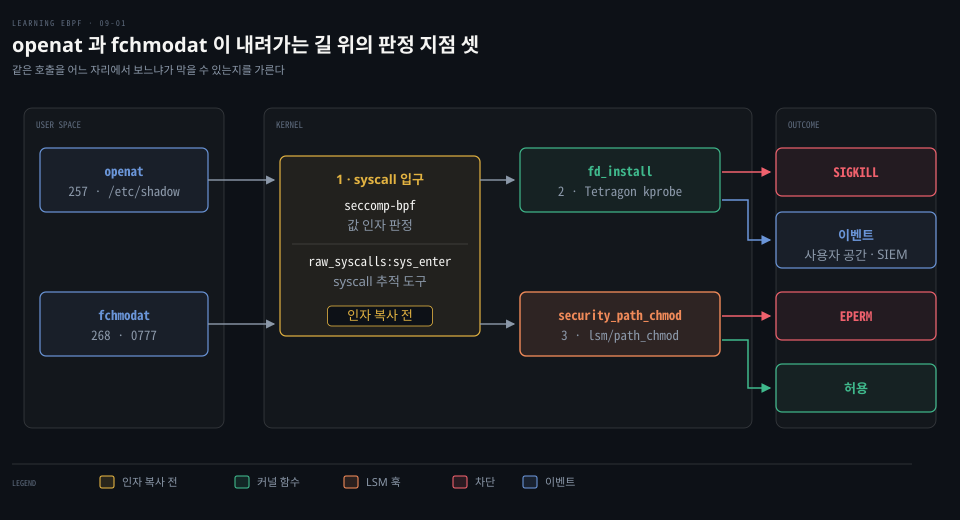
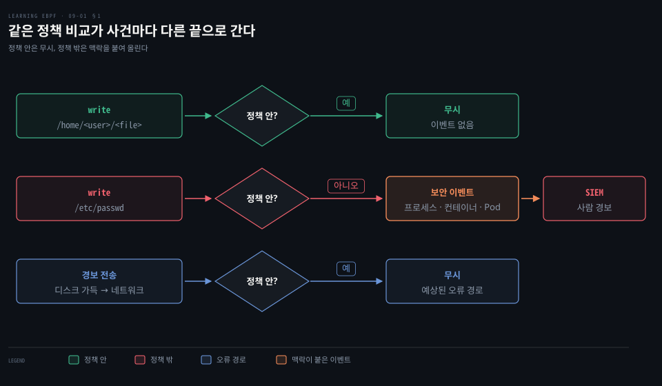
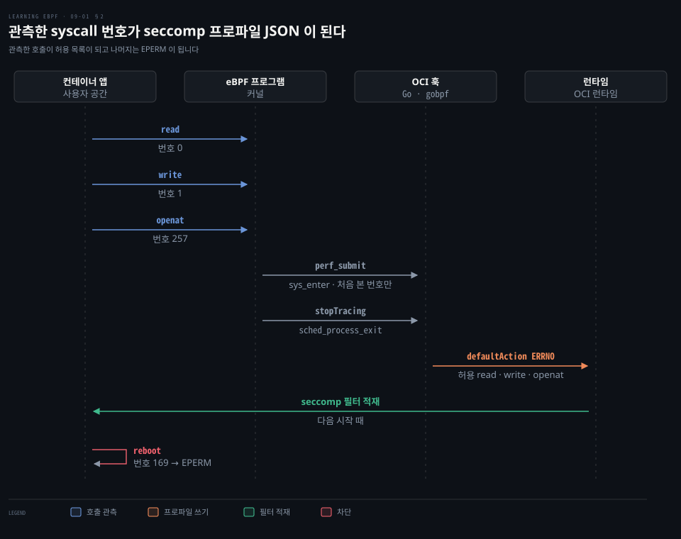
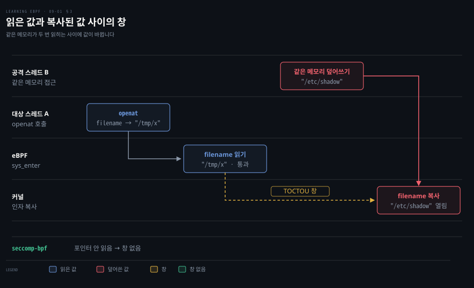
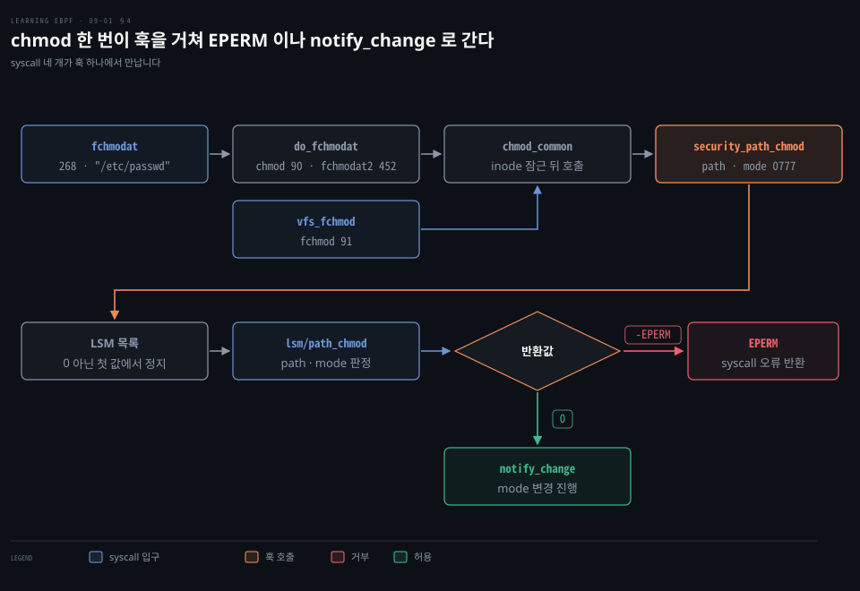
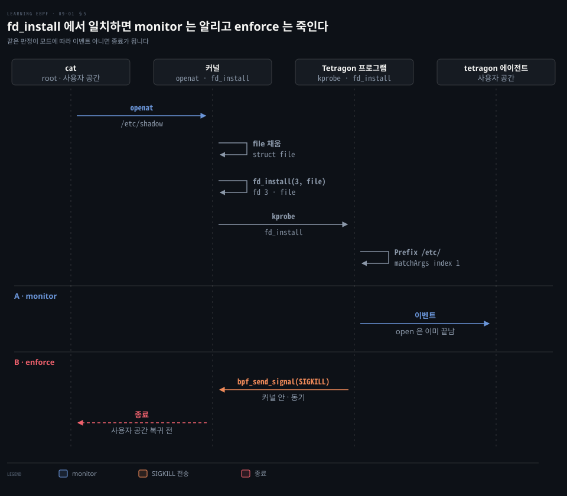

# 시스템 콜 입구 검사는 TOCTOU 에 뚫려 보안 도구는 LSM 훅과 커널 함수에서 판정하고 SIGKILL 로 막는다

---

> 보안 도구는 정책 밖 사건을 맥락과 함께 골라냅니다. 시스템 콜 입구는 인자를 믿을 수 없어서 LSM 훅이나 커널 함수에서 판정하고 `-EPERM` 이나 SIGKILL 로 막습니다.


## 핵심 요약

> 이 편의 중심 생각은 보안 판정의 신뢰도와 차단 가능 여부가 무엇을 보느냐보다 어느 지점에서 보느냐에 달려 있다는 것입니다.

보안 도구는 기대한 동작을 정책으로 들고 있다가 그 밖의 사건만 맥락을 붙여 올립니다. 정책에는 오류 경로도 들어가야 합니다.

시스템 콜 입구는 쉬운 부착 지점이지만 seccomp-bpf 는 값 인자만 보고, 다른 프로세스가 밖에서 얹을 수 없어 워크로드를 띄울 때 겁니다. 입구에서 포인터 인자를 읽는 도구는 커널이 복사하기 전에 값이 바뀌는 TOCTOU 에 노출됩니다.

그래서 판정은 커널이 값을 복사한 뒤로 옮겨 갑니다. BPF LSM 은 훅에서 `-EPERM` 으로 거부하고, Tetragon 은 `fd_install` 같은 커널 함수에서 걸러 SIGKILL 로 죽이며 monitor 로 먼저 돌립니다.


## 학습 목표

> 이 편을 읽고 나면 다음을 설명할 수 있습니다.

1. 보안 도구가 정책과 맥락으로 관측 도구와 갈리는 점, 오류 경로가 정책에 들어가야 하는 이유를 설명할 수 있습니다.
2. strict 모드와 seccomp-bpf 의 차이, 필터가 포인터를 읽지 못하고 워크로드를 띄울 때 거는 이유를 설명할 수 있습니다.
3. `raw_syscalls:sys_enter` 에서 본 syscall 이 JSON 프로파일이 되는 과정을 따라갈 수 있습니다.
4. 입구의 TOCTOU 창이 어디에 생기며 seccomp-bpf 에는 없고 unotify 에는 있는 이유를 설명할 수 있습니다.
5. BPF LSM 반환값 규칙, `fd_install` 을 고르는 이유, monitor 와 enforce 의 차이를 설명할 수 있습니다.

아래 그림은 시스템 콜이 내려가는 길 위의 세 판정 지점과 네 가지 결과를 보입니다. 입구 판정과 한계는 2·3절, LSM 훅 거부는 4절, 커널 함수 기반 차단은 5절이 다룹니다.




## 1. 보안 도구는 정책 밖 사건을 맥락과 함께 골라낸다

> 보안 도구는 사건을 정책과 비교해 밖의 것만 맥락을 붙여 올립니다. 정책에는 정상 경로뿐 아니라 오류 경로도 들어가야 합니다.

앱이 파일에 쓰는 사건 하나를 관측 도구는 로그로 쌓고 보안 도구는 경보로 울립니다. 차이는 어디서 올까요?

기대한 동작을 적어 둔 것이 **정책**입니다. 앱이 `/home/<user>/<file>` 에 쓰는 것은 정상이지만 `/etc/passwd` 를 바꾸려 하면 정책 밖이라 알려야 합니다. 정책 밖 사건은 보안 이벤트 로그가 되어 보안 로그를 모아 분석하는 SIEM(Security Information and Event Management) 플랫폼으로 가거나 사람에게 경보가 됩니다.

정책에는 오류 경로까지 담아야 합니다. 디스크가 가득 차서 앱이 네트워크로 경보를 보내는 일은 드물어도 예상된 동작이라 올리면 안 됩니다.



경보에는 맥락이 필요합니다. 조사하는 사람은 무엇이 어느 구성 요소(프로세스·컨테이너·Pod)에서 언제 누구 때문에 일어났는지 알아야 공격 여부를 판단하며, 이것이 로깅과 보안 관측을 가릅니다. 이미지 단위 정책 개념은 [컨테이너 런타임 보호][cs]의 1절에서 다뤘습니다.


## 2. seccomp-bpf 는 시스템 콜 번호와 값 인자로 판정하고, 프로파일은 eBPF 로 기록해 만든다

> seccomp-bpf 필터는 syscall 번호와 값 인자로 허용·오류·종료를 고르고, 밖에서 얹을 수 없어 워크로드를 띄울 때 겁니다. 프로파일은 손으로 쓰기 어려워 sys_enter 에 붙인 eBPF 로 기록합니다.

쓰지 않는 시스템 콜을 막으면 침해돼도 할 수 있는 일이 줄어듭니다. 허용 목록은 어떻게 만들까요? syscall 은 [BCC Hello World](./02-01.BCC%20Hello%20World%20는%20execve%20에%20kprobe%20를%20걸고%20결과를%20trace_pipe%20와%20해시%20맵으로%20꺼낸다.md)의 1절에, seccomp 의 두 세대는 [컨테이너 격리 강화](../../../08_cloud/book/container-security/08-01.컨테이너%20격리%20강화%20—%20샌드박싱의%20세%20갈래.md)의 2절에 있으니 eBPF 와 만나는 자리만 봅니다.

### strict 는 네 호출만 허용하고 seccomp-bpf 는 필터가 판정한다

strict 모드는 `read`·`write`·`_exit`·`sigreturn` 만 허용하고, 다른 호출은 스레드를 끝냅니다. 대부분의 앱은 더 많이 필요하지만 전부는 아니어서 **seccomp-bpf** 는 고정 목록 대신 BPF 필터를 싣습니다.

필터는 `seccomp_data` 의 `nr`·`arch`·`instruction_pointer`·`args[6]` 을 읽고, 상위 16비트에 결과를 실어 돌려줍니다. [seccomp(2)](https://man7.org/linux/man-pages/man2/seccomp.2.html) 에 따르면 필터가 여럿이면 모두 실행하고 우선순위가 가장 높은 결과를 씁니다. 높은 쪽부터 `KILL_PROCESS`·`KILL_THREAD`·`TRAP`·`ERRNO`·`USER_NOTIF`·`TRACE`·`LOG`·`ALLOW` 입니다. `USER_NOTIF`(5.0)는 감독 프로세스에 판정을 넘깁니다.

### 포인터는 읽지 못하고 필터는 프로세스 시작 때 건다

`args` 는 값입니다. 인자가 포인터여도 필터는 역참조할 수 없어 포인터 값이나 다른 값 인자로만 판정하고, [커널 문서](https://docs.kernel.org/userspace-api/seccomp_filter.html)는 이 제약이 TOCTOU 를 막는다고 설명합니다. 대신 경로 문자열로는 판정하지 못합니다.

`seccomp()` 는 호출한 프로세스 자신의 상태에 작용하고 자식과 `execve` 뒤에도 필터가 이어집니다. operation 은 strict 설정과 필터 설정, 조회 두 가지뿐이라 건 필터를 빼지 못하고 더 얹기만 합니다. 다른 프로세스가 밖에서 얹을 수는 없어서, 컨테이너 런타임은 워크로드를 `execve` 하기 전에 그 프로세스 안에서 필터를 겁니다.

### 프로파일은 sys_enter 에서 기록해 만든다

개발자는 자기 앱이 `open()` 을 부르는지 `openat()` 을 부르는지 몰라서 프로파일을 손으로 쓰기 어렵습니다. `strace` 는 컨테이너나 Pod 에 붙이기 어렵고 결과도 JSON 이 아닙니다. Aqua 는 2018년에 [일반 컨테이너가 40~70개 syscall 을 쓴다](https://www.aquasec.com/blog/aqua-3-2-preventing-container-breakouts-with-dynamic-system-call-profiling/)고 봤습니다. Docker 기본 프로파일은 [대부분을 허용하고](https://github.com/moby/profiles/blob/seccomp/v0.2.4/seccomp/default.json) `reboot` 은 `CAP_SYS_BOOT` 가 있을 때만 허용합니다.

eBPF 로 기록하는 도구는 둘입니다. Inspektor Gadget 의 `advise_seccomp` 는 [`SEC("raw_tracepoint/sys_enter")`](https://github.com/inspektor-gadget/inspektor-gadget/blob/v0.57.0/gadgets/advise_seccomp/program.bpf.c#L90) 프로그램이 mount namespace 마다 syscall 번호를 인덱스로 한 배열에 `0x01` 을 적습니다. mount namespace 는 프로세스가 보는 마운트 목록을 컨테이너마다 따로 두는 격리 단위입니다. [oci-seccomp-bpf-hook](https://github.com/containers/oci-seccomp-bpf-hook/blob/8daf794/oci-seccomp-bpf-hook.go#L236-L262) 은 런타임이 컨테이너 네임스페이스를 만든 뒤 사용자 프로그램을 실행하기 전에 부르는 OCI prestart 훅으로 실행되어 BCC 와 gobpf 로 `enter_trace` 를 적재합니다.

```go
// $PARENT_PID 를 컨테이너 init 의 PID 로 바꿔 컴파일합니다.
src := strings.ReplaceAll(source, "$PARENT_PID", strconv.Itoa(pid))
m := bcc.NewModule(src, []string{})
defer m.Close()

...
// 일반 tracepoint 프로그램으로 적재합니다.
enterTrace, err := m.LoadTracepoint("enter_trace")
...
// raw_syscalls:sys_enter 에 붙입니다.
if err := m.AttachTracepoint("raw_syscalls:sys_enter", enterTrace); err != nil {
	return fmt.Errorf("error attaching to tracepoint: %v", err)
}
```

`$PARENT_PID` 치환은 추적할 컨테이너마다 eBPF 소스를 따로 만들어 컴파일한다는 뜻입니다. 두 도구는 같은 이벤트에 훅은 일반 tracepoint 로, Inspektor Gadget 은 raw tracepoint 로 붙습니다. raw tracepoint 부착은 [kprobe 부착과 perf 버퍼](./04-02.kprobe%20는%20perf%20이벤트로%20붙고%20perf%20버퍼는%20CPU%20마다,%20링%20버퍼는%20하나로%20사용자%20공간에%20넘긴다.md)의 4절에 있습니다.

훅의 C 프로그램은 `$PARENT_PID` 프로세스의 mount namespace 를 맵에 적어 두고, 같은 namespace 에서 처음 보는 번호만 `perf_submit` 으로 올립니다. 런타임이 프로파일을 거는 `prctl`(프로세스 속성을 바꾸는 시스템 콜)이 불리기 전의 호출은 기록하지 않습니다. init 이 끝나면 `sched_process_exit` 가 `stopTracing` 을 올립니다.

모은 이름은 `SCMP_ACT_ALLOW`(`socket` 은 [첫 인자 값마다](https://github.com/containers/oci-seccomp-bpf-hook/blob/8daf794/oci-seccomp-bpf-hook.go#L380-L404) 허용), `defaultAction` 은 `SCMP_ACT_ERRNO` 로 한 JSON 을 씁니다. [OCI 명세](https://github.com/opencontainers/runtime-spec/blob/v1.3.0/config-linux.md)에서 `defaultErrnoRet` 을 안 쓰면 값은 `EPERM` 입니다. 예를 들어 번호 0 인 `read`, 1 인 `write`, 257 인 `openat` 이 허용되고 다음 시작 때 런타임이 적재한 필터에서 번호 169 인 `reboot` 은 `EPERM` 입니다.



관측에 안 잡힌 호출은 운영 중 처음 나올 때 `EPERM` 으로 막힙니다. 오류 상황에서만 부르는 syscall 이 대표적이고 JSON 을 사람이 검토해 찾기도 어렵습니다. 1절에서 오류 경로를 정책에 넣어야 하는 이유와 같습니다.


## 3. 시스템 콜 입구에서 본 인자는 커널이 읽을 때 바뀌어 있을 수 있다

> 입구의 eBPF 는 이미 도는 워크로드에도 붙지만 포인터 인자를 읽은 뒤 커널이 복사하기 전에 값이 바뀔 수 있어서 판정에는 복사 뒤의 지점이 필요합니다.

입구에서 읽어 정책을 통과시킨 인자를 커널도 그대로 쓸까요? [Falco][cs] 같은 추적 도구가 이 질문에 걸립니다. eBPF 는 동적으로 적재되어 이미 도는 워크로드에도 정책을 걸 수 있고, 규칙을 바꿔도 앱을 건드리지 않습니다. 워크로드를 띄울 때 거는 seccomp 와 다른 점입니다. Falco 0.45.0 의 [기본 엔진은 `modern_ebpf`](https://github.com/falcosecurity/falco/blob/0.45.0/falco.yaml#L443) 입니다.

문제는 포인터 인자입니다. 커널은 포인터가 가리키는 값을 자기 메모리로 복사한 뒤 일합니다. 읽은 시점과 복사 시점 사이에 공격자가 같은 메모리를 바꾸면 커널은 다른 값으로 일합니다. 이것이 **TOCTOU**(Time Of Check to Time Of Use) 입니다. [`openat` 의 `filename`](https://github.com/torvalds/linux/blob/v7.2/fs/open.c#L1385) 은 사용자 포인터라 경로가 이 대상입니다. 스레드 A 의 `openat` 이 `/tmp/x` 를 가리키면 eBPF 는 `/tmp/x` 를 읽어 통과시키지만, 스레드 B 가 같은 메모리를 `/etc/shadow` 로 덮은 뒤 커널이 복사하면 `/etc/shadow` 가 열립니다.

x86-64 의 `openat` 은 257번, `fchmodat` 은 268번입니다([syscall_64.tbl](https://github.com/torvalds/linux/blob/v7.2/arch/x86/entry/syscalls/syscall_64.tbl#L269-L280)).



seccomp-bpf 에는 이 창이 없습니다. 포인터를 읽지 못해 검사할 값이 없기 때문입니다. 필터는 입구 작업에서 [tracepoint 보다 먼저](https://github.com/torvalds/linux/blob/v7.2/include/linux/entry-common.h#L101-L112) 돕니다. seccomp 사용자 알림은 감독 프로세스가 대상 메모리를 읽어 판단하므로 창이 있고, [seccomp_unotify(2)](https://man7.org/linux/man-pages/man2/seccomp_unotify.2.html) 는 보안 정책 구현에 쓰지 말라고 못박습니다.

대응은 입구와 출구에 모두 붙는 것입니다. Sysmon for Linux 는 호출이 끝난 뒤 커널 자료구조에서 정확한 값을 얻지만 이미 끝난 호출을 막지는 못합니다. 현재 Falco 의 modern eBPF 드라이버도 주 디스패처가 [`SEC("tp_btf/sys_exit")`](https://github.com/falcosecurity/libs/blob/0.26.0/driver/modern_bpf/programs/attached/dispatchers/syscall_exit.bpf.c#L181-L182) 입니다. `connect`·`creat`·`open`·`openat`·`openat2` 는 [입구 이벤트를 따로 만들어](https://github.com/falcosecurity/libs/tree/0.26.0/driver/modern_bpf/programs/attached/events/toctou_mitigation) 출구 이벤트를 돕습니다.

차단하려면 복사 뒤의 지점이 필요한데 복사 코드는 syscall 마다 달라 공통 자리가 없습니다. 정의된 인터페이스는 Linux Security Module(LSM) API 입니다.


## 4. BPF LSM 은 커널이 객체를 건드리기 직전의 훅에서 거부한다

> LSM 훅은 커널이 객체를 건드리기 직전에 불리고 프로그램은 대개 0 이나 음수 errno 로 허용하거나 거부합니다. 여러 syscall 이 한 훅에서 만납니다.

syscall 마다 복사 시점이 다르다면 경로가 만나는 자리는 어디일까요? 객체 쪽입니다. `/etc/passwd` 를 0777 로 바꾸는 호출은 번호 268 의 `fchmodat` 입니다. 90 의 `chmod` 와 452 의 `fchmodat2` 는 v7.2 에서 `do_fchmodat` 으로, 91 의 `fchmod` 는 `vfs_fchmod` 로 들어가 [`chmod_common()`](https://github.com/torvalds/linux/blob/v7.2/fs/open.c#L618-L638) 에서 만납니다. 이 함수는 inode 를 잠근 뒤 `security_path_chmod()` 를 부르고, 오류가 없을 때만 `notify_change()` 로 모드를 바꿉니다. 호출은 넷이어도 훅은 하나입니다.



`security_path_chmod` 는 [등록된 LSM 을 차례로 부르며](https://github.com/torvalds/linux/blob/v7.2/security/security.c#L479-L496) 0 이 아닌 첫 값에서 멈춥니다. BPF LSM 은 훅마다 [`bpf_lsm_<훅 이름>` 함수](https://github.com/torvalds/linux/blob/v7.2/kernel/bpf/bpf_lsm.c#L24-L25)를 등록해 두고 프로그램이 그 함수를 대상으로 붙습니다.

커널은 경로의 한 칸을 `dentry`(디렉터리 항목) 구조체로 다룹니다. 파일 이름은 긴 이름까지 가리키는 `d_name.name` 으로 읽습니다. [`d_iname` 은 64비트에서 40바이트 인라인 버퍼](https://github.com/torvalds/linux/blob/v7.2/include/linux/dcache.h#L72-L90)라 짧은 이름만 담습니다. v6.14 부터 `d_iname` 은 `d_shortname.string` 의 [매크로](https://github.com/torvalds/linux/blob/v6.14/include/linux/dcache.h#L89)라 BTF 에서 뽑은 vmlinux.h 로는 쓸 수 없습니다.

```c
// path_chmod 훅에 붙는 BPF LSM 프로그램입니다.
SEC("lsm/path_chmod")
int BPF_PROG(path_chmod, const struct path *path, umode_t mode)
{
    // 긴 이름까지 가리키는 d_name.name 으로 읽습니다.
    bpf_printk("Change mode of file name %s\n", path->dentry->d_name.name);
    return 0;
}
```

`path` 는 대상 파일이고 `mode` 는 새 모드입니다. 이 프로그램은 이름을 찍고 0 을 돌려줍니다. `path_chmod` 같은 대부분의 int 훅에서는 0 이나 `[-MAX_ERRNO, 0]` 의 음수 errno 만 돌려줄 수 있고 [verifier 가 강제합니다](https://github.com/torvalds/linux/blob/v7.2/kernel/bpf/bpf_lsm.c#L423-L473). 0 은 허용, 음수는 거부이고 bool 성격의 훅 셋만 0·1 입니다.

거부는 `-EPERM` 으로 하며, 그러면 `chmod_common` 이 오류를 반환해 syscall 이 `EPERM` 을 돌려줍니다. 이 검사는 양수를 돌려준 프로그램이 `file_alloc_security` 훅에서 일으킨 패닉을 계기로 [v6.12 에 들어갔습니다](https://github.com/torvalds/linux/commit/5d99e198be279045e6ecefe220f5c52f8ce9bfd5). 판정을 커널 안에서 끝내서 빠릅니다.

BPF LSM 은 [5.7 에서 들어왔고](https://github.com/iovisor/bcc/blob/v0.37.0/docs/kernel-versions.md) [`CONFIG_BPF_LSM`](https://github.com/torvalds/linux/blob/v7.2/kernel/bpf/Kconfig#L92-L102) 과 LSM 순서 목록의 `bpf` 가 모두 필요합니다. v7.2 의 [`CONFIG_LSM` 기본값](https://github.com/torvalds/linux/blob/v7.2/security/Kconfig#L268-L281)에는 `bpf` 가 있고 `lsm=` 부팅 인자가 이를 덮어씁니다. 경로 훅은 [`CONFIG_SECURITY_PATH`](https://github.com/torvalds/linux/blob/v7.2/include/linux/lsm_hook_defs.h#L90-L110) 가 있어야 선언됩니다. 차단 맥락은 [컨테이너 런타임 보호][cs]의 심화 절에 있습니다.

예제 저장소의 [`hello-lsm.py`](https://github.com/lizrice/learning-ebpf/blob/91ded4a/chapter9/hello-lsm.py) 는 BPF LSM 프로그램이 아닙니다. `security_file_permission` 함수에 BCC `KFUNC_PROBE` 로 붙어 uid 1001 의 호출만 골라 파일 이름(`d_iname`, 짧은 이름만 정확)과 `mask`, 명령 이름을 찍는 관찰 전용입니다.

```c
// LSM 훅(file_permission)을 부르는 래퍼 함수에 fentry 로 붙고, 이름을 찍은 뒤 0 을 돌려줍니다.
KFUNC_PROBE(security_file_permission, struct file *f, int mask)
{
  ...
  bpf_trace_printk("File %s mask %x", f->f_path.dentry->d_iname, mask);
  ...
  return 0;
}
```


## 5. Tetragon 은 내부 커널 함수에 붙어 커널 안에서 거르고 SIGKILL 로 막는다

> Tetragon 은 임의 커널 함수에 eBPF 를 붙여 커널 안에서 판정하고 SIGKILL 로 프로세스를 죽입니다. 오탐이 걱정되면 monitor 모드부터 시작합니다.

[안정 인터페이스는 syscall 뿐](https://github.com/torvalds/linux/blob/v7.2/Documentation/process/stable-api-nonsense.rst#L11-L19)이고 LSM 훅도 내부 함수라 시그니처가 바뀝니다. `inode_setxattr` 의 첫 인자는 [v6.2 `user_namespace`](https://github.com/torvalds/linux/blob/v6.2/include/linux/lsm_hook_defs.h#L139) 에서 [v6.3 `mnt_idmap`](https://github.com/torvalds/linux/blob/v6.3/include/linux/lsm_hook_defs.h#L139) 로 바뀌었습니다. 그런데도 왜 `fd_install` 같은 내부 함수에 붙을까요? 선언돼 있지 않아도 오래 바뀌지 않아 사실상 안정된 함수가 있고, 새 커널 배포에 몇 년이 걸려 호환성 문제를 고칠 시간도 있습니다.

BPF LSM 이 없는 커널에서도 커널 안에서 판정하려고 Tetragon 은 LSM 훅 대신 임의 커널 함수에 붙는 틀을 만들었습니다. 어디에 붙어 무엇을 보고 무엇을 할지는 쿠버네티스 커스텀 리소스 `TracingPolicy` 로 선언합니다. [공식 문서의 첫 예제](https://github.com/cilium/tetragon/blob/v1.7.1/docs/content/en/docs/concepts/tracing-policy/example.md)가 `fd_install` 입니다.

```yaml
apiVersion: cilium.io/v1alpha1
kind: TracingPolicy
metadata:
  name: "fd-install"
spec:
  kprobes:
  - call: "fd_install"
    # 시스템 콜이 아닌 커널 함수입니다.
    syscall: false
    args:
    # 첫째 인자 fd 입니다.
    - index: 0
      type: "int"
    # 둘째 인자 struct file * 입니다.
    - index: 1
      type: "file"
    selectors:
    - matchArgs:
      - index: 1
        operator: "Equal"
        values:
        - "/tmp/tetragon"
      matchActions:
      - action: Sigkill
```

[`fd_install(unsigned int fd, struct file *file)`](https://github.com/torvalds/linux/blob/v7.2/fs/file.c#L672-L679) 은 fd 표에 파일 포인터를 설치하는 함수라 `index: 1` 이 `file` 입니다. `openat` 경로에서는 [파일이 열려 `struct file` 이 채워진 뒤](https://github.com/torvalds/linux/blob/v7.2/fs/open.c#L1359-L1369) `FD_ADD` 가 [`fd_publish`](https://github.com/torvalds/linux/blob/v7.2/include/linux/file.h#L221-L253) 로 `fd_install` 을 불러서 이름을 믿을 수 있습니다.

문서 예제는 `Equal` 이지만 디렉터리는 `Prefix` 에 `"/etc/"` 를 넣습니다. 문서는 이 정책이 하드 링크로 쉽게 우회되므로 접근 제한에 쓰지 말라고 경고합니다. [`lsmhooks:`](https://github.com/cilium/tetragon/blob/v1.7.1/docs/content/en/docs/concepts/tracing-policy/hooks.md) 로 LSM 훅에 직접 붙을 수도 있습니다.

사용자 공간이 이벤트를 받아 반응하면 비동기라 이미 늦을 수 있습니다. [`bpf_send_signal()`](https://github.com/torvalds/linux/blob/v7.2/include/uapi/linux/bpf.h#L4231) 은 현재 프로세스에 시그널을 보내며 [5.3 에서 들어왔습니다](https://github.com/iovisor/bcc/blob/v0.37.0/docs/kernel-versions.md#L385). `Sigkill` 동작을 두면 조건이 맞는 순간 커널 안 eBPF 코드가 프로세스를 죽입니다.

root 권한의 `cat` 이 `/etc/shadow` 를 열면 커널이 `struct file` 을 채워 `fd_install(3, file)` 을 부르고, kprobe 가 Tetragon 프로그램을 돌려 `Prefix "/etc/"` 를 맞춥니다. monitor 는 이벤트만 tetragon 에이전트에 올리고 enforce 는 이벤트에 더해 `bpf_send_signal(SIGKILL)` 을 보냅니다. monitor 이벤트가 에이전트에 닿을 때 `open` 은 이미 끝나 있습니다.



[문서](https://github.com/cilium/tetragon/blob/v1.7.1/docs/content/en/docs/concepts/enforcement/_index.md)에 따르면 프로세스는 동기적으로 끝나지만 진행 중이던 연산이 완료되지 않는다는 보장은 아닙니다. `write()` 에서 보낸 SIGKILL 은 데이터가 안 쓰였음을 보장하지 않으며, 연산까지 막으려면 함수 본문을 건너뛰고 정한 오류를 돌려주게 하는 `Override` 를 함께 씁니다. `Override` 는 syscall 과 오류 주입을 허용한 함수, `security_` 함수에만 걸 수 있고 `fd_install` 은 대상이 아닙니다. `fd_install` 에서 죽이면 사용자 공간으로 돌아가기 전에 끝나 새 fd 를 쓰지 못합니다.

잘못 쓴 `Sigkill` 은 멀쩡한 앱을 죽이므로 [`monitor` 모드](https://github.com/cilium/tetragon/blob/v1.7.1/docs/content/en/docs/concepts/tracing-policy/mode.md)에서는 강제 동작을 생략하고 `enforce` 에서만 수행합니다. 모드는 `spec.options` 의 `policy-mode`, 적재 때 `tetra tracingpolicy add --mode`, 실행 중 `tetra tp set-mode` 로 정합니다. 오탐이 없다고 확신할 때까지 monitor 로 돌립니다.

네트워크 보안은 공인 IP 에 곧 의심스러운 트래픽이 들어오므로 처음부터 예방 모드로 씁니다. XDP·TC 부착 지점은 [kube-proxy 를 이해하는 세 기술](../../../08_cloud/book/networking-and-kubernetes/02-03.iptables·IPVS·eBPF%20—%20kube-proxy를%20이해하는%20세%20기술.md)에서 다룹니다. 이 지점들로 만드는 Cilium 데이터패스는 [Cilium 편](../../../08_cloud/book/cilium-up-and-running/01-01.Cilium%20은%20eBPF%20데이터패스로%20iptables%20기반%20CNI%20의%20한계를%20넘는다.md)에 있습니다. 반대로 침입 탐지는 오탐 때문에 감사 모드로 남는 곳이 많고, 세밀한 eBPF 검사가 오탐을 줄이면 파일·프로세스 정책도 예방 모드로 갈 수 있습니다.


## 면접 대비

> 입구·LSM 훅·커널 함수의 차이와 도구별 적용 시점에 관한 질문입니다.

1. 입구의 TOCTOU 창은 어디에 생기며 seccomp-bpf 에는 없고 unotify 에는 있는 이유는 무엇입니까?
2. seccomp-bpf 와 Falco 는 정책을 거는 시점이 어떻게 다릅니까?
3. BPF LSM 프로그램이 돌려줄 수 있는 값과 `chmod` 를 거부하는 방법은 무엇입니까?
4. Tetragon 이 `fd_install` 같은 내부 커널 함수에 붙는 이유와 그 위험은 무엇입니까?
5. monitor 와 enforce 는 어떻게 다르며 SIGKILL 로 막을 때의 한계는 무엇입니까?


## 정답 (자답 후 펼치기)

> 면접 질문에 대한 키워드 중심의 모범 답안입니다.

### 정답 1 — 읽은 뒤 복사하기 전과 포인터 역참조

창은 입구의 eBPF 가 포인터 인자를 읽은 뒤 커널이 복사하기 전 사이에 생깁니다. 다른 스레드가 그 사이에 메모리를 바꾸면 커널은 다른 값으로 일합니다. seccomp-bpf 는 포인터를 읽지 못해 대상이 없고, unotify 는 감독 프로세스가 메모리를 읽어 판단하므로 응답을 기다리는 동안 인자가 바뀔 수 있습니다.

### 정답 2 — 프로세스 시작 때 대 이미 도는 워크로드

seccomp 필터는 프로세스가 자기에게만 걸 수 있어 런타임이 워크로드를 `execve` 하기 전에 걸고, 건 필터는 빼지 못합니다. Falco 같은 도구는 eBPF 를 동적으로 적재해 이미 도는 프로세스도 보고 규칙을 앱 수정 없이 바꿉니다.

### 정답 3 — 0 또는 음수 errno

대부분의 int 훅 프로그램은 0 이나 `[-MAX_ERRNO, 0]` 의 음수 errno 만 돌려줄 수 있고 verifier 가 강제합니다. `path_chmod` 훅에서 `-EPERM` 이면 syscall 이 `EPERM` 을 돌려주고 0 이면 `notify_change` 로 진행합니다.

### 정답 4 — 안정 인터페이스 밖 지점과 호환성 위험

LSM 훅 대신 오래 바뀌지 않은 내부 함수를 고르면 BPF LSM 이 없는 커널에서도 커널 안에서 판정할 수 있습니다. `fd_install` 은 파일 구조체가 채워진 뒤 불려 이름을 안전하게 볼 수 있습니다. 위험은 내부 인터페이스가 버전에 따라 바뀔 수 있다는 점이고 배포까지 몇 년이 고칠 시간을 줍니다.

### 정답 5 — 강제 동작 생략과 SIGKILL 의 한계

monitor 는 강제 동작을 생략하고 이벤트만 내며 enforce 는 `Sigkill` 이나 `Override` 를 수행합니다. SIGKILL 은 프로세스를 동기적으로 끝내지만 진행 중이던 연산의 완료를 막는다는 보장은 아니라서 `Override` 를 함께 씁니다. 잘못된 정책이 정상 앱을 죽이므로 monitor 로 먼저 검증합니다.


## 참고 자료

- Liz Rice, 《Learning eBPF》, O'Reilly Media, 2023, ISBN 978-1-098-13512-6, Chapter 9 "eBPF for Security". 예제: https://github.com/lizrice/learning-ebpf/tree/91ded4a/chapter9
- 리눅스 커널 v7.2: https://github.com/torvalds/linux/tree/v7.2, Tetragon v1.7.1: https://github.com/cilium/tetragon/tree/v1.7.1


## 관련 문서

- [컨테이너 런타임 보호 — 정상을 정의해 이상을 잡다][cs]
- [Cilium 정책과 identity 기반 허용 판정](../../../08_cloud/book/cilium-up-and-running/12-01.Cilium%20정책은%20라벨에서%20만든%20identity%20로%20허용을%20판정하고%20정책이%20붙으면%20기본%20거부가%20된다.md)

[cs]: ../../../08_cloud/book/container-security/13-01.컨테이너%20런타임%20보호%20—%20정상을%20정의해%20이상을%20잡다.md
