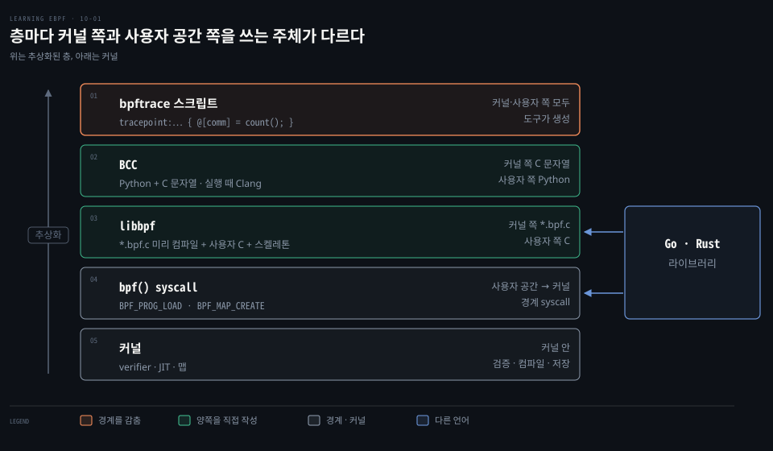
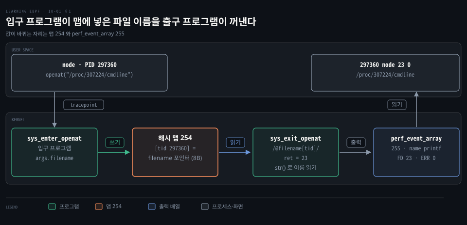
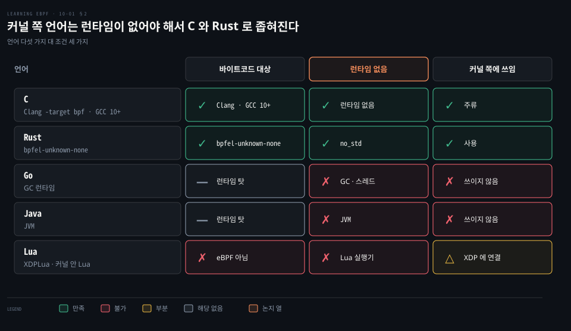
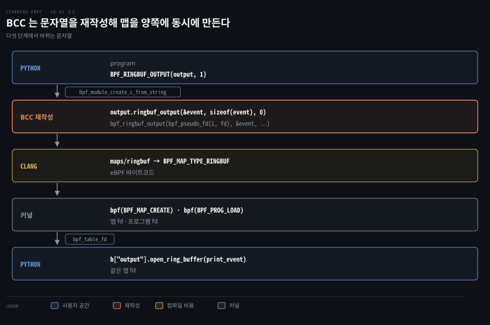
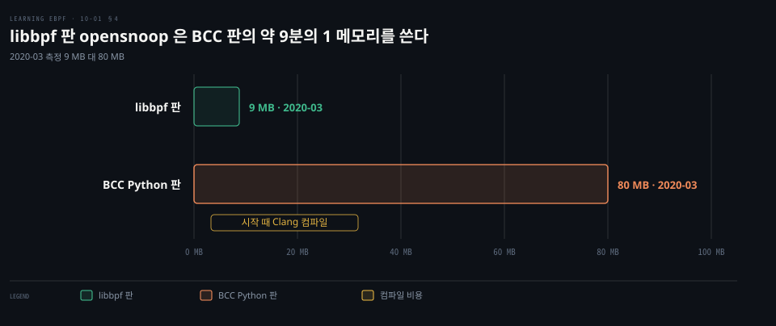

# bpftrace 는 커널과 사용자 공간 경계를 숨기고 BCC 와 libbpf 는 C 로 양쪽을 짜게 한다

---

> bpftrace 는 스크립트 한 줄을 eBPF 프로그램과 맵으로 바꿔 커널 쪽과 사용자 공간 쪽의 경계를 숨기고, BCC 와 libbpf 는 두 쪽을 C 로 직접 짜게 합니다.


## 핵심 요약

> 이 편의 중심 생각은 eBPF 프로그래밍 도구가 층마다 커널 쪽과 사용자 공간 쪽의 경계를 도구에 맡기는 정도가 다르다는 것입니다.

eBPF 앱은 커널 안에서 도는 프로그램과 그것을 싣고 결과를 읽는 사용자 공간 프로그램 둘로 이뤄집니다. bpftrace 는 스크립트 한 줄에서 두 쪽을 모두 만들어 경계를 숨깁니다. BCC 는 Python 안에 C 문자열을 넣어 한 파일에 쓰되 실행마다 Clang 으로 컴파일하고, libbpf 는 커널 쪽을 미리 컴파일해 배포 때 컴파일러가 필요 없습니다. 어느 쪽이든 `bpf()` 로 들어간 프로그램은 커널의 verifier 가 검증하고 [JIT](./03-02.JIT%20가%20바이트코드를%20기계어로%20바꾸고%20XDP%20에%20붙인%20프로그램은%20전역%20변수를%20맵에%20둔다.md) 가 기계어로 바꿉니다.

커널 쪽 언어는 verifier 와 맞아야 해서 런타임 없는 C 와 Rust 로 좁혀집니다. 사용자 공간 쪽을 C 로 쓰면 verifier 같은 보호가 없어, Go·Rust 라이브러리가 libbpf 위나 `bpf()` 호출 위에 붙습니다.




## 학습 목표

> 이 편을 읽고 나면 다음을 설명할 수 있습니다.

1. bpftrace 스크립트가 어떤 프로그램과 맵으로 바뀌는지 `bpftool` 출력으로 짚을 수 있습니다.
2. 입구·출구 프로그램이 맵으로 값을 넘겨야 하는 이유를 설명할 수 있습니다.
3. 커널 쪽 언어가 C 와 Rust 로 좁혀지는 이유를 말할 수 있습니다.
4. BCC 가 C 문자열을 재작성해 맵을 양쪽에 만드는 단계를 따라갈 수 있습니다.
5. libbpf 판이 BCC 판보다 배포에 유리한 이유를 설명할 수 있습니다.


## 1. bpftrace 는 스크립트 한 줄을 프로그램과 맵으로 바꿔 경계를 숨긴다

> bpftrace 사용자는 프로그램을 싣는 일도 맵을 읽는 일도 직접 하지 않지만, 경계는 도구 안에 있고 `bpftool` 로 보면 드러납니다.

어디에 붙일 수 있는지는 `bpftrace -l` 이 이름 패턴으로 나열합니다.

```bash
# execve 가 들어간 부착 지점을 나열한다
bpftrace -l "*execve*"
# tracepoint:syscalls:sys_enter_execve
# tracepoint:syscalls:sys_exit_execve
# ...
```

kprobe 는 커널 함수 이름에 거는 방식이라 함수가 사라지면 붙일 곳이 없어집니다. `do_execve` 가 그렇습니다. v7.2 의 [`fs/exec.c`](https://github.com/torvalds/linux/blob/v7.2/fs/exec.c#L1808)에는 `do_execve` 가 없고 `do_execveat_common` 만 static 함수로 남아 있습니다. 그래서 한 줄 스크립트는 목록에 있는 tracepoint 에 겁니다.

```bash
# execve 가 불릴 때마다 실행 파일 이름(comm)별로 횟수를 센다
bpftrace -e 'tracepoint:syscalls:sys_enter_execve { @[comm] = count(); }'
```

중괄호 안이 이벤트마다 실행됩니다. `@[comm]` 은 `comm` 을 키로 하는 맵이고 `count()` 가 값을 올립니다. 문법은 [원라이너](../systems-performance/15-02.BPF%20—%20bpftrace%20도구·원라이너.md) §1 과 [프로그램 구조·변수](../systems-performance/15-03.BPF%20—%20bpftrace%20프로그래밍·레퍼런스.md) §1~2 에서 다뤘으니 풀지 않습니다.

### 입구 프로그램은 인자를 맵에 적고 출구 프로그램이 꺼낸다

스크립트 하나가 프로그램을 여러 개 만들기도 합니다. 파일 여는 호출을 보여 주는 [`tools/opensnoop.bt`](https://github.com/bpftrace/bpftrace/blob/v0.27.0/tools/opensnoop.bt)의 핵심만 옮깁니다.

```c
// 입구 tracepoint 세 곳에 같은 동작을 건다 (bpftrace 는 부착 지점마다 프로그램을 따로 만든다)
tracepoint:syscalls:sys_enter_open,
tracepoint:syscalls:sys_enter_openat,
tracepoint:syscalls:sys_enter_openat2
{
  // 인자인 파일 이름 포인터를 스레드 ID 키로 맵에 적는다
  @filename[tid] = args.filename;
}

...

// 출구 tracepoint 세 곳, 입구가 적어 둔 항목이 있을 때만 실행한다
tracepoint:syscalls:sys_exit_open,
tracepoint:syscalls:sys_exit_openat,
tracepoint:syscalls:sys_exit_openat2
/@filename[tid]/
{
  sys_exit(args.ret, @filename, @paths);
}
```

프로그램이 둘로 나뉘는 이유는 값이 놓이는 시점이 다르기 때문입니다. 파일 이름은 syscall 이 들어올 때만 인자로 보이고 성공 여부는 끝나야 생깁니다. 그래서 입구 프로그램이 맵에 적고 출구 프로그램이 같은 키로 꺼냅니다. 한 스레드는 syscall 을 하나씩만 진행하므로 스레드 ID 가 키이고, `/@filename[tid]/` 필터는 입구를 거치지 않은 출구 이벤트를 걸러 냅니다.

예제를 돌린 출력은 다음과 같습니다(`open`·`openat` 에만 걸던 판의 결과). 출구 프로그램은 반환값 `args.ret` 가 0 이상이면 그 값을 `FD` 열에, `ERR` 열에는 0 을 적습니다([`opensnoop.bt`](https://github.com/bpftrace/bpftrace/blob/v0.27.0/tools/opensnoop.bt#L122-L126)).

```bash
./opensnoop.bt
...
PID    COMM               FD ERR PATH
...
297360 node               23   0 /proc/307224/cmdline
...
```



맵에는 이름 문자열이 아니라 인자 포인터가 들어갑니다. 출구에서 `str()` 이 그 주소를 따라 이름을 읽으므로 그 사이 사용자 메모리가 바뀌면 다른 이름이 보일 수 있습니다. 이 TOCTOU 한계는 [입구 검사의 한계](./09-01.시스템%20콜%20입구%20검사는%20TOCTOU%20에%20뚫려%20보안%20도구는%20LSM%20훅과%20커널%20함수에서%20판정하고%20SIGKILL%20로%20막는다.md) §3 에서 다룹니다.

### bpftool 로 보면 프로그램 넷과 맵 둘이 보인다

현재 스크립트는 여섯 곳에 걸고 `BEGIN`·`END` 를 더해 프로브가 여덟 개입니다. 아래 출력은 `open` 과 `openat` 에만 걸던 판의 결과라 tracepoint 프로그램이 넷, `BEGIN`·`END` 를 더해 프로브가 여섯이었습니다.

```bash
bpftool prog list
# ...
# 494: tracepoint name sys_enter_open tag 6f08c3c150c4ce6e ... map_ids 254
# 495: tracepoint name sys_enter_opena tag 26c093d1d907ce74 ... map_ids 254
# 496: tracepoint name sys_exit_open tag 0484b911472301f7 ... map_ids 254,255
# 497: tracepoint name sys_exit_openat tag 0484b911472301f7 ... map_ids 254,255
# ...
# map 목록은 bpftool map list 로 본다
# 254: hash flags 0x0
#         key 8B value 8B max_entries 4096 ...
# 255: perf_event_array name printf flags 0x0
```

프로그램 495 의 이름이 `sys_enter_opena` 로 잘린 것은 객체 이름이 NUL 을 포함해 16바이트여서([`BPF_OBJ_NAME_LEN`](https://github.com/torvalds/linux/blob/v7.2/include/uapi/linux/bpf.h#L1520)) 16글자인 `sys_enter_openat` 의 마지막 글자가 빠지기 때문입니다. 입구는 맵 254 만, 출구는 254 와 255 를 씁니다. 8바이트씩인 해시 맵 254 가 스레드 ID 와 포인터를 담고, `perf_event_array` 255 가 출력을 사용자 공간으로 보냅니다. 출구 두 프로그램의 tag 가 같은 것은 명령 배열이 같기 때문입니다([ID 와 태그](./03-01.C%20소스는%20clang%20으로%20eBPF%20바이트코드가%20되고%20bpftool%20이%20적재해%20ID%20와%20태그를%20붙인다.md)).

### bpftrace 는 BCC 위에 있지 않다

bpftrace 는 스크립트를 BCC 프로그램으로 바꾸지 않습니다. 스크립트를 파싱해 LLVM IR 을 직접 만들고 실행 때 LLVM 으로 컴파일하며, 커널과의 접점은 libbpf 입니다([README](https://github.com/bpftrace/bpftrace/blob/v0.27.0/README.md#L13)).

BCC 에서 libbpf 로 옮긴 변경은 v0.16.0(2022-08-30)의 [Move from BCC to libbpf](https://github.com/bpftrace/bpftrace/blob/v0.27.0/CHANGELOG.md#L1001)이고 PR 은 [#2265](https://github.com/bpftrace/bpftrace/pull/2265)입니다. 다만 현재 릴리스 v0.27.0 의 [`CMakeLists.txt`](https://github.com/bpftrace/bpftrace/blob/v0.27.0/CMakeLists.txt#L90)는 `find_package(LibBcc REQUIRED)` 라서 libbcc 는 필수 빌드 의존성으로 남아 있습니다. [`src/CMakeLists.txt`](https://github.com/bpftrace/bpftrace/blob/v0.27.0/src/CMakeLists.txt#L67)에는 bcc 를 더는 쓰지 않게 되면 지울 수 있다는 TODO 가 달려 있습니다.


## 2. 커널 쪽 언어는 런타임 없는 C 와 Rust 로 좁혀진다

> 바이트코드를 직접 쓸 수도 있지만 현실에서는 바이트코드를 목표로 하는 컴파일러가 있고 런타임이 필요 없는 언어가 쓰입니다.

바이트코드를 손으로 쓴 [사례](https://blog.cloudflare.com/epbf_sockets_hop_distance)도 있지만 대부분은 C 나 Rust 에서 컴파일해 얻습니다.

C 는 Clang 의 `-target bpf` 가 기본입니다. GCC 도 10 부터 BPF 백엔드를 갖습니다. [10.1.0 매뉴얼](https://gcc.gnu.org/onlinedocs/gcc-10.1.0/gcc/eBPF-Options.html)에는 eBPF Options 절이 있고 9.5.0 매뉴얼에는 없습니다. 현행 GCC 매뉴얼에도 [eBPF Options](https://gcc.gnu.org/onlinedocs/gcc/eBPF-Options.html) 절이 있습니다. Rust 는 `bpfel-unknown-none`·`bpfeb-unknown-none` 타깃이 있고 [지원 등급](https://doc.rust-lang.org/rustc/platform-support.html)은 Tier 3 이며 `std` 와 `alloc` 이 없는 `no_std` 환경이 전제입니다([타깃 문서](https://doc.rust-lang.org/nightly/rustc/platform-support/bpf-unknown-none.html)).



Go 나 JVM 언어는 런타임 때문에 맞지 않습니다. 가비지 컬렉터, 곧 GC 의 메모리 관리는 verifier 가 싣기 전에 메모리 접근을 정적으로 증명하는 방식과 어울리지 않고, eBPF 프로그램은 단일 스레드로 돌아야 해서 언어의 동시성 기능도 쓸 수 없습니다. 반복문 허용 범위는 verifier 의 별도 주제로, 유한 반복문 검증은 5.3 에 들어왔고([bounded loops 커밋](https://github.com/torvalds/linux/commit/2589726d12a1b12eaaa93c7f1ea64287e383c7a5), v5.3 에 포함) 헬퍼 `bpf_loop` 는 [v5.17 의 `bpf.h`](https://github.com/torvalds/linux/blob/v5.17/include/uapi/linux/bpf.h#L4963)에 처음 보입니다(v5.16 에는 없음).

XDPLua 는 XDP 프로그램을 eBPF 로 컴파일하지 않고 XDP 에 연결되는 Lua 실행기가 커널 안에서 Lua 스크립트를 돌리는 방식이라 eBPF 가 아닙니다([논문](https://netdevconf.info/0x14/pub/papers/22/0x14-paper22-talk-paper.pdf)).

두 쪽의 언어는 섞어도 됩니다. 커널 쪽을 Rust 로 쓰면 사용자 공간도 Rust 로 쓰는 편이 자연스럽습니다. 공유 구조체 정의를 다시 쓰지 않아도 되기 때문입니다. 어느 쪽이든 [`bpf()` 시스템 콜](./04-01.bpf%28%29%20시스템%20콜은%20BTF·맵·프로그램을%20적재하고%20참조%20카운트와%20고정·링크가%20수명을%20정한다.md)을 감싸 주는 라이브러리를 씁니다.


## 3. BCC 는 C 비슷한 문자열을 전처리해 커널 쪽과 사용자 공간 쪽을 한꺼번에 만든다

> BCC 는 커널 쪽 프로그램을 문자열로 받아 Clang 에 넘기기 전에 재작성합니다. 그래서 맵을 선언하는 한 줄이 커널 쪽 맵과 Python 쪽 객체를 동시에 만듭니다.

예제 저장소의 [`chapter2/hello-file-ring-buffer.py`](https://github.com/lizrice/learning-ebpf/blob/91ded4a/chapter2/hello-file-ring-buffer.py)는 `openat` tracepoint 에 프로그램을 걸고 링 버퍼로 사용자 공간에 보냅니다. 핵심 줄만 옮깁니다.

```python
from bcc import BPF

program = r"""
// 링 버퍼 맵 output 을 선언한다 (5행)
BPF_RINGBUF_OUTPUT(output, 1);
...
TRACEPOINT_PROBE(syscalls, sys_enter_openat)
{
  ...
  // 이벤트를 링 버퍼에 쓴다 (23행)
  output.ringbuf_output(&event, sizeof(event), 0);

  return 0;
}
"""

# 문자열을 재작성하고 컴파일해 커널에 싣는다 (29행)
b = BPF(text=program)
...
# Python 쪽에서 같은 이름으로 링 버퍼를 연다 (35행)
b["output"].open_ring_buffer(print_event)
while True:
    b.ring_buffer_poll()
```

`b["output"]` 은 문자열 안의 선언 말고는 정의된 곳이 없습니다. BCC 가 전처리에서 두 쪽의 정의를 한 번에 만듭니다.

### 메서드 호출처럼 보이는 줄은 함수 포인터 멤버다

`output.ringbuf_output(...)` 은 메서드 문법처럼 보이지만 합법적인 C 입니다. [`BPF_RINGBUF_OUTPUT`](https://github.com/iovisor/bcc/blob/v0.37.0/src/cc/export/helpers.h#L232) 매크로가 `output` 구조체를 선언하면서 `ringbuf_output` 을 함수 포인터 멤버(`int (*ringbuf_output)(void *, u64, u64)`)로 넣어서 Clang 이 구문을 그대로 파싱합니다. 같은 매크로가 `max_entries` 를 `페이지 수 × PAGE_SIZE` 로 채우고 맵을 `maps/ringbuf` 섹션에 둡니다. 둘째 인자 `1` 이 그 페이지 수입니다([레퍼런스](https://github.com/iovisor/bcc/blob/v0.37.0/docs/reference_guide.md#L748)).

이어서 BCC 의 Clang 프런트엔드가 이 호출을 [`bpf_ringbuf_output((void *)bpf_pseudo_fd(1, fd), &event, ...)`](https://github.com/iovisor/bcc/blob/v0.37.0/src/cc/frontends/clang/b_frontend_action.cc#L1063) 꼴의 헬퍼 호출로 다시 씁니다. 맵은 섹션 이름을 보고 [`BPF_MAP_TYPE_RINGBUF`](https://github.com/iovisor/bcc/blob/v0.37.0/src/cc/frontends/clang/b_frontend_action.cc#L1584)로 만듭니다.



### BPF(text=program) 한 줄이 재작성·컴파일·적재를 한다

`BPF(text=program)` 은 `bpf_module_create_c_from_string` 으로 C++ 모듈에 문자열을 넘깁니다([`__init__.py`](https://github.com/iovisor/bcc/blob/v0.37.0/src/python/bcc/__init__.py#L502)).

모듈은 `load_string` 에서 `load_cfile` 을 거쳐 `ClangLoader` 로 파싱하고 위의 재작성을 해 바이트코드를 얻습니다([`bpf_module.cc`](https://github.com/iovisor/bcc/blob/v0.37.0/src/cc/bpf_module.cc#L211)).

맵은 모듈이 [`create_maps`](https://github.com/iovisor/bcc/blob/v0.37.0/src/cc/bpf_module.cc#L509)에서 `BPF_MAP_CREATE` 로 먼저 만들고, 프로그램은 Python 쪽이 [`bcc_func_load`](https://github.com/iovisor/bcc/blob/v0.37.0/src/cc/bpf_module.cc#L985)로 `BPF_PROG_LOAD` 해 싣습니다.

`b["output"]` 은 `get_table` 이 같은 모듈에서 `bpf_table_fd` 로 받은 맵 fd 로 만든 객체입니다. 두 쪽이 같은 맵을 가리키는 이유입니다.

도구를 시작할 때마다 컴파일러와 커널 헤더가 필요한 점이 배포용으로는 부담입니다. Gregg 는 그 의존성이 [100 MB 이상의 저장 공간](https://www.brendangregg.com/blog/2020-11-04/bpf-co-re-btf-libbpf.html)을 차지할 수 있다고 적었습니다.

Python 말고 Lua 와 C++ 도 쓸 수 있고 [`examples/lua`](https://github.com/iovisor/bcc/tree/v0.37.0/examples/lua)와 [`examples/cpp`](https://github.com/iovisor/bcc/tree/v0.37.0/examples/cpp)에 예제가 있습니다. 흐름은 [BCC Hello World](./02-01.BCC%20Hello%20World%20는%20execve%20에%20kprobe%20를%20걸고%20결과를%20trace_pipe%20와%20해시%20맵으로%20꺼낸다.md) §1, 링 버퍼는 [링 버퍼](./02-02.링%20버퍼는%20이벤트를%20밀어%20주고%20tail%20call%20은%20프로그램을%20갈아%20끼운다.md) §1, 성능 도구는 [BCC 도구](../systems-performance/15-01.BPF%20—%20개요·BCC%20vs%20bpftrace·BCC.md) §2~4 를 참고합니다.


## 4. libbpf 와 CO-RE 는 컴파일러 없이 배포하게 하고, 다른 언어는 그 위에 올라간다

> 커널 쪽을 미리 컴파일해 두면 대상 기계에 컴파일러가 필요 없습니다. BCC 프로젝트도 도구를 libbpf 로 다시 썼고, 다른 언어 라이브러리가 그 위에 올라갑니다.

Clang 이 `*.bpf.c` 를 바이트코드 오브젝트로 만들고 사용자 공간 C 프로그램이 libbpf 로 싣는 방식입니다. 이식을 가능하게 하는 CO-RE·BTF·스켈레톤은 별도 주제이고, 여기서는 컴파일러가 배포 대상에서 빠진다는 결과만 받습니다. Gregg 가 libbpf 로 옮긴 `opensnoop` 은 libLLVM 과 libclang 을 쓰지 않는 ELF 바이너리이고 stripped 하면 151 KB 였습니다([글](https://www.brendangregg.com/blog/2020-11-04/bpf-co-re-btf-libbpf.html)).

BCC 저장소도 도구를 이 방식으로 다시 썼습니다. [`libbpf-tools/`](https://github.com/iovisor/bcc/tree/v0.37.0/libbpf-tools)에 `opensnoop.bpf.c` 가 있고 Python 판은 `tools/opensnoop.py` 입니다. libbpf 판은 메모리와 시작 지연에서 낫습니다. 같은 `opensnoop` 을 libbpf(CO-RE) 판은 9 MB, Python 판은 80 MB 썼다고 Gregg 가 [CO-RE `opensnoop` 을 올린 PR](https://github.com/iovisor/bcc/pull/2778#issuecomment-594202408)(2020-03-03)에 적었습니다. 시작 지연은 BCC 판의 시작 때 Clang 컴파일에서 옵니다.



C 로 새 도구를 쓰려면 데모 애플리케이션 모음인 [libbpf-bootstrap](https://github.com/libbpf/libbpf-bootstrap)이 출발점이고 동기는 [Andrii Nakryiko 의 글](https://nakryiko.com/posts/libbpf-bootstrap/)에 있습니다. 최신 libbpf 는 [v1.8.0](https://github.com/libbpf/libbpf/releases/tag/v1.8.0)입니다.

[libxdp](https://github.com/xdp-project/xdp-tools/tree/v1.6.3/lib/libxdp)는 libbpf 위에서 XDP 프로그램을 붙이는 일을 쉽게 하고, 한 인터페이스에 XDP 프로그램을 차례로 여럿 싣는 기능과 AF_XDP 소켓 헬퍼를 더합니다. [xdp-tools](https://github.com/xdp-project/xdp-tools)(최신 v1.6.3)의 일부이고 같은 저장소 계열의 [XDP Tutorial](https://github.com/xdp-project/xdp-tutorial)이 익히는 자료입니다.

사용자 공간까지 C 로 쓰면 메모리와 버퍼 처리를 직접 맡습니다. 커널 쪽에는 verifier 가 있지만 사용자 공간 코드를 지켜 주는 장치는 없어 포인터 오용이 취약점이나 크래시로 이어집니다. 그래서 libbpf 를 감싸거나 재배치 기능을 자체 구현한 Go·Rust 라이브러리가 쓰이며, 내용은 [Go·Rust 라이브러리](./10-02.Go·Rust%20라이브러리는%20libbpf%20를%20감싸거나%20bpf%28%29%20를%20직접%20불러%20바이트코드를%20싣는다.md) 편에 있습니다.


## 면접 대비

> 층 구분과 맵 흐름을 설명할 수 있는지 확인합니다.

1. bpftrace 가 감춘 커널과 사용자 공간의 경계를 `bpftool` 로 어떻게 확인합니까?
2. `opensnoop.bt` 가 입구 프로그램과 출구 프로그램을 따로 두고 맵으로 잇는 이유는 무엇입니까?
3. `bpftool prog list` 에 `sys_enter_opena` 처럼 이름이 잘리는 이유는 무엇입니까?
4. `output.ringbuf_output(...)` 이 컴파일되고 Python 의 `b["output"]` 으로도 접근되는 원리는 무엇입니까?
5. 같은 도구를 BCC Python 판에서 libbpf 판으로 옮기면 배포 측면에서 무엇이 달라집니까?


## 정답 (자답 후 펼치기)

### 정답 1 — bpftool 로 프로그램과 맵을 본다

스크립트가 도는 동안 `bpftool prog list` 와 `bpftool map list` 를 보면 tracepoint 프로그램, 해시 맵, 출력용 `perf_event_array` 가 그대로 나옵니다.

### 정답 2 — 인자와 반환값은 놓이는 시점이 다르다

파일 이름은 입구에서만, 성공 여부는 출구에서만 알 수 있어서 입구 프로그램이 스레드 ID 키로 맵에 적고 출구 프로그램이 같은 키로 꺼냅니다.

### 정답 3 — 객체 이름은 15글자까지다

객체 이름이 NUL 을 포함해 16바이트(`BPF_OBJ_NAME_LEN`)라서 16글자인 `sys_enter_openat` 의 마지막 글자가 잘립니다.

### 정답 4 — 함수 포인터 멤버를 재작성하고 맵 fd 를 공유한다

`BPF_RINGBUF_OUTPUT` 이 `ringbuf_output` 함수 포인터 멤버를 가진 구조체를 선언해 C 로 파싱되고, BCC 가 이를 `bpf_ringbuf_output()` 헬퍼 호출로 바꿉니다. `b["output"]` 은 같은 모듈의 맵 fd 로 만든 객체입니다.

### 정답 5 — 컴파일러 없이 미리 컴파일된 바이너리를 배포한다

libbpf 판은 `*.bpf.c` 를 미리 컴파일해 두어 대상 기계에 Clang 과 커널 헤더가 필요 없고 시작 때 컴파일 지연도 없습니다. BCC 판은 실행마다 Clang 으로 컴파일합니다.


## 참고 자료

- 《Learning eBPF》(Liz Rice, O'Reilly, 2023, ISBN 978-1-098-13512-6) Ch.10 eBPF Programming
- [bpftrace v0.27.0](https://github.com/bpftrace/bpftrace/blob/v0.27.0/tools/opensnoop.bt) · [BCC v0.37.0](https://github.com/iovisor/bcc/blob/v0.37.0/src/cc/frontends/clang/b_frontend_action.cc) · [Linux v7.2](https://github.com/torvalds/linux/blob/v7.2/include/uapi/linux/bpf.h) · [예제 저장소](https://github.com/lizrice/learning-ebpf/blob/91ded4a/chapter2/hello-file-ring-buffer.py)
- [Brendan Gregg, BPF binaries: BTF, CO-RE, and the future of BPF perf tools](https://www.brendangregg.com/blog/2020-11-04/bpf-co-re-btf-libbpf.html)
- [GCC 10.1.0 eBPF Options](https://gcc.gnu.org/onlinedocs/gcc-10.1.0/gcc/eBPF-Options.html) · [rustc `bpf*-unknown-none`](https://doc.rust-lang.org/nightly/rustc/platform-support/bpf-unknown-none.html)


## 관련 문서

- [BCC Hello World](./02-01.BCC%20Hello%20World%20는%20execve%20에%20kprobe%20를%20걸고%20결과를%20trace_pipe%20와%20해시%20맵으로%20꺼낸다.md) · [링 버퍼와 tail call](./02-02.링%20버퍼는%20이벤트를%20밀어%20주고%20tail%20call%20은%20프로그램을%20갈아%20끼운다.md)
- [`bpf()` 시스템 콜](./04-01.bpf%28%29%20시스템%20콜은%20BTF·맵·프로그램을%20적재하고%20참조%20카운트와%20고정·링크가%20수명을%20정한다.md) · [시스템 콜 입구 검사의 한계](./09-01.시스템%20콜%20입구%20검사는%20TOCTOU%20에%20뚫려%20보안%20도구는%20LSM%20훅과%20커널%20함수에서%20판정하고%20SIGKILL%20로%20막는다.md)
- [Go·Rust 라이브러리](./10-02.Go·Rust%20라이브러리는%20libbpf%20를%20감싸거나%20bpf%28%29%20를%20직접%20불러%20바이트코드를%20싣는다.md)
- [bpftrace 프로그래밍·레퍼런스](../systems-performance/15-03.BPF%20—%20bpftrace%20프로그래밍·레퍼런스.md) · [커널을 늘리는 두 길](../learning-modern-linux/02-01.커널은%20전부를%20하지만%20운영체제는%20아니다.md)
