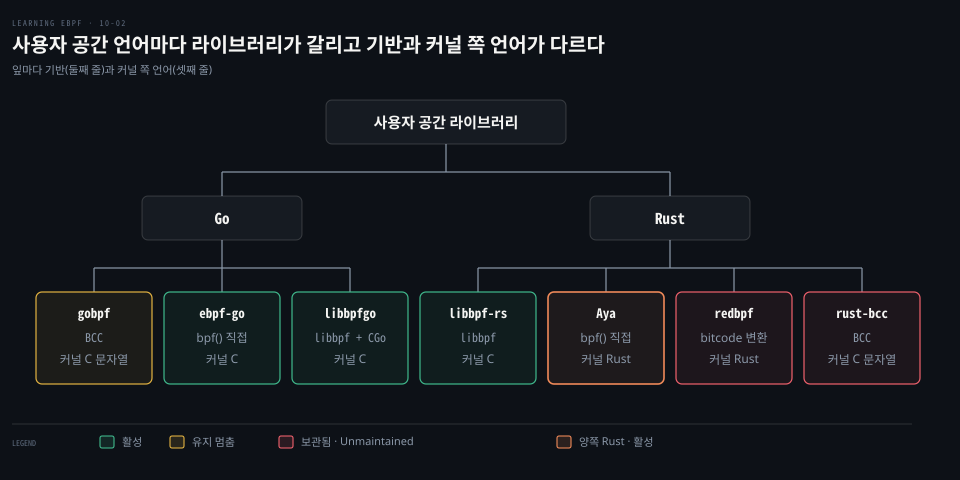
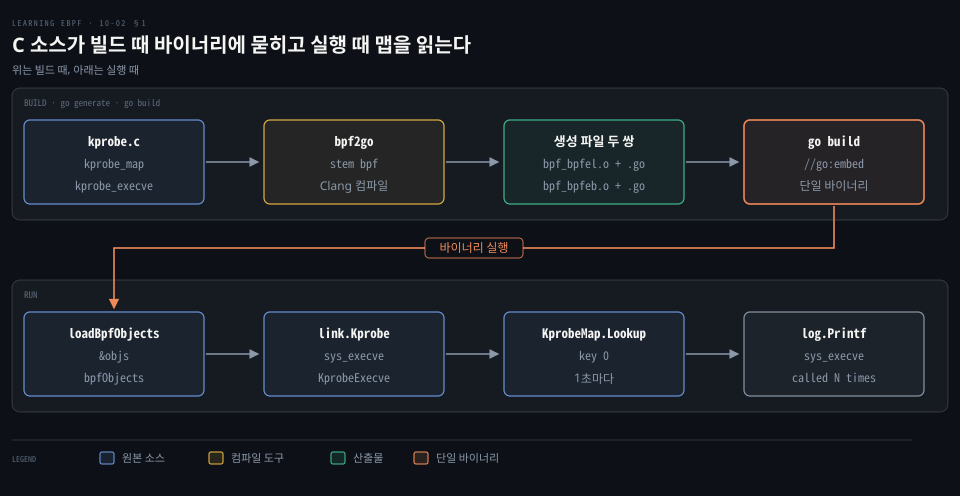
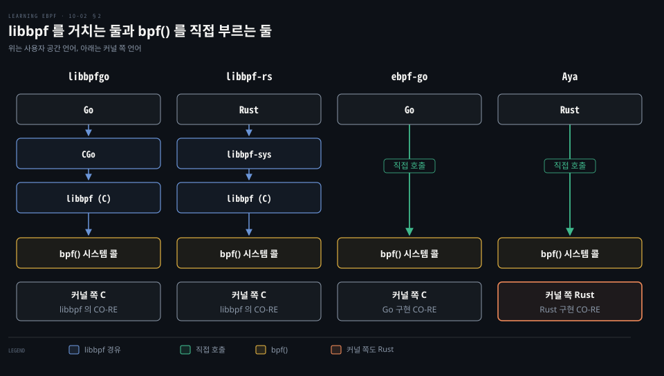
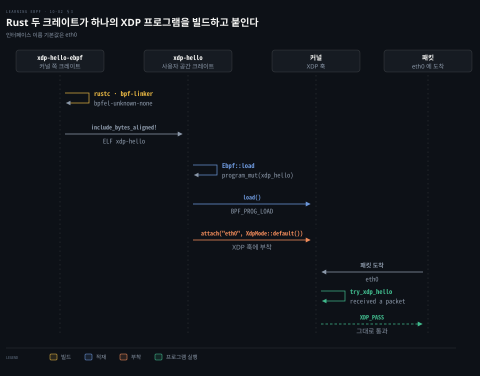
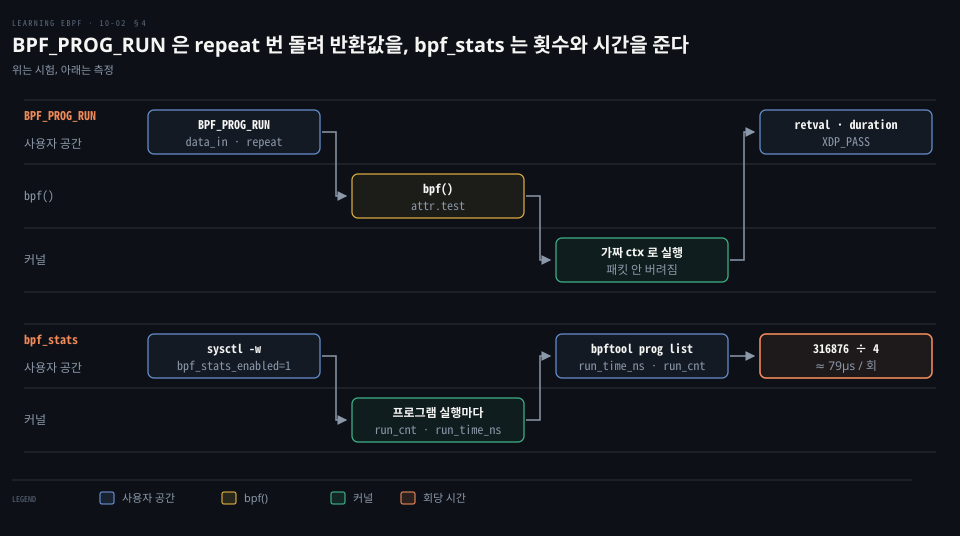

# Go·Rust 라이브러리는 libbpf 를 감싸거나 bpf() 를 직접 불러 바이트코드를 싣는다

---

> Go·Rust 라이브러리는 libbpf 를 감싸거나 `bpf()` 를 직접 불러 프로그램을 싣고, 적재한 프로그램은 `BPF_PROG_RUN` 으로 시험하고 `bpf_stats` 로 잽니다.


## 핵심 요약

> 이 편의 중심 생각은 사용자 공간 라이브러리가 libbpf 를 감싸는지 `bpf()` 를 직접 부르는지에 따라 배포물과 빌드 도구가 갈린다는 것입니다.

Go 에는 BCC 바인딩 gobpf, 순수 Go 구현 ebpf-go, libbpf 를 감싼 libbpfgo 가 있고 Rust 에는 libbpf-rs 와 Aya 가 있습니다. libbpfgo 와 libbpf-rs 는 libbpf 의 CO-RE 를 그대로 얻는 대신 C 라이브러리와 링크됩니다. ebpf-go 와 Aya 는 `bpf()` 호출과 BTF 재배치를 직접 구현해 libbpf 없이 돕니다.

지금 유지되는 라이브러리 가운데 커널 쪽까지 Rust 로 짜는 것은 Aya 하나입니다. 보관된 redbpf 도 커널 쪽이 Rust 였고, 나머지는 C 입니다. 적재한 프로그램은 `BPF_PROG_RUN` 으로 시험하고 `bpf_stats` 로 잽니다.




## 학습 목표

> 이 편을 읽고 나면 다음을 설명할 수 있습니다.

1. `bpf2go` 가 만드는 파일과 이름이 옮겨지는 규칙을 따라갈 수 있습니다.
2. libbpfgo·libbpf-rs 와 ebpf-go·Aya 를 `bpf()` 를 부르는 주체와 커널 쪽 언어로 구분할 수 있습니다.
3. Aya 가 LLVM 에 기대지 않는다는 말이 사용자 공간에만 맞는 이유를 말할 수 있습니다.
4. `BPF_PROG_RUN` 이 프로그램을 돌리는 방식과 시험 모드에서 패킷이 버려지지 않는 이유를 설명할 수 있습니다.
5. `run_time_ns` 와 `run_cnt` 에서 회당 시간을 계산하고 통계를 꺼 두는 이유를 설명할 수 있습니다.


## 1. ebpf-go 는 bpf2go 로 바이트코드와 Go 스켈레톤을 한 바이너리에 묻는다

> 배포물에 오브젝트 파일과 컴파일러가 따라가야 한다면 번거롭습니다. ebpf-go 는 컴파일을 빌드 때 끝내고 결과를 Go 바이너리에 담습니다.

### gobpf 는 유지가 멈췄고 주력인 bcc 패키지는 BCC 를 감싼다

gobpf 의 `bcc` 패키지는 BCC 바인딩이라 [libbcc 를 설치](https://github.com/iovisor/gobpf/blob/16120a1/README.md#L21-L22)해야 하고 BCC 처럼 실행 때 컴파일합니다. 마지막 커밋은 [2022-10-05](https://github.com/iovisor/gobpf/commit/16120a1) 이어서 유지가 멈춘 상태입니다.

### 순수 Go 라는 말은 libbpf 와 CGo 없이 bpf() 를 직접 부른다는 뜻이다

ebpf-go 는 [`unix.Syscall(unix.SYS_BPF, ...)`](https://github.com/cilium/ebpf/blob/v0.22.0/internal/sys/syscall_other.go#L34)로 `bpf()` 를 직접 부릅니다. ELF 로더는 libbpf 와 [호환을 목표](https://github.com/cilium/ebpf/blob/v0.22.0/docs/ebpf/concepts/loader.md#L3-L5)로 하고 CO-RE 재배치도 libbpf 에서 [파생](https://github.com/cilium/ebpf/blob/v0.22.0/btf/core.go#L17-L18)한 Go 구현입니다. 다른 의존이 cgo 를 요구하지 않으면 [`CGO_ENABLED=0`](https://github.com/cilium/ebpf/blob/v0.22.0/docs/ebpf/guides/portable-ebpf.md#L29-L31)으로 libc 의존까지 뺄 수 있습니다.

### bpf2go 는 엔디언마다 오브젝트 파일과 Go 파일 한 쌍을 만든다

**bpf2go** 는 C 소스를 컴파일해 바이트코드를 얻고 그것을 담은 Go 파일을 내는 도구입니다. Clang 은 `go generate` 때만 필요합니다. `go:generate` 에 준 stem(`bpf`)으로 리틀 엔디언용 `bpf_bpfel.o`·`bpf_bpfel.go` 와 빅 엔디언용 `bpf_bpfeb.o`·`bpf_bpfeb.go` [두 쌍](https://github.com/cilium/ebpf/blob/v0.22.0/docs/ebpf/guides/portable-ebpf.md#L19-L35)이 나옵니다. 각 `.go` 는 `//go:embed` 로 짝이 되는 `.o` 를 담고 빌드 태그로 대상 쪽만 컴파일됩니다. 두 엔디언을 다 만들어 두므로 `GOARCH` 만 바꾸면 교차 컴파일이 됩니다. 결과는 커널 말고는 따라갈 파일이 없는 단일 바이너리입니다.



### C 객체 이름은 UpperCamelCase 필드로 옮겨진다

예제 [`kprobe.c`](https://github.com/cilium/ebpf/blob/v0.22.0/examples/kprobe/kprobe.c#L7-L27)는 맵 하나와 프로그램 하나를 둡니다.

```c
// 배열 맵의 한 칸에 u64 카운터를 둔다
struct {
	__uint(type, BPF_MAP_TYPE_ARRAY);
	...
	__uint(max_entries, 1);
} kprobe_map SEC(".maps");

// sys_execve 진입점에 붙는 kprobe 프로그램이다
SEC("kprobe/sys_execve")
int kprobe_execve() {
	...
}
```

생성된 [`bpf_bpfel.go`](https://github.com/cilium/ebpf/blob/v0.22.0/examples/kprobe/bpf_bpfel.go#L84-L127)에서는 snake_case 이름이 UpperCamelCase 필드가 되고 태그에 C 이름이 남습니다.

```go
// 맵 kprobe_map 이 필드 KprobeMap 이 된다
type bpfMaps struct {
	KprobeMap *ebpf.Map `ebpf:"kprobe_map"`
}

// 프로그램 kprobe_execve 가 필드 KprobeExecve 가 된다
type bpfPrograms struct {
	KprobeExecve *ebpf.Program `ebpf:"kprobe_execve"`
}

// 셋을 묶어 loadBpfObjects 의 인자로 쓴다. bpfVariables 는 전역 변수용이며 여기서는 비어 있다
type bpfObjects struct {
	bpfPrograms
	bpfMaps
	bpfVariables
}
```

### 사용자 공간 코드는 적재, 부착, 읽기 세 단계다

[`main.go`](https://github.com/cilium/ebpf/blob/v0.22.0/examples/kprobe/main.go#L17-L61)의 핵심만 옮기며 오류 처리는 줄였습니다.

```go
// 빌드 때 go generate 가 bpf2go 를 부른다
//go:generate go tool bpf2go -tags linux bpf kprobe.c -- -I../headers
// 맵의 0번 칸이 카운터다
const mapKey uint32 = 0
...
// 추적할 커널 함수 이름이다
fn := "sys_execve"
...
// 포함된 바이트코드와 맵을 커널에 싣는다
objs := bpfObjects{}
loadBpfObjects(&objs, nil)
...
// 그 함수의 진입점에 프로그램을 붙인다
kp, _ := link.Kprobe(fn, objs.KprobeExecve, nil)

// 1초마다 맵의 0번 칸을 읽는다
ticker := time.NewTicker(1 * time.Second)
for range ticker.C {
	var value uint64
	objs.KprobeMap.Lookup(mapKey, &value)
	log.Printf("%s called %d times\n", fn, value)
}
```

`link.Kprobe` 는 심볼에 붙다 실패하면 플랫폼 접두사(`__x64_` 등)를 붙여 [다시 시도](https://github.com/cilium/ebpf/blob/v0.22.0/link/kprobe.go#L63-L65)하므로 `sys_execve` 로 충분합니다.


## 2. libbpfgo 와 libbpf-rs 는 libbpf 를 감싸고, ebpf-go 와 Aya 는 bpf() 를 직접 부른다

> libbpf 를 감싸면 CO-RE 를 그대로 얻고 직접 구현하면 C 라이브러리 없이 돕니다. 갈림은 `bpf()` 를 부르는 주체에서 납니다.

libbpf 가 이미 있는데 다시 구현할 이유가 있을까요? 감싸는 쪽은 libbpf 의 기능을 거의 공짜로 얻고, 직접 구현하는 쪽은 배포와 빌드에서 C 를 걷어 냅니다.

### libbpfgo 는 libbpf 를 CGo 로 부르고 이벤트를 채널로 받는다

libbpfgo 는 libbpf 위의 얇은 Go 래퍼이며 CGo 로 libbpf 와 [링크](https://github.com/aquasecurity/libbpfgo/blob/96cbab3/Readme.md#L21-L28)됩니다. Tracee 가 이 라이브러리를 쓰며 [go.mod](https://github.com/aquasecurity/tracee/blob/2f9dc40/go.mod#L48)가 v0.11.0-libbpf-1.8-dev-2bbc483 을 고정합니다. README 의 [예제](https://github.com/aquasecurity/libbpfgo/blob/96cbab3/Readme.md#L88-L100)가 흐름을 보여 줍니다.

```go
// 오브젝트 파일을 읽어 커널에 싣는다
bpfModule := bpf.NewModuleFromFile(bpfObjectPath)
bpfModule.BPFLoadObject()

// 맵 항목을 고친다
mymap, _ := bpfModule.GetMap("mymap")
mymap.Update(key, value)

// 링 버퍼 이벤트를 Go 채널로 받는다
rb, _ := bpfModule.InitRingBuffer("events", eventsChannel, buffSize)
rb.Poll(300)
e := <-eventsChannel
```

이벤트가 채널로 오므로 Go 의 `select` 로 자연스럽게 다룹니다. 대가는 CGo 경계입니다. [cgo is not Go](https://dave.cheney.net/2016/01/18/cgo-is-not-go)는 빌드가 느려지고 교차 컴파일이 막히며 전환에 비용이 든다고 짚습니다.

### libbpf-rs 는 사용자 공간만 Rust 이고 커널 쪽은 C 이다

libbpf-rs 는 libbpf 를 감싼 [Rust 래퍼](https://github.com/libbpf/libbpf-rs/blob/v0.27.2/README.md#L3)입니다. 짝 도구 libbpf-cargo 가 `build.rs` 에서 C 소스를 컴파일해 스켈레톤을 만들며, libbpf-bootstrap 의 [Rust 예제](https://github.com/libbpf/libbpf-bootstrap/blob/6ca4009/examples/rust/profile/build.rs#L6-L25)가 `src/bpf/profile.bpf.c` 를 이렇게 빌드합니다.

libbpfgo 와 libbpf-rs 는 둘 다 libbpf 를 쓰므로 CO-RE 를 그대로 얻습니다. ebpf.io 도 [두 라이브러리의 CO-RE 지원](https://ebpf.io/infrastructure/#ebpf-libraries)을 적습니다. 어느 쪽이든 결국 `bpf()` 시스템 콜로 끝나므로 `strace -e bpf` 로 호출을 볼 수 있습니다. 달라지는 것은 그 호출을 C 코드가 하느냐 Go·Rust 코드가 하느냐입니다. 호출의 종류는 [시스템 콜 편](./04-01.bpf%28%29%20시스템%20콜은%20BTF·맵·프로그램을%20적재하고%20참조%20카운트와%20고정·링크가%20수명을%20정한다.md)에 있습니다.



리눅스 커널 안의 Rust 지원은 [v6.1](https://github.com/torvalds/linux/tree/v6.1/rust)에 처음 들어왔습니다(`rust/` 디렉터리가 v6.0 에는 없습니다). 이는 커널 코드를 Rust 로 쓰는 일이라 Aya 와 별개입니다([커널 Rust 문서](https://docs.kernel.org/rust/)).

| 라이브러리 | 기반 | 커널 쪽 | 현재 |
|---|---|---|---|
| gobpf | BCC(libbcc) | C 문자열 | 유지 멈춤, 마지막 커밋 2022-10-05 |
| ebpf-go | `bpf()` 직접 | C | [v0.22.0](https://github.com/cilium/ebpf/releases/tag/v0.22.0)(2026-06-29) |
| libbpfgo | libbpf + CGo | C | [v0.11.0-libbpf-1.8-dev-2bbc483](https://github.com/aquasecurity/libbpfgo/releases/tag/v0.11.0-libbpf-1.8-dev-2bbc483)(2026-07-29) |
| libbpf-rs | libbpf(libbpf-sys) | C | [v0.27.2](https://github.com/libbpf/libbpf-rs/releases/tag/v0.27.2)(2026-09-25) |
| Aya | `bpf()` 직접 | Rust | [aya v0.14.0](https://github.com/aya-rs/aya/releases/tag/aya-v0.14.0)(2026-06-24) |
| redbpf | LLVM bitcode 변환 | Rust | [보관됨](https://github.com/foniod/redbpf) |
| rust-bcc | BCC | C 문자열 | [Unmaintained](https://github.com/rust-bpf/rust-bcc/blob/52e29c6/README.md#L3-L6) |


## 3. Aya 는 커널 쪽과 사용자 공간 쪽을 모두 Rust 로 짠다

> Aya 는 rustc 의 BPF 타깃으로 커널 쪽을 바로 컴파일하고 사용자 공간 라이브러리는 libbpf 없이 돕니다.

커널 쪽을 Rust 로 쓰려면 컴파일러가 eBPF 바이트코드를 만들어야 합니다. redbpf 는 이를 어떻게 풀었고 Aya 는 무엇이 다를까요?

### redbpf 는 LLVM bitcode 를 직접 변환했고 지금은 보관돼 있다

redbpf 는 rustc 가 eBPF 바이트코드를 직접 내기 전에 나왔습니다. 그래서 rustc 가 낸 LLVM bitcode 를 cargo-bpf 가 자기 안에 묶은 LLVM 으로 읽어 BPF 바이트코드로 [변환합니다](https://github.com/foniod/redbpf/blob/5533198/README.md#L199-L219). 이 구조 때문에 rustc 의 LLVM 과 cargo-bpf 의 LLVM 버전이 맞아야 했습니다. 저장소는 보관(archived) 상태이고 마지막 push 는 2023-06-30 입니다.

### Aya 는 rustc 의 BPF 타깃으로 바로 컴파일한다

**Aya** 의 빌드 도우미는 `bpfel-unknown-none`(또는 `bpfeb-unknown-none`) 타깃과 `-Z build-std=core` 로 커널 쪽 크레이트를 [`cargo build`](https://github.com/aya-rs/aya/blob/aya-v0.14.0/aya-build/src/lib.rs#L139-L171) 합니다. `-Z build-std=core` 는 nightly 이거나 `RUSTC_BOOTSTRAP` 이 켜진 경우에만 붙습니다.

LLVM 을 쓰지 않는다는 말은 사용자 공간 라이브러리에만 맞습니다. Aya 는 [libbpf 도 BCC 도 쓰지 않고](https://github.com/aya-rs/aya/blob/aya-v0.14.0/README.md#L45-L50) libc 크레이트로 syscall 을 부릅니다. 반면 커널 쪽을 [빌드하려면](https://github.com/aya-rs/book/blob/a4dad9e/src/book/start/development.md#L14-L16) rustc 의 LLVM 백엔드와 `bpf-linker` 가 있어야 합니다. bpf-linker 는 LLVM 을 써서 링크하지만, 미리 빌드된 바이너리를 `cargo binstall bpf-linker` 로 받는 것이 [권장 경로](https://github.com/aya-rs/bpf-linker/blob/v0.11.1/README.md#L19-L27)이고 특정 LLVM 버전이 필요한 것은 [소스 빌드](https://github.com/aya-rs/bpf-linker/blob/v0.11.1/README.md#L78-L84)뿐입니다. BTF 재배치는 [`aya-obj`](https://github.com/aya-rs/aya/blob/aya-v0.14.0/aya-obj/src/btf/relocation.rs)가 Rust 로 구현해 CO-RE 를 얻습니다.

Aya 는 `task_struct` 같은 커널 구조체의 Rust 정의를 [제공하지 않아서](https://github.com/aya-rs/book/blob/a4dad9e/src/book/aya/aya-tool.md#L6-L25), aya-tool 이 `bpftool` 과 `bindgen` 으로 바인딩을 생성합니다.

LSM 훅으로 컨테이너를 지키는 lockc 는 libbpf-rs 에서 Aya 로 옮겨 [커널 쪽도 Aya 를 쓰며](https://github.com/lockc-project/lockc/blob/6a2926d/lockc-ebpf/Cargo.toml#L7-L8), 기본 브랜치의 마지막 커밋은 [2023-05-11](https://github.com/lockc-project/lockc/commit/6a2926d) 입니다.

### XDP 예제는 커널 쪽 함수 하나와 사용자 공간 적재 코드로 이뤄진다

Aya 가이드의 [`xdp-hello`](https://github.com/aya-rs/book/tree/a4dad9e/examples/xdp-hello)는 모든 패킷을 통과시킵니다. 커널 쪽은 다음과 같고 panic 핸들러는 줄였습니다.

```rust
#![no_std]
#![no_main]

use aya_ebpf::{bindings::xdp_action, macros::xdp, programs::XdpContext};
use aya_log_ebpf::info;

// 섹션 "xdp" 에 놓이는 프로그램이다. C 의 SEC("xdp") 에 해당한다
#[xdp]
pub fn xdp_hello(ctx: XdpContext) -> u32 {
    // 내부 함수가 오류를 내면 XDP_ABORTED 를 돌려준다
    match unsafe { try_xdp_hello(ctx) } {
        Ok(ret) => ret,
        Err(_) => xdp_action::XDP_ABORTED,
    }
}

unsafe fn try_xdp_hello(ctx: XdpContext) -> Result<u32, u32> {
    // 패킷이 왔다는 로그를 남긴다
    info!(&ctx, "received a packet");
    // 패킷을 그대로 통과시킨다
    Ok(xdp_action::XDP_PASS)
}
```

`#[xdp]` 는 함수를 [`link_section = "xdp"`](https://github.com/aya-rs/aya/blob/aya-ebpf-v0.2.1/aya-ebpf-macros/src/xdp.rs#L50-L62)로 내보내며 `frags` 인자를 주면 섹션 이름이 `xdp.frags` 가 됩니다. 사용자 공간 쪽은 컴파일된 ELF 를 바이트로 포함해 읽고 프로그램을 찾아 싣고([`BPF_PROG_LOAD`](https://github.com/aya-rs/aya/blob/aya-v0.14.0/aya/src/sys/bpf.rs#L1320-L1321)) 붙입니다.

```rust
// 컴파일된 커널 쪽 ELF 를 바이트로 포함해 읽어 들인다
let mut bpf = aya::Ebpf::load(aya::include_bytes_aligned!(concat!(
    env!("OUT_DIR"),
    "/xdp-hello"
)))?;
...
// ELF 안에서 함수 이름 xdp_hello 로 프로그램을 찾는다
let program: &mut Xdp = bpf.program_mut("xdp_hello").unwrap().try_into()?;
// 커널에 싣는다
program.load()?;
// 인터페이스에 붙인다
program.attach(&opt.iface, XdpMode::default())
    .context("failed to attach the XDP program with default mode - try changing XdpMode::default() to XdpMode::Skb")?;
```

파일 이름 `xdp-hello` 는 커널 쪽 크레이트 `xdp-hello-ebpf` 의 bin 이름이고 ELF 안의 프로그램 이름 `xdp_hello` 는 함수 이름입니다. 인터페이스 이름의 [기본값은 `eth0`](https://github.com/aya-rs/book/blob/a4dad9e/examples/xdp-hello/xdp-hello/src/main.rs#L10)입니다.




## 4. BPF_PROG_RUN 과 bpf_stats 로 시험하고 재며, 여러 프로그램은 맵과 스켈레톤으로 묶는다

> `BPF_PROG_RUN` 은 붙이지 않고 프로그램을 돌려 보고 `bpf_stats` 는 실행 횟수와 시간을 셉니다.

이벤트에 붙이지 않고 시험하려면, 붙인 뒤 얼마나 오래 도는지 재려면 무엇을 쓸까요?

### BPF_PROG_RUN 은 가짜 입력으로 프로그램을 돌려 반환값과 시간을 돌려준다

**BPF_PROG_RUN** 은 `prog_fd` 의 프로그램을 `repeat` 번 사용자가 준 컨텍스트와 데이터로 [실행](https://github.com/torvalds/linux/blob/v7.2/include/uapi/linux/bpf.h#L366-L392)하고 `retval` 과 `duration` 을 돌려줍니다. 입력은 `bpf_attr` 의 [`test` 구조체](https://github.com/torvalds/linux/blob/v7.2/include/uapi/linux/bpf.h#L1703-L1725)(`attr.test`)로 넘깁니다.

네트워크 유형만은 아닙니다. [커널 문서](https://docs.kernel.org/bpf/bpf_prog_run.html)의 목록에는 XDP·`SCHED_CLS` 와 함께 `RAW_TRACEPOINT`·`SYSCALL`·`TRACING`·`STRUCT_OPS`·`NETFILTER` 도 있습니다. 시험 모드는 사용자가 준 컨텍스트로 프로그램을 [단위 시험하는 용도](https://github.com/torvalds/linux/blob/v7.2/Documentation/bpf/bpf_prog_run.rst#L19-L21)라서 [패킷이 실제로 버려지거나 리다이렉트되지 않고](https://github.com/torvalds/linux/blob/v7.2/Documentation/bpf/bpf_prog_run.rst#L44-L51) 반환 코드만 돌아옵니다.

XDP 는 `BPF_F_TEST_XDP_LIVE_FRAMES` 로 패킷을 실제로 처리하는 [live frame 모드](https://github.com/torvalds/linux/blob/v7.2/Documentation/bpf/bpf_prog_run.rst#L53-L61)를 따로 켭니다. `SYSCALL` 처럼 부수 효과를 내려고 이 명령으로 돌리는 유형도 있습니다. `RAW_TRACEPOINT` 는 `data_in` 이 NULL 이고 `repeat` 가 0 이어야 합니다.

### bpf_stats 는 켠 동안 run_cnt 와 run_time_ns 를 쌓는다

통계는 기본으로 꺼져 있습니다. [sysctl 문서](https://docs.kernel.org/admin-guide/sysctl/kernel.html#bpf-stats-enabled)에 따르면 켜면 프로그램을 실행할 때마다 성능이 조금 떨어집니다. 그래서 `sysctl -w kernel.bpf_stats_enabled=1` 로 필요할 때만 켭니다. [`BPF_ENABLE_STATS`](https://github.com/torvalds/linux/blob/v7.2/include/uapi/linux/bpf.h#L830-L842) 명령은 모든 fd 를 닫아야 꺼지며 [v5.8 헤더](https://github.com/torvalds/linux/blob/v5.8/include/uapi/linux/bpf.h#L118)부터 있습니다. 켠 뒤 `bpftool prog list` 가 `run_time_ns` 와 `run_cnt` 를 보여 줍니다. 예제를 돌린 출력은 다음과 같습니다.

```bash
bpftool prog list
# ...
# 2179: raw_tracepoint         name raw_tp_exec       tag 7f6d182e48b7ed38   gpl
#            run_time_ns 316876 run_cnt 4
#            loaded_at 2023-01-09T11:07:31+0000 uid 0
#            xlated 216B jited 264B memlock 4096B map_ids 780,777
#            btf_id 953
#            pids hello(19173)
```

`run_time_ns` 316876 을 `run_cnt` 4 로 나누면 회당 약 79,000ns, 곧 79µs 입니다.



### 여러 프로그램은 맵으로 조율하고 스켈레톤이 한꺼번에 싣는다

앱 하나가 이벤트 하나에만 붙지는 않습니다. libbpf-tools 의 [`opensnoop`](https://github.com/iovisor/bcc/blob/v0.37.0/libbpf-tools/opensnoop.bpf.c#L24-L185)은 `open`·`openat`·`openat2` 의 입구와 출구에 붙는 tracepoint 프로그램 여섯과 해시 맵 `start` 를 씁니다. 입구에서는 인자가 보이고 출구에서야 성공 여부를 알기 때문입니다. 입구가 인자를 맵에 적고 출구가 읽은 뒤 지웁니다. bpftrace 판은 [앞 편](./10-01.bpftrace%20는%20커널과%20사용자%20공간%20경계를%20숨기고%20BCC%20와%20libbpf%20는%20C%20로%20양쪽을%20짜게%20한다.md#1-bpftrace-는-스크립트-한-줄을-프로그램과-맵으로-바꿔-경계를-숨긴다)에서 보았고 입구 인자를 믿을 수 없는 이유는 [입구 검사의 한계](./09-01.시스템%20콜%20입구%20검사는%20TOCTOU%20에%20뚫려%20보안%20도구는%20LSM%20훅과%20커널%20함수에서%20판정하고%20SIGKILL%20로%20막는다.md#3-시스템-콜-입구에서-본-인자는-커널이-읽을-때-바뀌어-있을-수-있다)에서 다룹니다.

사용자 공간 프로그램은 하나입니다. 스켈레톤의 `opensnoop_bpf__open_opts`·`__load`·`__attach` 를 [차례로 불러](https://github.com/iovisor/bcc/blob/v0.37.0/libbpf-tools/opensnoop.c#L327-L368) 프로그램 여섯을 한꺼번에 싣고 붙입니다. 커널에 없는 tracepoint 의 쌍은 적재에서 빼므로 실제로 싣는 수는 환경에 따라 줄어듭니다. bpf2go 가 만드는 `loadBpfObjects` 도 같은 역할을 하며 둘 다 하나씩 다루는 함수도 만듭니다.

개수가 고정되지 않는 앱도 있습니다. Cilium 은 Pod 의 veth 호스트 쪽 끝마다 [프로그램을 붙이므로](../../../08_cloud/book/cilium-up-and-running/05-01.Cilium%20데이터패스는%20같은%20노드는%20eBPF%20로%20바로%20넘기고%20다른%20노드는%20라우팅이나%20터널로%20잇는다.md) Pod 가 오가면 붙은 프로그램도 오갑니다.

빠른 추적은 bpftrace, Python 이면 BCC, 널리 배포하려면 CO-RE 라이브러리를 씁니다.


## 면접 대비

> 라이브러리의 구조 차이와 시험·측정 도구를 설명할 수 있는지 확인합니다.

1. `bpf2go` 가 엔디언별로 오브젝트 파일과 Go 파일을 한 쌍씩 만드는 이유와 배포 이점은 무엇입니까?
2. libbpfgo 와 ebpf-go 는 둘 다 CO-RE 를 지원하는데 `bpf()` 를 부르는 방식과 비용이 어떻게 다릅니까?
3. "Aya 는 LLVM 에 의존하지 않는다"는 말은 어디까지 맞습니까?
4. `BPF_PROG_RUN` 으로 XDP 프로그램을 시험하면 패킷이 실제로 버려집니까?
5. `run_time_ns` 316876, `run_cnt` 4 에서 무엇을 읽을 수 있고 통계를 꺼 두는 이유는 무엇입니까?


## 정답 (자답 후 펼치기)

### 정답 1 — 두 엔디언을 미리 만들어 교차 컴파일한다

대상마다 바이트 순서가 달라 `_bpfel` 과 `_bpfeb` 를 둘 다 만들고 각 `.go` 가 `.o` 를 `//go:embed` 로 담습니다. `GOARCH` 만 바꾸면 됩니다.

### 정답 2 — CGo 경계와 직접 syscall

libbpfgo 는 CGo 로 libbpf 를 불러 libbpf 가 `bpf()` 를 호출합니다. CO-RE 를 그대로 얻지만 C 링크와 교차 컴파일 부담, 경계 전환 비용이 따라옵니다. ebpf-go 는 Go 코드가 `unix.Syscall(SYS_BPF, ...)` 로 직접 부르고 CO-RE 도 Go 로 구현해 `CGO_ENABLED=0` 빌드가 가능합니다.

### 정답 3 — 사용자 공간 라이브러리에만 맞다

Aya 라이브러리는 libbpf 와 BCC 없이 libc 크레이트로 syscall 을 부릅니다. 커널 쪽을 빌드할 때는 rustc 의 LLVM 백엔드와 `bpf-linker` 가 필요합니다.

### 정답 4 — 버려지지 않고 반환 코드만 돌아온다

시험 모드는 단위 시험용이라 패킷이 실제로 버려지거나 리다이렉트되지 않습니다. `XDP_PASS` 같은 `retval` 과 `duration` 이 돌아옵니다. 실제로 처리하는 live frame 모드는 `BPF_F_TEST_XDP_LIVE_FRAMES` 로 따로 켭니다.

### 정답 5 — 회당 약 79µs 이고 통계는 비용이 든다

316876ns 를 4 로 나눈 약 79µs 가 회당 시간입니다. 통계를 켜면 실행마다 성능이 조금 떨어져 기본값이 꺼짐입니다.


## 참고 자료

- 《Learning eBPF》(Liz Rice, O'Reilly, 2023, ISBN 978-1-098-13512-6) Ch.10 eBPF Programming
- [Linux v7.2 bpf.h](https://github.com/torvalds/linux/blob/v7.2/include/uapi/linux/bpf.h) · [BPF_PROG_RUN](https://docs.kernel.org/bpf/bpf_prog_run.html) · [ebpf.io Infrastructure](https://ebpf.io/infrastructure/)


## 관련 문서

- [bpftrace 와 BCC, libbpf](./10-01.bpftrace%20는%20커널과%20사용자%20공간%20경계를%20숨기고%20BCC%20와%20libbpf%20는%20C%20로%20양쪽을%20짜게%20한다.md) · [`bpf()` 시스템 콜](./04-01.bpf%28%29%20시스템%20콜은%20BTF·맵·프로그램을%20적재하고%20참조%20카운트와%20고정·링크가%20수명을%20정한다.md)
