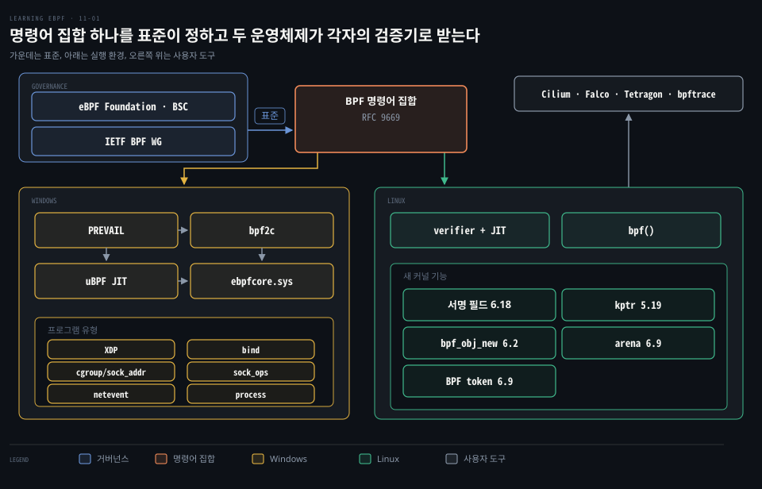
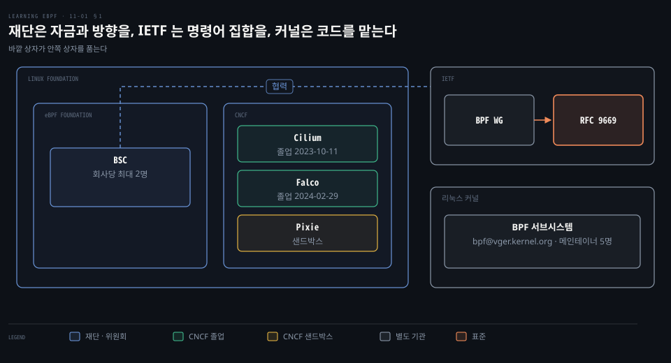
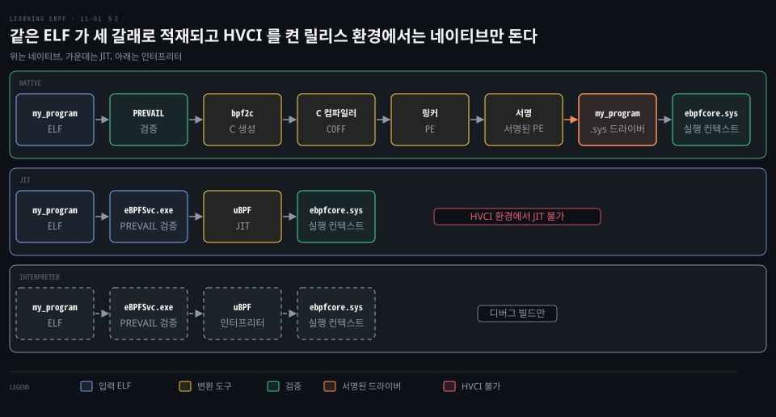
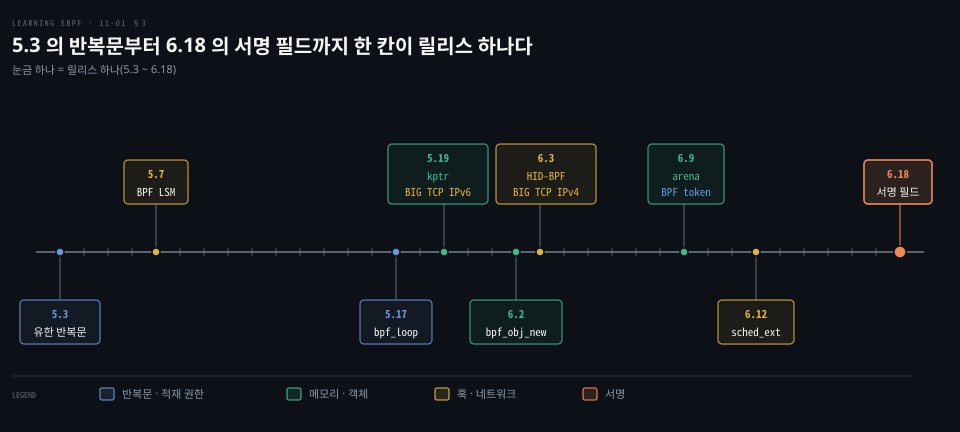
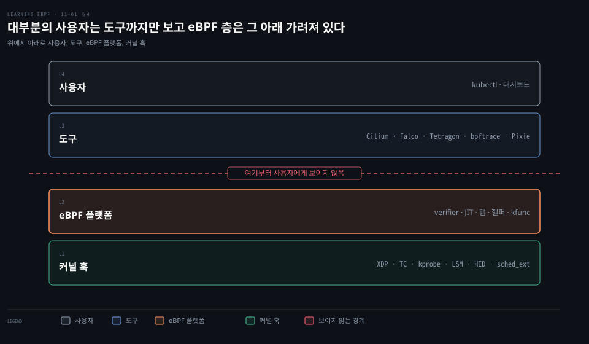

# eBPF 는 표준 명령어 집합으로 Windows 까지 가고 서명·kptr·arena 로 커널 안 기능을 넓힌다

---

> eBPF 는 IETF 표준 명령어 집합 위에서 Windows 까지 퍼지고, 리눅스 커널 안에서는 서명·kptr·arena 로 프로그램이 맡는 일을 넓히며, 사용자는 그 위의 도구로만 만납니다.

## 핵심 요약

> 이 편의 중심 생각은 eBPF 가 여러 운영체제가 공유하는 명령어 집합으로 올라서는 동시에, 리눅스 안에서는 프로그램이 맡을 일을 서명·kptr·arena 로 넓혀 간다는 것입니다.

명령어 집합은 IETF 가 RFC 9669 로 표준화했습니다. Windows 는 리눅스 verifier 가 GPL 코드라 쓸 수 없어서 PREVAIL 과 uBPF 를 씁니다. `bpf2c` 로 서명된 네이티브 드라이버까지 만듭니다.

리눅스에는 맵에 오래 담기는 커널 포인터 kptr 이 5.19 에, 프로그램이 직접 할당하는 `bpf_obj_new` 가 6.2 에, 사용자 공간과 메모리를 나누는 arena 가 6.9 에, 서명 필드가 6.18 에 차례로 들어왔습니다. 새 기능은 배포판 커널에 몇 년 늦게 닿습니다. 사용자는 Cilium 같은 도구를 쓸 뿐 eBPF 를 직접 다루지 않습니다.

## 학습 목표

> 이 편을 읽고 나면 다음을 설명할 수 있습니다.

1. 커널 서브시스템이 있는데도 중립 재단이 필요했던 이유와 운영위원회의 구성 규칙을 설명할 수 있습니다.
2. 표준이 보장하는 것과 플랫폼마다 달라지는 것을 RFC 9669 의 적합 그룹과 헬퍼 함수로 구분할 수 있습니다.
3. Windows 가 리눅스 verifier 를 쓰지 못하는 이유와 네이티브·JIT·인터프리터 세 방식의 차이를 설명할 수 있습니다.
4. 서명이 어려운 이유와 지금의 해법, kptr 이 푸는 문제, `bpf_obj_new` 와 arena 의 차이를 설명할 수 있습니다.
5. 배포 지연이 기능 선택에 주는 영향과 eBPF 를 플랫폼이라 부르는 뜻을 말할 수 있습니다.

## 1. 재단과 IETF 표준이 여러 운영체제가 함께 쓸 명령어 집합을 정한다

> 커널 안의 일은 BPF 서브시스템이 맡고, 여러 회사의 자금 조율은 재단이, 운영체제 사이의 명령어 집합은 IETF 가 맡습니다.

### 커널 서브시스템이 있는데 중립 재단이 따로 필요했던 이유

BPF 는 커널 안에서 자라 서브시스템이 되었고 메일링 리스트 `bpf@vger.kernel.org` 를 갖습니다. v7.2 `MAINTAINERS` 의 `BPF [GENERAL]` 항목은 [메인테이너 다섯 명](https://github.com/torvalds/linux/blob/v7.2/MAINTAINERS#L4899-L4912)을 적습니다. Alexei Starovoitov · Daniel Borkmann · Andrii Nakryiko · Eduard Zingerman · Kumar Kartikeya Dwivedi 입니다. 코드 합류는 이 구조가 이미 정합니다.

비어 있던 자리는 여러 회사가 한 기술에 돈을 대고 조율하는 곳입니다. **eBPF Foundation** 은 [2021-08-12 에 Linux Foundation 이 호스팅한다고 발표](https://www.linuxfoundation.org/press/press-release/facebook-google-isovalent-microsoft-and-netflix-launch-ebpf-foundation-as-part-of-the-linux-foundation)했고 창립 회원은 Meta·Google·Isovalent·Microsoft·Netflix 입니다. [헌장](https://github.com/ebpffoundation/foundation/blob/218652bc5b93/charter.md#L9-L11)은 목적을 eBPF 커뮤니티를 지원할 자금을 모으고 예산을 짜고 집행하는 일로 적습니다. 예산은 Governing Board 가 관리합니다. 재단은 자금과 지적 재산을 중립적으로 맡아 경쟁 회사들이 함께 일할 자리를 만듭니다.

### 운영위원회는 메인테이너로 채우고 한 회사에서 둘까지만 받는다

기술 방향은 **eBPF Steering Committee(BSC)** 가 맡습니다. [헌장](https://github.com/ebpffoundation/foundation/blob/218652bc5b93/charter.md#L46-L59)에 따르면 구성원은 커널과 eBPF 런타임, eBPF 프로젝트의 메인테이너이고 같은 회사나 관련 회사에서는 최대 두 명입니다. 새 구성원은 기존 위원이 제안하고 다른 위원이 지지하면 표결에 부치며 전체의 3분의 2 찬성이 필요합니다. 한 회사의 비중을 묶어 두는 규칙입니다.

### Cilium·Falco·Pixie 는 재단이 아니라 CNCF 에 있다

재단은 [업스트림 개발 안내와 홍보, 보안·신뢰성 개선](https://ebpf.foundation/)을 목표로 적습니다. 대상은 eBPF 기술 자체입니다. 그 위에 지은 제품 중 클라우드 네이티브 도구는 CNCF 로 갑니다. CNCF Landscape 기준으로 [Cilium 은 2023-10-11 에 졸업](https://github.com/cncf/landscape/blob/5ebec81fd274/landscape.yml#L3834-L3849)했고 [Falco 는 2024-02-29 에 졸업](https://github.com/cncf/landscape/blob/5ebec81fd274/landscape.yml#L1432-L1444)했으며 [Pixie 는 샌드박스](https://github.com/cncf/landscape/blob/5ebec81fd274/landscape.yml#L12326-L12336)입니다. Falco 는 [런타임 보호 편](../../../08_cloud/book/container-security/13-01.컨테이너%20런타임%20보호%20—%20정상을%20정의해%20이상을%20잡다.md)에, Cilium 은 [첫 편](../../../08_cloud/book/cilium-up-and-running/01-01.Cilium%20은%20eBPF%20데이터패스로%20iptables%20기반%20CNI%20의%20한계를%20넘는다.md)에 있습니다.

### 표준이 있어야 Windows 에서도 같은 바이트코드가 돈다

eBPF 구현이 리눅스 밖으로 퍼지면서 NIC 와 Windows 에도 들어갔습니다([헌장](https://datatracker.ietf.org/wg/bpf/about/)). 서로 다른 구현이 같은 바이트코드를 받으려면 명령어 집합을 문서로 못 박아야 했습니다. 표준화는 IETF BPF 워킹그룹이 맡아 2024-10 에 [RFC 9669 "BPF Instruction Set Architecture (ISA)"](https://www.rfc-editor.org/rfc/rfc9669.html)로 냈습니다. 초록은 eBPF 가 더는 약어가 아니라고 적습니다. 커널 트리에는 이 작업의 원본인 [`instruction-set.rst`](https://github.com/torvalds/linux/blob/v7.2/Documentation/bpf/standardization/instruction-set.rst)가 있습니다.

RFC 는 구현이 모든 명령어를 지원하지 않아도 되도록 [적합 그룹](https://www.rfc-editor.org/rfc/rfc9669.html#section-2.4)을 둡니다. `base32` 는 필수이고 `base64`·`atomic32`·`atomic64`·`divmul32`·`divmul64`·`packet` 은 선택입니다. 컴파일러와 런타임은 이 이름으로 지원 범위를 맞춥니다. 반대로 [헬퍼 함수의 표준화는 향후 과제](https://www.rfc-editor.org/rfc/rfc9669.html#section-4.3.1)로 남겼습니다. 워킹그룹 [헌장](https://datatracker.ietf.org/wg/bpf/about/)은 플랫폼 공통 헬퍼와 맵 타입, 프로그램 타입을 뒤이어 다루겠다고 적고 재단 운영위원회와 협력하라고 못 박습니다. 표준이 보장하는 것은 명령어의 인코딩과 의미입니다. 훅과 헬퍼는 플랫폼이 정합니다.

## 2. eBPF for Windows 는 같은 바이트코드를 PREVAIL 로 검증하고 네이티브 드라이버로 싣는다

> 바이트코드와 도구는 리눅스 것을 그대로 쓰고, 검증기와 JIT 와 훅은 Windows 에 맞게 갈아 끼운 구조입니다.

### 리눅스 커널 구조체를 쓰는 프로그램이 다른 운영체제에서 도는 길은 공통분에 있다

[eBPF for Windows](https://github.com/microsoft/ebpf-for-windows/blob/v1.6.0/README.md#L97-L108)가 목표로 삼는 것은 모든 리눅스 프로그램의 호환이 아니라 여러 운영체제에 공통인 훅과 헬퍼를 쓰는 코드의 소스 호환입니다. 리눅스 내부 구조체를 만지는 훅은 해당하지 않습니다. 네트워크 계층은 패킷 구조가 어느 운영체제에서나 같아서 공통분이 큽니다. 2022년 말 시점에 Cilium 의 L4 로드밸런싱과 eBPF 기반 연결 추적이 Windows 에서 도는 시연이 있었습니다.

바이트코드 가상 머신은 어디에나 구현할 수 있습니다. 구조체가 다른 곳으로 옮겨 가는 이식 문제는 리눅스 커널 버전 사이에도 있고 CO-RE 가 다루는 주제입니다.

### 리눅스 verifier 는 GPL 코드라 가져올 수 없어 PREVAIL 과 uBPF 를 쓴다

[리눅스 verifier](https://github.com/torvalds/linux/blob/v7.2/kernel/bpf/verifier.c#L1)는 `GPL-2.0-only` 입니다. [BPF 라이선스 문서](https://github.com/torvalds/linux/blob/v7.2/Documentation/bpf/bpf_licensing.rst#L55-L60)는 다른 커널의 구현이 독점 라이선스일 수 있다고 적습니다. 독점 라이선스의 Windows 에 GPL 코드를 합칠 수 없으므로 독자 구현을 둡니다.

- **PREVAIL**: 추상 해석 기반의 검증기이며 [MIT 라이선스](https://github.com/vbpf/prevail)입니다.
- **uBPF**: 사용자 공간 가상 머신과 JIT 이며 [Apache-2.0](https://github.com/iovisor/ubpf)입니다.
- Clang 과 libbpf: 바이트코드 생성과 적재 API 는 재사용합니다. 앱은 [`ebpfapi.dll` 의 libbpf API](https://github.com/microsoft/ebpf-for-windows/blob/v1.6.0/README.md#L56-L58)로 싣습니다.

### 적재 방식은 네이티브·JIT·인터프리터 셋이고 HVCI 를 켠 릴리스 환경에서는 네이티브만 돈다

`README` 는 [세 방식](https://github.com/microsoft/ebpf-for-windows/blob/v1.6.0/README.md#L32-L52)을 나눕니다. 적재할 때 어디서 검증하는지가 방식마다 다릅니다. JIT 와 인터프리터는 [`eBPFSvc` 가 검증](https://github.com/microsoft/ebpf-for-windows/blob/v1.6.0/README.md#L54)합니다.

1. **네이티브 모드**: `bpf2c` 가 Clang 이 만든 ELF 를 [PREVAIL 로 검증한 뒤](https://github.com/microsoft/ebpf-for-windows/blob/v1.6.0/README.md#L33-L38) 명령어마다 같은 의미의 C 문장을 만듭니다. 이어서 C 컴파일러가 COFF 로, 링커가 DriverEntry 골격과 묶어 PE 로, 서명 도구가 서명된 `.sys` 로 바꿉니다. [변환 문서](https://github.com/microsoft/ebpf-for-windows/blob/v1.6.0/docs/NativeCodeGeneration.md#L44-L78)가 여섯 단계로 정리하며 `scripts\Convert-BpfToNative.ps1 -FileName my_program` 이 `my_program.sys` 를 냅니다. 검증과 서명은 빌드 쪽에서 끝나고 [권장하는 방식](https://github.com/microsoft/ebpf-for-windows/blob/v1.6.0/README.md#L39-L40)입니다.
2. **JIT 모드**: 사용자 모드 서비스 [`eBPFSvc.exe` 가 검증하고 uBPF 로 JIT](https://github.com/microsoft/ebpf-for-windows/blob/v1.6.0/README.md#L43-L45) 해서 네이티브 코드를 커널 실행 컨텍스트에 넘깁니다.
3. **인터프리터 모드**: uBPF 의 인터프리터가 [디버그 빌드에만](https://github.com/microsoft/ebpf-for-windows/blob/v1.6.0/README.md#L47-L50) 있습니다.

HVCI 는 하이퍼바이저가 서명되지 않은 커널 코드 페이지를 거부하는 기능이라 [JIT 로 만든 코드가 돌지 않습니다](https://github.com/microsoft/ebpf-for-windows/blob/v1.6.0/README.md#L110-L126). 인터프리터는 HVCI 에서도 돌지만 릴리스 빌드에 없어 프로덕션에서 남는 길은 서명된 PE 이미지인 네이티브 모드입니다. 변환 문서도 [Secure Kernel 이 검증할 수 있는 형식은 서명된 `.sys` 뿐](https://github.com/microsoft/ebpf-for-windows/blob/v1.6.0/docs/NativeCodeGeneration.md#L3-L11)이라고 적습니다.

커널 쪽 구성은 실행 컨텍스트인 `ebpfcore.sys` 와 [WFP 훅 확장인 `netebpfext.sys`](https://github.com/microsoft/ebpf-for-windows/blob/v1.6.0/docs/GettingStarted.md#L153-L154)입니다. 훅은 [XDP·bind·cgroup/sock_addr·sock_ops·netevent·process](https://github.com/microsoft/ebpf-for-windows/blob/v1.6.0/include/ebpf_structs.h#L199-L264) 같은 프로그램 유형으로 나뉩니다. 최신 릴리스 태그는 [v1.6.0(2026-09-18)](https://github.com/microsoft/ebpf-for-windows/releases/tag/v1.6.0)이고 프리릴리스로 표시됩니다.

## 3. 리눅스 eBPF 는 서명·오래 사는 커널 포인터·메모리 할당을 커널에 들였다

> 명령어 수 제약은 사실상 풀렸고, 지금 확장되는 쪽은 누가 무엇을 싣게 하는가와 프로그램이 다루는 객체의 수명입니다.

### 복잡도의 상한은 100만으로 늘었고 커널 함수는 kfunc 로 부르되 인터페이스는 안정되지 않았다

`CAP_BPF` 가 있는 프로그램은 [100만 명령어까지](./01-01.eBPF%20는%20커널을%20고치거나%20재부팅하지%20않고%20커널에%20안전한%20프로그램을%20싣는다.md) 허용됩니다. 유한 반복문 검증은 [5.3](https://github.com/torvalds/linux/commit/2589726d12a1)에, BPF LSM 은 [5.7](https://github.com/iovisor/bcc/blob/v0.37.0/docs/kernel-versions.md)에, `bpf_loop` 헬퍼는 [5.17](https://github.com/torvalds/linux/blob/v5.17/include/uapi/linux/bpf.h#L4963)에 들어왔습니다. 프로그램이 부르는 커널 함수가 kfunc 입니다. [kfunc 는 안정된 인터페이스가 없어](https://github.com/torvalds/linux/blob/v7.2/Documentation/bpf/kfuncs.rst#L10-L16) 쓰는 프로그램은 커널 릴리스에 맞춰 고쳐야 합니다.

### 서명이 어려운 이유는 로더가 바이트코드를 고쳐 쓰기 때문이다

사용자 공간 로더는 적재 직전에 맵 fd 를 채우고 CO-RE 재배치를 적용해 명령어를 바꿉니다. 서명은 바이트가 그대로여야 성립하므로 이 정당한 수정과 악의적 변조를 서명 쪽에서 구별하기 어렵습니다.

6.18 은 `BPF_PROG_LOAD` 에 서명 검증을 넣었고, libbpf 는 프로그램 대신 그 프로그램을 싣는 로더 프로그램을 서명하는 방식으로 이를 씁니다. `BPF_PROG_LOAD` 에 [`signature`·`signature_size`·`keyring_id`](https://github.com/torvalds/linux/blob/v6.18/include/uapi/linux/bpf.h#L1614-L1623)가 생겼고 6.17 의 `bpf.h` 에는 없습니다. 커널은 [키링에서 키를 찾아 명령어 버퍼의 PKCS#7 서명을 검증](https://github.com/torvalds/linux/blob/v7.2/kernel/bpf/syscall.c#L2903-L2944)합니다.

libbpf v1.8.0 의 [gen_loader](https://github.com/libbpf/libbpf/blob/v1.8.0/src/gen_loader.c#L545-L554)는 메타데이터를 로더 명령어 뒤에 붙여 한 서명으로 덮고 별도의 메타데이터 해시를 비교하지 않습니다. 이 방식의 커널 쪽 절차는 v7.3-rc6 의 [서명 문서](https://github.com/torvalds/linux/blob/v7.3-rc6/Documentation/bpf/signing.rst)에 있습니다. 맵은 [`excl_prog_hash`](https://github.com/torvalds/linux/blob/v7.2/kernel/bpf/syscall.c#L1583-L1590)에 지정한 SHA-256 해시의 프로그램만 접근하게 만들 수 있습니다. 서명이 없으면 [적재는 그대로 진행](https://github.com/torvalds/linux/commit/349271568303)되고 막을지는 LSM 정책이 정합니다.

같은 "누가 무엇을 싣게 하나"의 다른 축이 **BPF token** 입니다. [`BPF_TOKEN_CREATE`](https://github.com/torvalds/linux/blob/v7.2/include/uapi/linux/bpf.h#L888-L913)는 BPF 파일시스템의 위임 마운트 옵션에서 토큰을 만들어, 사용자 네임스페이스 안의 비특권 프로세스가 허용된 `bpf()` 명령만 쓰게 합니다. 6.9 의 [`bpf.h`](https://github.com/torvalds/linux/blob/v6.9/include/uapi/linux/bpf.h#L960)에 들어왔고 6.8 에는 없습니다.

### kptr 은 커널 포인터를 맵에 담아 두게 한다

헬퍼나 kfunc 로 얻은 커널 객체 포인터는 프로그램 한 번의 실행 동안만 유효했습니다. 맵에 저장해 다음 실행에서 쓸 수 없었습니다. **kptr** 은 [5.19 에서](https://github.com/torvalds/linux/commit/367590b7fccc) 맵 값 안의 타입 있는 포인터를 허용하고 검증기가 타입 안전성과 수명을 강제합니다. 참조를 가진 kptr 의 소유권은 [`bpf_kptr_xchg(map_value, ptr)`](https://github.com/torvalds/linux/blob/v5.19/include/uapi/linux/bpf.h#L5157)로 맵과 주고받고 옛 값을 반환합니다. RCU 보호 kptr 은 RCU 구간에서 [`KF_RCU` kfunc](https://github.com/torvalds/linux/blob/v7.2/Documentation/bpf/kfuncs.rst#L334-L343)에 바로 넘길 수 있습니다.

### bpf_obj_new 와 arena 는 kmalloc 대신 eBPF 전용 할당을 준다

프로그램이 `kmalloc()` 을 부를 수는 없습니다. 6.2 의 [`bpf_obj_new_impl`](https://github.com/torvalds/linux/blob/v6.2/kernel/bpf/helpers.c#L1768)은 프로그램 BTF 의 타입 ID 로 [크기를 정해 객체를 할당](https://github.com/torvalds/linux/blob/v7.2/Documentation/bpf/kfuncs.rst#L140-L160)하고 `bpf_obj_drop` 으로 해제합니다. 이 객체가 [연결 리스트와 트리 같은 그래프 자료구조](https://github.com/torvalds/linux/blob/v7.2/Documentation/bpf/graph_ds_impl.rst#L90-L103)의 바탕입니다.

6.9 의 **arena** 는 방향이 다릅니다. [프로그램과 사용자 공간이 나눠 쓰는 희소한 공유 메모리 영역](https://github.com/torvalds/linux/blob/v7.2/kernel/bpf/arena.c#L16-L43)입니다. 프로그램은 `bpf_arena_alloc_pages()` 로 페이지를 받고 사용자 공간은 `mmap()` 으로 같은 영역을 봅니다. 맵 타입은 [`BPF_MAP_TYPE_ARENA`](https://github.com/torvalds/linux/blob/v6.9/include/uapi/linux/bpf.h#L1012)이며 `map_extra` 에 `mmap()` 할 주소를 넣습니다. 포인터 변환은 JIT 가 맡으므로 프로그램과 사용자 공간이 같은 구조체를 그대로 읽는다는 점이 맵과 다릅니다.

## 4. 새 기능은 배포판 커널을 타고 늦게 닿고, eBPF 는 보이지 않는 플랫폼이 된다

> 새 기능이 현장에 닿는 속도는 배포판 커널이 정하고, 도구를 쓰는 쪽은 eBPF 를 의식하지 않습니다.

### 새 기능은 몇 년 뒤에 닿으므로 쓰기 전에 하한 커널을 정한다

배포판은 [메이저 버전 동안 기준 버전을 유지](./01-01.eBPF%20는%20커널을%20고치거나%20재부팅하지%20않고%20커널에%20안전한%20프로그램을%20싣는다.md#3-커널에-기능을-넣는-길은-업스트림과-모듈-둘뿐이었다)해서 새 기능이 프로덕션에 몇 년 늦게 닿습니다. 최신 기능을 쓴 프로그램은 대부분의 프로덕션에서 몇 년 동안 돌지 않습니다. 급한 조직은 일찍 쓰려고 커널을 빨리 올립니다.

BIG TCP 가 그 예입니다. GSO(송신)와 GRO(수신) 묶음을 키워 스택 통과 횟수와 CPU 부하를 줄여 [100Gbit/s 이상](https://docs.cilium.io/en/v1.20/operations/performance/tuning/)을 노립니다. Cilium 은 묶음 크기 한도를 64k 에서 192k 로 올립니다. IPv6 는 [5.19](https://github.com/torvalds/linux/blob/v5.19/net/ipv6/ip6_offload.c#L356-L372)에서, IPv4 는 [6.3](https://github.com/torvalds/linux/commit/b1a78b9b9886)에서 들어왔습니다. Cilium 문서는 각각 커널 5.19 이상과 6.3 이상을 요구하고 NIC 는 mlx4·mlx5·ice 로 제한합니다.

### 커널 안 동작을 배포 뒤에 바꾸는 쓰임은 HID 와 적외선 리모컨과 스케줄러까지 간다

커널 동작을 동적으로 바꿀 수 있으니 장치별 문제를 배포 뒤에 고치는 쓰임이 생깁니다.

- **HID-BPF**: 6.3 에서 [`hid_bpf.h`](https://github.com/torvalds/linux/blob/v6.3/include/linux/hid_bpf.h)가 들어왔습니다. 마우스·키보드·게임 컨트롤러가 표준 HID 와 어긋날 때 [드라이버 대신 eBPF 로 맞춥니다](https://github.com/torvalds/linux/blob/v7.2/Documentation/hid/hid-bpf.rst#L7-L31). 낡은 조이스틱의 데드존을 커널에서 걸러 사용자 공간을 깨우지 않는 것이 문서의 예입니다.
- 적외선 리모컨: [`BPF_PROG_TYPE_LIRC_MODE2`](https://github.com/torvalds/linux/blob/v7.2/include/uapi/linux/bpf.h#L1083) 프로그램이 LIRC 장치에 붙어 [프로토콜을 디코딩](https://github.com/torvalds/linux/blob/v7.2/Documentation/userspace-api/media/rc/lirc-dev-intro.rst#L152-L170)합니다.
- **sched_ext**: [6.12](https://github.com/torvalds/linux/blob/v6.12/kernel/sched/ext.c#L1-L8) 부터 [스케줄링 정책을 BPF 프로그램으로 정의](https://github.com/torvalds/linux/blob/v7.2/Documentation/scheduler/sched-ext.rst#L7-L22)하는 스케줄러 클래스가 있습니다. 프로그램은 동적으로 켜고 끌 수 있고 오류가 나면 기본 스케줄러로 돌아갑니다.

### 사용자는 도구를 쓰지 eBPF 를 쓰지 않는다

컨테이너 사용자는 [namespace](../../../08_cloud/book/container-security/04-01.namespace와%20루트%20디렉토리%20—%20격리를%20만드는%20두%20장치.md)와 [cgroup](../../../08_cloud/book/container-security/03-01.Control%20Group%20—%20자원을%20제한해%20굶기기를%20막다.md)을 모르고도 컨테이너를 씁니다. eBPF 도 같은 길을 갑니다. 대부분의 사람은 `bpftool` 로 프로그램을 만지지 않습니다. `kubectl` 이나 대시보드로 Cilium·Falco·Tetragon·bpftrace·Pixie 같은 도구를 쓸 뿐입니다. 그 도구가 verifier 와 JIT, 맵, 헬퍼와 kfunc 라는 같은 바닥을 공유합니다. 바닥 아래의 훅은 XDP·TC·kprobe·LSM 에 HID 와 sched_ext 가 더해집니다.

## 면접 대비

> 서명·Windows·kptr·배포 지연·플랫폼의 뜻을 확인합니다.

1. BPF 프로그램 서명이 어려운 이유는 무엇이고 6.18 의 서명 대상은 무엇입니까?
2. Windows 가 리눅스 verifier 를 쓰지 못하는 이유와 네이티브 모드가 필요한 이유는 무엇입니까?
3. kptr 은 어떤 제약을 풀고 `bpf_kptr_xchg` 는 소유권을 어떻게 넘깁니까?
4. 새 커널 기능의 배포 지연은 eBPF 프로그램의 기능 선택에 어떤 영향을 줍니까?
5. "eBPF 는 기능이 아니라 플랫폼이다"라는 말은 무엇을 뜻합니까?

## 정답 (자답 후 펼치기)

### 정답 1 — 로더의 정당한 수정과 변조가 구별되지 않아 로더 프로그램을 서명한다

로더가 맵 fd 와 CO-RE 재배치로 명령어를 고치므로 바이트가 변합니다. 6.18 부터 커널이 `BPF_PROG_LOAD` 때 서명을 검증하고, libbpf 는 고쳐 쓰지 않는 로더 프로그램을 서명 대상으로 삼습니다. 맵은 `excl_prog_hash` 로 그 로더만 접근하게 합니다.

### 정답 2 — GPL 코드 재사용 불가와 HVCI 가 JIT 를 막는다

리눅스 verifier 는 GPL-2.0-only 라 독점 운영체제가 합칠 수 없어 PREVAIL 과 uBPF 를 씁니다. HVCI 는 서명되지 않은 커널 코드를 거부해 JIT 가 안 되고 인터프리터도 릴리스에 없으므로 `bpf2c` 가 만든 서명된 `.sys` 만 돕니다.

### 정답 3 — 프로그램 한 번 동안만 유효하던 포인터를 맵에 담는다

헬퍼나 kfunc 로 얻은 커널 포인터는 실행 한 번 동안만 유효했습니다. kptr 은 맵 값 안의 타입 있는 포인터를 허용하고 검증기가 수명을 추적합니다. `bpf_kptr_xchg` 는 옛 포인터를 참조로 돌려주고 넘긴 참조의 소유권을 맵으로 옮깁니다.

### 정답 4 — 최신 기능은 하한 커널을 정해 두고 쓴다

최신 기능은 오래된 커널에서 돌지 않아 최소 커널 버전을 명시해야 합니다. 대규모 환경은 BIG TCP 처럼 이득이 큰 기능을 위해 커널을 빨리 올립니다.

### 정답 5 — 사용자는 도구를 쓰고 eBPF 는 바닥에 놓인다

도구는 verifier·JIT·맵·kfunc 라는 같은 바닥 위에 만들어집니다. 사용자는 컨테이너의 namespace 와 cgroup 처럼 그 존재를 몰라도 씁니다.

## 참고 자료

- 《Learning eBPF》(Liz Rice, O'Reilly, 2023, ISBN 978-1-098-13512-6) Ch.11 The Future Evolution of eBPF
- [RFC 9669](https://www.rfc-editor.org/rfc/rfc9669.html) · [IETF BPF 워킹그룹](https://datatracker.ietf.org/wg/bpf/about/) · [eBPF Foundation](https://ebpf.foundation/)
- [eBPF for Windows v1.6.0](https://github.com/microsoft/ebpf-for-windows/tree/v1.6.0) · [PREVAIL](https://github.com/vbpf/prevail) · [uBPF](https://github.com/iovisor/ubpf)
- [BCC 커널 버전별 기능 목록](https://github.com/iovisor/bcc/blob/v0.37.0/docs/kernel-versions.md)
- 더 읽을거리: [ebpf.io](https://ebpf.io/) · [Cilium BPF 가이드](https://docs.cilium.io/en/stable/reference-guides/bpf/) · [커널 BPF 문서](https://docs.kernel.org/bpf/) · [Brendan Gregg](https://www.brendangregg.com/ebpf.html) · [Andrii Nakryiko](https://nakryiko.com/) · [LWN](https://lwn.net/) · [Elixir](https://elixir.bootlin.com/linux/latest/source)

## 관련 문서

- [커널 확장과 eBPF 의 출발](./01-01.eBPF%20는%20커널을%20고치거나%20재부팅하지%20않고%20커널에%20안전한%20프로그램을%20싣는다.md) · [시스템 콜 입구 검사와 LSM 훅](./09-01.시스템%20콜%20입구%20검사는%20TOCTOU%20에%20뚫려%20보안%20도구는%20LSM%20훅과%20커널%20함수에서%20판정하고%20SIGKILL%20로%20막는다.md)
