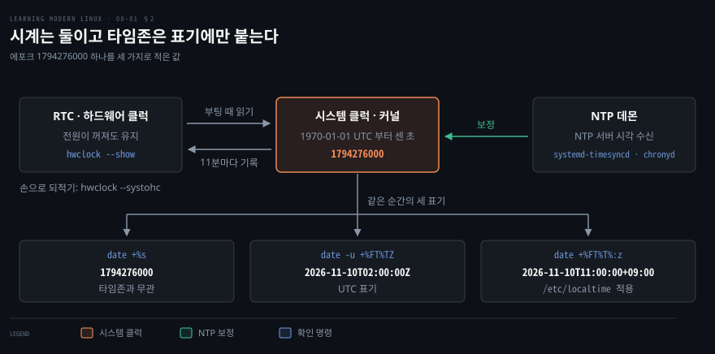

# 함정과 레시피 참조 시트

---

> 《Learning Modern Linux》 부록 A 의 명령을 모은 조회용 시트입니다. 명령마다 본문 어느 장이 설명했는지를 붙였고, 시스템 시계는 따로 풀어 적었습니다.

find 는 [find 참조 시트](./00-02.find%20%EC%B0%B8%EC%A1%B0%20%EC%8B%9C%ED%8A%B8.md), 부록 B 의 현대 도구는 [현대 도구 참조 시트](./00-03.%ED%98%84%EB%8C%80%20%EB%8F%84%EA%B5%AC%20%EC%B0%B8%EC%A1%B0%20%EC%8B%9C%ED%8A%B8.md) 에 있습니다.

## 이 문서의 성격

> 정독 노트가 아니라 조회용 시트라서 학습 목표와 면접 질문을 두지 않습니다.

표의 「본문」 열은 그 명령을 설명한 장이고, "본문 밖"은 이 책이 다루지 않은 명령입니다. 출력은 Debian 12 컨테이너(GNU findutils 4.9.0, bash 5.2.15, fish 3.6.0)에서 직접 돌려 받았습니다.


## 1. 그대로 치면 어긋나는 명령

> 아래 여섯은 적힌 대로 치면 실패하거나, 이름에서 기대하는 것과 다른 값을 냅니다.

### 함정 여섯

```bash
# ✗ cat 'foo bar baz' | sed -e 's/foo/quux/'  → cat 이 인자를 파일 이름으로 읽어 No such file or directory 로 끝난다
echo 'foo bar baz' | sed -e 's/foo/quux/'

# ✗ date +%FT%TZ  → 2026-11-10T11:00:00Z (지역 시각 뒤에 Z 가 글자로 붙는다)
date +%FT%T%:z

# ✗ git log (git describe --tags --abbrev=0)..HEAD --oneline  → bash 에서 syntax error near unexpected token '(' 로 끝난다
git log $(git describe --tags --abbrev=0)..HEAD --oneline

# ✗ git diff --color-moved  → 나란히 보기가 아니라 옮겨진 줄을 다른 색으로 칠한다
#   옮기기만 한 변경과 고친 변경을 가를 때 쓴다
git diff --color-moved

# ✗ head -c 450m  → m 은 1,048,576 배라 471,859,200 바이트에서 끊는다
head -c 450MB

# ✗ ls -l /etc | wc -l  → total N 줄이 하나 더해지고 숨은 파일은 빠진다
ls -1A /etc | wc -l
```

| 명령 | 실제 동작 | 대신 쓸 형태 |
|------|----------|-------------|
| `cat 'foo bar baz' \| sed -e 's/foo/quux/'` | `cat` 이 인자를 파일 이름으로 읽어 `No such file or directory` 로 끝납니다 | `echo 'foo bar baz' \| sed -e 's/foo/quux/'` |
| `date +%FT%TZ` | `Z` 는 UTC 표시인데 지역 시각 뒤에 글자로 붙습니다. `TZ=Asia/Seoul` 에서 `2026-11-10T11:00:00Z` 가 나옵니다 | `date +%FT%T%:z`[^date] |
| `git log (git describe --tags --abbrev=0)..HEAD --oneline` | bash 에서 `syntax error near unexpected token '('` 로 끝납니다 | `git log $(git describe --tags --abbrev=0)..HEAD --oneline` |
| `git diff --color-moved` | 옮겨진 줄을 다른 색으로 칠합니다. 나란히 보기가 아닙니다[^git-diff] | 옮기기만 한 변경과 고친 변경을 가를 때 씁니다 |
| `head -c 450m` | `m` 은 1,048,576 배라 471,859,200 바이트에서 끊습니다[^head] | 450,000,000 바이트는 `head -c 450MB` |
| `ls -l /etc \| wc -l` | `total N` 줄이 하나 더해지고 숨은 파일은 빠집니다 | `ls -1A /etc \| wc -l` |

### 셸마다 다른 문법

| 하려는 일 | bash | fish |
|----------|------|------|
| 명령 치환 | `$(cmd)` | `(cmd)` · `$(cmd)` |
| 파이프 각 명령의 종료 코드 | `${PIPESTATUS[@]}` | `$pipestatus` |

bash 에서 `(cmd)` 는 문법 오류입니다. fish 에서 `${PIPESTATUS[@]}` 는 `${ is not a valid variable in fish` 로 거부됩니다. `$(cmd)` 는 bash 5.2 와 fish 3.6 에서 모두 동작합니다.


## 2. 레시피 여덟 묶음

> 묶음 순서는 부록 A 를 따릅니다. 「시간과 날짜」에는 시스템 클럭과 RTC 를 확인하는 명령을 더했습니다.

### 시스템 정보 모으기

```bash
# 리눅스 배포판 버전 확인
cat /etc/*-release

# 커널 컴파일 정보와 버전 확인
cat /proc/version

# 커널 버전과 시스템 아키텍처 확인
uname -a

# CPU 모델과 코어 정보 확인
cat /proc/cpuinfo

# 시스템 메모리 사용 통계 확인
cat /proc/meminfo

# 디스크 I/O 통계 확인
cat /proc/diskstats

# BIOS 정보 확인(-t 에 system·memory 도 조회 가능)
sudo dmidecode -t bios

# 주 메모리와 스왑 사용량을 사람이 읽기 쉬운 단위와 합계(-t)로 확인
free -ht

# 프로세스가 가질 수 있는 최대 파일 디스크립터 수 확인
ulimit -n
```

| 명령 | 본문 |
|------|------|
| `cat /etc/*-release` | 본문 밖 |
| `cat /proc/version` | 1장 |
| `uname -a` | 2장 |
| `cat /proc/cpuinfo` | 1장 · 2장 |
| `cat /proc/meminfo` | 2장 |
| `cat /proc/diskstats` | 본문 밖 |
| `sudo dmidecode -t bios` | 2장 |
| `free -ht` | 8장 둘째 편 |
| `ulimit -n` | 본문 밖 |

### 사용자와 프로세스

```bash
who                        # 로그인한 사용자 목록 확인
w                          # 로그인한 사용자와 현재 작업 상세 확인

top -U SOMEUSER            # 특정 사용자의 프로세스별 시스템 메트릭 확인
ps faux                    # 전체 사용자의 프로세스를 부모-자식 트리로 본다
ps -e | grep python        # 특정 이름을 가진 프로세스 찾기

# 프로세스에 종료를 요청한다(SIGTERM). 무시하면 -9(SIGKILL)
kill PID                   # PID 로 지정
killall                    # 이름으로 지정

nohup command > log 2>&1 & # SIGHUP 을 무시한 채 백그라운드로 시작
disown -h %1               # 잡 표에 남기되, 셸이 받은 SIGHUP 을 이 잡에는 보내지 않는다
disown %1                  # 잡을 셸의 잡 표에서 뺀다
```

| 명령 | 본문 |
|------|------|
| `who` · `w` | 본문 밖 |
| `top -U SOMEUSER` | 8장 둘째 편 |
| `ps faux` | 2장 |
| `ps -e \| grep python` | 2장 |
| `kill PID` | 9장 |
| `killall` | 본문 밖 |
| `nohup command > log 2>&1 &` | 3장 첫 편 [터미널 끊김](./03-01.%EC%85%B8%EC%9D%98%20%EC%8B%A4%EC%B2%B4%EB%8A%94%20%EC%8A%A4%ED%8A%B8%EB%A6%BC%EA%B3%BC%20%EB%B3%80%EC%88%98%EC%99%80%20%EC%A2%85%EB%A3%8C%20%EC%83%81%ED%83%9C%EB%8B%A4.md#%ED%84%B0%EB%AF%B8%EB%84%90%EC%9D%B4-%EB%81%8A%EA%B8%B8-%EB%95%8C-%EC%82%B4%EC%95%84%EB%82%A8%EB%8A%94-%EC%9E%A1) |
| `disown -h %1` · `disown %1` | 3장 첫 편 [터미널 끊김](./03-01.%EC%85%B8%EC%9D%98%20%EC%8B%A4%EC%B2%B4%EB%8A%94%20%EC%8A%A4%ED%8A%B8%EB%A6%BC%EA%B3%BC%20%EB%B3%80%EC%88%98%EC%99%80%20%EC%A2%85%EB%A3%8C%20%EC%83%81%ED%83%9C%EB%8B%A4.md#%ED%84%B0%EB%AF%B8%EB%84%90%EC%9D%B4-%EB%81%8A%EA%B8%B8-%EB%95%8C-%EC%82%B4%EC%95%84%EB%82%A8%EB%8A%94-%EC%9E%A1) |

`kill -9` 는 `SIGKILL` 을 보냅니다. 이 시그널은 프로세스가 잡거나 무시할 수 없습니다. `&` 는 터미널만 놓아줄 뿐 세션에서 빼지 않아 끊기면 bash 가 모든 잡에 `SIGHUP` 을 보냅니다([3장 5절](./03-01.%EC%85%B8%EC%9D%98%20%EC%8B%A4%EC%B2%B4%EB%8A%94%20%EC%8A%A4%ED%8A%B8%EB%A6%BC%EA%B3%BC%20%EB%B3%80%EC%88%98%EC%99%80%20%EC%A2%85%EB%A3%8C%20%EC%83%81%ED%83%9C%EB%8B%A4.md#%ED%84%B0%EB%AF%B8%EB%84%90%EC%9D%B4-%EB%81%8A%EA%B8%B8-%EB%95%8C-%EC%82%B4%EC%95%84%EB%82%A8%EB%8A%94-%EC%9E%A1)).[^bashsig] `nohup` 은 출력을 돌리지 않으면 터미널 대신 `nohup.out` 에 덧붙입니다.[^nohup] 끊긴 뒤 다시 붙어 화면까지 이어 볼 때는 [tmux](./03-02.%EC%9E%90%EC%A3%BC%20%EC%B9%98%EB%8A%94%20%EA%B2%83%EC%9D%BC%EC%88%98%EB%A1%9D%20%EC%A7%A7%EC%95%84%EC%95%BC%20%ED%95%9C%EB%8B%A4.md#8-%EC%B0%BD%EC%9D%84-%EB%8A%98%EB%A6%AC%EC%A7%80-%EC%95%8A%EA%B3%A0-%ED%95%98%EB%82%98%EB%A5%BC-%EC%AA%BC%EA%B0%9C%EA%B8%B0-tmux) 를 씁니다.

### 파일 정보

```bash
# 아이노드를 포함한 파일 상세 확인
stat somefile

# 셸이 그 명령을 어떻게 해석하는지 확인
type somecommand

# 실행 파일의 위치 확인
which somebinary
```

| 명령 | 본문 |
|------|------|
| `stat somefile` | 5장 |
| `type somecommand` | 3장 첫 편 |
| `which somebinary` | 3장 첫 편 |

### 파일과 디렉터리 다루기

```bash
# 텍스트 파일 내용 보기
cat afile

# 줄 수 세기(total 줄이 더해지고 숨은 파일이 빠지는 함정 주의, §1)
ls -l /etc | wc -l

# /etc 에서 .conf 로 끝나는 파일 찾기(00-02)
find /etc -name "*.conf"

# 현재 디렉터리에서 문자열 찾기(00-02)
find . -type f -exec grep -H FINDME {} \;

# 두 파일의 차이를 비교
diff -u somefile anotherfile

# 문자 치환(→ com.acme.library)
echo 'Com_Acme_Library' | tr '_A-Z' '.a-z'

# ✗ cat 'foo bar baz' | sed -e 's/foo/quux/'  → foo bar baz 라는 파일을 찾다 실패한다(§1)
# 첫 foo 를 바꾼다(→ quux bar baz)
echo 'foo bar baz' | sed -e 's/foo/quux/'

# 시험용 파일 만들기(크기 1,024,000 바이트)
dd if=/dev/zero of=output.dat bs=1024 count=1000
```

| 명령 | 본문 |
|------|------|
| `cat afile` | 3장 첫 편 |
| `ls -l /etc \| wc -l` | 3장 첫 편 |
| `find /etc -name "*.conf"` | 3장 첫 편 |
| `find . -type f -exec grep -H FINDME {} \;` | 3장 첫 편 |
| `diff -u somefile anotherfile` | 본문 밖 |
| `echo 'Com_Acme_Library' \| tr '_A-Z' '.a-z'` | 3장 첫 편 |
| `cat 'foo bar baz' \| sed -e 's/foo/quux/'` | 3장 첫 편 |
| `echo 'foo bar baz' \| sed -e 's/foo/quux/'` | 3장 첫 편 |
| `dd if=/dev/zero of=output.dat bs=1024 count=1000` | 본문 밖 |

`sed` 의 구분자는 `/` 가 아니어도 됩니다. 경로를 바꿀 때 `echo /usr/bin | sed 's#/usr#/opt#'` 처럼 쓰면 `/opt/bin` 이 나옵니다.

### 리다이렉션과 파이프

```bash
# 표준 출력을 파일로
command 1> file

# 표준 오류를 파일로
command 2> file

# 표준 출력과 표준 오류를 함께 파일로
command &> file

# 같은 일을 하는 다른 방법(표준 출력과 표준 오류를 파일로)
command >file 2>&1

# 출력을 버리기
command > /dev/null

# 표준 입력을 파일에서 받기
command < file

# 한 프로세스의 표준 출력을 다음의 표준 입력으로
cmd1 | cmd2 | cmd3

# 파이프 각 명령의 종료 코드(bash 전용, fish 는 $pipestatus)
echo ${PIPESTATUS[@]}
```

| 명령 | 본문 |
|------|------|
| `command 1> file` | 3장 첫 편 |
| `command 2> file` | 3장 첫 편 |
| `command &> file` | 3장 첫 편 |
| `command >file 2>&1` | 3장 첫 편 |
| `command > /dev/null` | 3장 첫 편 |
| `command < file` | 3장 첫 편 |
| `cmd1 \| cmd2 \| cmd3` | 3장 첫 편 |
| `echo ${PIPESTATUS[@]}` | 3장 셋째 편 |

`&>` 앞에 숫자를 붙인 `2&>` 는 다른 뜻입니다. `ls nosuch 2&> r.txt` 를 돌리면 `2` 가 `ls` 의 인자로 넘어가 `ls: cannot access '2'` 가 파일에 함께 적힙니다.

### 시간과 날짜

```bash
# 지역 시각·UTC·동기화 상태 확인
timedatectl status

# 날짜를 YYYY-MM-DD 형식으로 출력(→ 2026-11-10)
date +"%Y-%m-%d"

# 유닉스 에포크 초 출력(→ 1794276000)
date +%s

# UTC 기준 시각 출력(→ 2026-11-10T02:00:00Z)
date -u +"%Y-%m-%dT%H:%M:%SZ"

# ✗ date +%FT%TZ  → 2026-11-10T11:00:00Z (지역 시각에 Z 가 붙는다, §1)
# 지역 시각을 오프셋과 함께 출력(→ 2026-11-10T11:00:00+09:00)
date +%FT%T%:z
```

| 명령 | 결과 | 본문 · 비고 |
|------|------|-------------|
| `timedatectl status` | 지역 시각·UTC·동기화 상태 | 6장 첫 편 |
| `date +"%Y-%m-%d"` | `2026-11-10` | 3장 둘째 편 |
| `date +%s` | `1794276000` | 3장 둘째 편 · 유닉스 에포크 |
| `date -u +"%Y-%m-%dT%H:%M:%SZ"` | `2026-11-10T02:00:00Z` | UTC. `Z` 가 맞습니다 |
| `date +%FT%TZ` | `2026-11-10T11:00:00Z` | 지역 시각에 `Z` 가 붙습니다(§1) |
| `date +%FT%T%:z` | `2026-11-10T11:00:00+09:00` | 지역 시각을 오프셋과 함께 적습니다 |

결과 열은 `TZ=Asia/Seoul` 에서 에포크 1794276000 을 적은 값입니다. 날짜 계산은 [3장 둘째 편](./03-02.%EC%9E%90%EC%A3%BC%20%EC%B9%98%EB%8A%94%20%EA%B2%83%EC%9D%BC%EC%88%98%EB%A1%9D%20%EC%A7%A7%EC%95%84%EC%95%BC%20%ED%95%9C%EB%8B%A4.md)이 다룹니다.

리눅스 기계에는 시계가 둘 있습니다. **RTC**(하드웨어 클럭)는 전원이 꺼져도 가는 시계입니다. 시스템 클럭은 커널이 1970-01-01 00:00:00 UTC 부터 세는 초입니다.[^hwclock] 부팅 때 RTC 값으로 시스템 클럭을 맞추고 켜져 있는 동안에는 NTP 데몬이 시스템 클럭을 보정합니다.

NTP 로 동기된 상태에서는 커널이 11분마다 시스템 클럭 값을 RTC 에 되적는데, 이 동작은 커널 빌드 옵션에 달려 있습니다.[^hwclock-11] 타임존은 이 초를 화면에 적을 때만 쓰이므로 `/etc/localtime` 을 바꿔도 `date +%s` 는 그대로입니다.[^localtime]



`timedatectl` 은 두 시계와 동기 상태를 한 번에 보여 줍니다. 아래는 NTP 데몬을 켜지 않은 Ubuntu 26.04(systemd 259) 가상 머신의 출력입니다.

```bash
# 시스템 시계와 동기화 상태 확인
timedatectl
```

```bash
               Local time: Tue 2026-11-10 11:16:26 KST
           Universal time: Tue 2026-11-10 02:16:26 UTC
                 RTC time: n/a
                Time zone: Asia/Seoul (KST, +0900)
System clock synchronized: no
              NTP service: inactive
          RTC in local TZ: no
```

| 줄 | 뜻 |
|----|----|
| `Local time` · `Universal time` | 시스템 클럭을 타임존을 적용해 적은 값과 UTC 로 적은 값 |
| `RTC time` | 하드웨어 클럭 값. 이 머신에서는 `n/a` 입니다 |
| `Time zone` | `/etc/localtime` 이 가리키는 구역 |
| `System clock synchronized` | 시스템 클럭이 NTP 로 맞춰졌는지 |
| `NTP service` | 시각 동기 서비스가 켜져 있는지 |
| `RTC in local TZ` | RTC 를 지역 시각으로 두는지. `no` 면 UTC 로 둡니다 |

```bash
# 타임존 변경(/etc/localtime 심볼릭 링크를 변경하며 시스템 클럭은 유지)
timedatectl set-timezone Asia/Seoul

# systemd-timesyncd 의 동기 상태 확인
timedatectl timesync-status

# 시각 동기 데몬의 활성화 여부 확인(하나라도 active 면 종료 코드 0)
systemctl is-active chronyd ntpd systemd-timesyncd

# 하드웨어 클럭(RTC) 값을 지역 시각으로 출력
hwclock --show

# 시스템 클럭 값을 RTC 에 저장
hwclock --systohc
```

| 명령 | 동작 · 주의 |
|------|------------|
| `timedatectl set-timezone Asia/Seoul` | `/etc/localtime` 심볼릭 링크를 바꿉니다. 시스템 클럭 값은 그대로입니다[^timedatectl] |
| `timedatectl timesync-status` | systemd-timesyncd 의 동기 상태. 이 데몬이 꺼진 머신에서는 `Failed to query server: Connection timed out` 으로 끝납니다 |
| `systemctl is-active chronyd ntpd systemd-timesyncd` | 어느 시각 동기 데몬이 도는지. 유닛마다 한 줄씩 상태를 찍고, 하나라도 `active` 면 종료 코드가 0 입니다[^systemctl] |
| `hwclock --show` | RTC 값을 지역 시각으로 출력합니다 |
| `hwclock --systohc` | 시스템 클럭 값을 RTC 에 적습니다 |

### Git

```bash
# 저장소를 로컬로 복제
git clone https://github.com/exampleorg/examplerepo.git

# 옮겨진 줄을 다른 색으로 칠한다(§1)
git diff --color-moved

# 작업 트리에서 무엇이 바뀌었는지 확인
git status

# 모든 변경을 담아 커밋
git add --all && git commit -m "adds a super cool feature"

# 현재 커밋 ID 확인
git rev-parse HEAD

# 특정 커밋에 태그 달기
git tag ATAG HASH

# 태그를 원격에 올리기
git push origin ATAG

# ✗ git log (git describe --tags --abbrev=0)..HEAD --oneline  → 마지막 태그 뒤의 커밋 목록(fish 문법, §1)
# 마지막 태그 뒤의 커밋 목록을 한 줄 요약으로 확인(bash 문법)
git log $(git describe --tags --abbrev=0)..HEAD --oneline
```

| 명령 | 비고 |
|------|------|
| `git clone https://github.com/exampleorg/examplerepo.git` | 저장소를 로컬로 복제 |
| `git diff --color-moved` | 옮겨진 줄을 다른 색으로 칠합니다(§1) |
| `git status` | 무엇이 바뀌었는지 |
| `git add --all && git commit -m "adds a super cool feature"` | 전부 담아 커밋 |
| `git rev-parse HEAD` | 현재 커밋 ID |
| `git tag ATAG HASH` | 특정 커밋에 태그 달기 |
| `git push origin ATAG` | 태그를 원격에 올리기 |
| `git log (git describe --tags --abbrev=0)..HEAD --oneline` | fish 문법(§1) |
| `git log $(git describe --tags --abbrev=0)..HEAD --oneline` | 같은 일을 하는 bash 문법 |

`git diff --color-moved` 를 한 글자 별칭으로 줄이는 예는 3장 둘째 편에 있습니다.

### 시스템 성능

```bash
# 메모리 부하 걸기(head 는 471,859,200 바이트에서 끊는다, §1)
yes | tr \\n x | head -c 450m | grep z

# 디렉터리별 디스크 사용량 확인
du -h /home

# 남은 디스크 공간 확인
df -h

# 직접 I/O(oflag=direct)로 디스크 입출력 처리량 재기
dd if=/dev/zero of=/home/some/file bs=1G count=1 oflag=direct
```

| 명령 | 본문 |
|------|------|
| `yes \| tr \\n x \| head -c 450m \| grep z` | 3장 첫 편(`yes`) |
| `du -h /home` | 본문 밖 |
| `df -h` | 5장(`df -i` 로 나옴) |
| `dd if=/dev/zero of=/home/some/file bs=1G count=1 oflag=direct` | 본문 밖 |

부하를 거는 파이프는 칸마다 하는 일이 다릅니다.

- `yes` 가 `y` 를 한 줄에 하나씩 끝없이 냅니다
- `tr` 이 줄바꿈을 `x` 로 바꿔 `yxyx…` 한 줄로 만듭니다
- `head` 가 정해진 크기에서 끊습니다
- `grep` 이 없는 문자 `z` 를 찾느라 그 덩어리를 전부 읽습니다

출력은 없고, `grep` 이 끝까지 읽는 동안 부하가 걸립니다.


## 3. 본문으로 되돌아가는 자리

> §2 표의 「본문」 열을 장 기준으로 뒤집은 표입니다.

| 장 | 부록이 기대는 명령 |
|:--:|------------------|
| 1 | `cat /proc/version` · `cat /proc/cpuinfo` |
| 2 | `uname -a` · `/proc/cpuinfo` · `/proc/meminfo` · `dmidecode` · `ps` 계열 |
| 3 | 리다이렉션과 파이프 묶음 전체 · `cat` · `find` · `tr` · `sed` · `type` · `which` · `wc -l` · `yes` · `date` · `git diff --color-moved` · `${PIPESTATUS[@]}` · `nohup` · `disown` |
| 4 | 없음 |
| 5 | `stat` · `df` |
| 6 | `timedatectl` · `systemctl` |
| 7 | `dig` |
| 8 | `free` · `top` |
| 9 | `kill` 과 `-9` |

3장에 기대는 명령이 가장 많고 4장에 기대는 명령은 없습니다. `cat /etc/*-release`·`/proc/diskstats`·`ulimit`·`who`·`w`·`killall`·`diff`·`dd`·`du`·`hwclock` 은 본문 밖입니다.


## 관련 문서

- [find 참조 시트](./00-02.find%20%EC%B0%B8%EC%A1%B0%20%EC%8B%9C%ED%8A%B8.md) — find 조건식·부호·xargs 넘기기·지우기 전 확인
- [현대 도구 참조 시트](./00-03.%ED%98%84%EB%8C%80%20%EB%8F%84%EA%B5%AC%20%EC%B0%B8%EC%A1%B0%20%EC%8B%9C%ED%8A%B8.md) — 부록 B 현대 도구 열넷과 3장 끝의 모던 대체
- [9장 — 이 장을 묶는 것은 주제가 아니라 필요해지는 조건이다](./09-01.%EC%9D%B4%20%EC%9E%A5%EC%9D%84%20%EB%AC%B6%EB%8A%94%20%EA%B2%83%EC%9D%80%20%EC%A3%BC%EC%A0%9C%EA%B0%80%20%EC%95%84%EB%8B%88%EB%9D%BC%20%ED%95%84%EC%9A%94%ED%95%B4%EC%A7%80%EB%8A%94%20%EC%A1%B0%EA%B1%B4%EC%9D%B4%EB%8B%A4.md) — `kill` 과 시그널 표
- [3장 첫 편 — 셸의 실체는 스트림과 변수와 종료 상태다](./03-01.%EC%85%B8%EC%9D%98%20%EC%8B%A4%EC%B2%B4%EB%8A%94%20%EC%8A%A4%ED%8A%B8%EB%A6%BC%EA%B3%BC%20%EB%B3%80%EC%88%98%EC%99%80%20%EC%A2%85%EB%A3%8C%20%EC%83%81%ED%83%9C%EB%8B%A4.md) — 리다이렉션·파이프와 nohup·disown 의 근거
- [3장 둘째 편 — 자주 치는 것일수록 짧아야 한다](./03-02.%EC%9E%90%EC%A3%BC%20%EC%B9%98%EB%8A%94%20%EA%B2%83%EC%9D%BC%EC%88%98%EB%A1%9D%20%EC%A7%A7%EC%95%84%EC%95%BC%20%ED%95%9C%EB%8B%A4.md) — 날짜 계산과 xargs, tmux 세션
- [5장 — 모든 것이 파일이라는 말은 손잡이가 하나라는 뜻이다](./05-01.%EB%AA%A8%EB%93%A0%20%EA%B2%83%EC%9D%B4%20%ED%8C%8C%EC%9D%BC%EC%9D%B4%EB%9D%BC%EB%8A%94%20%EB%A7%90%EC%9D%80%20%EC%86%90%EC%9E%A1%EC%9D%B4%EA%B0%80%20%ED%95%98%EB%82%98%EB%9D%BC%EB%8A%94%20%EB%9C%BB%EC%9D%B4%EB%8B%A4.md) — `/proc` 과 `stat` 이 읽는 것
- [8장 둘째 편 — 자원마다 창이 따로 나 있어 어느 창을 여느냐가 곧 진단이다](./08-02.%EC%9E%90%EC%9B%90%EB%A7%88%EB%8B%A4%20%EC%B0%BD%EC%9D%B4%20%EB%94%B0%EB%A1%9C%20%EB%82%98%20%EC%9E%88%EC%96%B4%20%EC%96%B4%EB%8A%90%20%EC%B0%BD%EC%9D%84%20%EC%97%AC%EB%8A%90%EB%83%90%EA%B0%80%20%EA%B3%A7%20%EC%A7%84%EB%8B%A8%EC%9D%B4%EB%8B%A4.md) — `free`·`du`·`df` 와 부하 걸기
- [Learning Modern Linux 정독 인덱스](./README.md) — 이 책의 MOC


## 참고 자료

- 《Learning Modern Linux》 Michael Hausenblas, O'Reilly Media, 2022. ISBN 978-1-098-10894-6
- Carla Schroder, 《Linux Cookbook》(O'Reilly) — 더 넓은 레시피 모음
- man7.org 의 [hwclock(8)](https://man7.org/linux/man-pages/man8/hwclock.8.html) · [timedatectl(1)](https://man7.org/linux/man-pages/man1/timedatectl.1.html)

[^date]: [date(1)](https://man7.org/linux/man-pages/man1/date.1.html) (GNU coreutils 9.11) — `%:z` 는 "+hh:mm numeric time zone (e.g., -04:00)" 입니다.

[^git-diff]: [git-diff(1)](https://man7.org/linux/man-pages/man1/git-diff.1.html) (Git 2.55) — `--color-moved` 는 "Moved lines of code are colored differently." 입니다.

[^head]: [head(1)](https://man7.org/linux/man-pages/man1/head.1.html) (GNU coreutils 9.11) — 접미사 `M` 은 1024×1024, `MB` 는 1000×1000 입니다. 컨테이너에서 `yes | tr \\n x | head -c 450m | wc -c` 는 `471859200`, `head -c 450MB` 는 `450000000` 을 냈습니다.

[^hwclock]: [hwclock(8)](https://man7.org/linux/man-pages/man8/hwclock.8.html) (util-linux 2.43) — 하드웨어 클럭은 "operates when the machine is powered off", 시스템 클럭은 "the number of seconds since 00:00:00 January 1, 1970 UTC" 이고, 하드웨어 클럭의 쓸모는 "to keep time when Linux is not running so that the System Clock can be initialized from it at boot" 입니다.

[^hwclock-11]: [hwclock(8)](https://man7.org/linux/man-pages/man8/hwclock.8.html) 의 "Automatic Hardware Clock Synchronization by the Kernel" 절 — 동기 상태의 커널은 "copies the System Time to the Hardware Clock every 11 minutes" 이며 커널 빌드 때 켜는 옵션입니다.

[^localtime]: [localtime(5)](https://man7.org/linux/man-pages/man5/localtime.5.html) — `/etc/localtime` 은 `/usr/share/zoneinfo/` 아래를 가리키는 심볼릭 링크이고 "used by applications for presentation to the user" 입니다. 컨테이너에서 `date +%s` 와 `TZ=Asia/Seoul date +%s` 는 같은 값을 냈습니다.

[^timedatectl]: [timedatectl(1)](https://man7.org/linux/man-pages/man1/timedatectl.1.html) — `set-timezone` 은 "This call will alter the /etc/localtime symlink." 입니다. `timesync-status` 는 systemd-timesyncd 전용이고 systemd 239 에서 들어왔습니다.

[^systemctl]: [systemctl(1)](https://man7.org/linux/man-pages/man1/systemctl.1.html) — `is-active` 는 "Returns an exit code 0 if at least one is active, or non-zero otherwise." 입니다.

[^bashsig]: bash(1), SIGNALS — "The shell exits by default upon receipt of a SIGHUP. Before exiting, an interactive shell resends the SIGHUP to all jobs, running or stopped.", "To prevent the shell from sending the signal to a particular job, remove it from the jobs table with the disown builtin (see SHELL BUILTIN COMMANDS below) or mark it not to receive SIGHUP using disown -h.", "If the huponexit shell option has been set using shopt, bash sends a SIGHUP to all jobs when an interactive login shell exits." <https://man7.org/linux/man-pages/man1/bash.1.html> (2026-11-11 조회)

[^nohup]: nohup(1) — "Run COMMAND, ignoring hangup signals.", "If standard output is a terminal, append output to 'nohup.out' if possible, '$HOME/nohup.out' otherwise." <https://man7.org/linux/man-pages/man1/nohup.1.html> (2026-11-10 조회)
