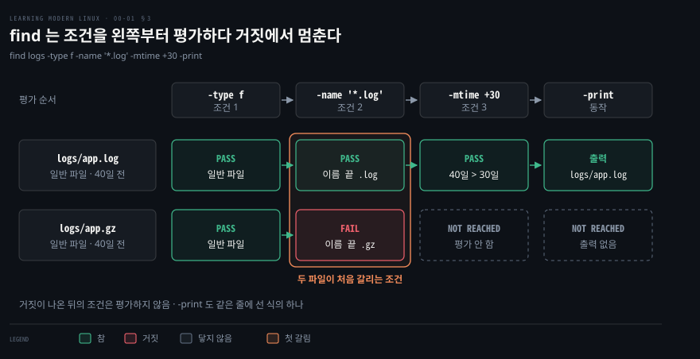
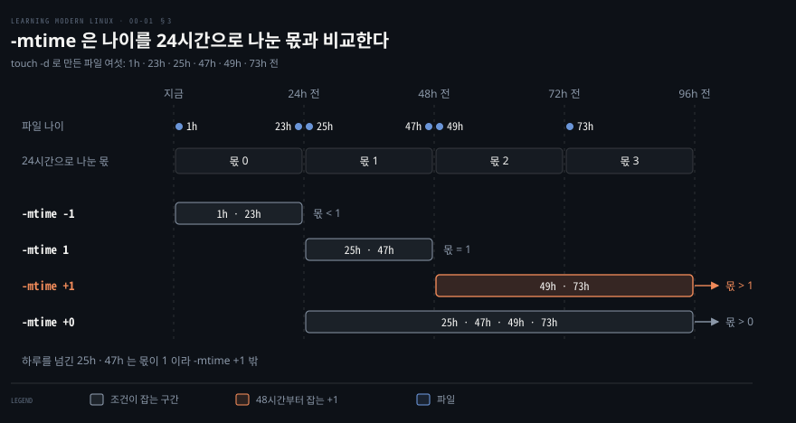
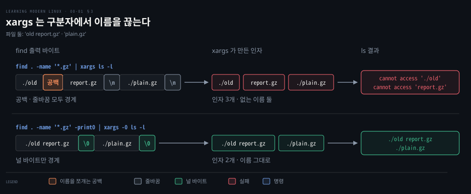

# find 참조 시트

---

> 《Learning Modern Linux》 부록 A 의 find 레시피를 풀어 적은 조회용 시트입니다. 나머지 레시피는 [함정과 레시피 참조 시트](./00-01.%ED%95%A8%EC%A0%95%EA%B3%BC%20%EB%A0%88%EC%8B%9C%ED%94%BC%20%EC%B0%B8%EC%A1%B0%20%EC%8B%9C%ED%8A%B8.md) 에 있습니다.

## 이 문서의 성격

> 정독 노트가 아니라 조회용 시트라서 학습 목표와 면접 질문을 두지 않습니다.

출력은 Debian 12 컨테이너(GNU findutils 4.9.0)에서 직접 돌려 받았습니다.


## 1. find 로 파일 찾기

> find 는 시작 경로 아래를 내려가며 파일마다 식을 왼쪽부터 평가합니다. 조건 표, 부호 읽는 법, 찾은 이름을 넘기는 법, 지우기 전 확인 순서를 모았습니다.

### 왼쪽부터 AND 로 평가

조건을 나란히 적으면 find 는 그 사이에 `-a`(AND)가 있는 것으로 읽고, 앞 조건이 거짓이면 뒤 조건을 평가하지 않습니다.[^find-and] `-print` 와 `-delete` 같은 동작도 같은 줄에 선 식이라, 왼쪽 조건이 모두 참이어야 그 자리에 닿습니다. 동작을 하나도 적지 않으면 식 전체가 참인 파일에 `-print` 가 적용됩니다.[^find-print]



```bash
# 조건을 모두 만족하는 파일만 찾는다(-a 생략)
find logs -type f -name '*.log' -mtime +30
```

```bash
logs/app.log
```

```bash
# -print 가 앞에 있어 조건 평가 전에 모든 파일과 디렉터리를 먼저 출력한다
find logs -print -type f -name '*.log' -mtime +30
```

```bash
logs
logs/app.log
logs/app.gz
logs/new.log
```

둘째 명령처럼 `-print` 를 맨 앞에 두면 조건을 보기 전에 이름부터 찍으므로 넷이 모두 나옵니다.

### 조건 옵션

| 조건 | 참이 되는 파일 | 예 |
|------|---------------|-----|
| `-name PATTERN` · `-iname PATTERN` | 디렉터리를 뗀 이름이 셸 패턴에 맞는 파일. `-iname` 은 대소문자를 가리지 않습니다 | `-name '*.conf'` |
| `-type c` | 종류가 `c` 인 파일. `f` 일반 파일, `d` 디렉터리, `l` 심볼릭 링크 | `-type f` |
| `-mtime n` · `-mmin n` | 내용이 바뀐 지 n일(24시간 단위) · n분 | `-mtime +30` · `-mmin -90` |
| `-newer FILE` | FILE 보다 나중에 바뀐 파일. 시각이 같으면 거짓입니다 | `-newer deploy.stamp` |
| `-size n[ckMG]` | 크기가 n 단위인 파일. `c` 바이트, `k` KiB, `M` MiB, `G` GiB | `-size +500M` |
| `-user NAME` · `-group NAME` | 소유자 · 그룹이 NAME 인 파일 | `-user alice` |
| `-perm MODE` | 권한 비트가 MODE 와 같은 파일. `-MODE` 는 적은 비트가 모두 켜진 파일, `/MODE` 는 하나라도 켜진 파일 | `-perm -u=x` |

탐색 범위를 정하는 옵션 둘은 조건이 아니라 전체에 적용되므로 시작 경로 바로 뒤에 적습니다.[^find-global]

| 옵션 | 하는 일 | 예 |
|------|--------|-----|
| `-maxdepth N` | 시작 경로에서 N 단계까지만 내려갑니다. 0 이면 시작 경로만 봅니다 | `find . -maxdepth 1 -type f` |
| `-xdev` | 다른 파일시스템에 있는 디렉터리로 내려가지 않습니다 | `find / -xdev -name cpuinfo` |

```bash
# 전체 경로에서 cpuinfo 검색
find / -name cpuinfo
```

```bash
/proc/cpuinfo
```

```bash
# 다른 파일시스템(-xdev)으로 내려가지 않아 /proc 안을 탐색하지 않는다
find / -xdev -name cpuinfo
```

둘째 명령은 아무것도 찍지 않습니다. `/proc` 은 따로 마운트된 파일시스템이라 `-xdev` 를 붙이면 그 안으로 들어가지 않습니다.

### -mtime 과 -size 의 부호

숫자 앞의 `+` 는 "보다 큼", `-` 는 "보다 작음"이고 부호가 없으면 "정확히 같음"입니다.[^find-num] 비교하는 값은 단위로 나눈 몫입니다. `-mtime` 은 나이를 24시간으로 나눠 소수를 버리고, `-size` 는 크기를 단위로 나눠 올립니다.[^find-round]



`touch -d '25 hours ago' 25h` 처럼 나이가 다른 파일 여섯을 만들어 돌린 결과입니다.

| 조건 | 잡힌 파일 |
|------|----------|
| `-mtime -1` · `-mtime 0` | `1h` `23h` |
| `-mtime 1` | `25h` `47h` |
| `-mtime +1` | `49h` `73h` |
| `-mtime +0` | `25h` `47h` `49h` `73h` |
| `-mmin -90` | `1h` |

`-mtime +1` 은 48시간이 지나야 잡습니다. 24시간을 넘긴 파일 전부는 `-mtime +0` 으로 적습니다.

크기는 0 · 1 · 1048576 · 1048577 · 524288000 · 524288001 바이트 파일로 확인했습니다.

| 조건 | 잡힌 크기(바이트) |
|------|------------------|
| `-size -1M` | 0 |
| `-size 1M` | 1 · 1048576 |
| `-size +1M` | 1048577 · 524288000 · 524288001 |
| `-size +500M` | 524288001 |
| `-size -1048576c` | 0 · 1 |

1바이트 파일도 올리면 1M 이라 `-size -1M` 은 빈 파일만 잡습니다. 1MiB 미만을 잡으려면 `-size -1048576c` 처럼 바이트로 적습니다.

### 따옴표 없는 패턴

`-name *.log` 처럼 따옴표를 빼면 셸이 `*.log` 를 현재 디렉터리의 파일 이름으로 먼저 바꿔서 find 에 넘깁니다.[^find-quote] 결과는 현재 디렉터리에 맞는 파일이 몇 개인지에 따라 갈립니다.

| 현재 디렉터리의 `*.log` | find 가 받는 인자 | 결과 |
|------------------------|------------------|------|
| 없음 | `-name *.log` | `./sub/c.log` 를 찾습니다. 우연히 동작한 경우입니다 |
| `a.log` | `-name a.log` | `./a.log` 만 나오고 `./sub/c.log` 를 놓칩니다. 종료 코드는 0 입니다 |
| `a.log` `b.log` | `-name a.log b.log` | `find: paths must precede expression: 'b.log'` 로 끝나고 종료 코드는 1 입니다 |

`-name '*.log'` 로 감싸면 세 경우 모두 `./a.log` `./b.log` `./sub/c.log` 가 나옵니다.

### 찾은 이름을 명령에 넘기기

| 형태 | 명령이 실행되는 횟수 | 쓰는 때 |
|------|--------------------|--------|
| `-exec CMD {} \;` | 파일마다 한 번 | 파일을 하나씩 다뤄야 할 때 |
| `-exec CMD {} +` | 이름을 명령 뒤에 모아 붙여 훨씬 적게[^find-exec] | `ls`·`chown`·`rm` 처럼 인자를 여럿 받는 명령 |
| `-print0 \| xargs -0 CMD` | xargs 가 이름을 모아 실행 | 파이프 뒤에서 xargs 옵션을 쓸 때 |

```bash
# 매칭된 파일마다 echo 명령을 한 번씩 실행한다
find . -name '*.log' -exec echo run: {} \;
```

```bash
run: ./1.log
run: ./2.log
run: ./3.log
```

```bash
# 매칭된 모든 파일 이름을 뒤에 모아 붙여 echo 명령을 한 번만 실행한다
find . -name '*.log' -exec echo run: {} +
```

```bash
run: ./1.log ./2.log ./3.log
```

파이프로 넘길 때는 구분자가 문제입니다. xargs 는 기본으로 공백과 줄바꿈에서 입력을 끊으므로 이름에 공백이 든 파일이 두 인자로 쪼개집니다.[^xargs] `-print0` 은 이름 끝에 널 바이트를 붙이고 `xargs -0` 은 널에서만 끊습니다.



```bash
# 공백이 든 파일 이름이 공백에서 둘로 쪼개져 실패한다
find . -name '*.gz' | xargs ls -l
```

```bash
ls: cannot access './old': No such file or directory
ls: cannot access 'report.gz': No such file or directory
-rw-r--r-- 1 root root 0 Nov 10 04:57 ./plain.gz
```

```bash
# 널 구분자(-print0, -0)로 공백이 든 이름도 안전하게 넘긴다
find . -name '*.gz' -print0 | xargs -0 ls -l
```

```bash
-rw-r--r-- 1 root root 0 Nov 10 04:57 ./old report.gz
-rw-r--r-- 1 root root 0 Nov 10 04:57 ./plain.gz
```

`ls` 대신 `rm` 이었다면 쪼개진 이름 `./old` 와 `report.gz` 가 삭제 대상이 됩니다. 같은 디렉터리에 `old` 라는 파일을 두고 `find . -name '*.gz' | xargs rm -f --` 를 돌려 보았습니다. `old` 가 지워지고 `old report.gz` 는 남습니다. xargs 는 입력이 비어도 명령을 한 번 실행하므로 `-r` 로 막습니다. xargs 의 나머지 쓰임은 [3장 둘째 편](./03-02.%EC%9E%90%EC%A3%BC%20%EC%B9%98%EB%8A%94%20%EA%B2%83%EC%9D%BC%EC%88%98%EB%A1%9D%20%EC%A7%A7%EC%95%84%EC%95%BC%20%ED%95%9C%EB%8B%A4.md)에 있습니다.

### 지우기 전에 -print 로 확인

`-delete` 도 식의 하나라서 조건보다 앞에 두면 시작 경로 아래를 전부 지웁니다.[^find-delete] 같은 조건에 `-print` 를 달아 목록을 먼저 보고, 그 자리만 `-delete` 로 바꿉니다.

```bash
# 지우기 전에 대상 파일 목록을 먼저 확인한다
find logs -name '*.log' -mtime +30 -print
```

```bash
logs/app.log
```

```bash
# 확인한 대상 파일만 삭제한다
find logs -name '*.log' -mtime +30 -delete
ls logs
```

```bash
keep.txt
new.log
```

같은 디렉터리를 다시 만들어 `-delete` 를 앞에 두면 조건과 상관없이 `logs` 까지 사라집니다.

```bash
# -delete 가 조건 앞에 오면 조건을 따지지 않고 logs 디렉터리까지 지운다
find logs -delete -name '*.log' -mtime +30
```

```bash
find: 'logs/new.log': No such file or directory
```

```bash
# logs 디렉터리 자체가 사라졌음을 확인한다
ls logs
```

```bash
ls: cannot access 'logs': No such file or directory
```

### find 레시피

```bash
# 바뀐 지 31일째부터인 로그 목록 확인
find /var/log -name '*.log' -mtime +30 -print

# 같은 조건으로 오래된 로그 파일 삭제
find /var/log -name '*.log' -mtime +30 -delete

# 오래된 압축 파일을 지운다(-- 뒤는 - 로 시작해도 이름으로 읽힌다, §1)
find /var/log -name '*.gz' -mtime +30 -print0 | xargs -0 -r rm -f --

# 루트 파일시스템(-xdev) 안에서 500MiB 를 넘는 파일을 나열
find / -xdev -type f -size +500M -exec ls -lh {} +

# deploy.stamp 보다 나중에 바뀐 설정 파일 찾기
find /etc -name '*.conf' -newer deploy.stamp

# alice 소유 파일의 소유자를 bob 으로 일괄 변경
find /srv/app -user alice -exec chown bob {} +
```

| 명령 | 하는 일 · 주의 |
|------|---------------|
| `find /var/log -name '*.log' -mtime +30 -print` | 바뀐 지 31일째부터인 로그 목록을 봅니다 |
| `find /var/log -name '*.log' -mtime +30 -delete` | 같은 조건으로 지웁니다 |
| `find /var/log -name '*.gz' -mtime +30 -print0 \| xargs -0 -r rm -f --` | 오래된 압축 파일을 지웁니다. `--` 뒤는 `-` 로 시작해도 이름으로 읽힙니다[^rm] |
| `find / -xdev -type f -size +500M -exec ls -lh {} +` | 루트 파일시스템 안에서 500MiB 를 넘는 파일을 나열합니다 |
| `find /etc -name '*.conf' -newer deploy.stamp` | `deploy.stamp` 보다 나중에 바뀐 설정 파일을 찾습니다 |
| `find /srv/app -user alice -exec chown bob {} +` | alice 소유 파일의 소유자를 bob 으로 바꿉니다 |


## 2. 본문으로 되돌아가는 자리

> [함정과 레시피 참조 시트](./00-01.%ED%95%A8%EC%A0%95%EA%B3%BC%20%EB%A0%88%EC%8B%9C%ED%94%BC%20%EC%B0%B8%EC%A1%B0%20%EC%8B%9C%ED%8A%B8.md) 의 같은 표에서 이 편에 해당하는 행입니다.

| 장 | 부록이 기대는 명령 |
|:--:|------------------|
| 3 | `find` |


## 관련 문서

- [함정과 레시피 참조 시트](./00-01.%ED%95%A8%EC%A0%95%EA%B3%BC%20%EB%A0%88%EC%8B%9C%ED%94%BC%20%EC%B0%B8%EC%A1%B0%20%EC%8B%9C%ED%8A%B8.md) — 부록 A 의 나머지 레시피와 그대로 치면 어긋나는 명령
- [현대 도구 참조 시트](./00-03.%ED%98%84%EB%8C%80%20%EB%8F%84%EA%B5%AC%20%EC%B0%B8%EC%A1%B0%20%EC%8B%9C%ED%8A%B8.md) — `find`·`grep` 을 갈아 끼우는 `rg`
- [3장 둘째 편 — 자주 치는 것일수록 짧아야 한다](./03-02.%EC%9E%90%EC%A3%BC%20%EC%B9%98%EB%8A%94%20%EA%B2%83%EC%9D%BC%EC%88%98%EB%A1%9D%20%EC%A7%A7%EC%95%84%EC%95%BC%20%ED%95%9C%EB%8B%A4.md) — 날짜 계산과 xargs, tmux 세션
- [Learning Modern Linux 정독 인덱스](./README.md) — 이 책의 MOC


## 참고 자료

- 《Learning Modern Linux》 Michael Hausenblas, O'Reilly Media, 2022. ISBN 978-1-098-10894-6
- man7.org 의 [find(1)](https://man7.org/linux/man-pages/man1/find.1.html) · [xargs(1)](https://man7.org/linux/man-pages/man1/xargs.1.html)

[^find-and]: [find(1)](https://man7.org/linux/man-pages/man1/find.1.html) — "Two expressions in a row are taken to be joined with an implied -a; expr2 is not evaluated if expr1 is false."

[^find-print]: [find(1)](https://man7.org/linux/man-pages/man1/find.1.html) — "The -print action is performed on all files for which the whole expression is true, unless it contains an action other than -prune or -quit."

[^find-global]: [find(1)](https://man7.org/linux/man-pages/man1/find.1.html) — "global options should be specified on the command-line after the list of start points, just before the first test, positional option or action."

[^find-num]: [find(1)](https://man7.org/linux/man-pages/man1/find.1.html) — 숫자 인자는 "+n for greater than n, -n for less than n, n for exactly n" 입니다.

[^find-round]: [find(1)](https://man7.org/linux/man-pages/man1/find.1.html) — `-atime` 항목의 "any fractional part is ignored, so to match -atime +1, a file has to have been accessed at least two days ago" 를 `-mtime` 이 그대로 따릅니다. `-size` 는 올림이라 "-size -1M is not equivalent to -size -1048576c. The former only matches empty files" 입니다.

[^find-quote]: [find(1)](https://man7.org/linux/man-pages/man1/find.1.html) 의 `-name` 항목 — "Don't forget to enclose the pattern in quotes in order to protect it from expansion by the shell."

[^find-exec]: [find(1)](https://man7.org/linux/man-pages/man1/find.1.html) — `-exec command {} +` 는 "the command line is built by appending each selected file name at the end; the total number of invocations of the command will be much less than the number of matched files" 입니다.

[^find-delete]: [find(1)](https://man7.org/linux/man-pages/man1/find.1.html) 의 `-delete` 항목 — "putting -delete first will make find try to delete everything below the starting points you specified."

[^xargs]: [xargs(1)](https://man7.org/linux/man-pages/man1/xargs.1.html) — 입력 항목은 "delimited by blanks ... or newlines" 이고, `-0` 을 주면 "Input items are terminated by a null character instead of by whitespace" 입니다. `-r` 은 입력이 비면 명령을 실행하지 않습니다.

[^rm]: [rm(1)](https://man7.org/linux/man-pages/man1/rm.1.html) — `-` 로 시작하는 이름은 `rm -- -foo` 로 지웁니다.
