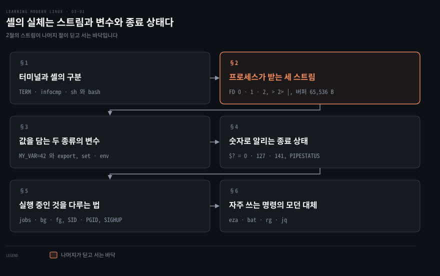
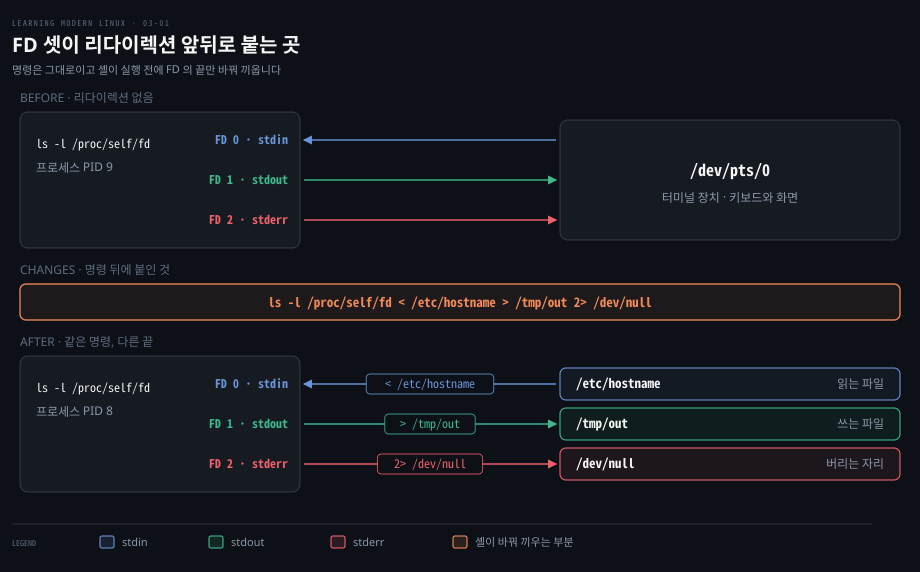
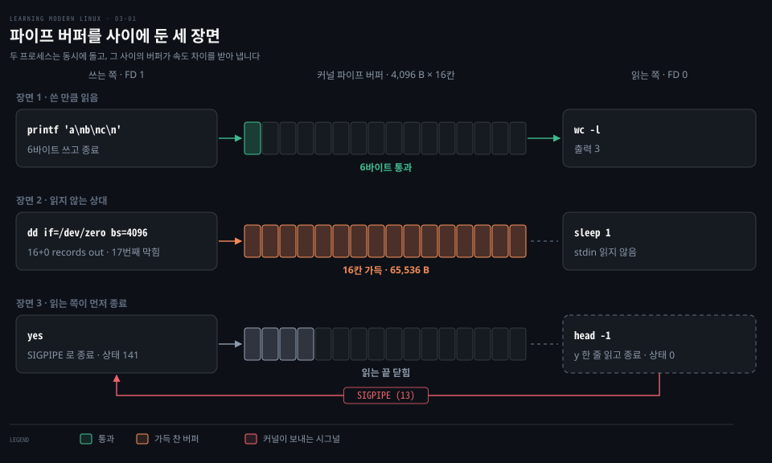
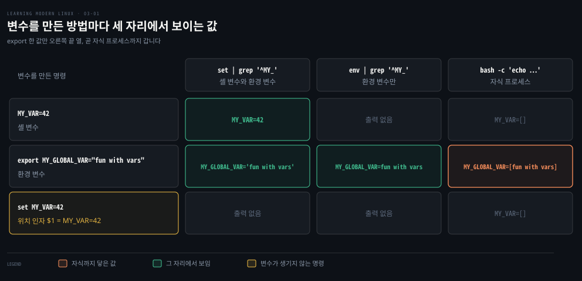
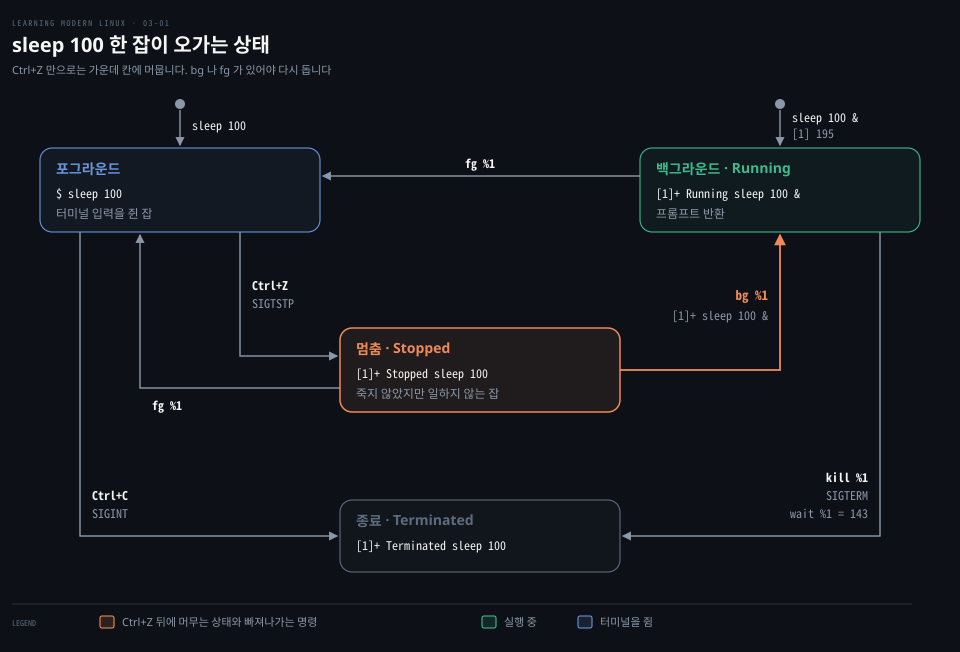
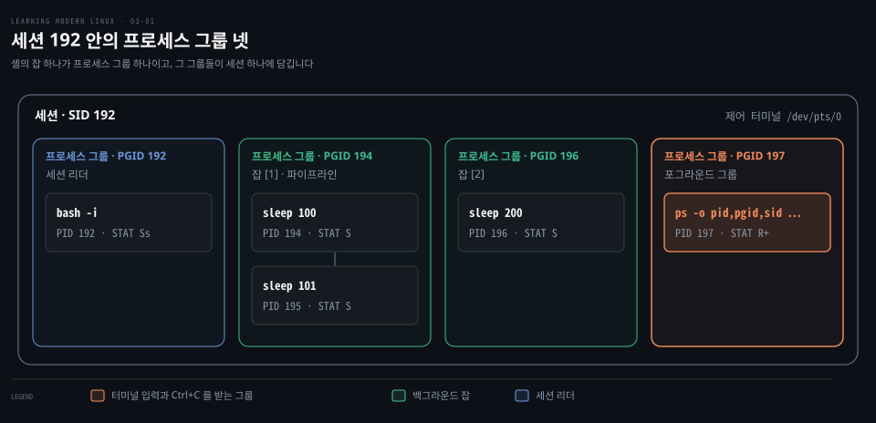
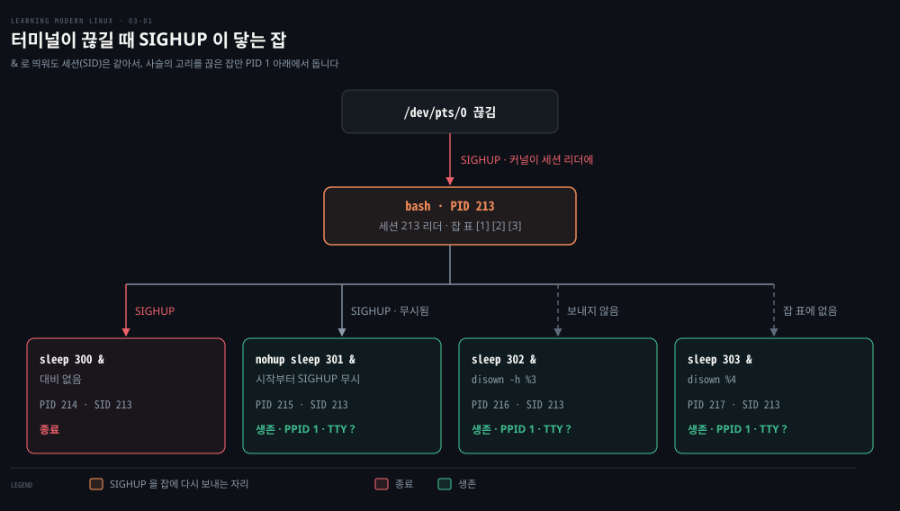

# 셸의 실체는 스트림과 변수와 종료 상태다

---

> 셸을 안다는 말은 명령을 많이 외운다는 뜻이 아닙니다. 《Learning Modern Linux》 3장 앞부분은 셸이 모든 프로세스에 무엇을 쥐여 주는지에서 시작합니다.

## 핵심 요약

> 셸은 명령 해석기이고, 그 해석기가 실제로 다루는 것은 스트림과 변수와 종료 상태 셋입니다.

저자가 셸을 정의하는 문장에 그 셋이 그대로 들어 있습니다. 셸은 터미널 안에서 도는 프로그램이며 다음을 합니다.

- 스트림으로 입출력을 다룹니다.
- 변수를 지원합니다.
- 몇 가지 내장 명령을 가집니다.
- 명령 실행과 상태를 처리합니다.
- 보통 대화형 사용과 스크립트 사용을 모두 지원합니다.

이 셋을 알면 나머지가 따라옵니다. `|` 와 `>` 가 왜 같은 문법 계열인지는 스트림에서 나옵니다. 자식 프로세스에 무엇이 물려지는지는 변수의 두 종류에서 나옵니다. 스크립트가 실패를 감지하는 방법은 종료 상태에서 나옵니다.

이 노트는 그 위에 두 가지를 더 짚습니다. 파이프 `|` 는 문법 기호이기 전에 커널이 가진 65,536바이트짜리 버퍼입니다. 그리고 터미널이 끊길 때 어느 잡이 죽는지는 세션과 `SIGHUP` 이 정합니다.


## 학습 목표

> 이 구간을 읽고 나면 아래 다섯 가지를 스스로 해낼 수 있습니다.

1. 터미널과 셸이 각각 무엇인지 구분해 말할 수 있습니다.
2. 파일 서술자 셋이 기본으로 어디에 붙어 있는지와 그 방향을 바꾸는 연산자를 설명할 수 있습니다.
3. 파이프라인의 단계가 어떻게 동시에 도는지, 버퍼가 차거나 읽는 쪽이 먼저 끝나면 무슨 일이 생기는지 말할 수 있습니다.
4. 자식 프로세스가 어느 변수를 물려받는지 가르고, 종료 상태의 값을 읽을 수 있습니다.
5. 잡의 상태를 옮기는 명령을 짝짓고, 터미널이 끊길 때 어느 잡이 살아남는지 설명할 수 있습니다.

아래는 이 문서 전체를 읽는 순서로 이은 지도입니다. 칸마다 절 번호와 그 절에서 손에 쥐게 되는 값을 적었습니다. 색이 붙은 칸이 나머지 절이 딛고 서는 바닥입니다.




## 이 문서가 다루지 않는 것

> 3장은 이 책에서 가장 긴 장이라 노트를 셋으로 나눴습니다. 이 노트는 사람이 터미널 앞에 앉아 대화형으로 치는 방식의 기초 구간입니다.

- 별칭·단축키·사람 친화 셸·터미널 멀티플렉서 → [자주 치는 것일수록 짧아야 한다](./03-02.%EC%9E%90%EC%A3%BC%20%EC%B9%98%EB%8A%94%20%EA%B2%83%EC%9D%BC%EC%88%98%EB%A1%9D%20%EC%A7%A7%EC%95%84%EC%95%BC%20%ED%95%9C%EB%8B%A4.md)
- 스크립트 작성·`pipefail` 같은 안전 옵션·린트와 테스트 → [bash 는 조용히 실패하므로 시끄럽게 만들어야 한다](./03-03.bash%20%EB%8A%94%20%EC%A1%B0%EC%9A%A9%ED%9E%88%20%EC%8B%A4%ED%8C%A8%ED%95%98%EB%AF%80%EB%A1%9C%20%EC%8B%9C%EB%81%84%EB%9F%BD%EA%B2%8C%20%EB%A7%8C%EB%93%A4%EC%96%B4%EC%95%BC%20%ED%95%9C%EB%8B%A4.md)
- 파일 권한과 `chmod 750` 의 의미 → [전부 아니면 전무에서 잘게 쪼개는 쪽으로](./04-01.%EC%A0%84%EB%B6%80%20%EC%95%84%EB%8B%88%EB%A9%B4%20%EC%A0%84%EB%AC%B4%EC%97%90%EC%84%9C%20%EC%9E%98%EA%B2%8C%20%EC%AA%BC%EA%B0%9C%EB%8A%94%20%EC%AA%BD%EC%9C%BC%EB%A1%9C.md)
- 셸이 커널에 무엇을 요청하는가 → [커널은 전부를 하지만 운영체제는 아니다](./02-01.%EC%BB%A4%EB%84%90%EC%9D%80%20%EC%A0%84%EB%B6%80%EB%A5%BC%20%ED%95%98%EC%A7%80%EB%A7%8C%20%EC%9A%B4%EC%98%81%EC%B2%B4%EC%A0%9C%EB%8A%94%20%EC%95%84%EB%8B%88%EB%8B%A4.md)
- 시그널의 종류와 프로세스가 시그널을 처리하는 방식 → [이 장을 묶는 것은 주제가 아니라 필요해지는 조건이다](./09-01.%EC%9D%B4%20%EC%9E%A5%EC%9D%84%20%EB%AC%B6%EB%8A%94%20%EA%B2%83%EC%9D%80%20%EC%A3%BC%EC%A0%9C%EA%B0%80%20%EC%95%84%EB%8B%88%EB%9D%BC%20%ED%95%84%EC%9A%94%ED%95%B4%EC%A7%80%EB%8A%94%20%EC%A1%B0%EA%B1%B4%EC%9D%B4%EB%8B%A4.md)

저자는 이 장을 시작하며 리눅스 환경을 하나 띄워 두고 예제를 바로 따라 쳐 보라고 권합니다. 이 노트에 실은 출력은 따로 밝히지 않는 한 Debian 12 컨테이너의 bash 5.2 에서 직접 돌린 것입니다.


## 1. 터미널과 셸의 구분

> 같은 창을 두고 **터미널**이라 부르기도 하고 **셸**이라 부르기도 합니다. 둘을 가르지 못하면 화면이 깨졌을 때 어느 쪽 설정을 봐야 할지 정할 수 없습니다.

창 하나에서 일어나는 일이라 둘을 한 덩어리로 보기 쉽습니다. 그러나 글자가 깨지는 것과 명령을 찾지 못하는 것은 서로 다른 프로그램의 문제입니다.

**터미널**은 텍스트 사용자 인터페이스를 제공하는 프로그램입니다. 터미널 에뮬레이터나 소프트 터미널이라는 말도 같은 것을 가리킵니다. 키보드에서 문자를 읽어 화면에 표시하는 일을 하고, 오래전에는 키보드와 화면이 붙은 통합 장치였지만 요즘은 그냥 앱입니다.

문자 입출력에 더해 터미널은 이스케이프 시퀀스를 지원합니다. 커서와 화면을 다루고 색을 내는 데 쓰이며, 예를 들어 Ctrl+H 는 백스페이스가 되어 커서 왼쪽 문자를 지웁니다.

지금 쓰는 터미널이 무엇인지는 환경 변수 `TERM` 에 있고, 그 설정은 `infocmp` 로 봅니다.

```bash
infocmp
```

저자의 출력에는 `cols#80`, `lines#24`, `colors#0x100` 이 들어 있습니다. 이 터미널이 가로 80칸과 세로 24줄, 그리고 256색(`0x100` 은 16진 표기)을 지원한다는 뜻입니다. `infocmp` 의 출력은 소화하기 쉽지 않으니 자세한 것은 terminfo 데이터베이스를 보라고 저자는 덧붙입니다.

터미널의 예로는 `xterm`·`rxvt`·Gnome terminator 가 있습니다. GPU 를 쓰는 새 세대로 저자는 Alacritty·kitty·warp 를 듭니다.

### 터미널 안에서 도는 명령 해석기

터미널만으로는 명령을 실행하지 못합니다. 문자를 받아 화면에 그릴 뿐이고, 그 문자를 명령으로 해석해 프로그램을 띄우는 일은 터미널 안에서 도는 다른 프로그램인 셸이 맡습니다. 핵심 요약의 다섯 항목이 저자가 내린 셸의 정의입니다.

셸은 형식상 `sh` 로 정의되어 있고, 그래서 POSIX 셸이라는 말을 자주 만납니다. 이 말은 스크립트와 이식성 문맥에서 더 중요해집니다.

원래는 만든 사람의 이름을 딴 Bourne 셸 `sh` 가 있었습니다. 요즘은 대개 `bash` 가 그 자리를 대신합니다. 원래 이름을 비튼 말장난이자 Bourne Again Shell 의 줄임말이며 기본값으로 널리 쓰입니다. 지금 무엇을 쓰는지 궁금하면 `file -h /bin/sh` 로 알아봅니다. 그것이 안 되면 `echo $0` 이나 `echo $SHELL` 을 씁니다.

`sh` 의 다른 구현과 변종도 많습니다. Korn 셸 `ksh` 나 C 셸 `csh` 같은 것인데 요즘 널리 쓰이지는 않습니다. 저자는 이 절 이후 모든 예제에서 별도로 밝히지 않는 한 bash 를 전제하고, 이 노트도 같습니다.


## 2. 프로세스가 받는 세 스트림

> 명령의 출력을 화면 대신 파일에 담거나 다른 명령에 넘기려면, 그 출력이 지금 어디에 붙어 있는지부터 알아야 합니다. 셸은 프로세스마다 입출력 통로 셋을 쥐여 줍니다.

셸은 모든 프로세스에 입출력용 **파일 서술자**(file descriptor, FD) 셋을 기본으로 쥐여 줍니다. 파일 서술자는 프로세스가 열어 둔 파일이나 장치를 가리키는 번호입니다.

| 이름 | 번호 | 기본으로 붙는 곳 |
|---|---|---|
| `stdin` | FD 0 | 키보드 |
| `stdout` | FD 1 | 화면 |
| `stderr` | FD 2 | 화면 |

달리 지정하지 않는 한, 셸에 입력한 명령은 키보드에서 입력을 받고 화면에 출력을 내놓습니다. 키보드와 화면은 프로세스 쪽에서 보면 터미널 장치 파일 하나입니다.

리눅스는 프로세스가 연 파일 서술자를 `/proc/<PID>/fd` 에 링크로 보여 줍니다. 터미널에서 `ls` 자신의 것을 찍어 보면 셋이 같은 장치를 가리킵니다. 아래 출력에서 권한과 시각 열은 덜어 냈습니다.

```bash
ls -l /proc/self/fd
```

```bash
0 -> /dev/pts/0
1 -> /dev/pts/0
2 -> /dev/pts/0
3 -> /proc/9/fd
```

`/dev/pts/0` 이 이 터미널이고, FD 3 은 `ls` 가 목록을 읽으려고 연 디렉토리입니다. 기본값을 쓰고 싶지 않을 때, 이를테면 `stderr` 를 화면에 뿌리지 않고 파일에 담고 싶을 때 이 연결의 끝을 다른 곳으로 옮깁니다.

### 방향을 바꾸는 연산자

방향 바꾸기는 `$FD>` 와 `<$FD` 로 하며 `$FD` 가 파일 서술자 번호입니다.

| 연산자 | 옮기는 것 |
|---|---|
| `> 파일` | `stdout` 을 파일로. `stdout` 이 기본이라 `1>` 과 같습니다 |
| `2> 파일` | `stderr` 만 파일로 |
| `&> 파일` | `stdout` 과 `stderr` 를 함께 |
| `< 파일` | `stdin` 을 파일에서 읽도록 |
| `> /dev/null` | 그 스트림을 버림 |

저자가 드는 예는 네 줄입니다.

```bash
# `stdout` 과 `stderr` 를 모두 `/dev/null` 로 보내 전부 버립니다.
curl https://example.com &> /dev/null

# 출력과 상태를 서로 다른 파일로 갈라 담습니다.
curl https://example.com > /tmp/content.txt 2> /tmp/curl-status

# 대화형으로 입력받아 파일에 저장하며, Ctrl+D 로 입력을 끝냅니다.
cat > /tmp/interactive-input.txt

# `stdin` 에서 읽는 `tr` 로 대문자를 소문자로 바꿉니다.
tr < /tmp/curl-status [A-Z] [a-z]
```

갈라 담기가 실제로 되는지는 성공과 실패가 한 번에 나오는 명령으로 확인합니다. 있는 파일과 없는 파일을 함께 `ls` 에 넘기면 정상 출력과 오류가 각각 다른 파일에 떨어집니다.

```bash
ls /etc/hostname /nope > ok.txt 2> err.txt
cat ok.txt
cat err.txt
```

```bash
/etc/hostname                                          # ok.txt — FD 1(stdout) 로 나간 정상 출력
ls: cannot access '/nope': No such file or directory   # err.txt — FD 2(stderr) 로 나간 오류
```

```bash
# 리다이렉션을 건 채로 서술자 표를 찍음
ls -l /proc/self/fd < /etc/hostname > /tmp/out 2> /dev/null

cat /tmp/out
```

```bash
0 -> /etc/hostname   # < 가 바꿔 끼운 stdin
1 -> /tmp/out        # > 가 바꿔 끼운 stdout
2 -> /dev/null       # 2> 가 바꿔 끼운 stderr
3 -> /proc/8/fd      # ls 가 이 디렉터리를 읽으려고 연 서술자
# 셸이 ls 를 띄우기 전에 바꿔 끼웠으므로 ls 는 행선지를 모른 채 FD 1 에 쓸 뿐입니다
```



### 셸이 알아듣는 특수 문자 셋

| 문자 | 하는 일 |
|---|---|
| `&` | 명령 끝에 두면 그 명령을 백그라운드에서 실행합니다. 5절이 이어 다룹니다 |
| `\` | 다음 줄로 명령을 이어 갑니다. 긴 명령의 가독성을 위한 것입니다 |
| `\|` | 한 프로세스의 `stdout` 을 다음 프로세스의 `stdin` 에 잇습니다. 임시 파일 없이 데이터를 넘깁니다 |

파이프를 실제로 써 보는 예로 저자는 HTML 파일의 줄 수를 셉니다.

```bash
curl https://example.com 2> /dev/null | \
     wc -l
```

```bash
46
```

`curl` 로 내려받되 `stderr` 로 나오는 상태 표시는 버립니다. 그리고 `curl` 의 `stdout` 을 `wc` 의 `stdin` 에 먹여 `-l` 옵션으로 줄 수를 셉니다. 저자는 실무라면 `curl` 의 `-s` 옵션을 쓰겠지만 여기서는 방금 배운 것을 적용해 본 것이라고 덧붙입니다.

### 파이프라인이 실제로 이어지는 방식

`a | b` 를 "a 가 끝나면 그 출력을 b 에 넘긴다" 로 읽으면 두 가지를 설명하지 못합니다. `yes | head -1` 은 `yes` 가 끝없이 출력하는 명령인데도 곧바로 끝납니다. 그리고 읽는 쪽이 느리면 쓰는 쪽이 멈춥니다. 둘 다 파이프라인이 이어지는 실제 방식에서 나옵니다.

**첫째로 셸은 단계마다 프로세스를 따로 띄워 한꺼번에 돌립니다.**[^bashpipe] 

2초짜리 명령 둘을 파이프로 이으면 4초가 아니라 2초가 걸립니다.

```bash
time (sleep 2 | sleep 2)
```

```bash
real	0m2.002s
user	0m0.000s
sys	0m0.002s
```

**둘째로 두 프로세스 사이에는 커널이 가진 버퍼가 있습니다.** 

파이프는 용량이 정해져 있고, 리눅스에서는 페이지가 4,096바이트일 때 16페이지, 곧 65,536바이트입니다.[^pipe7] 버퍼가 차면 쓰는 쪽의 `write` 가 읽는 쪽이 자리를 비울 때까지 멈춰 기다립니다. 읽는 쪽이 느리다고 데이터가 버려지거나 메모리가 끝없이 불어나지 않는 이유입니다.

용량은 읽지 않는 명령에 쓰기를 밀어 넣어 잴 수 있습니다. `sleep` 은 `stdin` 을 읽지 않으므로 버퍼가 차기만 합니다. `dd` 에 `oflag=nonblock` 을 주면 꽉 찼을 때 기다리는 대신 오류를 내고 그때까지 쓴 양을 알려 줍니다.

```bash
dd if=/dev/zero bs=4096 oflag=nonblock 2> /tmp/dd.err | sleep 1
cat /tmp/dd.err
```

```bash
dd: error writing 'standard output': Resource temporarily unavailable
17+0 records in
16+0 records out
65536 bytes (66 kB, 64 KiB) copied, 7.0125e-05 s, 935 MB/s
```

4,096바이트 블록 16개가 들어가고 17번째에서 막혔습니다. 16 × 4,096 = 65,536 이 그 용량입니다.

**셋째로 읽는 쪽이 먼저 끝나면 쓰는 쪽은 시그널을 받습니다.** 

파이프의 읽는 끝을 연 프로세스가 하나도 남지 않으면, 거기에 쓰려는 프로세스에 커널이 `SIGPIPE` 를 보냅니다.[^pipe7] `SIGPIPE` 의 기본 동작은 종료입니다.[^signal7] `head -1` 이 한 줄을 읽고 끝나면 `yes` 가 다음 쓰기에서 이 시그널을 받아 죽으므로 파이프라인 전체가 끝납니다.

```bash
yes | head -1
echo "${PIPESTATUS[@]}"
```

```bash
y
141 0
```

`PIPESTATUS` 는 방금 끝난 파이프라인의 단계별 종료 상태를 담는 bash 배열입니다.[^bashvar] `yes` 의 141 은 128 에 `SIGPIPE` 의 번호 13 을 더한 값입니다. bash 는 시그널로 죽은 명령의 종료 상태를 그렇게 매깁니다.[^bashexit]

**넷째로 파이프라인의 종료 상태는 마지막 명령의 것입니다.**[^bashpipe] 

앞 단계가 실패해도 마지막이 성공하면 `$?` 는 0 입니다.

```bash
false | true; echo "$? / ${PIPESTATUS[@]}"
```

```bash
0 / 1 0
```

종료 상태의 값을 읽는 법은 [4절](#4-숫자로-알리는-종료-상태)이 맡습니다. 중간 실패를 파이프라인 전체의 실패로 바꾸는 `pipefail` 옵션은 [스크립트 노트](./03-03.bash%20%EB%8A%94%20%EC%A1%B0%EC%9A%A9%ED%9E%88%20%EC%8B%A4%ED%8C%A8%ED%95%98%EB%AF%80%EB%A1%9C%20%EC%8B%9C%EB%81%84%EB%9F%BD%EA%B2%8C%20%EB%A7%8C%EB%93%A4%EC%96%B4%EC%95%BC%20%ED%95%9C%EB%8B%A4.md)가 다룹니다.

아래 도식은 위의 세 실험을 한 장에 놓은 것입니다. 가운데 칸 열여섯이 4,096바이트 페이지 하나씩입니다.




## 3. 값을 담는 두 종류의 변수

> 값을 하드코딩하고 싶지 않거나 할 수 없을 때 변수를 씁니다. 문제는 그 변수가 어디까지 따라가느냐입니다.

저자가 드는 쓰임새는 셋입니다.

1. 리눅스가 드러내는 설정 항목을 다룰 때입니다. 셸이 실행 파일을 찾는 자리를 담은 `$PATH` 가 그런 예입니다.
2. 스크립트 문맥에서 사용자에게 값을 대화형으로 물을 때입니다.
3. 긴 값을 한 번만 정의해 입력을 줄일 때입니다. HTTP API 의 URL 같은 것이 여기 들고, 프로그래밍 언어의 상수에 가깝습니다.

종류는 둘입니다. 둘을 가르는 것은 상속입니다. 셸 변수는 자식 프로세스가 물려받지 못합니다.

1. **환경 변수**는 셸 전체 설정이고 `env` 로 나열합니다. 
2. **셸 변수**는 지금 실행의 문맥에서만 유효하며 bash 에서는 `set` 으로 나열합니다. 

bash 에서 셸 변수는 `이름=값` 으로 만듭니다. 환경 변수는 거기에 `export` 를 붙여 만듭니다. 값을 읽을 때는 앞에 `$` 를 붙이고 없앨 때는 `unset` 을 씁니다.

하나씩 만든 뒤 세 자리에서 찾아보면 차이가 드러납니다.

```bash
# 셸 변수
MY_VAR=42

# 환경변수
export MY_GLOBAL_VAR="fun with vars"

set | grep '^MY_'  # 셸 변수
env | grep '^MY_'  # 환경 변수
bash -c 'echo "MY_VAR=[$MY_VAR] MY_GLOBAL_VAR=[$MY_GLOBAL_VAR]"'
```

```bash
# 출력
MY_GLOBAL_VAR='fun with vars'
MY_VAR=42
MY_GLOBAL_VAR=fun with vars
MY_VAR=[] MY_GLOBAL_VAR=[fun with vars]
```

앞의 두 줄이 `set` 의 출력이고 셋째 줄이 `env` 의 출력입니다. `MY_VAR` 는 `set` 에만 나오고, 새로 띄운 자식 `bash` 에서는 비어 있습니다.



### 실행 전에 셸이 하는 `$` 확장

`$` 를 붙여 변수 값을 읽는 일을 매개변수 확장(parameter expansion)이라 합니다. 이 확장은 셸이 명령을 실행하기 전에 끝냅니다.[^bashexp] `echo` 같은 명령은 변수가 있었는지 모르고, 셸이 값을 넣어 바꾼 줄만 받습니다.

`set -x` 를 켜면 셸이 바꾼 뒤의 줄을 `+` 뒤에 찍어 주므로, 확장이 일어났는지 막혔는지를 눈으로 볼 수 있습니다. 아래 네 줄은 같은 `$TARGET` 을 다르게 감싼 것입니다. 출력은 Linux 의 bash 에서 잰 것입니다. 맥 터미널의 기본 셸인 zsh 에 oh-my-zsh 같은 설정이 있으면 프롬프트를 그리는 함수까지 추적되어 줄이 수십 개 늘어납니다. 그때는 먼저 `bash --norc` 로 들어가서 칩니다.

```bash
TARGET=world
set -x   # 앞으로 실행할 줄을, 셸이 바꾼 뒤의 모양으로 + 뒤에 찍는다

echo hello $TARGET     # 그대로 두면 값으로 바뀐다
echo "hello $TARGET"   # 큰따옴표 안에서도 바뀐다
echo 'hello $TARGET'   # 작은따옴표 안은 전부 글자 그대로 남는다
echo hello \$TARGET    # 백슬래시는 바로 뒤 글자 하나만 막는다

set +x   # 추적을 끈다
```

```bash
+ echo hello world
hello world
+ echo 'hello world'
hello world
+ echo 'hello $TARGET'
hello $TARGET
+ echo hello '$TARGET'
hello $TARGET
+ set +x
```

둘째 줄에서 따옴표가 다시 보이는 것은 `hello world` 가 한 단어로 묶였기 때문입니다. 확장을 막는 방법은 둘입니다. 백슬래시는 바로 뒤 글자 하나의 특별한 뜻을 없애고, 작은따옴표는 안쪽 글자 전부를 그대로 둡니다.[^bashquote] 큰따옴표는 `$` 와 백틱과 `\` 같은 몇 글자만 예외로 두고 나머지를 그대로 두므로, 그 안에서 `$` 는 여전히 확장됩니다.

큰따옴표 밖에서 확장한 결과는 `IFS` 에 든 문자를 기준으로 단어로 쪼개집니다.[^bashexp] 값에 공백이 있으면 한 값이 여러 인자로 갈라진다는 뜻입니다.

```bash
FILE="my notes.txt"
printf '[%s]\n' $FILE     # 큰따옴표 없음: 확장 결과가 공백에서 두 단어로 쪼개진다
printf '[%s]\n' "$FILE"   # 큰따옴표 있음: 한 단어로 남는다
```

```bash
[my]
[notes.txt]
[my notes.txt]
```

그래서 값에 공백이 들어 있을 수 있는 변수는 보통 `"$FILE"` 처럼 감싸서 씁니다. `IFS` 가 무엇인지는 [아래 변수 표](#알아-둘-만한-변수들)의 `IFS` 행에 있고, 따옴표를 빠뜨려 생기는 사고는 [03-03 의 변수 보호와 단어 분리](./03-03.bash%20%EB%8A%94%20%EC%A1%B0%EC%9A%A9%ED%9E%88%20%EC%8B%A4%ED%8C%A8%ED%95%98%EB%AF%80%EB%A1%9C%20%EC%8B%9C%EB%81%84%EB%9F%BD%EA%B2%8C%20%EB%A7%8C%EB%93%A4%EC%96%B4%EC%95%BC%20%ED%95%9C%EB%8B%A4.md#변수-보호와-단어-분리)가 다룹니다.

### `set` 의 세 쓰임과 위치 인자

`set` 은 이름 하나로 세 가지 일을 하고, 어느 일인지는 뒤에 오는 인자가 가릅니다.

```bash
# 인자 없음: 셸 변수와 함수를 나열한다. 위에서 쓴 set | grep 이 이것이다
set | grep '^MY_'

# -로 시작하는 옵션: 셸이 동작하는 방식을 바꾼다. 켜는 방법은 03-03 이 다룬다
# (대화형 셸에서 set -e 를 켜면 실패한 명령 하나에 셸이 끝나므로, 여기서는 상태만 본다)
set -o | grep -E '^(errexit|pipefail)'

# 옵션이 아닌 값: 위치 인자 $1, $2 … 를 그 값으로 채운다. -- 뒤의 값은 - 로 시작해도 옵션이 아니다
set -- dev 3
echo "\$1=[$1] \$2=[$2]"
```

```bash
errexit        	off
pipefail       	off
$1=[dev] $2=[3]
```

`set -e` 와 `set -o pipefail` 이 스크립트에서 하는 일은 [03-03 의 기본 실패 차단](./03-03.bash%20%EB%8A%94%20%EC%A1%B0%EC%9A%A9%ED%9E%88%20%EC%8B%A4%ED%8C%A8%ED%95%98%EB%AF%80%EB%A1%9C%20%EC%8B%9C%EB%81%84%EB%9F%BD%EA%B2%8C%20%EB%A7%8C%EB%93%A4%EC%96%B4%EC%95%BC%20%ED%95%9C%EB%8B%A4.md#기본-실패-차단과-세미콜론의-함정)에 있습니다.

위치 인자 `$1`, `$2` 는 스크립트를 실행할 때 파일 이름 뒤에 붙인 값입니다. `set` 의 세 번째 쓰임은 같은 자리를 셸 안에서 직접 채우는 것입니다.[^bashpos]

```bash
# 값 두 개를 붙여 스크립트를 실행한다
cat > deploy.sh <<'EOF'
echo "\$1=[$1] \$2=[$2]"
EOF
bash deploy.sh dev 3
rm deploy.sh   # 실습 파일을 지운다
```

```bash
$1=[dev] $2=[3]
```

`bash deploy.sh dev 3` 으로 실행하면 스크립트 안에서 `$1` 은 `dev` 이고 `$2` 는 `3` 입니다.

### 대입과 삭제에서 틀리기 쉬운 두 곳

bash 는 잘못 쓴 대입과 삭제를 오류로 알려 주지 않아서, 변수가 만들어지지 않았거나 지워지지 않은 채로 다음 줄이 실행됩니다. 틀리기 쉬운 곳은 둘입니다.

첫째는 대입에 `set` 을 붙이는 것입니다. `set` 은 셸 옵션과 위치 인자를 다루는 내장 명령이라, 옵션 뒤에 남은 인자를 `$1`, `$2` 에 차례로 넣습니다.[^bashset] `set MY_VAR=42` 는 변수를 만들지 않고 `$1` 을 문자열 `MY_VAR=42` 로 만듭니다.

```bash
unset MY_VAR   # 앞 블록에서 만든 값이 남아 있지 않게 지운다
set MY_VAR=42
echo "MY_VAR=[$MY_VAR] \$1=[$1]"
```

```bash
MY_VAR=[] $1=[MY_VAR=42]
```

첫 줄의 `unset` 을 빼고 앞 블록에서 이어 치면 첫 칸이 `MY_VAR=[42]` 로 나옵니다. 앞에서 만든 셸 변수가 그대로 보이는 것일 뿐이고, `$1` 에 `MY_VAR=42` 가 들어간 것은 같습니다. `set` 이 변수가 아니라 위치 인자를 채웠다는 증거는 `$1` 쪽에 있습니다.

둘째는 `unset` 에 `$` 를 붙이는 것입니다. `unset $MY_VAR` 는 변수의 값을 먼저 펼친 뒤 그 값을 이름으로 삼습니다. 그래서 지우려던 변수가 살아남습니다.

```bash
MY_VAR=42; unset $MY_VAR; echo "after unset \$MY_VAR: [$MY_VAR]"
unset MY_VAR; echo "after unset MY_VAR: [${MY_VAR-unset}]"
```

```bash
after unset $MY_VAR: [42]
after unset MY_VAR: [unset]
```

### 알아 둘 만한 변수들

저자가 표로 모아 둔 것 가운데 자주 만나는 것만 옮깁니다. 값은 `echo $XXX` 로 봅니다.

| 변수 | 종류 | 뜻 |
|---|---|---|
| `PATH` | POSIX | 셸이 실행 프로그램을 찾는 디렉토리 목록 |
| `HOME` | POSIX | 현재 사용자의 홈 디렉토리 경로 |
| `IFS` | POSIX | 필드를 가르는 문자 목록. 셸이 확장 시 단어를 쪼갤 때 씀 |
| `EDITOR` | 환경 | 파일을 편집할 때 기본으로 쓰는 프로그램의 경로 |
| `PS1` | 환경 | 지금 쓰는 주 프롬프트 문자열 |
| `PWD` · `OLDPWD` | 환경 · bash | 작업 디렉토리의 전체 경로와 직전 `cd` 이전의 경로 |
| `SHELL` · `TERM` | 환경 | 지금 쓰는 셸과 터미널 에뮬레이터 |
| `UID` · `USER` | 환경 | 현재 사용자의 고유 ID 와 이름 |
| `RANDOM` | bash | 0 과 32767 사이의 난수 |
| `?` | bash | 종료 상태 |
| `$` · `0` | bash | 현재 프로세스의 ID 와 이름 |
| `_` | bash | 포그라운드에서 마지막으로 실행한 명령의 마지막 인자 |

여기에 bash 변수 하나를 더 알아 둘 만합니다. `history` 는 기본으로 번호와 명령만 보여 주므로 그 명령을 언제 쳤는지는 알 수 없습니다. `HISTTIMEFORMAT` 에 `strftime` 형식 문자열을 넣으면 `history` 가 항목마다 시각을 함께 찍습니다. 이 변수가 설정돼 있으면 셸이 이력 파일에도 시각을 적어 두므로 다음 세션에서도 남습니다.[^bashvar]

```bash
HISTTIMEFORMAT="%F %T  "
uptime > /dev/null
history 3
```

```bash
   20  2026-11-10 02:17:04  HISTTIMEFORMAT="%F %T  "
   21  2026-11-10 02:17:04  uptime > /dev/null
   22  2026-11-10 02:17:04  history 3
```


## 4. 숫자로 알리는 종료 상태

> 명령이 잘 끝났는지를 셸은 말이 아니라 숫자로 전달받습니다. 이 숫자를 읽지 않으면 스크립트는 앞 명령이 실패한 줄 모르고 다음 줄로 넘어갑니다.

셸은 명령 실행이 끝났다는 것을 **종료 상태**로 호출자에게 알립니다. 

리눅스 명령은 끝날 때 상태를 돌려주도록 기대됩니다. 종료 상태 0 은 오류 없이 성공했다는 뜻이고, 1 과 255 사이의 0 이 아닌 값은 실패를 알립니다. 직전 명령의 값은 `echo $?` 로 봅니다.

```bash
ls /etc/hostname > /dev/null; echo "ok=$?"
ls /nope 2> /dev/null; echo "fail=$?"
grep -q nothing /etc/hostname; echo "grep=$?"
nosuchcmd 2> /dev/null; echo "notfound=$?"
```

```bash
ok=0
fail=2
grep=1
notfound=127
```

0 이 아닌 값이 무엇을 뜻하는지는 명령마다 다릅니다. `grep` 의 1 은 오류가 아니라 맞는 줄이 없었다는 뜻입니다. 다만 몇몇 값은 셸이 정해 둡니다.[^bashexit]

| 값 | 뜻 |
|---|---|
| 0 | 성공 |
| 126 | 명령을 찾았지만 실행할 수 없음 |
| 127 | 명령을 찾지 못함 |
| 128 + N | 시그널 N 으로 종료됨. `SIGPIPE`(13)면 141, `SIGTERM`(15)이면 143 |

파이프라인에서는 `$?` 가 마지막 명령의 상태만 담습니다. 중간 명령의 상태는 2절에서 본 `PIPESTATUS` 배열에 남습니다. 아래에서 `grep -c` 는 맞는 줄이 없어 1 로 끝났지만 `$?` 만 보면 그 사실이 보이지 않습니다.

```bash
grep -c nothing /etc/hostname | sort | cat
echo "${PIPESTATUS[@]}"
```

```bash
0
1 0 0
```

### 내장 명령과 그 밖의 것

같은 이름의 명령이 셸 안에도 있고 디스크에도 있을 수 있어서, 지금 실행되는 것이 어느 쪽인지 모르면 옵션이 왜 다르게 먹는지 설명하지 못합니다. 셸에는 내장 명령이 여럿 딸려 옵니다. 저자가 드는 예는 `yes`·`echo`·`cat`·`read` 입니다. 배포판에 따라 이 가운데 일부는 내장이 아니라 `/usr/bin` 에 있을 수도 있다고 저자는 단서를 붙입니다.

내장 목록은 `help` 명령으로 봅니다. 그 밖의 모든 것은 셸 외부 프로그램이고 보통 사용자 명령은 `/usr/bin`, 관리 명령은 `/usr/sbin` 에 있습니다. 어느 쪽인지는 `type` 이 알려 줍니다.

```bash
type cd
type -a echo
command -v ls
```

```bash
cd is a shell builtin
echo is a shell builtin
echo is /usr/bin/echo
echo is /bin/echo
/usr/bin/ls
```

`echo` 는 내장과 외부 프로그램이 둘 다 있고, 셸은 내장을 먼저 씁니다. 경로를 찾을 때 저자는 `which ls` 도 함께 보이는데, 기술 감수자의 지적을 그대로 실어 둡니다. `which` 는 POSIX 가 아닌 외부 프로그램이라 항상 있으리라는 보장이 없습니다. 그러니 프로그램 경로나 셸 별칭·함수를 얻는 데는 `command -v` 를 쓰라는 것입니다.


## 5. 실행 중인 것을 다루는 법

> 명령 하나가 화면과 키보드를 쥐고 놓지 않으면 그 터미널에서는 다른 일을 하지 못합니다. 셸은 명령을 잡으로 묶어 앞뒤로 옮기게 해 주는데, 터미널이 끊길 때 그 잡이 어떻게 되는지는 따로 알아야 합니다.

기본적으로 명령을 입력하면 그 명령이 화면과 키보드를 쥡니다. 이것을 포그라운드에서 돈다고 말하고, 그 명령이 끝날 때까지 같은 터미널에서 다른 명령을 치지 못합니다. 이 막힘을 풀려고 대부분의 셸이 지원하는 기능이 **잡 컨트롤**입니다. 명령 끝에 `&` 를 붙이면 백그라운드로 띄워지고 셸이 곧바로 프롬프트를 돌려줍니다.

bash 는 파이프라인 하나를 잡 하나로 칩니다.[^bashjob] 백그라운드로 띄우면 잡 번호와 PID 를 한 줄 찍고, `jobs -l` 이 지금의 잡을 PID 와 함께 나열합니다.

```bash
sleep 100 | sleep 101 &
sleep 200 &
jobs -l
```

```bash
[1] 195                                         # 잡 1. 195 는 파이프라인 마지막 프로세스(sleep 101)의 PID
[2] 196                                         # 잡 2. 프로세스가 하나라 196 이 곧 sleep 200
[1]-   194 Running                 sleep 100     # -l 이 PID 를 함께 찍는다. 194 는 잡 1 의 첫 프로세스
       195                       | sleep 101 &   # 같은 잡의 둘째 줄. 앞의 | 는 194 와 파이프로 이어졌다는 표시
[2]+   196 Running                 sleep 200 &
```

대괄호 안이 잡 번호입니다. 1번 잡은 프로세스가 둘인 파이프라인입니다. 띄울 때 찍힌 195 는 그 마지막 프로세스의 PID 입니다.

`+` 가 붙은 것이 현재 잡이고 `-` 가 그 직전 잡입니다. 잡을 가리킬 때는 `%1` 처럼 `%` 에 번호를 붙입니다. 번호 없이 `fg` 나 `bg` 를 치면 현재 잡에 적용됩니다.

### 잡의 상태를 옮기는 명령

이미 포그라운드에서 돌고 있는 명령은 `&` 를 뒤늦게 붙일 수 없으므로, 먼저 멈춘 뒤 백그라운드에서 이어 돌리는 두 걸음이 필요합니다. Ctrl+Z 는 그 첫걸음일 뿐입니다. 프로세스를 멈추고 셸에 제어를 돌려줄 뿐 백그라운드에서 계속 돌리지는 않습니다.[^bashjob]

| 하려는 일 | 명령 |
|---|---|
| 처음부터 백그라운드로 띄우기 | `명령 &` |
| 포그라운드 잡을 멈추기 | Ctrl+Z |
| 멈춘 잡을 백그라운드에서 이어 돌리기 | `bg %1` |
| 잡을 포그라운드로 가져오기 | `fg %1` |
| 잡을 끝내기 | `kill %1`, 포그라운드라면 Ctrl+C |
| 잡이 끝나기를 기다려 종료 상태 받기 | `wait %1` |

아래는 잡 하나를 멈췄다가 백그라운드에서 이어 돌리고 끝낸 기록입니다. 키 입력을 스크립트로 재현하느라 Ctrl+Z 대신 그 키가 보내는 시그널 `SIGTSTP` 를 `kill -TSTP` 로 보냈습니다.

```bash
sleep 100 &
kill -TSTP %1
jobs -l
bg %1
jobs -l
kill %1
wait %1
echo "wait=$?"
```

```bash
[1] 195
[1]+   195 Stopped                 sleep 100
[1]+ sleep 100 &
[1]+   195 Running                 sleep 100 &
[1]+  Terminated              sleep 100
wait=143
```

출력 여섯 줄은 `kill` 두 줄을 뺀 나머지 명령 여섯이 차례로 낸 것입니다. `Stopped` 인 동안 잡은 죽지 않았지만 일도 하지 않습니다. `bg %1` 뒤에야 `Running` 으로 돌아옵니다. 마지막의 143 은 `kill` 이 기본으로 보내는 `SIGTERM`(15)에 128 을 더한 값입니다.



### 세션과 제어 터미널

잡 번호는 그 셸 안에서만 통하므로, 다른 터미널에서 저 창에 무엇이 도는지 보거나 터미널이 끊길 때 어디까지 영향이 가는지 따지려면 잡 번호로는 부족합니다. 커널이 프로세스를 묶는 단위를 봐야 합니다.

커널에는 셸의 잡 컨트롤을 받치려고 만든 묶음이 둘 있습니다.[^cred] **프로세스 그룹**은 파이프라인 하나의 프로세스를 묶은 것입니다. 셸의 잡 하나가 프로세스 그룹 하나입니다.

**세션**은 프로세스 그룹을 묶은 것이고 세션을 만든 프로세스를 세션 리더라 부릅니다. 터미널에 로그인했을 때는 로그인 셸이 그 자리에 있습니다. 두 용어의 정의는 [커널 노트의 3절](./02-01.%EC%BB%A4%EB%84%90%EC%9D%80%20%EC%A0%84%EB%B6%80%EB%A5%BC%20%ED%95%98%EC%A7%80%EB%A7%8C%20%EC%9A%B4%EC%98%81%EC%B2%B4%EC%A0%9C%EB%8A%94%20%EC%95%84%EB%8B%88%EB%8B%A4.md#3-세션에서-태스크까지-이름-다섯이-한-구조체로-모인다)에 있습니다.

한 세션의 프로세스는 **제어 터미널** 하나를 함께 씁니다. 세션 리더가 터미널을 처음 열 때 그 터미널이 세션의 제어 터미널이 됩니다. 세션 안에서 포그라운드 프로세스 그룹은 하나뿐이고, 그 그룹만 터미널에서 입력을 읽으며 Ctrl+C 같은 키가 만드는 시그널을 받습니다.[^cred]

지금 셸이 어느 터미널에 붙어 있는지는 `tty` 가, 셸의 PID 는 `$$` 가 알려 줍니다. tty 는 전신 타자기(teletypewriter)에서 온 이름으로 터미널 장치를 뜻합니다. `tty` 명령은 표준 입력에 이어진 터미널의 파일 이름을 찍고, 그 이름의 `pts` 는 가상 터미널입니다.[^ttyname] 앞 절의 잡 둘을 띄운 상태에서 `ps` 에 PGID 와 SID 열을 달라고 하면 이 묶음이 번호로 보입니다.

```bash
tty
echo $$
ps -o pid,ppid,pgid,sid,tty,stat,cmd
```

```bash
/dev/pts/0
192
    PID    PPID    PGID     SID TT       STAT CMD
    192     190     192     192 pts/0    Ss   bash --norc --noprofile -i
    194     192     194     192 pts/0    S    sleep 100
    195     192     194     192 pts/0    S    sleep 101
    196     192     196     192 pts/0    S    sleep 200
    197     192     197     192 pts/0    R+   ps -o pid,ppid,pgid,sid,tty,stat,c
```

SID 는 모두 192 이고 그것이 `bash` 의 PID 입니다. `bash` 가 세션 리더라는 뜻이고, `STAT` 의 소문자 `s` 가 같은 사실을 표시합니다. 파이프라인으로 묶인 `sleep 100` 과 `sleep 101` 은 PGID 194 를 함께 갖습니다. `ps` 자신의 `+` 는 지금 포그라운드 프로세스 그룹이라는 표시입니다.



다른 터미널에서 이 터미널의 프로세스를 보려면 `ps -t` 에 터미널 이름을 줍니다. 지금 누가 어느 터미널로 들어와 있는지는 `who` 와 `w` 가 보여 주며, [레시피 참조 시트](./00-01.%EB%A0%88%EC%8B%9C%ED%94%BC%EC%99%80%20%ED%98%84%EB%8C%80%20%EB%8F%84%EA%B5%AC%20%EC%B0%B8%EC%A1%B0%20%EC%8B%9C%ED%8A%B8.md)에 한 줄로 올라 있습니다.

```bash
ps -t pts/0 -o pid,sid,pgid,stat,cmd
```

```bash
    PID     SID    PGID STAT CMD
    192     192     192 Ss   bash --norc --noprofile -i
    194     192     194 S    sleep 100
    195     192     194 S    sleep 101
    196     192     196 S    sleep 200
    198     192     198 R+   ps -t pts/0 -o pid,sid,pgid,stat,cmd
```

### 터미널이 끊길 때 살아남는 잡

SSH 연결이 끊기면 그 터미널에서 `&` 로 띄워 둔 잡도 함께 죽습니다. `&` 는 터미널을 놓아줄 뿐 잡을 세션에서 빼 주지 않기 때문입니다. 죽음은 세 걸음으로 전해집니다.

1. 터미널이 끊기면 커널이 그 터미널을 제어 터미널로 가진 세션의 리더, 곧 셸에 `SIGHUP` 을 보냅니다.[^setsid]
2. bash 는 `SIGHUP` 을 받으면 종료합니다. 대화형 셸은 종료하기 전에 잡 표에 있는 모든 잡에 `SIGHUP` 을 다시 보냅니다. 돌고 있는 잡과 멈춘 잡을 가리지 않습니다.[^bashsig]
3. `SIGHUP` 의 기본 동작이 종료이므로 따로 대비하지 않은 잡은 거기서 끝납니다.[^signal7] 시그널의 기본 동작과 처리 방식은 [시그널 절](./09-01.%EC%9D%B4%20%EC%9E%A5%EC%9D%84%20%EB%AC%B6%EB%8A%94%20%EA%B2%83%EC%9D%80%20%EC%A3%BC%EC%A0%9C%EA%B0%80%20%EC%95%84%EB%8B%88%EB%9D%BC%20%ED%95%84%EC%9A%94%ED%95%B4%EC%A7%80%EB%8A%94%20%EC%A1%B0%EA%B1%B4%EC%9D%B4%EB%8B%A4.md#시그널--커널이-프로세스를-두드리는-방법)이 다룹니다.

살아남게 하는 방법은 이 사슬의 어느 고리를 끊느냐에 따라 셋입니다.

| 시점 | 명령 | 끊는 고리 |
|---|---|---|
| 실행 전 | `nohup 명령 &` | 명령이 `SIGHUP` 을 무시한 채 시작합니다. `stdout` 이 터미널이면 출력을 `nohup.out` 에 덧붙입니다[^nohup] |
| 실행 뒤 | `disown -h %N` | 잡 표에는 남기되 셸이 그 잡에 `SIGHUP` 을 보내지 않게 표시합니다[^bashsig] |
| 실행 뒤 | `disown %N` | 잡을 잡 표에서 뺍니다. 셸이 `SIGHUP` 을 보낼 대상에서 빠집니다[^bashsig] |

네 가지 경우를 한 셸에서 띄운 뒤 터미널을 끊어 보면 차이가 그대로 나옵니다. SSH 대신 터미널을 쥔 프로세스를 죽여 같은 끊김을 만들었습니다.

```bash
sleep 300 &
nohup sleep 301 > /dev/null 2>&1 &
sleep 302 &
disown -h %3
sleep 303 &
disown %4
jobs -l
```

```bash
[1]    214 Running                 sleep 300 &
[2]-   215 Running                 nohup sleep 301 > /dev/null 2>&1 &
[3]+   216 Running                 sleep 302 &
```

`disown` 한 `sleep 303` 은 잡 표에서 이미 빠졌습니다. 끊기 전과 끊은 뒤에 `ps -eo pid,ppid,sid,tty,stat,cmd` 로 본 결과는 아래와 같습니다.

```bash
끊기 전
    213     211     213 pts/0    Ss+  bash --norc --noprofile -i
    214     213     213 pts/0    S    sleep 300
    215     213     213 pts/0    S    sleep 301
    216     213     213 pts/0    S    sleep 302
    217     213     213 pts/0    S    sleep 303
끊은 뒤
    215       1     213 ?        S    sleep 301
    216       1     213 ?        S    sleep 302
    217       1     213 ?        S    sleep 303
```

아무 대비 없이 띄운 `sleep 300` 만 사라졌습니다. 남은 셋은 부모가 PID 1 로 바뀌었고 터미널 열이 `?` 가 됐습니다.



끊김과 정상 종료는 다르게 동작합니다. 셸을 `exit` 로 직접 닫을 때 bash 는 기본값에서 백그라운드 잡에 `SIGHUP` 을 보내지 않습니다. 같은 환경에서 `sleep 400 &` 뒤에 `exit` 하면 그 잡은 부모가 PID 1 로 바뀐 채 계속 돕니다. 대화형 로그인 셸에서 `shopt -s huponexit` 을 켜 두면 종료할 때도 모든 잡에 `SIGHUP` 을 보냅니다.[^bashsig] 이 옵션의 기본값은 꺼짐입니다.

저자는 이 절을 터미널 멀티플렉서를 권하며 닫습니다. 멀티플렉서는 셸이 닫히는 경우를 대신 처리해 주고, 끊긴 뒤 다시 붙어 화면까지 이어 볼 수 있기 때문입니다. 그 이야기는 [다음 노트](./03-02.%EC%9E%90%EC%A3%BC%20%EC%B9%98%EB%8A%94%20%EA%B2%83%EC%9D%BC%EC%88%98%EB%A1%9D%20%EC%A7%A7%EC%95%84%EC%95%BC%20%ED%95%9C%EB%8B%A4.md)가 맡습니다.


## 6. 자주 쓰는 명령의 모던 대체

> 매일 수십 번 치는 명령은 기본값이 불편하면 그 불편을 수십 번 겪습니다. 저자는 자주 쓰는 명령마다 모던 대체가 있다고 소개합니다.

자주 쓰는 명령으로 저자가 드는 것은 다섯입니다. 디렉토리를 오가는 `cd`, 내용을 나열하는 `ls`, 파일을 찾는 `find`, 내용을 보는 `cat` 과 `less` 입니다. 이렇게 자주 쓰니 타건 하나하나가 아깝다는 것이 출발점입니다.

모던 변종 가운데 어떤 것은 그대로 갈아 끼우는 대체이고 어떤 것은 기능을 넓힙니다. 공통점은 셋입니다.

- 흔한 작업에 분별 있는 기본값을 줍니다.
- 이해하기 쉬운 풍부한 출력을 냅니다.
- 같은 일을 더 적게 쳐서 끝내게 해 줍니다.

| 전통 | 모던 | 저자가 드는 이유 |
|---|---|---|
| `ls` | `exa` | Rust 로 쓰였고 Git 지원과 트리 렌더링이 내장 |
| `cat` | `bat` | 문법 강조, 출력되지 않는 문자 표시, Git 지원, 페이저 내장 |
| `find` + `grep` | `rg` | 빠르고 강력하며 결과에 줄 번호 같은 맥락이 함께 나옴 |
| `awk` · `sed` (JSON 한정) | `jq` | 대체가 아니라 JSON 전용 도구. HTTP API 와 설정 파일에서 자주 만남 |

이 가운데 `exa` 는 더 유지보수되지 않습니다. 저장소 README 가 포크인 `eza` 를 쓰라고 안내하므로, 지금 `ls` 를 갈아 끼운다면 `eza` 가 그 자리입니다.[^exa]

`find` 와 `grep` 조합을 `rg` 하나로 줄이는 예가 이 표의 논지를 잘 보입니다. 저자의 출력입니다.

```bash
find . -type f -name "*.yaml" -exec grep "sample" '{}' \; -print
```

```bash
      app: sample
        app: sample
./app.yaml
```

```bash
rg -t "yaml" sample
```

```bash
app.yaml
9:       app: sample
14:           app: sample
```

`rg` 쪽이 쓰기 쉬울 뿐 아니라 결과도 더 많은 정보를 담습니다. 이 경우에는 줄 번호가 그렇습니다.

저자가 곁들이는 팁이 하나 더 있습니다. 디렉토리 내용을 나열한 다음 가장 자주 하는 일이 화면을 지우는 것인데, 많은 사람이 `clear` 를 칩니다. 다섯 글자를 치고 엔터를 누르는 대신 Ctrl+L 을 쓰면 같은 효과를 더 빨리 냅니다.

기업 환경에 이 지식을 적용할 사람에게는 주의를 덧붙입니다. 저자는 이 도구들에 이해관계가 없고 자신이 유용하다고 느껴 권할 뿐이라고 밝힙니다. 그리고 설치해 쓸 때는 자기가 쓰는 배포판이 검증한 버전을 쓰는 편이 좋다고 적습니다.


## 결정 치트시트

> 이 구간이 판단으로 이어지는 자리를 모았습니다. 근거는 본문의 해당 절입니다.

| 상황 | 선택 | 이유 |
|---|---|---|
| 출력은 보고 오류만 파일에 담아야 한다 | `2> 파일` | `stdout` 은 기본이라 건드리지 않음 |
| 출력과 오류를 통째로 버려야 한다 | `&> /dev/null` | 둘 다 옮긴 뒤 버리는 자리로 보냄 |
| 자식 프로세스에 값을 물려야 한다 | `export` | 셸 변수는 자식이 물려받지 못함 |
| 파이프라인 중간 명령의 실패를 봐야 한다 | `${PIPESTATUS[@]}` | `$?` 는 마지막 명령의 상태만 담음 |
| 파이프라인이 141 로 끝났다 | 읽는 쪽이 먼저 끝났는지 확인 | 141 은 128 + `SIGPIPE`(13) |
| 명령의 경로를 이식성 있게 알아야 한다 | `command -v` | `which` 는 POSIX 가 아니고 없을 수 있음 |
| 멈춘 잡을 백그라운드에서 이어 돌려야 한다 | `bg` | Ctrl+Z 는 멈추기만 함 |
| 터미널이 끊겨도 프로세스를 살려야 한다 | 실행 전 `nohup`, 실행 뒤 `disown -h` 나 `disown` | 끊기면 셸이 잡 표의 잡에 `SIGHUP` 을 보냄 |
| 다른 터미널에서 도는 것을 봐야 한다 | `ps -t pts/N` | 잡 번호는 그 셸 안에서만 통함 |
| `ls` 를 갈아 끼우려 한다 | `eza` | `exa` 는 유지보수가 끝났고 그 포크가 후속 |


## 적용 관점

> 이 구간이 실무로 착지하는 자리는 로그와 종료 상태입니다. 컨테이너 안에서 도는 프로세스의 출력이 어디로 가는지가 곧 2절의 이야기입니다.

한 가지만 직접 해 본다면 아래 세 줄입니다. 자기가 쓰는 셸에서 쳐 보고, 셸 변수와 환경 변수가 자식 프로세스에서 어떻게 갈리는지 눈으로 확인합니다.

```bash
MY_VAR=42
export MY_GLOBAL_VAR=hello
bash -c 'echo "shell=[${MY_VAR:-없음}] env=[${MY_GLOBAL_VAR:-없음}]"'
```

Spring 애플리케이션을 컨테이너로 띄워 본 사람에게 2절은 익숙한 이야기입니다. 컨테이너 로그를 `kubectl logs` 로 보는 것은 결국 그 프로세스의 `stdout` 과 `stderr` 를 읽는 일입니다. 로그를 파일이 아니라 표준 출력으로 내보내라는 관례가 여기서 나옵니다.

3절의 환경 변수는 `ConfigMap` 과 `Secret` 이 앱에 값을 주입하는 통로입니다. Spring Boot 의 `SPRING_DATASOURCE_URL` 같은 이름이 그 위에 서 있습니다. 4절의 종료 상태는 컨테이너의 종료 코드가 되어 재시작 정책의 입력이 됩니다. 종료 코드 143 을 보면 128 + 15, 곧 `SIGTERM` 으로 끝났다고 읽을 수 있습니다.


## 면접에서 받을 만한 질문

> 자답한 뒤 아래 정답과 맞춰 봅니다.

1. 터미널과 셸의 차이를 설명해 보십시오.
2. `2>` 와 `&>` 와 `>` 는 각각 무엇을 옮깁니까?
3. `yes | head -1` 은 `yes` 가 끝없이 출력하는데도 왜 곧바로 끝납니까? 읽는 쪽이 읽지 않으면 쓰는 쪽은 어떻게 됩니까?
4. 셸 변수와 환경 변수는 어떻게 다릅니까? 자식 프로세스에서는 무엇이 보입니까?
5. 종료 상태 0 과 그 밖의 값은 각각 무엇을 뜻합니까? 파이프라인이 `141 0` 으로 끝났다면 무슨 일이 있었습니까?
6. 이미 포그라운드에서 도는 명령을 백그라운드로 옮기려면 어떻게 합니까?
7. SSH 가 끊기면 `&` 로 띄운 잡이 왜 죽습니까? 살리는 방법 셋은 각각 무엇을 바꿉니까?


## 정답 (자답 후 펼치기)

### 정답 1 — 터미널과 셸

터미널은 텍스트 사용자 인터페이스를 제공하는 프로그램으로 키보드에서 문자를 읽어 화면에 표시합니다. 셸은 그 터미널 안에서 도는 명령 해석기이며 스트림·변수·내장 명령·실행 상태를 다룹니다.

### 정답 2 — 리다이렉션 연산자

`>` 는 `stdout` 을 옮깁니다. `stdout` 이 기본이라 `1>` 과 같습니다. `2>` 는 `stderr` 만 옮기고, `&>` 는 둘 다 옮깁니다. 버리려면 `/dev/null` 로 보냅니다. 셸이 명령을 띄우기 전에 서술자를 바꿔 끼우므로 명령 자신은 달라진 것을 모릅니다.

### 정답 3 — 파이프라인의 동작

셸은 파이프라인의 단계마다 프로세스를 따로 띄워 동시에 돌립니다. `head -1` 이 한 줄을 읽고 끝나면 파이프의 읽는 끝이 닫히고, 거기에 쓰려던 `yes` 는 `SIGPIPE` 를 받아 종료합니다. 읽는 쪽이 살아 있지만 읽지 않으면 65,536바이트 버퍼가 찬 뒤 쓰는 쪽의 `write` 가 멈춰 기다립니다.

### 정답 4 — 두 종류의 변수

환경 변수는 셸 전체 설정으로 `env` 가 나열하고 `export` 로 만듭니다. 셸 변수는 지금 실행의 문맥에서만 유효하며 `set` 이 나열합니다. 자식 프로세스는 환경 변수만 물려받고 셸 변수는 물려받지 못합니다.

### 정답 5 — 종료 상태

0 은 오류 없이 성공했다는 뜻이고 1 과 255 사이의 값은 실패를 알립니다. `echo $?` 로 읽습니다. 파이프라인의 `$?` 는 마지막 명령의 상태이고 단계별 상태는 `PIPESTATUS` 에 있습니다. `141 0` 은 첫 명령이 `SIGPIPE`(128 + 13)로 죽고 마지막 명령은 성공했다는 뜻이므로, 읽는 쪽이 필요한 만큼만 읽고 먼저 끝난 것입니다.

### 정답 6 — 백그라운드로 옮기기

Ctrl+Z 로 멈춘 뒤 `bg` 로 백그라운드에서 이어 돌립니다. Ctrl+Z 만으로는 `Stopped` 상태에 머뭅니다. 처음부터 백그라운드로 두려면 명령 끝에 `&` 를 붙입니다.

### 정답 7 — 끊김과 SIGHUP

터미널이 끊기면 커널이 세션 리더인 셸에 `SIGHUP` 을 보냅니다. 대화형 bash 는 종료하기 전에 잡 표의 모든 잡에 `SIGHUP` 을 다시 보냅니다. 기본 동작이 종료라 잡이 죽습니다.

`nohup` 은 명령이 `SIGHUP` 을 무시하게 합니다. `disown -h` 는 셸이 그 잡에 `SIGHUP` 을 보내지 않게 표시합니다. `disown` 은 잡을 잡 표에서 뺍니다.


## 핵심 개념 체크리스트

- [ ] 파일 서술자 0·1·2 가 각각 무엇이고 기본으로 어디에 붙어 있는지 말할 수 있는가?
- [ ] 파이프 버퍼의 용량과, 버퍼가 찼을 때와 읽는 쪽이 끝났을 때 쓰는 쪽에 생기는 일을 가를 수 있는가?
- [ ] `export` 를 붙일 때와 붙이지 않을 때 자식 프로세스에서 무엇이 달라지는지 아는가?
- [ ] `$?` 와 `PIPESTATUS` 를 각각 언제 쓰는지, 141 과 143 을 어떻게 읽는지 아는가?
- [ ] 잡의 상태 `Running`·`Stopped` 와 그 사이를 옮기는 명령을 짝지을 수 있는가?
- [ ] 세션·프로세스 그룹·제어 터미널을 `ps` 출력의 SID·PGID·TT 열에서 짚을 수 있는가?
- [ ] `nohup`·`disown -h`·`disown` 이 `SIGHUP` 사슬의 어느 고리를 끊는지 설명할 수 있는가?


## 관련 문서

- [Learning Modern Linux 정독 인덱스](./README.md) — 이 책의 장별 진행 상황
- [자주 치는 것일수록 짧아야 한다](./03-02.%EC%9E%90%EC%A3%BC%20%EC%B9%98%EB%8A%94%20%EA%B2%83%EC%9D%BC%EC%88%98%EB%A1%9D%20%EC%A7%A7%EC%95%84%EC%95%BC%20%ED%95%9C%EB%8B%A4.md) — 같은 장의 도구 선택 구간, 터미널 멀티플렉서
- [bash 는 조용히 실패하므로 시끄럽게 만들어야 한다](./03-03.bash%20%EB%8A%94%20%EC%A1%B0%EC%9A%A9%ED%9E%88%20%EC%8B%A4%ED%8C%A8%ED%95%98%EB%AF%80%EB%A1%9C%20%EC%8B%9C%EB%81%84%EB%9F%BD%EA%B2%8C%20%EB%A7%8C%EB%93%A4%EC%96%B4%EC%95%BC%20%ED%95%9C%EB%8B%A4.md) — 같은 장의 자동화 구간, `pipefail`
- [커널은 전부를 하지만 운영체제는 아니다](./02-01.%EC%BB%A4%EB%84%90%EC%9D%80%20%EC%A0%84%EB%B6%80%EB%A5%BC%20%ED%95%98%EC%A7%80%EB%A7%8C%20%EC%9A%B4%EC%98%81%EC%B2%B4%EC%A0%9C%EB%8A%94%20%EC%95%84%EB%8B%88%EB%8B%A4.md) — 셸이 유저 랜드에 있다는 사실, 세션과 프로세스 그룹의 정의
- [이 장을 묶는 것은 주제가 아니라 필요해지는 조건이다](./09-01.%EC%9D%B4%20%EC%9E%A5%EC%9D%84%20%EB%AC%B6%EB%8A%94%20%EA%B2%83%EC%9D%80%20%EC%A3%BC%EC%A0%9C%EA%B0%80%20%EC%95%84%EB%8B%88%EB%9D%BC%20%ED%95%84%EC%9A%94%ED%95%B4%EC%A7%80%EB%8A%94%20%EC%A1%B0%EA%B1%B4%EC%9D%B4%EB%8B%A4.md) — 시그널과 명명 파이프


## 참고 자료

- 원서: 《Learning Modern Linux》 3장 Shells and Scripting
- 서지: Michael Hausenblas, O'Reilly, 2022년
- [bash(1)](https://man7.org/linux/man-pages/man1/bash.1.html) — Pipelines, EXIT STATUS, SIGNALS, JOB CONTROL, 셸 변수의 정본
- [pipe(7)](https://man7.org/linux/man-pages/man7/pipe.7.html) — 파이프 용량과 `SIGPIPE`
- [credentials(7)](https://man7.org/linux/man-pages/man7/credentials.7.html) — 세션·프로세스 그룹·제어 터미널
- [ps(1)](https://man7.org/linux/man-pages/man1/ps.1.html) — `-t` 선택과 `STAT` 열의 `s`·`+`
- [modern-unix](https://github.com/ibraheemdev/modern-unix) — 저자가 다른 대체 후보를 보라며 든 목록

[^bashpipe]: bash(1), Pipelines — "Each command in a multi-command pipeline, where pipes are created, is executed in a subshell, which is a separate process." 그리고 "The return status of a pipeline is the exit status of the last command, unless the pipefail option is enabled." <https://man7.org/linux/man-pages/man1/bash.1.html> (2026-11-10 조회)

[^pipe7]: pipe(7) — "If the pipe is full, then a write(2) will block or fail, depending on whether the O_NONBLOCK flag is set", "Since Linux 2.6.11, the pipe capacity is 16 pages (i.e., 65,536 bytes in a system with a page size of 4096 bytes)", "If all file descriptors referring to the read end of a pipe have been closed, then a write(2) will cause a SIGPIPE signal to be generated for the calling process." <https://man7.org/linux/man-pages/man7/pipe.7.html> (2026-11-10 조회)

[^signal7]: signal(7) — `SIGPIPE` 는 13번이고 "Broken pipe: write to pipe with no readers", `SIGHUP` 은 1번이고 "Hangup detected on controlling terminal or death of controlling process". 둘 다 기본 동작이 Term(종료)입니다. <https://man7.org/linux/man-pages/man7/signal.7.html> (2026-11-10 조회)

[^bashvar]: bash(1), Shell Variables — `PIPESTATUS` 는 "An array variable containing a list of exit status values from the commands in the most-recently-executed foreground pipeline", `HISTTIMEFORMAT` 은 "its value is used as a format string for strftime(3) to print the time stamp associated with each history entry displayed by the history builtin. If this variable is set, the shell writes time stamps to the history file so they may be preserved across shell sessions." <https://man7.org/linux/man-pages/man1/bash.1.html> (2026-11-10 조회)

[^bashexit]: bash(1) — "The return value of a simple command is its exit status, or 128+n if the command is terminated by signal n." 그리고 EXIT STATUS 절의 "If a command is not found, the child process created to execute it returns a status of 127. If a command is found but is not executable, the return status is 126." <https://man7.org/linux/man-pages/man1/bash.1.html> (2026-11-10 조회)

[^bashset]: bash(1), `set` 내장 명령 — "Any arguments remaining after option processing are treated as values for the positional parameters and are assigned, in order, to $1, $2, ..., $n." <https://man7.org/linux/man-pages/man1/bash.1.html> (2026-11-10 조회)

[^bashexp]: bash(1), EXPANSION — "Expansion is performed on the command line after it has been split into words." Parameter Expansion — "The “$” character introduces parameter expansion, command substitution, or arithmetic expansion." Word Splitting — "The shell scans the results of parameter expansion, command substitution, and arithmetic expansion that did not occur within double quotes for word splitting." 그리고 "The shell treats each character of IFS as a delimiter". <https://man7.org/linux/man-pages/man1/bash.1.html> (2026-11-10 조회)

[^bashquote]: bash(1), QUOTING — "A non-quoted backslash (\) is the escape character. It preserves the literal value of the next character that follows", "Enclosing characters in single quotes preserves the literal value of each character within the quotes.", "Enclosing characters in double quotes preserves the literal value of all characters within the quotes, with the exception of". <https://man7.org/linux/man-pages/man1/bash.1.html> (2026-11-10 조회)

[^bashpos]: bash(1), Positional Parameters — "Positional parameters are assigned from the shell's arguments when it is invoked, and may be reassigned using the set builtin command." `set` 내장 명령 — "Without options, display the name and value of each shell variable in a format that can be reused as input for setting or resetting the currently-set variables." 그리고 `--` 는 "Otherwise, set the positional parameters to the args, even if some of them begin with a -." <https://man7.org/linux/man-pages/man1/bash.1.html> (2026-11-10 조회)

[^bashjob]: bash(1), JOB CONTROL — "The shell associates a job with each pipeline." 그리고 "Typing the suspend character (typically ^Z, Control-Z) while a process is running stops that process and returns control to bash." 띄울 때 찍는 줄은 "[1] 25647 indicating that this job is job number 1 and that the process ID of the last process in the pipeline associated with this job is 25647". `jobs -l` 은 "List process IDs in addition to the normal information." 이어서 "using the bg command to continue it in the background, the fg command to continue it in the foreground". <https://man7.org/linux/man-pages/man1/bash.1.html> (2026-11-10 조회)

[^cred]: credentials(7) — "Sessions and process groups are abstractions devised to support shell job control.", "All of the processes in a session share a controlling terminal. The controlling terminal is established when the session leader first opens a terminal". <https://man7.org/linux/man-pages/man7/credentials.7.html> (2026-11-10 조회)

[^setsid]: setsid(2) — "If a session has a controlling terminal, and the CLOCAL flag for that terminal is not set, and a terminal hangup occurs, then the session leader is sent a SIGHUP signal." <https://man7.org/linux/man-pages/man2/setsid.2.html> (2026-11-10 조회)

[^bashsig]: bash(1), SIGNALS — "The shell exits by default upon receipt of a SIGHUP. Before exiting, an interactive shell resends the SIGHUP to all jobs, running or stopped.", "To prevent the shell from sending the signal to a particular job, it should be removed from the jobs table with the disown builtin or marked to not receive SIGHUP using disown -h.", "If the huponexit shell option has been set with shopt, bash sends a SIGHUP to all jobs when an interactive login shell exits." <https://man7.org/linux/man-pages/man1/bash.1.html> (2026-11-10 조회)

[^nohup]: nohup(1) — "Run COMMAND, ignoring hangup signals.", "If standard output is a terminal, append output to 'nohup.out' if possible, '$HOME/nohup.out' otherwise." <https://man7.org/linux/man-pages/man1/nohup.1.html> (2026-11-10 조회)

[^exa]: exa 저장소 README — "exa is unmaintained, use the fork eza instead". <https://github.com/ogham/exa> (2026-09-05 조회)

[^ttyname]: tty(1) — "Print the file name of the terminal connected to standard input." <https://man7.org/linux/man-pages/man1/tty.1.html> · pts(4) — "ptmx, pts - pseudoterminal master and slave" <https://man7.org/linux/man-pages/man4/pts.4.html>
