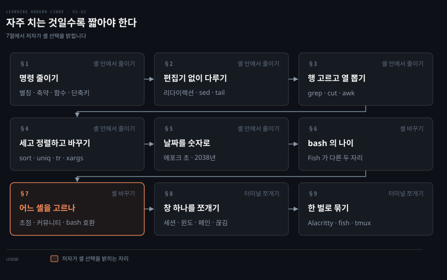
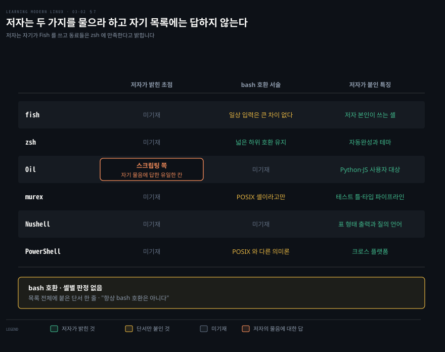
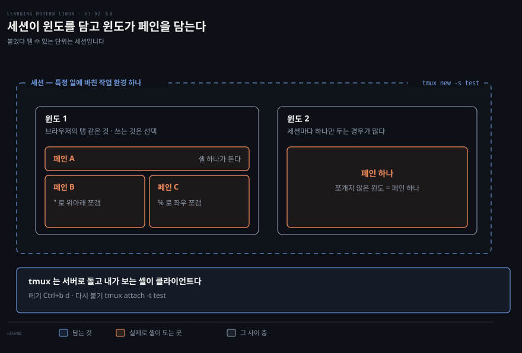
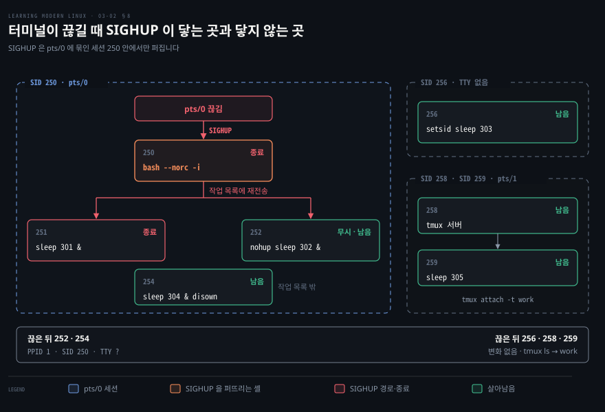
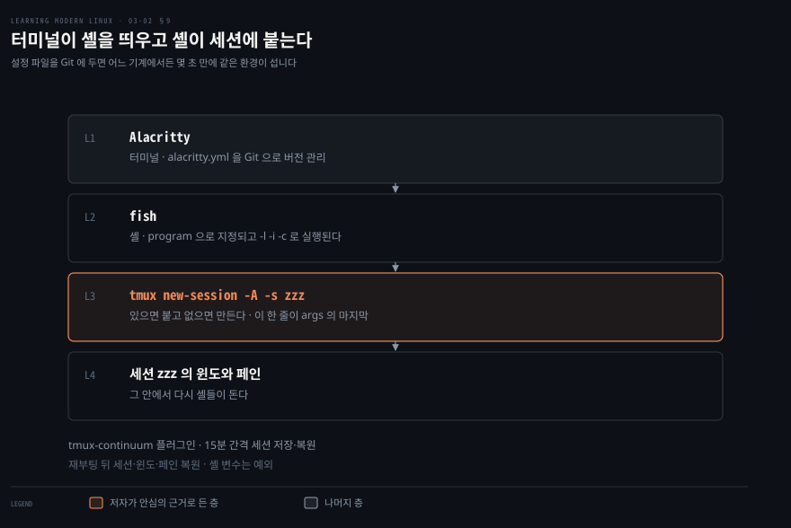

# 자주 치는 것일수록 짧아야 한다

---

> 아주 자주 쓰는 명령일수록 가장 적은 노력이 들어야 한다는 것이 이 구간을 여는 원칙입니다.

## 핵심 요약

> 이 구간 전체가 매달린 하나의 생각은 터미널에서 손이 덜 가게 만드는 방법이 세 층으로 쌓인다는 것입니다. 

지금 쓰는 셸 안에서 줄이는 층, 셸 자체를 갈아 끼우는 층, 그리고 터미널을 쪼개 쓰는 층입니다.

첫 층은 이미 가진 것으로 하는 일입니다. 

저자는 하루에 수백 번 보는 `git diff --color-moved` 를 `d` 한 글자로 줄여 씁니다. 커서를 줄 앞으로 옮기고 왼쪽을 지우는 단축키, 편집기를 열지 않고 텍스트를 다루는 일도 여기 듭니다.

둘째 층에서는 셸을 바꿉니다. 

저자는 bash 가 1980년대 말부터 있었고 나이가 드러날 때가 있다고 진단합니다. Fish 는 히스토리를 따로 관리하지 않고 그냥 치면 이전 실행이 나오며 명령마다 자동 제안도 내놓습니다. 

셋째 층은 터미널 자체를 다중화합니다. 

창을 여러 개 띄우는 대신 세션 하나 안에서 윈도와 페인으로 나눕니다. 무엇보다 셸을 닫아도 그 상태가 남게 합니다. 저자가 잡 컨트롤 대신 이쪽을 권한 이유를 여기서 채웁니다. 터미널이 끊길 때 무엇이 죽고 무엇이 남는지는 `nohup`, `setsid`, tmux 가 각각 다르게 답합니다.

세 층 가운데 저자가 자기 선택을 밝히는 곳은 둘째와 셋째입니다. 셸은 Fish 를 쓰되 취향이라 못 박지 않습니다. 멀티플렉서는 tmux 를 쓰라고 분명히 말합니다. `sed`·`grep`·`awk`·`head`·`tail`·`date` 같은 명령의 사용법은 공통 [리눅스 명령어 시트](../../docs/cmd/README.md)로 옮겼습니다. 5절의 세션 분리 명령은 책에 없는 내용입니다. 근거는 각주에 단 공식 매뉴얼입니다. 출력은 Debian 12 컨테이너에서 직접 돌려 얻었습니다.


## 학습 목표

> 이 구간을 읽고 나면 아래 세 가지를 스스로 해낼 수 있습니다.

1. 자주 쓰는 명령을 줄이는 방법을 셸별로 구분하고 셸을 고를 때 던질 두 물음을 댈 수 있습니다.
2. 편집기를 열지 않고 파일을 만들고 덧붙이며 프로세스 치환으로 두 명령의 출력을 견줄 수 있습니다.
3. tmux 의 세 단위를 설명하고 터미널이 끊길 때 `nohup`, `setsid`, tmux 가 각각 무엇을 남기는지 비교할 수 있습니다.

아래는 이 문서 전체를 읽는 순서로 이은 지도입니다. 칸마다 절 번호와 그 절의 주제를 적었습니다. 색이 붙은 칸이 저자가 셸 선택을 밝히는 자리입니다.




## 이 문서가 다루지 않는 것

> 3장을 셋으로 나눈 가운데 구간입니다. 앞뒤는 각각 다른 노트가 맡습니다.

- 터미널·셸 기초, 스트림·변수·종료 상태, 잡 컨트롤: [셸의 실체는 스트림과 변수와 종료 상태다](./03-01.%EC%85%B8%EC%9D%98%20%EC%8B%A4%EC%B2%B4%EB%8A%94%20%EC%8A%A4%ED%8A%B8%EB%A6%BC%EA%B3%BC%20%EB%B3%80%EC%88%98%EC%99%80%20%EC%A2%85%EB%A3%8C%20%EC%83%81%ED%83%9C%EB%8B%A4.md)
- 스크립트 이식성, 린트·테스트, `jq` 예제: [bash 는 조용히 실패하므로 시끄럽게 만들어야 한다](./03-03.bash%20%EB%8A%94%20%EC%A1%B0%EC%9A%A9%ED%9E%88%20%EC%8B%A4%ED%8C%A8%ED%95%98%EB%AF%80%EB%A1%9C%20%EC%8B%9C%EB%81%84%EB%9F%BD%EA%B2%8C%20%EB%A7%8C%EB%93%A4%EC%96%B4%EC%95%BC%20%ED%95%9C%EB%8B%A4.md)
- `sed`·`grep`·`awk`·`head`·`tail`·`date` 같은 명령의 사용법: [리눅스 명령어 시트](../../docs/cmd/README.md)
- `find` 조건식: [find 참조 시트](./00-02.find%20%EC%B0%B8%EC%A1%B0%20%EC%8B%9C%ED%8A%B8.md)
- 설정 파일 권한: [4장 노트](./04-01.%EC%A0%84%EB%B6%80%20%EC%95%84%EB%8B%88%EB%A9%B4%20%EC%A0%84%EB%AC%B4%EC%97%90%EC%84%9C%20%EC%9E%98%EA%B2%8C%20%EC%AA%BC%EA%B0%9C%EB%8A%94%20%EC%AA%BD%EC%9C%BC%EB%A1%9C.md)
- 파일시스템 안의 위치: [5장 노트](./05-01.%EB%AA%A8%EB%93%A0%20%EA%B2%83%EC%9D%B4%20%ED%8C%8C%EC%9D%BC%EC%9D%B4%EB%9D%BC%EB%8A%94%20%EB%A7%90%EC%9D%80%20%EC%86%90%EC%9E%A1%EC%9D%B4%EA%B0%80%20%ED%95%98%EB%82%98%EB%9D%BC%EB%8A%94%20%EB%9C%BB%EC%9D%B4%EB%8B%A4.md)


## 1. 자주 치는 명령 줄이기: 별칭·축약·함수

> 인터페이스에 관한 기본 통찰 하나를 셸에 적용하면 이 절이 나옵니다. 아주 자주 쓰는 명령일수록 입력이 빨라야 한다는 것입니다.

자주 보는 `git diff --color-moved` 를 `d` 한 글자로 줄일 수 있습니다. bash 에서는 별칭, Fish 에서는 축약이라 부릅니다. Fish 의 축약은 인자를 받지 않는 단순 명령에 알맞습니다.

```bash
abbr -a -U -- d 'git diff --color-moved'
abbr -a -U -- k kubectl
abbr -a -U -- l 'exa --long --all --git'
abbr -a -U -- s 'git status'
abbr -a -U -- cat bat
```

`exa` 는 유지보수가 끝나 `l` 축약을 그대로 옮기면 설치부터 막히므로 후속 포크인 `eza` 로 바꿔 넣습니다([앞 노트](./03-01.%EC%85%B8%EC%9D%98%20%EC%8B%A4%EC%B2%B4%EB%8A%94%20%EC%8A%A4%ED%8A%B8%EB%A6%BC%EA%B3%BC%20%EB%B3%80%EC%88%98%EC%99%80%20%EC%A2%85%EB%A3%8C%20%EC%83%81%ED%83%9C%EB%8B%A4.md)). 인자를 받거나 여러 동작을 묶을 때는 함수를 씁니다.

```bash
function c
      git add --all
      git commit -m "$argv"
end
```

### 커서를 옮기고 줄을 다루는 단축키

| 하려는 일 | 키 |
|---|---|
| 줄 처음으로 | Ctrl+A |
| 줄 끝으로 | Ctrl+E |
| 한 글자 앞으로 | Ctrl+F |
| 한 글자 뒤로 | Ctrl+B |
| 한 단어 앞으로 | Alt+f |
| 한 단어 뒤로 | Alt+b |
| 커서 오른쪽 전부 지우기 | Ctrl+K |
| 커서 왼쪽 전부 지우기 | Ctrl+U |
| 커서 왼쪽 한 단어 지우기 | Ctrl+W |
| 화면 지우기 | Ctrl+L |
| 명령 취소 | Ctrl+C |
| 히스토리 검색 | Ctrl+R |
| 검색 취소 | Ctrl+G |

- 단축키는 기본이 Emacs 방식이며 `.bashrc` 에 `set -o vi` 를 주면 `vi` 방식으로 바뀝니다. Ctrl 조합은 누르면 대소문자가 같은 제어 문자가 되므로 대문자로 표기합니다. 
- 모든 셸이 모든 단축키를 지원하지는 않습니다. Alt+f 는 왼쪽 Alt 에서만 동작하고 Ctrl+_ 의 실행 취소는 bash 전용입니다.


## 2. 편집기를 열지 않고 텍스트를 다루기

> 한 줄을 넣자고 매번 편집기를 띄우고 싶지는 않습니다. 스크립트 안에서는 아예 그럴 수도 없습니다.

리다이렉션과 기본 도구로 파일 생성과 치환, 비교를 처리합니다.

```bash
echo "First line" > /tmp/something       # 파일 생성·덮어쓰기
echo "Second line" >> /tmp/something     # 덧붙이기
sed 's/line/LINE/' /tmp/something

cat << 'EOF' > /tmp/another              # 히어 도큐먼트로 여러 줄 입력
First line
Second line
Third line
EOF
diff -y /tmp/something /tmp/another      # 두 파일을 나란히 비교
```

명령 출력을 파일처럼 견줄 때는 bash 의 프로세스 치환 `<(명령)` 을 씁니다.[^bash-procsub] 아래는 `1 kim`, `2 lee`, `3 park` 세 줄이 든 `names.txt` 를 견준 것입니다. 

이 노트의 코드 블록에서 명령 옆이나 아래의 `#` 줄, 그리고 명령 블록 바로 아래 따로 둔 블록은 그 명령의 실제 출력입니다. 다만 `# 덧붙이기` 처럼 명령이 하는 일을 적은 짧은 `#` 줄은 출력이 아니라 풀이입니다.

```bash
printf '1 kim\n2 lee\n3 park\n' > names.txt     # 견줄 파일 만들기
diff -u names.txt <(sed 's/lee/yi/' names.txt)
```

```bash
--- names.txt	2026-11-10 02:22:23.359479222 +0000
+++ /dev/fd/63	2026-11-10 02:22:23.367479126 +0000
@@ -1,3 +1,3 @@
 1 kim
-2 lee
+2 yi
 3 park
```

- 둘째 줄의 `/dev/fd/63` 이 `<(…)` 가 만든 파일 이름입니다. 서버 둘의 설정을 견줄 때도 `diff <(ssh web1 cat 파일) <(ssh web2 cat 파일)` 꼴을 씁니다. 
- 대상 서버가 여럿이면 `ssh 서버 md5sum 파일` 로 해시부터 견주고 다른 서버만 `diff` 로 엽니다. `-u` 통합 형식과 `-r` 재귀 비교는 [레시피 시트](./00-01.%ED%95%A8%EC%A0%95%EA%B3%BC%20%EB%A0%88%EC%8B%9C%ED%94%BC%20%EC%B0%B8%EC%A1%B0%20%EC%8B%9C%ED%8A%B8.md)에 있습니다.

긴 파일은 `less` 나 `bat` 같은 페이저로 보며, 일부만 볼 때는 `head` 와 `tail` 을 씁니다. 로테이션되는 로그를 `tail -F` 로 따라가는 법은 [head·tail 참조 시트](../../docs/cmd/text/head%C2%B7tail.md)에 있습니다. 화면과 파일에 동시 기록하는 `tee` 는 [8장 노트](./08-01.%EC%9E%AC%EB%8A%94%20%EA%B2%83%EC%9D%80%20%EB%B0%94%EA%B9%A5%EC%9D%B4%EA%B3%A0%20%EC%95%8C%EA%B3%A0%20%EC%8B%B6%EC%9D%80%20%EA%B2%83%EC%9D%80%20%EC%95%88%EC%9D%B4%EB%8B%A4.md)가 설명합니다.

줄을 바꾸는 `sed`, 행과 칸을 고르는 `grep`·`cut`·`awk`, 세고 정렬하는 `sort`·`uniq` 의 옵션과 쓰임은 책이 설명하지 않습니다. 책에는 위의 `sed` 한 줄 치환이나 스크립트 예의 `cut -f1 -d"-"` 처럼 예제 속 한 줄로만 나옵니다. 사용법은 [리눅스 명령어 시트](../../docs/cmd/README.md)의 text 분류로 옮겼습니다. 설정 파일 한 줄을 `sed -i.bak` 으로 원본을 남기며 고치는 예는 [sed 참조 시트](../../docs/cmd/text/sed.md)에 있습니다.


## 3. bash 가 사람 친화적이지 않다는 말

> bash 는 여전히 가장 널리 쓰이는 셸이지만 가장 사람 친화적인 셸은 아니라는 것이 저자의 진단입니다. 1980년대 말부터 있었고 그 나이가 가끔 드러납니다.

매일 쓰는 입력은 bash 와 큰 차이가 없지만 Fish 는 대화형 편의성을 앞세웁니다. 히스토리 관리 없이 명령을 치면 이전 실행이 떠서 바로 고르고 자동 제안과 시각적 힌트(알 수 없는 명령은 빨갛게)를 기본으로 줍니다.

### Fish 의 환경 변수 문법

| 하려는 일 | Fish 명령 |
|---|---|
| 환경 변수 `KEY` 를 값 `VAL` 로 내보내기 · 지우기 | `set -x KEY VAL` · `set -e KEY` |
| 한 명령에만 환경 변수 붙이기 | `env KEY=VAL cmd` |
| 프롬프트의 경로 길이를 1로 | `set -g fish_prompt_pwd_dir_length 1` |
| 축약 관리 · 함수 관리 | `abbr` · `functions` 와 `funcd` |

Fish 는 마지막 명령 종료 상태를 `$?` 가 아니라 `$status` 에 담습니다. 설정은 `fish_config` 명령으로 브라우저를 띄워 확인하고 변경합니다.


## 4. 어느 셸을 고를 것인가

> 저자는 새 셸을 볼 때 두 가지를 자문하라고 합니다. 그 셸의 초점이 대화형 사용인가 스크립팅인가, 그리고 그 주변 커뮤니티가 얼마나 활발한가입니다.



저자가 든 셸 가운데 zsh 는 넓은 bash 하위 호환을 유지하고 Fish 는 일상 입력 차이가 적습니다. 나머지 셸의 호환 여부와 커뮤니티 활성도는 책에서 직접 판정하지 않고 목록 전체에 "항상 bash 호환은 아니다" 라는 단서 한 줄만 붙습니다. 

저자의 서술로는 Oil 은 Python·JavaScript 사용자를 겨냥해 스크립팅에 초점이 있습니다. murex 는 통합 테스트 틀과 타입 파이프라인을 갖춘 POSIX 셸입니다. Nushell 은 표 형태 출력과 질의 언어를 갖췄고 PowerShell 은 의미론과 상호작용이 POSIX 셸과 다릅니다.

`zsh` 는 Bourne 계열로 자동완성과 테마 지원이 뛰어나며 Oh My Zsh 로 기능을 확장합니다. 설정 파일 다섯 개는 `$ZDOTDIR`(없으면 `$HOME`)에서 읽습니다.

| 파일 | 언제 읽히나 |
|---|---|
| `.zshenv` | 셸을 부를 때마다. 검색 경로와 중요한 환경 변수를 넣되 출력을 내거나 tty 를 가정하는 명령은 넣지 않는다 |
| `.zprofile` | `.zlogin` 대신 쓰는 ksh 사용자용. `.zshrc` 보다 먼저 읽히며 둘을 함께 쓰지는 않는다 |
| `.zshrc` | 대화형 셸에서. 별칭·함수·옵션·키 바인딩을 넣는다 |
| `.zlogin` | 로그인 셸에서. 로그인 셸에서만 실행할 명령을 넣고 별칭이나 환경 변수 설정은 넣지 않는다 |
| `.zlogout` | 로그인 셸이 끝날 때 |

### 저자의 결론

저자는 대화형 생산성을 위해 모던 셸을 권합니다. 명령행에서 보내는 시간을 생각하면 여러 셸을 써 보고 고르라고 합니다. 

자신은 Fish 를 쓰고 동료 다수는 zsh 를 쓴다고 밝힙니다. 저자가 꼽는 걸림돌은 원격 시스템과 설치 제약, 호환성과 습관입니다. 저자는 안내 문서 대부분이 `export FOO=BAR` 처럼 bash 를 전제한다는 점도 꼽습니다. 그래도 대개 자기가 통제하는 환경에서 일하므로 학습 비용은 회수된다고 봅니다.


## 5. 창을 늘리지 않고 하나를 쪼개기: tmux

> 오픈소스 프로젝트를 만지면서 블로그를 쓰고 서버에 붙고 API 를 두드리는 일은 창을 여럿 요구합니다. 그것들을 묶는 단위가 세션입니다.



- 터미널 작업에는 여러 창 관리, 연결 끊김 시 작업 보존, 분할 화면 조망이라는 요구가 따릅니다. 터미널 멀티플렉서는 입출력을 다중화해 이를 풉니다. 
- 저자는 원조인 `screen` 을 유지보수 정체와 기능 한계 때문에 다른 선택지가 없는 환경이 아니면 권하지 않습니다. 다만 책이 나온 뒤인 2024년 8월에 `screen` 5.0.0 이 나왔습니다.[^screen-rel]

### tmux 를 다루는 명령

세션을 만들 때는 `tmux new -s`, 다시 붙을 때는 `attach -t`, 분리는 `Ctrl+B 다음 d` 를 씁니다(tmux 에서 `D` 는 다른 명령이므로 소문자 `d` 로 칩니다). `attach` 에 `-d` 를 주면 이전 터미널에서 세션을 떼어 내며 붙습니다. 아래 표의 트리거는 기본 Ctrl+B 이며 저자는 손이 쉽게 닿는 안 쓰는 키로 바꾸라고 권합니다.

| 대상 | 하려는 일 | 명령 |
|---|---|---|
| 세션 | 새로 만들기 · 이름 바꾸기 | `:new -s 이름` · 트리거 + `$` |
| 세션 | 전부 나열 · 닫기 | 트리거 + `s` · 트리거 |
| 윈도 | 새로 만들기 · 이름 바꾸기 | 트리거 + `c` · 트리거 + `,` |
| 윈도 | 전환 · 전부 나열 · 닫기 | 트리거 + `1`~`9` · 트리거 + `w` · 트리거 + `&` |
| 페인 | 가로로 쪼개기 · 세로로 쪼개기 | 트리거 + `"` · 트리거 + `%` |
| 페인 | 확대·축소 토글 · 닫기 | 트리거 + `z` · 트리거 + `x` |

`"` 는 위아래로, `%` 는 좌우로 쪼갭니다. 트리거 + `n`·`p` 는 다음·이전 윈도로 옮깁니다. 트리거 + `[` 는 복사 모드로 지난 출력을 보고 `]` 로 붙여 넣습니다.[^tmux-keys] 세션을 밖에서 끝내는 명령은 `tmux kill-session -t` 입니다. 대안으로 Zellij, Byobu, tmuxinator 등이 있지만 저자는 성숙도·안정성·생태계가 검증된 tmux 를 쓰라고 명확히 권합니다.

### 터미널이 끊겨도 명령을 살리기

터미널이 닫힐 때 `SIGHUP` 이 전파되는 과정과 `nohup`·`disown` 의 원리는 [03-01 「터미널이 끊길 때 살아남는 잡」](03-01.셸의%20실체는%20스트림과%20변수와%20종료%20상태다.md#터미널이-끊길-때-살아남는-잡)이 설명합니다.[^signal7][^bash-hup] 시그널 원리는 [9장 둘째 편](./09-02.%EC%8B%9C%EA%B7%B8%EB%84%90%EC%9D%80%20%EB%B2%88%ED%98%B8%20%ED%95%98%EB%82%98%EB%A7%8C%20%EB%B3%B4%EB%82%B4%EA%B3%A0%20%EB%81%9D%EB%82%98%EB%8A%94%20%EB%AA%A8%EC%96%91%EC%9D%80%20%EC%B2%98%EB%A6%AC%20%EB%B0%A9%EC%8B%9D%EC%9D%B4%20%EC%A0%95%ED%95%9C%EB%8B%A4.md)에 있습니다. 

여기서는 프로세스를 터미널에서 완전히 떼어 내는 `setsid`·tmux·`systemd-run` 에 집중합니다. 한 셸에서 다섯 가지 방식으로 명령을 띄우고 터미널 쪽을 죽인 뒤 `ps` 로 남은 것을 본 결과입니다.

```bash
sleep 301 &
nohup sleep 302 > /dev/null 2>&1 &
setsid sleep 303 < /dev/null > /dev/null 2>&1 &
sleep 304 & disown
tmux new -d -s work "sleep 305"
```

```bash
# 터미널을 죽인 뒤
    PID    PPID    PGID     SID TT       STAT CMD
    252       1     252     250 ?        S    sleep 302
    254       1     254     250 ?        S    sleep 304
    256       1     256     256 ?        Ss   sleep 303
    258       1     258     258 ?        Ss   tmux new -d -s work sleep 305
    259     258     259     259 pts/1    Ss+  sleep 305
```

`sleep 301` 은 끊기 전 셸 250 아래 `pts/0` 에 있었고 셸과 함께 사라졌습니다. `nohup` 의 252 와 `disown` 의 254 는 PPID 가 1, TTY 가 `?` 로 바뀐 채 남았습니다. 256, 258, 259 는 끊기 전과 같습니다.



| 방법 | 살아남는 이유 | 출력이 가는 곳 | 다시 보는 길 |
|---|---|---|---|
| `nohup 명령 &` | 명령이 SIGHUP 을 무시하도록 해 놓고 실행 | 표준 출력이 터미널이면 `nohup.out` | 파일 |
| `명령 & disown` | 셸의 작업 목록에서 빠져 SIGHUP 을 전달받지 않음 | 여전히 그 터미널 | 미리 돌려 둔 파일 |
| `setsid 명령` | 새 세션에서 실행돼 제어 터미널이 없음 | 여전히 그 터미널 | 미리 돌려 둔 파일 |
| `tmux new -d -s 이름 '명령'` | tmux 서버가 만든 다른 터미널에서 실행 | 페인 화면 | `tmux attach -t 이름` |
| `systemd-run --unit=이름 명령` | 서비스 관리자가 부모가 돼 실행 | journal | `journalctl -u 이름` |

`nohup`·`disown` 이 SIGHUP 을 비켜 가는 원리는 위 03-01 절에 있습니다.[^nohup][^bash-disown] `setsid` 는 제어 터미널이 없는 새 세션에서 명령을 실행해, 위 출력의 256 처럼 SID 가 자기 PID 와 같아집니다.[^setsid] 이 셋은 화면을 다시 띄울 수 없고, `nohup` 만 표준 출력이 터미널일 때 `nohup.out` 으로 돌려 줍니다. 나머지 둘은 리다이렉션을 직접 지정해 로그를 남기고 `tail -f` 로 따라갑니다.

`tmux new -d -s` 는 백그라운드 가상 터미널(`pts/1`)에서 명령을 돌립니다.[^tmux-keys] 내 터미널이 끊겨도 유지되며 `tmux attach` 로 화면을 통째로 다시 봅니다. 위 다섯 방법 가운데 화면까지 돌아오는 것은 이것뿐입니다. `systemd-run` 은 명령을 일시적인 서비스 유닛으로 띄우고 `-p 속성=값` 으로 자원 한도도 겁니다.[^systemd-run] systemd 가 없는 컨테이너라 돌려 보지는 못했습니다. `screen` 만 있는 서버라면 `Ctrl+A 다음 d` 로 떼고 `screen -r` 로 다시 붙습니다.[^screen]

```bash
screen -dmS build bash -c 'echo building; sleep 30'
screen -ls
```

```bash
There is a screen on:
	789.build	(11/10/26 02:22:40)	(Detached)
1 Socket in /run/screen/S-root.
```


## 6. 터미널과 멀티플렉서와 셸을 한 벌로 묶기

> 셋을 따로 고르는 것으로 끝이 아닙니다. 저자는 이 셋을 설정 파일 하나로 묶어 어느 기계에서든 몇 초 만에 같은 환경을 세웁니다.



기기마다 설정을 손으로 다시 짜지 않도록 터미널·셸·멀티플렉서를 설정 파일로 묶어 Git 으로 버전 관리합니다. 저자의 터미널 Alacritty 는 설정 파일(`alacritty.yml`)의 `shell` 항목으로 멀티플렉서와 셸의 연결을 정의합니다. 

```bash
shell:
   program: /usr/local/bin/fish
   args:
   - -l
   - -i
   - -c
   - "tmux new-session -A -s zzz"
```

책이 나온 뒤 0.13.0 부터 설정은 TOML 입니다(`alacritty migrate` 로 변환). 0.14.0 부터 `shell` 은 `terminal.shell` 입니다.[^alacritty] 같은 설정을 지금 문법으로 쓰면 아래와 같습니다. `program` 에 셸 경로를 적고 `args` 에 셸에 넘길 인자를 적습니다.[^alacritty-shell]

```toml
# ~/.config/alacritty/alacritty.toml (0.14.0 이후)
[terminal.shell]
program = "/usr/local/bin/fish"
args = ["-l", "-i", "-c", "tmux new-session -A -s zzz"]
```

터미널을 열면 Alacritty 가 `program` 의 Fish 를 `-l -i` 로 띄우고, Fish 는 `-c` 뒤의 `tmux new-session -A -s zzz` 를 실행합니다. `-A` 라서 `zzz` 세션이 있으면 거기에 붙고 없으면 새로 만듭니다.[^tmux-A]

`tmux-resurrect` 는 세션을 저장·복원하고 `tmux-continuum` 은 이를 15분마다 자동으로 돌립니다. 그래서 컴퓨터를 껐다 켜도 세션과 윈도와 페인이 거의 그대로 돌아온다고 저자는 적습니다.

프로세스와 함께 사라지는 셸 변수는 예외입니다. 저자의 구성을 그대로 따를 필요는 없고 배치의 이유만 옮기면 됩니다. 자주 치는 입력을 줄이고 상태는 셸 바깥에 두며 설정 파일은 버전 관리합니다.


## 결정 치트시트

> 이 구간이 판단으로 이어지는 자리를 모았습니다. 명령 옵션을 고르는 판단은 [리눅스 명령어 시트](../../docs/cmd/README.md)의 각 시트에 있습니다.

| 상황 | 선택 | 이유 |
|---|---|---|
| 긴 명령을 줄이려 한다 | 인자가 없으면 별칭(bash)·축약(Fish), 있으면 함수 | 축약은 인자 없는 단순 명령에 알맞음 |
| bash 호환을 유지하면서 대화형을 개선하려 한다 | zsh + Oh My Zsh | 넓은 하위 호환을 유지 |
| 문법을 바꿔서라도 대화형이 편해야 한다 | Fish | 히스토리 관리 없음, 자동 제안 |
| 원격에 아무것도 깔 수 없다 | 셸은 bash, 멀티플렉서는 `screen` | 저자가 든 유일하게 실질적인 제약 |
| 끊겨도 돌아야 하고 화면도 다시 봐야 한다 | `tmux new -d -s 이름 '명령'` | 서버가 따로 떠 화면을 지님 |
| 끊겨도 돌기만 하면 되고 로그로 충분하다 | `nohup 명령 > 로그 2>&1 &` | SIGHUP 을 무시하고 출력은 파일로 감 |
| 멀티플렉서를 하나만 고른다 | tmux | 성숙·안정·플러그인·자료가 근거 |


## 적용 관점

> 이 구간이 실무로 착지하는 자리는 원격 작업입니다. 클러스터에 붙어 로그를 보면서 다른 창에서 매니페스트를 고치는 일이 저자가 든 상황 그대로입니다.

원격 작업 시 tmux 세션을 열고 화면을 쪼개 로그 추적과 파일 편집을 병행합니다. 세션을 떼었다가 다시 붙여 셸을 닫아도 상태가 남는지 눈으로 확인합니다.

```bash
tmux new -s k8s
kubectl logs -f deploy/myapp
tmux attach -t k8s
```

`kubectl logs -f` 같은 추적 작업은 멀티플렉서 세션 안에서 실행해야 네트워크 단절이나 이동 중에도 상태가 유지됩니다. 로그를 분석할 때 쓰는 예외 앞뒤 문맥(`grep -B`/`-A`)과 값별 집계(`sort` 뒤 `uniq -c`)는 [리눅스 명령어 시트](../../docs/cmd/README.md)에 있습니다. 안내 문서에 `export KUBECONFIG=...` 라고 적혀 있어도 Fish 에서는 `set -x KUBECONFIG ...` 로 바꿔 칩니다.


## 면접에서 받을 만한 질문

> 자답한 뒤 아래 정답과 맞춰 봅니다.

1. 자주 쓰는 명령을 줄이는 방법을 셸별로 말해 보십시오.
2. 히어 도큐먼트는 무엇이고 언제 씁니까?
3. 셸을 새로 고를 때 무엇을 자문해야 합니까?
4. tmux 의 세 단위를 큰 것에서 작은 것 순으로 말하고 각각을 설명해 보십시오.
5. 터미널이 끊겨도 명령이 계속 돌게 하는 방법 셋을 대고 각각 무엇이 남는지 견주어 보십시오.


## 정답 (자답 후 펼치기)

### 정답 1 — 셸별 명령 축약 방법

bash 에서는 별칭을, Fish 에서는 축약을 씁니다. 축약은 인자를 받지 않는 단순 명령에 알맞고 인자를 받거나 여러 줄이 필요하면 함수를 정의합니다.

### 정답 2 — 히어 도큐먼트의 용도

`cat << 'EOF' > 파일` 형태로 여러 줄을 한 번에 파일에 넣는 방법입니다. 편집기를 열 수 없는 스크립트 안에서 설정 파일을 만들 때 특히 쓸모가 있습니다.

### 정답 3 — 새 셸 선택 시 자문할 기준

그 셸의 초점이 대화형 사용인지 스크립팅인지, 그리고 주변 커뮤니티가 얼마나 활발한지입니다. 여기에 bash 호환이 필요한 환경인지를 함께 봅니다.

### 정답 4 — tmux 세 단위의 위계

세션은 특정 일에 바친 작업 환경이고 다른 모든 단위를 담는 그릇입니다. 윈도는 세션에 속한 브라우저 탭 같은 것이며 쓰는 것은 선택입니다. 페인은 실제로 셸 하나가 도는 곳이고 윈도의 일부이며 가로나 세로로 쪼갤 수 있습니다.

### 정답 5 — 터미널 단절 시 명령 보존 방법

`nohup` 은 SIGHUP 을 무시하며 출력은 `nohup.out` 이나 지정 로그 파일에 남습니다. `setsid` 는 명령을 제어 터미널이 없는 새 세션에서 돌리고 출력은 미리 돌려 둔 파일에만 남습니다. tmux 는 서버가 따로 떠서 자기 터미널에서 명령을 돌리므로 `tmux attach` 로 화면까지 다시 보며 `Ctrl+B 다음 d` 로 떼어 두면 터미널이 닫혀도 세션이 유지됩니다.


## 핵심 개념 체크리스트

- [ ] 별칭·축약·함수를 각각 언제 쓰는지 구분할 수 있는가?
- [ ] 편집기 없이 파일을 만들고 덧붙이고, 프로세스 치환으로 두 출력을 견줄 수 있는가?
- [ ] Fish 가 bash 와 다른 두 지점과 환경 변수 문법 차이를 말할 수 있는가?
- [ ] 저자가 셸을 볼 때 던지라고 한 두 물음과, 그가 정작 답하지 않은 칸을 말할 수 있는가?
- [ ] 세션·윈도·페인의 포함 관계를 알고 `nohup`·`setsid`·tmux 가 SIGHUP 을 피하는 자리를 구분할 수 있는가?


## 관련 문서

- [Learning Modern Linux 정독 인덱스](./README.md) — 이 책의 장별 진행 상황
- [셸의 실체는 스트림과 변수와 종료 상태다](./03-01.%EC%85%B8%EC%9D%98%20%EC%8B%A4%EC%B2%B4%EB%8A%94%20%EC%8A%A4%ED%8A%B8%EB%A6%BC%EA%B3%BC%20%EB%B3%80%EC%88%98%EC%99%80%20%EC%A2%85%EB%A3%8C%20%EC%83%81%ED%83%9C%EB%8B%A4.md) — 이 구간이 딛고 선 기초
- [bash 는 조용히 실패하므로 시끄럽게 만들어야 한다](./03-03.bash%20%EB%8A%94%20%EC%A1%B0%EC%9A%A9%ED%9E%88%20%EC%8B%A4%ED%8C%A8%ED%95%98%EB%AF%80%EB%A1%9C%20%EC%8B%9C%EB%81%84%EB%9F%BD%EA%B2%8C%20%EB%A7%8C%EB%93%A4%EC%96%B4%EC%95%BC%20%ED%95%9C%EB%8B%A4.md) — 같은 장의 자동화 구간
- [find 참조 시트](./00-02.find%20%EC%B0%B8%EC%A1%B0%20%EC%8B%9C%ED%8A%B8.md) · [함정과 레시피 참조 시트](./00-01.%ED%95%A8%EC%A0%95%EA%B3%BC%20%EB%A0%88%EC%8B%9C%ED%94%BC%20%EC%B0%B8%EC%A1%B0%20%EC%8B%9C%ED%8A%B8.md) — `find` 조건식과 `diff` 옵션
- [sed 참조 시트](../../docs/cmd/text/sed.md) · [grep 참조 시트](../../docs/cmd/text/grep.md) · [cut 참조 시트](../../docs/cmd/text/cut.md) · [awk 참조 시트](../../docs/cmd/text/awk.md) · [sort·uniq·wc 참조 시트](../../docs/cmd/text/sort%C2%B7uniq%C2%B7wc.md) · [tr 참조 시트](../../docs/cmd/text/tr.md) · [paste·join·column 참조 시트](../../docs/cmd/text/paste%C2%B7join%C2%B7column.md) · [xargs 참조 시트](../../docs/cmd/text/xargs.md) — 이 노트에서 옮긴 텍스트 도구 사용법
- [head·tail 참조 시트](../../docs/cmd/text/head%C2%B7tail.md) · [date 참조 시트](../../docs/cmd/time/date.md) — 이 노트에서 옮긴 로그 따라가기와 날짜 계산
- [배치 처리 개요와 Unix 도구](../../../05_data/book/designing-data-intensive-applications/11-01.%EB%B0%B0%EC%B9%98%20%EC%B2%98%EB%A6%AC%20%EA%B0%9C%EC%9A%94%EC%99%80%20Unix%20%EB%8F%84%EA%B5%AC.md) — `sort` 와 `uniq` 파이프라인을 배치 처리로 읽는 관점


## 참고 자료

- 원서: 《Learning Modern Linux》 3장 Shells and Scripting (Michael Hausenblas, O'Reilly, 2022년)
- [Fish shell](https://fishshell.com/) — 본문에서 자세히 다룬 모던 셸
- [tmux](https://github.com/tmux/tmux/wiki) — 저자가 분명하게 권한 멀티플렉서

각주의 매뉴얼은 2026-11-10 에 조회했고, `alacritty(5)` 만 2026-11-11 에 조회했습니다. 출력은 Debian 12.15 컨테이너에서 얻었습니다. 도구 버전은 sed 4.9, coreutils 9.1, bash 5.2.15, tmux 3.3a, screen 4.09.00 입니다.

[^bash-procsub]: GNU Bash 매뉴얼, "Process Substitution". <https://www.gnu.org/software/bash/manual/bash.html#Process-Substitution>
[^tmux-keys]: `tmux(1)` 의 "KEY BINDINGS" 와 `new-session`·`kill-session` 항목. <https://man7.org/linux/man-pages/man1/tmux.1.html>
[^signal7]: `signal(7)` — SIGHUP 은 "Hangup detected on controlling terminal or death of controlling process" 입니다. <https://man7.org/linux/man-pages/man7/signal.7.html>
[^bash-hup]: GNU Bash 매뉴얼, "Signals" — "Before exiting, an interactive shell resends the SIGHUP to all jobs, running or stopped". <https://www.gnu.org/software/bash/manual/bash.html#Signals>
[^bash-disown]: GNU Bash 매뉴얼, "Job Control Builtins" 의 `disown`. <https://www.gnu.org/software/bash/manual/bash.html#Job-Control-Builtins>
[^nohup]: GNU coreutils 매뉴얼, "nohup invocation". <https://www.gnu.org/software/coreutils/manual/coreutils.html#nohup-invocation>
[^setsid]: `setsid(1)` — "setsid runs a program in a new session". <https://man7.org/linux/man-pages/man1/setsid.1.html>
[^systemd-run]: `systemd-run(1)` — "create and start a transient .service or .scope unit". <https://man7.org/linux/man-pages/man1/systemd-run.1.html>
[^screen]: GNU Screen 매뉴얼, "Invoking Screen". <https://www.gnu.org/software/screen/manual/screen.html#Invoking-Screen>
[^tmux-A]: `tmux(1)` man 페이지, `new-session` 항목 — "The -A flag makes new-session behave like attach-session if session-name already exists". <https://man7.org/linux/man-pages/man1/tmux.1.html>
[^screen-rel]: GNU FTP 의 screen 배포 목록 — `screen-5.0.0.tar.gz` 가 2024-08-28 에 올라왔습니다. <https://ftp.gnu.org/gnu/screen/>
[^alacritty]: Alacritty `CHANGELOG.md` 의 0.13.0 — "Configuration file now uses TOML instead of YAML", 0.14.0 — "Moved config option `shell` to `terminal.shell`". <https://github.com/alacritty/alacritty/blob/master/CHANGELOG.md>
[^alacritty-shell]: Alacritty 설정 문서 `alacritty(5)` 의 TERMINAL 절, `shell` 항목 — "You can set shell.program to the path of your favorite shell, e.g. /bin/zsh. Entries in shell.args are passed as arguments to the shell." 2026-11-11 조회. <https://alacritty.org/config-alacritty.html>
