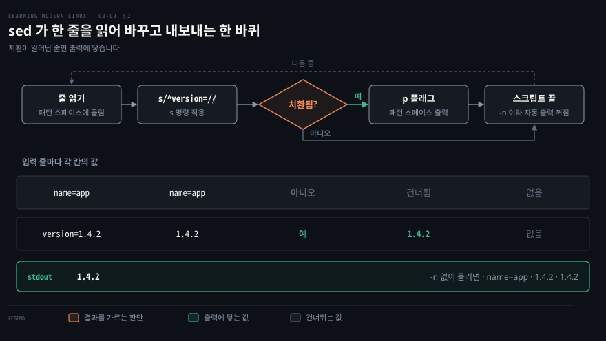
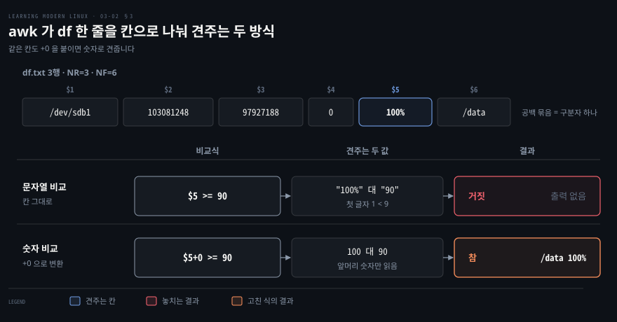
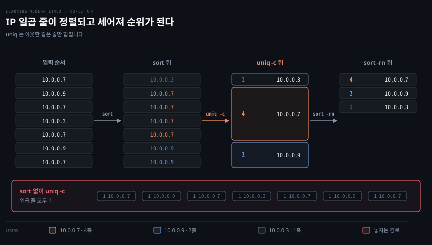
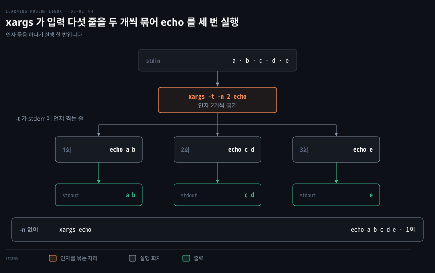

# 자주 치는 것일수록 짧아야 한다

---

> 저자가 이 구간을 여는 원칙은 한 줄입니다. 아주 자주 쓰는 명령일수록 가장 적은 노력이 들어야 한다는 것입니다.

## 핵심 요약

> 이 구간 전체가 매달린 하나의 생각은 터미널에서 손이 덜 가게 만드는 방법이 세 층으로 쌓인다는 것입니다. 지금 쓰는 셸 안에서 줄이는 층, 셸 자체를 갈아 끼우는 층, 그리고 터미널을 쪼개 쓰는 층입니다.

첫 층은 이미 가진 것으로 하는 일입니다. 저자는 하루에 수백 번 보는 `git diff --color-moved` 를 `d` 한 글자로 줄여 씁니다. 커서를 줄 앞으로 옮기고 왼쪽을 지우는 단축키도 여기 듭니다. 편집기를 열지 않고 텍스트를 다루는 일도 같은 층입니다. 행을 고르는 `grep` 과 열을 뽑는 `awk`, 세는 `sort` 와 `uniq` 를 파이프로 이으면 로그 수만 줄이 답 몇 줄로 줄어듭니다.

둘째 층은 셸을 바꾸는 것입니다. bash 는 1980년대 말부터 있었고 나이가 드러날 때가 있다는 것이 저자의 진단입니다. Fish 는 히스토리를 따로 관리하지 않고 그냥 치면 이전 실행이 나옵니다. 명령마다 자동 제안도 내놓습니다. 셋째 층은 터미널 자체를 다중화하는 것입니다. 창을 여러 개 띄우는 대신 세션 하나 안에서 윈도와 페인으로 나눕니다. 셸을 닫아도 그 상태가 남게 하는 것이 핵심입니다. 저자가 잡 컨트롤 대신 이쪽을 권한 이유를 여기서 채웁니다. 터미널이 끊길 때 무엇이 죽고 무엇이 남는지는 `nohup`, `setsid`, tmux 가 각각 다르게 답합니다.

세 층 가운데 저자가 자기 선택을 밝히는 곳은 둘째와 셋째입니다. 셸은 Fish 를 쓰되 취향이라 못 박지 않습니다. 멀티플렉서는 tmux 를 쓰라고 분명히 말합니다. 2절의 `sed` 소절, 3절과 4절, 5절의 인증서 예, 8절의 세션 분리 명령은 책에 없는 내용입니다. 근거는 각주에 단 공식 매뉴얼입니다. 출력은 Debian 12 컨테이너에서 직접 돌려 얻었습니다.


## 학습 목표

> 이 구간을 읽고 나면 아래 다섯 가지를 스스로 해낼 수 있습니다.

1. 자주 쓰는 명령을 줄이는 방법을 셸별로 구분하고, 셸을 고를 때 던질 두 물음을 댈 수 있습니다.
2. 편집기를 열지 않고 파일을 만들고 덧붙이며, `sed` 로 줄을 바꾸거나 골라낼 수 있습니다.
3. `grep`, `awk`, `sort`, `uniq` 를 파이프로 이어 로그에서 개수를 세고, 문자열 비교와 숫자 비교가 갈리는 결과를 예측할 수 있습니다.
4. 에포크 초로 두 날짜의 차이를 계산하고 2038년에 무슨 일이 생기는지 설명할 수 있습니다.
5. tmux 의 세 단위를 설명하고, 터미널이 끊길 때 `nohup`, `setsid`, tmux 가 각각 무엇을 남기는지 비교할 수 있습니다.

아래는 이 문서 전체를 읽는 순서로 이은 지도입니다. 칸마다 절 번호와 그 절이 답하는 물음 하나를 적었습니다. 색이 붙은 칸이 저자가 자기 선택을 밝히는 자리입니다.


## 이 문서가 다루지 않는 것

> 3장을 셋으로 나눈 가운데 구간입니다. 앞뒤는 각각 다른 노트가 맡습니다.

- 터미널과 셸의 정의, 스트림과 파이프, 변수, 종료 상태, 잡 컨트롤은 [셸의 실체는 스트림과 변수와 종료 상태다](./03-01.%EC%85%B8%EC%9D%98%20%EC%8B%A4%EC%B2%B4%EB%8A%94%20%EC%8A%A4%ED%8A%B8%EB%A6%BC%EA%B3%BC%20%EB%B3%80%EC%88%98%EC%99%80%20%EC%A2%85%EB%A3%8C%20%EC%83%81%ED%83%9C%EB%8B%A4.md)가 다룹니다.
- 스크립트 작성과 이식성, 린트와 테스트, `jq` 를 쓰는 예제는 [bash 는 조용히 실패하므로 시끄럽게 만들어야 한다](./03-03.bash%20%EB%8A%94%20%EC%A1%B0%EC%9A%A9%ED%9E%88%20%EC%8B%A4%ED%8C%A8%ED%95%98%EB%AF%80%EB%A1%9C%20%EC%8B%9C%EB%81%84%EB%9F%BD%EA%B2%8C%20%EB%A7%8C%EB%93%A4%EC%96%B4%EC%95%BC%20%ED%95%9C%EB%8B%A4.md)가 다룹니다.
- `find` 로 파일을 찾는 조건식은 [레시피와 현대 도구 참조 시트](./00-01.%EB%A0%88%EC%8B%9C%ED%94%BC%EC%99%80%20%ED%98%84%EB%8C%80%20%EB%8F%84%EA%B5%AC%20%EC%B0%B8%EC%A1%B0%20%EC%8B%9C%ED%8A%B8.md)가 다룹니다. 셸 설정 파일의 권한은 [4장 노트](./04-01.%EC%A0%84%EB%B6%80%20%EC%95%84%EB%8B%88%EB%A9%B4%20%EC%A0%84%EB%AC%B4%EC%97%90%EC%84%9C%20%EC%9E%98%EA%B2%8C%20%EC%AA%BC%EA%B0%9C%EB%8A%94%20%EC%AA%BD%EC%9C%BC%EB%A1%9C.md)가, 파일시스템 안에서 놓이는 자리는 [5장 노트](./05-01.%EB%AA%A8%EB%93%A0%20%EA%B2%83%EC%9D%B4%20%ED%8C%8C%EC%9D%BC%EC%9D%B4%EB%9D%BC%EB%8A%94%20%EB%A7%90%EC%9D%80%20%EC%86%90%EC%9E%A1%EC%9D%B4%EA%B0%80%20%ED%95%98%EB%82%98%EB%9D%BC%EB%8A%94%20%EB%9C%BB%EC%9D%B4%EB%8B%A4.md)가 다룹니다.

저자가 이 구간에서 자기 설정 파일을 통째로 싣는 대목이 여럿 있습니다. 이 노트는 그 설정을 옮겨 적기보다 왜 그렇게 했는지를 남깁니다.


## 1. 자주 치는 명령 줄이기: 별칭·축약·함수

> 인터페이스에 관한 기본 통찰 하나를 셸에 적용하면 이 절이 나옵니다. 아주 자주 쓰는 명령일수록 입력이 빨라야 한다는 것입니다.

저자가 드는 자기 예가 구체적입니다. 저장소에서 변경을 하루에 수백 번 보기 때문에 `git diff --color-moved` 대신 `d` 한 글자를 칩니다. 이것을 부르는 이름은 셸마다 다릅니다. bash 에서는 별칭이라 하고, Fish 에는 축약이 따로 있습니다.

Fish 의 축약은 인자를 받지 않는 단순한 명령에 알맞습니다. 저자가 실제로 쓰는 것 가운데 몇 개만 옮기면 이렇습니다.

```bash
abbr -a -U -- d 'git diff --color-moved'
abbr -a -U -- k kubectl
abbr -a -U -- l 'exa --long --all --git'
abbr -a -U -- s 'git status'
abbr -a -U -- cat bat
```

이 목록의 `exa` 는 유지보수가 끝났고 후속 포크가 `eza` 입니다. 근거는 [앞 노트](./03-01.%EC%85%B8%EC%9D%98%20%EC%8B%A4%EC%B2%B4%EB%8A%94%20%EC%8A%A4%ED%8A%B8%EB%A6%BC%EA%B3%BC%20%EB%B3%80%EC%88%98%EC%99%80%20%EC%A2%85%EB%A3%8C%20%EC%83%81%ED%83%9C%EB%8B%A4.md)에 적었습니다. `l` 축약을 그대로 옮겨 쓰면 설치부터 막히니 `eza` 로 바꿔 넣습니다.

인자를 받는 더 복잡한 것을 줄이려면 함수를 씁니다. 저자가 드는 예는 파일을 전부 스테이징하고 인자를 메시지로 삼아 커밋하는 함수입니다.

```bash
function c
      git add --all
      git commit -m "$argv"
end
```

### 커서를 옮기고 줄을 다루는 단축키

명령을 치다 보면 줄 앞으로 가거나 커서 왼쪽을 통째로 지우고 싶어집니다. 저자가 모아 둔 것 가운데 자주 쓰는 것만 옮깁니다.

| 하려는 일 | 키 |
|---|---|
| 줄 처음으로 · 줄 끝으로 | Ctrl+a · Ctrl+e |
| 한 글자 앞 · 뒤, 한 단어 앞 · 뒤 | Ctrl+f · Ctrl+b, Alt+f · Alt+b |
| 커서 오른쪽 전부 · 왼쪽 전부 · 왼쪽 한 단어 지우기 | Ctrl+k · Ctrl+u · Ctrl+w |
| 화면 지우기 · 명령 취소 | Ctrl+l · Ctrl+c |
| 히스토리 검색 · 검색 취소 | Ctrl+r · Ctrl+g |

이 단축키들이 Emacs 편집 키 조합에 바탕을 둔다는 점을 저자가 밝힙니다. `vi` 를 선호하면 `.bashrc` 에 `set -o vi` 를 넣어 `vi` 방식으로 편집할 수 있습니다. 다만 모든 셸이 모든 단축키를 지원하지는 않고, 히스토리 관리 같은 동작은 셸마다 다르게 구현될 수 있습니다. Alt+f 는 왼쪽 Alt 에서만 동작하고 Ctrl+_ 의 실행 취소는 bash 전용입니다.


## 2. 편집기를 열지 않고 텍스트를 다루기

> 한 줄을 넣자고 매번 편집기를 띄우고 싶지는 않습니다. 스크립트 안에서는 아예 그럴 수도 없습니다.

저자가 드는 방법은 리다이렉션과 몇 개의 명령으로 끝납니다.

```bash
echo "First line" > /tmp/something
echo "Second line" >> /tmp/something
sed 's/line/LINE/' /tmp/something
cat << 'EOF' > /tmp/another
First line
Second line
Third line
EOF
diff -y /tmp/something /tmp/another
```

`>` 로 만들고 `>>` 로 덧붙입니다. `sed` 는 내용을 바꿔 `stdout` 으로 내놓습니다. `<<` 로 여는 것을 히어 도큐먼트라 하고 여러 줄을 한 번에 넣을 때 씁니다. `diff -y` 는 두 파일을 나란히 놓고 차이를 보입니다.

`diff` 가 받는 것은 파일 둘인데, 견주고 싶은 것이 명령 둘의 출력일 때가 있습니다. bash 의 `<(명령)` 이 명령의 출력을 파일 이름 하나로 바꿔 줍니다.[^bash-procsub] 아래는 `1 kim`, `2 lee`, `3 park` 세 줄이 든 `names.txt` 를 `lee` 만 바꾼 결과와 견준 것입니다. 이 노트의 코드 블록에서 명령 아래나 옆에 붙은 `#` 줄은 그 명령의 실제 출력입니다.

```bash
diff -u names.txt <(sed 's/lee/yi/' names.txt)
# --- names.txt	2026-11-10 02:22:23.359479222 +0000
# +++ /dev/fd/63	2026-11-10 02:22:23.367479126 +0000
# @@ -1,3 +1,3 @@
#  1 kim
# -2 lee
# +2 yi
#  3 park
```

둘째 줄의 `/dev/fd/63` 이 `<(…)` 가 만들어 준 이름입니다. 서버 두 대의 설정을 견줄 때도 같은 꼴로 양쪽에 `ssh` 를 넣습니다. `diff <(ssh web1 cat 파일) <(ssh web2 cat 파일)` 입니다. 서버가 여럿이면 `ssh 서버 md5sum 파일` 로 해시부터 모으고, 값이 다른 서버만 `diff` 로 엽니다. `-u` 통합 형식과 디렉터리를 통째로 견주는 `-r` 은 [레시피 시트](./00-01.%EB%A0%88%EC%8B%9C%ED%94%BC%EC%99%80%20%ED%98%84%EB%8C%80%20%EB%8F%84%EA%B5%AC%20%EC%B0%B8%EC%A1%B0%20%EC%8B%9C%ED%8A%B8.md)에 있습니다.

### sed 로 줄을 바꾸고 골라내기

위 예의 `sed 's/line/LINE/'` 는 줄마다 첫 `line` 하나만 바꿉니다. 줄 안의 전부를 바꾸거나, 10행부터 20행만 떼어 보거나, 설정 파일의 한 줄을 고치는 일도 같은 도구가 합니다. `sed` 는 입력을 한 줄씩 패턴 스페이스라는 버퍼에 올립니다. 스크립트의 명령을 그 버퍼에 차례로 적용하고, 끝에 이르면 버퍼를 출력한 뒤 다음 줄을 읽습니다. `-n` 을 주면 이 마지막 자동 출력이 꺼져, `p` 명령을 만난 줄만 나옵니다.[^sed-cycle]



도식은 `name=app` 과 `version=1.4.2` 두 줄이 든 파일이 `sed -n 's/^version=//p'` 를 지나는 모습입니다. 첫 줄은 치환이 일어나지 않아 `p` 가 돌지 않습니다. `-n` 때문에 자동 출력도 없어 사라집니다. 둘째 줄만 `1.4.2` 로 나옵니다. `-n` 을 빼면 `name=app` 이 따라 나옵니다. `1.4.2` 는 `p` 와 자동 출력이 한 번씩 찍어 두 줄이 됩니다.

| 하려는 일 | 명령 |
|---|---|
| 줄마다 첫 일치만 · 모든 일치 · 대소문자 무시하고 바꾸기 | `sed 's/foo/bar/'` · `'s/foo/bar/g'` · `'s/foo/bar/gI'` |
| 10행부터 20행만 · 두 패턴 사이만 출력 | `sed -n '10,20p'` · `sed -n '/WARN/,/reset/p'` |
| `#` 로 시작하는 줄과 빈 줄 지우기 | `sed '/^#/d; /^$/d'` |
| 3행 앞에 한 줄 넣기 · 뒤에 넣기 | `sed '3i\새 줄'` · `sed '3a\새 줄'` |
| 그룹을 잡아 순서 바꾸기 · 줄 끝 공백 지우기 | `sed -E 's/^([^=]+)=(.*)$/\2=\1/'` · `sed 's/[[:space:]]*$//'` |
| 맞은 줄에서 값만 뽑기 | `sed -n 's/^version=//p'` |

`g` 는 줄 안의 모든 일치를 바꾸라는 플래그이고, `I` 는 대소문자를 가리지 않게 하는 GNU 확장입니다. `s` 뒤의 구분자는 `/` 가 아니어도 됩니다. 한 명령 안에서 같은 글자로 통일하기만 하면 되므로, 경로처럼 `/` 가 든 값을 바꿀 때는 다른 글자를 고릅니다.[^sed-s]

```bash
echo 'foo Foo foo' | sed 's/foo/bar/'               # bar Foo foo
echo 'foo Foo foo' | sed 's/foo/bar/g'              # bar Foo bar
echo 'foo Foo foo' | sed 's/foo/bar/gI'             # bar bar bar
echo '/usr/local/bin' | sed 's|/usr/local|/opt|'    # /opt/bin
echo 'name=app' | sed -E 's/^([^=]+)=(.*)$/\2=\1/'  # app=name
```

파일을 실제로 고칠 때는 `-i` 를 씁니다. `-i` 는 결과를 화면에 내지 않고 파일을 바꿔 씁니다.[^sed-i] 되돌릴 길이 없으므로 먼저 `-i` 없이 돌려 결과를 확인하고, 고칠 때는 `-i.bak` 으로 원본을 남깁니다. 히어 도큐먼트로 만든 설정 파일로 해 봅니다.

```bash
cat > sshd_config << 'EOF'
# This is the sshd server system-wide configuration file.

Port 22
#PermitRootLogin prohibit-password
PasswordAuthentication yes
  # indented comment

X11Forwarding no
EOF
sed -E 's/^#?PermitRootLogin.*/PermitRootLogin no/' sshd_config | grep -n PermitRootLogin
# 4:PermitRootLogin no
sed -i.bak -E 's/^#?PermitRootLogin.*/PermitRootLogin no/' sshd_config
ls sshd_config*                                     # sshd_config  sshd_config.bak
```

`^#?` 는 줄 맨 앞에 `#` 가 있어도 없어도 맞으라는 뜻입니다. 주석으로 막혀 있던 줄과 이미 풀려 있던 줄을 한 번에 같은 값으로 맞춥니다. 고친 뒤 `diff -u sshd_config.bak sshd_config` 를 돌리면 4행 하나만 바뀐 것이 보입니다.

### 긴 파일을 보는 법

화면에 다 안 들어가는 파일에는 페이저를 씁니다. `less` 가 대표적이고 `bat` 에는 페이저가 내장되어 있습니다. 페이징은 출력을 화면 크기에 맞는 쪽으로 나누고 쪽을 오가는 명령을 붙이는 것입니다. 일부만 볼 때는 `head` 와 `tail` 을 씁니다.

```bash
head -5 /tmp/longfile
sudo tail -f /var/log/Xorg.0.log
```

`-f` 는 따라간다는 뜻이라 계속 자라는 파일을 실시간으로 봅니다. 다만 `-f` 는 처음 연 파일 자체를 따라갑니다. 로그 로테이션이 그 파일의 이름을 바꾸고 같은 이름으로 새 파일을 만들면 옛 파일만 보다가 멈춥니다. `-F` 는 이름을 따라가고, 파일이 사라지면 다시 열기를 되풀이합니다.[^tail]

```bash
echo one > r.log
tail -F r.log &
mv r.log r.log.1; echo two > r.log; echo three >> r.log
# one
# tail: 'r.log' has been replaced;  following new file
# two
# three
```

같은 순서를 `tail -f` 로 돌리면 `one` 에서 끝납니다. 줄이 아니라 바이트로 자를 때는 `head -c 19 app.log` 처럼 `-c` 를 씁니다. 화면으로 보면서 파일에도 남기는 `tee` 는 [8장 노트](./08-01.%EC%9E%AC%EB%8A%94%20%EA%B2%83%EC%9D%80%20%EB%B0%94%EA%B9%A5%EC%9D%B4%EA%B3%A0%20%EC%95%8C%EA%B3%A0%20%EC%8B%B6%EC%9D%80%20%EA%B2%83%EC%9D%80%20%EC%95%88%EC%9D%B4%EB%8B%A4.md)의 「흐르는 로그를 따라가기」가 설명합니다. 오류까지 함께 남기려면 `2>&1` 을 파이프 앞에 둡니다. `명령 2>&1 | tee -a "status-$(date +%F).log"` 는 날짜를 파일 이름에 넣은 꼴입니다.


## 3. 행을 고르고 열을 뽑기: grep·cut·awk

> 로그가 수만 줄이어도 필요한 것은 그중 몇 줄이고, 그 줄에서도 한두 칸입니다. 행을 고르는 도구와 열을 뽑는 도구를 파이프로 이으면 편집기를 열지 않고 그 칸까지 갑니다.

앞 명령의 출력을 뒤 명령의 입력으로 잇는 파이프는 [앞 노트](./03-01.%EC%85%B8%EC%9D%98%20%EC%8B%A4%EC%B2%B4%EB%8A%94%20%EC%8A%A4%ED%8A%B8%EB%A6%BC%EA%B3%BC%20%EB%B3%80%EC%88%98%EC%99%80%20%EC%A2%85%EB%A3%8C%20%EC%83%81%ED%83%9C%EB%8B%A4.md) 2절이 설명합니다. 이 절의 예는 아래 일곱 줄짜리 `app.log` 를 씁니다.

```bash
2026-11-10 09:01:15 INFO  order-api started
2026-11-10 09:14:40 ERROR payment timeout orderId=1001
2026-11-10 09:14:41 WARN  retrying orderId=1001
2026-11-10 09:20:02 ERROR payment timeout orderId=1002
2026-11-10 10:06:01 error db connection reset
2026-11-10 10:06:02 [ERROR] pool exhausted, errors=3
2026-11-10 11:30:00 INFO  heartbeat
```

### grep 으로 행 고르기

`grep 패턴 파일` 은 패턴과 맞는 줄만 내보냅니다. 옵션은 세 물음으로 갈립니다. 무엇을 일치로 볼 것인가, 어디를 읽을 것인가, 무엇을 찍을 것인가입니다.[^grep]

| 물음 | 옵션 | 하는 일 |
|---|---|---|
| 무엇을 일치로 보나 | `-i` | 대소문자를 가리지 않음 |
| | `-v` | 맞지 않는 줄을 고름 |
| | `-E` | 확장 정규식. 선택 기호와 `+`, `?`, `{n}` 을 역슬래시 없이 씀 |
| | `-F` | 패턴을 정규식이 아니라 글자 그대로 찾음 |
| | `-w` · `-x` | 단어 단위로 맞음 · 줄 전체가 맞아야 함 |
| 어디를 읽나 | `-r` | 디렉터리 아래를 재귀로 읽음 |
| | `--include='*.conf'` | 재귀 검색에서 이름이 맞는 파일만 읽음 |
| 무엇을 찍나 | `-n` · `-c` | 줄 번호를 앞에 붙임 · 맞은 줄 수만 냄 |
| | `-l` · `-o` | 맞은 파일의 이름만 냄 · 맞은 부분만 냄 |
| | `-A n` · `-B n` · `-C n` | 맞은 줄의 뒤 · 앞 · 앞뒤 n줄을 함께 냄 |

패턴은 기본이 정규식이라, 눈에 보이는 글자 그대로 찾아 주지 않을 때가 있습니다.

```bash
grep -c '[ERROR]' app.log        # 6
grep -F '[ERROR]' app.log        # 2026-11-10 10:06:02 [ERROR] pool exhausted, errors=3
grep 'WARN|ERROR' app.log        # 출력 없음
grep -w error app.log            # 2026-11-10 10:06:01 error db connection reset
grep -E 'WARN|\[ERROR\]' app.log
# 2026-11-10 09:14:41 WARN  retrying orderId=1001
# 2026-11-10 10:06:02 [ERROR] pool exhausted, errors=3
```

첫 명령이 6을 내는 까닭은 대괄호가 "이 글자들 중 하나" 를 뜻하기 때문입니다. `E`, `R`, `O` 가운데 한 글자라도 든 줄이 전부 맞습니다. `-F` 를 주면 `[ERROR]` 일곱 글자를 그대로 찾습니다. 셋째 명령은 기본 정규식에서 세로 막대가 보통 글자라 `WARN|ERROR` 라는 글자열을 찾다가 빈손으로 끝납니다. `-E` 를 줘야 "둘 중 하나" 가 됩니다. `-w` 는 `error` 가 단어로 떨어진 줄만 고르므로 `errors=3` 이 든 줄은 빠집니다.

맞은 줄만 봐서는 앞뒤 사정을 알 수 없을 때 문맥 옵션을 쓰고, 설정 파일에서 켜진 줄만 볼 때는 `-v` 로 주석과 빈 줄을 걷습니다.

```bash
grep -n -B1 -A1 WARN app.log
# 2-2026-11-10 09:14:40 ERROR payment timeout orderId=1001
# 3:2026-11-10 09:14:41 WARN  retrying orderId=1001
# 4-2026-11-10 09:20:02 ERROR payment timeout orderId=1002
grep -vE '^[[:space:]]*(#|$)' sshd_config
# Port 22
# PasswordAuthentication yes
# X11Forwarding no
```

맞은 줄은 번호 뒤에 `:` 가, 딸려 온 줄은 `-` 가 붙습니다. 자바 스택 트레이스는 `grep -n -B2 -A10 OutOfMemoryError app.log` 처럼 뒤쪽을 넉넉히 잡습니다. 둘째 명령은 2절에서 고치기 전의 `sshd_config` 로 돌렸습니다. `grep -v '^#'` 만 쓰면 빈 줄과 들여 쓴 주석 줄이 남고, 2절 표의 `sed '/^#/d; /^$/d'` 도 들여 쓴 주석은 못 지웁니다. 줄 머리의 공백까지 `[[:space:]]*` 로 받아야 세 줄만 남습니다.

개수와 파일 이름만 필요할 때는 아래처럼 씁니다. `auth.log` 에는 ssh 로그인 실패가 세 줄 있습니다. `conf/` 에는 `timeout=30` 인 `a.conf` 와 `c.txt`, `timeout=60` 인 `b.conf` 가 있습니다.

```bash
grep -c 'Failed password' auth.log               # 3
grep -rl --include='*.conf' 'timeout=30' conf    # conf/a.conf
zgrep -c ERROR app.log.1.gz                      # 3
grep -o 'orderId=[0-9]*' app.log | tr '\n' ' '   # orderId=1001 orderId=1001 orderId=1002
```

`c.txt` 도 같은 값을 갖지만 `--include` 가 걸러 냈습니다. `zgrep` 은 압축됐을 수 있는 파일에 `grep` 을 불러 주는 명령이라 로테이션돼 `.gz` 로 묶인 로그를 풀지 않고 찾고, 옵션은 그대로 `grep` 에 넘깁니다.[^zgrep] `grep` 은 맞은 줄이 있으면 0, 없으면 1, 오류가 나면 2로 끝납니다. 그래서 `if grep -q 패턴 파일; then` 처럼 조건 자리에 그대로 씁니다. 종료 상태를 조건으로 쓰는 법은 [앞 노트](./03-01.%EC%85%B8%EC%9D%98%20%EC%8B%A4%EC%B2%B4%EB%8A%94%20%EC%8A%A4%ED%8A%B8%EB%A6%BC%EA%B3%BC%20%EB%B3%80%EC%88%98%EC%99%80%20%EC%A2%85%EB%A3%8C%20%EC%83%81%ED%83%9C%EB%8B%A4.md) 4절에 있습니다.

### cut 과 awk 로 열 뽑기

고른 줄에서 칸 하나만 필요할 때 가장 단순한 도구는 `cut` 입니다. `-d` 로 구분자를, `-f` 로 칸 번호를 주고, `-c` 로는 글자 위치를 줍니다.

```bash
cut -d: -f1,7 /etc/passwd | head -2
cut -c1-10 app.log | head -1
# root:/bin/bash
# daemon:/usr/sbin/nologin
# 2026-11-10
```

`cut` 은 구분자 하나를 칸 경계 하나로 셉니다. 공백 둘이 이어지면 그 사이를 빈 칸으로 칩니다. `echo 'a  b' | cut -d' ' -f2` 는 빈 줄을 내고, `echo 'a  b' | awk '{print $2}'` 는 `b` 를 냅니다. `df` 나 `ps` 처럼 공백으로 줄을 맞춘 출력에는 `awk` 를 씁니다.

`awk` 는 입력을 한 줄씩 읽어 공백으로 나눈 칸을 `$1`, `$2` 로 부릅니다. 이어진 공백은 구분자 하나로 칩니다.[^gawk-fields] `$0` 은 줄 전체, `NF` 는 그 줄의 칸 수, `NR` 은 지금까지 읽은 줄 번호입니다. 그래서 `$NF` 가 마지막 칸입니다. 구분자는 `-F:` 처럼 바꿉니다. 프로그램은 `패턴 { 동작 }` 꼴입니다. 패턴이 참인 줄에서만 동작을 실행합니다. 동작을 빼면 그 줄을 그대로 찍고, 패턴을 빼면 모든 줄에서 실행합니다. `BEGIN` 은 첫 줄을 읽기 전에, `END` 는 마지막 줄을 읽은 뒤에 한 번씩 돕니다.



도식과 아래 예가 쓰는 입력은 `df -P` 의 출력 꼴인 `df.txt` 입니다. `-P` 는 파일시스템 하나를 반드시 한 줄에 찍습니다. 장치 이름이 길어도 줄이 둘로 갈리지 않으니 다섯째 칸이 늘 사용률입니다.[^df]

```bash
Filesystem     1024-blocks      Used Available Capacity Mounted on
/dev/sda1         41152736  17283548  21755756      45% /
/dev/sdb1        103081248  97927188         0     100% /data
/dev/sdc1         51474912  46327424   2509728      95% /var/log
tmpfs              8139112         0   8139112       0% /dev/shm
```

```bash
awk '{print NR, NF, $NF}' df.txt | head -2
# 1 7 on
# 2 6 /
awk -F: '$3 >= 1000 && $7 !~ /(nologin|false)$/ {print $1, $3, $7}' /etc/passwd
# dev 1000 /bin/sh
```

머리글 줄은 `Mounted on` 이 두 칸으로 갈려 `NF` 가 7입니다. 둘째 명령은 UID 가 1000 이상이면서 셸이 `nologin` 이나 `false` 로 끝나지 않는 계정, 곧 사람이 로그인하는 계정을 고릅니다. `!~` 가 정규식과 맞지 않는다는 뜻입니다. 컨테이너에 만든 `dev`(1000, `/bin/sh`)와 `svc`(1001, `/usr/sbin/nologin`) 가운데 `dev` 만 나왔습니다. `/etc/passwd` 의 일곱 칸은 [4장 노트](./04-01.%EC%A0%84%EB%B6%80%20%EC%95%84%EB%8B%88%EB%A9%B4%20%EC%A0%84%EB%AC%B4%EC%97%90%EC%84%9C%20%EC%9E%98%EA%B2%8C%20%EC%AA%BC%EA%B0%9C%EB%8A%94%20%EC%AA%BD%EC%9C%BC%EB%A1%9C.md)의 「/etc/passwd 한 줄 읽기」에 있습니다.

### awk 비교가 문자열로 떨어질 때

사용률이 90% 이상인 파일시스템을 고르려고 `$5 >= 90` 이라 쓰면 정작 100% 를 놓칩니다.

```bash
awk 'NR>1 && $5 >= 90 {print $6, $5}' df.txt      # /var/log 95%
awk 'NR>1 && $5+0 >= 90 {print $6, $5}' df.txt
# /data 100%
# /var/log 95%
```

`awk` 는 칸의 내용이 숫자 꼴일 때만 숫자로 견줍니다. `95%` 는 `%` 가 붙어 숫자 꼴이 아니므로 문자열이고, 한쪽이 문자열이면 비교 전체가 문자열 비교가 됩니다.[^gawk-cmp] 문자열은 앞 글자부터 견주므로 `1` 로 시작하는 `100%` 가 `9` 로 시작하는 `90` 보다 작습니다.

`$5+0` 처럼 산술을 걸면 문자열의 앞머리에서 숫자로 읽히는 부분만 수로 바뀝니다. `100%` 는 100 이 되고, 숫자로 읽을 부분이 없는 `abc` 는 0 이 됩니다.[^gawk-conv] 머리글을 건너뛰는 `NR>1` 도 같은 이유로 필요합니다. `awk '$5 > 9 {print $5}' df.txt` 는 `Capacity` 라는 글자까지 내보냅니다. Debian 의 기본 `awk` 인 mawk 와 gawk 에서 결과가 같았습니다. `grep '9[0-9]%' df.txt` 처럼 패턴으로 임계를 흉내 내면 95% 줄만 잡고 100% 를 놓칩니다. 임계 비교는 칸을 숫자로 바꿔서 합니다.

자주 쓰는 꼴을 모으면 아래와 같습니다. `access.log` 는 첫 칸이 클라이언트 IP 이고 아홉째 칸이 상태 코드인 일곱 줄짜리 접근 로그입니다.

```bash
awk -v limit=90 'NR>1 && $5+0 >= limit {print $6}' df.txt | tr '\n' ' '   # /data /var/log
awk 'NR>1 {sum += $3} END {print sum}' df.txt                     # 161538160
awk 'BEGIN {OFS=","} NR>1 {$1=$1; print}' df.txt | head -1        # /dev/sda1,41152736,17283548,21755756,45%,/
awk '$9 == 500 {n++} END {print n}' access.log                    # 3
awk 'NR>1 {printf "%-10s %5.1f%%\n", $6, $3/$2*100}' df.txt | head -2
# /           42.0%
# /data       95.0%
awk '{count[$1]++} END {for (ip in count) print count[ip], ip}' access.log | sort -rn
# 4 10.0.0.7
# 2 10.0.0.9
# 1 10.0.0.3
free -m | awk '/^Mem:/ {printf "%.1f%%\n", $7/$2*100}'           # 76.4%
awk -v n="$(nproc)" '{print ($1 > n ? "over" : "ok"), $1, n}' /proc/loadavg   # ok 0.71 8
```

`-v limit=90` 은 값을 `awk` 변수로 넘깁니다. 셸 변수라면 `-v limit="$LIMIT"` 꼴로 씁니다. `printf` 는 `%-10s` 로 폭을, `%5.1f` 로 소수 자릿수를 정합니다. `OFS` 는 출력 구분자인데, 바꿔 놓기만 해서는 줄이 그대로 나옵니다. `$1=$1` 처럼 칸에 값을 넣어야 `awk` 가 줄을 새 구분자로 다시 조립합니다.[^gawk-rebuild] 배열 `count` 는 IP 를 키로 삼아 줄 수를 모읍니다. `for (ip in count)` 가 도는 순서는 정해져 있지 않아 `sort -rn` 으로 세웁니다.

마지막 두 줄은 시스템 상태를 한 줄로 읽습니다. `free` 의 `Mem:` 행에서는 일곱째 칸 `available` 을 둘째 칸 `total` 로 나눕니다.[^free] `/proc/loadavg` 에서는 첫 칸인 1분 평균 부하를 코어 수와 견줍니다.[^loadavg] 두 값은 돌릴 때마다 달라집니다. 두 값의 뜻은 [8장 둘째 노트](./08-02.%EC%9E%90%EC%9B%90%EB%A7%88%EB%8B%A4%20%EC%B0%BD%EC%9D%B4%20%EB%94%B0%EB%A1%9C%20%EB%82%98%20%EC%9E%88%EC%96%B4%20%EC%96%B4%EB%8A%90%20%EC%B0%BD%EC%9D%84%20%EC%97%AC%EB%8A%90%EB%83%90%EA%B0%80%20%EA%B3%A7%20%EC%A7%84%EB%8B%A8%EC%9D%B4%EB%8B%A4.md)의 `free` 와 `uptime` 소절이 설명합니다.


## 4. 세고 정렬하기: sort·uniq·tr·xargs

> 어느 값이 몇 번 나왔는지 세려면 같은 줄을 먼저 붙여 놓아야 합니다. 세는 도구가 바로 이웃한 줄끼리만 견주기 때문입니다.

### 정렬로 같은 줄을 붙여 세기

접근 로그에서 어느 IP 가 가장 많이 들어왔는지 세는 파이프라인입니다.

```bash
grep -oE '^[0-9.]+' access.log | sort | uniq -c | sort -rn
#       4 10.0.0.7
#       2 10.0.0.9
#       1 10.0.0.3
```



`grep -o` 가 줄 머리의 IP 만 뽑습니다. `sort` 가 같은 IP 를 이웃하게 붙이면 `uniq -c` 가 이웃한 같은 줄을 하나로 합치며 개수를 앞에 붙입니다. 마지막 `sort -rn` 이 개수가 큰 순서로 세웁니다. 여기서 `sort` 를 빼면 `uniq -c` 는 일곱 줄 모두에 1을 붙입니다. `uniq` 는 되풀이된 줄을 이웃해 있을 때만 알아보기 때문입니다.[^uniq]

`sort` 의 옵션은 무엇을 키로 삼고 어떻게 견줄지를 정합니다.

| 옵션 | 하는 일 |
|---|---|
| `-n` · `-r` | 숫자로 견줌(키 앞머리의 숫자 부분을 읽음) · 순서를 뒤집음 |
| `-k N` · `-t 글자` | N번째 칸부터를 키로 삼음 · 칸 구분자를 정함 |
| `-u` · `-h` | 같은 줄은 하나만 남김 · `3K`, `12M`, `1.5G` 같은 크기 표기를 크기 순으로 견줌 |

```bash
printf '10\n9\n100\n' | sort | tr '\n' ' '                # 10 100 9
printf '10\n9\n100\n' | sort -n | tr '\n' ' '             # 9 10 100
printf '1.5G\n200M\n3K\n12M\n' | sort -h | tr '\n' ' '    # 3K 12M 200M 1.5G
awk 'NR>1' df.txt | sort -k5 -rn | head -2
# /dev/sdb1        103081248  97927188         0     100% /data
# /dev/sdc1         51474912  46327424   2509728      95% /var/log
```

옵션이 없으면 글자 순서라 `100` 이 `9` 앞에 옵니다. `-n` 은 키 앞머리에서 숫자로 읽히는 데까지만 읽습니다.[^sort] 그래서 넷째 명령처럼 `%` 가 붙은 사용률 칸도 숫자 순서로 정렬됩니다. 3절의 `awk` 비교가 숫자 꼴이 아닌 칸을 문자열로 견준 것과 다른 점입니다.

같은 조합으로 시간대별 오류 수도 셉니다. `app.log` 에서 `ERROR` 줄의 둘째 칸인 시각을 뽑고, 그 앞 두 글자인 시(時)만 남겨 셉니다.

```bash
grep ERROR app.log | cut -d' ' -f2 | cut -c1-2 | sort | uniq -c
#       2 09
#       1 10
wc app.log                  #   7  38 337 app.log
ls /proc/$$/fd | wc -l      # 3
```

`wc` 는 줄 수, 단어 수, 바이트 수를 차례로 내고, `wc -l` 은 줄 수만 내므로 목록 뒤에 붙이면 개수가 됩니다. 마지막 줄은 스크립트를 돌린 셸이 연 파일 디스크립터가 0, 1, 2 셋이라는 뜻입니다. `uniq -d` 는 두 번 이상 나온 줄만 냅니다. 이 파이프라인을 배치 처리의 원형으로 읽는 관점은 [DDIA 11장 노트](../../../05_data/book/designing-data-intensive-applications/11-01.%EB%B0%B0%EC%B9%98%20%EC%B2%98%EB%A6%AC%20%EA%B0%9C%EC%9A%94%EC%99%80%20Unix%20%EB%8F%84%EA%B5%AC.md) 2절에 있습니다.

### 글자 바꾸기와 칸 맞추기

`sed` 가 줄 안의 패턴을 바꾼다면 `tr` 은 글자 하나하나를 다른 글자로 옮깁니다. 지우는 `-d` 와 이어진 같은 글자를 하나로 줄이는 `-s` 도 있습니다.

```bash
echo 'Com_Acme' | tr '_A-Z' '.a-z'                     # com.acme
echo 'a    b   c' | tr -s ' '                          # a b c
printf 'a\r\nb\r\n' | tr -d '\r' | od -c | head -1     # 0000000   a  \n   b  \n
```

윈도우에서 만든 파일은 줄 끝이 `\r\n` 이라 값 끝에 보이지 않는 `\r` 이 붙습니다. `tr -d '\r'` 로 지우고 `od -c` 로 남았는지 확인합니다.

파일 둘을 옆으로 잇는 도구가 `paste` 와 `join` 이고, 칸 너비가 들쭉날쭉한 출력은 `column -t` 가 표로 맞춥니다.[^column] `teams.txt` 에는 `1 dev`, `3 ops` 두 줄이 들어 있습니다.

```bash
paste names.txt teams.txt
# 1 kim	1 dev
# 2 lee	3 ops
# 3 park
join names.txt teams.txt | tr '\n' ' '    # 1 kim dev 3 park ops
printf 'svc enabled active\ncron disabled inactive\n' | column -t
# svc   enabled   active
# cron  disabled  inactive
```

`paste` 는 같은 줄 번호끼리 탭으로 붙일 뿐이라 `2 lee` 옆에 `3 ops` 가 왔습니다. `join` 은 첫 칸이 같은 줄끼리 붙이므로 짝이 없는 `2 lee` 는 빠지며, 두 파일이 그 칸으로 정렬돼 있어야 합니다.[^join]

서비스 여러 개의 상태를 한 표로 볼 때 `column -t` 를 씁니다. 반복문이 서비스마다 `이름 is-enabled 결과 is-active 결과` 한 줄을 만들어 넘깁니다.

```bash
for s in ssh cron nginx; do
  echo "$s $(systemctl is-enabled "$s") $(systemctl is-active "$s")"
done | column -t
```

이 반복문은 systemd 가 없는 컨테이너라 돌려 보지 못했습니다. `systemctl` 은 [6장 노트](./06-01.%EB%A8%BC%EC%A0%80%20%EC%BC%9C%EC%A7%80%EB%8A%94%20%EA%B2%83%20%ED%95%98%EB%82%98%EA%B0%80%20%EB%82%98%EB%A8%B8%EC%A7%80%20%EC%A0%84%EB%B6%80%EB%A5%BC%20%EC%BC%A0%EB%8B%A4.md) 5절이 다룹니다.

JSON 은 칸이 공백으로 나뉘지 않아 이 도구들로 다루기 어렵습니다. 그 일은 `jq` 가 맡습니다. 기본 설치에 없을 수 있어, [다음 노트](./03-03.bash%20%EB%8A%94%20%EC%A1%B0%EC%9A%A9%ED%9E%88%20%EC%8B%A4%ED%8C%A8%ED%95%98%EB%AF%80%EB%A1%9C%20%EC%8B%9C%EB%81%84%EB%9F%BD%EA%B2%8C%20%EB%A7%8C%EB%93%A4%EC%96%B4%EC%95%BC%20%ED%95%9C%EB%8B%A4.md)의 예제는 `jq` 가 있는지부터 검사합니다.

### xargs 로 입력을 인자로 바꾸기

파이프는 앞 명령의 출력을 뒤 명령의 표준 입력에 넣습니다. 그런데 `rm`, `grep -l`, `ssh` 처럼 처리할 대상을 인자로 받는 명령이 많습니다. `xargs` 가 표준 입력에서 읽은 항목을 인자로 붙여 명령을 실행합니다. 명령을 주지 않으면 `echo` 를 씁니다.[^xargs]

```bash
printf 'a\nb\nc\nd\ne\n' | xargs echo                  # a b c d e
printf 'a\nb\nc\nd\ne\n' | xargs -t -n 2 echo
# echo a b
# a b
# echo c d
# c d
# echo e
# e
```



첫 명령은 다섯 줄을 인자 다섯으로 모아 `echo` 를 한 번 실행했습니다. `-n 2` 를 주면 인자를 둘씩 끊어 세 번 실행합니다. `-t` 는 실행할 명령을 먼저 찍어 주므로 묶음이 어떻게 갈렸는지 보입니다. `xargs` 는 기본으로 공백에서도 항목을 끊습니다. 이름에 공백이 든 파일이 섞이면 인자가 쪼개집니다. 그래서 파일 이름을 넘길 때는 보내는 쪽이 널 문자로 끊고 `xargs -0` 으로 받으며, `find` 의 `-print0` 이 그 짝입니다. 인자를 명령 끝이 아닌 자리에 넣을 때는 `-I{}` 를 씁니다.

```bash
printf 'my file.txt\nb.txt\n' | xargs -n 1 echo | tr '\n' ' '      # my file.txt b.txt
printf 'my file.txt\0b.txt\0' | xargs -0 -n 1 echo
# my file.txt
# b.txt
find conf -name '*.conf' -print0 | xargs -0 grep -l 'timeout=30'    # conf/a.conf
printf 'a\nb\n' | xargs -I{} echo 'file: {} -> {}.bak'
# file: a -> a.bak
# file: b -> b.bak
```

첫 줄은 세 줄로 갈려 `my`, `file.txt`, `b.txt` 가 따로 찍힌 것을 한 줄로 이어 붙인 것입니다. `-P N` 은 프로세스를 N개까지 동시에 돌립니다. `sleep 1` 을 네 번 실행하는 데 `xargs -n 1` 은 4.014초, `xargs -n 1 -P 4` 는 1.009초가 걸렸습니다. `find` 의 조건식은 [레시피 시트](./00-01.%EB%A0%88%EC%8B%9C%ED%94%BC%EC%99%80%20%ED%98%84%EB%8C%80%20%EB%8F%84%EA%B5%AC%20%EC%B0%B8%EC%A1%B0%20%EC%8B%9C%ED%8A%B8.md)에 있습니다.


## 5. 날짜를 숫자로 다루기

> `date` 는 유일한 파일 이름을 만드는 데 쓸모가 있습니다. 여러 형식으로 날짜를 만들고 서로 바꾸는 일도 합니다.

```bash
date +%s                                    # 1629582883
date -d @1629582883 '+%m/%d/%Y:%H:%M:%S'    # 08/21/2021:21:54:43
```

첫 줄이 유닉스 타임스탬프를 만들고, 둘째 줄이 그것을 사람이 읽는 날짜로 바꿉니다. `date -d` 는 GNU coreutils 의 옵션이고 `@` 뒤의 숫자를 에포크 초로 읽습니다.[^date] macOS 의 BSD `date` 는 `-d` 를 이 뜻으로 받지 않아, 같은 일을 `date -r 1629582883` 으로 합니다.

### 에포크 초로 남은 날 세기

날짜 둘의 차이는 둘 다 에포크 초로 바꿔 빼면 나옵니다. 인증서 만료까지 남은 날을 세는 일이 그 예입니다. 아래는 유효 기간 30일짜리 자체 서명 인증서를 방금 만들어 돌린 결과입니다.

```bash
openssl x509 -enddate -noout -in cert.pem    # notAfter=Dec 10 02:22:33 2026 GMT
end=$(date -d "$(openssl x509 -enddate -noout -in cert.pem | cut -d= -f2)" +%s)
now=$(date +%s)
echo $(( (end - now) / 86400 ))              # 30
```

`-enddate` 가 만료 시각을 `notAfter=` 뒤에 찍습니다.[^x509] `cut -d= -f2` 로 `=` 뒤만 떼어 `date -d` 에 넘기면 에포크 초가 됩니다. 지금 시각의 초를 빼고 하루의 초인 86,400 으로 나누면 남은 날입니다.

### 에포크 시간과 2038년

유닉스 에포크 시간, 줄여서 유닉스 시간은 1970년 1월 1일 0시 0분 0초 UTC 부터 흐른 초의 수입니다. 모든 날을 정확히 86,400초로 취급합니다. 유닉스 시간을 부호 있는 32비트 정수로 저장하는 소프트웨어를 다룬다면 주의해야 합니다. 2038년 1월 19일에 카운터가 넘치기 때문이고, 이것을 2038년 문제라 부릅니다. 부호 있는 32비트의 최댓값 2,147,483,647 을 `date -u -d @2147483647` 로 바꾸면 `Tue Jan 19 03:14:07 UTC 2038` 이 나옵니다.


## 6. bash 가 사람 친화적이지 않다는 말

> bash 는 여전히 가장 널리 쓰이는 셸이지만 가장 사람 친화적인 셸은 아니라는 것이 저자의 진단입니다. 1980년대 말부터 있었고 그 나이가 가끔 드러납니다.

저자가 자세히 드는 예는 Fish 입니다. 스스로를 똑똑하고 사용자 친화적인 명령행 셸이라 소개합니다. 매일 하는 일에서 입력만 놓고 보면 bash 와 큰 차이가 없고 앞 절의 단축키도 대부분 그대로 통합니다. 다만 두 자리에서 다르고, 그 두 자리가 훨씬 편하다고 적습니다. 하나는 히스토리를 따로 관리하지 않는다는 점입니다. 그냥 치면 그 명령의 이전 실행들이 나오고 위아래 키로 고릅니다. 다른 하나는 자동 제안이 많은 명령에 붙는다는 점입니다. Tab 을 누르면 명령과 인자와 경로를 완성하려 합니다. 알아보지 못한 명령은 입력을 붉게 물들이는 식으로 시각적 힌트를 줍니다.

### Fish 의 환경 변수 문법

Fish 로 옮길 때 가장 먼저 걸리는 것이 이것입니다.

| 하려는 일 | Fish 명령 |
|---|---|
| 환경 변수 `KEY` 를 값 `VAL` 로 내보내기 · 지우기 | `set -x KEY VAL` · `set -e KEY` |
| 한 명령에만 환경 변수 붙이기 | `env KEY=VAL cmd` |
| 프롬프트의 경로 길이를 1로 | `set -g fish_prompt_pwd_dir_length 1` |
| 축약 관리 · 함수 관리 | `abbr` · `functions` 와 `funcd` |

여기에 하나 더 있습니다. 다른 셸과 달리 Fish 는 마지막 명령의 종료 상태를 `$?` 가 아니라 `$status` 에 담습니다. bash 에서 오던 사람은 Fish FAQ 를 보라고 저자가 권합니다. 설정은 `fish_config` 명령으로 합니다. 배포판에 따라 `browse` 하위 명령이 필요할 수 있으며, Fish 가 `http://localhost:8000` 으로 서버를 띄우고 기본 브라우저를 자동으로 열어 설정을 보고 바꾸게 해 줍니다.


## 7. 어느 셸을 고를 것인가

> 저자는 새 셸을 볼 때 두 가지를 자문하라고 합니다. 그 셸의 초점이 대화형 사용인가 스크립팅인가, 그리고 그 주변 커뮤니티가 얼마나 활발한가입니다.


도식은 그 두 물음을 열로 세우고 저자가 실제로 적은 것만 칸에 넣은 것입니다. 초점을 밝힌 셸은 여섯 중 하나뿐입니다. 커뮤니티가 얼마나 활발한지는 어느 셸에도 적혀 있지 않아 열로 세울 수조차 없었습니다. bash 호환도 마찬가지입니다. 저자가 셸마다 호환 여부를 판정한 곳은 없습니다. 목록 전체에 "항상 bash 호환은 아니다" 라는 단서 한 줄이 붙어 있을 뿐입니다. 예외는 둘입니다. zsh 에는 "넓은 하위 호환을 유지한다" 고 적었고 fish 에는 일상 입력에서 큰 차이를 느끼지 못할 것이라고 적었습니다. 나머지 넷은 확인이 읽는 사람 몫입니다.

목록에 오른 셸을 저자의 서술 그대로 옮기면 이렇습니다. Oil 은 Python 과 JavaScript 사용자를 겨냥하며 대화형보다 스크립팅에 초점이 있습니다. murex 는 통합 테스트 프레임워크와 타입 있는 파이프라인, 이벤트 기반 프로그래밍을 갖춘 POSIX 셸입니다. Nushell 은 표 형태 출력과 강력한 질의 언어를 갖춘 실험적인 새 패러다임입니다. PowerShell 은 윈도우 PowerShell 의 포크에서 출발해 POSIX 셸과 다른 의미론과 상호작용을 제공합니다.

`zsh` 는 Bourne 계열 셸로 강력한 자동완성 시스템과 풍부한 테마 지원을 갖습니다. Oh My Zsh 를 쓰면 앞 절에서 본 Fish 처럼 설정해 쓰면서도 bash 와의 하위 호환을 넓게 유지할 수 있습니다. 시작 파일이 다섯이라는 점이 특징이고, 이 파일들은 `$ZDOTDIR` 에서 읽되 그 값이 없으면 `$HOME` 을 씁니다.

| 파일 | 언제 읽히나 |
|---|---|
| `.zshenv` | 셸을 부를 때마다. 검색 경로와 중요한 환경 변수를 넣되 출력을 내거나 tty 를 가정하는 명령은 넣지 않는다 |
| `.zprofile` | `.zlogin` 대신 쓰는 ksh 사용자용. `.zshrc` 보다 먼저 읽히며 둘을 함께 쓰지는 않는다 |
| `.zshrc` | 대화형 셸에서. 별칭·함수·옵션·키 바인딩을 넣는다 |
| `.zlogin` | 로그인 셸에서. 로그인 셸에서만 실행할 명령을 넣고 별칭이나 환경 변수 설정은 넣지 않는다 |
| `.zlogout` | 로그인 셸이 끝날 때 |

### 저자의 결론

지금 시점에서 bash 를 뺀 모든 모던 셸이 사람 중심 관점에서는 좋은 선택으로 보인다는 것이 저자의 결론입니다. 매끄러운 자동완성과 쉬운 설정과 똑똑한 환경은 사치가 아니라고 봅니다. 명령행에서 보내는 시간을 생각하면 여러 셸을 써 보고 마음에 드는 것을 고르라고 권합니다. 자기는 Fish 를 쓰고 동료 다수는 zsh 에 아주 만족한다고 덧붙입니다.

옮기기를 망설이게 하는 이유로 저자가 꼽는 것은 넷입니다. 원격 시스템에서 일하거나 자기 셸을 설치할 수 없을 때가 있습니다. 호환성 때문에 bash 에 남기도 하고, 손에 익은 습관을 떼기도 어렵습니다. 그리고 거의 모든 안내가 `export FOO=BAR` 처럼 bash 를 암묵적으로 전제합니다. 그러면서도 이 문제들이 대부분의 사용자에게는 실제 문제가 아니라고 봅니다. 원격 시스템에서 잠시 bash 를 써야 할 수는 있어도 대개는 자기가 통제하는 환경에서 일합니다. 학습 곡선이 있지만 길게 보면 투자가 회수된다는 것입니다.


## 8. 창을 늘리지 않고 하나를 쪼개기: tmux

> 오픈소스 프로젝트를 만지면서 블로그를 쓰고 서버에 붙고 API 를 두드리는 일은 창을 여럿 요구합니다. 그것들을 묶는 단위가 세션입니다.


저자가 드는 상황은 구체적입니다. `watch` 로 디렉토리를 훑으면서 파일을 편집합니다. 서버 프로세스의 로그를 보면서 다른 일을 합니다. `vi` 로 편집하면서 `git` 으로 커밋하고 클라우드 VM 에 `ssh` 로 붙은 채 로컬 파일을 관리합니다. 이런 묶음에는 세 가지 어려움이 따릅니다. 창이 여러 개 필요합니다. 터미널을 닫거나 원격이 끊겨도 창과 경로가 남아 있어야 합니다. 한 작업을 확대해 집중하면서도 전체를 조망하고 오갈 수 있어야 합니다. 이 셋을 풀려고 사람들이 낸 발상이 터미널 하나 위에 여러 윈도와 세션을 겹치는 것, 곧 터미널 입출력을 다중화하는 것입니다.

원조는 `screen` 입니다. 지금도 쓰이지만 다른 것을 쓸 수 없는 원격 환경이 아니라면 아마 쓰지 않는 편이 좋다고 저자는 적습니다. 이유는 셋입니다. 더 이상 활발히 유지보수되지 않습니다. 유연하지 않습니다. 모던 멀티플렉서가 가진 기능이 여럿 빠져 있습니다.

### tmux 를 다루는 명령

세션을 만들 때는 `tmux new -s test`, 다시 붙을 때는 `tmux attach -t test` 를 칩니다. 떼어 둘 때는 Ctrl+b 다음에 d 를 누릅니다. 앞 세션을 이전 터미널에서 떼어 내면서 붙고 싶으면 `attach` 에 `-d` 를 함께 줍니다. 기본 트리거는 Ctrl+b 이고, 저자는 이것을 자주 누르니 손이 쉽게 닿는 안 쓰는 키에 매핑하라고 권합니다.

| 대상 | 하려는 일 | 명령 |
|---|---|---|
| 세션 | 새로 만들기 · 이름 바꾸기 | `:new -s 이름` · 트리거 + `$` |
| 세션 | 전부 나열 · 닫기 | 트리거 + `s` · 트리거 |
| 윈도 | 새로 만들기 · 이름 바꾸기 | 트리거 + `c` · 트리거 + `,` |
| 윈도 | 전환 · 전부 나열 · 닫기 | 트리거 + `1`~`9` · 트리거 + `w` · 트리거 + `&` |
| 페인 | 가로로 쪼개기 · 세로로 쪼개기 | 트리거 + `"` · 트리거 + `%` |
| 페인 | 확대·축소 토글 · 닫기 | 트리거 + `z` · 트리거 + `x` |

표에 없는 키 가운데 자주 쓰는 것이 셋 있습니다. 트리거 + `n` 과 `p` 는 다음 윈도와 이전 윈도로 옮깁니다. 트리거 + `[` 는 복사 모드로 들어갑니다. 화면 위로 지나간 출력을 거슬러 볼 때 씁니다. 쪼개는 방향은 `"` 가 위아래, `%` 가 좌우입니다.[^tmux-keys] 세션을 밖에서 없앨 때는 `tmux kill-session -t test` 를 씁니다.

다른 선택지도 있습니다. 저자는 tmux 세션을 관리하는 메타 도구 tmuxinator, `screen` 이나 tmux 를 감싸는 Byobu, 레이아웃 엔진과 플러그인 시스템을 갖춘 Rust 기반 Zellij 를 듭니다. 타일링 창 관리를 터미널로 가져온 dvtm 과 Go 로 쓴 간단한 3mux 도 목록에 있습니다. 그럼에도 저자는 여기서만큼은 분명한 선호를 밝힙니다. tmux 를 쓰라는 것입니다. 성숙하고 안정적이며 플러그인이 많고 유연하며, 쓰는 사람이 많아 읽을 자료와 도움을 구할 곳이 넉넉하기 때문입니다. 나머지는 비교적 새것이거나 `screen` 처럼 전성기가 지났다고 봅니다.

### 터미널이 끊겨도 명령을 살리기

`ssh` 로 붙어 설치 스크립트를 돌리다 연결이 끊기면 그 스크립트도 함께 죽습니다. 터미널이 닫히면 그 터미널을 제어 터미널로 쓰던 셸이 SIGHUP 을 받습니다.[^signal7] 대화형 bash 는 죽기 전에 자기 작업 목록에 있는 모든 작업에 SIGHUP 을 다시 보냅니다.[^bash-hup] 시그널이 무엇인지는 [9장 노트](./09-01.%EC%9D%B4%20%EC%9E%A5%EC%9D%84%20%EB%AC%B6%EB%8A%94%20%EA%B2%83%EC%9D%80%20%EC%A3%BC%EC%A0%9C%EA%B0%80%20%EC%95%84%EB%8B%88%EB%9D%BC%20%ED%95%84%EC%9A%94%ED%95%B4%EC%A7%80%EB%8A%94%20%EC%A1%B0%EA%B1%B4%EC%9D%B4%EB%8B%A4.md)의 시그널 소절이 설명합니다.

이 사슬을 끊는 방법이 여럿이고, 끊는 자리가 저마다 다릅니다. 한 셸에서 다섯 가지를 띄우고 터미널 쪽을 죽인 뒤 `ps -eo pid,ppid,pgid,sid,tty,stat,cmd` 로 남은 것을 보았습니다.

```bash
sleep 301 &
nohup sleep 302 > /dev/null 2>&1 &
setsid sleep 303 < /dev/null > /dev/null 2>&1 &
sleep 304 & disown
tmux new -d -s work "sleep 305"
# 터미널을 죽인 뒤
#     PID    PPID    PGID     SID TT       STAT CMD
#     252       1     252     250 ?        S    sleep 302
#     254       1     254     250 ?        S    sleep 304
#     256       1     256     256 ?        Ss   sleep 303
#     258       1     258     258 ?        Ss   tmux new -d -s work sleep 305
#     259     258     259     259 pts/1    Ss+  sleep 305
```

끊기 전에는 `sleep 301`, `sleep 302`, `sleep 304` 가 PID 251, 252, 254 로 셸 250 아래에 있었고 TTY 는 `pts/0` 이었습니다. 끊은 뒤 셸과 `sleep 301` 이 사라졌고, 252 와 254 는 PPID 가 1 로 바뀌고 TTY 가 `?` 가 된 채 남았습니다. 256, 258, 259 는 끊기 전과 같습니다.


| 방법 | 살아남는 이유 | 출력이 가는 곳 | 다시 보는 길 |
|---|---|---|---|
| `nohup 명령 &` | 명령이 SIGHUP 을 무시하도록 해 놓고 실행 | 표준 출력이 터미널이면 `nohup.out` | 파일 |
| `명령 & disown` | 셸의 작업 목록에서 빠져 SIGHUP 을 전달받지 않음 | 여전히 그 터미널 | 미리 돌려 둔 파일 |
| `setsid 명령` | 새 세션에서 실행돼 제어 터미널이 없음 | 여전히 그 터미널 | 미리 돌려 둔 파일 |
| `tmux new -d -s 이름 '명령'` | tmux 서버가 만든 다른 터미널에서 실행 | 페인 화면 | `tmux attach -t 이름` |
| `systemd-run --unit=이름 명령` | 서비스 관리자가 부모가 돼 실행 | journal | `journalctl -u 이름` |

`nohup` 은 명령이 SIGHUP 을 무시하게 해 놓고 실행합니다. 표준 출력이 터미널이면 출력을 `nohup.out` 에 덧붙입니다. 표준 입력이 터미널이면 읽을 수 없는 파일로 바꿉니다.[^nohup] 그래서 출력을 정하지 않고 실행하면 `nohup: ignoring input and appending output to 'nohup.out'` 이 찍힙니다. 실제로는 `nohup ./install.sh > install.log 2>&1 &` 처럼 출력 파일을 직접 정합니다. 진행은 `tail -f install.log` 로 따라갈 뿐 화면은 다시 띄울 수 없습니다.

`disown` 은 이미 띄운 작업을 셸의 작업 목록에서 빼, 셸이 SIGHUP 을 다시 보낼 대상에서 빠지게 합니다.[^bash-disown] `setsid` 는 명령을 새 세션에서 실행합니다.[^setsid] 위 출력에서 `sleep 303` 은 SID 가 자기 PID 인 256 이고 TTY 가 `?` 라, 끊길 제어 터미널이 없습니다. 두 방법 모두 입력과 출력은 손대지 않으므로 `< /dev/null > 파일 2>&1` 을 처음부터 붙입니다.

`tmux new -d -s work '명령'` 은 붙지 않은 채로 세션을 만들어 명령을 돌립니다.[^tmux-keys] 서버(258)는 터미널 없이 떠 있습니다. 명령은 서버가 만들어 준 `pts/1` 에서 돌아 내 터미널 `pts/0` 이 사라져도 그대로입니다. `tmux ls` 로 세션을 확인하고 `tmux attach -t work` 로 화면을 통째로 다시 봅니다. 다섯 방법 가운데 화면까지 돌아오는 것은 이것뿐입니다.

systemd 가 도는 서버라면 `systemd-run --unit=이름 명령` 이 명령을 일시적인 서비스 유닛으로 띄웁니다. 서비스 관리자가 부모라 다른 유닛처럼 `systemctl` 목록에 나오고 `-p 속성=값` 으로 자원 한도도 겁니다.[^systemd-run] systemd 가 없는 컨테이너라 돌려 보지는 못했습니다. `screen` 만 있는 서버라면 `screen -S build` 로 만들고 Ctrl+a 다음 d 로 뗍니다. `screen -r build` 로 다시 붙습니다. `-L` 을 주면 창의 출력이 `screenlog.0` 에 남습니다.[^screen]

```bash
screen -dmS build bash -c 'echo building; sleep 30'
screen -ls
# There is a screen on:
# 	789.build	(11/10/26 02:22:40)	(Detached)
# 1 Socket in /run/screen/S-root.
```


## 9. 터미널과 멀티플렉서와 셸을 한 벌로 묶기

> 셋을 따로 고르는 것으로 끝이 아닙니다. 저자는 이 셋을 설정 파일 하나로 묶어 어느 기계에서든 몇 초 만에 같은 환경을 세웁니다.


새 기계를 받을 때마다 터미널의 색과 키, 띄울 셸, 붙을 세션을 손으로 다시 맞추면 앞 절들에서 줄인 수고가 도로 늘어납니다. 저자는 이것을 터미널 설정 파일 하나로 풉니다. 저자의 터미널 Alacritty 는 YAML 파일로 구성하므로 Git 으로 버전 관리해 어느 시스템에서든 몇 초 만에 같은 환경을 세웁니다.

`alacritty.yml` 이 색과 키 바인딩, 글꼴 크기까지 담고, 대부분의 설정은 저장하는 즉시 반영됩니다. 그 가운데 `shell` 설정 하나가 멀티플렉서와 셸의 연결을 정의합니다.

```bash
shell:
   program: /usr/local/bin/fish
   args:
   - -l
   - -i
   - -c
   - "tmux new-session -A -s zzz"
```

Alacritty 가 기본 셸로 fish 를 쓰게 하되, 터미널을 띄우면 특정 세션에 자동으로 붙게 한 것입니다. `new-session -A` 의 `-A` 는 그 이름의 세션이 이미 있을 때 새로 만드는 대신 붙으라는 플래그입니다.[^tmux-A]

여기에 tmux-continuum 플러그인이 더해지면 마음이 놓인다고 저자는 적습니다. 컴퓨터를 꺼도 다시 켜면 터미널이 세션과 윈도와 페인을 거의 그대로 갖춘 채 돌아오기 때문입니다. 다만 셸 변수는 예외라고 단서를 붙입니다. 앞 노트에서 본 대로 셸 변수는 프로세스가 죽으면 사라지는 것이니 일관된 이야기입니다. 저자가 쓰는 플러그인은 둘입니다. tmux-resurrect 는 Ctrl+s 로 저장하고 Ctrl+r 로 복원하게 해 줍니다. tmux-continuum 은 15분 간격으로 세션을 자동 저장하고 복원합니다. 먼저 플러그인 관리자 tpm 을 설치한 뒤 트리거와 I 로 플러그인을 받습니다.

저자의 구성을 그대로 따라 할 필요는 없습니다. 이 절에서 옮길 만한 것은 설정 파일의 내용보다 그 배치의 이유입니다. 자주 치는 것을 줄입니다. 상태는 셸 바깥에 둡니다. 그 설정은 버전 관리합니다.


## 결정 치트시트

> 이 구간이 판단으로 이어지는 자리를 모았습니다. 근거는 본문입니다.

| 상황 | 선택 | 이유 |
|---|---|---|
| 긴 명령을 줄이려 한다 | 인자가 없으면 별칭(bash)·축약(Fish), 있으면 함수 | 축약은 인자 없는 단순 명령에 알맞음 |
| 대괄호나 점이 든 글자를 그대로 찾는다 | `grep -F` | 기본은 정규식이라 대괄호가 글자 묶음으로 읽힘 |
| 공백으로 줄 맞춘 출력에서 칸을 뽑는다 | `awk '{print $N}'` | `cut` 은 공백 하나를 칸 하나로 셈 |
| `%` 나 단위가 붙은 칸을 임계와 견준다 | `awk` 에서 `$5+0` | 숫자 꼴이 아닌 칸은 문자열로 비교됨 |
| 값마다 몇 번 나왔는지 센다 | `sort` 뒤에 `uniq -c` | `uniq` 는 이웃한 줄만 합침 |
| 설정 파일의 한 줄을 고친다 | `-i` 없이 확인한 뒤 `sed -i.bak` | 제자리 수정은 되돌릴 길이 없음 |
| 로테이션되는 로그를 따라간다 | `tail -F` | `-f` 는 이름이 바뀐 옛 파일에 머묾 |
| 공백이 든 파일 이름을 인자로 넘긴다 | `find -print0` 과 `xargs -0` | 기본은 공백에서도 항목을 끊음 |
| bash 호환을 유지하면서 대화형을 개선하려 한다 | zsh + Oh My Zsh | 넓은 하위 호환을 유지 |
| 문법을 바꿔서라도 대화형이 편해야 한다 | Fish | 히스토리 관리 없음, 자동 제안 |
| 원격에 아무것도 깔 수 없다 | 셸은 bash, 멀티플렉서는 `screen` | 저자가 든 유일하게 실질적인 제약 |
| 끊겨도 돌아야 하고 화면도 다시 봐야 한다 | `tmux new -d -s 이름 '명령'` | 서버가 따로 떠 화면을 지님 |
| 끊겨도 돌기만 하면 되고 로그로 충분하다 | `nohup 명령 > 로그 2>&1 &` | SIGHUP 을 무시하고 출력은 파일로 감 |
| 멀티플렉서를 하나만 고른다 | tmux | 성숙·안정·플러그인·자료가 근거 |


## 적용 관점

> 이 구간이 실무로 착지하는 자리는 원격 작업입니다. 클러스터에 붙어 로그를 보면서 다른 창에서 매니페스트를 고치는 일이 저자가 든 상황 그대로입니다.

먼저 해 볼 것은 하나입니다. tmux 세션 하나를 만들어 페인 둘로 쪼개고, 한쪽에서 로그를 따라가면서 다른 쪽에서 편집합니다. 그런 다음 세션을 떼었다가 다시 붙여, 셸을 닫아도 상태가 남는다는 것을 눈으로 확인합니다.

```bash
tmux new -s k8s
kubectl logs -f deploy/myapp
tmux attach -t k8s
```

Spring 애플리케이션을 운영해 본 사람에게 이 구간이 닿는 자리는 배포 창구입니다. `kubectl logs -f` 로 로그를 따라가는 동안 터미널이 끊기면 그 추적도 끊깁니다. 멀티플렉서 세션 안에서 돌리면 노트북을 덮었다 열어도 그 자리에 그대로 있습니다.

로그를 읽는 쪽에서는 3절과 4절이 그대로 쓰입니다. 예외 이름으로 `grep -n -B2 -A10` 을 걸면 스택 트레이스가 통째로 보입니다. `ERROR` 줄의 시각을 잘라 `sort` 와 `uniq -c` 에 넘기면 시간대별 개수가 나옵니다. 6절의 환경 변수 문법 차이도 실무에서 걸립니다. 안내 문서에 `export KUBECONFIG=...` 라고 적혀 있어도 Fish 에서는 `set -x KUBECONFIG ...` 로 바꿔 칩니다.


## 면접에서 받을 만한 질문

> 자답한 뒤 아래 정답과 맞춰 봅니다.

1. 자주 쓰는 명령을 줄이는 방법을 셸별로 말해 보십시오.
2. 히어 도큐먼트는 무엇이고 언제 씁니까?
3. 로그에서 값마다 나온 횟수를 셀 때 `uniq -c` 앞에 `sort` 를 두는 이유는 무엇입니까?
4. 다섯째 칸이 `8%`, `45%`, `100%`, `95%` 인 네 줄에 `awk '$5 >= 50 {print $5}'` 를 돌리면 무엇이 나옵니까? 왜 그렇고 어떻게 고칩니까?
5. 유닉스 에포크 시간은 무엇이며 2038년 문제는 왜 생깁니까?
6. 셸을 새로 고를 때 무엇을 자문해야 합니까?
7. tmux 의 세 단위를 큰 것에서 작은 것 순으로 말하고 각각을 설명해 보십시오.
8. 터미널이 끊겨도 명령이 계속 돌게 하는 방법 셋을 대고, 각각 무엇이 남는지 견주어 보십시오.


## 정답 (자답 후 펼치기)

1. bash 에서는 별칭을, Fish 에서는 축약을 씁니다. 축약은 인자를 받지 않는 단순 명령에 알맞고, 인자를 받거나 여러 줄이 필요하면 함수를 정의합니다.
2. `cat << 'EOF' > 파일` 형태로 여러 줄을 한 번에 파일에 넣는 방법입니다. 편집기를 열 수 없는 스크립트 안에서 설정 파일을 만들 때 특히 쓸모가 있습니다.
3. `uniq` 는 되풀이된 줄을 이웃해 있을 때만 알아봅니다. 같은 값이 흩어져 있으면 따로따로 1씩 셉니다. `sort` 가 같은 값을 붙여 놓아야 `uniq -c` 가 한 덩이로 셉니다.
4. `8%` 와 `95%` 가 나옵니다. `%` 가 붙은 칸은 숫자 꼴이 아니어서 문자열이고, 비교가 문자열 비교가 됩니다. 앞 글자부터 견주므로 `8` 로 시작하는 `8%` 는 `50` 보다 크고, `1` 로 시작하는 `100%` 와 `4` 로 시작하는 `45%` 는 작습니다. `$5+0 >= 50` 으로 고치면 숫자로 바뀌어 `100%` 와 `95%` 가 나옵니다.
5. 1970년 1월 1일 0시 0분 0초 UTC 부터 흐른 초의 수이고, 모든 날을 정확히 86,400초로 취급합니다. 이 값을 부호 있는 32비트 정수로 저장하면 2038년 1월 19일에 카운터가 넘칩니다.
6. 그 셸의 초점이 대화형 사용인지 스크립팅인지, 그리고 주변 커뮤니티가 얼마나 활발한지입니다. 여기에 bash 호환이 필요한 환경인지를 함께 봅니다.
7. 세션은 특정 일에 바친 작업 환경이고 다른 모든 단위를 담는 그릇입니다. 윈도는 세션에 속한 브라우저 탭 같은 것이며 쓰는 것은 선택입니다. 페인은 실제로 셸 하나가 도는 곳이고 윈도의 일부이며 가로나 세로로 쪼갤 수 있습니다.
8. `nohup` 은 명령이 SIGHUP 을 무시하게 하고, 남는 것은 `nohup.out` 이나 지정한 로그 파일입니다. `setsid` 는 명령을 제어 터미널이 없는 새 세션에서 돌리고, 출력은 미리 돌려 둔 파일에만 남습니다. tmux 는 서버가 따로 떠서 자기 터미널에서 명령을 돌리므로 `tmux attach` 로 화면까지 다시 봅니다. Ctrl+b 다음 d 로 떼어 두면 내 터미널이 사라져도 세션은 남습니다.


## 핵심 개념 체크리스트

- [ ] 별칭·축약·함수를 각각 언제 쓰는지 구분할 수 있는가?
- [ ] 편집기 없이 파일을 만들고 덧붙이고 `sed -i.bak` 으로 한 줄을 고칠 수 있는가?
- [ ] `grep` 의 `-F`, `-E`, `-v`, `-o`, `-c` 가 무엇을 바꾸는지, `awk` 에서 `$5 >= 90` 과 `$5+0 >= 90` 의 결과가 갈리는 이유를 설명할 수 있는가?
- [ ] `sort`, `uniq -c`, `sort -rn` 을 이어 값별 개수를 낼 수 있는가?
- [ ] `xargs -n`, `-0`, `-P` 가 인자 묶음과 실행 횟수를 어떻게 바꾸는지 아는가?
- [ ] 에포크 초로 두 날짜의 차이를 구하고 2038년 문제의 원인을 비트 수로 설명할 수 있는가?
- [ ] Fish 가 bash 와 다른 두 지점과 환경 변수 문법 차이를 말할 수 있는가?
- [ ] 저자가 셸을 볼 때 던지라고 한 두 물음과, 그가 정작 답하지 않은 칸을 말할 수 있는가?
- [ ] 세션·윈도·페인의 포함 관계를 알고, `nohup`·`setsid`·tmux 가 SIGHUP 을 피하는 자리를 구분할 수 있는가?


## 관련 문서

- [Learning Modern Linux 정독 인덱스](./README.md) — 이 책의 장별 진행 상황
- [셸의 실체는 스트림과 변수와 종료 상태다](./03-01.%EC%85%B8%EC%9D%98%20%EC%8B%A4%EC%B2%B4%EB%8A%94%20%EC%8A%A4%ED%8A%B8%EB%A6%BC%EA%B3%BC%20%EB%B3%80%EC%88%98%EC%99%80%20%EC%A2%85%EB%A3%8C%20%EC%83%81%ED%83%9C%EB%8B%A4.md) — 이 구간이 딛고 선 기초
- [bash 는 조용히 실패하므로 시끄럽게 만들어야 한다](./03-03.bash%20%EB%8A%94%20%EC%A1%B0%EC%9A%A9%ED%9E%88%20%EC%8B%A4%ED%8C%A8%ED%95%98%EB%AF%80%EB%A1%9C%20%EC%8B%9C%EB%81%84%EB%9F%BD%EA%B2%8C%20%EB%A7%8C%EB%93%A4%EC%96%B4%EC%95%BC%20%ED%95%9C%EB%8B%A4.md) — 같은 장의 자동화 구간
- [레시피와 현대 도구 참조 시트](./00-01.%EB%A0%88%EC%8B%9C%ED%94%BC%EC%99%80%20%ED%98%84%EB%8C%80%20%EB%8F%84%EA%B5%AC%20%EC%B0%B8%EC%A1%B0%20%EC%8B%9C%ED%8A%B8.md) — `find` 조건식과 `diff` 옵션
- [배치 처리 개요와 Unix 도구](../../../05_data/book/designing-data-intensive-applications/11-01.%EB%B0%B0%EC%B9%98%20%EC%B2%98%EB%A6%AC%20%EA%B0%9C%EC%9A%94%EC%99%80%20Unix%20%EB%8F%84%EA%B5%AC.md) — `sort` 와 `uniq` 파이프라인을 배치 처리로 읽는 관점


## 참고 자료

- 원서: 《Learning Modern Linux》 3장 Shells and Scripting (Michael Hausenblas, O'Reilly, 2022년)
- [Fish shell](https://fishshell.com/) — 저자가 자세히 다룬 모던 셸
- [tmux](https://github.com/tmux/tmux/wiki) — 저자가 분명하게 권한 멀티플렉서
- [GNU grep 매뉴얼](https://www.gnu.org/software/grep/manual/grep.html) · [GNU sed 매뉴얼](https://www.gnu.org/software/sed/manual/sed.html) · [GNU awk 매뉴얼](https://www.gnu.org/software/gawk/manual/gawk.html) · [GNU coreutils 매뉴얼](https://www.gnu.org/software/coreutils/manual/coreutils.html) — 3절과 4절의 근거

각주의 매뉴얼은 모두 2026-11-10 에 조회했습니다. 출력은 Debian 12.15 컨테이너에서 얻었습니다. 도구 버전은 grep 3.8, sed 4.9, gawk 5.2.1, mawk 1.3.4, coreutils 9.1, findutils 4.9.0, bash 5.2.15, tmux 3.3a, screen 4.09.00 입니다.

[^bash-procsub]: GNU Bash 매뉴얼, "Process Substitution". <https://www.gnu.org/software/bash/manual/bash.html#Process-Substitution>
[^sed-cycle]: GNU sed 매뉴얼, "How sed Works". <https://www.gnu.org/software/sed/manual/sed.html#Execution-Cycle>
[^sed-s]: GNU sed 매뉴얼, "The s Command" — "The / characters may be uniformly replaced by any other single character within any given s command", "The I modifier to regular-expression matching is a GNU extension". <https://www.gnu.org/software/sed/manual/sed.html#The-_0022s_0022-Command>
[^sed-i]: GNU sed 매뉴얼, "Command-Line Options" 의 `-i[SUFFIX]`. <https://www.gnu.org/software/sed/manual/sed.html#Command_002dLine-Options>
[^tail]: GNU coreutils 매뉴얼, "tail invocation" — `-F` 는 "the same as --follow=name --retry". <https://www.gnu.org/software/coreutils/manual/coreutils.html#tail-invocation>
[^grep]: GNU grep 매뉴얼, "Command-line Options" 와 "Exit Status" — "the exit status is 0 if a line is selected, 1 if no lines were selected, and 2 if an error occurred". <https://www.gnu.org/software/grep/manual/grep.html>
[^zgrep]: `zgrep(1)` — "All options specified are passed directly to grep". <https://manpages.debian.org/bookworm/gzip/zgrep.1.en.html>
[^gawk-fields]: GNU awk 매뉴얼, "Specifying How Fields Are Separated" — "Fields are separated by runs of whitespace". <https://www.gnu.org/software/gawk/manual/gawk.html#Field-Separators>
[^df]: GNU coreutils 매뉴얼, "df invocation" 의 `-P` — "The information about each file system is always printed on exactly one line". <https://www.gnu.org/software/coreutils/manual/coreutils.html#df-invocation>
[^gawk-cmp]: GNU awk 매뉴얼, "Variable Typing and Comparison Expressions" — 숫자 꼴인 칸만 strnum 속성을 갖고, 한쪽이 문자열이면 문자열로 비교합니다. <https://www.gnu.org/software/gawk/manual/gawk.html#Variable-Typing>
[^gawk-conv]: GNU awk 매뉴얼, "Conversion of Strings and Numbers" — "A string is converted to a number by interpreting any numeric prefix of the string as numerals". <https://www.gnu.org/software/gawk/manual/gawk.html#Strings-And-Numbers>
[^gawk-rebuild]: GNU awk 매뉴얼, "Changing the Contents of a Field". <https://www.gnu.org/software/gawk/manual/gawk.html#Changing-Fields>
[^free]: `free(1)` 의 `available` 항목. <https://man7.org/linux/man-pages/man1/free.1.html>
[^loadavg]: `proc_loadavg(5)` — 앞의 세 칸이 1분·5분·15분 평균 부하입니다. <https://man7.org/linux/man-pages/man5/proc_loadavg.5.html>
[^uniq]: GNU coreutils 매뉴얼, "uniq invocation" — "repeated input lines are detected only if they are adjacent". <https://www.gnu.org/software/coreutils/manual/coreutils.html#uniq-invocation>
[^sort]: GNU coreutils 매뉴얼, "sort invocation" 의 `-n` — "The number begins each line and consists of optional blanks, an optional '-' sign, and zero or more digits …". <https://www.gnu.org/software/coreutils/manual/coreutils.html#sort-invocation>
[^join]: GNU coreutils 매뉴얼, "join invocation" — "file1 and file2 should be sorted on the join fields". <https://www.gnu.org/software/coreutils/manual/coreutils.html#join-invocation>
[^column]: `column(1)` 의 `-t, --table`. <https://man7.org/linux/man-pages/man1/column.1.html>
[^xargs]: `xargs(1)` — 기본 명령이 `echo` 이고 `-0`, `-n`, `-I`, `-P`, `-t` 의 뜻이 적혀 있습니다. <https://man7.org/linux/man-pages/man1/xargs.1.html>
[^date]: GNU coreutils 매뉴얼, "Seconds since the Epoch". <https://www.gnu.org/software/coreutils/manual/coreutils.html#Seconds-since-the-Epoch>
[^x509]: OpenSSL 3.0 `openssl-x509` 의 `-enddate`. <https://docs.openssl.org/3.0/man1/openssl-x509/>
[^tmux-keys]: `tmux(1)` 의 "KEY BINDINGS" 와 `new-session`·`kill-session` 항목. <https://man7.org/linux/man-pages/man1/tmux.1.html>
[^signal7]: `signal(7)` — SIGHUP 은 "Hangup detected on controlling terminal or death of controlling process" 입니다. <https://man7.org/linux/man-pages/man7/signal.7.html>
[^bash-hup]: GNU Bash 매뉴얼, "Signals" — "Before exiting, an interactive shell resends the SIGHUP to all jobs, running or stopped". <https://www.gnu.org/software/bash/manual/bash.html#Signals>
[^bash-disown]: GNU Bash 매뉴얼, "Job Control Builtins" 의 `disown`. <https://www.gnu.org/software/bash/manual/bash.html#Job-Control-Builtins>
[^nohup]: GNU coreutils 매뉴얼, "nohup invocation". <https://www.gnu.org/software/coreutils/manual/coreutils.html#nohup-invocation>
[^setsid]: `setsid(1)` — "setsid runs a program in a new session". <https://man7.org/linux/man-pages/man1/setsid.1.html>
[^systemd-run]: `systemd-run(1)` — "create and start a transient .service or .scope unit". <https://man7.org/linux/man-pages/man1/systemd-run.1.html>
[^screen]: GNU Screen 매뉴얼, "Invoking Screen". <https://www.gnu.org/software/screen/manual/screen.html#Invoking-Screen>
[^tmux-A]: `tmux(1)` man 페이지, `new-session` 항목 — "The -A flag makes new-session behave like attach-session if session-name already exists". <https://man7.org/linux/man-pages/man1/tmux.1.html>
