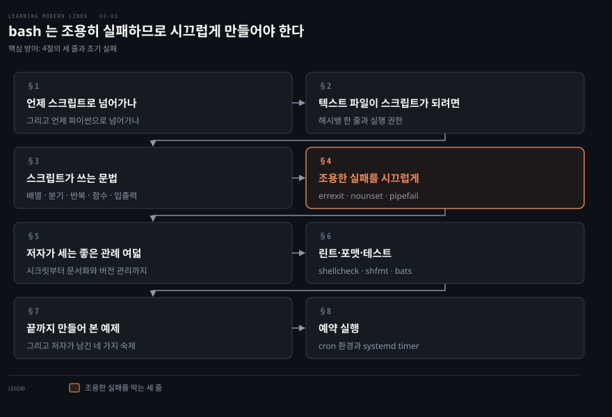
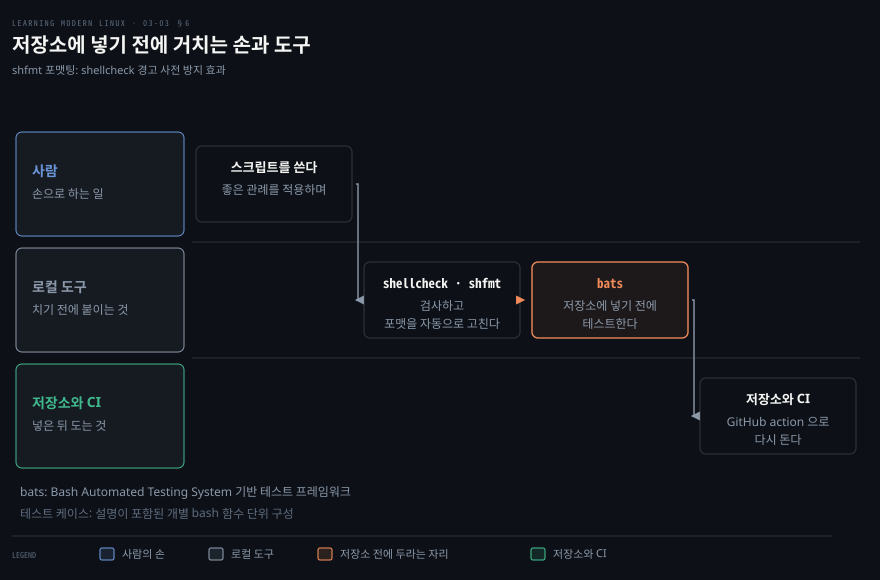
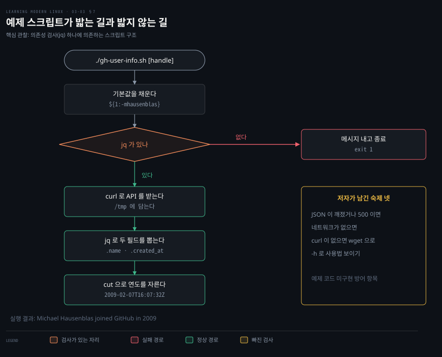
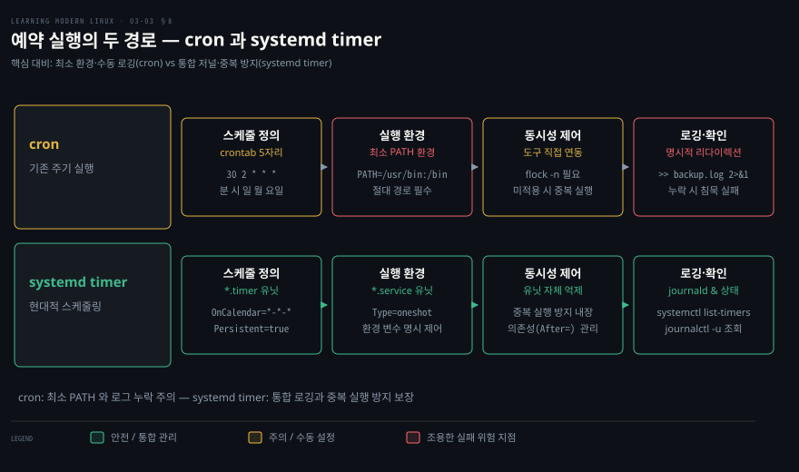

# bash 는 조용히 실패하므로 시끄럽게 만들어야 한다

---

> 스크립트는 편리합니다. 다만 안전장치 없이 작성하면 예기치 못한 조용한 실패를 일으킵니다.

## 핵심 요약

> 이 구간 전체가 매달린 하나의 생각은 **bash 가 기본적으로 조용히 실패하는 쪽이라, 스크립트를 쓰는 일의 절반이 그 침묵을 깨는 장치를 다는 일**이라는 것입니다.

조용한 실패를 피하고 빨리 실패하는 것이 셸 스크립트 작성의 제1원칙입니다. `errexit`·`nounset`·`pipefail` 옵션과 매개변수 가드(`${VAR:?}`)를 켜 두면 그 실패가 표면으로 드러납니다.

출발점은 해시뱅과 권한 설정입니다. 이 둘이 텍스트 파일을 실행 가능한 스크립트로 만듭니다. 배열·흐름 제어·함수 같은 셸 문법 위에 실패를 막는 스켈레톤 템플릿과 삭제 방어 장치를 얹습니다. 여기에 문법 검사(`bash -n`), 실행 추적(`bash -x`), ShellCheck 정적 분석과 bats 테스트를 더합니다. 마지막은 cron 과 systemd timer 를 통한 안전한 예약 실행입니다.

예제 스크립트를 보면 돌아가는 것처럼 보이는 코드에도 여전히 네트워크 단절, API 결함, 의존 도구 누락 같은 미처리 예외가 숨어 있습니다. 실패를 가정하고 시끄럽게 드러내는 설계가 있어야만 자동화를 신뢰할 수 있습니다.


## 학습 목표

> 이 구간을 읽고 나면 아래 다섯 가지를 스스로 해낼 수 있습니다.

1. 언제 스크립트로 넘어가고 언제 범용 언어로 넘어가야 하는지 기준을 댈 수 있습니다.
2. 텍스트 파일을 실행 가능한 스크립트로 만드는 두 조건을 말할 수 있습니다.
3. `errexit`·`nounset`·`pipefail` 과 매개변수 가드(`${VAR:?}`)가 각각 어떤 조용한 실패를 막는지 설명할 수 있습니다.
4. 따옴표 보호, 삭제 대상 한정, `flock -n`, 사전 시뮬레이션의 안전 관례를 적용할 수 있습니다.
5. `shellcheck`·`bash -n`·`bats` 로 검증하고 `cron`·`systemd timer` 로 안전하게 예약 실행할 수 있습니다.

아래는 이 문서 전체를 읽는 순서로 이은 지도입니다. 칸마다 절 번호와 그 절이 답하는 물음 하나를 적었습니다. 색이 붙은 칸은 실패를 막는 장치를 다루는 핵심 절로, 이 구간에서 값이 가장 큽니다.




## 이 문서가 다루지 않는 것

> 3장을 셋으로 나눈 마지막 구간입니다. 앞 둘은 대화형 사용을 다뤘고 여기는 자동화를 다룹니다.

- 스트림·변수·종료 상태 같은 셸의 기본기 → [셸의 실체는 스트림과 변수와 종료 상태다](./03-01.%EC%85%B8%EC%9D%98%20%EC%8B%A4%EC%B2%B4%EB%8A%94%20%EC%8A%A4%ED%8A%B8%EB%A6%BC%EA%B3%BC%20%EB%B3%80%EC%88%98%EC%99%80%20%EC%A2%85%EB%A3%8C%20%EC%83%81%ED%83%9C%EB%8B%A4.md)
- 별칭·모던 셸·터미널 멀티플렉서 → [자주 치는 것일수록 짧아야 한다](./03-02.%EC%9E%90%EC%A3%BC%20%EC%B9%98%EB%8A%94%20%EA%B2%83%EC%9D%BC%EC%88%98%EB%A1%9D%20%EC%A7%A7%EC%95%84%EC%95%BC%20%ED%95%9C%EB%8B%A4.md)
- `chmod 750` 이 왜 `chmod +x` 보다 나은가 → [전부 아니면 전무에서 잘게 쪼개는 쪽으로](./04-01.%EC%A0%84%EB%B6%80%20%EC%95%84%EB%8B%88%EB%A9%B4%20%EC%A0%84%EB%AC%B4%EC%97%90%EC%84%9C%20%EC%9E%98%EA%B2%8C%20%EC%AA%BC%EA%B0%9C%EB%8A%94%20%EC%AA%BD%EC%9C%BC%EB%A1%9C.md)
- systemd 유닛의 상세 구조와 서비스 라이프사이클 → [먼저 켜지는 것 하나가 나머지 전부를 켠다](./06-01.%EB%A8%BC%EC%A0%80%20%EC%BC%9C%EC%A7%80%EB%8A%94%20%EA%B2%83%20%ED%95%98%EB%82%98%EA%B0%80%20%EB%82%98%EB%A8%B8%EC%A7%80%20%EC%A0%84%EB%B6%80%EB%A5%BC%20%EC%BC%A0%EB%8B%A4.md)
- 시그널과 트랩 같은 더 고급 구성 → 기본 트랩 외의 복잡한 시그널 처리는 bash 매뉴얼로 넘깁니다


## 1. 언제 스크립트로 넘어가는가

> 프롬프트에서 같은 일을 몇 번이고 손으로 되풀이했다면, 그 일을 자동화할 때가 됐다는 신호입니다.

bash 로 스크립트를 작성하는 데는 두 가지 실용적인 이유가 있습니다. 첫째, 시중에 공개된 시스템 스크립트 대다수가 bash 로 작성되어 있어 풍부한 예제와 도움을 얻기 쉽습니다. 둘째, 대상 시스템에 bash 가 설치되어 있을 가능성이 높습니다. 낯선 셸보다 잠재 사용자 기반을 넓히기 유리합니다.

동시에 명확한 경계도 있습니다. 수천 줄에 달하는 거대한 셸 스크립트를 목표로 삼아서는 안 됩니다. 오히려 그 반대입니다. 스크립트가 수백 줄을 넘어 복잡해진다면 파이썬이나 루비 같은 범용 스크립팅 언어가 더 나은 선택이 아닌지 자문해야 합니다.

스크립트의 위험성도 미리 인식해야 합니다. 스크립트는 편리하지만 예방책 없이 실행하면 대규모 시스템 손상을 부를 수 있습니다. 그래서 설정 관리 시스템과 운영 자동화 스크립트의 밑바탕에는 항상 엄격한 안전장치가 요구됩니다.


## 2. 텍스트 파일이 스크립트가 되려면

> 작성한 스크립트 파일이 권한이나 인터프리터 미지정으로 실행되지 않는 문제를 먼저 해결해야 합니다. 텍스트 파일이 온전한 스크립트로 동작하려면 두 가지 조건이 필요합니다.

1. 첫 줄에 인터프리터를 선언합니다. 이것을 셔뱅 또는 해시뱅이라 부르고 `#!` 로 적습니다.
2. 실행 권한을 부여합니다. `chmod +x` 는 모든 사용자에게 실행 권한을 엽니다. 반면 `chmod 750` 은 소유자와 소유 그룹만 실행하게 제한하므로 최소 권한 원칙에 더 가깝습니다.

`+x` 대신 `750` 을 권장하는 것은 표기법 때문이 아니라 권한을 과도하게 열지 않으려는 보안 원칙 때문입니다. 기호 모드로도 `chmod u+x,g+x` 처럼 범위를 좁힐 수 있습니다. 다른 사용자에게까지 불필요한 실행 권한을 열어 두지 않는 것이 안전한 스크립트 운영의 출발점입니다.


## 3. 스크립트가 쓰는 문법

> 대화형으로 셸을 써 왔다면 관련 용어와 기법을 이미 대부분 알고 있습니다. 스크립트 문맥에서 몇 가지만 더 익히면 됩니다.

셸은 기본적으로 모든 값을 문자열로 다룹니다. 복잡한 수치 계산이나 다차원 데이터 처리가 필요하다면 셸 스크립트 대신 다른 언어를 선택하는 편이 현명합니다. 다만 일차원 배열 같은 기본적인 자료 구조는 자체 지원합니다.

```bash
os=('Linux' 'macOS' 'Windows')
echo "${os[0]}"
numberofos="${#os[@]}"
```

원소 셋짜리 배열을 선언하고 첫 원소인 `Linux` 를 출력한 뒤, `${#os[@]}` 문법으로 배열 길이인 `3` 을 얻습니다.

### 분기와 반복

흐름 제어는 조건에 따라 분기하거나(`if`), 반복문(`for` 와 `while`)을 통해 정해진 작업을 되풀이합니다.

```bash
for afile in /tmp/* ; do
   echo "$afile"
done

for i in {1..10}; do
    echo "$i"
done

while true; do
   sleep 1
done
```

첫째는 디렉터리 경로를 훑으며 파일 이름을 출력하는 기본 반복입니다. 둘째는 범위 구문을 활용한 반복입니다. 셋째는 무한 루프이며 CPU 독점을 막기 위해 루프 내부에 `sleep 1` 을 둡니다.

### 함수와 입출력

함수는 스크립트를 모듈화하고 로직을 재사용하게 돕습니다. 셸은 스크립트를 위에서 아래로 순차 해석하므로 함수를 호출하기 전에 먼저 정의해야 합니다.

```bash
sayhi() {
      echo "Hi $1 hope you are well!"
}

sayhi "Michael"
```

인자는 `$1`, `$2` 같은 위치 매개변수로 전달됩니다. 위 호출의 실행 결과는 `Hi Michael hope you are well!` 입니다.

`read` 명령을 쓰면 표준 입력(`stdin`)에서 대화형으로 사용자 입력을 받을 수 있습니다. 단순 출력에는 `echo` 대신 `printf` 를 우선 고려합니다. 서식 지정과 색상 출력을 정밀하게 제어할 수 있습니다. 또 `echo` 는 셸과 구현마다 `-n`·`-e` 옵션과 역슬래시 처리가 달라서 `printf` 쪽이 이식성이 높습니다.

```bash
read name
printf "Hello %s\n" "$name"
```


## 4. 조용한 실패를 시끄럽게

> 이식성 있고 안전한 스크립트는 실행 환경에 대해 안일한 가정을 하지 않습니다. 그 가정을 배제하고 실패를 즉시 드러내는 출발점이 스켈레톤 템플릿입니다.


스크립트를 작성할 때 첫머리에 두어야 하는 표준 씨앗 템플릿은 다음과 같습니다.

```bash
#!/usr/bin/env bash
set -o errexit
set -o nounset
set -o pipefail

firstargument="${1:-somedefaultvalue}"

echo "$firstargument"
```

해시뱅(`#!/usr/bin/env bash`)은 환경 경로에서 bash 인터프리터를 찾아 실행하도록 지시합니다. 이어지는 세 줄의 옵션은 조용히 지나갈 실패를 그 자리에서 드러냅니다.

- `errexit` (`set -e`): 명령이 0이 아닌 종료 코드를 반환하면 스크립트 실행을 즉시 중단합니다.
- `nounset` (`set -u`): 정의되지 않은 변수를 참조하면 즉시 오류로 처리하고 중단합니다.
- `pipefail`: 파이프라인 내부의 명령어 중 하나라도 실패하면 파이프라인 전체의 종료 상태를 실패로 확정합니다. 이때 종료 상태는 실패한 명령 가운데 가장 오른쪽 명령의 코드입니다.

### 기본 실패 차단과 세미콜론의 함정

명령어를 세미콜론(`;`)으로 이어 쓰면 앞선 명령이 실패하더라도 셸은 아무 일 없었다는 듯 다음 명령을 계속 수행합니다. `&&` 연산자로 연결하면 앞 명령이 성공했을 때만 다음 명령이 실행됩니다.

네 흐름을 각각 따로 실행해 비교하면 다음과 같습니다. 세 번째 조각의 `set -e` 는 그 자리에서 스크립트를 끝내므로 한 파일에 이어 붙이면 네 번째 조각까지 가지 못합니다.

```bash
# 1. 세미콜론: 실패해도 다음 명령 강행
false; echo "next command ran, exit=$?"
# 출력: next command ran, exit=1

# 2. && 체인: 실패 즉시 체인 중단
false && echo "this is unreached"

# 3. set -e: 비정상 종료 시 즉시 스크립트 중단
set -e
false
echo "this is unreached"

# 4. || true: 의도적인 실패 묵인
false || true
echo "continued because || true suppressed failure"
```

`set -e` 상태에서도 `command || true` 패턴을 쓰면 해당 실패의 종료 코드가 0으로 치환되어 실행이 계속됩니다. 이 패턴은 실패가 정상 시나리오에 포함될 때만 제한적으로 사용해야 합니다. 외부 시스템 상태 점검이 그런 예입니다. 남용하면 실패를 조용히 숨기게 됩니다.

세미콜론과 미정의 변수가 결합하면 의도하지 않은 디렉터리가 통째로 지워집니다. 대표적인 사례가 `cd $DIR; rm -rf *` 입니다. 따옴표 없이 `$DIR` 를 참조했을 때 변수가 정의되지 않았거나 비어 있으면 다음 세 단계를 거쳐 홈 디렉터리의 파일이 지워집니다.

1. 변수가 없거나 비어 있음: 셸은 빈 인자를 제거하고 `cd` 단독 명령으로 해석합니다.[^bash-cd]
2. `cd` 가 홈으로 이동: 인자 없는 `cd` 는 기본값인 사용자의 홈 디렉터리(`$HOME`)로 이동합니다.
3. `rm -rf *` 가 홈을 지움: 세미콜론 뒤의 `rm -rf *` 가 홈 디렉터리에서 실행됩니다.

```bash
cd /tmp
unset DIR
cd $DIR
pwd
# 실측 출력: /root (기본 HOME 으로 이동)
```

`$DIR` 경로가 없어 `cd` 가 실패해도 세미콜론은 다음 명령을 막지 않으므로 원래 작업 디렉터리에 남아 있는 모든 파일이 삭제 대상이 됩니다. `&&` 체인과 따옴표만으로도 부족합니다. `DIR` 이 빈 문자열이면 `cd ""` 는 실패하지 않고(종료 코드 0) 현재 디렉터리에 머뭅니다(bash 5.2 실측). 그러면 뒤의 `rm -rf ./*` 가 그 자리를 지웁니다. 그래서 디렉터리 이동과 파일 삭제는 `cd "${DIR:?}" && rm -rf ./*` 처럼 다음 절의 빈 값 가드까지 묶어야 합니다.

### 변수 보호와 단어 분리

`set -u` 는 빈 문자열(`""`)로 설정된 변수를 정상 값으로 보고 통과시킵니다. 빈 값까지 막으려면 매개변수 확장 가드인 `${VAR:?메시지}` 를 사용해야 합니다.

```bash
# set -u 만 켠 경우: 빈 문자열은 통과
set -u    # 미정의 변수 참조 시 중단
EMPTY_VAR=""
echo "value: [$EMPTY_VAR]" # 오류 없이 통과

# ${VAR:?메시지}: 미정의 및 빈 문자열 모두 즉시 실패
EMPTY_VAL=""
echo "${EMPTY_VAL:?EMPTY_VAL이 비어 있습니다}"
# 스크립트 파일로 실행한 실측: ./script.sh: line 8: EMPTY_VAL: EMPTY_VAL이 비어 있습니다 (종료 코드 1)
```

콜론을 생략한 `${VAR?메시지}` 는 미정의 변수만 검사하지만 콜론을 붙인 `${VAR:?메시지}` 는 변수 값이 비어 있어도 즉시 중단합니다. 이때 명시한 오류 메시지를 표준 오류로 출력하고 0이 아닌 종료 코드로 끝납니다.[^bash-pe] man page 가 약속하는 것은 0이 아니라는 점까지입니다. bash 5.2.15 에서 스크립트 파일로 실행하면 1이, `bash -c` 로 실행하면 127 이 나왔습니다. 필수 환경 변수 검증에는 다음 패턴을 사용합니다.

```bash
ARCHIVE_DIR="${ARCHIVE_DIR:?ARCHIVE_DIR 환경 변수가 설정되지 않았거나 비어 있습니다}"
```

변수를 참조할 때는 항상 큰따옴표(`"$VAR"`)로 감싸야 합니다. 따옴표가 없으면 두 가지 변형이 일어납니다. 첫째는 공백을 기준으로 인자가 쪼개지는 단어 분리(word splitting)입니다. 둘째는 `*` 나 `?` 같은 메타문자가 파일 경로로 치환되는 경로 확장(pathname expansion)입니다.[^bash-exp]

```bash
TITLE="Linux Shell Scripting"
# 따옴표 없음: 인자 3개로 분리 (<Linux>, <Shell>, <Scripting>)
print_args $TITLE

# 따옴표 있음: 단일 인자 유지 (<Linux Shell Scripting>)
print_args "$TITLE"

STAR="*"
# 따옴표 없음: 현재 디렉터리의 모든 파일 목록으로 확장
print_args $STAR

# 따옴표 있음: 리터럴 문자열 <*> 유지
print_args "$STAR"
```

공백이 포함된 파일 이름이나 한 줄씩 읽은 텍스트를 처리할 때는 기본 필드 구분자(`IFS`)를 개행과 탭으로만 한정해 두면 유용합니다.

```bash
IFS=$'\n\t'
```

기본 `IFS`(`$' \t\n'`)에서 공백을 제외하면 띄어쓰기가 토큰으로 쪼개지지 않습니다. 그래서 파일명에 공백이 있어도 예기치 않은 인자로 분리되지 않습니다.[^bash-ifs]

### 안전한 삭제와 사전 시뮬레이션

스크립트에서 `rm -rf` 를 사용할 때는 삭제 대상 경로가 비어 있을 때의 위험을 통제해야 합니다. `TARGET_DIR` 변수가 비어 있는 상태로 `rm -rf "$TARGET_DIR/"*` 를 실행하면 안 됩니다. 빈 값이 슬래시 뒤 와일드카드와 결합해 최상위 루트 디렉터리(`/*`) 전체가 지워집니다.

삭제 대상을 안전하게 한정하는 원칙은 둘입니다.

1. 보호된 변수 확장: `rm -rf "${TARGET_DIR:?TARGET_DIR 경로가 지정되지 않았습니다}/"*`
2. 상대 경로 한정: `cd "${TARGET_DIR:?}" && rm -rf ./*`

상대 경로 구문(`./*`)은 삭제 범위를 이동에 성공한 디렉터리 안으로 묶습니다. 다만 앞 절에서 본 것처럼 `TARGET_DIR` 가 빈 문자열이면 `cd` 가 성공한 채 현재 디렉터리에 머뭅니다. 그래서 상대 경로만으로는 부족하고 빈 값 가드를 함께 씁니다.

파괴적인 변경을 가하는 명령은 실행 전에 시뮬레이션(Dry-run)을 거치는 습관이 꼭 필요합니다. 대표적인 세 도구는 이렇게 시뮬레이션합니다.

| 도구 | 시뮬레이션 명령 | 효과 |
|---|---|---|
| `find` | `find /path -name "*.log" -print` | `-delete` 를 적용하기 전에 삭제 대상 목록을 화면에 사전 출력 |
| `rsync` | `rsync -n -av /src/ /dst/` | `-n` (`--dry-run`) 옵션으로 실제 파일 전송 없이 복사 대상 확인 |
| `logrotate` | `logrotate -d /etc/logrotate.conf` | `-d` (`--debug`) 플래그로 실제 파일 변경 없이 설정 문법 및 로테이션 조건 확인 |

보존 기간이 지난 아카이브 파일은 다음 표준 스크립트 패턴으로 안전하게 삭제합니다.

```bash
cd "$ARCHIVE_DIR" && find -maxdepth 1 -type f -name "*.tar.gz" -mtime +14 -print -delete    # 하위 폴더 제외·삭제 대상 출력
```

`ARCHIVE_DIR` 는 앞에서 `:?` 가드로 빈 값을 막아 두었고, `&&` 연산자로 디렉터리 이동 성공을 먼저 확인합니다. `-mtime +14` 는 경과 일수의 소수점 아래를 버리고 비교하므로 실제로는 15일 이상 지난 파일만 고릅니다. debian:12 실측에서 14.5일 된 파일은 빠지고 15.5일 된 파일은 걸렸습니다.[^find-man]

### 동시 실행 차단과 오류 추적

주기적으로 도는 배치 스크립트가 이전 작업을 마치기 전에 다시 실행되면 리소스 고갈이나 데이터 오염이 발생합니다. `flock` 명령어의 비차단(`-n`) 옵션을 사용하면 스크립트의 중복 실행을 막을 수 있습니다.[^flock-man]

```bash
LOCKFILE="/tmp/backup.lock"
exec 200>"$LOCKFILE"
flock -n 200 || { echo "이미 다른 백업 작업이 실행 중입니다." >&2; exit 1; }
```

실측 결과 첫 프로세스가 락을 잡고 있는 동안 두 번째 `flock -n` 을 호출하면 대기하지 않고 즉시 종료 코드 `1` 을 반환하며 종료합니다.

스크립트가 중단되었을 때 어느 줄에서 어떤 오류 코드로 멈췄는지 기록하려면 `ERR` 트랩과 `$LINENO` 변수를 결합합니다.[^bash-trap]

```bash
set -e
set -E   # errtrace: 함수 안에서 난 실패에도 트랩을 상속
trap 'echo "[ERROR] failed at line $LINENO with exit code $?" >&2' ERR    # 실패 줄 번호·반환 코드 출력
```

실패 줄 번호와 반환 코드가 표준 오류에 남으므로 운영 시점에 어느 줄에서 멈췄는지 바로 보여 디버깅 비용이 줄어듭니다. `set -E` 를 빼면 함수 안에서 난 실패에는 트랩이 걸리지 않습니다. debian:12 실측에서 `set -e` 만 켠 스크립트는 함수 안 `false` 로 종료 코드 1을 내며 끝났지만 `[ERROR]` 줄은 남기지 않았습니다.


## 5. 저자가 세는 좋은 관례 여덟

> 모범 사례라는 단어 대신 좋은 관례라 부릅니다. 무엇을 선택해야 하는지는 실행 맥락과 배포 대상에 따라 달라지기 때문입니다.

혼자 사용하는 간단한 일회성 스크립트와 수천 대의 서버에 배포되는 운영 스크립트는 갖추어야 할 요건이 다릅니다. 그 전제 위에서 권장하는 핵심 관례는 여덟 가지입니다.

| 관례 | 구체적 실천 지침 |
|---|---|
| 빨리 시끄럽게 실패하기 | 조용한 실패를 피하고 실패를 즉시 알립니다. `set -o errexit`, `nounset`, `pipefail` 이 이를 담당합니다 |
| 민감한 정보 보호 | 비밀번호와 토큰을 스크립트에 하드코딩하지 않습니다. 환경 변수나 보안 볼트, 실행 시점의 표준 입력으로 받습니다 |
| 입력값 엄격 검증 | 적절한 기본값을 부여하고 외부에서 전달된 모든 입력값의 유효성을 검사합니다 |
| 의존성 명시 확인 | 도구가 대상 환경에 설치되어 있다고 가정하지 않습니다. `command -v` 로 확인하고 부재 시 대체 수단을 제공합니다 |
| 실행 가능한 오류 메시지 | `Error 123` 같은 단순 코드가 아니라 무엇을 시도하다 왜 실패했고 어떻게 해결해야 하는지 안내합니다 |
| 가독성과 문서화 | 복잡한 블록에 주석을 달고, diff 가독성을 위해 80~100자 폭 제한을 준수합니다 |
| Git 버전 관리 | 변경 이력 추적과 롤백을 위해 스크립트를 Git 저장소에서 관리합니다 |
| 린트와 자동화 테스트 | 배포 전에 `shellcheck` 로 검사하고 `bats` 로 기능 회귀를 방지합니다 |

실패 메시지는 어디서 왜 막혔는지 구체적으로 밝혀야 합니다. 좋은 예는 `Tried to write to /project/xyz/ but seems this is read-only for me` 같은 메시지입니다. 이 메시지처럼 단순한 실패 단언에 그치지 않고 어디서 어떤 권한 문제로 막혔는지 밝혀야 즉각 대응할 수 있습니다. 스크립트의 실패는 발생 여부의 문제가 아니라 언제 어디서 발생하는가의 문제입니다.


## 6. 린트·포맷·테스트

> 문법 오류나 이식성 결함을 배포 후에 발견하면 운영 장애로 직결됩니다. 원격 저장소에 커밋하기 전에 도구 체인을 통해 사전 검증해야 합니다.



개발 환경에서 오류를 미리 거르지 않으면 그 결함이 운영 환경까지 그대로 넘어갑니다. 문법 검사, 정적 분석, 서식 정리, 단위 테스트의 네 단계를 차례로 거치며 잠재 결함을 잡아냅니다.

### 문법 사전 검사와 실행 추적

스크립트를 실제로 실행하지 않고 문법적 결함만 빠르게 점검할 때는 `bash -n` 플래그를 사용합니다.[^bash-opt]

```bash
bash -n ./deploy.sh
```

문법이 올바르면 아무런 출력 없이 종료 코드 `0` 을 반환합니다. `fi` 나 `done` 누락 같은 문법 오류가 발견되면 파싱 실패 위치와 행 번호를 출력하며 종료 코드 `2` 를 반환합니다. 파괴적인 명령어가 포함된 스크립트를 테스트할 때 첫 관문으로 유용합니다.

변수가 어떻게 치환되고 어느 분기를 타는지 실행 흐름을 단계별로 추적하려면 `bash -x` 플래그를 사용합니다.

```bash
bash -x ./deploy.sh
```

셸은 실행 직전의 명령어를 `+ ` 접두사를 붙여 표준 오류로 출력합니다. 변수에 의도하지 않은 공백이나 빈 값이 들어갔을 때 실제 실행되는 최종 명령어 형태를 한눈에 파악할 수 있습니다.

### 린터와 자동 포맷터

정적 분석에는 ShellCheck 를 씁니다. 로컬 CLI 도구로 설치하거나 `shellcheck.net` 웹 서비스를 이용할 수 있습니다. ShellCheck 는 따옴표 누락, 비표준 구문, 이식성 결함, 잠재적 버그를 실행 전에 탐지합니다.

코드 서식 정리에는 `shfmt` 를 씁니다. `shfmt` 는 들여쓰기와 공백을 일관되게 정돈하고 나중에 ShellCheck 가 지적할 만한 서식 문제를 미리 자동 교정합니다.

### bats 를 통한 단위 테스트

로직 검증에는 `bats` 를 사용합니다. Bash Automated Testing System 의 줄임말로, 테스트 케이스를 bash 함수 형태로 작성할 수 있는 전용 프레임워크입니다.

테스트 파일 내부에서 명령어의 종료 코드와 표준 출력을 단언(assertion)합니다. 로컬뿐 아니라 GitHub Actions 같은 CI 에서도 자동 실행해 스크립트 회귀를 방지합니다.


## 7. 끝까지 만들어 본 예제

> 의존 도구가 없거나 외부 API 가 실패하는 상황을 스크립트 내부에서 어떻게 방어할 것인지가 문제입니다. GitHub 사용자 정보를 조회하는 예제로 단계별 검증을 구현합니다.



단순해 보이는 한 줄 출력도 의존 도구 결손과 외부 API 장애라는 위험이 겹쳐 있습니다. 그래서 이 예제는 입력 기본값 검증부터 출력 조립까지의 경로를 실패에 대비해 구현합니다.

```bash
#!/usr/bin/env bash

set -o errexit
set -o errtrace
set -o nounset
set -o pipefail

### Command line parameter:
targetuser="${1:-mhausenblas}"    # 인자 미지정 시 기본값 대입

### Check if our dependencies are met:
if ! [ -x "$(command -v jq)" ]    # 필수 도구 jq 설치 확인
then
     echo "jq is not installed" >&2
     exit 1
fi

### Main:
githubapi="https://api.github.com/users/"
tmpuserdump="/tmp/ghuserdump_$targetuser.json"

result=$(curl -s $githubapi$targetuser)    # API 응답 수신
echo "$result" > $tmpuserdump              # 응답 임시 파일 저장

name=$(jq .name $tmpuserdump -r)             # 이름 필드 추출
created_at=$(jq .created_at $tmpuserdump -r) # 가입일 필드 추출

joinyear=$(echo "$created_at" | cut -f1 -d"-") # - 앞 첫 칸(연도) 추출
echo "$name joined GitHub in $joinyear"
```

```bash
./gh-user-info.sh
# 출력: Michael Hausenblas joined GitHub in 2009
```

의존성 검사에 `which` 대신 `command -v` 를 사용하는 까닭은 POSIX 표준과 호환되기 때문입니다. `command -v` 는 외부 명령어에 의존하지 않고 셸 내장 기능으로 도구의 가용성을 확인합니다.

### 남겨진 실무 과제 넷

위 예제는 정상 경로에서 문제없이 동작하지만 실무 환경에서는 다음 네 가지 방어 로직을 보강해야 합니다.

1. API 응답 검증: GitHub API 가 404나 500 오류를 반환하거나 유효하지 않은 JSON 을 주었을 때의 예외 처리가 필요합니다.
2. 네트워크 단절 대비: 오프라인 상태이거나 방화벽에 막혔을 때 `curl` 호출 실패를 감지하고 알림을 주어야 합니다.
3. 유연한 의존성 관리: 이 스크립트는 `curl` 이 이미 설치되어 있다고 가정합니다. 바이너리를 변수로 두고 `wget` 으로 넘어가는 대체 검사를 더할 수 있습니다.
4. 사용자 인터페이스: `-h` 또는 `--help` 옵션을 처리하여 사용법과 옵션 기본값을 명확히 안내해야 합니다.


## 8. 예약 실행

> 자동화 스크립트를 주기적으로 실행할 때 발생하는 가장 흔한 문제는 실행 환경의 차이와 침묵하는 실패입니다. cron 과 systemd timer 의 특성을 정확히 알고 적용해야 합니다.



### cron 환경의 함정과 최소 실행 계약

cron 은 유닉스 환경의 오랜 주기 실행 도구입니다. 하지만 cron 으로 스크립트를 돌리면 수많은 실패가 조용히 묻힙니다. 주원인은 최소한으로 축소된 실행 환경입니다.

Debian 12(cron 3.0pl1-162)에서 사용자 crontab 작업이 받는 환경을 찍어 보면 다음과 같습니다.

```bash
PATH=/usr/bin:/bin
SHELL=/bin/sh
```

대화형 셸에서 흔히 접근하는 `/usr/local/bin` 이나 `/usr/sbin` 이 이 `PATH` 에 포함되어 있지 않습니다. 이 값은 cron 구현과 배포판에 따라 다릅니다. 같은 Debian 에서도 시스템 crontab(`/etc/crontab`)은 파일 첫머리에서 더 넓은 `PATH` 를 직접 선언합니다. `crontab(5)` 는 SHELL·LOGNAME·HOME 을 정한다고만 적고 `PATH` 값은 약속하지 않습니다.[^crontab-man] 그래서 터미널에서는 잘 돌던 스크립트가 cron 에 등록되면 `command not found` 오류를 내며 멈춥니다.

cron 에 작업을 등록할 때는 두 가지 계약을 지켜야 합니다.

1. 절대 경로 사용: crontab 항목과 스크립트 내부에서 실행 파일의 절대 경로를 씁니다. 또는 스크립트 상단에서 `PATH` 를 명시적으로 재선언합니다.
2. 명시적 리다이렉션: cron 은 작업 출력을 시스템 메일로 보내려 시도합니다. 메일 설정이 없는 환경에서는 오류 메시지가 조용히 버려집니다.

```bash
# 매일 새벽 02:30 실행 및 로그 파일 기록
30 2 * * * /usr/local/bin/backup.sh >> /var/log/backup.log 2>&1
```

5개의 필드는 순서대로 `분(0~59) 시(0~23) 일(1~31) 월(1~12) 요일(0~7)` 을 나타냅니다. `30 2 * * *` 는 매일 02:30 을 의미합니다. `>> /var/log/backup.log 2>&1` 로 표준 출력과 표준 오류를 단일 파일에 누적 기록해 실패를 추적합니다.

### systemd timer 를 통한 현대적 스케줄링

systemd 를 init 으로 쓰는 배포판에서는 cron 대신 systemd timer 를 쓸 수 있습니다. [06-01 greeter 를 한 시간마다 돌려 보기](./06-01.%EB%A8%BC%EC%A0%80%20%EC%BC%9C%EC%A7%80%EB%8A%94%20%EA%B2%83%20%ED%95%98%EB%82%98%EA%B0%80%20%EB%82%98%EB%A8%B8%EC%A7%80%20%EC%A0%84%EB%B6%80%EB%A5%BC%20%EC%BC%A0%EB%8B%A4.md#6-greeter-%EB%A5%BC-%ED%95%9C-%EC%8B%9C%EA%B0%84%EB%A7%88%EB%8B%A4-%EB%8F%8C%EB%A0%A4-%EB%B3%B4%EA%B8%B0) 에서 다룬 것처럼, 타이머 단위는 서비스 단위와 짝을 이루어 동작합니다.

cron 과 비교해 systemd timer 가 갖는 이점은 넷입니다.

- 중앙 저널 수집: 스크립트의 표준 출력과 오류가 파일 리다이렉션 없이도 `systemd-journald` 에 자동 수집됩니다.
- 중복 실행 억제: 서비스가 아직 실행 중이면 타이머는 두 번째 인스턴스를 띄우지 않습니다. Ubuntu(systemd 259)에서 5초 주기 타이머에 12초짜리 작업을 걸어 보았습니다. 실행 중 놓친 주기는 하나로 합쳐졌고 다음 실행은 앞 실행이 끝난 직후 시작됐습니다.
- 단위 의존성 관리: 네트워크나 특정 마운트 지점이 활성화된 뒤에만 스크립트를 돌리도록 `After=` 구문으로 통제할 수 있습니다.
- 상태 가시성: `systemctl list-timers` 로 다음 실행 시각(NEXT)·남은 시간(LEFT)·지난 실행 시각(LAST)·그 뒤 흐른 시간(PASSED)을 봅니다. 성공 여부 열은 없으므로 결과는 `systemctl status` 나 `journalctl` 로 확인합니다.[^systemctl-man]

정기 백업 작업을 systemd timer 로 구성할 때는 두 유닛 파일을 `/etc/systemd/system/` 에 배치합니다.

```ini
# /etc/systemd/system/backup.service
[Unit]
Description=Daily Archive Backup Service

[Service]
Type=oneshot
ExecStart=/usr/local/bin/backup.sh
```

```ini
# /etc/systemd/system/backup.timer
[Unit]
Description=Daily Archive Backup Timer

[Timer]
OnCalendar=*-*-* 02:30:00
Persistent=true

[Install]
WantedBy=timers.target
```

`Type=oneshot` 은 스크립트가 실행을 마치고 종료하는 배치 작업임을 선언합니다. `Persistent=true` 를 두면 타이머가 꺼져 있던 동안 지나간 실행 시각이 있는지 봅니다. 하나라도 있으면 타이머가 다시 활성화되는 즉시 한 번 실행해 따라잡습니다. 보통은 시스템이 꺼져 있다가 부팅된 경우입니다.[^systemd-timer-man]

```bash
sudo systemctl daemon-reload
sudo systemctl enable --now backup.timer
systemctl list-timers backup.timer
```

Ubuntu(systemd 259)에서 같은 모양의 데모 타이머를 걸고 `systemctl list-timers` 를 실행해 보았습니다. NEXT 에는 다음 02:30 이 찍힙니다. 아직 한 번도 돌지 않았으므로 LAST 와 PASSED 는 `-` 입니다. 실행 결과와 실패 로그는 `journalctl -u backup.service` 로 언제든 추적할 수 있습니다.


## 심화 학습

> 스크립트가 시스템과 맺는 계약을 깊이 이해하려면 옵션의 상속 구조와 도구 표준을 살펴야 합니다.

- **`errtrace` (`set -E`) 상속 범위**: 옵션을 켜지 않으면 `ERR` 트랩은 셸 함수·명령 치환·서브셸로 상속되지 않습니다. 그래서 함수 안에서 실패해 `set -e` 로 끝나더라도 트랩 메시지가 남지 않습니다. 함수나 서브셸 내부의 실패까지 바깥 트랩이 잡으려면 `set -o errtrace` 를 함께 켭니다.[^errtrace]
- **`nounset` 과 `${VAR:?}` 의 상호 보완성**: `set -u` 는 설정되지 않은 변수를 전역적으로 차단하지만 빈 문자열은 통과시킵니다. 반면 `${VAR:?}` 는 특정 필수 변수에 한해 빈 값인 경우까지 막습니다. 전역 안전망으로 `set -u` 를 켜고 핵심 파라미터에는 `${VAR:?}` 가드를 덧대는 것이 표준적인 다층 방어입니다.
- **`command -v` 와 `which` 의 차이**: `which` 는 외부 실행 파일이며 배포판에 따라 옵션과 동작이 다릅니다. 반면 `command -v` 는 POSIX 가 정한 셸 내장 명령이라 외부 실행 파일에 기대지 않습니다. 다만 경로만 내는 것은 아닙니다. 별칭이면 `alias ll='ls -l'` 처럼 정의를, 함수나 내장 명령이면 이름만 내므로 출력이 경로라고 가정하지 말고 종료 코드(없으면 1)로 판정합니다.
- **`CronJob` 의 동시 실행 정책**: cron 과 systemd timer 가 각자 다르게 다룬 중복 실행 문제는 쿠버네티스 `CronJob` 에서도 이어집니다. `CronJob` 은 `.spec.concurrencyPolicy` 로 앞 작업이 끝나지 않았을 때의 동작을 고릅니다. `Allow`(기본값)는 겹쳐 실행하고, `Forbid` 는 이번 실행을 건너뛰고, `Replace` 는 앞 작업을 새 작업으로 바꿉니다.[^k8s-cronjob]


## 결정 치트시트

> 상황에 맞는 올바른 도구와 안전 설정을 선택하는 기준입니다.

| 상황 | 권장 선택 | 핵심 근거 |
|---|---|---|
| 같은 작업을 터미널에서 반복했다 | 셸 스크립트로 작성 | 자동화의 기본 신호 |
| 스크립트가 수백 줄로 커지고 데이터가 복잡하다 | 파이썬이나 범용 언어 전환 | 셸은 문자열 중심이라 복잡한 데이터 구조 처리에 부적합 |
| 새 셸 스크립트를 시작한다 | `set -euo pipefail` 스켈레톤 | bash 는 기본적으로 조용히 실패하므로 조기 실패 강제 |
| 빈 변수나 미정의 변수를 엄격 차단해야 한다 | `${VAR:?오류메시지}` 가드 | `set -u` 는 빈 문자열을 허용하지만 `:?` 는 빈 값도 즉시 차단 |
| 변수를 참조하거나 인자로 전달한다 | 항상 큰따옴표 `"$VAR"` | 따옴표 누락 시 단어 분리와 경로 확장(글로브) 위험 발생 |
| 디렉터리 내 대량 파일을 삭제한다 | `cd "${DIR:?}" && rm -rf ./*` 또는 `"${DIR:?}/"*` | 빈 변수로 인한 루트 디렉터리(`/*`) 삭제 사고 원천 차단 |
| 삭제나 동기화 스크립트를 작성 중이다 | `find -print`, `rsync -n` 사전 점검 | 실제 변경 전 시뮬레이션(Dry-run)으로 대상 목록 확인 |
| 스크립트의 중복 동시 실행을 방지해야 한다 | `flock -n` | 락 점유 실패 시 대기하지 않고 즉시 종료 코드 1로 중단 |
| 스크립트를 커밋하기 전 검증한다 | `bash -n` → `shellcheck` → `bats` | 문법 사전 검사, 정적 분석, 단위 테스트의 단계적 검증 |
| 변수 치환과 실행 분기를 디버깅한다 | `bash -x` | 실행 직전의 확장된 명령어를 표준 오류로 실시간 추적 |
| 주기적인 시스템 예약 작업을 설정한다 | `systemd timer` (우선) / `cron` | cron 은 최소 PATH 와 침묵 위험이 크며, timer 는 통합 저널과 중복 방지 제공 |
| cron 에 작업을 등록해야 한다 | 절대 경로 + `>> log 2>&1` 필수 | 좁은 `PATH`(Debian 사용자 crontab 실측 `/usr/bin:/bin`) 극복 및 침묵 실패 방지 |


## 적용 관점

> 이 구간이 실무 엔지니어링으로 착지하는 대표적인 영역은 CI/CD 파이프라인과 컨테이너 엔트리포인트입니다.

`./gradlew build | tee build.log` 처럼 파이프를 쓰는 구성이 대표적입니다. `pipefail` 없이는 `gradlew` 가 실패해도 파이프 전체 종료 상태가 마지막 명령인 `tee` 의 `0` 이 됩니다. 빌드가 깨졌는데도 파이프라인이 초록불로 통과하는 조용한 실패가 여기서 일어납니다.

컨테이너 이미지의 `entrypoint.sh` 도 마찬가지입니다. 셸 스크립트가 실패를 무시하고 넘어가면 데이터베이스 연결이 실패했거나 필수 환경 변수가 비어 있는데도 컨테이너 프로세스가 죽지 않고 비정상 동작을 계속합니다. 그래서 `set -euo pipefail` 과 변수 가드(`${DB_HOST:?}`)는 필수입니다. 이 둘이 있으면 비정상 컨테이너가 즉시 종료되어 CrashLoopBackOff 로 문제를 드러냅니다.


## 면접에서 받을 만한 질문

> 자답한 뒤 아래 정답과 비교해 보십시오.

1. 텍스트 파일을 실행 가능한 스크립트로 만드는 두 조건은 무엇입니까?
2. `set -o errexit`, `nounset`, `pipefail` 은 각각 어떤 실패를 방어합니까?
3. `set -u` 와 `${VAR:?메시지}` 의 동작 차이는 무엇입니까?
4. `cd $DIR; rm -rf *` 구문에서 생길 수 있는 심각한 사고와 그 해결책은 무엇입니까?
5. 변수를 참조할 때 큰따옴표 `"$VAR"` 로 감싸지 않으면 어떤 문제가 발생합니까?
6. 배치 스크립트의 중복 실행을 막기 위해 `flock -n` 을 사용하는 원리는 무엇입니까?
7. cron 과 systemd timer 의 차이점과 cron 등록 시 주의해야 할 환경 요인은 무엇입니까?


## 정답 (자답 후 펼치기)

### 정답 1 — 스크립트 성립 조건

첫 줄에 인터프리터를 지정하는 셔뱅(`#!/usr/bin/env bash`)을 선언하고, `chmod` 로 실행 권한을 부여하는 것입니다. `.sh` 확장자는 식별을 위한 관례일 뿐 실행 여부를 결정하지 않습니다.

### 정답 2 — 세 핵심 옵션

`errexit` (`-e`)은 명령이 0이 아닌 종료 코드를 반환하면 즉시 중단합니다. `nounset` (`-u`)은 미정의 변수를 참조하면 오류로 처리합니다. `pipefail` 은 파이프라인 내부 어느 한 단계라도 실패하면 파이프라인 전체의 종료 상태를 실패한 명령 가운데 가장 오른쪽 명령의 종료 코드로 확정합니다.

### 정답 3 — `set -u` 와 `${VAR:?}` 차이

`set -u` 는 정의되지 않은 변수만 차단하고 빈 문자열(`""`)은 통과시킵니다. `${VAR:?메시지}` 는 미정의 변수뿐 아니라 빈 문자열인 경우에도 지정한 메시지를 출력하며 0이 아닌 종료 코드로 스크립트를 즉시 중단시킵니다.

### 정답 4 — 삭제 경로 사고 방어

`$DIR` 변수가 비어 있거나 미정의 상태이면 인자 없는 `cd` 가 되어 사용자의 홈 디렉터리(`$HOME`)로 이동해 홈 안의 파일을 삭제합니다. 또한 디렉터리 이동이 실패하더라도 세미콜론 때문에 다음 `rm` 명령이 강행됩니다. 따옴표만 붙인 `cd ""` 는 성공한 채 현재 디렉터리에 머물므로 그것도 막지 못합니다. 이를 막으려면 `cd "${DIR:?}" && rm -rf ./*` 처럼 빈 값 가드와 `&&` 체인, 상대 경로를 결합해야 합니다.

### 정답 5 — 따옴표 누락의 부작용

변수 내부의 공백 문자로 인해 하나의 인자가 여러 개로 쪼개지는 단어 분리(word splitting)가 발생하고, `*` 나 `?` 같은 메타문자가 파일 시스템 경로로 확장(pathname expansion)되어 예기치 않은 인자가 명령어로 전달됩니다.

### 정답 6 — `flock -n` 의 동작 원리

`flock` 은 파일 디스크립터에 커널이 관리하는 권고(advisory) 락을 겁니다. 같은 락 파일로 `flock` 을 거는 프로세스끼리만 막으므로 그 락을 쓰지 않는 프로세스는 막지 못합니다. `-n` (`--nonblock`) 옵션을 주면 다른 프로세스가 락을 이미 점유하고 있을 때 대기하지 않고 즉시 종료 코드 `1` 을 반환하며 종료하므로 중복 배치 실행을 막습니다.

### 정답 7 — cron 과 systemd timer 의 비교

cron 은 기본 `PATH` 가 좁아서(Debian 12 사용자 crontab 실측 `/usr/bin:/bin`) 명령어 절대 경로 지정과 명시적 로그 파일 리다이렉션(`>> log 2>&1`)이 필수적입니다. 반면 systemd timer 는 `journald` 중앙 로깅, 의존성 관리, 중복 실행 자동 억제, `systemctl list-timers` 를 통한 상태 조회를 지원합니다.


## 핵심 개념 체크리스트

- [ ] 셔뱅이 인터프리터를 지정하는 방식을 설명할 수 있는가?
- [ ] `set -e`, `set -u`, `set -o pipefail` 을 켜지 않았을 때 각각 어떤 조용한 실패가 발생하는가?
- [ ] `set -u` 와 `${VAR:?}` 의 빈 문자열 처리 차이를 구분할 수 있는가?
- [ ] `cd $DIR; rm -rf *` 가 홈 디렉터리를 지우는 메커니즘을 설명할 수 있는가?
- [ ] 단어 분리와 경로 확장을 막기 위해 왜 항상 `"$VAR"` 로 감싸야 하는지 알고 있는가?
- [ ] `find -print`, `rsync -n`, `logrotate -d` 로 사전 시뮬레이션을 수행할 수 있는가?
- [ ] `flock -n` 으로 중복 실행을 막는 락 스크립트를 구성할 수 있는가?
- [ ] `bash -n` 과 `bash -x` 의 용도 차이를 설명할 수 있는가?
- [ ] cron 의 기본 `PATH` 한계와 systemd timer 의 장점을 대조할 수 있는가?


## 관련 문서

- [Learning Modern Linux 정독 인덱스](./README.md) — 이 책의 장별 진행 상황
- [셸의 실체는 스트림과 변수와 종료 상태다](./03-01.%EC%85%B8%EC%9D%98%20%EC%8B%A4%EC%B2%B4%EB%8A%94%20%EC%8A%A4%ED%8A%B8%EB%A6%BC%EA%B3%BC%20%EB%B3%80%EC%88%98%EC%99%80%20%EC%A2%85%EB%A3%8C%20%EC%83%81%ED%83%9C%EB%8B%A4.md) — 종료 상태와 `$PIPESTATUS` 의 근거
- [자주 치는 것일수록 짧아야 한다](./03-02.%EC%9E%90%EC%A3%BC%20%EC%B9%98%EB%8A%94%20%EA%B2%83%EC%9D%BC%EC%88%98%EB%A1%9D%20%EC%A7%A7%EC%95%84%EC%95%BC%20%ED%95%9C%EB%8B%A4.md) — 같은 장의 대화형 도구 구간
- [전부 아니면 전무에서 잘게 쪼개는 쪽으로](./04-01.%EC%A0%84%EB%B6%80%20%EC%95%84%EB%8B%88%EB%A9%B4%20%EC%A0%84%EB%AC%B4%EC%97%90%EC%84%9C%20%EC%9E%98%EA%B2%8C%20%EC%AA%BC%EA%B0%9C%EB%8A%94%20%EC%AA%BD%EC%9C%BC%EB%A1%9C.md) — `chmod 750` 이 왜 나은지의 권한 모델 근거
- [먼저 켜지는 것 하나가 나머지 전부를 켠다](./06-01.%EB%A8%BC%EC%A0%80%20%EC%BC%9C%EC%A7%80%EB%8A%94%20%EA%B2%83%20%ED%95%98%EB%82%98%EA%B0%80%20%EB%82%98%EB%A8%B8%EC%A7%80%20%EC%A0%84%EB%B6%80%EB%A5%BC%20%EC%BC%A0%EB%8B%A4.md) — `systemd timer` 유닛과 서비스 라이프사이클


## 참고 자료

- 원서: 《Learning Modern Linux》 3장 Shells and Scripting (Michael Hausenblas, O'Reilly, 2022)
- [ShellCheck](https://www.shellcheck.net/) — 셸 정적 분석 도구
- [bats-core](https://github.com/bats-core/bats-core) — Bash Automated Testing System
- [GNU Bash Manual: The Set Builtin](https://www.gnu.org/software/bash/manual/bash.html#The-Set-Builtin)
- [`bash(1)` man page](https://man7.org/linux/man-pages/man1/bash.1.html)
- [`find(1)` man page](https://man7.org/linux/man-pages/man1/find.1.html)
- [`flock(1)` man page](https://man7.org/linux/man-pages/man1/flock.1.html)
- [`crontab(5)` man page](https://man7.org/linux/man-pages/man5/crontab.5.html)
- [`systemd.timer(5)` man page](https://man7.org/linux/man-pages/man5/systemd.timer.5.html)
- [`systemctl(1)` man page](https://man7.org/linux/man-pages/man1/systemctl.1.html)
- [Kubernetes CronJob](https://kubernetes.io/docs/concepts/workloads/controllers/cron-jobs/)

[^bash-cd]: `bash(1)` man page, SHELL BUILTIN COMMANDS `cd`: "Change the current directory to dir. if dir is not supplied, the value of the HOME shell variable is used as dir." <https://man7.org/linux/man-pages/man1/bash.1.html>
[^bash-pe]: `bash(1)` man page, Parameter Expansion `${parameter:?word}`: "If parameter is null or unset, the shell writes the expansion of word (or a message to that effect if word is not present) to the standard error and, if it is not interactive, exits with a non-zero status." <https://man7.org/linux/man-pages/man1/bash.1.html>
[^bash-exp]: `bash(1)` man page, EXPANSION: Word Splitting & Pathname Expansion. <https://man7.org/linux/man-pages/man1/bash.1.html>
[^bash-ifs]: `bash(1)` man page, PARAMETERS `IFS`: "The Internal Field Separator that is used for word splitting after expansion." <https://man7.org/linux/man-pages/man1/bash.1.html>
[^find-man]: `find(1)` man page, TESTS `-atime n`: "When find figures out how many 24-hour periods ago the file was last accessed, any fractional part is ignored, so to match -atime +1, a file has to have been accessed at least two days ago." `-mtime n` 항목은 이 반올림 설명을 따르라고 적습니다. ACTIONS `-delete`: "Delete files or directories; true if removal succeeded. If the removal failed, an error message is issued and find's exit status will be nonzero (when it eventually exits)." <https://man7.org/linux/man-pages/man1/find.1.html>
[^flock-man]: `flock(1)` man page, OPTIONS `-n, --nb, --nonblocking`: "Fail rather than wait if the lock cannot be immediately acquired. See the -E option for the exit status used." `-E` 의 기본값은 1입니다. <https://man7.org/linux/man-pages/man1/flock.1.html>
[^bash-trap]: `bash(1)` man page, SHELL BUILTIN COMMANDS `trap`: "If a sigspec is ERR, action is executed whenever a pipeline (which may consist of a single simple command), a list, or a compound command returns a non-zero exit status, subject to the following conditions." <https://man7.org/linux/man-pages/man1/bash.1.html>
[^bash-opt]: `bash(1)` man page, OPTIONS `-n`: "Read commands but do not execute them. This may be used to check a shell script for syntax errors." <https://man7.org/linux/man-pages/man1/bash.1.html>
[^crontab-man]: `crontab(5)` man page(cronie 판), DESCRIPTION: "Several environment variables are set up automatically by the cron(8) daemon. SHELL is set to /bin/sh, and LOGNAME and HOME are set from the /etc/passwd line of the crontab´s owner." Debian bookworm 의 `crontab(5)` 도 같은 세 변수만 적습니다. 본문의 `PATH` 값은 문서가 아니라 Debian 12 실측입니다. <https://man7.org/linux/man-pages/man5/crontab.5.html>
[^systemd-timer-man]: `systemd.timer(5)` man page, `Persistent=`: "When the timer is activated, the service unit is triggered immediately if it would have been triggered at least once during the time when the timer was inactive. … This is useful to catch up on missed runs of the service when the system was powered down." <https://man7.org/linux/man-pages/man5/systemd.timer.5.html>
[^systemctl-man]: `systemctl(1)` man page, `list-timers`: "List timer units currently in memory, ordered by the time they elapse next." 예시 출력의 열은 NEXT·LEFT·LAST·PASSED·UNIT·ACTIVATES 입니다. <https://man7.org/linux/man-pages/man1/systemctl.1.html>
[^k8s-cronjob]: Kubernetes 문서 「CronJob」의 Concurrency policy 절. `.spec.concurrencyPolicy` 값으로 `Allow`·`Forbid`·`Replace` 를 정의하고 기본값은 `Allow` 입니다. <https://kubernetes.io/docs/concepts/workloads/controllers/cron-jobs/#concurrency-policy>
[^errtrace]: `bash(1)` man page, `set -E` (`errtrace`): "If set, any trap on ERR is inherited by shell functions, command substitutions, and commands executed in a subshell environment. The ERR trap is normally not inherited in such cases." <https://man7.org/linux/man-pages/man1/bash.1.html>
