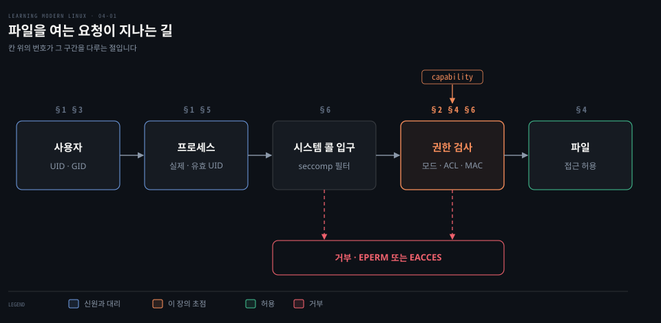
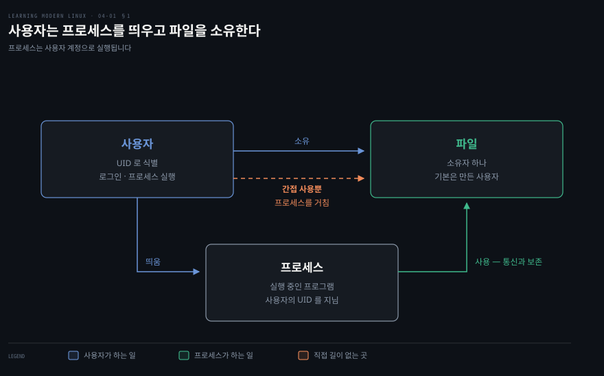
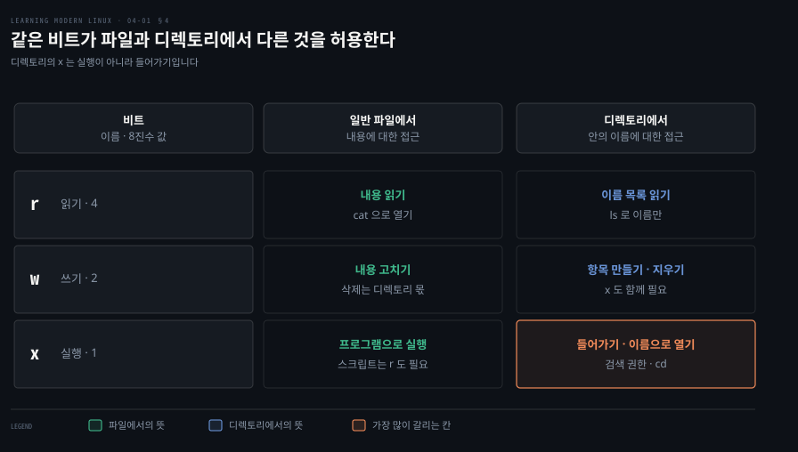
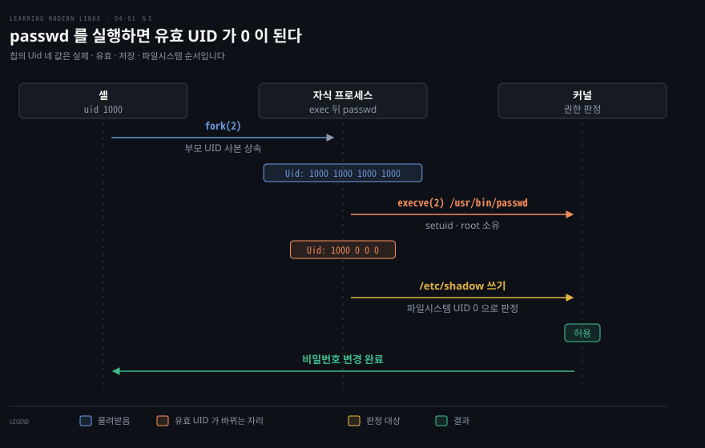
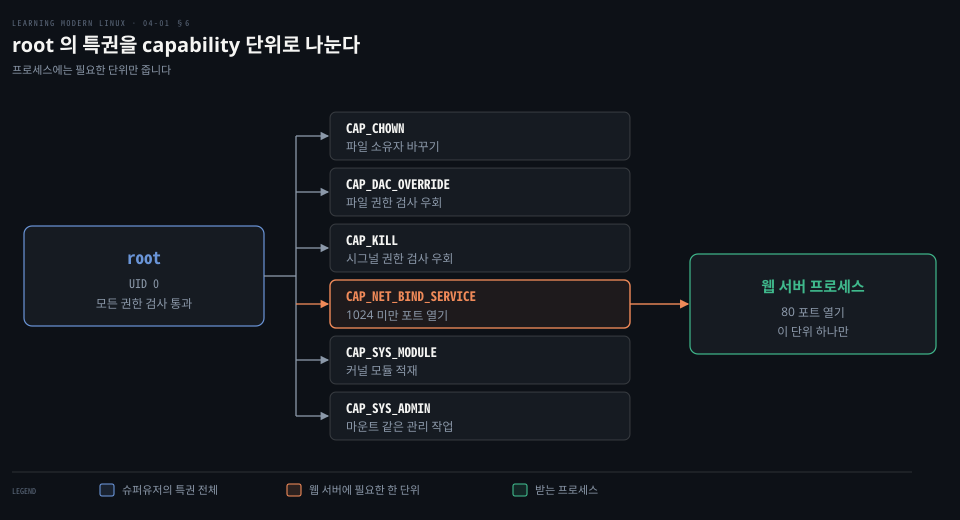

# 전부 아니면 전무에서 잘게 쪼개는 쪽으로

---

> 리눅스는 오랫동안 모든 것을 바꿀 수 있는 슈퍼유저이거나 제한된 접근을 가진 보통 사용자이거나 둘 중 하나였습니다. 4장은 그 이분법이 어떻게 깨져 왔는지를 따라갑니다.

## 핵심 요약

> 리눅스의 접근 통제는 root 냐 아니냐라는 이분법에서 출발해, 그 특권을 독립된 단위로 쪼개는 쪽으로 움직여 왔습니다. 그래서 권한을 읽을 때는 파일의 아홉 칸과 함께 요청을 낸 프로세스가 어떤 UID 와 capability 를 들고 있는지를 봐야 합니다.

이분법의 비용은 구체적입니다. 프로세스 하나가 네트워크 설정만 바꾸면 되는 경우에도 예전에는 그 프로세스에 `root` 접근 전체를 줘야 했습니다. 그 프로세스가 뚫리면 공격자는 네트워크 설정뿐 아니라 `root` 가 할 수 있는 모든 일을 할 수 있습니다.

앞의 절반은 그 이분법 안의 이야기입니다. 사용자와 프로세스와 파일이 서로에게 무엇을 하는지, 사용자를 어떤 파일이 정의하는지, 파일 모드 아홉 칸을 어떻게 읽는지를 다룹니다. 프로세스 쪽으로 넘어가면 UID 가 하나가 아니라 넷이라는 사실이 나옵니다.

뒤의 절반은 이분법을 깨는 장치들입니다.

- capability: 커널 2.2부터 `root` 의 특권을 따로 켜고 끌 수 있는 단위로 나눕니다.
- seccomp: 프로세스가 부를 수 있는 시스템 콜을 줄입니다.
- ACL: 소유자·그룹·그 밖의 모두라는 세 칸 밖의 사용자와 그룹에 권한을 줍니다.

저자는 이 셋을 컨테이너 문맥에서 특히 중요한 장치로 꼽습니다.


## 학습 목표

> 이 장을 읽고 나면 아래 다섯 가지를 스스로 해낼 수 있습니다.

1. 파일을 여는 요청이 사용자에서 프로세스를 거쳐 커널의 권한 검사에 닿는 길을 설명할 수 있습니다.
2. 재량적 접근 통제와 강제적 접근 통제의 차이를 말할 수 있습니다.
3. `-rw-r--r--` 한 줄을 칸별로 읽어 8진수로 옮기고 같은 비트가 디렉토리에서 무엇을 허용하는지 구분할 수 있습니다.
4. `passwd` 를 예로 실제 UID 와 유효 UID 가 갈리는 순간을 설명하고 `/proc/PID/status` 로 네 UID 를 확인할 수 있습니다.
5. capability·seccomp·ACL 이 각각 무엇을 쪼개거나 넓히는지 구분할 수 있습니다.

아래는 파일 하나를 여는 요청이 지나가는 길입니다. 칸 위의 절 번호가 그 구간을 다루는 절이고 색이 붙은 칸이 이 장의 제목이 가리키는 자리입니다.




## 접근 요청 하나가 지나는 길

> 파일을 여는 요청은 사용자에게서 시작해 프로세스가 대신 내고, 커널이 시스템 콜 입구와 권한 검사에서 두 번 거른 뒤에야 파일에 닿습니다. 아래 표는 그 다섯 단계와 각 단계를 맡은 절을 잇습니다.

권한 오류가 났을 때 요청이 어느 단계에서 막혔는지 모르면 엉뚱한 곳을 고치게 됩니다. 파일 모드를 아무리 넓혀도 seccomp 가 시스템 콜을 막고 있으면 그대로 실패합니다.

| 단계 | 주체 | 받치는 개념 | 절 |
|---|---|---|---|
| 1 신원 | 사용자 계정 | UID 와 GID, 계정 파일 | §1, §3 |
| 2 대리 | 프로세스 | 실제 UID 와 유효 UID, setuid 비트 | §1, §5 |
| 3 입구 | 커널의 시스템 콜 입구 | seccomp 필터 | §6 |
| 4 판정 | 커널의 권한 검사 | 파일 모드와 ACL, capability, 강제적 접근 통제 | §2, §4, §6 |
| 5 결과 | 커널 | 허용하거나 `EACCES` 같은 오류로 거부 | §4 |

§7 은 이 길 밖에 있습니다. 길을 좁게 쓰는 관례와, 지나간 요청을 남기는 감사 기록을 다룹니다.


## 이 문서가 다루지 않는 것

> 이 장은 범위 밖으로 넘기는 주제가 많습니다. 저자가 그은 선과, 다른 문서가 맡는 주제를 함께 적습니다.

- `chattr` 로 다루는 파일 속성 → 저자가 이 장의 범위 밖으로 둡니다
- `getcap`·`setcap` 의 상세와 좋은 관례 → 역시 범위 밖으로 둡니다
- ACL 항목을 읽고 쓰는 명령 → [getfacl·setfacl 참조 시트](../../docs/cmd/perm/getfacl%C2%B7setfacl.md)가 다룹니다
- 중앙 사용자 관리의 구현별 장단점 → 환경이 정하는 일이라 다루지 않습니다
- Kerberos 의 동작 → [09-01 노트](./09-01.%EC%9D%B4%20%EC%9E%A5%EC%9D%84%20%EB%AC%B6%EB%8A%94%20%EA%B2%83%EC%9D%80%20%EC%A3%BC%EC%A0%9C%EA%B0%80%20%EC%95%84%EB%8B%88%EB%9D%BC%20%ED%95%84%EC%9A%94%ED%95%B4%EC%A7%80%EB%8A%94%20%EC%A1%B0%EA%B1%B4%EC%9D%B4%EB%8B%A4.md)의 Kerberos 절이 다룹니다
- 감사 로그를 읽는 도구 → [08-01 노트](./08-01.%EC%9E%AC%EB%8A%94%20%EA%B2%83%EC%9D%80%20%EB%B0%94%EA%B9%A5%EC%9D%B4%EA%B3%A0%20%EC%95%8C%EA%B3%A0%20%EC%8B%B6%EC%9D%80%20%EA%B2%83%EC%9D%80%20%EC%95%88%EC%9D%B4%EB%8B%A4.md)가 다룹니다

스크립트에 `chmod 750` 을 권한 이유가 이 장에서 채워집니다. 그 연결은 [앞 노트](./03-03.bash%20%EB%8A%94%20%EC%A1%B0%EC%9A%A9%ED%9E%88%20%EC%8B%A4%ED%8C%A8%ED%95%98%EB%AF%80%EB%A1%9C%20%EC%8B%9C%EB%81%84%EB%9F%BD%EA%B2%8C%20%EB%A7%8C%EB%93%A4%EC%96%B4%EC%95%BC%20%ED%95%9C%EB%8B%A4.md)에서 예고했습니다.


## 1. 사용자와 프로세스와 파일

> 접근 통제를 이야기하기 전에 누가 누구에게 무엇을 하는지부터 세웁니다. 행위자는 사용자·프로세스·파일 셋이고, 이 절은 그 관계만 그립니다.

흐름 위치: 1 신원 → 2 대리 · 받치는 개념 — 사용자 ID

사용자는 파일에 직접 손대지 못합니다. 파일을 여는 쪽은 언제나 프로세스이고 커널은 그 프로세스가 지닌 사용자 ID 로 허락 여부를 정합니다.



리눅스는 유닉스에서 다중 사용자 개념을 물려받았습니다. 사용자 계정마다 사용자 ID 가 붙습니다. 실행 파일·파일·장치 같은 자산에 대한 접근은 그 ID 에 줍니다.

사람은 사용자 계정으로 로그인하고 프로세스는 사용자 계정으로 실행됩니다.

셋의 관계는 이렇습니다. 사용자는 프로세스를 띄우고 파일을 소유합니다. 파일에는 소유자가 있고 기본으로는 그 파일을 만든 사용자가 소유자가 됩니다. 프로세스는 통신과 데이터 보존을 위해 파일을 씁니다. 도식의 점선처럼 사용자가 파일을 쓰는 길은 프로세스를 거치는 간접 경로뿐입니다.

이 장에서 자원은 사용자가 쓸 수 있는 하드웨어나 소프트웨어 구성요소를 말합니다. 시스템 콜 같은 다른 종류의 자원을 따로 말할 때가 아니면 자원을 그냥 파일이라 부릅니다. 프로세스는 커널이 주기억장치에 올려 실행하고 있는 프로그램입니다.


## 2. 권한을 누가 정하는가

> 같은 파일이라도 권한을 정하는 쪽이 소유자인지 관리자인지에 따라 통제 방식이 갈립니다. 리눅스는 소유자가 정하는 방식을 기본으로 두고, 관리자가 정하는 방식을 그 위에 얹을 수 있습니다.

흐름 위치: 4 판정 · 받치는 개념 — 재량적 접근 통제와 강제적 접근 통제

파일 소유자가 자기 파일을 누구에게나 열어 둘 수 있다면 관리자는 그 파일이 어디까지 퍼질지 막을 수 없습니다. 이 문제를 어느 쪽이 쥐느냐로 리눅스에서 중요한 접근 통제 유형이 둘로 갈립니다.

**재량적 접근 통제**는 사용자의 신원을 근거로 자원 접근을 제한합니다. 재량적이라 부르는 이유는 권한을 가진 사용자가 그 권한을 다른 사용자에게 넘겨줄 수 있기 때문입니다. 소유자가 `chmod` 로 바꾸는 §4 의 파일 모드가 이 방식입니다.

**강제적 접근 통제**는 보안 수준을 나타내는 계층 모델에 바탕을 둡니다. 사용자에게는 인가 등급이, 자원에는 보안 라벨이 붙습니다. 사용자는 자기 등급과 같거나 낮은 등급의 자원에만 접근합니다. 모든 권한은 관리자가 배타적으로 설정하므로 사용자는 자원을 소유하고 있어도 스스로 권한을 바꿀 수 없습니다.

### 그리고 전부 아니면 전무라는 태도

여기에 더해 리눅스는 전통적으로 전부 아니면 전무라는 태도였습니다. 모든 것을 바꿀 수 있는 슈퍼유저이거나 제한된 접근을 가진 보통 사용자이거나 둘 중 하나였습니다. 사용자나 프로세스에 특정 특권 하나만 주는 쉽고 유연한 방법이 처음에는 없었습니다.

기본값도 넓게 열려 있습니다. 대부분의 리눅스 시스템은 거의 모든 파일과 실행 파일에 대해 그 밖의 모두에게 읽기를 허용합니다. 강제적 접근 통제를 켜면 접근이 명시적으로 허락한 자산으로 좁혀집니다. 예컨대 SELinux 정책 아래의 웹 서버는 80과 443 포트만 씁니다. 정해진 디렉토리의 파일과 스크립트만 내보내고 정해진 위치에만 로그를 씁니다.

리눅스의 강제적 접근 통제 구현 가운데 가장 잘 알려진 것이 SELinux 입니다. 정부 기관의 높은 보안 요구를 맞추려고 개발됐고 규칙이 엄격합니다. 다른 구현으로는 커널 2.6.36부터 들어 있고 우분투 계열에서 많이 쓰는 AppArmor 가 있습니다.

SELinux 의 라벨과 모드, 파일 권한 다음에 검사되는 순서는 [SELinux](../../docs/kernel/01-03.SELinux.md)에 정리했습니다.


## 3. 사용자를 만드는 파일 넷

> 시스템 사용자와 일반 사용자의 구분은 기술이라기보다 조직의 약속입니다. 커널이 보는 것은 이름이 아니라 UID 라는 숫자 하나이고, 그 숫자와 이름을 잇는 일을 파일 넷이 맡습니다.

흐름 위치: 1 신원 · 받치는 개념 — UID 와 계정 데이터베이스

`ls -l` 은 소유자를 이름으로 보이지만 커널이 아는 것은 숫자뿐입니다. 이름과 숫자가 어디서 이어지는지 모르면 소유자 칸에 이름 대신 숫자가 찍힌 파일을 설명하지 못합니다.

목적으로 보면 사용자 계정은 둘로 나뉩니다. **시스템 사용자**는 데몬이라고도 부르는 백그라운드 프로세스를 돌리는 데 쓰는 계정입니다. 그 서비스는 `sshd` 처럼 운영체제의 일부일 수도 있고 `mysql` 처럼 애플리케이션 계층의 것일 수도 있습니다. **일반 사용자**는 셸로 리눅스를 대화형으로 쓰는 사람의 계정입니다.

리눅스는 사용자를 UID 로 식별합니다. UID 는 32비트 정수이고 사용자는 GID 로 식별되는 그룹 하나 이상에 속합니다.[^uids] UID 0 을 가진 사용자를 보통 `root` 라 부릅니다. 이 슈퍼유저의 프로세스는 커널의 권한 검사를 모두 건너뜁니다.[^caps] 저자는 힘이 너무 커서 조심하지 않으면 시스템을 쉽게 망가뜨릴 수 있으니 `root` 로 일하는 것을 피하라고 권합니다.

UID 범위의 쓰임은 배포판이 정합니다. `systemd` 가 정한 관례는 이렇습니다.[^uids]

| UID | 쓰임 |
|---|---|
| 0 | `root` |
| 1 ~ 999 | 시스템 사용자 |
| 1000 ~ 65533 과 65536 ~ 4294967294 | 일반 사용자 |
| 65534 | `nobody`. 16비트 UID 만 아는 파일시스템이나 NFS 처럼 대응시킬 수 없는 사용자를 모으는 자리 |
| 65535 와 4294967295 | 쓰지 않음. `(uid_t) -1` 이 "바꾸지 말라"는 뜻이라 계정에 줄 수 없다 |

`adduser` 같은 도구는 일반 사용자 범위 가운데 1000 ~ 60000 에서 UID 를 고릅니다.[^uids] 자기 UID 는 `id -u` 로 봅니다.

### /etc/passwd 한 줄 읽기

지역 사용자 관리는 단순한 파일 기반 인터페이스로 합니다. 파일 이름이 내용과 어긋나 헷갈리는데 저자는 이것을 안고 살아야 할 역사적 산물로 봅니다. 네 파일이 함께 사용자 관리를 구현합니다.

| 목적 | 파일 |
|---|---|
| 사용자 데이터베이스 | `/etc/passwd` |
| 그룹 데이터베이스 | `/etc/group` |
| 사용자 비밀번호 | `/etc/shadow` |
| 그룹 비밀번호 | `/etc/gshadow` |

`/etc/passwd` 는 사용자마다 이름·UID·주 그룹·홈 디렉토리·로그인 셸을 담은 작은 데이터베이스입니다. 한 줄은 콜론으로 나뉜 일곱 칸입니다.[^passwd]

```bash
root:x:0:0:root:/root:/bin/bash
```

앞에서부터 사용자 이름, 비밀번호 자리, UID, 주 그룹의 GID, 사용자 정보, 홈 디렉토리, 로그인 셸입니다. 칸마다 알아 둘 점은 이렇습니다.

- 비밀번호 자리: `x` 는 암호화된 비밀번호가 `/etc/shadow` 에 있다는 뜻이고 요즘 배포판의 기본입니다.
- UID: 1000 미만은 시스템 용도로 예약합니다.
- 사용자 정보: GECOS 필드라고도 부르며 보통 계정 주인의 전체 이름을 넣습니다.
- 홈 디렉토리: 칸이 비어 있으면 `login` 은 `/` 를 홈으로 씁니다.[^login]
- 로그인 셸: `nologin` 을 넣으면 대화형 로그인을 거절합니다.

이름이 `passwd` 인데 비밀번호는 다른 파일에 있습니다. `/etc/passwd` 는 `ls` 같은 도구가 UID 를 이름으로 바꾸는 데 쓰므로 모든 사용자가 읽을 수 있어야 합니다.

이 때문에 암호화된 비밀번호는 `/etc/shadow` 로 옮겨졌고 이 파일은 일반 사용자가 읽을 수 없어야 합니다.[^passwd][^shadow] 2026-11-17 OrbStack 에서 본 권한은 배포판마다 달랐습니다. 데비안 bookworm 은 `root:shadow` 소유의 `640` 이고 Rocky Linux 9 는 `root:root` 소유의 `000` 입니다.

사용자를 더하는 명령은 홈 디렉토리를 만들고 `/etc/skel` 의 기본 설정 파일을 복사해 넣습니다. 비밀번호를 정하게 하고 GECOS 정보를 묻습니다. 시스템 계정은 따로 만듭니다. `useradd -r` 은 UID 를 시스템 범위에서 고르고 홈 디렉토리를 만들지 않습니다.[^useradd]

그룹은 사용자를 묶은 것입니다. 일반 사용자는 기본 그룹 하나에 속하고 추가 그룹의 구성원이 될 수 있습니다. `/etc/group` 한 줄은 `그룹이름:비밀번호:GID:사용자목록` 꼴입니다. 마지막 칸에 쉼표로 이은 사용자 이름을 넣으면 그 사용자들이 그룹 권한을 받습니다.[^group]

### 기계가 여러 대일 때

관리할 기계가 여러 대면 파일 넷을 기계마다 따로 맞추는 일이 금세 감당이 안 됩니다. 접근은 셋입니다.

- 디렉토리 기반: LDAP 을 씁니다. Keycloak 같은 프로젝트로 서버를 직접 돌리거나 Azure Active Directory 같은 클라우드 서비스에 맡깁니다.
- 네트워크 인증: Kerberos 로 합니다. 동작은 [09-01 노트](./09-01.%EC%9D%B4%20%EC%9E%A5%EC%9D%84%20%EB%AC%B6%EB%8A%94%20%EA%B2%83%EC%9D%80%20%EC%A3%BC%EC%A0%9C%EA%B0%80%20%EC%95%84%EB%8B%88%EB%9D%BC%20%ED%95%84%EC%9A%94%ED%95%B4%EC%A7%80%EB%8A%94%20%EC%A1%B0%EA%B1%B4%EC%9D%B4%EB%8B%A4.md)에 있습니다.
- 설정 관리: Ansible·Chef·Puppet·SaltStack 으로 여러 기계에 같은 사용자를 만듭니다.

어느 쪽을 쓸지는 대개 환경이 정합니다. 회사가 이미 LDAP 을 쓰고 있으면 선택지가 거기서 좁혀집니다.


## 4. 파일 모드 한 줄 읽기

> `ls -l` 의 맨 앞 열 칸은 매일 보면서도 막상 소리 내어 읽으라고 하면 막힙니다. 리눅스에서는 많은 것이 파일로 보이므로 이 열 칸이 자원 접근의 핵심입니다.

흐름 위치: 4 판정 → 5 결과 · 받치는 개념 — 파일 모드 비트

같은 `x` 라도 파일과 디렉토리에서 허용하는 것이 다릅니다. 이 차이를 모르면 디렉토리 권한을 고치다 아무도 들어가지 못하게 만듭니다. 지워져서는 안 될 파일을 남이 지우게 두기도 합니다.



도식의 세 줄이 곧 규칙입니다.[^pathres]

- 읽기: 파일에서는 내용을 읽게 하고 디렉토리에서는 그 안의 이름 목록을 읽게 합니다.
- 쓰기: 파일에서는 내용을 고치게 합니다. 디렉토리에서는 그 안에 항목을 만들고 지우게 하는데 실행 비트도 함께 있어야 합니다.
- 실행: 파일에서는 프로그램으로 띄우게 합니다. 디렉토리에서는 그 안으로 들어가거나(`cd`) 이름을 아는 파일에 닿게 하며, 매뉴얼은 이것을 검색 권한이라 부릅니다.

직관과 어긋나는 결과가 둘 있습니다.

- 파일 삭제: 파일의 쓰기 비트가 아니라 그 파일이 든 디렉토리의 쓰기 비트가 정합니다.[^unlink] 읽기 전용 파일도 디렉토리에 `w` 와 `x` 가 있으면 지워집니다.
- 스크립트 실행: 컴파일된 실행 파일은 실행 비트만 있어도 돕니다. 셸 스크립트는 인터프리터가 파일을 열어 읽으므로 읽기 비트도 있어야 합니다.

아래 명령으로 둘 다 재현됩니다. 2026-11-17 데비안 bookworm(OrbStack)에서 보통 사용자로 실행했습니다. `root` 로 실행하면 권한 검사를 건너뛰어 결과가 다릅니다.

```bash
# 빈 작업 디렉토리로 옮긴다
cd "$(mktemp -d)"

# 읽기 전용 파일도 디렉토리에 w 와 x 가 있으면 지워진다
mkdir d && echo hi > d/f && chmod 400 d/f
rm -f d/f && echo deleted

# 컴파일된 실행 파일은 x 만으로 돈다
cp /bin/true t && chmod 100 t && ./t && echo ran

# 셸 스크립트는 x 만으로는 열리지 않는다
printf '#!/bin/sh\necho hi\n' > s && chmod 100 s && ./s
```

```bash
deleted
ran
/bin/sh: 0: cannot open ./s: Permission denied
```

### 대상 셋과 긴 목록의 칸

권한의 대상은 좁은 것에서 넓은 것으로 셋입니다.

- 사용자: 파일의 소유자
- 그룹: 파일이 속한 그룹의 구성원
- 그 밖의 모두: 나머지 전부

커널은 셋 가운데 한 묶음만 봅니다. 프로세스의 UID 가 소유자와 같으면 첫 세 칸을 보고 아니면서 그룹이 맞으면 가운데 세 칸을 봅니다. 둘 다 아니면 마지막 세 칸을 봅니다.[^pathres] 그래서 소유자 칸이 그룹 칸보다 좁으면 소유자는 좁은 쪽을 받습니다.

```bash
# 긴 목록으로 연다. 칸 읽는 법과 옵션은 ls 참조 시트에 있다
ls -l
```

```bash
-rw-r--r--  1  mh9  devs  9  Apr 12 11:42  test
```

칸을 앞에서부터 읽으면 파일 모드, 하드 링크 수, 소유자, 그룹, 바이트 단위 크기, 마지막 수정 시각, 파일 이름입니다. 파일 모드는 종류 한 칸과 권한 아홉 칸입니다. 아홉 칸은 소유자·그룹·그 밖의 모두 순서로 세 칸씩 묶입니다. 종류 글자(`-` 일반 파일, `d` 디렉토리, `l` 심볼릭 링크 같은)는 [ls 참조 시트](../../docs/cmd/file/ls.md)에 모아 두었습니다.

### 숫자로 옮기기

세 칸 한 묶음을 숫자로 옮기면 읽기가 4, 쓰기가 2, 실행이 1이고 켜진 비트의 값을 더한 수가 한 자릿수가 됩니다. 그래서 자릿수는 0부터 7까지 여덟 가지입니다. `rwx` 는 7, `r-x` 는 5, `r--` 는 4, `---` 는 0 입니다.

자주 쓰는 조합은 이렇습니다.

- `755`: 소유자는 전부, 나머지는 읽기와 실행
- `700`: 소유자만 전부
- `664`: 소유자와 그룹은 읽기와 쓰기, 나머지는 읽기
- `644`: 소유자는 읽기와 쓰기, 나머지는 읽기
- `400`: 소유자만 읽기

새 파일이 처음 받는 권한은 umask 가 정합니다. 프로그램이 `666` 으로 파일을 만들면 커널이 umask 에 켜진 비트를 끕니다.[^umask] umask 가 `022` 이면 `644` 가 되고 `002` 면 `664` 가 됩니다. 저자의 시스템은 umask 가 `0002` 라 새 파일이 `664` 를 받습니다. umask 를 읽고 바꾸는 법은 [umask 참조 시트](../../docs/cmd/perm/umask.md)에 있습니다.

### r·w·x 말고 보이는 글자들

`ls -l` 에는 다른 글자도 나옵니다. `s` 는 실행 칸 자리에 보이는 setuid 나 setgid 비트입니다. setuid 가 켜진 실행 파일을 띄우면 프로세스의 유효 UID 가 실행한 사용자가 아니라 파일 소유자의 UID 가 됩니다.[^execve] setgid 는 같은 일을 그룹에 합니다. 이 바뀜이 실제로 어떻게 일어나는지는 §5 가 `passwd` 로 보입니다.

`t` 는 스티키 비트이며 디렉토리에서 뜻을 갖습니다. 스티키 비트가 켜진 디렉토리 안의 파일은 그 파일의 소유자, 디렉토리 소유자, 특권 프로세스만 이름을 바꾸거나 지울 수 있습니다.[^inode] 누구나 쓰는 `/tmp` 가 `drwxrwxrwt` 인 이유가 이것입니다. 모두에게 쓰기를 열어 두되 남의 파일은 지우지 못하게 합니다.

저자는 setuid 를 경고합니다. 파일이 `root` 소유라면 그것을 실행하는 누구나 그동안 `root` 의 힘으로 돌기 때문입니다.

### 바꾸는 법과 그 함정

권한은 `chmod` 로 바꿉니다. `644` 처럼 숫자로 전부 적거나, `u+x` 처럼 누구(`u`·`g`·`o`·`a`)에게 무엇을 더하고 뺄지 기호로 적습니다.

```bash
# 대상을 적지 않고 실행 비트만 더한다
chmod +x /tmp/masktest
```

```bash
-rw-r--r--  1 mh9 dev 0 Aug 28 13:07 /tmp/masktest
-rwxr-xr-x  1 mh9 dev 0 Aug 28 13:07 /tmp/masktest
```

`644` 였던 것이 `755` 가 됐습니다. 대상을 적지 않은 `+x` 는 `a+x` 처럼 모두에게 실행 비트를 주고 umask 에 켜진 비트만 건드리지 않습니다.[^chmod] 저자는 소유자에게만 실행을 더하고 나머지는 그대로 두는 `chmod 744` 가 나았을 것이라고 짚습니다. 기호로 쓰더라도 `chmod u+x` 처럼 대상을 적으면 같은 결과가 나옵니다.

소유자는 `chown` 으로, 그룹은 `chgrp` 로 바꿉니다.


## 5. 프로세스가 갖는 네 개의 UID

> 지금까지는 사람이 파일에 접근하는 이야기였습니다. 실제로 요청을 내는 프로세스 쪽에서 보면 UID 가 하나가 아니라 넷이고, 이 절은 권한 검사가 그중 어느 값을 보는지를 다룹니다.

흐름 위치: 2 대리 · 받치는 개념 — 프로세스 자격증명

보통 사용자는 비밀번호가 든 `/etc/shadow` 를 읽지도 못합니다. 그런데 `passwd` 로 자기 비밀번호를 바꾸면 그 파일에 쓰기가 성공합니다. 커널은 이 요청을 명령을 친 사람의 UID 가 아니라 프로세스가 그 순간 들고 있는 다른 UID 로 판정합니다.



`credentials(7)` 매뉴얼은 프로세스의 사용자 ID 를 넷으로 가릅니다.[^cred]

- 실제 UID: 누가 프로세스를 소유하는지를 정합니다. 프로세스는 `getuid(2)` 로 얻습니다.
- 유효 UID: 메시지 큐·공유 메모리·세마포어 같은 공유 자원에 대한 권한을 정합니다. 대부분의 유닉스에서는 파일 권한도 이 값으로 정하지만 리눅스는 그 일을 파일시스템 UID 에 맡깁니다. `geteuid(2)` 로 얻습니다.
- 저장된 set-user-ID: setuid 프로그램이 실행될 때 정해진 유효 UID 의 사본입니다. 프로그램은 유효 UID 를 실제 UID 와 이 값 사이에서 오가며 특권을 쥐었다 놓습니다. `getresuid(2)` 로 얻습니다.
- 파일시스템 UID: 리눅스에만 있고 파일 접근 권한을 정합니다. 유효 UID 가 바뀔 때마다 커널이 같은 값으로 따라 바꾸므로 보통은 유효 UID 와 같습니다.

파일시스템 UID 가 따로 있는 이유는 역사에 있습니다. 예전 리눅스에서는 유효 UID 가 같은 프로세스끼리 시그널을 보낼 수 있었습니다. 그래서 NFS 서버가 파일 검사를 위해 유효 UID 를 바꾸면 그 사용자의 시그널을 받을 위험이 생겼습니다. 리눅스 2.0 에서 시그널 권한 규칙이 바뀐 뒤로 `setfsuid(2)` 는 필요 없어졌고 새 프로그램은 쓰지 않습니다.[^fsuid]

### 언제 갈리는가

갈리는 순간은 `execve(2)` 입니다. `fork(2)` 로 만든 자식은 부모의 UID 사본을 그대로 물려받습니다. `execve(2)` 를 하는 동안 실제 UID 는 보존되고 유효 UID 와 저장된 set-user-ID 는 바뀔 수 있습니다.[^cred]

`passwd` 가 그 예입니다. `/usr/bin/passwd` 는 `root` 소유에 setuid 비트가 켜져 있습니다. UID 1000 인 사용자가 실행하면 실제 UID 는 1000 으로 남고 유효 UID 는 파일 소유자인 0 이 됩니다. 저장된 set-user-ID 에는 바뀐 유효 UID 가 복사됩니다.[^execve] 파일시스템 UID 도 유효 UID 를 따라 0 이 되므로 `/etc/shadow` 에 쓸 수 있습니다.

### 네 값을 /proc 에서 읽기

네 값은 `/proc/PID/status` 의 `Uid:` 줄에 실제·유효·저장·파일시스템 순서로 나옵니다.[^status] 디렉토리 `/proc/PID` 자체의 소유자는 실제 UID 가 아니라 유효 UID 입니다.[^procpid] 그래서 `stat` 으로 그 디렉토리 소유자를 읽어서는 두 값을 가를 수 없습니다.

아래는 `root` 소유 setuid 실행 파일을 띄워 네 값을 읽는 재현입니다. 2026-11-17 데비안 bookworm(OrbStack)에서 UID 501 사용자로 실행했습니다. 그 머신의 `/tmp` 는 `nosuid` 로 마운트돼 있었습니다. 그 아래에 둔 파일은 setuid 비트가 무시됐으므로 다른 자리에 둡니다.

```bash
# sleep 사본을 root 소유 setuid 파일로 만든다 (sudo 필요)
B=/usr/local/bin/suid-sleep
sudo cp /bin/sleep "$B" && sudo chown root:root "$B" && sudo chmod 4755 "$B"

# 보통 사용자로 띄우고 네 UID 와 /proc 디렉토리 소유자를 읽는다
"$B" 5 & P=$!; sleep 0.5
grep '^Uid' /proc/$P/status
stat -c '%u %g' /proc/$P

# 실습 파일을 지운다
kill $P; sudo rm -f "$B"
```

```bash
Uid:    501     0       0       0
0 501
```

실제 UID 만 501 로 남고 나머지 셋이 0 이 됐습니다. `/proc/PID` 의 소유자도 유효 UID 인 0 으로 보입니다.

### UID 가 파일 말고 쓰이는 곳

커널은 파일 밖에서도 프로세스 UID 를 씁니다.[^cred]

- 시그널: 누가 누구에게 시그널을 보낼 수 있는지 정합니다. 보내는 법은 [kill 참조 시트](../../docs/cmd/process/kill%C2%B7pgrep%C2%B7killall.md)에 있습니다.
- 스케줄링: `nice` 값과 실시간 스케줄링 정책을 바꿀 수 있는지 정합니다.
- 자원 한도: `getrlimit(2)` 의 한도를 검사합니다. 로그인 때 거는 한도는 [09-01 노트](./09-01.%EC%9D%B4%20%EC%9E%A5%EC%9D%84%20%EB%AC%B6%EB%8A%94%20%EA%B2%83%EC%9D%80%20%EC%A3%BC%EC%A0%9C%EA%B0%80%20%EC%95%84%EB%8B%88%EB%9D%BC%20%ED%95%84%EC%9A%94%ED%95%B4%EC%A7%80%EB%8A%94%20%EC%A1%B0%EA%B1%B4%EC%9D%B4%EB%8B%A4.md)의 pam_limits 절에서 이어집니다.

POSIX 스레드는 한 프로세스의 모든 스레드가 자격증명을 공유하도록 요구합니다. 리눅스 커널은 스레드마다 자격증명을 따로 두고 C 라이브러리의 스레드 구현이 바뀐 값을 모든 스레드에 맞춰 줍니다.[^cred]


## 6. 이분법을 쪼개는 세 장치

> 전통적인 유닉스처럼 리눅스도 커널이 특권 프로세스와 비특권 프로세스 둘만 구분했고, 유효 UID 가 0 인 프로세스는 모든 권한 검사를 건너뛰었습니다. 세 장치는 그 판정을 각자 다른 자리에서 잘게 나눕니다.

흐름 위치: 3 입구 → 4 판정 · 받치는 개념 — capability, seccomp, ACL

특권 하나만 필요한 프로그램도 특권이 root 냐 아니냐 둘뿐이면 전부를 받습니다. 세 장치는 요청이 지나는 길의 서로 다른 자리에서 이 문제를 줄입니다.

### capability 로 root 특권 나누기

웹 서버가 80 포트를 열려면 예전에는 `root` 로 떠야 했습니다. 그러면 파일 소유자 변경이나 커널 모듈 적재 같은 상관없는 힘까지 함께 쥐었습니다. **capability** 는 리눅스 2.2부터 슈퍼유저의 특권을 따로 켜고 끌 수 있는 단위로 나눈 것이고 스레드마다 붙는 속성입니다.[^caps]



| capability | 허용하는 것 |
|---|---|
| `CAP_CHOWN` | 파일의 UID 와 GID 를 임의로 바꾸기 |
| `CAP_DAC_OVERRIDE` | 파일의 읽기·쓰기·실행 권한 검사 건너뛰기 |
| `CAP_KILL` | 시그널을 보낼 때의 권한 검사 건너뛰기 |
| `CAP_SETUID` | 프로세스 UID 를 임의로 바꾸기 |
| `CAP_NET_BIND_SERVICE` | 1024 미만 포트에 소켓 바인딩 |
| `CAP_NET_ADMIN` | 인터페이스 설정과 라우팅 표 수정 같은 네트워크 관리 |
| `CAP_NET_RAW` | RAW 와 PACKET 소켓 쓰기 |
| `CAP_SYS_CHROOT` | `chroot(2)` 호출 |
| `CAP_SYS_PTRACE` | 임의의 프로세스를 `ptrace(2)` 로 추적. `strace` 가 이것을 쓴다 |
| `CAP_SYS_MODULE` | 커널 모듈 적재와 제거 |
| `CAP_SYS_ADMIN` | 파일시스템 마운트를 포함한 여러 시스템 관리 작업 |

보통 사용자의 프로세스는 capability 가 하나도 없고 §4 의 파일 모드로 통제됩니다. 실행 파일과 프로세스에 capability 를 붙이면 필요한 특권만 하나씩 더할 수 있습니다. 위 웹 서버라면 `CAP_NET_BIND_SERVICE` 하나면 됩니다. 저자는 capability 가 대개 시스템 수준 작업에만 관련 있어서 대부분의 경우 꼭 기댈 필요는 없다고 봅니다.

```bash
# 현재 셸의 capability 상태를 이름으로 본다
capsh --print

# 같은 상태를 커널이 내놓는 16진수 비트로 본다
grep Cap /proc/$$/status
```

두 명령 모두 현재 프로세스의 상태를 보입니다.[^capsh] `/proc/$$/status` 의 `CapEff` 는 지금 효력이 있는 집합입니다. 보통 사용자의 셸에서는 `0000000000000000` 입니다. 파일에 붙은 capability 는 `getcap` 으로 읽고 `setcap` 으로 붙입니다.

### seccomp 로 시스템 콜 줄이기

capability 가 특권 작업을 나눈다면 **seccomp** 는 프로세스가 부를 수 있는 시스템 콜 자체를 줄입니다. 2005년부터 있는 커널 기능이고 지금은 `seccomp(2)` 시스템 콜이나 `prctl(2)` 로 켭니다.[^seccomp] 가장 엄격한 모드는 `read`·`write`·`_exit`·`sigreturn` 만 남깁니다. 필터 모드에서는 BPF 프로그램이 시스템 콜마다 허용 여부를 정합니다.

필터를 손으로 쓰는 일은 번거롭습니다. 저자는 컨테이너가 그 부담을 덜어 준다고 짚습니다. 도커와 쿠버네티스가 모두 seccomp 프로파일을 지원하기 때문입니다.

### ACL 로 세 칸 밖에 권한 주기

파일 모드는 소유자·그룹·그 밖의 모두 세 칸뿐입니다. 그래서 그룹에 넣지 않은 특정 사용자 한 명에게만 읽기를 주는 일을 표현하지 못합니다. **ACL** 은 이 세 칸에 더해 이름을 지정한 사용자와 그룹마다 권한 항목을 둘 수 있게 합니다.[^acl] `ls -l` 의 권한 칸 끝에 붙는 `+` 가 ACL 이 있다는 표시입니다.

ACL 은 커널 빌드 설정과 파일시스템이 함께 지원해야 쓸 수 있습니다. 커널 설정 파일(`/proc/config.gz` 같은)에 쓰려는 파일시스템의 `POSIX_ACL` 항목이 `=y` 로 있으면 됩니다. 2026-11-17 OrbStack 우분투 noble 에서는 `CONFIG_EXT4_FS_POSIX_ACL=y` 였습니다. ext4 는 `acl`·`noacl` 마운트 옵션으로 켜고 끕니다. 옵션을 주지 않으면 파일시스템 슈퍼블록에 적힌 기본값을 따릅니다.[^ext4]


## 7. 최소 권한·setuid 피하기·감사

> 저자가 접근 통제의 좋은 관례로 꼽는 것은 셋입니다. 일부는 전문적인 환경에 더 맞지만 모두가 알고는 있어야 한다는 것이 저자의 판단입니다.

흐름 위치: 흐름 밖 — 길을 좁게 쓰는 관례와 남기는 기록

스크립트 하나에 실행 권한을 줄 때도 줄 범위를 정하지 않으면 필요 없는 사람에게까지 권한이 갑니다. **최소 권한**은 사람이나 프로세스가 맡은 일을 하는 데 필요한 권한만 가져야 한다는 원칙입니다. 앱이 파일에 쓰지 않는다면 읽기만 있으면 됩니다. 저자는 접근 통제에서 이 원칙을 실천하는 길로 둘을 듭니다.

1. 권한은 숫자 모드로 명시합니다. 저자의 이유는 기호 모드가 편하지만 덜 엄격하다는 것입니다. §4 에서 본 대로 대상을 빠뜨린 `chmod +x` 는 모두에게 실행을 줍니다.
2. 가능한 한 `root` 로 실행하지 않습니다. 무언가를 설치할 때도 `root` 로 로그인하지 않고 `sudo` 를 씁니다.

[3장 노트](./03-03.bash%20%EB%8A%94%20%EC%A1%B0%EC%9A%A9%ED%9E%88%20%EC%8B%A4%ED%8C%A8%ED%95%98%EB%AF%80%EB%A1%9C%20%EC%8B%9C%EB%81%84%EB%9F%BD%EA%B2%8C%20%EB%A7%8C%EB%93%A4%EC%96%B4%EC%95%BC%20%ED%95%9C%EB%8B%A4.md)가 스크립트에 권한 `chmod 750` 이 여기서 이어집니다. `750` 은 소유자에게 전부, 그룹에 읽기와 실행을 주고 그 밖의 모두에게는 아무것도 주지 않습니다.

애플리케이션 수준에서는 SELinux 정책으로 앱이 닿을 수 있는 파일과 디렉토리를 정해 둘 수 있습니다. 기본 리눅스 모델에서는 앱이 시스템에 열려 있는 어떤 파일에든 접근할 수 있습니다.

setuid 피하기는 setuid 대신 capability 를 쓰라는 권고입니다. 저자는 setuid 를 큰 망치에 빗대며, 공격자에게 시스템을 장악할 좋은 길을 준다고 봅니다. `root` 소유 setuid 파일에 결함이 있으면 그 파일을 실행한 누구나 `root` 의 힘을 얻기 때문입니다.

감사는 누가 언제 무엇을 했는지를 조작할 수 없는 형태로 남기는 일입니다. 읽기 전용으로 남긴 기록이 있어야 사고 뒤에 행위를 검증할 수 있습니다. 감사 로그를 읽는 도구는 [08-01 노트](./08-01.%EC%9E%AC%EB%8A%94%20%EA%B2%83%EC%9D%80%20%EB%B0%94%EA%B9%A5%EC%9D%B4%EA%B3%A0%20%EC%95%8C%EA%B3%A0%20%EC%8B%B6%EC%9D%80%20%EA%B2%83%EC%9D%80%20%EC%95%88%EC%9D%B4%EB%8B%A4.md)에 있습니다.


## 결정 치트시트

> 이 장이 판단으로 이어지는 자리를 모았습니다. 근거는 본문입니다.

| 상황 | 선택 | 이유 |
|---|---|---|
| 스크립트에 실행 권한을 준다 | `chmod 750` | 대상을 빠뜨린 `chmod +x` 는 모두에게 실행을 준다 |
| 남이 지우면 안 되는 파일을 둔다 | 디렉토리의 `w` 를 확인 | 삭제는 파일이 아니라 디렉토리의 쓰기 비트가 정한다 |
| 모두가 쓰는 디렉토리를 만든다 | 스티키 비트 `t` | 남의 파일을 지우지 못하게 한다 |
| 무언가를 설치해야 한다 | `sudo` | `root` 로 로그인하지 않는다 |
| 웹 서버가 80 포트를 연다 | `CAP_NET_BIND_SERVICE` | `root` 전체를 주지 않고 단위 하나만 준다 |
| 특권이 필요한 실행 파일을 만든다 | setuid 대신 capability | setuid 는 장악 경로를 연다 |
| 프로세스의 네 UID 를 확인한다 | `/proc/PID/status` 의 `Uid:` 줄 | `/proc/PID` 의 소유자는 유효 UID 만 보인다 |
| 프로세스가 쓸 시스템 콜을 줄인다 | seccomp | 도커와 쿠버네티스가 지원한다 |
| 그룹에 없는 사용자에게 권한을 준다 | ACL | 파일 모드의 세 칸이 표현하지 못하는 자리 |
| 기계가 여러 대라 사용자를 함께 관리한다 | LDAP 이나 Kerberos 나 설정 관리 도구 | 환경이 이미 정해 놓은 경우가 많다 |
| 누가 무엇을 했는지 증명해야 한다 | 감사 로그 | 조작할 수 없는 읽기 전용 기록 |


## 적용 관점

> 이 장이 실무로 착지하는 자리는 컨테이너의 보안 컨텍스트입니다. 파드 매니페스트에 적는 값들이 여기서 배운 개념의 이름을 그대로 씁니다.

한 가지 실행: 자기가 만든 이미지 하나를 골라 그 프로세스가 어떤 UID 로 도는지 확인합니다. `root` 로 돌고 있다면 그것이 이 장이 피하라고 한 자리입니다.

```bash
# 컨테이너 안에서 실행한다. 네 UID 와 capability 집합을 함께 본다
grep -E '^(Uid|CapEff)' /proc/1/status
```

Spring 애플리케이션을 쿠버네티스에 올려 본 사람에게 이 장의 어휘는 이미 익숙합니다.

- `securityContext.runAsUser`: §3 의 UID
- `securityContext.runAsNonRoot`: §7 의 최소 권한 원칙
- `capabilities.drop` 과 `add`: §6 의 capability
- `seccompProfile`: §6 의 seccomp 와 그대로 같은 이름

이 장을 읽고 나면 그 필드들이 임의의 설정이 아니라 리눅스가 이분법을 쪼개 온 역사의 이름표라는 것이 보입니다. 컨테이너의 첫 프로세스가 UID 0 으로 뜨면 §5 의 규칙대로 그 자식들도 UID 0 을 물려받습니다. capability 와 seccomp 프로파일이 잘못 설정됐을 때 무엇이 무너지는지는 [컨테이너 격리 깨뜨리기](../../../08_cloud/book/container-security/09-01.%EC%BB%A8%ED%85%8C%EC%9D%B4%EB%84%88%20%EA%B2%A9%EB%A6%AC%20%EA%B9%A8%EB%9C%A8%EB%A6%AC%EA%B8%B0%20%E2%80%94%20%EC%84%A4%EC%A0%95%20%ED%95%98%EB%82%98%EB%A1%9C%20%EB%AC%B4%EB%84%88%EC%A7%80%EB%8A%94%20%EA%B2%BD%EA%B3%84.md)에서 이어집니다.


## 면접에서 받을 만한 질문

> 자답한 뒤 아래 정답과 맞춰 봅니다.

1. 재량적 접근 통제와 강제적 접근 통제의 차이를 설명해 보십시오.
2. `-rw-r--r--` 를 칸별로 읽고 8진수로 옮겨 보십시오.
3. 디렉토리에 붙은 `x` 는 무엇을 허용합니까?
4. 실제 UID 와 유효 UID 는 언제 갈리고, 어떻게 확인합니까?
5. capability 가 무엇을 바꿨습니까?
6. `chmod +x` 대신 숫자 모드를 권하는 이유는 무엇입니까?


## 정답 (자답 후 펼치기)

> 위 질문 6개에 먼저 자답한 뒤 아래를 읽으세요.

### 정답 1 — 두 접근 통제

재량적 접근 통제는 사용자의 신원을 근거로 접근을 제한하고 권한을 가진 사용자가 그 권한을 다른 사용자에게 넘길 수 있습니다. 강제적 접근 통제는 보안 수준의 계층 모델에 바탕을 두고 관리자가 배타적으로 모든 권한을 설정합니다. 사용자는 자원을 소유해도 스스로 권한을 바꿀 수 없습니다.

### 정답 2 — 파일 모드 읽기

첫 칸 `-` 는 일반 파일입니다. 다음 세 칸 `rw-` 는 소유자에게 읽기와 쓰기를, 그다음 `r--` 는 그룹에 읽기만을, 마지막 `r--` 는 그 밖의 모두에게 읽기만을 줍니다. 숫자로는 6·4·4, 곧 `644` 입니다.

### 정답 3 — 디렉토리의 x

검색 권한입니다. 그 디렉토리 안으로 들어가거나(`cd`) 이름을 아는 파일에 닿게 해 줍니다. 이름 목록을 읽는 것은 `r` 이 따로 맡으므로 `--x` 디렉토리에서는 `ls` 가 실패해도 이름을 아는 파일은 열 수 있습니다.

### 정답 4 — 두 UID 가 갈리는 때

`execve(2)` 를 하는 동안입니다. 실제 UID 는 보존되지만 유효 UID 와 저장된 set-user-ID 는 바뀔 수 있습니다. `passwd` 처럼 `root` 소유에 setuid 가 켜진 실행 파일을 돌리면 유효 UID 가 0 이 됩니다. 네 값은 `/proc/PID/status` 의 `Uid:` 줄에서 실제·유효·저장·파일시스템 순서로 읽습니다.

### 정답 5 — capability 가 바꾼 것

리눅스 2.2부터 `root` 와 연결되던 특권이 따로 켜고 끌 수 있는 단위로 나뉘었고 그 단위는 스레드마다 붙습니다. 그전까지 커널은 특권 프로세스와 비특권 프로세스 둘만 구분했습니다. 이제는 웹 서버에 `CAP_NET_BIND_SERVICE` 하나만 주는 식으로 필요한 특권만 줄 수 있습니다.

### 정답 6 — 숫자 모드를 권하는 이유

대상을 적지 않은 `chmod +x` 는 `a+x` 처럼 동작해 다른 사용자에게도 실행 권한을 줍니다. 숫자 모드는 세 대상의 권한을 전부 명시하므로 의도하지 않은 권한이 끼어들 틈이 없습니다. 그래서 최소 권한 원칙에 더 가깝습니다.


## 핵심 개념 체크리스트

- [ ] 사용자가 파일에 직접 닿지 못하고 프로세스를 거쳐야 하는 이유를 말할 수 있는가?
- [ ] `/etc/passwd` 한 줄의 일곱 칸을 순서대로 댈 수 있는가?
- [ ] `r`·`w`·`x` 가 파일과 디렉토리에서 각각 무엇을 허용하는지 구분할 수 있는가?
- [ ] 파일을 지울 수 있는지를 어느 비트가 정하는지 말할 수 있는가?
- [ ] 프로세스의 UID 넷을 이름과 용도로 짝짓고 `/proc/PID/status` 에서 찾을 수 있는가?
- [ ] capability·seccomp·ACL 이 각각 무엇을 쪼개거나 넓히는지 아는가?
- [ ] 좋은 관례 셋을 컨테이너 설정의 필드 이름과 이을 수 있는가?


## 관련 문서

- [Learning Modern Linux 정독 인덱스](./README.md) — 이 책의 장별 진행 상황
- [bash 는 조용히 실패하므로 시끄럽게 만들어야 한다](./03-03.bash%20%EB%8A%94%20%EC%A1%B0%EC%9A%A9%ED%9E%88%20%EC%8B%A4%ED%8C%A8%ED%95%98%EB%AF%80%EB%A1%9C%20%EC%8B%9C%EB%81%84%EB%9F%BD%EA%B2%8C%20%EB%A7%8C%EB%93%A4%EC%96%B4%EC%95%BC%20%ED%95%9C%EB%8B%A4.md) — `chmod 750` 을 예고한 자리
- [재는 것은 바깥이고 알고 싶은 것은 안이다](./08-01.%EC%9E%AC%EB%8A%94%20%EA%B2%83%EC%9D%80%20%EB%B0%94%EA%B9%A5%EC%9D%B4%EA%B3%A0%20%EC%95%8C%EA%B3%A0%20%EC%8B%B6%EC%9D%80%20%EA%B2%83%EC%9D%80%20%EC%95%88%EC%9D%B4%EB%8B%A4.md) — 감사 로그를 읽는 도구
- [이 장을 묶는 것은 주제가 아니라 필요해지는 조건이다](./09-01.%EC%9D%B4%20%EC%9E%A5%EC%9D%84%20%EB%AC%B6%EB%8A%94%20%EA%B2%83%EC%9D%80%20%EC%A3%BC%EC%A0%9C%EA%B0%80%20%EC%95%84%EB%8B%88%EB%9D%BC%20%ED%95%84%EC%9A%94%ED%95%B4%EC%A7%80%EB%8A%94%20%EC%A1%B0%EA%B1%B4%EC%9D%B4%EB%8B%A4.md) — Kerberos 와 로그인 자원 한도
- [컨테이너 격리 깨뜨리기](../../../08_cloud/book/container-security/09-01.%EC%BB%A8%ED%85%8C%EC%9D%B4%EB%84%88%20%EA%B2%A9%EB%A6%AC%20%EA%B9%A8%EB%9C%A8%EB%A6%AC%EA%B8%B0%20%E2%80%94%20%EC%84%A4%EC%A0%95%20%ED%95%98%EB%82%98%EB%A1%9C%20%EB%AC%B4%EB%84%88%EC%A7%80%EB%8A%94%20%EA%B2%BD%EA%B3%84.md) — 이 장의 장치가 잘못 설정됐을 때
- [Kubernetes 네트워크 학습 로드맵](../../network-keywords.md) — capability 가 11단계에서 다시 나오는 이유


## 참고 자료

- 원서: 《Learning Modern Linux》 4장 Access Control
- 서지: Michael Hausenblas, O'Reilly, 2022년
- [`credentials(7)`](https://man7.org/linux/man-pages/man7/credentials.7.html) — 프로세스의 네 UID 와 전이 규칙
- [`capabilities(7)`](https://man7.org/linux/man-pages/man7/capabilities.7.html) — capability 전체 목록
- [`path_resolution(7)`](https://man7.org/linux/man-pages/man7/path_resolution.7.html) — 파일 모드 세 묶음을 고르는 규칙과 디렉토리의 검색 권한
- [`proc_pid(5)`](https://man7.org/linux/man-pages/man5/proc_pid.5.html) · [`proc_pid_status(5)`](https://man7.org/linux/man-pages/man5/proc_pid_status.5.html) — `/proc/PID` 의 소유와 `Uid:` 줄
- [systemd 「Users, Groups, UIDs and GIDs on systemd Systems」](https://systemd.io/UIDS-GIDS/) — UID 범위 관례

[^uids]: systemd 「Users, Groups, UIDs and GIDs on systemd Systems」 — "In theory, the range of the C type uid_t is 32-bit wide on Linux", "1000…65533 and 65536…4294967294 → Everything else, i.e. regular (human) users", "programs such as adduser tend to allocate from a subset of the available regular user range only, usually 1000..60000." <https://systemd.io/UIDS-GIDS/> (2026-11-17 조회)
[^caps]: `capabilities(7)` — "Privileged processes bypass all kernel permission checks", "Starting with Linux 2.2, Linux divides the privileges traditionally associated with superuser into distinct units, known as capabilities, which can be independently enabled and disabled. Capabilities are a per-thread attribute." <https://man7.org/linux/man-pages/man7/capabilities.7.html> (2026-11-17 조회)
[^passwd]: `passwd(5)` — "/etc/passwd has an 'x' character in the password field, and the encrypted passwords are in /etc/shadow, which is readable by the superuser only." 일곱 칸은 "name:password:UID:GID:GECOS:directory:shell". <https://man7.org/linux/man-pages/man5/passwd.5.html> (2026-11-17 조회)
[^shadow]: `shadow(5)` — "This file must not be readable by regular users if password security is to be maintained." <https://man7.org/linux/man-pages/man5/shadow.5.html> (2026-11-17 조회)
[^login]: `login(1)` — "If there is no home directory specified in /etc/passwd, then / is used". <https://man7.org/linux/man-pages/man1/login.1.html> (2026-11-17 조회)
[^useradd]: `useradd(8)` `-r, --system` — "their numeric identifiers are chosen in the SYS_UID_MIN-SYS_UID_MAX range", "useradd will not create a home directory for such a user". <https://man7.org/linux/man-pages/man8/useradd.8.html> (2026-11-17 조회)
[^group]: `group(5)` — 한 줄은 "group_name:password:GID:user_list" 이고 user_list 는 "separated by commas". <https://man7.org/linux/man-pages/man5/group.5.html> (2026-11-17 조회)
[^pathres]: `path_resolution(7)` — "The first group of three is used when the effective user ID of the calling process equals the owner ID of the file ... When neither holds, the third group is used", "the last execute permission in case of ordinary files, or search permission in case of directories", "Linux uses the fsuid instead of the effective user ID in permission checks." <https://man7.org/linux/man-pages/man7/path_resolution.7.html> (2026-11-17 조회)
[^unlink]: `unlink(2)` — "EACCES Write access to the directory containing path is not allowed for the process's effective UID, or one of the directories in path did not allow search permission." <https://man7.org/linux/man-pages/man2/unlink.2.html> (2026-11-17 조회)
[^umask]: `umask(2)` — "(because 0666 & ~022 = 0644; i.e., rw-r--r--)". <https://man7.org/linux/man-pages/man2/umask.2.html> (2026-11-17 조회)
[^execve]: `execve(2)` — "If the set-user-ID bit is set on the program file referred to by path, then the effective user ID of the calling process is changed to that of the owner of the program file", "The effective user ID of the process is copied to the saved set-user-ID". <https://man7.org/linux/man-pages/man2/execve.2.html> (2026-11-17 조회)
[^inode]: `inode(7)` — "The sticky bit (S_ISVTX) on a directory means that a file in that directory can be renamed or deleted only by the owner of the file, by the owner of the directory, and by a privileged process." <https://man7.org/linux/man-pages/man7/inode.7.html> (2026-11-17 조회)
[^chmod]: `chmod(1)` — "If none of these are given, the effect is as if (a) were given, but bits that are set in the umask are not affected." <https://man7.org/linux/man-pages/man1/chmod.1.html> (2026-11-17 조회)
[^cred]: `credentials(7)` — 네 UID 의 정의, "A child process created by fork(2) inherits copies of its parent's user and groups IDs. During an execve(2), a process's real user and group ID and supplementary group IDs are preserved; the effective and saved set IDs may be changed", "at the kernel level, Linux maintains separate user and group credentials for each thread". <https://man7.org/linux/man-pages/man7/credentials.7.html> (2026-11-17 조회)
[^fsuid]: `setfsuid(2)` HISTORY — "Since Linux 2.0, signal permission handling is different ... Thus, setfsuid() is nowadays unneeded and should be avoided in new applications". <https://man7.org/linux/man-pages/man2/setfsuid.2.html> (2026-11-17 조회)
[^status]: `proc_pid_status(5)` — "Uid, Gid: Real, effective, saved set, and filesystem UIDs (GIDs)." <https://man7.org/linux/man-pages/man5/proc_pid_status.5.html> (2026-11-17 조회)
[^procpid]: `proc_pid(5)` — "The files inside each /proc/pid directory are normally owned by the effective user and effective group ID of the process. However, as a security measure, the ownership is made root:root if the process's 'dumpable' attribute is set to a value other than 1." <https://man7.org/linux/man-pages/man5/proc_pid.5.html> (2026-11-17 조회)
[^capsh]: `capsh(1)` — "--print Display prevailing capability and related state." <https://man7.org/linux/man-pages/man1/capsh.1.html> (2026-11-17 조회)
[^seccomp]: `seccomp(2)` — "seccomp() provides a superset of the functionality provided by the prctl(2) PR_SET_SECCOMP operation", 엄격 모드에서 허용되는 시스템 콜은 "read(2), write(2), _exit(3) (but not exit_group(2)), and sigreturn(2)". <https://man7.org/linux/man-pages/man2/seccomp.2.html> (2026-11-17 조회)
[^acl]: `acl(5)` — "ACL_USER entries denote access rights for users identified by the entry's qualifier." <https://man7.org/linux/man-pages/man5/acl.5.html> (2026-11-17 조회)
[^ext4]: `ext4(5)` — "acl | noacl Support POSIX Access Control Lists (or not)", "for most mount options the default is determined by the file system superblock." <https://man7.org/linux/man-pages/man5/ext4.5.html> (2026-11-17 조회)
