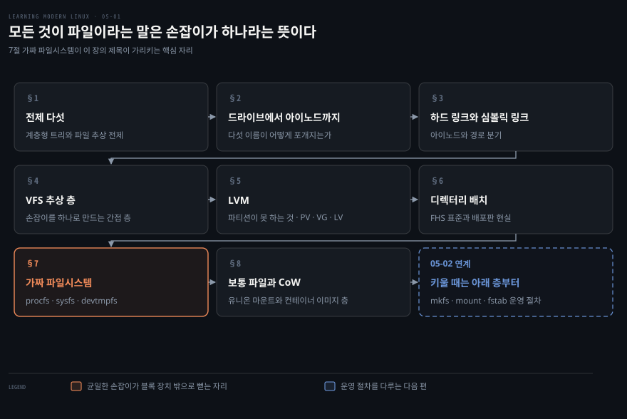
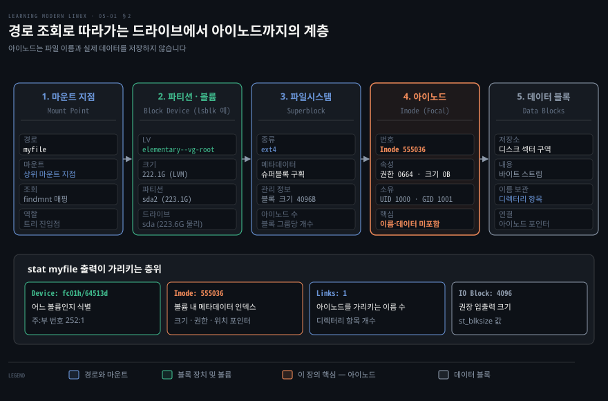
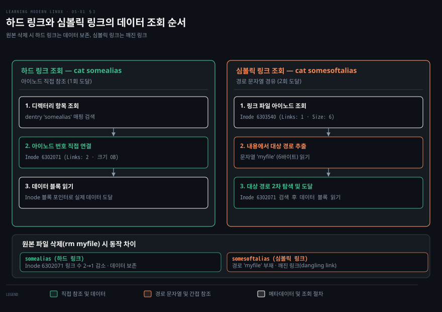
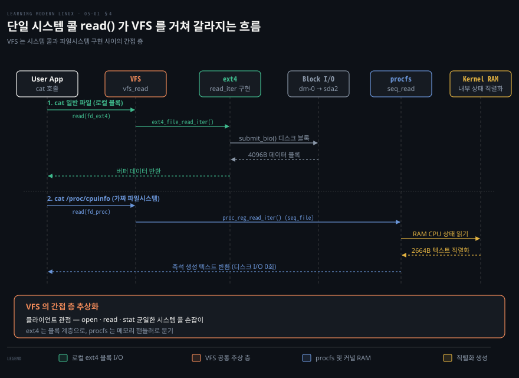
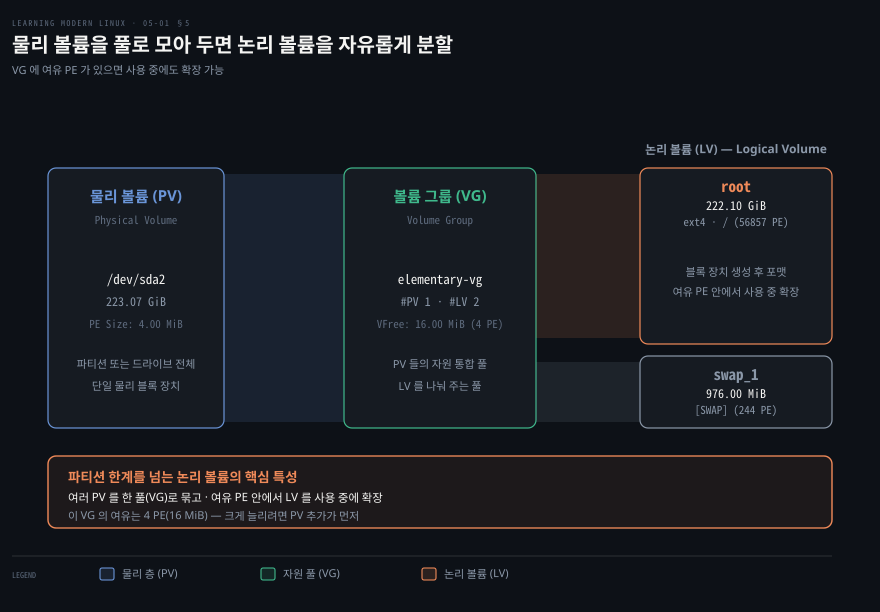
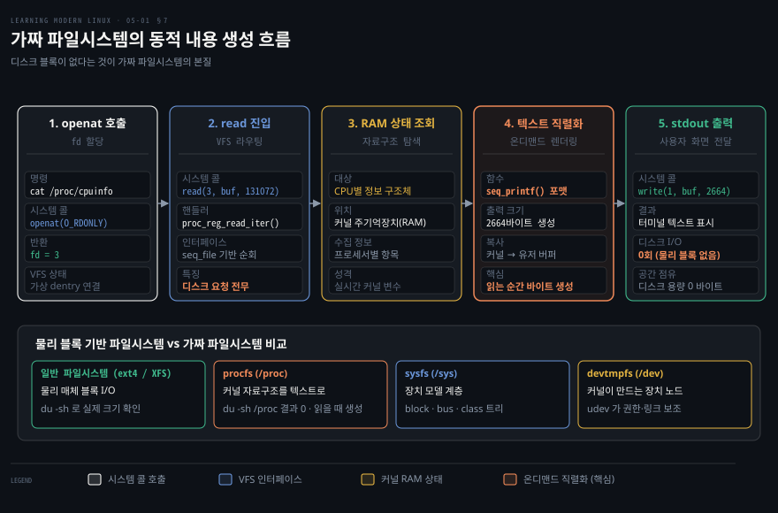
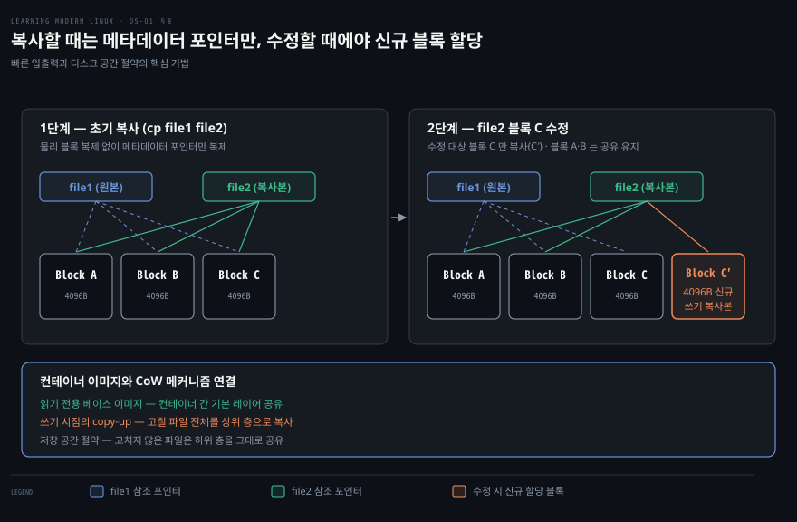
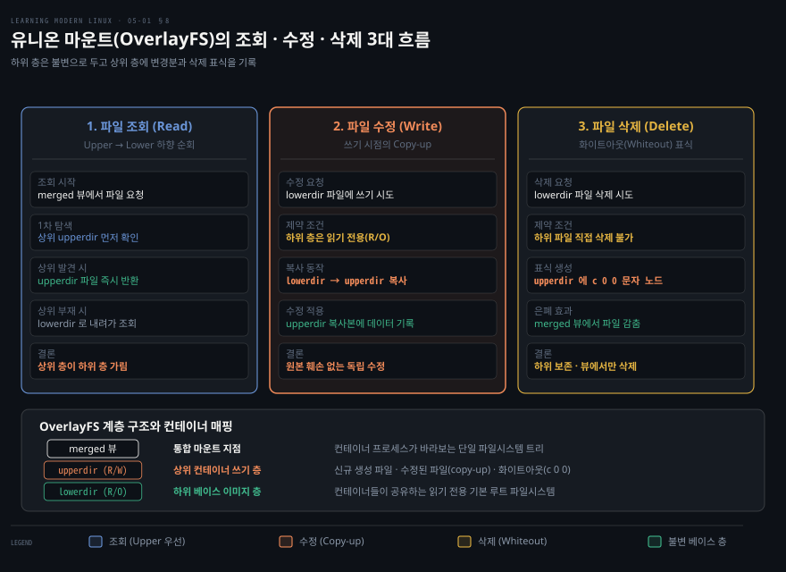

# 모든 것이 파일이라는 말은 손잡이가 하나라는 뜻이다

---

> 유닉스의 "모든 것은 파일이다"라는 추상은 리눅스에서도 대부분의 자원에 일관된 손잡이를 제공합니다. 5장은 이 추상이 VFS, 가짜 파일시스템(의사 파일시스템, pseudo filesystem), 유니온 마운트로 어떻게 구현되는지 따라갑니다.


## 핵심 요약

> 파일시스템이 제공하는 것은 단순한 저장 공간이 아니라 자원을 다루는 균일한 인터페이스입니다.

리눅스는 파일을 구조에 대한 사전 제약이 없는 바이트 스트림으로 다룹니다. 이 균일한 손잡이 덕분에 서로 다른 물리 장치와 가상 자원을 동일한 도구와 시스템 콜로 조작할 수 있습니다.

- **VFS** 가 커널 내부에서 시스템 콜과 개별 파일시스템 사이의 간접 층이 됩니다.
- **LVM** 은 물리 장치와 파일시스템 사이에 볼륨 풀을 두어 무중단으로 확장할 수 있게 합니다.
- **가짜 파일시스템**은 블록 장치가 아닌 프로세스와 커널 객체에도 동일한 손잡이를 달아 줍니다.
- **CoW 와 유니온 마운트**는 파일 층을 중복 없이 겹쳐 쌓아 컨테이너 이미지의 토대가 됩니다.

포맷(`mkfs`), 마운트, fstab 및 LVM 조작 등 운영 실무는 [05-02 편](./05-02.%ED%82%A4%EC%9A%B8%20%EB%95%8C%EB%8A%94%20%EC%95%84%EB%9E%98%20%EC%B8%B5%EB%B6%80%ED%84%B0%20%EC%A4%84%EC%9D%BC%20%EB%95%8C%EB%8A%94%20%EC%9C%84%20%EC%B8%B5%EB%B6%80%ED%84%B0.md)에서 다룹니다.


## 학습 목표

> 이 장을 읽고 나면 아래 다섯 가지를 스스로 해낼 수 있습니다.

1. 드라이브·파티션·볼륨·슈퍼블록·아이노드를 하나의 계층으로 설명할 수 있습니다.
2. 하드 링크와 심볼릭 링크의 차이를 아이노드 관점에서 말할 수 있습니다.
3. VFS 가 무엇과 무엇 사이에 놓인 층인지 설명할 수 있습니다.
4. procfs·sysfs·devtmpfs 가 각각 무엇을 드러내는지 구분할 수 있습니다.
5. CoW 와 유니온 마운트가 컨테이너 이미지의 어느 부분이 되는지 말할 수 있습니다.

아래는 이 문서 전체를 읽는 순서로 이은 지도입니다. 1~3절이 용어와 링크 구조, 4~5절이 VFS 와 LVM 간접 층, 6~8절이 디렉터리 배치와 가짜 파일시스템 및 CoW·유니온 마운트입니다.




## 이 문서가 다루지 않는 것

> 저장소의 개념과 추상화 층에 집중하기 위해 운영 절차와 외부 연계를 나눕니다.

- 파일시스템 포맷, 마운트 옵션, fstab 설정, LVM 크기 조절 → [05-02 편](./05-02.%ED%82%A4%EC%9A%B8%20%EB%95%8C%EB%8A%94%20%EC%95%84%EB%9E%98%20%EC%B8%B5%EB%B6%80%ED%84%B0%20%EC%A4%84%EC%9D%BC%20%EB%95%8C%EB%8A%94%20%EC%9C%84%20%EC%B8%B5%EB%B6%80%ED%84%B0.md)에서 다룹니다.
- 네트워크 파일시스템 (NFS, Samba 등) → 7장 네트워크에서 다룹니다.
- 컨테이너 런타임의 네임스페이스 격리와 cgroup 결합 → 6장 컨테이너에서 다룹니다.

4장에서 다룬 파일 소유권과 권한 모델은 파일시스템이 유지하는 핵심 메타데이터 속성입니다. 자세한 권한 모델은 [04-01. 전부 아니면 전무에서 잘게 쪼개는 쪽으로](./04-01.%EC%A0%84%EB%B6%80%20%EC%95%84%EB%8B%88%EB%A9%B4%20%EC%A0%84%EB%AC%B4%EC%97%90%EC%84%9C%20%EC%9E%98%EA%B2%8C%20%EC%AA%BC%EA%B0%9C%EB%8A%94%20%EC%AA%BD%EC%9C%BC%EB%A1%9C.md)를 참고합니다.


## 1. 계층형 트리와 파일 추상 전제

> 파일시스템의 전제를 명확히 하지 않으면 추상화 계층과 권한 모델에서 혼선이 생깁니다.

리눅스는 다섯 가지 전제 위에 서 있습니다. 이 기본 전제를 확인하지 않고 작업하면 트리 탐색과 권한 모델에서 예상과 다른 동작을 만나게 됩니다.

- 파일시스템 대부분은 **계층형** 구조입니다. 루트(`/`)에서 시작하는 단일 트리 구조를 사용자에게 제공합니다.
- 트리를 이루는 객체는 **디렉터리와 파일** 둘뿐입니다. 디렉터리가 가지를 치는 노드이고, 잎은 파일이거나 빈 디렉터리입니다.
- 트리 탐색은 디렉터리 나열(`ls`), 이동(`cd`), 현재 위치 확인(`pwd`)이라는 세 가지 동작으로 수행합니다.
- **권한이 내장**되어 있습니다. 파일시스템은 객체 소유권을 추적하며 배정된 모드 비트로 접근을 제어합니다.
- 파일시스템은 성능 때문에 일반적으로 **커널 공간**에 구현됩니다. 다만 FUSE(Filesystem in Userspace)처럼 사용자 공간에 드라이버를 구현하는 대안도 있습니다.

이 다섯 가지 전제를 잡아 두면 뒤따르는 계층과 용어가 물리 하드웨어와 어떻게 연결되는지 보입니다.


## 2. 드라이브에서 아이노드까지

> 물리 장치에서 메타데이터까지 다섯 계층의 경계를 구분하지 못하면 스토리지 장애 분석이 어긋납니다.



저장소 계층은 물리 장치에서 시작해 파일 메타데이터로 수렴합니다.

- **드라이브**: HDD 나 SSD 같은 물리 블록 장치입니다. 가상화 환경에서는 하이퍼바이저가 에뮬레이트한 가상 디스크일 수 있습니다.
- **파티션**: 드라이브를 논리적으로 분할한 연속된 저장 섹터의 집합입니다.
- **볼륨**: 파티션보다 유연한 논리 구획이며 특정 파일시스템으로 포맷된 상태입니다.
- **슈퍼블록**: 파일시스템 포맷 시 앞머리에 생성되는 특수 구획입니다. 파일시스템 종류, 전체 블록 수, 블록 크기, 블록 그룹당 아이노드 수(ext4 기준) 같은 전역 메타데이터를 저장합니다.
- **아이노드**: 파일 크기, 소유자, 저장 위치, 날짜, 접근 권한 같은 개별 파일 메타데이터를 저장합니다.

아이노드의 가장 중요한 특징은 **파일 이름과 실제 데이터를 저장하지 않는다**는 점입니다. 파일 이름은 디렉터리 항목(directory entry)이 보관하며 디렉터리는 아이노드 번호를 이름에 매핑하는 특수 파일입니다.

### 눈으로 확인하는 순서

실제 시스템에서 블록 장치 계층을 확인합니다.

```bash
lsblk --exclude 7
```

```bash
NAME                        MAJ:MIN RM    SIZE RO TYPE MOUNTPOINTS
sda                           8:0     0 223.6G  0 disk
├─sda1                        8:1     0   512M  0 part /boot/efi
└─sda2                        8:2     0 223.1G  0 part
  ├─elementary--vg-root     253:0     0 222.1G  0 lvm  /
  └─elementary--vg-swap_1   253:1     0   976M  0 lvm  [SWAP]
```

`--exclude 7` 은 주번호(major) 7 인 장치, 곧 루프 장치(loop)를 목록에서 뺍니다. 이 옵션은 주번호 목록을 받습니다.[^lsblk-e]

출력 결과를 보면 223.6GB 디스크 드라이브 `sda` 안에 파티션 둘이 있고 `sda2` 파티션 위에 LVM 볼륨 둘이 놓여 있습니다.

이어서 현재 시스템에 마운트된 파일시스템 목록을 조회합니다.

```bash
findmnt -D -t nosquashfs
```

```bash
SOURCE                          FSTYPE     SIZE USED  AVAIL USE% TARGET
udev                            devtmpfs   3.8G    0   3.8G   0% /dev
tmpfs                           tmpfs    778.9M 1.6M 777.3M   0% /run
/dev/mapper/elementary--vg-root ext4     217.6G 13.8G 192.7G  6% /
tmpfs                           tmpfs      3.8G 19.2M  3.8G   0% /dev/shm
tmpfs                           tmpfs        5M    4K     5M  0% /run/loc
tmpfs                           tmpfs      3.8G     0   3.8G  0% /sys/fs/
/dev/sda1                       vfat       511M    6M 504.9M  1% /boot/ef
tmpfs                           tmpfs    778.9M   76K 778.8M  0% /run/use
```

`-t nosquashfs` 는 읽기 전용 압축 파일시스템인 squashfs 타입을 목록에서 뺍니다. 출력 아래 네 줄은 `TARGET` 열 끝이 잘려 있습니다. `/run/loc` 는 `/run/lock` 이고, `/boot/ef` 는 `lsblk` 에서 본 `/boot/efi` 입니다.

개별 파일의 아이노드 메타데이터는 `stat` 명령으로 확인합니다.

```bash
stat myfile
```

```bash
  File: myfile
  Size: 0           Blocks: 0          IO Block: 4096   regular empty file
Device: fc01h/64513d    Inode: 555036      Links: 1
Access: (0664/-rw-rw-r--)  Uid: ( 1000/ mh9)   Gid: ( 1001/ mh9)
```

출력의 `Inode: 555036` 이 해당 파일의 메타데이터 번호입니다. 디렉터리 정보 역시 `stat .` 명령으로 동일하게 확인합니다.

블록 장치와 아이노드를 탐색할 때는 아래 저수준 진단 명령을 씁니다.

```bash
lsblk              # 모든 블록 장치와 마운트 지점 나열
fdisk -l           # 디스크 파티션 테이블 확인 및 관리
blkid              # UUID 및 파일시스템 타입 등 블록 장치 속성 출력
hwinfo --disk      # 스토리지 하드웨어 상세 정보 조회
file -s /dev/sda1  # 블록 장치 및 파티션 내부 파일시스템 판별
stat myfile        # 파일 아이노드 번호 · 크기 · 권한 등 메타데이터 출력
df -i              # 파일시스템별 아이노드 사용량 점검
```


## 3. 하드 링크와 심볼릭 링크

> 파일 이름과 실제 데이터가 강하게 결합되어 있으면 한 데이터에 여러 이름을 붙이거나 경로를 분기하기 어렵습니다.



리눅스에서는 아이노드가 파일 이름을 보관하지 않으므로 이름과 데이터가 강하게 묶여 있지 않습니다. 그래서 하나의 아이노드에 여러 디렉터리 항목이 연결되어 한 파일이 여러 이름을 가질 수 있고 경로도 유연하게 나눌 수 있습니다.

- **하드 링크**: 기존 파일의 아이노드 번호를 디렉터리 항목에 직접 연결합니다. 디렉터리를 가리킬 수 없으며 동일 파일시스템 내부에서만 동작합니다.
- **심볼릭 링크**: 대상 파일의 경로 문자열을 데이터로 저장하는 독립된 특수 파일입니다. 파일시스템 경계를 넘을 수 있고 디렉터리도 참조할 수 있습니다.

두 링크를 생성해 비교합니다.

```bash
ln myfile somealias
ln -s myfile somesoftalias
ls -al *alias
```

```bash
-rw-rw-r-- 2 mh9 mh9 0 Sep  5 12:15 somealias
lrwxrwxrwx 1 mh9 mh9 6 Sep  5 12:45 somesoftalias -> myfile
```

하드 링크 `somealias` 는 일반 파일(`-`)이며 링크 수가 2입니다. 심볼릭 링크 `somesoftalias` 는 링크 파일(`l`)이며 링크 수가 1이고 크기가 6바이트입니다. 대상 경로 문자열 `"myfile"` 의 글자 수가 6바이트이기 때문입니다.

`stat` 으로 두 링크를 비교하면 차이가 분명해집니다.

```bash
stat somealias
```

```bash
  File: somealias
  Size: 0        Blocks: 0     IO Block: 4096   regular empty file
Device: fd00h/64768d    Inode: 6302071    Links: 2
```

```bash
stat somesoftalias
```

```bash
  File: somesoftalias -> myfile
  Size: 6        Blocks: 0     IO Block: 4096   symbolic link
Device: fd00h/64768d    Inode: 6303540    Links: 1
```

하드 링크 쪽 `Links: 2` 는 아이노드 `6302071` 하나를 이름 둘(`myfile`·`somealias`)이 가리킨다는 뜻입니다. 심볼릭 링크는 별도 아이노드 `6303540` 을 가지며 파일 내용이 경로 문자열일 뿐입니다.

§2 의 `stat myfile` 과 아이노드 번호를 직접 맞대지는 않습니다. 장치 번호가 달라 서로 다른 파일시스템에서 뜬 출력입니다.

1. `fc01h`(252:1): §2 `stat myfile` 이 위치한 파일시스템 장치 번호
2. `fd00h`(253:0): 이 절 `stat` 출력의 장치 번호(`lsblk` 에서 본 `elementary--vg-root`, 253:0)

원본 파일 `myfile` 을 삭제하면 두 링크의 동작이 갈립니다.

| 링크 종류 | 원본 삭제 시 동작 차이 |
|---|---|
| 하드 링크 | 아이노드를 직접 붙들고 있으므로 링크 수만 줄고 데이터는 보존됩니다. |
| 심볼릭 링크 | 저장된 경로 대상이 사라지므로 깨진 링크(dangling link)가 됩니다. |


## 4. VFS — 단일 인터페이스를 제공하는 추상 층

> 저장 장치와 프로토콜마다 입출력 방식이 다르면 애플리케이션 코드가 대상 스토리지 종류에 종속됩니다.



VFS(Virtual File System)는 커널 안의 추상화 층입니다. 저장 장치마다 다른 입출력 방식을 파일 패러다임으로 감싸므로 클라이언트 애플리케이션은 특정 스토리지에 맞추지 않고 일관된 접근 인터페이스로 파일을 다룹니다.

VFS 는 시스템 콜과 구체적인 파일시스템 구현 사이에 간접 층을 둡니다. 공통 연산과 실제 구현 세부가 분리되어 클라이언트는 대상 장치 종류와 상관없이 표준 바이트 스트림으로 파일을 조작합니다.

VFS 가 추상화하는 파일시스템은 네 가지 부류입니다.

- **로컬 파일시스템**: ext4, XFS, FAT, NTFS 등입니다. 디바이스 드라이버를 통해 로컬 블록 장치(SSD, HDD)에 직접 접근합니다.
- **인메모리 파일시스템**: tmpfs 등입니다. 블록 장치 없이 주기억장치(RAM)에 머뭅니다.
- **가짜 파일시스템**: procfs, sysfs 등입니다. 커널 내부 상태와 디바이스 모델을 파일 인터페이스로 노출합니다.
- **네트워크 파일시스템**: NFS, CIFS/Samba 등입니다. 네트워크 드라이버를 거쳐 원격 서버의 스토리지와 통신합니다.

### 시스템 콜 범주와 핵심 자료구조

파일 관련 시스템 콜은 백여 개에 달하지만 핵심 연산은 다섯 범주로 묶입니다.

| 범주 | 대표 시스템 콜 |
|---|---|
| 아이노드 | `chmod`, `chown`, `stat` |
| 파일 | `open`, `close`, `seek`, `truncate`, `read`, `write` |
| 디렉터리 | `chdir`, `getcwd`, `link`, `unlink`, `rename`, `symlink` |
| 파일시스템 | `mount`, `umount`, `chroot` |
| 기타 | `mmap`, `poll`, `sync`, `flock` |

이 가운데 많은 시스템 콜은 VFS 를 지나 파일시스템별 구현으로 넘어가고, 나머지는 VFS 의 기본 구현이 처리합니다.

커널 소스 코드(`include/linux/fs.h`)에는 VFS 의 핵심 자료구조 4개가 정의되어 있습니다.

- `inode`: 디스크 상의 객체를 나타내며 권한, 소유자, 크기, 블록 위치 포인터를 가집니다.
- `dentry`: 경로명을 빠르게 탐색하기 위해 디렉터리 항목과 아이노드를 메모리에 캐시합니다.
- `file`: 프로세스가 연 열린 파일 인스턴스를 나타내며 읽기 위치 오프셋과 상태 플래그를 가집니다.
- `super_block`: 마운트된 특정 파일시스템 전체의 메타데이터와 파일시스템별 연산자 테이블을 담습니다.

동일한 `read()` 시스템 콜이 로컬 디스크 파일과 `/proc` 가상 파일을 동시에 다룰 수 있는 근거가 바로 VFS 의 함수 포인터 분기입니다.


## 5. LVM — 파티션이 못 하는 것

> 물리 파티션은 크기가 고정되어 있어 사용량이 임계치에 도달했을 때 무중단으로 공간을 늘리기 어렵습니다.



물리 파티션은 한 번 크기를 정하면 서비스 중단 없이 온라인으로 크기를 늘리거나 줄이기 어렵습니다. LVM(Logical Volume Manager)은 물리 저장 장치와 파일시스템 사이에 간접 층을 놓아 이 제약 없이 스토리지를 키울 수 있게 합니다. 여러 디스크를 하나의 풀로 묶고 필요한 크기만큼 논리 볼륨을 잘라 할당합니다.

LVM 은 3가지 개념으로 이루어집니다.

- **물리 볼륨(PV)**: 실제 디스크 드라이브 전체나 분할된 파티션(`sda2` 등)을 LVM 초기화한 블록 장치입니다.
- **볼륨 그룹(VG)**: 하나 이상의 물리 볼륨을 모아 생성한 스토리지 자원 풀입니다.
- **논리 볼륨(LV)**: 볼륨 그룹의 여유 공간에서 생성된 가상 블록 장치입니다. 파티션처럼 포맷 후 마운트해 사용하며 서비스 가동 중에도 동적으로 크기를 늘릴 수 있습니다.

실제 시스템의 LVM 계층을 순서대로 점검합니다.

```bash
sudo lvscan
```

```bash
  ACTIVE            '/dev/elementary-vg/root' [<222.10 GiB] inherit
  ACTIVE            '/dev/elementary-vg/swap_1' [976.00 MiB] inherit
```

```bash
sudo vgs
```

```bash
  VG            #PV #LV #SN Attr   VSize    VFree
  elementary-vg   1   2   0 wz--n- <223.07g 16.00m
```

```bash
sudo pvdisplay
```

```bash
  --- Physical volume ---
  PV Name               /dev/sda2
  VG Name               elementary-vg
  PV Size               <223.07 GiB / not usable 3.00 MiB
  PE Size               4.00 MiB
  Total PE              57105
  Free PE               4
  Allocated PE          57101
```

물리 볼륨 `/dev/sda2` 가 볼륨 그룹 `elementary-vg` 에 할당되어 있습니다. 이 풀 안에서 `root` 와 `swap_1` 두 논리 볼륨이 생성되어 있습니다. `vgs` 의 `#PV 1`·`#LV 2` 가 이 관계를 요약합니다.

숫자도 서로 맞습니다. 할당된 PE 57101 개 가운데 `root` 가 56857 개, `swap_1` 이 244 개(976 MiB ÷ 4 MiB)를 씁니다. 남은 `Free PE 4` 는 `VFree 16.00m` 입니다. 이 VG 에는 여유가 16 MiB 뿐이라, LV 를 키우려면 먼저 PV 를 더해야 합니다.

LVM 볼륨의 생성·확장·축소와 포맷 및 마운트 연동 절차는 별도의 운영 단계입니다. 구체적인 작업 순서는 [05-02 편](./05-02.%ED%82%A4%EC%9A%B8%20%EB%95%8C%EB%8A%94%20%EC%95%84%EB%9E%98%20%EC%B8%B5%EB%B6%80%ED%84%B0%20%EC%A4%84%EC%9D%BC%20%EB%95%8C%EB%8A%94%20%EC%9C%84%20%EC%B8%B5%EB%B6%80%ED%84%B0.md)에서 다룹니다.


## 6. 어디에 무엇을 두는가

> 파일시스템 트리에 표준이 없으면 설정 파일과 로그 파일이 분산되어 관리 복잡성이 커집니다.

파일시스템 계층 표준(FHS, Filesystem Hierarchy Standard)은 리눅스 트리의 주요 디렉터리 역할을 정의합니다. 디렉터리 배치에 이런 공통 규칙이 있어야 패키지마다 설정과 데이터가 흩어지지 않고 시스템을 안정적으로 관리할 수 있습니다. 다만 배포판마다 실제 디렉터리 심볼릭 링크와 세부 경로가 다를 수 있으므로 현재 배포판 기준은 `man hier` 로 확인합니다.

| 디렉터리 | 표준 역할과 보관 대상 |
|---|---|
| `bin`, `sbin` | 기본 명령어와 시스템 관리 바이너리. 최신 배포판은 보통 `/usr/bin`, `/usr/sbin` 의 심볼릭 링크 |
| `boot` | 부트로더 파일과 커널 이미지 |
| `dev` | 물리 및 가상 장치 특수 파일 |
| `etc` | 호스트 전역 설정 파일 |
| `home` | 일반 사용자의 홈 디렉터리 |
| `lib` | 시스템 공유 라이브러리. 보통 `/usr/lib` 심볼릭 링크 |
| `mnt`, `media` | 임시 마운트 지점 및 이동식 매체(USB 등) 마운트 경로 |
| `opt` | 서드파티 추가 패키지 설치 공간 |
| `proc`, `sys` | 커널 내부 상태와 하드웨어 제어를 위한 가상 파일시스템 |
| `tmp` | 임시 파일 저장소 (재부팅 시 삭제될 수 있음) |
| `usr` | 사용자 프로그램과 읽기 전용 정적 리소스 |
| `var` | 로그, 캐시, 스풀 등 시스템 운용 중 계속 늘어나는 가변 데이터 |

### 바인드 마운트의 정의

바인드 마운트(`mount --bind <src> <target>`)는 파일시스템 트리의 특정 디렉터리를 다른 마운트 지점에 거울처럼 붙이는 기능입니다. 별도의 블록 장치 포맷 없이도 기존 경로를 새로운 경로로 즉시 노출할 수 있습니다.[^bind]

이 방식은 호스트의 특정 디렉터리를 컨테이너 내부 경로로 연결하는 컨테이너 볼륨 마운트의 기반 기술로 쓰입니다.


## 7. 블록 장치가 아닌 것에 손잡이 달기

> 커널 내부 상태나 하드웨어 제어 레지스터를 일반 파일처럼 조회하지 못하면 별도의 독점 도구가 필요해집니다.



가짜 파일시스템은 디스크 블록 없이 커널 인터페이스를 파일 형태로 노출합니다. 그래서 커널 내부 상태나 하드웨어 정보를 확인할 때마다 전용 시스템 콜이나 독점 도구를 만들어 운영을 복잡하게 할 필요가 없습니다. 사용자는 별도의 진단 도구 없이 `cat`, `ls`, `grep` 같은 표준 명령어로 커널 상태를 점검합니다.

### procfs — 프로세스와 커널 상태 노출

`/proc` 은 원래 프로세스 관련 정보를 노출하기 위해 설계되었으나 시간이 흐르며 시스템 전반의 런타임 정보가 함께 통합되었습니다. `ps`·`free`·`top` 같은 명령이 이 파일들을 읽어 결과를 만듭니다. `/proc/sys` 아래는 sysctl 이 커널 파라미터를 읽고 쓰는 자리입니다.

디스크에는 0바이트이지만 읽는 순간 커널이 실시간 데이터를 생성합니다. `du -sh /proc` 은 0을 반환하지만 `cat /proc/cpuinfo` 는 시스템 코어 정보를 즉시 출력합니다.

Debian 12 컨테이너(aarch64, coreutils 9.1)에서 `strace -e trace=openat,read,write cat /proc/cpuinfo` 로 읽기 과정을 추적했습니다. 공유 라이브러리를 여는 줄은 뺐습니다.

```bash
openat(AT_FDCWD, "/proc/cpuinfo", O_RDONLY) = 3
read(3, "processor\t: 0\nBogoMIPS\t: 48.00\nF"..., 131072) = 2664
write(1, "processor\t: 0\nBogoMIPS\t: 48.00\nF"..., 2664) = 2664
read(3, "", 131072)                     = 0
```

1. `openat` 호출로 `/proc/cpuinfo` 를 열어 fd 3 을 받습니다.
2. 첫 `read` 에서 커널 핸들러가 RAM 의 CPU 정보를 그 자리에서 텍스트로 직렬화해 2664 바이트를 채웁니다.
3. `write` 호출로 같은 2664 바이트를 stdout 에 내보냅니다.
4. 둘째 `read` 가 0 을 돌려주면 파일 끝입니다. `cat` 이 한 번에 요청한 131072 바이트는 이 파일 크기와 무관한 읽기 버퍼 크기입니다.

CPU 수와 아키텍처가 다르면 바이트 수와 첫 줄 내용(x86 은 `vendor_id`, arm64 는 `BogoMIPS`)이 달라집니다.

프로세스별 디렉터리(`/proc/<pid>/`) 아래의 주요 항목은 이렇습니다.

| 항목 | 종류 | 보관 정보 |
|---|---|---|
| `cmdline` | 파일 | 실행 시 전달된 명령행 인자 |
| `cwd` | 링크 | 프로세스의 현재 작업 디렉터리 |
| `environ` | 파일 | 프로세스에 전달된 환경 변수 목록 |
| `exe` | 링크 | 실행 바이너리의 실제 경로 |
| `fd` | 디렉터리 | 프로세스가 열고 있는 파일 디스크립터 목록 |
| `limits` | 파일 | 프로세스에 설정된 소프트/하드 리소스 제한 |
| `status` | 파일 | 사람이 읽기 좋은 형태의 프로세스 상태 요약 |
| `net` | 디렉터리 | 프로세스가 속한 네트워크 네임스페이스 통계 |

프로세스의 UID 매핑을 확인합니다.

```bash
cat /proc/self/status | head -10
```

```bash
Name:   cat
Umask:  0002
State:  R (running)
Tgid:   12011
Ngid:   0
Pid:    12011
PPid:   3421
TracerPid:  0
Uid:    1000    1000    1000    1000
Gid:    1000    1000    1000    1000
```

`Uid:` 에 표시된 네 숫자는 4장에서 살펴본 실제·유효·저장된·파일시스템 UID 입니다.

`/proc/PID/net` 경로는 개별 프로세스가 아니라 프로세스가 속한 **네트워크 네임스페이스** 단위로 격리됩니다.[^proc-net] 동일 네트워크 네임스페이스를 공유하는 파드 안의 컨테이너들은 동일한 ARP 캐시와 인터페이스 목록을 바라봅니다.

### sysfs — 정돈된 디바이스 모델 계층

`/sys` 는 리눅스 디바이스 모델을 체계적으로 구조화한 가상 파일시스템입니다.

- `block/`: 감지된 블록 장치로 가는 심볼릭 링크를 담습니다.
- `bus/`: 커널이 지원하는 물리 버스(PCI, USB 등) 디렉터리입니다.
- `class/`: 장치 클래스(net, tty 등) 디렉터리입니다.
- `dev/`: 블록 장치와 문자 장치를 `주번호:부번호` 형태로 매핑합니다.
- `devices/`: 실제 하드웨어 트리의 계층 구조를 드러냅니다.
- `fs/`: 속성을 내보내는 일부 파일시스템의 하위 디렉터리를 담습니다.
- `module/`: 커널에 적재된 모듈별 튜닝 파라미터를 보관합니다.

`/proc` 과 `/sys` 는 일부 정보가 겹칩니다. `procfs` 는 구조 규칙이 거의 없어 파일마다 뜻을 알려면 커널 문서를 곁에 둬야 합니다. 그래서 구조화된 하드웨어 탐색은 `sysfs` 를 먼저 봅니다. 세부 메모리 통계(`meminfo`)나 프로세스 내부 상태처럼 `procfs` 에만 있는 정보는 `procfs` 에서 찾습니다.

```bash
ls -al /sys/block/sda/ | head -7
```

```bash
total 0
drwxr-xr-x 11 root root    0 Sep  7 11:49 .
drwxr-xr-x  3 root root    0 Sep  7 11:49 ..
-r--r--r--  1 root root 4096 Sep  8 16:22 alignment_offset
lrwxrwxrwx  1 root root    0 Sep  7 11:51 bdi -> ../../../virtual/bdi/8:0
-r--r--r--  1 root root 4096 Sep  8 16:22 capability
-r--r--r--  1 root root 4096 Sep  7 11:49 dev
```

`bdi` 링크 끝의 `8:0` 은 `lsblk` 출력에서 확인한 `sda` 의 주번호와 부번호(`MAJ:MIN`)와 같습니다. `dev` 파일을 `cat` 으로 읽어도 같은 `8:0` 이 나옵니다. 두 명령이 같은 장치를 다른 창으로 본 것입니다.

### devtmpfs — 장치 노드가 파일이 되는 자리

`/dev` 는 하드웨어 장치 노드와 특수 파일을 호스팅합니다.

오늘날 `/dev` 는 커널 부팅 초기에 생성되는 `devtmpfs` 가 채웁니다.[^devtmpfs] §2 의 `findmnt` 출력 첫 줄 `udev devtmpfs … /dev` 가 그 마운트입니다. 커널 드라이버가 장치 노드를 등록하면 사용자 공간의 `udev` 데몬이 규칙에 따라 파일 권한을 설정하고 심볼릭 링크를 유지합니다.

장치는 세 부류로 나뉩니다.

- **블록 장치**: 데이터를 고정 크기 블록 단위로 전송하는 디스크 저장소입니다.
- **문자 장치**: 바이트 스트림 단위로 입출력하는 터미널, 키보드, 직렬 포트입니다.
- **특수 장치**: `/dev/null`(데이터 싱크), `/dev/urandom`(난수 생성), `/dev/tty`(제어 터미널) 등 커널 유틸리티입니다.

```bash
tr -dc A-Za-z0-9 < /dev/urandom | head -c 42
echo "hello terminal" > /dev/tty
```

특수 장치는 일반 파일 리다이렉션 문법 그대로 터미널 출력이나 난수 생성을 처리합니다.


## 8. 보통 파일과 복사하지 않는 복사

> 대용량 데이터와 컨테이너 이미지를 매번 물리 복사하면 디스크 공간이 급격히 고갈되고 I/O 병목이 발생합니다.



주요 로컬 파일시스템과 인메모리 파일시스템은 용도와 크기 한계가 저마다 다릅니다.

| 파일시스템 | 주 용도 및 특징 | 최대 파일 크기 | 최대 볼륨 크기 |
|---|---|---|---|
| ext4 | 범용 기본 파일시스템, 저널링 지원, 높은 하위 호환성 | 16 TB | 1 EB |
| XFS | 큰 파일과 고속 I/O, 메타데이터 저널링, Red Hat 계열 배포판의 기본값 | 8 EB | 8 EB |
| btrfs | CoW, 스냅숏, 체크섬으로 조용한 데이터 손상 탐지 | 16 EB | 16 EB |
| ZFS | 파일시스템과 볼륨 관리 통합, 풀 기반 관리 | 16 EB | 2^128 바이트 |
| vfat | FAT 계열, 윈도우·이동식 매체와의 상호운용성 | 4 GiB − 1 바이트[^fat-max] | — |
| tmpfs | 커널 내부 캐시에 두는 인메모리 파일시스템, 스왑 가능, 재부팅 시 소멸 | 마운트 옵션 `size` (기본 물리 RAM 의 절반)[^tmpfs] | 같음 |

`pipefs` 와 `sockfs` 는 트리에 붙지 않는 인메모리 파일시스템입니다. 파이프와 네트워크 소켓도 이 둘 덕분에 VFS 손잡이를 얻습니다. 셸 문법으로 배운 파이프와 네트워크의 것으로 알던 소켓이 모두 파일시스템 이름을 가집니다. "모든 것은 파일이다" 가 은유에 그치지 않고 구현이라는 뜻입니다.

### CoW — 복사 없는 복사

CoW(Copy-on-Write)는 포인터 공유를 통해 입출력 속도를 높이고 공간 낭비를 막는 기법입니다.

1. **복사 시점**: 블록 A·B·C 로 이루어진 `file1` 을 `file2` 로 복사할 때 물리 데이터 블록을 복제하지 않고 블록을 가리키는 메타데이터 포인터만 복제합니다.
2. **수정 시점**: `file2` 가 특정 블록을 수정할 때 비로소 대상 블록만 새로 복사되어 `C'` 이 만들어집니다. 원본 `file1` 은 기존 블록을 유지하고 `file2` 만 신규 블록을 가리킵니다.

### 유니온 마운트와 OverlayFS



유니온 마운트는 여러 디렉터리를 하나의 마운트 지점으로 겹쳐 단일 디렉터리처럼 보이게 만드는 기술입니다. 메인라인 커널에 들어간 구현은 OverlayFS 이며 컨테이너 이미지 층의 기반 기술입니다.

OverlayFS 는 조회·수정·삭제 3가지 연산을 서로 다르게 처리합니다.

- **조회(Read)**: 상위 층(upperdir)에 파일이 있으면 상위 파일을 반환하고, 없으면 하위 층(lowerdir)으로 내려가 조회합니다.
- **수정(Write)**: 하위 층 파일을 쓰기로 열거나 메타데이터를 바꾸면 그 파일을 통째로 상위 층에 복사(copy-up)합니다. 이후 상위 복사본에 변경을 기록합니다.
- **삭제(Delete)**: 읽기 전용 하위 층 파일은 물리 삭제가 불가능합니다. 상위 층에 같은 이름의 화이트아웃을 만들어 하위 층 파일이 뷰에서 보이지 않도록 가립니다. 화이트아웃은 장치 번호 0/0 인 문자 장치(`c 0 0`)입니다.[^whiteout]

이 구조 덕분에 수십 개의 컨테이너가 동일한 읽기 전용 기본 이미지 레이어를 공유하면서도 각자 격리된 쓰기 층을 유지할 수 있습니다.


## 결정 치트시트

> 파일시스템 설계와 링크 선택 시 판단 기준을 정리합니다.

| 상황 | 권장 선택 | 핵심 이유 |
|---|---|---|
| 동일 데이터에 다중 이름을 부여해야 함 | 하드 링크 | 아이노드를 직접 참조하므로 원본 이름을 지워도 데이터 보존 |
| 파일시스템 경계를 넘거나 디렉터리를 가리킴 | 심볼릭 링크 | 하드 링크는 디렉터리와 파일시스템 경계를 지원하지 않음 |
| 사용 중 동적 크기 확장이 필요한 블록 저장소 | LVM 논리 볼륨(LV) | VG 에 여유 PE 가 있으면 사용 중에도 LV 를 늘릴 수 있음 |
| 구조화된 디바이스 트리 탐색 | `sysfs` (`/sys`) | 표준화된 디바이스 모델 계층으로 버스 및 클래스 정보 노출 |
| 프로세스별 런타임 정보 및 메모리 통계 | `procfs` (`/proc`) | 커널 내부 상태를 실시간 텍스트로 직렬화해 노출 |
| 고속 접근이 필요하고 재부팅 시 사라져도 됨 | `tmpfs` | 커널 캐시 메모리에 직접 상주하여 I/O 지연 최소화 |
| 기존 디렉터리를 다른 경로에 거울처럼 노출 | `mount --bind` | 포맷 없이 단일 디렉터리 계층을 재배치해 컨테이너 볼륨에 활용 |
| 다중 이미지 레이어를 겹치고 쓰기 격리 필요 | OverlayFS | 불변 하위 층 공유와 copy-up 및 화이트아웃 기반 변경 격리 |


## 적용 관점

> 엔터프라이즈 환경과 쿠버네티스 운영에서 파일시스템 개념이 구체화되는 지점입니다.

컨테이너 이미지 레이어가 유니온 마운트와 CoW 의 결합입니다. `docker build` 가 만드는 층은 독립된 파일시스템이 아니라 OverlayFS 로 겹쳐지는 디렉터리들입니다. 컨테이너가 하위 층 파일을 고칠 때만 그 파일이 상위 쓰기 층으로 복사됩니다. 그래서 동일 베이스 이미지를 공유하는 컨테이너가 수십 개여도 디스크를 중복 점유하지 않습니다.

쿠버네티스 `emptyDir.medium: Memory` 볼륨이 `tmpfs` 입니다. 메모리에 상주하므로 I/O 처리량이 뛰어나지만 파드가 재시작되면 데이터가 소멸합니다. 애플리케이션 캐시나 세션 임시 저장소에 적합합니다.

JVM 이 컨테이너 메모리 한도를 인식하는 통로가 `/sys` 와 `/proc` 입니다. `UseContainerSupport` 플래그가 활성화된 JVM 은 호스트 물리 메모리가 아니라 cgroup 파일시스템 경로를 읽어 힙 크기를 결정합니다. 컨테이너에 메모리 한도를 주지 않으면 호스트 메모리를 기준으로 힙을 과대 할당합니다.

쿠버네티스 볼륨 마운트가 `mount --bind` 계열입니다. 호스트의 특정 디렉터리를 파드 컨테이너의 특정 경로에 마운트할 때 바인드 마운트가 동작합니다. `subPath` 로 파일 하나만 주입할 때 원본 디렉터리 전체가 가려지지 않는 것도 같은 바인드 마운트 덕분입니다.

`/proc/self/status` 의 `Uid:` 네 필드가 컨테이너 보안을 검증합니다. 파드 매니페스트의 `runAsUser` 설정이 실제 프로세스에 적용되었는지 확인하려면 컨테이너 내부에서 이 파일을 조회해 유효 UID 를 직접 검증합니다.


## 면접에서 받을 만한 질문

> 자답을 먼저 떠올린 뒤 아래 정답을 확인하는 것이 좋습니다.

1. 아이노드에 저장되지 않는 두 가지 핵심 정보는 무엇이며 이 분리가 어떤 기능을 가능하게 합니까?
2. 하드 링크와 심볼릭 링크의 차이를 `stat` 출력 필드 세 가지로 어떻게 구분합니까?
3. VFS 는 무엇과 무엇 사이에 위치하는 계층이며 어떤 이점을 제공합니까?
4. `/proc/PID/net` 아래의 네트워크 정보는 어떤 단위로 격리됩니까?
5. 컨테이너 이미지가 수십 개의 층으로 쌓여도 디스크 공간을 적게 차지하는 메커니즘은 무엇입니까?


## 정답 (자답 후 펼치기)

### 정답 1 — 아이노드가 보관하지 않는 정보

아이노드는 파일 크기, 소유자, 권한, 수정 시각, 블록 위치 포인터를 저장하지만 **파일 이름과 실제 데이터는 저장하지 않습니다**.

파일 이름은 디렉터리 항목(directory entry)이 보관하고 디렉터리는 아이노드 번호를 이름에 매핑하는 특수 파일입니다. 실제 데이터는 데이터 블록에 저장됩니다.

이 분리 덕분에 하나의 아이노드에 서로 다른 파일 이름을 연결하는 하드 링크가 가능해집니다.

### 정답 2 — 하드 링크와 심볼릭 링크 구분

`stat` 출력에서 세 가지 필드로 구분합니다.

1. **아이노드 번호**: 하드 링크는 원본과 동일한 아이노드 번호를 공유하지만 심볼릭 링크는 별도의 신규 아이노드 번호를 가집니다.
2. **링크 수(Links)**: 하드 링크는 링크 수가 2 이상으로 증가하지만 심볼릭 링크는 링크 수가 1입니다.
3. **파일 종류 및 크기**: 하드 링크는 `regular file` 이며 원본 파일 크기를 공유합니다. 심볼릭 링크는 `symbolic link` 이며 파일 크기가 가리키는 대상 경로 문자열의 바이트 길이와 같습니다.

### 정답 3 — VFS 의 위치와 이점

VFS 는 간접 추상화 계층입니다. 유저 공간의 **시스템 콜**과 커널 내부의 **개별 파일시스템 구현체** 사이에 위치합니다.

애플리케이션은 대상 스토리지가 로컬 SSD, 가상 메모리, 네트워크 스토리지인지와 무관하게 동일한 시스템 콜로 작업합니다. `open`, `read`, `write`, `close` 같은 통일된 시스템 콜 인터페이스로 모든 자원을 균일하게 조작할 수 있습니다.

### 정답 4 — `/proc/PID/net` 의 격리 단위

개별 프로세스 단위가 아니라 프로세스가 속한 **네트워크 네임스페이스** 단위로 격리됩니다.

동일 네트워크 네임스페이스를 공유하는 모든 프로세스는 동일한 네트워크 디바이스, IP 주소, 라우팅 테이블, ARP 캐시를 바라봅니다. 쿠버네티스 파드 내의 컨테이너들이 `localhost` 로 서로 통신하고 동일한 네트워크 설정을 공유하는 기반입니다.

### 정답 5 — 컨테이너 이미지 레이어의 디스크 절약 원리

**유니온 마운트(OverlayFS)** 와 **CoW(Copy-on-Write)** 메커니즘이 함께 동작하기 때문입니다.

읽기 전용 베이스 이미지 레이어는 단 한 벌만 디스크에 보관되며 모든 컨테이너가 이를 공유합니다. 컨테이너가 파일 수정을 시도할 때만 대상 파일이 상위 쓰기 층으로 복사(copy-up)됩니다. 그래서 같은 데이터를 중복 저장하지 않고 디스크 사용량도 최소로 줄입니다.


## 핵심 개념 체크리스트

- [ ] 드라이브·파티션·볼륨·슈퍼블록·아이노드의 계층 관계를 설명할 수 있는가?
- [ ] 아이노드가 담지 않는 두 가지와 파일 이름이 보관되는 위치를 아는가?
- [ ] 하드 링크와 심볼릭 링크의 차이와 원본 삭제 시 동작을 구분할 수 있는가?
- [ ] VFS 가 추상화하는 네 가지 파일시스템 부류를 들 수 있는가?
- [ ] LVM 에서 PV, VG, LV 의 관계와 논리 볼륨을 쓰는 이유를 설명할 수 있는가?
- [ ] FHS 최상위 디렉터리의 표준 역할과 바인드 마운트의 개념을 아는가?
- [ ] procfs, sysfs, devtmpfs 가 각각 무엇을 노출하는지 구분할 수 있는가?
- [ ] CoW 의 전후 상태와 OverlayFS 의 조회·수정(copy-up)·삭제(whiteout) 흐름을 설명할 수 있는가?


## 관련 문서

- [Learning Modern Linux 정독 인덱스](./README.md) — 이 책의 장별 진행 상황
- [키울 때는 아래 층부터 줄일 때는 위 층부터](./05-02.%ED%82%A4%EC%9A%B8%20%EB%95%8C%EB%8A%94%20%EC%95%84%EB%9E%98%20%EC%B8%B5%EB%B6%80%ED%84%B0%20%EC%A4%84%EC%9D%BC%20%EB%95%8C%EB%8A%94%20%EC%9C%84%20%EC%B8%B5%EB%B6%80%ED%84%B0.md) — mkfs · mount · fstab 과 LVM 크기 조절 실무 운영
- [전부 아니면 전무에서 잘게 쪼개는 쪽으로](./04-01.%EC%A0%84%EB%B6%80%20%EC%95%84%EB%8B%88%EB%A9%B4%20%EC%A0%84%EB%AC%B4%EC%97%90%EC%84%9C%20%EC%9E%98%EA%B2%8C%20%EC%AA%BC%EA%B0%9C%EB%8A%94%20%EC%AA%BD%EC%9C%BC%EB%A1%9C.md) — 파일 소유권과 UID 매핑이 이 장에서 파일로 관측되는 자리
- [커널은 전부를 하지만 운영체제는 아니다](./02-01.%EC%BB%A4%EB%84%90%EC%9D%80%20%EC%A0%84%EB%B6%80%EB%A5%BC%20%ED%95%98%EC%A7%80%EB%A7%8C%20%EC%9A%B4%EC%98%81%EC%B2%B4%EC%A0%9C%EB%8A%94%20%EC%95%84%EB%8B%88%EB%8B%A4.md) — 시스템 콜이 유일한 통로라는 앞 장의 결론


## 참고 자료

- 원서: 《Learning Modern Linux》 5장 Filesystems (Michael Hausenblas, O'Reilly, 2022년)
- [FUSE 커널 문서](https://www.kernel.org/doc/html/latest/filesystems/fuse.html) — 사용자 공간 파일시스템 구현 인터페이스
- [Filesystem Hierarchy Standard](https://refspecs.linuxfoundation.org/fhs.shtml) — Linux Foundation 리눅스 디렉터리 계층 표준 사양
- [OverlayFS 커널 문서](https://docs.kernel.org/filesystems/overlayfs.html) — OverlayFS 아키텍처 및 마운트 옵션 공식 문서

[^proc-net]: `proc_pid_net(5)` man 페이지 — "/proc/net is a symbolic link to the directory /proc/self/net, which contains the same files and directories" 이며 이들은 "expose information for the network namespace of which the process is a member" 라고 밝힙니다. <https://man7.org/linux/man-pages/man5/proc_pid_net.5.html>

[^lsblk-e]: `lsblk(8)` man 페이지 — `-e, --exclude list` 는 "Exclude the devices specified by the comma-separated list of major device numbers." 라고 적습니다. <https://man7.org/linux/man-pages/man8/lsblk.8.html>

[^bind]: `mount(8)` man 페이지 「Bind mount operation」 — "Remount part of the file hierarchy somewhere else." 이고 "After this call the same contents are accessible in two places." 라고 적습니다. <https://man7.org/linux/man-pages/man8/mount.8.html>

[^fat-max]: 리눅스 커널 `fs/fat/inode.c` 가 FAT 슈퍼블록의 최대 파일 크기를 `sb->s_maxbytes = 0xffffffff;` 로 둡니다. <https://github.com/torvalds/linux/blob/master/fs/fat/inode.c>

[^tmpfs]: 커널 문서 「Tmpfs」 — `size` 옵션은 "The limit of allocated bytes for this tmpfs instance. The default is half of your physical RAM without swap." 이고, tmpfs 는 "puts everything into the kernel internal caches" 하며 스왑으로 내보낼 수 있다고 적습니다. <https://docs.kernel.org/filesystems/tmpfs.html>

[^whiteout]: 커널 문서 「Overlay Filesystem」 — "A whiteout is created as a character device with 0/0 device number or as a zero-size regular file with the xattr “trusted.overlay.whiteout”." 이고, copy-up 은 쓰기 접근이 필요할 때 "the file is first copied from the lower filesystem to the upper filesystem (copy_up)" 라고 적습니다. <https://docs.kernel.org/filesystems/overlayfs.html>

[^devtmpfs]: 리눅스 커널 `drivers/base/Kconfig` 의 `CONFIG_DEVTMPFS` 도움말 — "Maintain a devtmpfs filesystem to mount at /dev", "This creates a tmpfs/ramfs filesystem instance early at bootup. In this filesystem, the kernel driver core maintains device nodes with their default names and permissions for all registered devices with an assigned major/minor number. ... It provides a fully functional /dev directory, where usually udev runs on top, managing permissions and adding meaningful symlinks." <https://github.com/torvalds/linux/blob/master/drivers/base/Kconfig>
