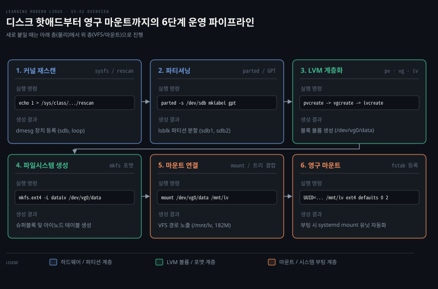
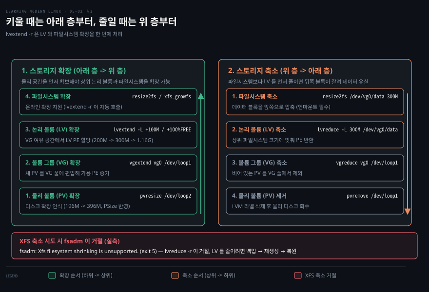
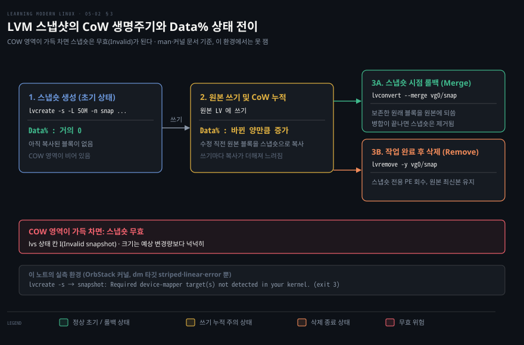
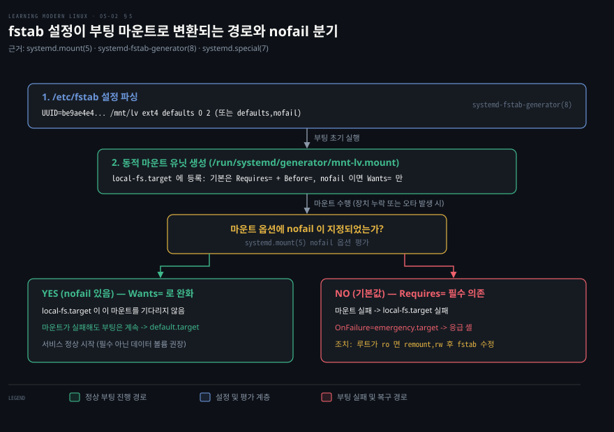
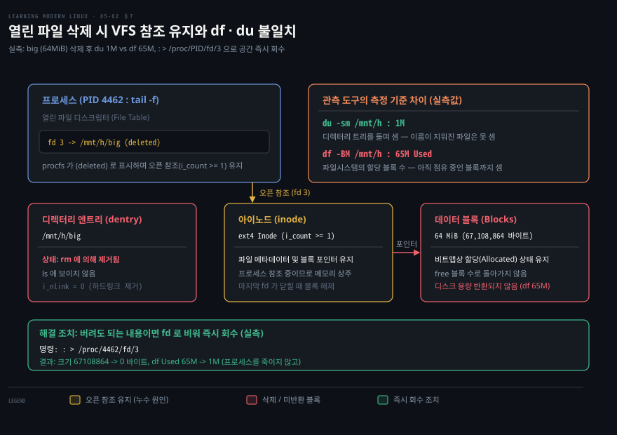

# 키울 때는 아래 층부터 줄일 때는 위 층부터

---

> 스토리지 운영은 디스크 감지부터 파티셔닝, 볼륨 풀링, 포맷, 마운트, fstab 영구화까지 계층을 따라 흐릅니다. 05-02 편은 이 물리 장치부터 VFS 마운트까지의 운영 절차와 용량 조절 및 공간 이상 추적을 정리합니다.


## 핵심 요약

> 스토리지를 다루는 방향성은 계층 의존성이 결정합니다.

물리 디스크를 새로 추가하거나 확장했다면 아래 규칙대로 운영체제 트리에 안전하게 붙이고 용량을 바꿉니다.

- **디스크 인식과 파티션**: 가상 머신에 핫애드된 디스크는 SCSI 호스트 재스캔을 거쳐 커널에 등록하고 2TiB 를 넘는 볼륨은 GPT 라벨을 붙여 `parted`·`growpart` 로 다룹니다.
- **확장은 아래 층부터**: 물리 볼륨(PV)을 먼저 늘리고(`pvresize`), 볼륨 그룹(VG)을 확장한 뒤 논리 볼륨(LV)과 파일시스템을 늘립니다(`lvextend -r`).
- **축소는 위 층부터**: 파일시스템을 먼저 줄이지 않고 하위 LV 를 줄이면 데이터를 잃습니다. XFS 는 `lvreduce -r` 이 축소를 거절하므로 백업 뒤 다시 만들어야 합니다.
- **fstab 과 부팅 격리**: systemd 는 `/etc/fstab` 의 마운트 항목을 마운트 유닛으로 변환합니다. 필수 아닌 볼륨에 `nofail` 옵션을 주면 그 마운트가 실패해도 부팅이 기다리지 않고 계속되므로 emergency 셸로 떨어지는 사고를 막습니다.
- **보이지 않는 용량 소진**: 파일 이름(dentry)을 지워도 프로세스가 열고 있는 파일 디스크립터가 남으면 블록이 반환되지 않아 `df` 와 `du` 가 어긋납니다.


## 학습 목표

> 이 문서를 읽고 나면 아래 여섯 가지 운영 작업을 명령어로 수행하고 원리를 설명할 수 있습니다.

1. SCSI 버스 재스캔 세 갈래의 차이를 알고 새 디스크를 커널에 등록할 수 있습니다.
2. GPT 파티션을 분할하고 `growpart` 로 파티션을 끝까지 늘릴 수 있습니다.
3. LVM 볼륨 확장의 하향 의존성과 축소의 상향 의존성을 구분하고 XFS 의 제약을 설명할 수 있습니다.
4. 마운트 옵션의 실제 보안 제약과 `mount -a` 의 검증 범위를 이해할 수 있습니다.
5. fstab 오타로 부팅이 멈췄을 때 emergency 셸에서 복구할 수 있습니다.
6. `df` 와 `du` 의 불일치 원인을 추적하고 실행 중인 서비스 중단 없이 디스크 공간을 회수할 수 있습니다.




## 이 문서가 다루지 않는 것

> VFS 내부 구현과 커널 가상 메모리 및 하드웨어 RAID 설정은 이 문서의 범위 밖입니다.

- 파일시스템의 VFS 내부 구조, 아이노드 및 디렉터리 엔트리 개념, OverlayFS 유니온 마운트 원리는 [05-01 편](./05-01.모든%20것이%20파일이라는%20말은%20손잡이가%20하나라는%20뜻이다.md)에서 다룹니다.
- systemd 의 전체 부팅 시퀀스와 타깃 의존성 구조는 [06-01 편](./06-01.먼저%20켜지는%20것%20하나가%20나머지%20전부를%20켠다.md)에서 다룹니다.
- 커널의 가상 메모리 관리와 OOM killer 알고리즘은 [LKP 09-03 편](../linux-kernel-programming/09-03.%EB%A9%94%EB%AA%A8%EB%A6%AC%20%ED%95%A0%EB%8B%B9%20%285%29%20%E2%80%94%20demand%20paging%EA%B3%BC%20OOM%20killer.md)에서 다룹니다.
- 하드웨어 RAID 컨트롤러의 펌웨어 설정이나 광 채널(FC) 스위치 조작은 다루지 않습니다.


## 1. 커널이 새 디스크를 알아보게 하기

> 핫애드된 새 디스크나 용량이 증설된 기존 볼륨은 호스트 또는 장치 단위 재스캔을 거쳐 커널에 등록합니다.

가상화 환경이나 클라우드 인스턴스에서 디스크를 새로 붙이거나(핫애드), 기존 가상 디스크의 용량을 늘려도 커널이 그 사실을 즉시 알아채지 못할 때가 있습니다. 이때 서버를 재부팅하지 않고 커널에 변경 사항을 통지하는 통로가 세 가지 있습니다.

### 재스캔 세 갈래의 용도 차이

커널의 SCSI 서브시스템과 블록 계층은 `sysfs` 인터페이스를 통해 재스캔 트리거를 노출합니다. 대상의 상태에 따라 쓰는 경로가 다릅니다.

| 재스캔 방식 | 대상 경로 및 명령 | 사용 시점 |
|---|---|---|
| 호스트 버스 재스캔 | `echo "- - -" > /sys/class/scsi_host/host0/scan` | 가상 머신에 새 디스크를 핫애드하여 `/dev/sdX` 노드 자체가 없을 때 |
| 스크립트 기반 버스 스캔 | `rescan-scsi-bus.sh` (`sg3-utils` 패키지) | 여러 SCSI 호스트 채널을 순회하며 새 LUN 을 자동 감지할 때 |
| 단일 장치 재스캔 | `echo 1 > /sys/class/block/sdX/device/rescan` | 이미 인식된 `/dev/sdX` 디스크의 하이퍼바이저 용량을 증설했을 때 |
| 파티션 테이블 재독출 | `partprobe /dev/sdX` | 디스크 내부 파티션을 나눈 뒤 커널에 `/dev/sdX1` 생성을 알릴 때 |

호스트 단위 재스캔의 `"- - -"` 문구는 컨트롤러 채널, SCSI 타깃 ID, LUN 번호의 와일드카드를 의미합니다. 새 디스크가 추가되면 커널 드라이버가 버스를 스캔해 새 장치 노드를 할당합니다. 반면 이미 있는 디스크의 볼륨 크기만 바뀐 경우에는 블록 장치 아래 `device/rescan` 파일에 `1` 을 써서 용량 메타데이터만 다시 읽게 합니다.

### 장치 인식 확인과 멀티패스

재스캔 명령을 내린 직후에는 `dmesg` 명령으로 커널이 장치 등록 메시지를 출력했는지 확인합니다.

```bash
dmesg | grep -Ei 'scsi|sd[a-z]'
```

로그에 장치 용량과 함께 `[sdX] Attached SCSI disk` 줄이 찍히면 블록 계층 등록이 끝난 것입니다. 엔터프라이즈 SAN 스토리지처럼 다중 경로가 연결된 환경이라면 `multipath -ll` 명령으로 다중 경로 데몬이 새 디스크의 활성 경로를 올바르게 묶었는지 함께 점검합니다.[^multipath]


## 2. 파티션을 나누고 키우기

> 2TiB 를 넘는 볼륨은 MBR 로 주소를 다 잡을 수 없어 GPT 라벨을 쓰고, parted 와 growpart 로 크기를 다룹니다.

커널이 새 디스크를 인식했더라도 블록 장치를 분할하지 않으면 파티션 단위 격리와 마운트 관리가 어렵습니다.

### GPT 라벨을 쓰는 조건

과거 MBR(Master Boot Record) 방식은 32비트 LBA 주소 체계를 써서 512바이트 섹터 기준으로 2^32 × 512B = 2TiB 까지만 주소를 지정할 수 있었고 주 파티션도 4개까지만 만들 수 있었습니다. 그래서 아래 두 조건 중 하나에 해당하면 GPT(GUID Partition Table) 를 씁니다.

1. **디스크 용량이 2TiB 를 넘는 경우**: GPT 는 64비트 LBA 를 쓰므로 그 너머 공간까지 주소를 지정할 수 있습니다.
2. **UEFI 로 부팅하는 경우**: UEFI 펌웨어는 ESP(EFI System Partition) 를 GPT 디스크에서 찾는 것이 표준 구성이라, 부팅 디스크는 보통 GPT 로 만듭니다.

파티션 테이블은 주로 `parted` 명령으로 조작합니다. 대화형 메뉴 없이 스크립트로 안전하게 실행할 수 있는 도구입니다.[^parted]

```bash
parted -s /dev/loop10 mklabel gpt mkpart p1 ext4 1MiB 50MiB mkpart p2 ext4 50MiB 100MiB
parted -s /dev/loop10 print
```

```bash
Model: Loopback device (loopback)
Disk /dev/loop10: 210MB
Sector size (logical/physical): 512B/512B
Partition Table: gpt
Disk Flags: 

Number  Start   End     Size    File system  Name  Flags
 1      1049kB  52.4MB  51.4MB               p1
 2      52.4MB  105MB   52.4MB               p2
```

`parted` 로 분할을 마친 뒤 커널이 새 파티션 장치 파일(`/dev/loop10p1`, `/dev/loop10p2`)을 즉시 노출하지 않으면 `partprobe /dev/loop10` 명령을 실행해 파티션 테이블 변경분을 다시 읽어 들입니다.

### growpart 로 파티션 확장

가상 디스크 용량을 늘린 뒤 디스크 끝에 할당되지 않은 여유 공간이 생겼다면 `cloud-guest-utils` 패키지의 `growpart` 명령으로 특정 파티션을 디스크 끝까지 한 번에 늘립니다. 이 작업은 기존 데이터를 유지합니다.[^growpart]

```bash
growpart /dev/loop10 2
# CHANGED: partition=2 start=102400 old: size=102400 end=204799 new: size=716767 end=819166
```

`growpart` 는 파티션 테이블의 섹터 종료 위치만 안전하게 바꾸므로 파티션 내부 파일시스템의 기존 데이터를 훼손하지 않습니다. 파티션 크기가 늘어난 뒤에는 상위 볼륨이나 파일시스템 확장 단계로 넘어갑니다.


## 3. LVM 으로 키우고 줄이고 되돌리기

> LVM 볼륨 확장은 물리 층부터 위로 올리고, 축소는 파일시스템부터 아래로 내리며 XFS 는 LV 축소 경로가 막혀 있습니다.

물리 파티션을 직접 포맷해 쓰면 운영 중 서비스 중단 없이 디스크 용량을 유연하게 변경하기 어렵습니다. 물리 볼륨 PV, 볼륨 그룹 VG, 논리 볼륨 LV 의 기본 개념과 매핑 관계는 [05-01 편 §5](./05-01.모든%20것이%20파일이라는%20말은%20손잡이가%20하나라는%20뜻이다.md#5-lvm--파티션이-못-하는-것)에서 다루었습니다. 여기서는 크기를 동적으로 조절하는 운영 규칙을 살펴봅니다.



### 확장은 아래 층부터

용량을 늘릴 때는 반드시 하위 물리 층에서 상위 파일시스템 층으로 올라가야 합니다. 상위 계층은 하위 계층에 이미 확보된 공간만 쓸 수 있기 때문입니다.

1. **디스크 증설 인식**: 디스크 자체 크기가 커진 경우 `pvresize /dev/loop2` 로 PV 메타데이터의 `PSize` 를 먼저 갱신합니다. 새 디스크를 추가한 경우라면 `pvcreate` 로 초기화한 뒤 `vgextend vg0 /dev/loop1` 로 기존 볼륨 그룹 풀에 넣습니다.
2. **논리 볼륨 확장**: 볼륨 그룹에 여유 익스텐트(Free PE)가 생기면 `lvextend` 명령으로 LV 크기를 늘립니다.
3. **파일시스템 확장**: 마지막으로 블록 장치 위의 파일시스템 크기를 늘려 운영체제가 늘어난 공간을 쓰게 합니다.

실무에서는 `lvextend` 의 `-r`(`--resizefs`) 옵션으로 2단계와 3단계를 한 번에 실행합니다.[^lvextend]

```bash
lvextend -r -L +100M /dev/vg0/data
```

```bash
  Size of logical volume vg0/data changed from 200.00 MiB (50 extents) to 300.00 MiB (75 extents).
  Logical volume vg0/data successfully resized.
resize2fs 1.47.0 (5-Feb-2023)
Filesystem at /dev/mapper/vg0-data is mounted on /mnt/lv; on-line resizing required
old_desc_blocks = 2, new_desc_blocks = 3
The filesystem on /dev/mapper/vg0-data is now 307200 (1k) blocks long.
```

볼륨 그룹에 남은 여유 공간 전부를 하나의 논리 볼륨에 몰아줄 때는 `-l +100%FREE` 플래그를 붙입니다. ext4 파일시스템은 위 출력의 `on-line resizing required` 줄처럼 마운트된 상태에서 `resize2fs` 로 늘어나며 XFS 파일시스템 역시 마운트된 채로 `xfs_growfs /mnt/xfs` 로 즉시 용량을 늘릴 수 있습니다.

### 축소는 위 층부터 — XFS 의 예외

용량을 줄이는 작업은 확장의 역순입니다. 상위 파일시스템을 먼저 줄여 데이터 블록을 앞쪽으로 모아 두지 않은 채 하위 LV 부터 잘라내면 파일시스템 뒷부분의 데이터와 메타데이터가 잘려 나가 영구히 손실됩니다.

ext4 는 마운트된 채로 줄일 수 없습니다. `resize2fs(8)` 은 마운트된 파일시스템에 대해서는 확장만 하고 축소는 언마운트된 파일시스템에서만 합니다.[^resize2fs] 그래서 마운트를 해제한 뒤 `fsck` 검사를 거쳐 `resize2fs` 로 크기를 줄이고 그 뒤에 `lvreduce` 로 LV 익스텐트를 반환해야 합니다. 마운트된 상태에서 `lvreduce -r` 을 시도하면 도구가 언마운트 여부를 확인합니다.

```bash
lvreduce -r -L 300M /dev/vg0/data
```

```bash
Do you want to unmount "/mnt/lv" ? [Y|n] n
fsadm: Cannot proceed with mounted filesystem "/mnt/lv".
  /sbin/fsadm failed: 1
  Filesystem resize failed.
```

`-y` 옵션을 주면 `fsadm` 도우미가 언마운트, `fsck`, `resize2fs`, LV 축소, 재마운트를 차례로 실행합니다.

XFS 는 사정이 다릅니다. `lvreduce -r` 이 부르는 `fsadm` 은 XFS 축소를 아예 거절합니다. 이 노트의 실측에서는 마운트한 상태와 언마운트한 상태 모두 아래처럼 멈췄습니다(언마운트 상태에서는 `xfs_repair` 점검 출력이 먼저 찍힌 뒤 같은 줄로 끝납니다). XFS 쪽 도구인 `xfs_growfs(8)` 도 축소는 마지막 할당 그룹(AG) 안쪽을 줄이는 것만 구현돼 있고 AG 하나짜리까지는 줄일 수 없다고 적습니다.[^xfs-growfs] 운영에서 LV 를 원하는 크기로 줄이는 데 쓸 길은 없는 셈입니다.

```bash
lvreduce -y -r -L 200M /dev/vgx/xfsl
```

```bash
fsadm: Xfs filesystem shrinking is unsupported.
  /sbin/fsadm failed: 1
  Filesystem resize failed.
```

그래서 XFS 가 올라간 논리 볼륨을 줄이는 방법은 데이터를 다른 저장소로 백업한 뒤 논리 볼륨을 삭제하고 더 작은 크기로 다시 만들어 포맷한 후 데이터를 복원하는 것뿐입니다.

### LVM 스냅샷과 Data% 상태 전이

LVM 스냅숏은 원본 논리 볼륨의 특정 시점 상태를 보존하는 특수 볼륨입니다.



스냅숏은 `lvcreate -s` 로 만듭니다.

```bash
lvcreate -s -L 50M -n snap /dev/vg0/data
```

스냅숏을 막 만든 시점에는 스냅숏 공간(COW 영역)에 복사된 블록이 없으므로 `lvs` 의 `Data%` 가 0 가까이에서 시작합니다. 이후 원본 볼륨에 쓰기가 일어날 때마다 CoW(Copy-on-Write)가 동작합니다. 바뀌기 전 원래 블록을 COW 영역에 먼저 저장하는 방식입니다. 커널 문서는 이를 "For each write, the original data will be saved in the <COW device>" 라고 적습니다.[^dm-snapshot] 원본이 많이 바뀔수록 스냅숏의 `Data%` 가 올라갑니다.

스냅숏 운영에는 두 가지 주의점이 있습니다.

1. **공간이 차면 스냅숏이 무효가 됨**: 원본의 변경량이 스냅숏에 할당한 크기(예: 50MiB)를 넘으면 스냅숏은 더 쓸 수 없게 됩니다. 커널 문서는 COW 영역이 가득 차면 "the snapshot will become useless and be disabled, returning errors" 라고 설명합니다. `lvs` 는 상태(Attr) 칸에 `I`(Invalid snapshot) 를 띄웁니다.[^lvs] 무효가 된 스냅숏으로는 되돌릴 수 없으므로 스냅숏 크기는 예상 변경량보다 넉넉하게 잡습니다.
2. **쓰기 비용 증가**: 스냅숏이 살아 있는 동안 원본에 쓰기가 일어나면 원래 블록을 COW 영역에 복사하는 일이 더해지므로 원본의 쓰기 성능이 떨어집니다.

작업이 실패해 이전 상태로 되돌려야 할 때는 `lvconvert --merge vg0/snap` 을 실행합니다. 스냅숏에 보존된 원래 블록이 원본으로 다시 쓰이며 병합이 끝나면 LVM 이 스냅숏을 제거합니다. 다만 원본이나 스냅숏이 열려 있으면(마운트 중) 병합은 바로 시작하지 않고 둘 다 닫힌 뒤 처음 활성화될 때로 미뤄집니다.[^lvconvert] 작업이 정상적으로 끝났다면 `lvremove vg0/snap` 으로 스냅숏을 지워 복사 비용을 없앱니다.

OrbStack 같은 경량 VM 이나 컨테이너가 쓰는 커널에는 dm-snapshot 타깃이 없을 수 있으니, 스냅숏을 만들기 전에 `dmsetup targets` 로 타깃 목록을 확인합니다. 실제 `striped`·`linear`·`error` 타깃만 있는 환경에서 `lvcreate -s` 를 실행하면 오류가 납니다. 이때 도구는 `snapshot: Required device-mapper target(s) not detected in your kernel.` 메시지를 내며 exit 3 으로 끝납니다.

### pvmove 로 디스크 교체하기

장애가 예상되는 물리 디스크를 제거하거나 새로운 고속 스토리지로 볼륨을 옮길 때는 `pvmove` 명령을 씁니다.[^pvmove]

```bash
pvmove /dev/loop4 /dev/loop5
```

`pvmove` 는 원본 PV 에 할당된 물리 익스텐트(PE)를 다른 PV 로 옮깁니다. 도중에 끊기면(예: 서버가 죽으면) 인자 없이 `pvmove` 를 다시 실행해 마지막 체크포인트부터 이어 갑니다. 이동이 끝나면 원본 PV 에 할당된 익스텐트가 남지 않으므로 그 PV 를 볼륨 그룹에서 빼고 LVM 라벨을 지울 수 있습니다.

OrbStack 등 커널에 dm-mirror 나 관련 타깃이 없는 환경에서 `pvmove /dev/loop4` 를 실행하면 오류가 발생합니다. 도구는 `Required device-mapper target(s) not detected in your kernel.` 메시지를 출력하며 exit 5 로 끝납니다. 따라서 `pvmove` 로 디스크를 교체하기 전에도 `dmsetup targets` 로 필요한 장치 매퍼 타깃이 활성화되어 있는지 확인합니다.

```bash
vgreduce vgm /dev/loop4
pvremove /dev/loop4
```

데이터가 남아 있는 PV 에 `vgreduce` 를 시도하면 LVM 이 `Physical volume "/dev/loop4" still in use` 경고를 내며 거절하므로 실수로 데이터를 날리는 사고를 막아 줍니다.


## 4. 파일시스템을 만들고 붙이기

> 포맷으로 라벨과 파일시스템 메타데이터를 새기고, defaults 옵션 묶음과 보안 제한 옵션으로 마운트합니다.

블록 장치를 운영체제 트리에 연결하려면 파일시스템을 포맷하고 마운트해야 합니다.

### 포맷과 라벨 부여

파일시스템을 만들 때는 디스크 관리자가 쉽게 식별할 수 있도록 볼륨 라벨(`-L`)을 함께 지정하는 것이 좋습니다.[^mkfs-ext4]

```bash
mkfs.ext4 -L datalv /dev/vg0/data
mkfs.xfs -L xfslv /dev/vgx/xfsl
```

포맷이 끝나면 `blkid` 명령으로 장치의 고유 식별자 UUID 와 파일시스템 종류 TYPE, 볼륨 라벨 LABEL 을 확인합니다.

```bash
blkid /dev/vg0/data /dev/vgx/xfsl
# /dev/vg0/data: LABEL="datalv" UUID="be9ae4e4-a6c3-4e10-8bf1-2b8dc07e7958" BLOCK_SIZE="1024" TYPE="ext4"
# /dev/vgx/xfsl: LABEL="xfslv" UUID="1b215cc0-0f84-4f0a-bcf4-04ecee6e6453" BLOCK_SIZE="512" TYPE="xfs"
```

### 마운트 옵션 표

`mount` 명령에 `-o` 로 전달하는 옵션은 보안과 성능을 좌우합니다. 가장 흔히 쓰이는 `defaults` 는 단일 옵션이 아니라 표준 운영 옵션 일곱 개의 묶음입니다.[^mount]

| 옵션 | 묶음 포함 여부 | 의미 및 동작 |
|---|---|---|
| `rw` | `defaults` 포함 | 읽기 및 쓰기 허용 (반대는 `ro`) |
| `suid` | `defaults` 포함 | set-user-identifier 또는 set-group-identifier 비트 동작 허용 |
| `dev` | `defaults` 포함 | 파일시스템 내의 문자 및 블록 특수 장치 파일 해석 허용 |
| `exec` | `defaults` 포함 | 바이너리 실행 허용 (반대는 `noexec`) |
| `auto` | `defaults` 포함 | `mount -a` 실행 시 자동 마운트 대상에 포함 |
| `nouser` | `defaults` 포함 | 일반 사용자의 마운트 조작 금지 (root 만 가능) |
| `async` | `defaults` 포함 | 모든 입출력을 비동기 방식으로 수행 |
| `noexec` | 명시적 지정 | 파일시스템 내 실행 파일 직접 실행 차단 (`Permission denied`, exit 126) |
| `nosuid` | 명시적 지정 | setuid/setgid 비트를 무시하여 권한 상승 공격 방지 |
| `nodev` | 명시적 지정 | `mknod` 로 만든 장치 파일 열기 시도 시 접근 거부 (`Permission denied`) |
| `ro` | 명시적 지정 | 읽기 전용 마운트 (파일 쓰기 시 `Read-only file system` 오류) |

실제 보안 환경에서는 사용자가 파일을 업로드하는 `/tmp` 나 데이터 디렉터리에 `noexec,nosuid,nodev` 옵션을 주어 임의 스크립트 실행이나 악의적 디바이스 노드 생성을 막습니다. 다만 `noexec` 가 걸려 있어도 `sh /mnt/m/t.sh` 처럼 인터프리터를 직접 호출하는 방식까지 막지는 못하므로 다층 방어가 필요합니다.

운영 중 파일시스템 옵션을 바꿀 때는 언마운트하지 않고 재마운트(`remount`)합니다.

```bash
mount -o remount,ro /mnt/lv
```


## 5. 부팅 때 다시 붙이기 — fstab

> fstab 설정은 systemd 마운트 유닛으로 변환되며, nofail 옵션으로 외장 볼륨 장애가 emergency 모드로 번지는 것을 방지합니다.

수동으로 실행한 `mount` 는 시스템이 재부팅되면 사라집니다. 부팅 과정에서 특정 경로에 블록 장치를 자동으로 마운트하려면 `/etc/fstab` 에 항목을 등록해야 합니다.[^fstab]

### fstab 의 여섯 필드와 UUID 지목

`/etc/fstab` 은 공백으로 구분한 여섯 개 필드로 구성합니다.

```bash
# <file system>                            <mount point> <type> <options>          <dump> <pass>
# UUID=be9ae4e4-a6c3-4e10-8bf1-2b8dc07e7958  /mnt/lv       ext4   defaults,nofail    0      2
```

1. **파일시스템 식별자**: 장치 이름(`/dev/sda1`) 대신 `UUID=` 나 `LABEL=` 표기를 씁니다. `fstab(5)` 도 이 방식을 권장합니다. 디스크를 추가하거나 포트가 바뀌어 장치 노드 이름이 달라져도 UUID 는 변하지 않기 때문입니다.
2. **마운트 지점**: 파일시스템을 연결할 트리 경로입니다.
3. **파일시스템 종류**: `ext4`, `xfs` 등 포맷 형식입니다.
4. **마운트 옵션**: 쉼표로 연결된 옵션 목록입니다.
5. **dump 주기**: `dump` 백업 도구의 주기(보통 `0`).
6. **fsck 검사 순서**: 부팅 시 무결성 검사 순서입니다. 루트 파일시스템은 `1`, 일반 데이터 파일시스템은 `2`, 스왑이나 검사가 필요 없는 볼륨은 `0` 으로 둡니다.

### mount -a 의 검증 범위

`/etc/fstab` 을 수정한 뒤에는 재부팅하기 전에 `mount -a` 로 문법 오류나 장치 오타가 없는지 확인합니다. `mount(8)` 의 `-a` 정의는 "Mount all filesystems (of the given types) mentioned in fstab (except for those whose line contains the noauto keyword)" 입니다.

```bash
mount -a
```

```bash
mount: /mnt/bad: special device /dev/nonexist_vol does not exist.
       dmesg(1) may have more information after failed mount system call.
mount: /mnt/fx: unknown filesystem type 'ext44'.
       dmesg(1) may have more information after failed mount system call.
```

만약 오타가 있거나 존재하지 않는 장치를 적었다면 즉시 에러가 발생하며 0 이 아닌 종료 코드(예: exit 32)를 반환합니다. 단, 마운트 옵션에 `noauto` 가 적힌 줄은 `mount -a` 가 건너뛰므로 그 줄의 오타는 여기서 드러나지 않습니다.

실제로 마운트하지 않고 파일만 점검하려면 `findmnt --verify` 를 씁니다. 같은 오류 줄을 담은 fstab 사본에 돌려 보았습니다(debian:12 컨테이너, util-linux 2.38.1). `noauto` 줄까지 읽고 `[W] ext44 seems unsupported by the current kernel` 같은 경고를 낸 뒤 `0 parse errors, 0 errors, 8 warnings` 로 끝났습니다. 경고만 있으면 종료 코드가 0 이므로 출력 내용을 직접 읽어야 합니다.

### 부팅 실패와 emergency 셸 복구

현대 리눅스 배포판에서 `/etc/fstab` 은 단순한 텍스트 설정 파일로 끝나지 않고 systemd 부팅 의존성 그래프에 직접 결합합니다.[^systemd-mount]



1. **마운트 유닛 생성**: 부팅 초기 `systemd-fstab-generator` 가 `/etc/fstab` 각 줄을 읽어 `/run/systemd/generator/` 아래에 동적 `.mount` 유닛을 만듭니다.
2. **local-fs.target 결합**: `local-fs.target` 은 로컬 파일시스템 마운트 유닛을 필수(required)로 요구하며 타깃보다 먼저 끝나도록 순서를 잡습니다.
3. **부팅 중단 갈래**: fstab 에 오타가 있거나 외장 디스크가 빠져 마운트가 실패하면 `local-fs.target` 도 실패합니다. 이 타깃에는 `OnFailure=emergency.target` 이 걸려 있어(`systemctl cat local-fs.target` 으로 확인, systemd 259) 시스템이 `emergency.target` 으로 빠집니다.

1. nofail: 외장 디스크나 보조 데이터 볼륨처럼 부팅 필수 장치가 아닌 로컬 스토리지를 fstab 에 등록할 때 지정합니다. 이 옵션이 빠지면 장치가 연결되지 않거나 마운트가 실패했을 때 `local-fs.target` 이 함께 실패하여 부팅이 멈추고 emergency 모드로 빠집니다.
2. _netdev: iSCSI 나 FCoE 처럼 네트워크가 먼저 올라와야 접근할 수 있는 블록 스토리지 위에 일반 파일시스템을 올렸을 때 지정합니다. 이 옵션이 빠지면 네트워크 서비스가 활성화되기 전에 마운트를 시도하다 장치를 찾지 못해 부팅이 멈추거나 지연됩니다.

NFS 처럼 파일시스템 종류만으로 네트워크 마운트임을 알 수 있는 대상은 systemd 가 `_netdev` 없이도 `network-online.target` 뒤로 마운트 순서를 미룹니다.

fstab 오타 때문에 emergency 셸에 떨어졌다면 먼저 루트가 쓰기 가능한지 봅니다. `systemd-remount-fs.service` 가 `local-fs-pre.target` 보다 앞에서 루트를 fstab 옵션대로 다시 마운트하므로 보통은 이미 `rw` 입니다. `findmnt -o OPTIONS /` 가 `ro` 를 보일 때만 쓰기 모드로 다시 마운트한 뒤 편집합니다.

```bash
findmnt -o OPTIONS /
mount -o remount,rw /    # ro 일 때만
nano /etc/fstab
systemctl daemon-reload
```

fstab 을 수정한 뒤에는 `systemctl daemon-reload` 로 generator 가 마운트 유닛을 다시 생성하게 한 뒤 재부팅합니다.


## 6. swap

> 물리 메모리 압박을 완화하는 스왑은 파티션 또는 파일 형태로 구성하며, 쿠버네티스 노드는 기본 설정에서 스왑이 켜져 있으면 kubelet 이 시작하지 않습니다.

대규모 작업으로 물리 메모리가 고갈되면 OOM 이 일어나 커널이 프로세스를 강제 종료합니다. 메모리 압박을 완화하려고 커널은 스왑을 씁니다. 비활성 익명 메모리 페이지를 디스크로 밀어내는 방식입니다.

### 파티션과 파일 방식 비교

스왑 공간은 전용 디스크 파티션으로 구성하거나 기존 파일시스템 안에 스왑 파일을 생성해 구성합니다.

| 비교 항목 | 스왑 파티션 | 스왑 파일 |
|---|---|---|
| 공간 유연성 | 파티션 크기 조절이 어려움 | 필요할 때 `fallocate` 로 즉시 증설·삭제 가능 |
| 파일시스템 제약 | 파일시스템 없이 raw 블록 장치 사용 | 구멍(hole) 있는 파일이나 Btrfs 의 CoW 파일은 문제가 되고, 실측에서는 overlayfs 위에서 `swapon` 이 실패 |
| 구성 난이도 | 디스크 파티셔닝 작업 필요 | 루트 디렉터리 아래 파일 하나로 구성 완료 |
| 권장 용도 | 고정된 물리 서버 인프라 | 클라우드 가상 머신 및 동적 메모리 증설 환경 |

### 스왑 파일 생성과 활성화 4단계

현대 클라우드 환경에서는 스왑 파일 구성이 일반적입니다. 스왑 파일은 네 단계로 만듭니다.[^mkswap]

```bash
fallocate -l 64M /mnt/h/swapf2
chmod 600 /mnt/h/swapf2
mkswap /mnt/h/swapf2
swapon /mnt/h/swapf2
```

1. **공간 할당**: `fallocate -l` 로 디스크 공간을 미리 할당합니다. `swapon(8)` 은 파일시스템에 따라 `fallocate` 로 만든 파일도 구멍 있는 파일로 취급될 수 있다고 경고하며 가장 이식성 있는 방법으로 `dd` 와 `/dev/zero` 를 듭니다. 이 노트의 실측(ext4)에서는 `fallocate` 파일로 `swapon` 이 성공했습니다.
2. **보안 권한 제한**: 스왑 파일에는 프로세스의 메모리 페이지가 그대로 기록되므로 `chmod 600` 으로 root 이외의 읽기를 막습니다. 권한이 열려 있으면 `mkswap` 이 `insecure permissions 0644` 경고를 냅니다.
3. **스왑 서명 기록**: `mkswap` 명령으로 스왑 헤더와 매직 넘버를 기록합니다.
4. **활성화**: `swapon` 명령으로 커널 스왑 풀에 등록합니다.

스왑 파일은 ext4·XFS 처럼 블록 장치에 바로 놓인 파일시스템 위에 둡니다. 컨테이너의 overlayfs 루트 위에 만든 파일로 `swapon` 을 시도하면 `fallocate`·`chmod`·`mkswap` 까지는 진행됩니다. 하지만 `swapon` 단계에서 `swapon failed: Invalid argument` 오류를 내며 exit 255 로 실패합니다. `swapon(8)` 설명대로 커널은 파일시스템을 거치지 않고 스왑 파일에 직접 쓰기 때문이며, 파일시스템이 블록 매핑을 직접 제공하지 못하는 계층에서는 커널이 활성화를 거절합니다.

### 스왑 관측과 비활성화

현재 활성화된 스왑 장치와 우선순위는 `swapon --show` 또는 `free -m`, `/proc/swaps` 로 확인합니다.[^swapon]

```bash
swapon --show
```

```bash
NAME          TYPE       SIZE USED  PRIO
/dev/zram0    partition  7.8G   0B 32767
/dev/vdc      partition 1024M   0B     1
/mnt/h/swapf2 file        64M   0B    -1
```

스왑을 끄는 작업은 일시적 비활성화와 영구 비활성화로 나뉩니다.

- **일시적 비활성화**: `swapoff /mnt/h/swapf2` 또는 `swapoff -a` 를 실행하면 디스크에 있던 스왑 페이지를 모두 물리 RAM 으로 다시 읽어 들이고 스왑 공간을 해제합니다. 그러나 fstab 설정이 남아 있으면 시스템 재부팅 시 다시 켜집니다.
- **영구 비활성화**: 쿠버네티스 노드 세팅처럼 스왑을 계속 꺼 두어야 할 때는 `swapoff -a` 로 끕니다. 이어서 `/etc/fstab` 파일에서 swap 관련 줄을 주석 처리(`sed -i '/swap/s/^/#/' /etc/fstab`)해야 재부팅 후에도 다시 켜지지 않습니다.

systemd 환경에서 `/etc/fstab` 에 등록된 스왑 항목은 `systemd-fstab-generator` 가 마운트 항목과 마찬가지로 `.swap` 유닛으로 바꿔 관리합니다. 스왑과 커널 OOM 점수 산정의 관계는 [LKP 09-03 편](../linux-kernel-programming/09-03.%EB%A9%94%EB%AA%A8%EB%A6%AC%20%ED%95%A0%EB%8B%B9%20%285%29%20%E2%80%94%20demand%20paging%EA%B3%BC%20OOM%20killer.md), 메모리 포화 관측 지표는 [SP 07-04 편](../systems-performance/07-04.메모리%20—%20관측%20도구.md)에서 자세히 다룹니다.


## 7. 공간이 안 맞을 때

> inode 소진과 프로세스가 잡고 있는 삭제 파일은 df 와 du 의 측정 기준 차이로 나타나며, 버려도 되는 내용이면 프로세스를 멈추지 않고 공간을 회수합니다.

디스크 용량이 부족하다는 알람이 왔을 때 흔히 겪는 이상 현상은 두 가지입니다. 첫째는 용량(`df -h`)은 남는데 파일 생성이 안 되는 경우이고 둘째는 `df` 와 `du` 의 수치가 맞지 않는 경우입니다.

### inode 소진과 문제 디렉토리 추적

파일시스템은 데이터를 저장하는 데이터 블록 외에도 파일의 메타데이터를 저장하는 아이노드(inode) 공간을 따로 관리합니다. `df -h` 로 보았을 때 공간이 수 기가바이트씩 남아 있어도 `df -i` 로 조회한 아이노드가 100% 소진되면 새 파일을 만들 수 없습니다.

```bash
touch /mnt/i/new_file
# touch: cannot touch '/mnt/i/new_file': No space left on device
```

이때 `df -h` 와 `df -i` 를 비교해 보면 원인이 드러납니다.

```bash
df -h /mnt/i; echo "---"; df -i /mnt/i
```

```bash
Filesystem      Size  Used Avail Use% Mounted on
/dev/loop8       19M  5.1M   13M  30% /mnt/i
---
Filesystem     Inodes IUsed IFree IUse% Mounted on
/dev/loop8         72    72     0  100% /mnt/i
```

Used 공간은 30% 에 불과하지만 Inodes 는 100% 찼습니다. 메일 큐, 세션 파일, 캐시 파일처럼 수만 수십만 개의 0바이트에 가까운 작은 파일이 쌓였을 때 발생합니다.

아이노드 소진을 유발한 문제 디렉터리를 찾을 때는 `find` 명령에 `-xdev` 플래그를 붙여 파일시스템 경계를 넘지 않도록 제한합니다.[^find]

```bash
find /mnt/i -xdev -type f -printf '%h\n' | sort | uniq -c | sort -rn | head
```

```bash
     52 /mnt/i/a
      3 /mnt/i/b
      1 /mnt/i/c
```

`/mnt/i/a` 디렉터리에 파일이 비정상적으로 집중되어 있음을 즉시 찾을 수 있습니다. 반대로 용량을 많이 차지하는 대형 디렉터리를 찾을 때는 `du` 명령에 `-x` 옵션을 씁니다.[^du]

```bash
du -xh --max-depth=1 /mnt/i | sort -rh
```

```bash
5.1M	/mnt/i/c
5.1M	/mnt/i
12K	/mnt/i/lost+found
1.0K	/mnt/i/b
1.0K	/mnt/i/a
```

`-x` 옵션을 빼면 마운트된 다른 볼륨까지 합산해 용량을 오판할 수 있습니다. 위 `find` 도 `-xdev` 를 빼고 돌리면 `/mnt/i/b` 아래 마운트된 tmpfs 의 `/mnt/i/b/t` 한 줄이 더 나왔습니다.

> [!WARNING]
> ext4 의 아이노드 비율(바이트당 아이노드 하나)은 포맷(`mkfs.ext4 -N`·`-i`) 시점에 정해지고, `mke2fs(8)` 은 만든 뒤에는 이 비율을 바꿀 수 없다고 적습니다. 
>
> `tune2fs -N` 같은 옵션도 없습니다(실측: invalid option). 다만 `resize2fs` 로 파일시스템을 키우면 늘어난 블록 그룹만큼 아이노드도 함께 늘어납니다. 20MiB 에 `-N 64` 로 만든 파일시스템은 아이노드 72개였고, 40MiB 로 키우자 120개가 됐습니다(debian:12 컨테이너). 그래서 당장은 불필요한 파일을 지워 아이노드를 확보하고, 근본 대책으로는 볼륨을 키우거나 아이노드를 넉넉히 주어 다시 포맷합니다.

### 지워졌지만 열린 파일에 의한 불일치

디스크 이상 중 가장 잦은 원인은 `df` 의 사용량은 꽉 차 있는데 `du` 로 디렉터리를 뒤져 보면 어디서 용량을 쓰는지 보이지 않는 현상입니다.



원인은 프로세스가 열고 있는 파일을 `rm` 으로 삭제했기 때문입니다. 유닉스 파일시스템에서 `rm` 은 파일 데이터를 지우는 명령이 아니라 디렉터리 엔트리(이름)를 지우는 `unlink(2)` 시스템 콜을 호출합니다.

- `dentry` 가 사라졌으므로 디렉터리 트리를 순회하는 `du` 에는 파일이 보이지 않고 용량이 줄어든 것처럼 보입니다(`du -sm /mnt/h` -> 1M).
- 그러나 애플리케이션 프로세스가 파일 디스크립터(fd)로 아이노드를 잡고 있으면 커널의 오픈 참조 카운트가 `0` 이 되지 않아 실제 데이터 블록이 해제되지 않습니다.
- `df` 는 파일시스템 슈퍼블록의 할당 블록 카운터를 읽으므로 해당 블록이 그대로 사용 중으로 잡힙니다(`df -BM /mnt/h` -> 65M Used).

어떤 프로세스가 지워진 파일을 물고 있는지 찾으려면 `procfs` 의 fd 디렉터리를 살펴봅니다.[^proc]

```bash
ls -l /proc/4462/fd | grep -i deleted
# lr-x------ 1 root root 64 Nov 10 12:29 3 -> /mnt/h/big (deleted)
```

PID 4462 프로세스(실측에서는 `tail -f`)가 fd 3 으로 지워진 64MiB `big` 파일을 열고 있음을 확인할 수 있습니다. 전체 프로세스를 대상으로 `lsof +L1` 로 미반환 파일을 추적하는 상세 절차는 [8장 둘째 편 「지워도 공간이 안 돌아오는 파일」](./08-02.%EC%9E%90%EC%9B%90%EB%A7%88%EB%8B%A4%20%EC%B0%BD%EC%9D%B4%20%EB%94%B0%EB%A1%9C%20%EB%82%98%20%EC%9E%88%EC%96%B4%20%EC%96%B4%EB%8A%90%20%EC%B0%BD%EC%9D%84%20%EC%97%AC%EB%8A%90%EB%83%90%EA%B0%80%20%EA%B3%A7%20%EC%A7%84%EB%8B%A8%EC%9D%B4%EB%8B%A4.md#지워도-공간이-안-돌아오는-파일)에서 다룹니다.

이때 서비스를 재시작할 수 있다면 프로세스를 종료해 fd 를 닫으면 커널이 공간을 반환합니다. 프로세스를 죽일 수 없고 그 파일 내용을 버려도 되는 경우(지워진 로그 등)라면 procfs 의 fd 손잡이에 리다이렉션을 걸어 파일 크기를 0바이트로 잘라낼(truncate) 수 있습니다. 데이터베이스 파일처럼 내용이 필요한 파일에는 쓰면 안 됩니다.

```bash
: > /proc/4462/fd/3
```

콜론(`:`) 널 명령어와 덮어쓰기 리다이렉션은 파일을 `O_TRUNC` 로 열어 크기를 0바이트로 만들고 커널은 그 데이터 블록을 회수합니다. 실측에서 `df -BM` 의 Used 가 65M 에서 1M 으로 떨어졌습니다.

같은 이유로 프로세스가 쓰고 있는 로그 파일을 비울 때는 `rm` 대신 `: > app.log` 로 내용을 비우는 편이 안전합니다. 단 쓰는 쪽이 파일을 `O_APPEND` 로 열었는지에 따라 결과가 갈립니다.

1. O_APPEND 플래그로 연 경우: 쓸 때마다 오프셋을 파일 끝으로 옮기므로 비운 뒤에는 파일 크기가 0부터 다시 자라납니다.[^open] 실측에서 2MiB 남짓 쓴 뒤 비운 파일에 한 줄을 더 쓰자 크기가 6바이트로 유지되었습니다.
2. O_APPEND 플래그 없이 연 경우: 프로세스가 기존 쓰기 오프셋 위치에서 계속 쓰므로 앞부분이 빈 구멍(hole)인 희소 파일이 남습니다. 실측에서 비운 파일에 한 줄을 더 쓰자 `ls` 크기가 2097158 바이트로 돌아왔습니다(실제 블록 할당은 4KiB).

디스크 블록은 회수되더라도 겉보기 파일 크기 혼선이 생길 수 있으므로, 실행 중인 서비스 로그는 `logrotate` 의 `copytruncate` 같은 정해진 방법으로 다루는 편이 안전합니다.

### 마운트에 가려진 파일에 의한 불일치

두 번째 원인은 마운트 지점 디렉터리에 파일이 이미 들어 있는 상태에서 그 위에 다른 파일시스템을 마운트한 경우입니다.

예를 들어 `/mnt/h/sub` 디렉터리에 40MiB 크기의 파일(`hidden.bin`)을 만든 뒤 그 경로 위에 `tmpfs` 를 마운트하면 발생합니다.

- `ls /mnt/h/sub` 를 조회하면 방금 마운트된 빈 `tmpfs` 의 루트가 보이므로 기존 40MiB 파일은 가려집니다.
- `du` 는 새로 마운트된 깨끗한 `tmpfs` 만을 탐색하므로 1M 만 잡힙니다.
- 하지만 원래 파일시스템(`/dev/loop11`)은 여전히 40MiB 블록을 점유하고 있으므로 `df` 에는 41M 사용 중으로 잡힙니다.

이처럼 마운트에 가려진 파일을 확인하려면 바인드 마운트(`mount --bind`)를 씁니다. 원본 볼륨의 루트를 다른 임시 경로에 비재귀적으로 붙이면 하위 마운트가 덮어씌워지지 않은 본래 디렉터리 내용이 그대로 보입니다.

```bash
mkdir -p /mnt/hb
mount --bind /mnt/h /mnt/hb
ls -l /mnt/hb/sub
# total 40960
# -rw-r--r-- 1 root root 41943040 Nov 10 12:29 hidden.bin
```

숨어 있던 `hidden.bin` 파일이 드러납니다. `du -sm /mnt/hb` 로 재면 41M 용량이 잡힙니다. 불필요한 파일임을 확인했다면 해당 경로에서 삭제하거나 상위 마운트를 안전하게 분리한 뒤 정리합니다.


## 결정 치트시트

> 디스크 조작 및 파일시스템 운영 시 판단 기준을 정리합니다.

| 상황 | 권장 조치 | 핵심 이유 |
|---|---|---|
| 가상 머신에 새 디스크를 핫애드함 | `echo "- - -" > /sys/class/scsi_host/hostX/scan` | 커널 SCSI 드라이버가 새 LUN 을 탐색해 장치 노드 생성 |
| 기존 가상 디스크 볼륨 크기만 증설함 | `echo 1 > /sys/class/block/sdX/device/rescan` | 버스 스캔 없이 특정 디스크의 변경된 용량 메타데이터만 갱신 |
| 2TiB 넘는 디스크 또는 UEFI 부팅 디스크 | `parted` 로 GPT 라벨 분할 | MBR 32비트 LBA 한계(512B 섹터 기준 2TiB) 극복, UEFI 의 일반적인 ESP 구성 |
| 기존 파티션을 디스크 끝까지 확장 | `growpart /dev/sdX <파티션번호>` | 파티션 테이블 섹터 종료점만 안전하게 이동해 기존 데이터 보존 |
| LVM 볼륨과 파일시스템 동시 확장 | `lvextend -r -L +<크기> <LV경로>` | LV 익스텐트 확장과 `resize2fs`/`xfs_growfs` 를 단일 명령으로 처리 |
| LVM 볼륨 축소 필요 | ext4 는 언마운트 후 `lvreduce -r`, XFS 는 백업 → 재생성 → 복원 | `lvreduce -r`(fsadm)이 XFS 축소를 거절, 파일시스템보다 LV 를 먼저 줄이면 데이터 절단 |
| 스냅숏 생성 후 원본 작업 | `lvcreate -s -L <크기>` 후 작업이 끝나면 바로 삭제 또는 병합 | COW 영역이 차면 스냅숏 무효, 살아 있는 동안 쓰기마다 복사 비용 |
| 부팅 시 필수 아닌 데이터 디스크 등록 | fstab 옵션에 `nofail` 부여 | 부팅이 그 마운트를 기다리지 않아 디스크가 빠져도 `emergency.target` 으로 가지 않음 |
| `df -h` 여유 있는데 파일 생성 실패 | `df -i` 확인 후 `find -xdev ... uniq -c` 로 소진 디렉터리 색출 | 포맷 때 정해진 아이노드 수가 작은 파일로 소진된 원인 식별 |
| `rm` 후에도 디스크 공간 미반환 | `lsof +L1` 로 프로세스 확인 후 버려도 되는 파일만 `: > /proc/PID/fd/N` | fd 가 열려 있는 동안 서비스 중단 없이 크기를 0 으로 잘라 블록 회수 |
| 운영 중 로그 파일 용량 비우기 | `rm` 대신 `: > /path/to/log` (또는 logrotate `copytruncate`) | 이름만 지워져 공간이 안 돌아오는 상황 방지, `O_APPEND` 아닌 writer 는 희소 파일이 남음 |


## 적용 관점

> 쿠버네티스와 엔터프라이즈 인프라 운영에서 스토리지 계층 원리가 구체화되는 지점입니다.

쿠버네티스의 볼륨 확장도 아래 층부터 올라갑니다. PersistentVolumeClaim(PVC) 의 크기를 늘리면 그 PVC 뒤의 PersistentVolume 을 받치는 볼륨이 먼저 커지고 볼륨 안의 파일시스템(XFS·Ext3·Ext4)은 그 PVC 를 쓰는 Pod 가 시작하거나 실행 중일 때 늘어납니다. 공식 문서는 파일시스템이 들어 있는 볼륨은 이 세 파일시스템일 때만 크기를 바꿀 수 있다고 적습니다.[^k8s-pv]

쿠버네티스 노드는 기본 설정에서 스왑을 꺼 두어야 합니다. kubelet 설정 `failSwapOn` 의 기본값이 `true` 이고 이 값이면 노드에 스왑이 켜져 있을 때 kubelet 이 시작하지 않습니다.[^kubelet-swap] 그래서 운영자는 `swapoff -a` 로 스왑을 끄고 `/etc/fstab` 의 스왑 줄을 주석 처리해 재부팅 뒤에도 켜지지 않게 합니다. `failSwapOn: false` 로 스왑을 허용해도 기본 동작(`NoSwap`)에서는 Pod 가 스왑을 쓰지 않습니다.

컨테이너 안에서 쓰는 중인 로그를 `rm` 해도 같은 일이 벌어집니다. 컨테이너 프로세스가 파일을 연 채로 있으면 이름만 사라지고 그 블록은 호스트의 컨테이너 저장 영역에 남아 프로세스가 쓰는 만큼 계속 늘어납니다. 컨테이너 안의 `du` 로는 보이지 않으므로 노드 디스크 부족(DiskPressure) 경고를 받고서야 알게 되기 쉽습니다.

fstab 의 `nofail` 누락은 여러 서버를 한꺼번에 멈출 수 있습니다. 정전 뒤 스토리지 장비가 서버보다 늦게 켜졌는데 서버들의 fstab 에 외장 SAN 볼륨이 `nofail` 없이 적혀 있으면 그 마운트가 실패한 서버마다 `local-fs.target` 이 실패해 emergency 셸에서 멈춥니다. 관리자가 한 대씩 들어가 고쳐야 합니다.


## 면접에서 받을 만한 질문

> 자답을 먼저 떠올린 뒤 아래 정답을 확인하는 것이 좋습니다.

1. LVM 볼륨을 확장할 때와 축소할 때의 계층 순서가 서로 반대인 이유와 XFS 파일시스템의 축소 제약을 설명하십시오.
2. `/etc/fstab` 에 적힌 마운트 옵션 중 `nofail` 과 `_netdev` 가 부팅 시 각각 어떤 역할을 합니까?
3. `df -h` 로 보았을 때 디스크 공간이 많이 남아 있는데도 애플리케이션이 `No space left on device` 오류를 내며 쓰기에 실패하는 원인과 해결책은 무엇입니까?
4. 프로세스가 열고 있는 로그 파일을 `rm` 으로 지웠을 때 디스크 공간이 즉시 반환되지 않는 이유를 커널 VFS 구조와 관련지어 설명하고 서비스를 끄지 않고 용량을 회수하는 명령을 제시하십시오.
5. `mount -a` 명령이 수행하는 실제 작업은 무엇이며 `/etc/fstab` 에 `noauto` 가 지정된 항목은 어떻게 처리됩니까?


## 정답 (자답 후 펼치기)

### 정답 1 — LVM 확장·축소 순서와 XFS 축소 제약

확장은 하위 물리 층에서 상위 층으로(PV → VG → LV → 파일시스템) 진행합니다. 상위 논리 볼륨과 파일시스템은 하위 블록 장치에 이미 확보된 공간 범위 내에서만 익스텐트와 블록을 늘릴 수 있기 때문입니다.

반대로 축소는 상위 파일시스템에서 하위 층으로(파일시스템 → LV → VG → PV) 진행해야 합니다. 파일시스템의 데이터 블록을 앞쪽으로 압축해 줄여 놓지 않고 하위 LV 를 먼저 잘라내면 파일시스템 뒷부분의 메타데이터와 파일 데이터가 잘려 나갑니다.

XFS 는 `lvreduce -r` 이 부르는 `fsadm` 이 축소를 거절하고(`Xfs filesystem shrinking is unsupported.`), `xfs_growfs` 도 마지막 할당 그룹(AG) 안쪽을 줄이는 것만 구현돼 있습니다. 그래서 LV 를 줄여야 하면 데이터를 백업하고 볼륨을 다시 만든 뒤 복원합니다.

### 정답 2 — fstab 의 nofail 과 _netdev

`nofail` 이 붙은 마운트는 `local-fs.target` 이 요구(required)하지 않고 원하기만(wanted) 하며 타깃보다 먼저 끝나도록 순서가 잡히지도 않습니다. 그래서 부팅이 그 마운트를 기다리지 않고 마운트가 실패해도 `local-fs.target` 이 실패하지 않아 emergency 셸로 빠지지 않습니다.

`_netdev` 는 파일시스템 종류만으로는 네트워크 마운트인지 알 수 없을 때(iSCSI 위 ext4 처럼 네트워크 블록 장치 기반 마운트) 네트워크가 필요하다고 systemd 에 알립니다. NFS 는 종류로 알아보므로 붙이지 않아도 됩니다. 네트워크 마운트로 분류되면 `network-online.target` 을 끌어오고 그 뒤에 마운트되며 종료할 때는 순서가 거꾸로 되어 네트워크가 끊기기 전에 해제됩니다.

### 정답 3 — inode 소진의 원인과 해결책

디스크 블록 용량이 남아 있어도 파일 메타데이터를 담는 아이노드(inode)가 100% 소진되었기 때문입니다. 메일 큐, 세션 임시 파일처럼 아주 작은 파일이 대량으로 쌓였을 때 생깁니다.

`df -i` 로 아이노드 사용률을 먼저 확인합니다. 이어서 `find /mnt -xdev -type f -printf '%h\n' | sort | uniq -c | sort -rn | head` 명령으로 파일이 밀집된 디렉터리를 찾아 불필요한 파일을 정리해야 합니다. ext4 는 포맷 뒤 아이노드 비율을 바꿀 수 없지만 `resize2fs` 로 파일시스템을 키우면 늘어난 블록 그룹만큼 아이노드도 늘어납니다.

### 정답 4 — 열린 파일 삭제 시 블록 유지 원리와 즉시 회수

유닉스에서 `rm` 은 디렉터리 엔트리를 제거하는 `unlink(2)` 시스템 콜을 호출합니다. 이때 파일 이름은 지워지지만(dentry 삭제, `i_nlink=0`) 프로세스가 열고 있는 파일 디스크립터(fd)가 남아 있으면 오픈 참조 카운트가 유지되어 커널이 데이터 블록을 해제하지 않습니다. 디렉터리 트리를 순회하는 `du` 에는 보이지 않지만 슈퍼블록의 할당 블록을 읽는 `df` 에는 공간이 점유된 채로 남습니다.

서비스를 멈추지 않고 공간을 회수하려면 내용을 버려도 되는 파일에 한해 `/proc/<PID>/fd/<FD>` 에 널 리다이렉션을 걸어 파일 크기를 0바이트로 잘라냅니다(truncate).

```bash
: > /proc/<PID>/fd/<FD>
```

이 명령은 프로세스의 fd 를 그대로 둔 채 데이터 블록만 반환합니다. 프로세스가 `O_APPEND` 없이 계속 쓰고 있었다면 이후 쓰기는 원래 오프셋에서 이어지므로 앞부분이 비어 있는 희소 파일이 됩니다.

### 정답 5 — mount -a 의 동작과 noauto 처리

`mount -a` 는 `/etc/fstab` 에 적힌 파일시스템 가운데 `noauto` 가 붙지 않은 항목을 모두 마운트하는 명령입니다.

fstab 에 문법 오류, 지원되지 않는 파일시스템 형식, 존재하지 않는 특수 장치가 적혀 있으면 에러 메시지와 함께 0 이 아닌 종료 코드를 반환합니다. 그래서 fstab 을 설정한 뒤 사전 검증 도구로 씁니다. 마운트 옵션에 `noauto` 가 지정된 볼륨은 `mount -a` 실행 대상에서 빠지므로 그 줄의 오타는 드러나지 않습니다. 마운트 없이 모든 줄을 점검하려면 `findmnt --verify` 를 씁니다.


## 직접 확인할 질문

> 실측 환경의 제약으로 확인하지 못한 동작을 검증하기 위한 추가 질문입니다.

1. dm-snapshot 타깃이 활성화된 일반 리눅스 커널에서 LVM 스냅숏의 COW 영역이 100% 가득 차면 `lvs` 의 Data% 와 Attr 상태는 어떻게 바뀌는가?
   - 확인할 명령: `lvcreate -s -L 50M` 스냅숏 생성 후 원본에 50MiB 이상 쓰기를 수행하고 `lvs -o lv_name,data_percent,lv_attr` 확인
2. pvmove 로 물리 익스텐트(PE)를 옮기는 동안 서비스 입출력 지연은 얼마나 증가하며, 중단 후 재개할 때 체크포인트는 어떻게 이어지는가?
   - 확인할 명령: `pvmove -v /dev/sdX /dev/sdY` 로 이동 중 강제 중단 후 인자 없는 `pvmove` 재실행 동작 점검
3. 컨테이너 overlayfs 위에서 `swapon` 실행 시 `swapon failed: Invalid argument`(exit 255)가 발생하는 커널 내부 제약은 무엇인가?
   - 확인할 문서: Linux 커널 `mm/swapfile.c` 의 swap_file 확인 로직과 VFS `bmap` 인터페이스 지원 사양
4. 실제 물리 머신에서 외장 SAN 볼륨이 fstab 에 `nofail` 없이 등록되었을 때 emergency 셸로 떨어지는 systemd 부팅 시퀀스는 어떻게 기록되는가?
   - 확인할 명령: 가상 머신 테스트 볼륨 마운트 해제 후 부팅하여 `journalctl -xb` 및 `systemctl status local-fs.target` 로그 확인


## 핵심 개념 체크리스트

- [ ] SCSI 호스트 재스캔(`scan`)과 장치 재스캔(`rescan`), `partprobe` 의 용도 차이를 설명할 수 있는가?
- [ ] 2TiB 초과 디스크나 UEFI 부팅 디스크에 GPT 라벨을 쓰는 이유를 아는가?
- [ ] `lvextend -r` 플래그가 LV 확장과 함께 수행하는 작업을 아는가?
- [ ] LVM 축소 시 파일시스템을 먼저 줄여야 하는 이유와 XFS LV 를 줄이는 방법을 아는가?
- [ ] LVM 스냅숏의 CoW 동작 원리와 COW 영역이 가득 찼을 때 일어나는 일을 설명할 수 있는가?
- [ ] fstab 에서 장치명 대신 `UUID=` 나 `LABEL=` 로 지정하는 이유를 아는가?
- [ ] fstab 의 `nofail` 옵션이 systemd 부팅 시 emergency 셸 진입을 막는 원리를 아는가?
- [ ] `df -h` 와 `df -i` 의 차이 및 inode 소진 시 디렉터리 탐색 명령을 알고 있는가?
- [ ] 열린 파일을 `rm` 했을 때 `df` 와 `du` 가 어긋나는 VFS 구조적 원리를 설명할 수 있는가?
- [ ] 무중단 환경에서 삭제된 열린 파일의 디스크 공간을 회수하는 명령(`: > /proc/PID/fd/N`)을 알고 있는가?


## 관련 문서

- [Learning Modern Linux 정독 인덱스](./README.md) — 이 책의 장별 진행 상황
- [모든 것이 파일이라는 말은 손잡이가 하나라는 뜻이다](./05-01.모든%20것이%20파일이라는%20말은%20손잡이가%20하나라는%20뜻이다.md) — VFS 추상화와 아이노드 및 LVM 기본 개념
- [먼저 켜지는 것 하나가 나머지 전부를 켠다](./06-01.먼저%20켜지는%20것%20하나가%20나머지%20전부를%20켠다.md) — systemd 유닛 의존성과 부팅 타깃 구조
- [메모리 할당 (5) — demand paging과 OOM killer](../linux-kernel-programming/09-03.%EB%A9%94%EB%AA%A8%EB%A6%AC%20%ED%95%A0%EB%8B%B9%20%285%29%20%E2%80%94%20demand%20paging%EA%B3%BC%20OOM%20killer.md) — 스왑 공간과 프로세스 badness 점수 산정
- [메모리 — 관측 도구](../systems-performance/07-04.메모리%20—%20관측%20도구.md) — swapon 및 시스템 메모리 포화 관측 지표


## 참고 자료

- 원서: 《Learning Modern Linux》 5장 "Filesystems" (Michael Hausenblas, O'Reilly, 2022년)
- [mount(8) 매뉴얼](https://man7.org/linux/man-pages/man8/mount.8.html) — 리눅스 파일시스템 마운트 옵션 및 `-a` 동작 정의
- [fstab(5) 매뉴얼](https://man7.org/linux/man-pages/man5/fstab.5.html) — 정적 파일시스템 정보 테이블 구조
- [systemd.mount(5) 매뉴얼](https://man7.org/linux/man-pages/man5/systemd.mount.5.html) — systemd 마운트 유닛 설정 및 nofail 사양
- [lvextend(8) 매뉴얼](https://man7.org/linux/man-pages/man8/lvextend.8.html) — LVM 논리 볼륨 확장 및 `--resizefs` 사양
- [lvreduce(8) 매뉴얼](https://man7.org/linux/man-pages/man8/lvreduce.8.html) — LVM 논리 볼륨 축소 인터페이스
- [pvresize(8) 매뉴얼](https://man7.org/linux/man-pages/man8/pvresize.8.html) — 물리 볼륨 크기 갱신 사양
- [pvmove(8) 매뉴얼](https://man7.org/linux/man-pages/man8/pvmove.8.html) — 물리 볼륨 사이의 익스텐트 이동
- [parted(8) 매뉴얼](https://man7.org/linux/man-pages/man8/parted.8.html) — GNU 파티션 조작 도구
- [growpart(1) 매뉴얼](https://manpages.debian.org/bookworm/cloud-guest-utils/growpart.1.en.html) — 파티션 섹터 확장 도구
- [swapon(8) 매뉴얼](https://man7.org/linux/man-pages/man8/swapon.8.html) — 스왑 장치 및 파일 제어

[^multipath]: `multipath(8)` Debian bookworm man 페이지 — "multipath is used to detect and coalesce multiple paths to devices" <https://manpages.debian.org/bookworm/multipath-tools/multipath.8.en.html>

[^parted]: `parted(8)` man 페이지 — "parted is a program to manipulate disk partitions. It supports multiple partition table formats, including MS-DOS and GPT." <https://man7.org/linux/man-pages/man8/parted.8.html>

[^growpart]: `growpart(1)` Debian bookworm man 페이지 — "growpart - extend a partition in a partition table to fill available space" <https://manpages.debian.org/bookworm/cloud-guest-utils/growpart.1.en.html>

[^lvextend]: `lvextend(8)` man 페이지, `-r`·`--resizefs` — "Resize underlying filesystem together with the LV using fsadm(8)." <https://man7.org/linux/man-pages/man8/lvextend.8.html>

[^pvmove]: `pvmove(8)` man 페이지 — "pvmove moves the allocated physical extents (PEs) on a source PV to one or more destination PVs." <https://man7.org/linux/man-pages/man8/pvmove.8.html>

[^resize2fs]: `resize2fs(8)` man 페이지 — "It can be used to enlarge or shrink an unmounted file system located on device. If the file system is mounted, it can be used to expand the size of the mounted file system" <https://man7.org/linux/man-pages/man8/resize2fs.8.html>

[^xfs-growfs]: `xfs_growfs(8)` man 페이지 — "a filesystem cannot be shrunk to the point where it would only have 1 AG. [NOTE: Only shrinking the last AG without removing it is implemented]" <https://man7.org/linux/man-pages/man8/xfs_growfs.8.html>

[^dm-snapshot]: Linux 커널 문서 Device-mapper snapshot support — "<COW device> will often be smaller than the origin and if it fills up the snapshot will become useless and be disabled, returning errors." <https://docs.kernel.org/admin-guide/device-mapper/snapshot.html>

[^lvs]: `lvs(8)` man 페이지, `lv_attr` 다섯째 글자 — "State: (a)ctive, (h)istorical, (s)uspended, (I)nvalid snapshot," <https://man7.org/linux/man-pages/man8/lvs.8.html>

[^lvconvert]: `lvconvert(8)` man 페이지, `--mergesnapshot` — "When the merge finishes, the merged snapshot is removed." <https://man7.org/linux/man-pages/man8/lvconvert.8.html>

[^mkfs-ext4]: `mke2fs(8)` man 페이지, `-L` — "Set the volume label for the file system to new-volume-label." <https://man7.org/linux/man-pages/man8/mke2fs.8.html>

[^mount]: `mount(8)` man 페이지, `defaults` — "Use the default options: rw, suid, dev, exec, auto, nouser, and async." <https://man7.org/linux/man-pages/man8/mount.8.html>

[^fstab]: `fstab(5)` man 페이지 — "The file fstab contains descriptive information about the filesystems the system can mount." <https://man7.org/linux/man-pages/man5/fstab.5.html>

[^systemd-mount]: `systemd.mount(5)` man 페이지 — "Mounts listed in /etc/fstab will be converted into native units dynamically at boot and when the configuration of the system manager is reloaded." <https://man7.org/linux/man-pages/man5/systemd.mount.5.html>

[^mkswap]: `mkswap(8)` man 페이지 — "mkswap sets up a Linux swap area on a device or in a file." <https://man7.org/linux/man-pages/man8/mkswap.8.html>

[^swapon]: `swapon(8)` man 페이지, `--show` — "Display a definable table of swap areas." <https://man7.org/linux/man-pages/man8/swapon.8.html>

[^find]: `find(1)` man 페이지, `-xdev` — "Don't descend into directories on other devices." <https://man7.org/linux/man-pages/man1/find.1.html>

[^du]: `du(1)` man 페이지 — "-x, --one-file-system: skip directories on different file systems" <https://man7.org/linux/man-pages/man1/du.1.html>

[^proc]: `proc_pid_fd(5)` man 페이지 — "This is a subdirectory containing one entry for each file which the process has open" <https://man7.org/linux/man-pages/man5/proc_pid_fd.5.html>

[^open]: `open(2)` man 페이지, `O_APPEND` — "Before each write(2), the file offset is positioned at the end of the file, as if with lseek(2)." <https://man7.org/linux/man-pages/man2/open.2.html>

[^k8s-pv]: Kubernetes 문서 Persistent Volumes — "You can only resize volumes containing a file system if the file system is XFS, Ext3, or Ext4." <https://kubernetes.io/docs/concepts/storage/persistent-volumes/>

[^kubelet-swap]: Kubernetes 문서 Kubelet Configuration (v1beta1), `failSwapOn` — "failSwapOn tells the Kubelet to fail to start if swap is enabled on the node." <https://kubernetes.io/docs/reference/config-api/kubelet-config.v1beta1/>
