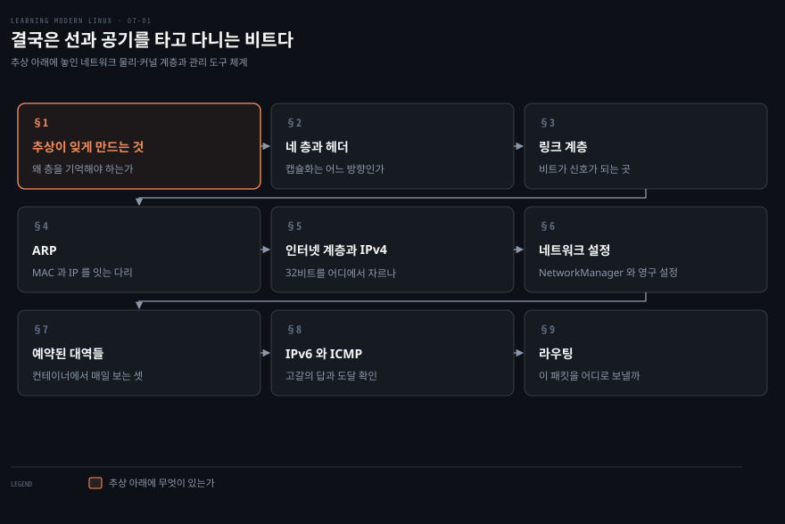
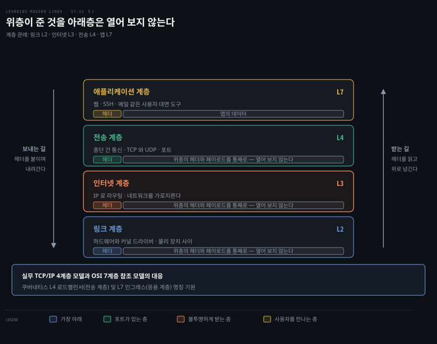
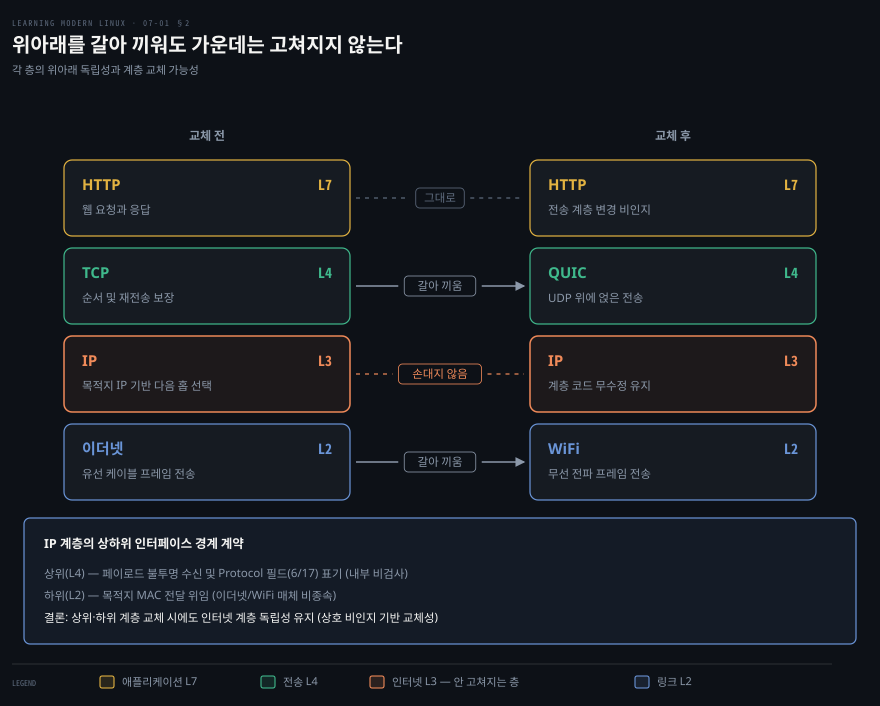
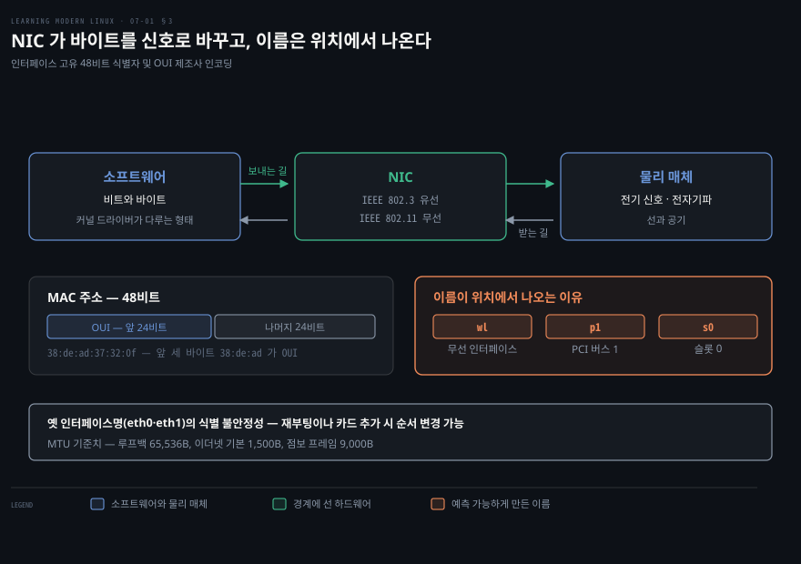
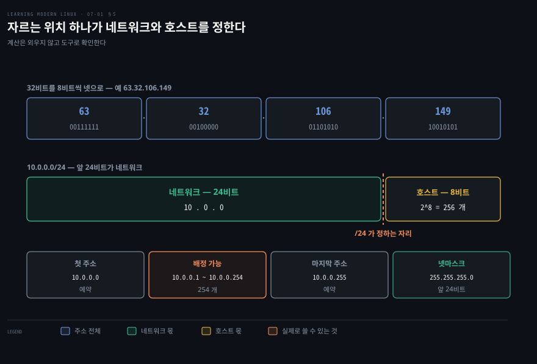
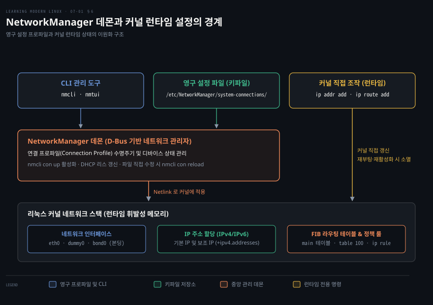
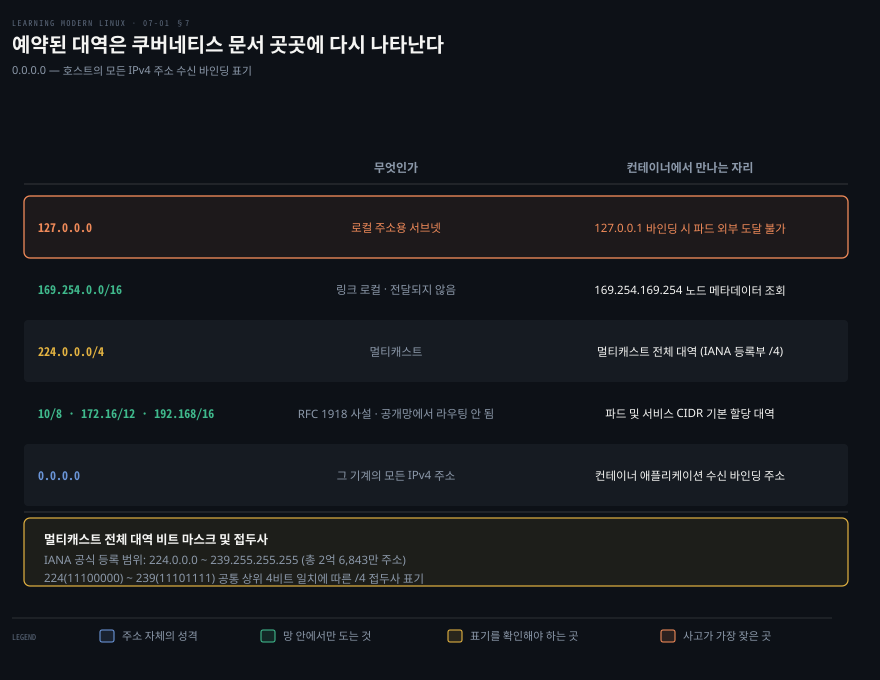
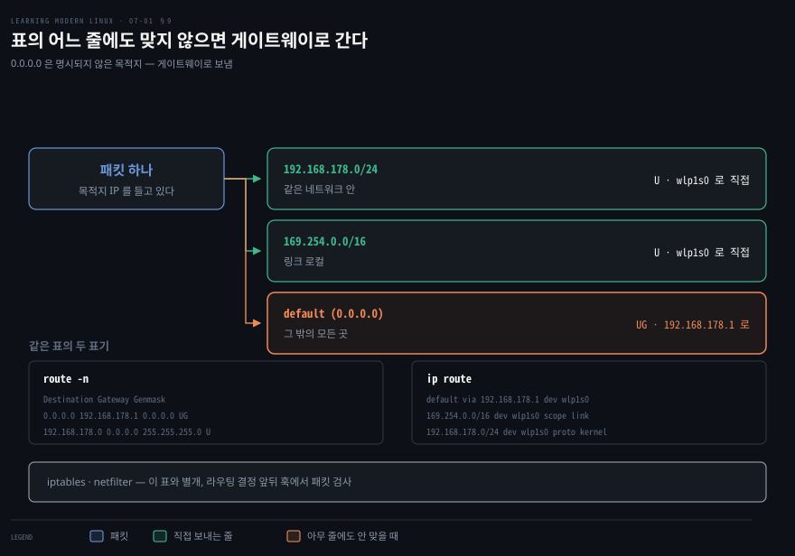
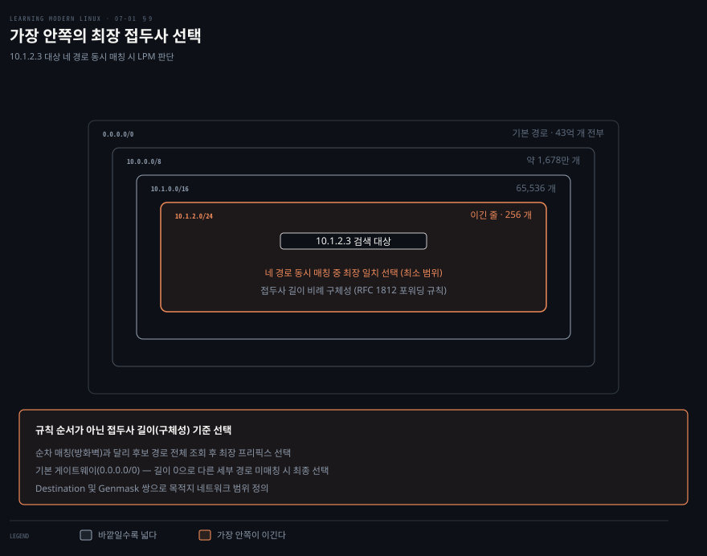

# 결국은 선과 공기를 타고 다니는 비트다

---

> 7장은 스택의 아래 두 층인 링크 계층과 인터넷 계층을 다룹니다. [쿠버네티스 네트워크 학습 로드맵](../../../landscape/network-keywords.md)이 0단계로 지정한 구간입니다.

물리 매체의 전기·전자기 신호부터 IP 라우팅, 커널 런타임 설정과 NetworkManager 영구 설정까지를 한 흐름으로 연결합니다.


## 핵심 요약

> 원격 자원을 로컬처럼 보이게 하는 추상은 유용하지만, 결국 모든 통신은 선을 타고 공기를 가르는 비트로 귀결됩니다.

네트워크 스택은 네 층으로 나뉘며 각 층은 바로 위와 바로 아래 층만 압니다. 데이터는 헤더로 감싸는 캡슐화를 거쳐 전달됩니다. 층이 서로 독립적이라 위아래 프로토콜을 유연하게 교체할 수 있습니다. 반면 층을 나누면 헤더 오버헤드, 장애 진단 복잡성, 계층별 캐시 불일치라는 세 가지 대가를 치릅니다.

- **링크 계층**은 하드웨어와 커널 드라이버를 다루며 물리 장치 사이의 프레임 전달에 집중합니다.
- **인터넷 계층**은 IP 주소와 라우팅을 다루며 호스트 사이에 패킷을 전달합니다.
- **전송 계층**은 호스트 사이의 종단 간 통신(TCP·UDP)을 제어합니다.
- **애플리케이션 계층**은 HTTP, SSH 같은 사용자 대면 서비스와 프로토콜을 처리합니다.

현대 리눅스 환경에서는 `iproute2`와 `NetworkManager`가 표준 관리 도구로 자리 잡았습니다. 커널 메모리만 바꾸는 런타임 명령(`ip`)과 프로파일 파일에 저장하는 영구 설정(`nmcli`)은 재부팅 뒤 남느냐로 갈립니다.


## 학습 목표

> 이 구간을 읽고 나면 아래 열세 가지를 스스로 해낼 수 있습니다.

1. TCP/IP 네 층과 캡슐화 방향 및 계층 독립성의 트레이드오프를 설명할 수 있습니다.
2. `ip link` 출력에서 MAC 주소, MTU, 예측 가능한 인터페이스 명명 규칙을 판독할 수 있습니다.
3. ARP 가 링크 계층과 인터넷 계층을 잇는 방식과 캐시 동작을 설명할 수 있습니다.
4. CIDR 표기에서 네트워크와 호스트 부분을 분리해 가용 주소 수를 계산할 수 있습니다.
5. 커널 런타임 설정(`ip`)과 영구 설정(`nmcli`)의 차이 및 덮어쓰기 위험을 설명할 수 있습니다.
6. RHEL 8 과 9 에서 NetworkManager 가 새 프로파일을 적는 형식(ifcfg·키파일)과 위치가 어떻게 바뀌었는지 비교할 수 있습니다.
7. `nmcli` 로 고정 IP, 보조 IP, MTU, 키파일 리로드, 본딩 인터페이스를 구성할 수 있습니다.
8. 복수 NIC 환경에서 단일 기본 게이트웨이 원칙과 출발지 기반 정책 라우팅(PBR)을 설명할 수 있습니다.
9. 예약된 IPv4 대역(사설·루프백·링크 로컬·`0.0.0.0`)의 용도와 컨테이너 바인딩 주의점을 구분할 수 있습니다.
10. 최장 접두사 일치(LPM) 알고리즘이 규칙 순서가 아닌 접두사 길이로 경로를 고르는 방식을 설명할 수 있습니다.
11. 브로드캐스트와 멀티캐스트의 차이를 수신자 선택권 관점에서 비교할 수 있습니다.
12. IP 헤더 체크섬 계산 3단계와 검산 원리, 라우터의 증분 갱신 메커니즘을 설명할 수 있습니다.
13. IPv6 에서 헤더 체크섬이 생략된 이유와 상위 계층(UDP·ICMPv6) 체크섬 강제 관계를 설명할 수 있습니다.

아래 지도는 이 문서의 9개 절을 읽는 순서로 이은 전체 흐름도입니다.




## 이 문서가 다루지 않는 것

> 7장은 범위가 넓어 노트를 셋으로 나눴으며, 물리 인프라와 상위 계층은 범위를 명확히 가릅니다.

- 전송 계층과 DNS → [둘째 노트](./07-02.%ED%8F%AC%ED%8A%B8%EA%B0%80%20%EC%9E%88%EC%96%B4%EC%95%BC%20%EC%84%9C%EB%B9%84%EC%8A%A4%EB%A5%BC%20%EA%B0%80%EB%A6%AC%ED%82%AC%20%EC%88%98%20%EC%9E%88%EA%B3%A0%20%EC%9D%B4%EB%A6%84%EC%9D%B4%20%EC%9E%88%EC%96%B4%EC%95%BC%20%EC%82%AC%EB%9E%8C%EC%9D%B4%20%EA%B8%B0%EC%96%B5%ED%95%9C%EB%8B%A4.md)에서 다룹니다.
- 애플리케이션 계층과 고급 전송 도구 → [셋째 노트](./07-03.%EC%A3%BC%EA%B3%A0%EB%B0%9B%EB%8A%94%20%EC%9D%BC%EC%9D%80%20%EA%B2%B0%EA%B5%AD%20%EB%AA%87%20%EA%B0%9C%EC%9D%98%20%EB%AA%85%EB%A0%B9%EC%9C%BC%EB%A1%9C%20%EC%A4%84%EC%96%B4%EB%93%A0%EB%8B%A4.md)에서 다룹니다.
- 물리 스위치 및 라우터 하드웨어 구성 → 호스트 운영체제 밖 인프라 주제이므로 다루지 않습니다.
- 동적 라우팅 프로토콜 세부 구현 → 개요만 전달하고 BGP 엔진 구축은 다루지 않습니다.
- 성능 계측과 상세 트러블슈팅 → 8장 관측의 모니터링 절로 위임합니다.


## 1. 추상이 편한 만큼 잊게 만드는 것

> 네트워크 추상은 문제를 소프트웨어와 하드웨어 계층으로 나누어 가려내는 작업을 어렵게 만듭니다.

원격 자원에 접근하는 도구 상당수는 로컬 인터페이스와 비슷하게 쓰입니다. 파일 시스템 마운트나 원격 프로시저 호출을 쓰면 로컬 디스크나 메모리에 접근하는 듯한 착각이 듭니다.

추상은 개발을 한결 편하게 해 줍니다. 그래도 통신의 실체는 물리 케이블의 전기 펄스와 공기 중 전자기파를 타고 이동하는 비트의 흐름입니다. 이 물리적 한계를 잊으면 타임아웃, 대역폭 한계, 단편화 문제를 만났을 때 근본 원인을 짚기 어렵습니다.

리눅스 네트워킹은 세 영역으로 나뉩니다. 이더넷이나 무선 카드 같은 **네트워킹 하드웨어**가 최하단에 있습니다. 그 위에 TCP/IP 스택을 제어하는 **커널 수준 구성요소**가 있습니다. 사용자 공간에는 네트워크를 진단하고 설정하는 **도구들**이 놓입니다.

### RFC 명세를 먼저 확인하는 습관

리눅스의 다른 영역에서는 설계 가정을 알려면 소스 코드를 뒤지거나 문서가 잘 남아 있기를 바라야 합니다. 네트워킹은 다릅니다. 거의 모든 프로토콜과 인터페이스가 IETF 가 무료로 공개하는 명세(RFC)를 바탕으로 합니다. 그래서 구현 세부로 들어가기 전에 해당 RFC 를 먼저 읽는 편이 빠릅니다. 실무자가 실무자를 위해 쓴 문서라 동기와 쓰임새, 왜 그렇게 정했는지가 거기 적혀 있습니다. 이 노트의 헤더 체크섬·예약 대역·최장 일치 설명도 각주의 RFC 와 IANA 등록부를 근거로 삼았습니다.


## 2. 네 층과, 층마다 붙는 헤더

> 계층 분리의 목적은 각 층이 바로 위와 아래 계층과의 인터페이스 계약만 유지하게 만드는 데 있습니다.



TCP/IP 스택은 계층형 모델을 따릅니다. 보낼 데이터는 패킷으로 캡슐화됩니다. 송신 경로에서는 상위 계층이 하위 계층으로 데이터를 넘길 때마다 각 층의 제어 정보를 담은 헤더가 앞에 덧붙습니다. 수신 경로에서는 하위 계층부터 차례로 헤더를 해석해 벗겨 내고 상위 계층에 페이로드를 넘깁니다.

어떤 층의 헤더와 페이로드가 합쳐져 다음 층의 페이로드가 됩니다. 인터넷 계층의 페이로드는 전송 계층 헤더와 그 페이로드입니다. 그래서 인터넷 계층이 보기에 전송 계층 패킷은 내용물을 들여다볼 필요가 없는 불투명한 바이트 블록입니다. 인터넷 계층은 목적지 IP 주소와 라우팅 규칙만 봅니다. 데이터 무결성이나 전송 순서 보장은 전송 계층 몫으로 남깁니다.

| 층 | 주요 역할 | 프로토콜 예시 |
|---|---|---|
| 링크 계층 | 물리 매체(이더넷·WiFi)와 커널 드라이버를 잇고 노드 간 프레임을 전달합니다 | Ethernet, ARP, 802.11 |
| 인터넷 계층 | IP 주소를 기반으로 네트워크를 가로질러 종단 기계 간 패킷을 라우팅합니다 | IPv4, IPv6, ICMP |
| 전송 계층 | 호스트 내부 프로세스 간 종단 통신을 연결하고 신뢰성을 제어합니다 | TCP, UDP |
| 애플리케이션 계층 | 최종 사용자와 직접 상호작용하는 프로토콜과 서비스를 처리합니다 | HTTP, SSH, DNS |

### 층 번호의 역사적 관례

실무에서 자주 쓰는 L4 로드밸런서나 L7 인그레스라는 이름은 OSI 7계층 참조 모델의 번호 관례에서 왔습니다. 물리 하드웨어를 1계층으로 보아 링크 계층을 2, 인터넷 계층을 3, 전송 계층을 4, 응용 계층을 7로 부릅니다. 패킷의 포트 번호까지만 확인해 전달하면 4계층 처리입니다. HTTP 경로와 헤더까지 파싱해 분기하면 7계층 처리가 됩니다.

### 계층 간 상호 독립성과 교체 가능성

계층 사이가 서로 불투명하기 때문에 각 층의 프로토콜을 독립적으로 교체할 수 있습니다.



인터넷 계층이 위층에 대해 아는 것은 "덩어리가 내려온다" 하나입니다. 아래층에 대해 아는 것도 "이 MAC 으로 보내 달라" 하나뿐입니다. IP 헤더의 `Protocol` 필드에 6(TCP)이나 17(UDP)을 적어 두기는 합니다. 그 값은 받는 쪽이 페이로드를 어느 위층에 넘길지 고를 때 씁니다. 라우터는 목적지 주소만 보고 다음 홉을 정합니다.

그래서 전송 계층을 TCP 에서 QUIC(UDP 기반)으로 교체해도 인터넷 계층 코드는 그대로입니다. 하위 링크를 이더넷에서 WiFi 로 바꿔도 마찬가지입니다. 서로를 모르는 것이 곧 교체 가능성입니다.

이 성질을 일부러 어기는 코드도 있습니다. 방화벽은 IP 처리 경로에 훅으로 끼어들어 그 위의 TCP 헤더를 열고 포트를 읽습니다. 흔히 쓰는 NAT 도 주소만이 아니라 포트까지 고쳐 씁니다. RFC 3022 는 이것을 NAPT 라는 이름으로 따로 정의합니다.[^napt] 층을 가로질러 보는 이런 예외를 계층 위반이라고 부릅니다.

규칙을 어기는 주체는 인터넷 계층 자신이 아니라 그 경로에 붙은 다른 코드입니다. 방화벽 규칙을 전부 비워도 라우팅은 그대로 돌아간다는 사실로 가를 수 있습니다. 리눅스에서 그 코드가 Netfilter 프레임워크입니다.

### 계층 분리의 세 가지 대가

계층화로 유지보수성과 교체성을 얻는 대신 세 가지 비용을 치릅니다.

1. **헤더 오버헤드**: 계층을 거칠 때마다 헤더가 중첩되어 유효 대역폭이 감소합니다.
2. **장애 진단 복잡성**: 통신 장애 시 원인이 링크(L2), 네트워크(L3), 전송(L4), 응용(L7) 중 어느 층에 있는지 단계별로 격리해야 합니다.
3. **계층별 캐시 불일치**: 성능 향상을 위해 각 층이 독자 캐시를 유지하므로, 하위 상태가 바뀌어도 상위 캐시가 갱신되지 않으면 장애가 발생합니다.

| 계층 캐시 | 보관 데이터 | 캐시 불일치 시 증상 |
|---|---|---|
| DNS TTL | 도메인 이름 → IP 주소 | 서버 IP 변경 후에도 클라이언트가 구 IP 로 접속합니다 |
| ARP 캐시 | IP 주소 → MAC 주소 | 네트워크 장비 교체 후에도 옛 MAC 으로 프레임을 보냅니다 |
| NFS 속성 캐시 | 파일 경로 → 크기·수정 시각 | 서버에서 변경된 파일 크기가 클라이언트에 즉시 보이지 않습니다 |

진단 복잡성 때문에 7장 세 노트는 층마다 다른 도구를 씁니다. `ip link` 로 링크를, `ping` 으로 인터넷을, `ss` 로 전송을, `curl` 로 애플리케이션을 짚어 "안 된다"는 증상 하나의 후보 넷을 좁힙니다.

캐시 셋은 이 시리즈에 흩어져 있습니다. ARP 캐시는 [4절](#4-arp--두-층을-잇는-다리)이, DNS TTL 은 둘째 노트가, NFS 속성 캐시는 셋째 노트가 다룹니다. 따로 배운 것처럼 보여도 같은 대가를 각 층에서 치르는 모습입니다. 그래서 "어제까지 되던 게 오늘 안 된다"는 신고를 받으면 캐시부터 의심합니다. 아래는 바뀌었는데 위가 아직 옛 답을 들고 있는 경우가 흔합니다.


## 3. 링크 계층 — 비트가 신호가 되는 곳

> 링크 계층은 소프트웨어 바이트와 하드웨어 전기 신호가 상호 변환되는 경계입니다.



NIC(Network Interface Controller)는 기계를 물리 매체에 연결해 주는 핵심 하드웨어입니다. 송신할 때는 디지털 바이트를 전선의 전기 펄스나 전자기 신호로 변환합니다. 수신할 때는 감지한 물리 신호를 커널이 다룰 수 있는 프레임 데이터로 복원합니다.

이 층에서 만나는 용어는 넷입니다. **이더넷**은 전선으로 기계를 잇는 기술 계열이며 주로 LAN 에서 씁니다. **무선**(WiFi)은 전선 대신 전자기파로 데이터를 나르는 프로토콜 부류입니다. **인터페이스**는 네트워크 연결 하나입니다. 물리 NIC 일 수도 있고 루프백 `lo` 같은 가상 장치일 수도 있습니다.

**MAC 주소**는 네트워크 인터페이스를 식별하는 고유한 48비트 하드웨어 주소입니다. 기계가 아니라 인터페이스에 붙으므로 NIC 가 둘인 서버는 MAC 도 둘입니다. 앞 24비트는 IEEE 가 제조사에 배정하는 OUI(Organizationally Unique Identifier)입니다. 뒤 24비트는 제조사가 자기 장비에 붙이는 번호입니다.

### 옛 도구와 새 도구

인터페이스를 보는 옛 도구는 `net-tools` 패키지의 `ifconfig` 입니다. 지금은 `iproute2` 패키지의 `ip` 를 씁니다. `ifconfig` 도 같은 정보를 보이지만 `ip` 는 가상 링크 유형까지 한 명령 체계로 다루므로 이 장에서도 `ip` 를 주로 씁니다.

```bash
ip link show
```

```bash
1: lo: <LOOPBACK,UP,LOWER_UP> mtu 65536 qdisc noqueue state UNKNOWN mode DEFAULT
    link/loopback 00:00:00:00:00:00 brd 00:00:00:00:00:00
2: wlp1s0: <BROADCAST,MULTICAST,UP,LOWER_UP> mtu 1500 qdisc noqueue state UP
    link/ether 38:de:ad:37:32:0f brd ff:ff:ff:ff:ff:ff
```

현대 리눅스의 인터페이스 이름(`wlp1s0`)은 예측 가능한 명명 규칙을 따릅니다. 무선 인터페이스(`wl`), PCI 버스 1(`p1`), 슬롯 0(`s0`)처럼 물리 위치에서 이름을 만듭니다. 옛 방식의 `eth0`·`eth1` 은 재부팅하거나 카드를 새로 꽂으면 이름이 뒤바뀌지 않는다는 보장이 없었습니다. `LOWER_UP`·`MULTICAST` 같은 플래그의 뜻은 `netdevice(7)` man 페이지가 설명합니다.

MTU(Maximum Transmission Unit)는 한 프레임에 담을 수 있는 최대 바이트 크기입니다. 클수록 한 번에 나르는 양이 많아 처리량이 높습니다. 위 출력에서 루프백은 65,536바이트이고 무선 인터페이스는 1,500바이트입니다. 이더넷 기본값 1,500바이트는 역사적 이유로 굳은 값입니다. 9,000바이트 점보 프레임을 쓰는 망도 있습니다.

### 무선 장치 진단 도구

무선 인터페이스는 신호 세기와 주파수 대역을 확인해야 하므로 `iw` 도구를 씁니다.

```bash
iw dev wlp1s0 link
```

```bash
Connected to 74:42:7f:67:ca:b5 (on wlp1s0)
        SSID: FRITZ!Box 7530 QJ
        freq: 2432
        RX: 28003606 bytes (45821 packets)
        TX: 4993401 bytes (15605 packets)
        signal: -67 dBm
        tx bitrate: 65.0 MBit/s MCS 6 short GI
```

`TX`(Transmit)는 호스트가 보낸 양이고 `RX`(Receive)는 받은 양입니다. 이 약어가 장 내내 반복되므로 여기서 익혀 두면 편합니다. 같은 인터페이스의 채널·송신 출력 같은 속성은 `iw dev wlp1s0 info` 가 보입니다.


## 4. ARP — 두 층을 잇는 다리

> 링크 계층은 MAC 주소로 통신하고 인터넷 계층은 IP 주소로 통신하므로, 두 주소를 매핑하는 다리가 필요합니다.

ARP(Address Resolution Protocol, RFC 826)는 목적지 IP 에 대응하는 하드웨어 MAC 을 조회합니다. 같은 네트워크 안에서 대상 IP 의 MAC 주소를 묻는 ARP 요청을 브로드캐스트로 보냅니다. 그 IP 를 가진 노드가 자기 MAC 주소를 유니캐스트로 응답합니다.

```bash
arp
```

```bash
Address              HWtype  HWaddress           Flags Mask
mh9-imac.fritz.box   ether   00:25:4b:9b:64:49   C
fritz.box            ether   3c:a6:2f:8e:66:b3   C
```

옛 도구 `arp` 는 MAC 주소를 호스트명에 대응시킨 캐시를 보입니다. `arp -n` 을 쓰면 이름 해석을 건너뛰고 IP 주소로 보입니다. 같은 캐시를 지금은 `ip neigh` 로 봅니다.

```bash
ip neigh
```

```bash
192.168.178.34 dev wlp1s0 lladdr 00:25:4b:9b:64:49 STALE
192.168.178.1 dev wlp1s0 lladdr 3c:a6:2f:8e:66:b3 REACHABLE
```

ARP 캐시는 커널의 이웃 테이블(Neighbor Table)에 들어 있습니다. 캐시 상태가 `REACHABLE` 이면 최근에 유효성을 검증한 상태입니다. `STALE` 이면 통신한 지 시간이 지나 검증해야 하는 상태입니다. 이 캐시는 프로세스별이 아니라 [06-02 컨테이너](./06-02.컨테이너의%20새로움은%20재료가%20아니라%20조합에%20있다.md#2-네임스페이스--무엇이-보이는가)에서 다룬 네트워크 네임스페이스 단위로 격리됩니다. 그래서 같은 파드 안의 컨테이너들은 ARP 캐시를 공유합니다.


## 5. 인터넷 계층과 IP 주소 체계

> 인터넷 계층은 비신뢰 네트워크 위에서 최선 노력 전달(Best-Effort Delivery)을 제공하며 패킷을 독립적으로 처리합니다.



인터넷 계층은 두 가지를 전제합니다. 네트워크 인프라는 패킷을 잃거나 순서를 바꿀 수 있습니다. 참여하는 기계는 자주 바뀝니다. 그래서 모든 패킷을 독립적으로 다루고 성능을 보장하지 않습니다.

순서·재시도·전달 보장은 상위 전송 계층(TCP)이 맡습니다. 인터넷 계층은 목적지 IP 주소를 보고 다음 경로를 고르는 라우팅에 전념합니다.

IP 주소는 우편 주소와 닮았습니다. 나라처럼 거친 단위부터 번지수까지 여러 부분으로 이루어집니다. 보내는 사람은 배를 타는지 비행기를 타는지 몰라도 됩니다. 올바른 주소만 적으면 배달은 우체국이 책임진다는 단순한 계약 덕분에 경로를 몰라도 됩니다.

### IPv4 헤더 주요 필드

IPv4 주소는 32비트 숫자입니다. 8비트 조각(옥텟) 4개로 나누어 점으로 구분한 10진수로 표기합니다. 각 옥텟은 0~255 입니다. 예컨대 `63.32.106.149` 의 첫 옥텟 63 은 이진수로 `00111111` 입니다. RFC 791 이 정의한 20바이트 기본 헤더 필드 가운데 핵심 항목은 다음과 같습니다.

| 필드 | 크기 | 역할 |
|---|:--:|---|
| Source Address | 32비트 | 송신 호스트의 IPv4 주소 |
| Destination Address | 32비트 | 수신 목적지 호스트의 IPv4 주소 |
| Protocol | 8비트 | 상위 페이로드 종류 (1 ICMP, 6 TCP, 17 UDP) |
| Time to live (TTL) | 8비트 | 패킷 루핑을 방지하기 위한 최대 홉 수 (라우터 통과 시 1씩 감소) |
| Type of Service (ToS) | 8비트 | 서비스 품질(QoS) 및 우선순위 지정 필드 |
| Header Checksum | 16비트 | 헤더 데이터 무결성 검증용 체크섬 |

### CIDR 표기와 호스트 범위 계산

IP 주소는 네트워크 식별부와 호스트 식별부로 나뉩니다. CIDR(Classless Inter-Domain Routing, RFC 4632)은 주소 뒤에 빗금과 네트워크 비트 수를 붙여 범위를 지정합니다(`/24`).

`10.0.0.0/24` 표기에서 상위 24비트(`255.255.255.0`)는 네트워크 영역이고 하위 8비트가 호스트 영역입니다. 호스트 비트가 8개이므로 주소는 256개가 나옵니다. 첫 주소(`10.0.0.0`)는 네트워크 주소이고 마지막 주소(`10.0.0.255`)는 브로드캐스트 주소라 둘 다 예약되어 있습니다. 그래서 실제 기기에 할당할 수 있는 호스트는 254개입니다.

넷마스크 `255.255.255.0` 과 접두사 `/24` 는 같은 경계를 적는 두 표기입니다. 이 계산을 다 외울 필요는 없습니다. 매일 CIDR 을 다루면 저절로 익습니다. 가끔 쓴다면 도구로 확인하면 됩니다.

```bash
ip addr show
```

```bash
1: lo: <LOOPBACK,UP,LOWER_UP> mtu 65536 qdisc noqueue state UNKNOWN
    inet 127.0.0.1/8 scope host lo
    inet6 ::1/128 scope host
2: wlp1s0: <BROADCAST,MULTICAST,UP,LOWER_UP> mtu 1500 qdisc noqueue state UP
    inet 192.168.178.40/24 brd 192.168.178.255 scope global dynamic wlp1s0
    inet6 fe80::be87:e600:7de7:e08f/64 scope link
```

`ip link` 가 링크 계층을 보였다면 `ip addr` 은 인터넷 계층을 보입니다. 같은 인터페이스에 MAC 주소와 IP 주소가 각각 붙어 있습니다. 두 층은 그렇게 한 장치에서 만납니다.

### 헤더 체크섬 계산 절차

IP 헤더 체크섬은 RFC 1071 의 16비트 1의 보수 합(Ones' Complement Sum)으로 만듭니다.

1. 헤더 20바이트를 16비트 단위 10개 워드로 나눕니다. 체크섬 필드 자체는 값이 아직 없으니 `0x0000` 으로 둡니다.
2. 10개 워드를 전부 더합니다. 16비트를 넘쳐 생긴 자리올림(Carry)은 버리지 않고 하위 16비트에 다시 더합니다(자리올림 되접기).
3. 합의 모든 비트를 뒤집어(1의 보수, `0xFFFF` 에서 빼기) 체크섬 필드에 적습니다.

ping 한 발의 IPv4 헤더로 직접 세어 봅니다.

```bash
# ping 한 발의 IPv4 헤더 20바이트. 체크섬 칸(여섯째 워드)은 0 으로 두었다
# 45 00 = 버전4·헤더20바이트·TOS   00 54 = 전체 길이 84   5A F1 = 식별자
# 40 00 = 플래그 DF               40 01 = TTL 64·프로토콜 1(ICMP)
4500  0054  5AF1  4000  4001  0000  C0A8  000A  0101  0101

# 열 워드를 전부 더하면 16비트를 넘는다
4500 + 0054 + 5AF1 + 4000 + 4001 + 0000 + C0A8 + 000A + 0101 + 0101 = 1E2FA
# 넘친 자리(1)를 아래로 되접어 더한다
E2FA + 1 = E2FB
# 뒤집는다
FFFF - E2FB = 1D04      ← 헤더에 넣을 체크섬
```

받는 쪽 검산은 더 단순합니다. 체크섬까지 포함해 열 워드를 같은 방식으로 더해 `0xFFFF` 가 나오면 통과입니다. 위 예에서는 `E2FB + 1D04 = FFFF` 입니다. 어떤 수 $S$ 와 그 반전 $\sim S$ 는 자리마다 0 과 1 이 하나씩이라 더하면 모든 비트가 1 이 되기 때문입니다.

### 증분 갱신을 통한 체크섬 재계산 생략

패킷이 라우터를 거칠 때마다 TTL 이 1씩 줄고 헤더가 바뀌므로 체크섬도 매 홉 맞춰야 합니다. 홉마다 20바이트를 처음부터 다시 세면 비쌉니다.

RFC 1624 는 TTL 갱신처럼 IP 패킷에 일상적으로 하는 연산을 위해 바뀐 차이만 옛 체크섬에 반영하는 증분 갱신(Incremental Update)을 정의합니다.[^rfc1624] 위 예에서 TTL 만 64 에서 63 으로 줄여 봅니다.

```bash
# TTL 은 다섯째 워드의 위쪽 바이트라, 1 줄면 4001 → 3F01 로 0x0100 줄어든다
4500 + 0054 + 5AF1 + 4000 + 3F01 + 0000 + C0A8 + 000A + 0101 + 0101 = 1E1FA
E1FA + 1 = E1FB
FFFF - E1FB = 1E04      ← 처음부터 다시 센 결과

# 증분 갱신은 20바이트를 보지 않고 옛 체크섬에 더하기만 한다
1D04 + 0100 = 1E04      ← 같다
```

합은 `0x0100` 줄었는데 체크섬은 `0x0100` 늘었습니다. 체크섬이 합을 뒤집은 값이라 합이 작아지면 그만큼 커지기 때문입니다. 위 산술은 파이썬 한 줄로 다시 잴 수 있습니다.

```bash
python3 -c "w=[0x4500,0x0054,0x5AF1,0x4000,0x4001,0,0xC0A8,0x000A,0x0101,0x0101]; s=sum(w); s=(s&0xFFFF)+(s>>16); print(hex(~s & 0xFFFF))"
# 0x1d04
```


## 6. 리눅스 네트워크 설정과 NetworkManager

> 커널 메모리에만 머무는 런타임 설정과 디스크에 기록되는 영구 설정의 경계를 이해해야 안정적인 서버 네트워크를 구성할 수 있습니다.



### 배포판 변천과 네트워크 관리 스택

서버를 재부팅해도 설정이 남으려면 누군가 디스크에 적어 두고 부팅 때 다시 걸어야 합니다. RHEL 계열에서 그 일을 맡은 주체와 파일 형식이 판마다 달라졌습니다.

| 구분 | RHEL 8 까지 | RHEL 9.0 부터 |
|---|---|---|
| 새 프로파일을 적는 곳 | `/etc/sysconfig/network-scripts/` 의 `ifcfg` 형식 | `/etc/NetworkManager/system-connections/` 의 키파일 형식 |
| 이미 있던 `ifcfg` 프로파일 | (해당 없음) | 그대로 동작하고, 수정해도 옛 파일이 갱신됩니다 |
| 옛 `network-scripts` 패키지 | RHEL 8 에서 deprecated | 들어 있지 않습니다. NetworkManager 를 씁니다 |

판이 바뀌어도 기존 `ifcfg` 파일이 갑자기 무시되지는 않습니다. 새로 만드는 프로파일만 키파일로 적힙니다.[^rhel9] 키파일은 `.ini` 형식이라 사람이 읽고 고칠 수 있습니다.[^nmkeyfile]

### 커널 런타임 설정과 영구 설정의 경계

`ip addr add` 나 `ip route add` 명령은 커널 메모리 안의 네트워크 서브시스템을 곧바로 바꿉니다. 디스크 설정 파일에는 기록되지 않으므로 인터페이스를 재시작하거나 시스템을 재부팅하면 바로 사라집니다.

NetworkManager 가 관리하는 인터페이스를 `ip` 명령으로 바꾸면 그 변경은 프로파일에 없습니다. `nmcli con down`·`up` 으로 프로파일을 다시 활성화하면 커널 상태가 프로파일 값으로 다시 맞춰지므로 `ip` 로 넣은 주소나 경로가 사라질 수 있습니다. 그래서 임시 진단이나 CNI 플러그인의 동적 할당이 아닌 관리자 설정은 NetworkManager 프로파일에 둡니다.

### nmcli 기반 인터페이스와 IP 주소 관리

`nmcli` 는 물리 장치(`device`)와 설정 프로파일(`connection`)을 나눠 다룹니다.

```bash
# 1. 물리 하드웨어 상태 및 저장된 연결 프로파일 확인
nmcli device status
nmcli connection show

# 2. 신규 이더넷 연결 프로파일 생성
nmcli con add type ethernet con-name eth0-static ifname eth0

# 3. 고정 IPv4 주소, 게이트웨이, DNS 영구 구성
nmcli con mod eth0-static ipv4.method manual ipv4.addresses 192.168.1.100/24 \
    ipv4.gateway 192.168.1.1 ipv4.dns "8.8.8.8 8.8.4.4" ipv4.dns-search "example.com"

# 4. 단일 NIC 에 보조 IP 추가 (+ 접두사로 배열 추가)
nmcli con mod eth0-static +ipv4.addresses 192.168.1.101/24

# 5. 경로 MTU 가 1,500 보다 작은 망(터널·오버레이)에 맞춰 MTU 를 낮춘다
nmcli con mod eth0-static 802-3-ethernet.mtu 1400

# 6. 프로파일 활성화 (커널 스택에 즉시 적용)
nmcli con up eth0-static
```

키파일(`/etc/NetworkManager/system-connections/<프로파일>.nmconnection`)을 손으로 고치면 NetworkManager 는 그 사실을 모릅니다. 데몬이 연결 파일의 변경을 감시하지 않기 때문입니다. 그래서 `nmcli connection reload` 로 디스크의 파일을 다시 읽힌 뒤 `nmcli con up` 으로 커널에 적용합니다.[^nmreload]

### 본딩을 통한 인터페이스 결합과 고가용성

NIC 여러 개를 결합해 링크 장애 극복(Failover)이나 대역폭 확장을 꾀할 때는 본딩(Bonding) 인터페이스를 구성합니다.

```bash
# 본딩 마스터 인터페이스 생성 (active-backup 모드, 100ms 감시 주기)
nmcli con add type bond con-name bond0 ifname bond0 bond.options "mode=active-backup,miimon=100"
nmcli con mod bond0 ipv4.method manual ipv4.addresses 192.168.10.50/24 ipv4.gateway 192.168.10.1

# 본딩 포트 연결. NetworkManager 1.46 부터 정식 이름은 controller 이고 master 는 별칭으로 남았다
nmcli con add type ethernet con-name bond0-port1 ifname eth1 master bond0
nmcli con add type ethernet con-name bond0-port2 ifname eth2 master bond0
nmcli con up bond0
```

커널 본딩 상태는 `/proc/net/bonding/bond0` 파일에서 확인할 수 있습니다. 커널 드라이버가 현재 활성 슬레이브(Currently Active Slave), MII 링크 상태, 포트별 장애 복구 이력을 이 파일에 드러냅니다.

### 복수 NIC 환경의 라우팅과 정책 라우팅

물리 NIC 가 둘 이상 연결된 서버에서 가장 흔한 장애 원인은 **기본 게이트웨이 충돌**입니다. 리눅스 커널의 기본 경로(`0.0.0.0/0`)는 단 하나만 활성 상태여야 합니다. 양쪽 인터페이스에 모두 기본 게이트웨이를 두면 메트릭 경쟁에서 한쪽만 선택됩니다. 다른 NIC 로 들어온 외부 요청의 응답이 엉뚱한 게이트웨이로 빠져나가는 비대칭 라우팅(Asymmetric Routing) 문제가 생깁니다.

이 문제를 푸는 원칙은 세 가지입니다.

1. **단일 기본 게이트웨이 유지**: 외부 인터넷 통신을 담당하는 주 인터페이스 하나에만 기본 게이트웨이를 둡니다.
2. **보조 인터페이스의 기본 경로 차단**: 보조 프로파일에 `ipv4.never-default yes` 를 지정합니다. 필요한 내부 대역만 정적 경로(`+ipv4.routes "10.50.0.0/16 192.168.20.1"`)로 등록합니다.
3. **출발지 기반 정책 라우팅(PBR) 적용**: 양쪽 NIC 가 모두 외부 트래픽을 처리해야 한다면 출발지 IP 에 따라 전용 라우팅 테이블을 조회하도록 정책 라우팅을 구성합니다.

```bash
# NetworkManager 영구 정책 라우팅 설정 (보조 NIC eth1 전용 table 100 분리)
nmcli con mod eth1 ipv4.routes "0.0.0.0/0 192.168.20.1 table=100"
nmcli con mod eth1 +ipv4.routing-rules "priority 1000 from 192.168.20.10 table 100"
nmcli con up eth1

```

NetworkManager 를 쓰지 않는 기계에서 같은 상태를 런타임으로 만들면 다음 두 줄입니다.

```bash
ip route add default via 192.168.20.1 dev eth1 table 100
ip rule add priority 1000 from 192.168.20.10 table 100
ip rule show
ip route show table 100
```

```bash
0:	from all lookup local
1000:	from 192.168.20.10 lookup 100
32766:	from all lookup main
32767:	from all lookup default
default via 192.168.20.1 dev eth1
```

위 출력은 debian:12 컨테이너(iproute2 6.1.0)에 가짜 장치 `eth1` 을 만들어 잰 것입니다. 규칙은 번호가 작은 것부터 검사합니다. 그래서 출발지가 `192.168.20.10` 인 패킷은 32766 번의 `main` 보다 먼저 1000 번 규칙에 걸려 `table 100` 을 봅니다. 목적지만 보던 라우팅이 출발지까지 보게 됩니다. 그 덕에 들어온 NIC 로 응답이 나갑니다.[^iprule]

NetworkManager 의 `routing-rules` 는 이 우선순위 번호를 반드시 고정값으로 적어야 합니다. 테이블은 이름이 아니라 번호로만 받습니다.


## 7. 예약된 대역들

> 모든 IP 주소가 공용 인터넷에서 라우팅 가능한 것은 아닙니다. 특수 목적 대역의 성격을 알아야 설정 오류를 방지할 수 있습니다.



| 대역 | 성격 및 RFC 표준 | 실무 활용 및 컨테이너 환경 주의점 |
|---|---|---|
| `127.0.0.0/8` | 루프백(Loopback) 대역. `127.0.0.1` 이 대표적입니다 | 로컬 네임스페이스 통신 전용. 컨테이너 내부 앱이 루프백에 바인딩하면 파드 외부에서 도달할 수 없습니다 |
| `169.254.0.0/16` | 링크 로컬(Link-Local, RFC 3927) 주소 | 라우터를 넘어 전달되지 않습니다. 클라우드 노드 메타데이터 조회(`169.254.169.254`)에 쓰입니다 |
| `224.0.0.0/4` | 멀티캐스트(Multicast) 대역 | `224.0.0.0` ~ `239.255.255.255` 전 범위입니다.[^mcast] 224 는 `11100000`, 239 는 `11101111` 이라 상위 4비트 `1110` 이 공통이고, 그래서 접두사는 `/4` 입니다. `/24` 로 적으면 `224.0.0.0` ~ `224.0.0.255` 의 256개만 가리킵니다 |
| 사설 IP (RFC 1918) | `10.0.0.0/8`, `172.16.0.0/12`, `192.168.0.0/16` | 공용 인터넷 라우팅이 차단된 사설망. 파드 CIDR 및 서비스 CIDR 분할 대역으로 쓰입니다 |
| `0.0.0.0` | 라우팅되지 않는 주소. 문맥에 따라 뜻이 다릅니다 | 서버가 소켓을 열 때는 "이 기계의 모든 IPv4 주소에서 듣겠다"는 뜻입니다. 컨테이너 안의 앱을 파드 밖에서 부르려면 이 주소에 바인딩해야 합니다 |

### 브로드캐스트와 멀티캐스트의 차이

브로드캐스트와 멀티캐스트는 한 번 송신해 다수 수신자에게 전달된다는 공통점이 있습니다. 하지만 수신 측 선택권에서 본질적으로 다릅니다.

- **브로드캐스트**: 로컬 네트워크 세그먼트의 모든 노드가 강제로 패킷을 수신해 처리합니다(예: ARP 요청). 받을 필요가 없는 노드에도 CPU 부하가 걸립니다.
- **멀티캐스트**: 해당 멀티캐스트 그룹에 가입(IGMP)한 노드만 수신합니다. 나머지 노드는 NIC 하드웨어 레벨에서 패킷을 폐기합니다(예: 라우팅 프로토콜 이웃 탐색). IPv6 는 브로드캐스트를 폐지하고 멀티캐스트로 통합했습니다.


## 8. IPv6 와 ICMP

> IPv4 주소 고갈을 해결하는 128비트 주소 체계와 네트워크 진단의 핵심인 ICMP 메커니즘을 살펴봅니다.

IPv6 는 128비트 주소 공간($2^{128} \approx 3.4 \times 10^{38}$ 개)을 제공합니다. 주소는 16비트씩 8개 블록으로 나눠 16진수로 적고 콜론(`:`)으로 구분합니다. 연속된 0 블록은 이중 콜론(`::`)으로 한 번 압축할 수 있어 루프백 주소는 `::1` 로 표기합니다.

IPv4 와 IPv6 는 헤더 구조와 주소 길이가 달라 서로 호환되지 않습니다. 그래서 IPv6 지원이 전화 같은 가장자리 장치부터 라우터, 서버 소프트웨어까지 경로 위의 모든 참여자에게 들어가 있어야 합니다. 그 사이를 듀얼 스택(Dual-Stack)이나 주소 변환(NAT64)이 잇습니다.

리눅스는 이미 지원이 넓습니다. IPv6 가 켜져 있으면 커널이 인터페이스마다 `fe80::` 로 시작하는 링크 로컬 주소를 스스로 붙입니다. 앞의 `ip addr` 출력에 `inet6` 줄이 보인 것도 그 때문입니다.

ICMP(Internet Control Message Protocol, RFC 792)는 낮은 층의 구성요소가 오류 메시지와 가용성 같은 운영 정보를 보내는 데 씁니다. ICMP 에는 포트가 없습니다. 포트는 전송 계층의 것이고 ICMP 는 그 아래 인터넷 계층에 바로 얹힙니다. 그래서 방화벽은 ICMP 를 포트가 아니라 Type 과 Code 로 거릅니다. "핑은 되는데 접속이 안 된다"와 그 반대가 둘 다 흔한 것도 둘이 서로 다른 층에서 막히기 때문입니다.

```bash
ping mhausenblas.info
```

```bash
PING mhausenblas.info (185.199.109.153): 56 data bytes
64 bytes from 185.199.109.153: icmp_seq=0 ttl=38 time=23.140 ms
64 bytes from 185.199.109.153: icmp_seq=1 ttl=38 time=23.237 ms
...
--- mhausenblas.info ping statistics ---
7 packets transmitted, 7 packets received, 0.0% packet loss
round-trip min/avg/max/stddev = 22.984/23.683/24.826/0.599 ms
```

IPv6 용으로는 이름 그대로 `ping6` 가 있습니다.

### IPv6 헤더 체크섬 생략과 상위 계층 강제

IPv6 는 IPv4 헤더에 있던 체크섬 필드를 기본 헤더에서 완전히 제거했습니다.

검사가 중복되기 때문입니다. 아래에서는 이더넷 프레임의 FCS 가 손상을 걸러 냅니다. 위에서는 TCP 와 UDP 의 체크섬이 페이로드를 덮습니다. 가운데 층이 매 홉 손대는 값을 하나 더 두면 같은 일을 세 번 하는 셈입니다. 앞 절에서 본 증분 갱신도 결국 홉마다 치르는 비용입니다.

대신 위층에 조건을 걸었습니다. IPv4 에서는 선택이던 UDP 체크섬을 IPv6 에서는 필수로 만들었습니다. 계산 결과가 0 이면 `0xFFFF` 로 바꿔 넣습니다. 받는 쪽은 체크섬이 0 인 UDP 패킷을 버려야 합니다.[^v6udp]

ICMPv6 도 출발지·목적지 주소를 담은 의사 헤더(Pseudo-Header)를 자기 체크섬 계산에 넣습니다. ICMP 가 의존하는 IPv6 헤더의 필드가 IPv4 와 달리 인터넷 계층 체크섬으로 덮이지 않기 때문입니다.[^v6icmp] 의사 헤더는 [둘째 노트](./07-02.%ED%8F%AC%ED%8A%B8%EA%B0%80%20%EC%9E%88%EC%96%B4%EC%95%BC%20%EC%84%9C%EB%B9%84%EC%8A%A4%EB%A5%BC%20%EA%B0%80%EB%A6%AC%ED%82%AC%20%EC%88%98%20%EC%9E%88%EA%B3%A0%20%EC%9D%B4%EB%A6%84%EC%9D%B4%20%EC%9E%88%EC%96%B4%EC%95%BC%20%EC%82%AC%EB%9E%8C%EC%9D%B4%20%EA%B8%B0%EC%96%B5%ED%95%9C%EB%8B%A4.md) §2 에서 TCP 체크섬이 IP 주소를 빌려 오던 그 장치입니다. 가운데 층이 검사를 그만두자 위층이 그만큼 더 떠맡았습니다.


## 9. 라우팅과 패킷 전달 경로

> 리눅스 커널은 라우팅 테이블과 최장 접두사 일치 규칙을 통해 수신·발신 패킷의 다음 홉을 결정합니다.



패킷의 목적지는 같은 기계의 프로세스일 수도 있고 다른 기계의 IP 주소일 수도 있습니다. 커널은 패킷마다 라우팅 테이블을 보고 어디로 내보낼지 정합니다. 그 표를 보는 옛 방법이 `route` 입니다.

```bash
sudo route -n
```

```bash
Kernel IP routing table
Destination     Gateway         Genmask         Flags Metric Ref  Use Ifa
0.0.0.0         192.168.178.1   0.0.0.0         UG    600    0      0 wlp
169.254.0.0     0.0.0.0         255.255.0.0     U     1000   0      0 wlp
192.168.178.0   0.0.0.0         255.255.255.0   U     600    0      0 wlp
```

출력 오른쪽 끝은 지면 폭에서 잘렸습니다. 마지막 열은 `Iface` 이고 값은 무선 인터페이스 `wlp1s0` 입니다. Destination 은 목적지이며 `0.0.0.0` 은 명시되지 않은 목적지라 게이트웨이로 보냅니다. Gateway 는 같은 네트워크에 없는 패킷을 넘길 주소이고 Genmask 는 서브넷 마스크입니다. Flags 의 `UG` 는 경로가 살아 있고(U) 게이트웨이를 거친다(G)는 뜻입니다.

현대적인 방법은 `ip` 입니다.

```bash
sudo ip route
```

```bash
default via 192.168.178.1 dev wlp1s0 proto dhcp metric 600
169.254.0.0/16 dev wlp1s0 scope link metric 1000
192.168.178.0/24 dev wlp1s0 proto kernel scope link src 192.168.178.40 metr
```

두 출력은 같은 표의 두 표기입니다. `route -n` 의 `Destination 0.0.0.0` 이 `ip route` 에서는 `default` 입니다. `Genmask 255.255.0.0` 은 `/16` 입니다. 넷마스크와 CIDR 접두사가 같은 경계를 적는 두 방법이라는 5절의 이야기 그대로입니다. `scope link` 는 게이트웨이 없이 그 인터페이스로 바로 프레임을 내보내는 같은 링크의 경로입니다.

### 여러 줄에 걸리면 무엇이 이기는가

목적지 IP 가 라우팅 테이블의 여러 항목에 동시에 걸릴 때 가장 먼저 따르는 선택 규칙은 **최장 접두사 일치(Longest Prefix Match, LPM)**입니다.



방화벽 규칙은 위에서부터 차례로 대조하지만 라우팅 테이블은 다르게 동작합니다. 걸리는 후보를 모두 놓고 그중 서브넷 마스크 비트 수(접두사 길이)가 가장 긴 경로를 최종으로 고릅니다(RFC 1812 §5.2.4.3).[^lpm]

예를 들어 `10.1.2.3` 은 `0.0.0.0/0`, `10.0.0.0/8`, `10.1.0.0/16`, `10.1.2.0/24` 에 모두 포함됩니다. 커널은 접두사가 24비트로 가장 길고 구체적인 `10.1.2.0/24` 경로를 선택합니다. 기본 게이트웨이(`0.0.0.0/0`)는 접두사 길이가 0 이라 모든 주소에 걸리지만 언제나 가장 짧으므로 다른 줄이 하나도 걸리지 않을 때만 이깁니다. "모르겠으면 여기로"가 별도 장치가 아니라 접두사 길이로 표현돼 있는 셈입니다.

`Genmask` 가 `Destination` 마다 붙는 이유도 여기서 보입니다. `Destination` 하나로는 상자의 크기를 알 수 없습니다. `10.0.0.0` 이 1,678만 개짜리인지 256개짜리인지를 `Genmask` 가 정합니다. `ip route` 는 그 한 쌍을 `10.0.0.0/8` 한 덩이로 적습니다.

### traceroute 와 TTL 경로 진단

네트워크 경로의 중간 홉을 추적하는 `traceroute` 는 IP 헤더의 TTL 메커니즘을 응용합니다.

```bash
traceroute mhausenblas.info
```

```bash
traceroute to mhausenblas.info (185.199.108.153), 30 hops max, 60 byte pack
 1  _gateway (192.168.5.2)  1.350 ms  1.306 ms  1.293 ms
```

송신 패킷의 TTL 을 1로 두고 보내면 첫 번째 라우터가 TTL 을 0으로 줄이고 패킷을 버립니다. 이때 라우터는 송신자에게 ICMP Time Exceeded(Type 11) 메시지를 돌려보냅니다. 돌아온 ICMP 패킷의 출발지 IP 가 첫 홉 라우터의 주소입니다. TTL 을 2, 3으로 올리며 반복하면 홉이 하나씩 드러납니다. 8절에서 ICMP 가 진단용이라고 한 말이 여기서 실물로 쓰입니다.

### 자율 시스템과 BGP 경로 전파

인터넷은 수많은 네트워크의 집합체입니다. 같은 기술적 관리 주체에 속한 라우터 그룹을 자율 시스템(Autonomous System, AS)이라 부릅니다. AS 사이에서 라우팅 경로와 도달 가능성 정보를 주고받는 표준 프로토콜이 BGP(Border Gateway Protocol, RFC 4271)입니다.

### Facebook 글로벌 BGP 장애 사례

2021년 10월 4일 Facebook 전체 서비스가 인터넷에서 수 시간 동안 사라진 장애는 BGP 경로 광고 취소가 부른 대표적인 사고입니다.[^fb]

정기 유지보수 중 백본의 가용 용량을 재려던 명령이 백본의 모든 연결을 내렸고 데이터센터가 전 세계적으로 끊겼습니다. 회사는 이런 명령을 감사하는 도구를 두고 있었지만 그 도구의 결함 때문에 명령이 걸러지지 않았다고 적습니다.

여기까지는 큰 장애이긴 해도 이름까지 사라질 일은 아닙니다. Facebook 의 DNS 서버는 자기가 데이터센터와 말이 통하지 않으면 스스로 BGP 광고를 거두도록 설계돼 있었습니다. 연결이 건강하지 않다는 신호로 읽은 것입니다. 백본이 통째로 사라지자 서버들이 광고를 거뒀습니다. 회사의 표현대로 DNS 서버는 여전히 동작 중이었는데도 도달할 수 없게 됐습니다.

광고를 거둔다는 것은 주소를 틀리게 적은 일이 아닙니다. 전 세계 라우터의 라우팅 테이블에서 그 줄이 통째로 지워진 일입니다. 가장 긴 접두사가 이긴다는 규칙은 걸릴 줄이 하나라도 있을 때의 이야기입니다. 줄이 없으면 갈 곳이 없습니다.

건강 검사가 스스로를 끊는 손잡이를 쥐는 설계는 평소에는 죽은 경로를 자동으로 걷어 줍니다. 그러나 검사가 보는 대상과 검사 결과가 조작하는 대상이 같은 망에 얹혀 있으면 망이 흔들릴 때 그 설계가 장애를 키우는 쪽으로 돕니다.


## 심화 학습

> 책이 개요만 짚고 넘어간 네트워크 서브시스템의 깊은 연결 고리를 정리합니다.

- **`iptables` 와 Netfilter 의 훅 체계**: iptables 는 라우팅 결정 전후(PREROUTING, POSTROUTING, FORWARD)에 패킷을 검사하는 룰셋입니다. 실체는 커널 내부의 [02-02 Netfilter 프레임워크](../../../08_cloud/book/networking-and-kubernetes/02-02.%EC%BB%A4%EB%84%90%EC%9D%B4%20%ED%8C%A8%ED%82%B7%EC%9D%84%20%ED%8C%90%EC%A0%95%ED%95%98%EB%8A%94%20%EC%B8%B5%20%E2%80%94%20Netfilter%C2%B7Conntrack%C2%B7%EB%9D%BC%EC%9A%B0%ED%8C%85.md#1-netfilter--커널-속-다섯-개의-검문소)에서 실행됩니다.
- **오버레이 네트워크와 MTU 감축**: VXLAN 이나 Geneve 터널링은 외부 패킷 헤더(50~54바이트)를 추가합니다. 물리 인터페이스 MTU 가 1,500바이트이면 가상 인터페이스 MTU 를 1,450이나 1,400으로 줄여야 단편화를 막을 수 있습니다.
- **ARP 캐시 상태 전이 기계**: `ip neigh` 출력의 `REACHABLE`, `STALE`, `DELAY`, `PROBE` 상태는 RFC 4861 이웃 탐색 상태 머신을 따릅니다. 세부 규칙은 `arp(7)` 에 자세히 정해져 있습니다.


## 결정 치트시트

> 실무 상황별 최적의 도구와 명령 조합입니다.

| 상황 | 권장 명령 / 설정 | 이유 |
|---|---|---|
| 인터페이스 링크 상태와 MAC 확인 | `ip link show` | net-tools 의 `ifconfig` 와 달리 가상 링크 유형까지 정확히 표시합니다 |
| IP 주소 및 서브넷 확인 | `ip addr show` | 단일 명령으로 IPv4 와 IPv6 주소를 동시에 표시합니다 |
| 영구 고정 IP 및 DNS 설정 | `nmcli con mod <이름> ipv4.method manual ...` | 프로파일에 적히므로 재부팅 뒤에도 남습니다 (RHEL 9 의 새 프로파일은 `.nmconnection` 키파일) |
| 단일 NIC 에 보조 IP 추가 | `nmcli con mod <이름> +ipv4.addresses <IP/CIDR>` | `+` 연산자로 기존 주소를 보존하며 2차 IP 를 추가합니다 |
| 수동 파일 수정 후 NM 반영 | `nmcli con reload && nmcli con up <이름>` | 디스크 변경사항을 데몬 메모리에 재적재하고 커널에 활성화합니다 |
| 본딩 결합 및 장애 극복 구성 | `nmcli con add type bond ...` | 물리 NIC 다중화로 링크 고가용성을 보장합니다 |
| 복수 NIC 기본 게이트웨이 충돌 방지 | `nmcli con mod <보조NIC> ipv4.never-default yes` | 보조 NIC 가 불필요한 기본 경로(`0.0.0.0/0`)를 생성하지 못하게 차단합니다 |
| 양방향 외부 서비스 복수 NIC 라우팅 | `nmcli con mod ... table=100` 및 정책 라우팅 룰 | 출발지 IP 기준으로 전용 라우팅 테이블을 조회해 비대칭 라우팅을 차단합니다 |
| ARP 매핑 및 이웃 노드 진단 | `ip neigh` | 현대 커널 이웃 테이블 상태(`REACHABLE`/`STALE`)를 직접 확인합니다 |
| 커널 라우팅 경로 확인 | `ip route show` | 최장 접두사 일치 규칙이 적용될 커널 라우팅 엔트리를 확인합니다 |
| 모든 인터페이스에서 서버 수신 대기 | `0.0.0.0` 바인딩 | 호스트 및 컨테이너 내부의 모든 가용 IP 로부터 인바운드 연결을 허용합니다 |


## 적용 관점

> 엔터프라이즈 인프라 및 쿠버네티스 환경에서 이 구간의 원리가 적용되는 현장입니다.

**쿠버네티스 L4 서비스와 L7 인그레스의 구분**: `LoadBalancer` 나 `NodePort` 서비스는 전송 계층의 IP 와 포트 번호(L4)까지만 보고 패킷을 전달합니다. 반면 인그레스 컨트롤러는 패킷 페이로드를 열어 HTTP Host 헤더와 URL 경로(L7)를 파싱해 라우팅합니다.

**Spring Boot 컨테이너 바인딩 장애**: 스프링 부트 설정 `server.address` 를 `127.0.0.1` 로 지정하면 파드 네트워크 네임스페이스의 루프백 인터페이스에만 바인딩됩니다. 외부 서비스 프록시나 인그레스가 파드 IP 로 접근하면 연결 거부(Connection Refused)가 일어납니다. 컨테이너 애플리케이션은 반드시 `0.0.0.0` 에 바인딩해야 합니다.

**클라우드 메타데이터와 링크 로컬 대역**: 파드가 노드 인스턴스 자격증명을 가져오는 `169.254.169.254` 는 링크 로컬 주소입니다. 링크 로컬 주소는 라우터를 넘지 않으므로 이 요청은 외부망으로 나가지 않고 같은 링크의 메타데이터 서비스에 닿습니다.

**파드 CIDR 설계와 MTU 튜닝**: 노드마다 할당되는 파드 서브넷이 `/24` 이면 노드당 최대 파드 수는 254개로 제한됩니다. Calico 나 Flannel 같은 CNI 가 VXLAN 캡슐화를 사용할 때 인터페이스 MTU 를 1,450으로 낮추지 않으면 대용량 전송에서 패킷 드롭이 일어납니다.


## 면접에서 받을 만한 질문

> 스스로 답을 구성한 뒤 아래 정답과 대조해 보십시오.

1. TCP/IP 스택에서 상하위 계층의 불투명성이 주는 아키텍처적 이점과 계층화의 세 가지 대가는 무엇입니까?
2. `ip addr add` 로 추가한 IP 주소와 `nmcli` 로 추가한 IP 주소의 생명주기 차이점은 무엇입니까?
3. RHEL 8 과 RHEL 9 에서 NetworkManager 가 새 프로파일을 적는 형식과 위치는 어떻게 다르고, 이미 있던 `ifcfg` 파일은 어떻게 됩니까?
4. 서버에 NIC 가 두 개 장착되었을 때 각각 기본 게이트웨이를 설정하면 어떤 문제가 발생하며 어떻게 해결합니까?
5. `10.1.2.3` 목적지 패킷이 라우팅 테이블의 `0.0.0.0/0`, `10.0.0.0/8`, `10.1.0.0/16` 에 모두 매칭될 때 커널은 어떤 경로를 선택합니까?
6. IP 헤더 체크섬 계산 3단계 절차와, 라우터가 TTL 갱신 시 헤더 전체를 재계산하지 않는 원리를 설명하십시오.
7. IPv6 헤더에서 체크섬 필드가 제거된 이유와, 그 공백을 메우기 위해 어떤 상위 프로토콜 규칙이 변경되었습니까?


## 정답 (자답 후 펼치기)

### 정답 1 — 계층 불투명성과 세 가지 대가

상위 계층은 하위 계층의 물리 구현(이더넷/무선)을 알 필요가 없습니다. 하위 계층은 상위 페이로드를 불투명한 바이트로 취급합니다. 덕분에 TCP 를 QUIC 으로 바꾸거나 이더넷을 WiFi 로 바꿔도 중간 IP 계층 코드를 고칠 필요가 없는 **프로토콜 교체 가능성**을 얻습니다. 반면 헤더가 겹겹이 붙는 **오버헤드**, 장애가 나면 어느 계층의 문제인지 격리해야 하는 **진단 복잡성**, 그리고 DNS·ARP 처럼 계층마다 존재하는 **캐시 간 불일치**라는 세 가지 대가를 치릅니다.

### 정답 2 — 런타임 IP 와 영구 IP 설정의 차이

`ip addr add` 는 커널 메모리의 네트워크 스택만 즉시 바꿉니다. 디스크에 적지 않으므로 재부팅하면 사라집니다. NetworkManager 가 관리하는 인터페이스라면 프로파일을 다시 활성화할 때 프로파일 값으로 되돌아갈 수 있습니다. 반면 `nmcli` 는 변경을 프로파일에 저장한 뒤 커널에 적용하므로 재부팅 뒤에도 남습니다. RHEL 9 에서 새로 만든 프로파일이면 그 저장 위치가 `/etc/NetworkManager/system-connections/` 의 키파일입니다.

### 정답 3 — RHEL 8 과 9 의 프로파일 형식

RHEL 8 까지 NetworkManager 는 새 프로파일을 `/etc/sysconfig/network-scripts/` 에 `ifcfg` 형식으로 적었습니다. RHEL 9.0 부터는 새 프로파일을 `/etc/NetworkManager/system-connections/` 에 키파일 형식으로 적습니다. 이미 있던 `ifcfg` 프로파일은 그대로 동작합니다. 그 프로파일을 고치면 옛 파일이 갱신됩니다. RHEL 8 에서 deprecated 였던 `network-scripts` 패키지는 RHEL 9 에 들어 있지 않아 NetworkManager 로 설정합니다.

### 정답 4 — 복수 NIC 기본 게이트웨이 충돌 및 해결책

기본 게이트웨이(`0.0.0.0/0`)가 둘 이상 있으면 메트릭에 따라 단 하나의 경로만 기본 경로가 됩니다. 다른 NIC 로 들어온 외부 요청에 대해 응답 패킷이 기본 경로 NIC 로 나가는 비대칭 라우팅이 생겨 연결이 끊어집니다. 해결하려면 외부 인터넷 기본 경로는 단 하나의 NIC 에만 둡니다. 보조 NIC 에는 `ipv4.never-default yes` 와 내부망 정적 경로만 줍니다. 양쪽 모두 외부 응답이 필요하면 출발지 IP 에 따라 별도 라우팅 테이블(`table 100`)을 참조하게 만드는 정책 라우팅(`ip rule`)을 적용합니다.

### 정답 5 — 최장 접두사 일치(LPM)

`10.1.0.0/16` 경로를 선택합니다. 라우팅 테이블은 방화벽 규칙과 같은 순차 매칭이 아니라 매칭되는 모든 후보 중 네트워크 접두사(Prefix) 비트 수가 가장 긴 엔트리를 우선 선택합니다(최장 접두사 일치). 접두사가 길수록 대상 네트워크 범위가 좁고 구체적이므로 더 정확한 경로로 봅니다.

### 정답 6 — IP 헤더 체크섬 계산과 증분 갱신

헤더 20바이트를 16비트 워드 10개로 쪼개 전부 더한 뒤 자리올림 비트를 하위에 되접어 더하고 전체 비트를 1의 보수로 반전합니다. 라우터가 패킷을 포워딩할 때 TTL 이 1 줄면 16비트 워드 상위 바이트 기준으로 `0x0100` 이 줄어듭니다. RFC 1624 증분 갱신 알고리즘에 따라 이전 체크섬 값에 `0x0100` 을 더하기만 하면 20바이트 전체를 재계산하지 않고도 새 체크섬을 구할 수 있습니다. 5절의 예에서 옛 체크섬 `1D04` 에 `0100` 을 더한 `1E04` 가 TTL 63 으로 처음부터 다시 센 값과 같습니다.

### 정답 7 — IPv6 체크섬 생략과 상위 계층 강제

이더넷 FCS 와 TCP·UDP 체크섬이 데이터 무결성을 이미 검증합니다. 라우터가 매 홉 체크섬을 갱신하던 중복 오버헤드를 줄이려고 기본 헤더에서 체크섬을 뺐습니다.

대신 검증 공백을 메우려고 IPv4 에서 선택이던 UDP 체크섬 계산을 IPv6 에서는 필수로 강제했습니다. ICMPv6 역시 의사 헤더의 출발지와 목적지 IP 를 자체 체크섬 계산에 포함합니다. ICMP 가 의존하는 IPv6 헤더 필드를 덮어 줄 인터넷 계층 체크섬이 없기 때문입니다.


## 핵심 개념 체크리스트

- [ ] TCP/IP 네 계층의 명칭과 캡슐화·역캡슐화 방향을 설명할 수 있는가?
- [ ] 층 분리를 통해 얻는 계층 교체 가능성과 세 가지 대가(오버헤드·진단·캐시)를 말할 수 있는가?
- [ ] `ip link` 출력에서 MAC 주소와 버스 위치 기반 예측 명명 규칙을 읽을 수 있는가?
- [ ] ARP 가 어느 두 층을 잇는지와 캐시가 네트워크 네임스페이스별로 격리되는 이유를 아는가?
- [ ] CIDR `/24` 표기에서 가용 호스트 수가 왜 254개인지 설명할 수 있는가?
- [ ] `ip addr add` 와 `nmcli` 의 동작 차이(런타임 커널 메모리 vs 영구 키파일)를 설명할 수 있는가?
- [ ] RHEL 8 과 9 에서 새 프로파일 형식(ifcfg vs 키파일)이 어떻게 바뀌었고 기존 ifcfg 가 어떻게 되는지 말할 수 있는가?
- [ ] `nmcli` 로 고정 IP, 보조 IP(+), MTU, 키파일 리로드를 실행할 수 있는가?
- [ ] 본딩의 active-backup 구성과 `/proc/net/bonding/bond0` 확인 방식을 아는가?
- [ ] 복수 NIC 환경에서 다중 기본 게이트웨이 문제와 정책 라우팅(PBR) 해결 원리를 설명할 수 있는가?
- [ ] 특수 대역 다섯(루프백·링크 로컬·멀티캐스트 `/4`·사설 IP·`0.0.0.0`)의 용도를 아는가?
- [ ] 최장 접두사 일치(LPM) 알고리즘이 순차 매칭과 어떻게 다른지 설명할 수 있는가?
- [ ] 브로드캐스트와 멀티캐스트의 차이를 수신자 선택권 관점에서 구분할 수 있는가?
- [ ] IP 헤더 체크섬의 3단계 계산 절차와 라우터의 증분 갱신 원리를 아는가?
- [ ] IPv6 에서 헤더 체크섬이 생략된 이유와 UDP 체크섬 필수화 관계를 설명할 수 있는가?


## 관련 문서

- [Learning Modern Linux 정독 인덱스](./README.md) — 이 책의 장별 진행 상황
- [포트가 있어야 서비스를 가리킬 수 있고 이름이 있어야 사람이 기억한다](./07-02.%ED%8F%AC%ED%8A%B8%EA%B0%80%20%EC%9E%88%EC%96%B4%EC%95%BC%20%EC%84%9C%EB%B9%84%EC%8A%A4%EB%A5%BC%20%EA%B0%80%EB%A6%AC%ED%82%AC%20%EC%88%98%20%EC%9E%88%EA%B3%A0%20%EC%9D%B4%EB%A6%84%EC%9D%B4%20%EC%9E%88%EC%96%B4%EC%95%BC%20%EC%82%AC%EB%9E%8C%EC%9D%B4%20%EA%B8%B0%EC%96%B5%ED%95%9C%EB%8B%A4.md) — 같은 장의 전송 계층과 DNS
- [컨테이너의 새로움은 재료가 아니라 조합에 있다](./06-02.%EC%BB%A8%ED%85%8C%EC%9D%B4%EB%84%88%EC%9D%98%20%EC%83%88%EB%A1%9C%EC%9B%80%EC%9D%80%20%EC%9E%AC%EB%A3%8C%EA%B0%80%20%EC%95%84%EB%8B%88%EB%9D%BC%20%EC%A1%B0%ED%95%A9%EC%97%90%20%EC%9E%88%EB%8B%A4.md) — 네트워크 네임스페이스가 정의된 자리
- [커널이 패킷을 판정하는 층 — Netfilter·Conntrack·라우팅](../../../08_cloud/book/networking-and-kubernetes/02-02.%EC%BB%A4%EB%84%90%EC%9D%B4%20%ED%8C%A8%ED%82%B7%EC%9D%84%20%ED%8C%90%EC%A0%95%ED%95%98%EB%8A%94%20%EC%B8%B5%20%E2%80%94%20Netfilter%C2%B7Conntrack%C2%B7%EB%9D%BC%EC%9A%B0%ED%8C%85.md) — Netfilter 프레임워크와 정책 라우팅 판정
- [Kubernetes 네트워크 학습 로드맵](../../../landscape/network-keywords.md) — 이 장이 0단계로 지정된 자리


## 참고 자료

- 원서: 《Learning Modern Linux》 7장 Networking
- 서지: Michael Hausenblas, O'Reilly, 2022년
- [IETF Datatracker](https://datatracker.ietf.org/) — 인터넷 프로토콜 표준 RFC 원문
- [RFC 791 — Internet Protocol](https://www.rfc-editor.org/rfc/rfc791.txt) — IP 헤더 형식의 1차 자료
- [RFC 1918 — Address Allocation for Private Internets](https://www.rfc-editor.org/rfc/rfc1918.txt) — 사설 대역 셋의 1차 자료
- [IANA Multicast Addresses](https://www.iana.org/assignments/multicast-addresses/multicast-addresses.xhtml) — 멀티캐스트 대역 범위(224.0.0.0/4)의 공식 등록부
- [RFC 3022 — Traditional IP Network Address Translator](https://www.rfc-editor.org/rfc/rfc3022.txt) — NAPT 정의
- [RFC 1624 — Computation of the Internet Checksum via Incremental Update](https://www.rfc-editor.org/rfc/rfc1624.txt) — 라우터 체크섬 증분 갱신 공식
- [RFC 1071 — Computing the Internet Checksum](https://www.rfc-editor.org/rfc/rfc1071.txt) — 1의 보수 합 체크섬 원전
- [RFC 8200 — Internet Protocol, Version 6 (IPv6) Specification](https://www.rfc-editor.org/rfc/rfc8200.txt) — IPv6 헤더 체크섬 생략 및 UDP 체크섬 강제
- [RFC 1812 — Requirements for IP Version 4 Routers](https://www.rfc-editor.org/rfc/rfc1812.txt) — 최장 접두사 일치(LPM) 라우팅 알고리즘 규정
- [Red Hat Enterprise Linux 9 Configuring and managing networking](https://docs.redhat.com/en/documentation/red_hat_enterprise_linux/9/html/configuring_and_managing_networking/) — RHEL 9 NetworkManager 및 키파일 표준 설정 가이드
- [NetworkManager Keyfile Reference](https://networkmanager.dev/docs/api/latest/nm-settings-keyfile.html) — `.nmconnection` 키파일 INI 포맷 명세
- [NetworkManager nmcli Settings](https://networkmanager.dev/docs/api/latest/nm-settings-nmcli.html) — `nmcli con mod` 속성 명세

[^napt]: RFC 3022, *Traditional IP Network Address Translator (Traditional NAT)* — "Network Address Port Translation, or NAPT is a method by which many network addresses and their TCP/UDP (Transmission Control Protocol/User Datagram Protocol) ports are translated into a single network address and its TCP/UDP ports." <https://www.rfc-editor.org/rfc/rfc3022.txt> (2026-09-06 조회)

[^mcast]: IANA, IPv4 Multicast Address Space Registry — "The multicast addresses are in the range 224.0.0.0 through 239.255.255.255." 접두사 `/4` 는 이 등록부가 문장으로 적지는 않으며, 위 본문의 비트 계산으로 얻은 것입니다. <https://www.iana.org/assignments/multicast-addresses/multicast-addresses.xhtml> (2026-09-05 조회)

[^rhel9]: Red Hat, *Considerations in adopting RHEL 9* 네트워킹 장 — "Previously, NetworkManager stored new network configurations to `/etc/sysconfig/network-scripts/` in the `ifcfg` format. Starting with RHEL 9.0, RHEL stores new network configurations at `/etc/NetworkManager/system-connections/` in a key file format. The connections for which the configurations are stored to `/etc/sysconfig/network-scripts/` in the old format still work uninterrupted. Modifications in existing profiles continue updating the older files." · "RHEL 9 does not contain the `network-scripts` package that provided the deprecated legacy network scripts in RHEL 8. To configure network connections in RHEL 9, use NetworkManager." <https://docs.redhat.com/en/documentation/red_hat_enterprise_linux/9/html/considerations_in_adopting_rhel_9/assembly_networking_considerations-in-adopting-rhel-9> (2026-11-10 조회)

[^nmkeyfile]: NetworkManager, *nm-settings-keyfile(5)* — "The keyfile plugin is the generic plugin that supports all the connection types and capabilities that NetworkManager has. The files are in a .ini-style format and located in /etc/NetworkManager/system-connections/ , /usr/lib/NetworkManager/system-connections/ and /run/NetworkManager/system-connections/ ." <https://networkmanager.dev/docs/api/latest/nm-settings-keyfile.html> (2026-11-10 조회)

[^nmreload]: NetworkManager, *nmcli(1)* `connection reload` — "Reload all connection files from disk. NetworkManager does not monitor changes to connection. So you need to use this command in order to tell NetworkManager to re-read the connection profiles from disk when a change was made to them." <https://networkmanager.dev/docs/api/latest/nmcli.html> (2026-11-10 조회)

[^iprule]: *ip-rule(8)* — "In some circumstances, we want to route packets differently depending not only on destination addresses but also on other packet fields: source address, IP protocol, transport protocol ports or even packet payload. This task is called 'policy routing'." <https://man7.org/linux/man-pages/man8/ip-rule.8.html> (2026-11-10 조회)

[^fb]: Santosh Janardhan, "More details about the October 4 outage", Meta Engineering, 2021-10-05 — "During one of these routine maintenance jobs, a command was issued with the intention to assess the availability of global backbone capacity, which unintentionally took down all the connections in our backbone network, effectively disconnecting Facebook data centers globally." · "Our systems are designed to audit commands like these to prevent mistakes like this, but a bug in that audit tool prevented it from properly stopping the command." · "To ensure reliable operation, our DNS servers disable those BGP advertisements if they themselves can not speak to our data centers, since this is an indication of an unhealthy network connection." · "The end result was that our DNS servers became unreachable even though they were still operational. This made it impossible for the rest of the internet to find our servers." <https://engineering.fb.com/2021/10/05/networking-traffic/outage-details/> (2026-09-06 조회)

[^lpm]: RFC 1812, *Requirements for IP Version 4 Routers* — "By definition, CIDR comprises three elements: o topologically significant address assignment, o routing protocols that are capable of aggregating network layer reachability information, and o consistent forwarding algorithm (\"longest match\")." <https://www.rfc-editor.org/rfc/rfc1812.txt> (2026-09-06 조회)

[^rfc1624]: RFC 1624, *Computation of the Internet Checksum via Incremental Update* — 초록은 "This memo describes an updated technique for incremental computation of the standard Internet checksum." 이고, 서론은 이 기법이 필요한 자리로 "types of operations routinely performed on IP packets, such as TTL update, IP fragmentation, and source route update." 를 듭니다. 자리올림 되접기와 뒤집기 자체의 원전은 RFC 1071 입니다. <https://www.rfc-editor.org/rfc/rfc1624.txt> (2026-09-07 조회)

[^v6udp]: RFC 8200 §8.1 Upper-Layer Checksums — "Unlike IPv4, the default behavior when UDP packets are originated by an IPv6 node is that the UDP checksum is not optional. That is, whenever originating a UDP packet, an IPv6 node must compute a UDP checksum over the packet and the pseudo-header, and, if that computation yields a result of zero, it must be changed to hex FFFF for placement in the UDP header. IPv6 receivers must discard UDP packets containing a zero checksum and should log the error." <https://www.rfc-editor.org/rfc/rfc8200.txt> (2026-09-07 조회)

[^v6icmp]: RFC 8200 §8.1 — "The IPv6 version of ICMP [RFC4443] includes the above pseudo-header in its checksum computation; this is a change from the IPv4 version of ICMP, which does not include a pseudo-header in its checksum. The reason for the change is to protect ICMP from misdelivery or corruption of those fields of the IPv6 header on which it depends, which, unlike IPv4, are not covered by an internet-layer checksum." <https://www.rfc-editor.org/rfc/rfc8200.txt> (2026-09-07 조회)
