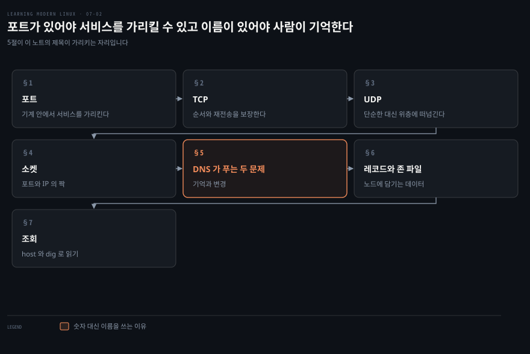
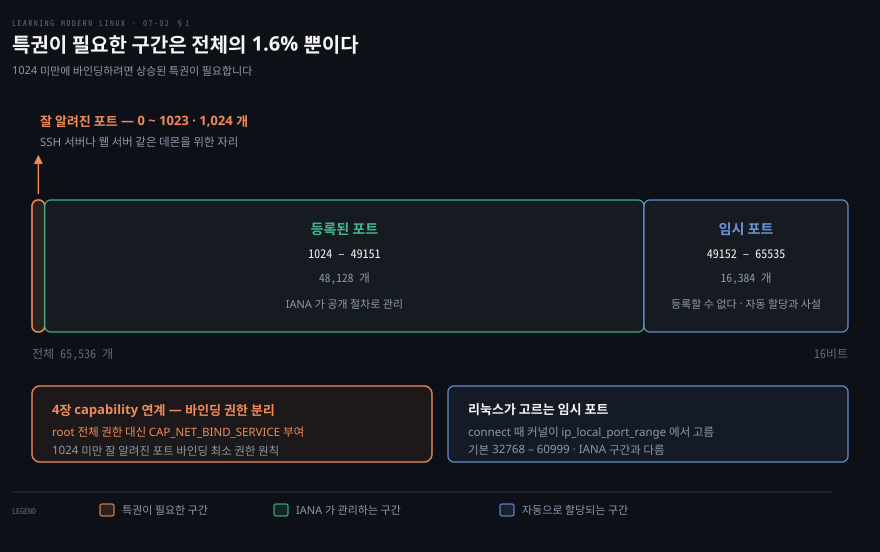
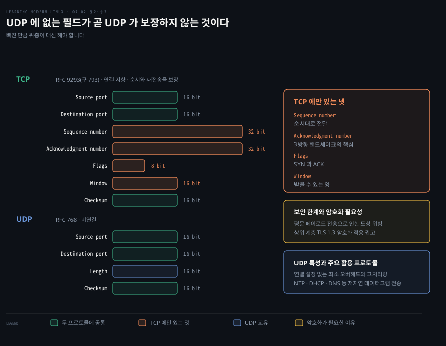
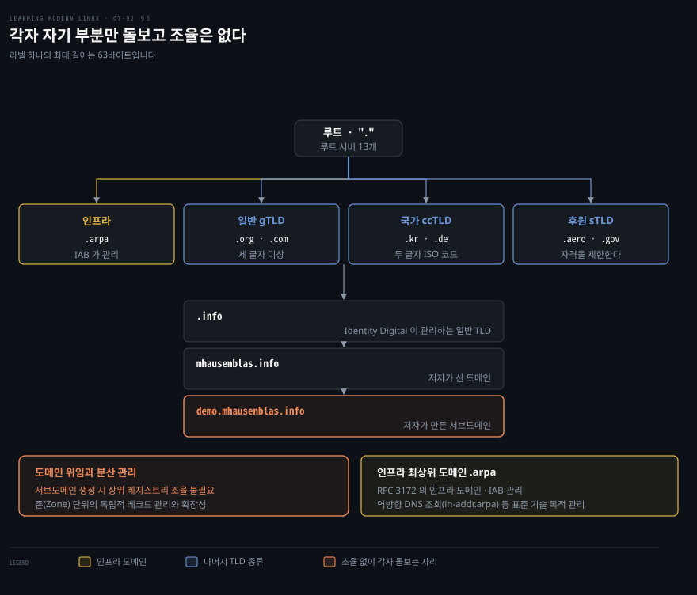
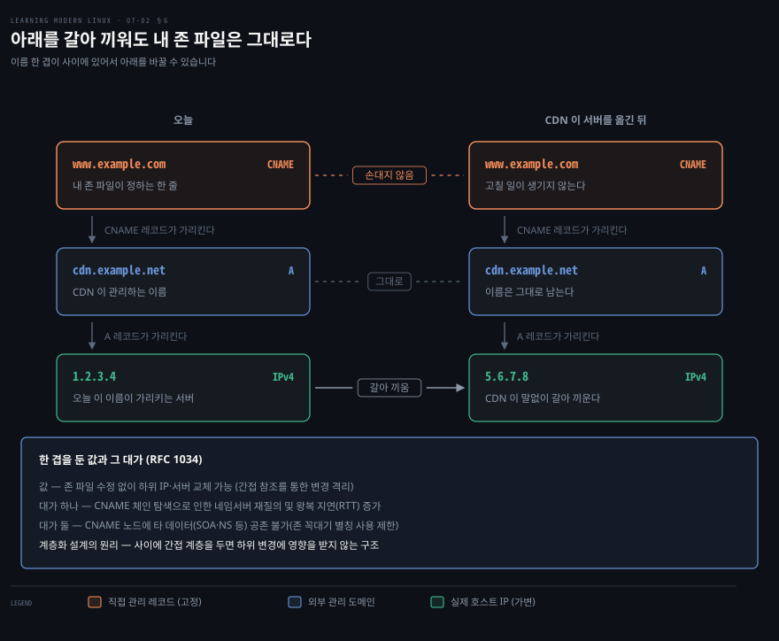
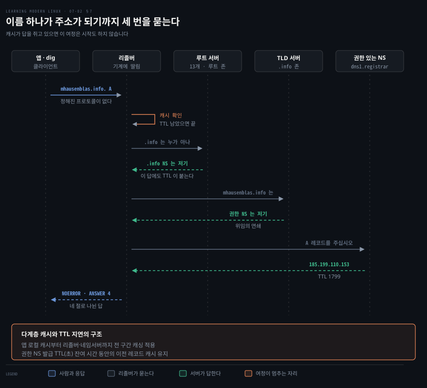

# 포트가 있어야 서비스를 가리킬 수 있고 이름이 있어야 사람이 기억한다

---

> 7장 노트의 둘째 편입니다. 앞 편이 기계까지 패킷을 배달하는 두 층을 다뤘다면, 이 편은 그 기계 안의 **어느 서비스**인지를 가리키는 층과, 그 기계를 **어떤 이름**으로 부를 것인지를 정하는 체계를 다룹니다.


## 핵심 요약

> 이 구간이 매달린 생각은 **주소만으로는 부족하다**는 것입니다. IP 주소는 기계까지만 데려다주고 사람은 숫자를 기억하지 못합니다.

그 두 부족함을 포트와 DNS 가 각각 메웁니다. 포트는 IP 주소에서 이용할 수 있는 서비스를 식별하는 16비트 숫자입니다. 한 기계에서 여러 서비스가 돌 수 있으므로 같은 IP 안에서 각각을 가릴 번호가 필요합니다.

DNS 가 푸는 문제는 둘입니다.

- 사람은 일반적으로 **긴 숫자보다 이름을 잘 기억**합니다. 웹사이트를 알려 줄 때 `4.31.198.44` 대신 `ietf.org` 라고 말하면 됩니다.
- **IP 주소는 바뀝니다.** 새 서버를 받으면 새 IP 를 받고 컨테이너는 다른 호스트로 재배치되면 자동으로 새 IP 를 배정받습니다.

IP 주소는 기억하기 어렵고 바뀌지만 서버나 서비스의 이름은 그대로입니다. 그래서 이 명명 체계는 인터넷뿐 아니라 쿠버네티스 같은 컨테이너 환경에서도 서비스 디스커버리의 중심에 있습니다.


## 학습 목표

> 이 구간을 읽고 나면 아래 열두 가지를 스스로 해낼 수 있습니다.

1. 포트 세 구간을 나누고 1024 미만이 특별한 이유를 말할 수 있습니다.
2. TCP 와 UDP 를 헤더 필드와 보장 수준으로 구분할 수 있습니다.
3. 소켓이 무엇으로 식별되는지 말하고 `ss` 로 상태별 조회를 할 수 있습니다.
4. `RLIMIT_NOFILE` 의 soft 와 hard 한도, 커널 상한을 구분해 설명할 수 있습니다.
5. DNS 의 네 개념과 TLD 종류를 구분할 수 있습니다.
6. `dig` 출력의 각 절과 SRV 레코드의 네 값을 읽을 수 있습니다.
7. TCP 헤더에 IP 주소 칸이 없는데 체크섬은 IP 를 보는 이유와 대가를 설명할 수 있습니다.
8. DNS 의 TTL 과 IP 의 TTL 을 단위와 줄이는 주체로 갈라 말할 수 있습니다.
9. 소켓이 `read` 와 `write` 로 다뤄지는 까닭을 파일 디스크립터로 설명할 수 있습니다.
10. `ECE` 와 `CWR` 플래그가 알리는 내용과 첫 SYN 에 둘이 함께 붙는 이유를 설명할 수 있습니다.
11. 소켓이 왜 프로토콜 계층이 아닌 API 추상인지 근거를 대며 말할 수 있습니다.
12. 한 이름에 A 레코드가 여럿일 때 일어나는 동작과 그 대가를 말할 수 있습니다.

아래는 이 문서 전체를 읽는 순서로 이은 지도입니다. 칸마다 절 번호와 그 절이 답하는 물음 하나를 적었습니다. 색이 붙은 칸이 이 노트의 제목이 가리키는 자리입니다.




## 이 문서가 다루지 않는 것

> 다루는 범위를 명확히 하기 위해 경계를 함께 적습니다.

- 링크 계층과 인터넷 계층 → [앞 노트](./07-01.%EA%B2%B0%EA%B5%AD%EC%9D%80%20%EC%84%A0%EA%B3%BC%20%EA%B3%B5%EA%B8%B0%EB%A5%BC%20%ED%83%80%EA%B3%A0%20%EB%8B%A4%EB%8B%88%EB%8A%94%20%EB%B9%84%ED%8A%B8%EB%8B%A4.md)가 다룹니다.
- 애플리케이션 계층 프로토콜과 도구 → [다음 노트](./07-03.%EC%A3%BC%EA%B3%A0%EB%B0%9B%EB%8A%94%20%EC%9D%BC%EC%9D%80%20%EA%B2%B0%EA%B5%AD%20%EB%AA%87%20%EA%B0%9C%EC%9D%98%20%EB%AA%85%EB%A0%B9%EC%9C%BC%EB%A1%9C%20%EC%A4%84%EC%96%B4%EB%93%A0%EB%8B%A4.md)가 다룹니다.
- DNS 해석의 세부 평가와 구성 논리 → RFC 1034·1035 가 다룹니다.
- TLS 암호화의 세부 동작 → RFC 8446 의 1.3 버전을 따릅니다.
- 파일 디스크립터 말고 다른 자원 한도(`nproc`·`memlock`·`core` 등)와 `limits.conf` → [09-01 의 pam_limits 절](./09-01.%EC%9D%B4%20%EC%9E%A5%EC%9D%84%20%EB%AC%B6%EB%8A%94%20%EA%B2%83%EC%9D%80%20%EC%A3%BC%EC%A0%9C%EA%B0%80%20%EC%95%84%EB%8B%88%EB%9D%BC%20%ED%95%84%EC%9A%94%ED%95%B4%EC%A7%80%EB%8A%94%20%EC%A1%B0%EA%B1%B4%EC%9D%B4%EB%8B%A4.md#pam_limits--로그인할-때-거는-자원-한도)이 다룹니다.

네트워크 애플리케이션을 직접 짜지 않더라도 바인딩된 소켓의 상태와 필요한 권한은 읽을 줄 알아야 합니다. 이 편이 그 읽는 법까지를 다룹니다.


## 1. 포트 — 기계 안에서 서비스를 가리키는 번호

> IP 주소는 기계까지만 데려다줍니다. 한 기계 안에서 여러 서비스가 동작할 때 대상 서비스를 식별하는 번호가 포트입니다.



전송 계층의 핵심 식별자가 포트입니다. 이 계층의 프로토콜은 모두 포트로 통신 상대를 특정합니다.

포트는 IP 주소에서 실행 중인 서비스를 식별하는 16비트 부호 없는 정수입니다. 16비트이므로 범위는 0 부터 65,535 까지 65,536개입니다.

IANA 는 이 범위를 세 구간으로 나눕니다.

**잘 알려진 포트**는 0 부터 1023 까지입니다. SSH 서버나 웹 서버 같은 데몬을 위한 자리이고 여기에 바인딩하려면 상승된 특권이 필요합니다. `root` 이거나 `CAP_NET_BIND_SERVICE` capability 를 가져야 합니다.

**등록된 포트**는 1024 부터 49151 까지입니다. IANA 가 공개된 절차로 특정 서비스나 벤더에 배정합니다.

**임시 포트**는 49152 부터 65535 까지입니다. IANA 에 등록할 수 없으며 자동 할당이나 사설 용도로 씁니다.

리눅스 커널이 실제로 임시 포트를 고르는 범위는 IANA 구간과 다릅니다. 클라이언트가 `connect()` 할 때 커널은 `net.ipv4.ip_local_port_range` 에서 로컬 포트를 고릅니다. 그 기본값은 32768 부터 60999 까지입니다.[^portrange] 그래서 리눅스 클라이언트의 출발 포트는 IANA 의 등록된 포트 구간과 겹칠 수 있습니다.

1024 라는 경계도 고정값이 아닙니다. 리눅스는 네트워크 네임스페이스마다 `net.ipv4.ip_unprivileged_port_start` 로 첫 비특권 포트를 정하고 그 기본값이 1024 입니다.[^unpriv] 시스템에 등록된 표준 포트 이름은 `/etc/services` 에서 볼 수 있습니다.

`CAP_NET_BIND_SERVICE` 는 [04-01 권한 분리 편](./04-01.%EC%A0%84%EB%B6%80%20%EC%95%84%EB%8B%88%EB%A9%B4%20%EC%A0%84%EB%AC%B4%EC%97%90%EC%84%9C%20%EC%9E%98%EA%B2%8C%20%EC%AA%BC%EA%B0%9C%EB%8A%94%20%EC%AA%BD%EC%9C%BC%EB%A1%9C.md)에서 본 capability 의 대표적인 쓰임입니다. 웹 서버에 `root` 전체를 주지 않고 낮은 포트에 바인딩할 권한 하나만 떼어 줄 수 있습니다.

열린 포트와 서비스를 알아낼 때는 `nmap` 을 씁니다. 네트워크 탐색과 보안 감사용 도구이고 원시 IP 패킷으로 어떤 호스트가 살아 있고 어떤 서비스를 내놓는지 알아냅니다.[^nmap] `-A` 는 포트 스캔에 더해 OS 와 서비스 버전 탐지까지 켭니다.

```bash
nmap -A localhost
```

```bash
Starting Nmap 7.60 ( https://nmap.org ) at 2021-09-19 14:53 IST
Nmap scan report for localhost (127.0.0.1)
Host is up (0.00025s latency).
Not shown: 999 closed ports
PORT    STATE SERVICE VERSION
631/tcp open  ipp     CUPS 2.2
```

631번 포트에서 인터넷 인쇄 프로토콜(IPP) 데몬이 듣고 있고 버전 탐지가 그것이 `CUPS 2.2` 라고 알려 줍니다. 원격 호스트나 허가받지 않은 네트워크에는 스캔을 실행하지 않습니다.


## 2. TCP — 순서와 재전송을 보장하는 쪽

> 이 층에서 갈리는 것은 통신의 성격입니다. 연결 지향 프로토콜이 있고 비연결 프로토콜이 있습니다.



둘 중 무엇을 쓸지는 취향이 아니라 무엇을 보장받아야 하는지가 정합니다. 그 보장의 목록이 곧 헤더 필드의 목록입니다.

TCP 는 연결 지향 전송 계층 프로토콜이며 HTTP 와 SSH 같은 상위 프로토콜이 씁니다. 세션 기반이라 패킷을 순서대로 전달하는 것을 보장하고 오류가 나면 재전송합니다.

TCP 헤더의 현행 표준은 2022년 8월에 RFC 793 을 폐기하고 STD 7 을 이어받은 RFC 9293 입니다.[^rfc9293] 주요 필드는 이렇습니다.

| 필드 | 비트 | 무엇인가 |
|---|:--:|---|
| Source port | 16 | 보내는 쪽 포트 |
| Destination port | 16 | 받는 쪽 포트 |
| Sequence number | 32 | 순서대로 전달하는 것을 관리하는 번호 |
| Acknowledgment number | 32 | SYN·ACK 플래그와 함께 3방향 핸드셰이크의 핵심 |
| Flags | 8 | 제어 비트. 가장 중요한 것이 SYN 과 ACK |
| Window | 16 | 수신 윈도 크기 |
| Checksum | 16 | 오류 검사용 체크섬 |

RFC 9293 의 헤더 그림에서 제어 비트는 `CWR·ECE·URG·ACK·PSH·RST·SYN·FIN` 여덟 칸이고 그 앞에 예약 비트 4개가 있습니다.[^ctlbits]

TCP 는 연결의 상태를 수립부터 종료까지 추적합니다. 양쪽은 한 번에 보낼 데이터 양(윈도 크기)과 최대 세그먼트 크기(MSS) 같은 값을 협상합니다.

TCP 자체에는 방어 장치가 없습니다. 페이로드가 평문으로 가고 보내는 쪽과 받는 쪽 사이의 여러 홉 어디서든 패킷을 들여다볼 수 있습니다. 기밀이 필요하면 그 위에 TLS 를 얹고 되도록 RFC 8446 의 1.3 버전을 씁니다.

### 의사 헤더와 TCP 체크섬의 계층 교차

위 표에는 IP 주소 칸이 없습니다. 주소를 다루는 것은 아래층인 인터넷 계층의 일입니다. 앞 편에서 본 대로 각 층은 바로 위아래만 알면 됩니다. 전송 계층은 어느 기계로 가는지 모른 채 어느 서비스로 갈지만 정합니다.

그런데 체크섬 하나가 그 선을 넘습니다. RFC 9293 은 체크섬이 **의사 헤더(pseudo-header)**까지 덮는다고 적습니다. 의사 헤더는 실제로 전송되지 않고 계산할 때만 TCP 헤더 앞에 붙였다고 치는 가상의 필드입니다. IPv4 에서 96비트이고 출발지와 목적지 IP 주소가 들어 있습니다.[^pseudo]

이유도 같은 문장에 있습니다. 의사 헤더를 체크섬에 넣으면 **잘못 배달된 세그먼트로부터 연결을 보호**합니다. 포트는 맞는데 IP 가 엉뚱한 세그먼트가 흘러들어와도, 받는 쪽이 자기 IP 로 다시 계산하면 값이 어긋나 걸러집니다.

NAT 이 그 값을 치릅니다. 주소를 바꾸는 장치는 IP 헤더만 고쳐서는 안 되고 TCP 체크섬도 다시 계산해야 합니다. RFC 3022 는 그 이유로 TCP·UDP 체크섬이 출발지와 목적지 IP 를 담은 의사 헤더까지 덮는다는 점을 듭니다.[^natsum]

[앞 편](./07-01.%EA%B2%B0%EA%B5%AD%EC%9D%80%20%EC%84%A0%EA%B3%BC%20%EA%B3%B5%EA%B8%B0%EB%A5%BC%20%ED%83%80%EA%B3%A0%20%EB%8B%A4%EB%8B%88%EB%8A%94%20%EB%B9%84%ED%8A%B8%EB%8B%A4.md)이 방화벽과 NAT 을 계층 위반의 예로 든 자리와 이어지지만 방향은 반대입니다. 방화벽에서는 아래층 코드가 위층 헤더를 열어 봅니다. 의사 헤더는 거꾸로 위층이 아래층 값을 빌려 오는 쪽입니다. 그리고 이쪽은 남이 끼어든 예외가 아니라 프로토콜 명세가 스스로 정한 설계입니다.

### ECN 협상과 TCP 헤더 플래그

패킷을 떠 보면 첫 SYN 에 `ECE` 와 `CWR` 이 함께 붙어 나가고 돌아오는 SYN-ACK 에는 `ECE` 만 붙는 경우가 있습니다.

```bash
# 핸드셰이크의 첫 두 패킷만 골라 플래그를 본다
sudo tshark -i en0 -Y "tcp.flags.syn==1" -T fields -e tcp.flags.str
```

이야기는 혼잡 제어의 오래된 약점에서 시작합니다. 기존 방식에서 「길이 막혔다」는 신호는 **패킷이 사라지는 것**입니다. 보내는 쪽은 응답이 안 오는 것을 보고서야 알아차리므로, 알아차리려면 먼저 손실을 치러야 합니다.

명시적 혼잡 통지(ECN, RFC 3168)는 그 순서를 바꿉니다. 큐를 관리하는 라우터가 **패킷을 버리는 대신** IP 헤더에 혼잡 경험(CE) 표시를 넣을 수 있습니다. 받는 쪽은 패킷을 온전히 받으면서 혼잡을 압니다. 그러면 손실 뒤 재전송으로 생기는 지연을 피합니다.[^ecn]

표시는 IP 헤더에 들어가지만 그것을 되돌려 알릴 자리는 TCP 헤더에 있습니다. **`ECE`** 는 받는 쪽이 「CE 표시가 붙은 패킷을 받았다」고 보내는 쪽에 알리는 칸입니다. **`CWR`** 은 보내는 쪽이 「혼잡 윈도를 줄였다」고 받는 쪽에 알리는 칸입니다.[^ecnflags]

첫 SYN 에 둘이 같이 붙는 것은 협상입니다. RFC 3168 은 `ECE` 와 `CWR` 이 다 선 SYN 을 **ECN-setup SYN**, `ECE` 만 서고 `CWR` 은 안 선 SYN-ACK 을 **ECN-setup SYN-ACK** 이라 부릅니다. 같은 RFC 는 연결이 ECN 을 쓰려면 이 한 쌍이 오가야 한다고 적습니다.[^ecnsetup] 캡처의 `SYN, ECE, CWR` → `SYN, ACK, ECE` 가 그 한 쌍입니다.

중간 장비가 ECN 이 붙은 SYN 을 버리는 경우도 있습니다. 이 노트를 쓰며 macOS 에서 뜬 캡처에서는 협상이 응답을 받지 못하자 두 플래그를 뺀 SYN 을 다시 보냈습니다.


## 3. UDP — 단순한 대신 위층에 떠넘기는 쪽

> 연결을 세우지 않고 그냥 보내는 프로토콜입니다. 그래서 오버헤드가 거의 없습니다.

UDP 는 비연결 전송 계층 프로토콜이고 데이터그램이라 부르는 메시지를 통신 설정 없이 보내게 해 줍니다. TCP 가 핸드셰이크로 하는 그 설정이 없습니다. 다만 데이터그램 체크섬은 지원합니다.

UDP 를 쓰는 애플리케이션 계층 프로토콜로 NTP 와 DHCP 가 있고 DNS 도 그렇습니다.

RFC 768 이 정의하는 UDP 헤더 필드는 넷입니다.

| 필드 | 비트 | 무엇인가 |
|---|:--:|---|
| Source port | 16 | 보내는 쪽 포트. 선택이며 쓰지 않으면 0 |
| Destination port | 16 | 받는 쪽 포트 |
| Length | 16 | UDP 헤더와 데이터를 합친 바이트 길이 |
| Checksum | 16 | 오류 검사용 체크섬 |

두 표를 나란히 놓으면 무엇이 빠졌는지가 보입니다. UDP 에는 순서 번호도 확인 응답 번호도 윈도도 플래그도 없습니다. 그래서 TCP 라면 자기가 처리했을 순서 보장과 손실 복구를 그 위에서 도는 상위 프로토콜이 맡아야 합니다.

그 대가로 헤더가 8바이트뿐이고 연결 설정이 없어 오버헤드가 아주 적어 높은 처리량을 낼 수 있습니다.


## 4. 소켓 — 통신의 끝점

> 포트와 IP 를 각각 알아 봐야 실제로 통신하는 것은 그 둘의 짝입니다. 리눅스가 그 짝에 이름을 붙인 것이 소켓입니다.

리눅스가 제공하는 고수준 통신 인터페이스가 소켓입니다. 통신의 끝점이라고 생각하면 됩니다. 프로토콜과 양쪽의 IP·포트로 이루어진 튜플이 그 정체성입니다.

소켓을 직접 프로그래밍할 일이 없더라도 조회하는 법은 알아 두어야 합니다. Docker 데몬의 소켓에 어떤 권한이 필요한지 따지는 일이 그런 예입니다.

조회 도구는 `ss` 입니다. net-tools 의 `netstat` 을 대신하는 iproute2 쪽 도구입니다. [앞 편](./07-01.%EA%B2%B0%EA%B5%AD%EC%9D%80%20%EC%84%A0%EA%B3%BC%20%EA%B3%B5%EA%B8%B0%EB%A5%BC%20%ED%83%80%EA%B3%A0%20%EB%8B%A4%EB%8B%88%EB%8A%94%20%EB%B9%84%ED%8A%B8%EB%8B%A4.md)에서 `ifconfig` 대신 `ip link` 를 쓰라던 그 세대 교체와 같은 이동입니다. `netstat` 의 man page 가 스스로 이 프로그램이 대체로 폐기됐다고 적습니다. `netstat` 은 `ss` 로, `netstat -r` 은 `ip route` 로, `netstat -i` 는 `ip -s link` 로 가라는 대체표도 붙여 둡니다.[^netstat]

```bash
ss -s
```

```bash
Total: 913 (kernel 0)
TCP:   10 (estab 4, closed 1, orphaned 0, synrecv 0, timewait 1/0), ports 0

Transport Total     IP        IPv6
RAW       1         0         1
UDP       10        8         2
TCP       9         8         1
INET      20        16        4
FRAG      0         0         0
```

`-s` 는 요약을 달라는 뜻입니다. 둘째 줄이 TCP 소켓 10개를 상태별로 세고 아래 표가 종류와 IP 버전으로 쪼갭니다. `INET` 줄은 RAW·UDP·TCP 를 더한 값입니다(1+10+9=20).

더 자세히 보려면 플래그를 조합합니다.

```bash
ss -ulp
```

```bash
State   Recv-Q Send-Q Local Address:Port    Peer Address:Port
UNCONN  0      0      0.0.0.0:60360         0.0.0.0:*
UNCONN  0      0      127.0.0.53%lo:domain  0.0.0.0:*
UNCONN  0      0      0.0.0.0:bootpc        0.0.0.0:*
UNCONN  0      0      0.0.0.0:ipp           0.0.0.0:*
UNCONN  0      0      0.0.0.0:mdns          0.0.0.0:*
UNCONN  0      0      [::]:mdns             [::]:*
...
```

`-u` 는 UDP 소켓으로 한정하고 `-l` 은 듣는(listening) 소켓만 고릅니다. `-p` 는 소켓을 쥔 프로세스를 함께 보입니다. 위 블록은 지면에 맞춰 줄였고 생략한 자리에 `...` 을 넣었습니다. `UNCONN` 은 연결이 없는 UDP 소켓의 상태입니다.

이 출력에 앞 편의 내용이 그대로 나타납니다. `0.0.0.0` 은 그 기계의 모든 IPv4 주소를 뜻합니다. 듣는 소켓 대부분이 거기에 바인딩되어 있습니다. 반면 `127.0.0.53%lo:domain` 은 루프백에만 묶여 있어 밖에서 닿지 않습니다. 이 소켓의 정체는 §5 의 리졸버 설정에서 다시 나옵니다.

상태로 거를 수도 있습니다. `TIME_WAIT` 상태인 TCP 소켓 수는 `ss -tnH state time-wait | wc -l` 로 셉니다. 기본 출력에는 열 머리글 한 줄이 붙으므로 `-H`(`--no-header`)로 빼야 개수가 맞습니다.

`ss` 와 `lsof` 는 겹쳐 보이지만 재는 축이 다릅니다. 두 man page 의 첫 줄이 그 차이를 적어 둡니다. `ss` 는 소켓 통계를 쏟아 내는 도구이고,[^ss] `lsof` 는 프로세스가 연 파일의 정보를 나열하는 도구입니다.[^lsof]

축이 다르니 답하는 질문도 갈립니다. 「지금 무엇이 8080 을 듣고 있나」는 소켓 축이라 `ss` 가 답합니다. 「이 프로세스가 무엇을 열어 두었나」에는 프로세스 축인 `lsof` 가 답합니다.

```bash
ss -tlnp                 # 소켓 축 — 듣고 있는 TCP 소켓과 그것을 쥔 프로세스
lsof -p 1234             # 프로세스 축 — 그 프로세스가 열어 둔 것 전부
lsof -i :8080            # 두 축이 만나는 자리 — 그 포트를 쓰는 프로세스
```

### 바인딩 주소와 VIP

바인딩에는 주소 규칙도 걸립니다. 프로세스는 기본적으로 그 기계에 실제로 붙은 IP 에만 바인딩할 수 있고 없는 주소로 시도하면 `EADDRNOTAVAIL`(`Cannot assign requested address`)로 실패합니다.

이 규칙이 고가용성 구성에서 걸림돌이 됩니다. Keepalived 같은 도구는 가상 IP(VIP)를 노드 사이에서 옮깁니다. 이런 구성에서는 대기 노드의 HAProxy 같은 서비스가 VIP 가 아직 자기 것이 아닐 때부터 그 주소에 바인딩해 두어야 장애 조치 순간 바로 받을 수 있습니다. 이때 `net.ipv4.ip_nonlocal_bind=1` 을 켜면 로컬에 없는 주소에도 `bind()` 가 허용됩니다. 기본값은 0 입니다. 커널 문서는 유용하지만 일부 애플리케이션을 깨뜨릴 수 있다고 경고합니다.[^nonlocal]

### 소켓과 파일 디스크립터

조회 밖에서, 프로그램 안의 소켓은 파일 디스크립터의 모습입니다.

`socket()` 시스템 콜은 통신의 끝점을 만들고 **그 끝점을 가리키는 파일 디스크립터를 돌려줍니다.**[^socket] 앞에서 소켓을 통신의 끝점이라 부른 그 말이 시스템 콜 설명에 그대로 붙어 있습니다.

파일 디스크립터(FD)는 프로세스가 열어 둔 것들의 표에 매긴 번호입니다. `open(2)` 는 그 반환값을 작은 음이 아닌 정수이며 프로세스의 열린 파일 디스크립터 표의 항목을 가리키는 색인이라고 설명합니다.[^fd]

0·1·2 는 프로그램이 시작할 때부터 표준 입력·표준 출력·표준 오류에 매여 있습니다.[^stdio] 새로 여는 것은 그때 비어 있는 가장 낮은 번호를 받으므로, 셋을 닫지 않은 보통 프로그램에서는 3번부터 붙습니다.

이것이 소켓을 `read` 와 `write` 로 다룰 수 있는 이유입니다. [5장](./05-01.%EB%AA%A8%EB%93%A0%20%EA%B2%83%EC%9D%B4%20%ED%8C%8C%EC%9D%BC%EC%9D%B4%EB%9D%BC%EB%8A%94%20%EB%A7%90%EC%9D%80%20%EC%86%90%EC%9E%A1%EC%9D%B4%EA%B0%80%20%ED%95%98%EB%82%98%EB%9D%BC%EB%8A%94%20%EB%9C%BB%EC%9D%B4%EB%8B%A4.md)에서 본 「모든 것이 파일」이라는 말의 손잡이가 여기까지 뻗어 있습니다. 커널이 보기에 소켓은 번호가 붙은 또 하나의 열린 것이라 파일에 쓰던 시스템 콜이 그대로 먹힙니다.

`/proc/PID/fd` 를 열면 그 표가 보입니다. 각 항목은 실제 대상을 가리키는 심볼릭 링크입니다. 소켓은 `socket:[2248868]` 처럼 종류와 inode 번호로 나타납니다.[^procfd] 그 inode 로 `/proc/net` 아래를 찾으면 `ss` 가 보여 주던 소켓에 닿습니다. `lsof` 가 소켓을 나열할 수 있는 것도 소켓이 그 표 안에 있기 때문입니다.

```bash
ls -l /proc/self/fd      # 이 셸이 열어 둔 것들 — 0·1·2 와 그 뒤
ulimit -n                # 한 프로세스가 열 수 있는 파일 디스크립터 수(soft 한도)
```

### 열린 파일 수의 한도 (rlimit)

표에 들어갈 수 있는 개수에는 상한이 있고 그 상한이 실무에서 장애로 돌아옵니다. 연결을 많이 쥔 서버는 `accept()` 가 `EMFILE` 로 실패합니다. 그 오류의 이름이 **too many open files** 입니다.[^emfile] man page 가 흔한 원인으로 지목하는 것이 `RLIMIT_NOFILE` 자원 한도 초과입니다. 연결 하나가 파일 디스크립터 하나를 먹으므로, 동시 연결 수가 곧 이 한도와 맞붙습니다.

커널은 프로세스마다 이런 자원 한도(rlimit)를 둡니다. 한도마다 값이 둘입니다.

- **soft 한도**는 커널이 실제로 적용하는 값입니다. 비특권 프로세스도 0 부터 hard 한도까지는 마음대로 올리고 내릴 수 있습니다.
- **hard 한도**는 soft 의 천장입니다. 비특권 프로세스는 이것을 낮출 수만 있고 한 번 낮추면 되돌릴 수 없습니다. 올리려면 초기 사용자 네임스페이스의 `CAP_SYS_RESOURCE` 가 필요합니다.[^getrlimit]

한도는 상속됩니다. `fork(2)` 로 만든 자식은 부모의 한도를 물려받고 `execve(2)` 로 다른 프로그램이 되어도 한도는 그대로 남습니다.[^rlinherit] 그래서 서비스의 한도를 바꾸려면 그 서비스를 띄우는 쪽(셸, systemd 유닛, 컨테이너 런타임)에서 바꿔야 합니다.

hard 한도 위에 커널의 상한이 하나 더 있습니다. `/proc/sys/fs/nr_open`(`fs.nr_open`)은 `RLIMIT_NOFILE` 을 올릴 수 있는 천장이고 특권 프로세스에도 적용됩니다. 커널 기본값은 1048576 입니다.[^nropen]

실제로 보게 되는 숫자는 환경마다 다릅니다. 커널이 처음 주는 `RLIMIT_NOFILE` 은 soft 1024, hard 4096 입니다. systemd 240 부터는 자기가 띄우는 프로세스의 hard 한도를 512K(524288)로 올리고 `fs.nr_open` 과 `fs.file-max` 도 가능한 최댓값으로 올립니다. soft 1024 는 그대로 둡니다. 전통적인 `select()` 가 1024 이상인 파일 디스크립터를 다루지 못하므로, 많이 쓰려는 프로그램이 스스로 soft 를 올리게 한 것입니다.[^systemd240]

숫자를 외우기보다 그 환경에서 세 값을 직접 봅니다. 컨테이너는 런타임 설정을 따르므로 호스트와 값이 다를 수 있습니다.

```bash
ulimit -n                     # soft 한도
ulimit -Hn                    # hard 한도
cat /proc/sys/fs/nr_open      # 커널 상한
```

`ulimit` 으로 바꾼 값은 그 셸과 거기서 띄운 자식에만 적용됩니다. 로그인할 때마다 거는 영구 설정(`limits.conf`)과 프로세스 수(`nproc`) 같은 다른 한도는 [09-01 의 pam_limits 절](./09-01.%EC%9D%B4%20%EC%9E%A5%EC%9D%84%20%EB%AC%B6%EB%8A%94%20%EA%B2%83%EC%9D%80%20%EC%A3%BC%EC%A0%9C%EA%B0%80%20%EC%95%84%EB%8B%88%EB%9D%BC%20%ED%95%84%EC%9A%94%ED%95%B4%EC%A7%80%EB%8A%94%20%EC%A1%B0%EA%B1%B4%EC%9D%B4%EB%8B%A4.md#pam_limits--로그인할-때-거는-자원-한도)이 다룹니다. 파일 크기와 CPU 시간 한도를 넘었을 때 오는 `SIGXFSZ`·`SIGXCPU` 는 [09-02 의 시그널 표](./09-02.%EC%8B%9C%EA%B7%B8%EB%84%90%EC%9D%80%20%EB%B2%88%ED%98%B8%20%ED%95%98%EB%82%98%EB%A7%8C%20%EB%B3%B4%EB%82%B4%EA%B3%A0%20%EB%81%9D%EB%82%98%EB%8A%94%20%EB%AA%A8%EC%96%91%EC%9D%80%20%EC%B2%98%EB%A6%AC%20%EB%B0%A9%EC%8B%9D%EC%9D%B4%20%EC%A0%95%ED%95%9C%EB%8B%A4.md#번호와-기본-동작)가 다룹니다.

### 소켓의 정체 — 5-tuple 손잡이

포트를 다루고 소켓을 다루는 순서로 오다 보니 「주소 위에 포트, 포트 위에 소켓」처럼 층이 하나 더 있는 것으로 읽히기 쉽습니다. 그렇지 않습니다.

**소켓은 새 층이 아니라 API 추상입니다.** 앞 편이 세운 네 층에 다섯째가 붙지 않습니다. 선 위를 지나가는 것은 여전히 이더넷 프레임 안의 IP 패킷 안의 TCP 세그먼트뿐입니다. 소켓에 해당하는 비트는 어디에도 없습니다.

소켓은 커널이 **이미 있는 값들을 하나로 묶어 프로그램에 내주는 손잡이**입니다. 묶는 값은 프로토콜과 양쪽의 주소·포트, 흔히 5-tuple 이라 부르는 다섯입니다. `ss` 출력의 `Local Address:Port` 와 `Peer Address:Port` 열이 그 넷을 그대로 보입니다. 나머지 하나인 프로토콜은 `-t`·`-u` 로 고른 축입니다.

커널은 그 다섯을 파일 디스크립터 하나에 붙여 돌려줍니다. 그래서 프로그램은 다섯을 매번 들고 다니는 대신 정수 하나를 들고 `read` 와 `write` 를 부릅니다.

확인하는 방법도 있습니다. **패킷을 떠서 소켓을 찾아보십시오.** IP 헤더도 TCP 헤더도 있지만 소켓 헤더는 없습니다. 층은 선 위에 흔적을 남기지만 API 추상은 기계 안에만 있습니다.


## 5. DNS 가 푸는 두 문제

> 숫자 주소에는 문제가 둘 있습니다. 사람이 기억하지 못한다는 것과, 그 숫자가 바뀐다는 것입니다.



이 문제는 인터넷 초기부터 있었습니다. 처음의 해법은 이름과 IP 의 대응을 파일 하나로 관리하는 것이었습니다. NIC(Network Information Center)가 `HOSTS.TXT` 라는 파일 하나를 유지했고 모든 호스트가 그것을 FTP 로 받아 갔습니다.[^hoststxt] 기계 하나 안에서는 지금도 `/etc/hosts` 가 같은 일을 합니다.

이 중앙집중 방식은 커 가는 인터넷을 따라가지 못했습니다. 조직마다 자기 이름과 주소를 관리하면서도 바뀐 내용을 밖에 보이려면 NIC 가 `HOSTS.TXT` 를 고칠 때까지 기다려야 했습니다. 그래서 이름을 나눠 관리하는 분산 시스템이 설계됐습니다. 그 명세인 RFC 882·883 을 1987년 Paul Mockapetris 의 RFC 1034·1035 가 대체해 지금까지 기준으로 남았습니다.[^hoststxt]

DNS 는 인터넷의 호스트와 서비스를 위한 세계적이고 계층적인 명명 체계입니다.

### DNS 핵심 개념 넷

**도메인 이름 공간**은 `.` 을 루트로 하는 트리입니다. 잎에서 루트까지 따라가며 만나는 라벨을 이은 것이 FQDN(정규화된 도메인 이름)이고 라벨 하나는 최대 63바이트입니다. `demo.mhausenblas.info.` 가 FQDN 이고 최상위 도메인은 `.info` 입니다. 맨 오른쪽 점, 곧 루트는 흔히 생략합니다.

**자원 레코드**는 이름 공간의 노드나 잎에 담긴 데이터입니다.

**네임서버**는 도메인 트리에 관한 정보를 갖는 서버 프로그램입니다. 어떤 부분에 관한 완전한 정보를 가지면 그 부분의 **권한 있는(authoritative)** 네임서버라 부릅니다. 권한 있는 정보는 존(zone) 단위로 조직됩니다.

**리졸버**는 클라이언트 요청에 응해 네임서버에서 정보를 뽑아 오는 프로그램입니다. 기계에 딸려 있고 리졸버와 클라이언트 사이에는 정해진 프로토콜이 없어서 보통 라이브러리 호출로 씁니다.

리졸버 설정은 `/etc/resolv.conf` 에 적힙니다. 다만 이 파일을 데몬이 관리하는 시스템이 많아서 직접 고친 내용이 덮어써질 수 있습니다. systemd-resolved 를 쓰는 시스템에서는 `/etc/resolv.conf` 가 `/run/systemd/resolve/stub-resolv.conf` 를 가리키는 심볼릭 링크일 수 있습니다. 그 파일은 `127.0.0.53` 스텁 하나만 DNS 서버로 적습니다.[^resolved] §4 의 `ss -ulp` 출력에서 루프백에 묶여 있던 `127.0.0.53%lo:domain` 이 바로 그 스텁입니다.

### 최상위 도메인 (TLD) 분류

DNS 의 뿌리에는 최상위 도메인 레코드를 관리하는 루트 서버가 있습니다. 루트 서버는 이름으로 13개이고 루트 바로 아래가 최상위 도메인(TLD)입니다. 종류는 넷으로 가릅니다.

- **인프라 TLD** 는 인터넷 운영 기반을 위한 도메인입니다. RFC 3172 는 `.arpa` 를 「인프라 도메인」이라 부르고,[^rfc3172] IANA 루트 존 데이터베이스는 그 관리 주체를 IAB 로 적습니다.[^iana] 역방향 조회의 `in-addr.arpa` 가 그 아래에 있습니다.
- **일반 TLD(gTLD)** 는 세 글자 이상의 일반 도메인이며 `.org`·`.com`·`.info` 같은 것입니다.
- **국가 코드 TLD(ccTLD)** 는 두 글자 ISO 국가 코드를 배정받은 나라나 영토를 위한 것입니다(`.kr`·`.de`).
- **후원 TLD(sTLD)** 는 쓸 자격을 제한하는 규칙을 둔 기관이 운영하는 도메인이며 `.aero`·`.gov` 가 예입니다. IANA 데이터베이스는 2026-11 기준 이 둘의 유형을 Generic 으로 표기합니다.[^iana]

`example` 과 `localhost` 는 루트 존의 TLD 가 아닙니다. 둘은 RFC 6761 이 정한 특수 용도 이름입니다.

DNS 가 전 세계 규모로 커질 수 있는 이유는 **위임**입니다. `.info` 는 Identity Digital 이 관리하는 일반 TLD 이고 `mhausenblas.info` 는 저자가 산 도메인입니다. 저자가 `demo` 서브도메인을 만들 때 `.info` 관리자에게 허가를 구할 필요가 없었습니다. 각 주체가 자기 부분만 돌보고 서로 조율할 필요가 없다는 이 단순한 사실이 DNS 를 분산적이고 확장 가능하게 만듭니다.


## 6. 레코드 종류와 존 파일

> 네임서버가 관리하는 것은 레코드입니다. FQDN 이 노드의 주소라면 자원 레코드는 그 노드의 데이터입니다.



종류가 여럿인 이유가 있습니다. 이름을 주소로 바꾸는 일만 필요했다면 한 종류로 충분했겠지만 별칭과 위임과 역방향 조회 같은 다른 일도 같은 체계로 처리해야 했습니다.

레코드는 종류와 데이터 말고도 TTL 같은 필드를 담습니다. TTL 은 그 레코드를 캐시에서 버려야 하는 시점까지의 시간입니다.

| 종류 | RFC | 무엇인가 |
|---|---|---|
| A / AAAA | 1035 / 3596 | 호스트명을 IPv4·IPv6 주소에 대응 |
| CNAME | 1035 | 정식 이름 레코드. 한 이름을 다른 이름의 별칭으로 |
| NS | 1035 | 네임서버 레코드. 존을 권한 있는 네임서버에 위임 |
| PTR | 1035 | 포인터 레코드. 역방향 조회에 씀. A 레코드의 반대 |
| SRV | 2782 | 서비스 위치 레코드. 일반화된 디스커버리 장치 |
| TXT | 1035 | 텍스트 레코드. 원래는 사람이 읽는 임의의 텍스트용 |

SRV 는 메일 교환에 `MX` 라는 전용 종류를 두었던 것처럼 서비스마다 종류를 새로 정의하는 대신, 어떤 서비스든 다룰 수 있는 일반적인 방법을 만든 것입니다.

TXT 는 원래 사람이 읽는 텍스트를 위한 것이었지만 지금은 소유권 확인 토큰처럼 기계가 읽는 값을 담는 경우가 많습니다. 별표 라벨(`*`)로 시작하는 와일드카드 레코드는 존재하지 않는 이름에 대한 질의를 받아 냅니다.

레코드는 존 파일이라는 텍스트 형식으로 적고 `bind` 같은 네임서버가 그것을 읽어 자기 데이터베이스로 삼습니다.

```bash
$ORIGIN example.com.
$TTL 3600
@       SOA nse.example.com. nsmaster.example.com. (
                1234567890 ; serial number
                21600      ; refresh after 6 hours
                3600       ; retry after 1 hour
                604800     ; expire after 1 week
                3600 )     ; minimum TTL of 1 hour
example.com.    IN  NS      nse
example.com.    IN  MX      10 mail.example.com.
example.com.    IN  A       1.2.3.4
nse             IN  A       5.6.7.8
www             IN  CNAME   example.com.
mail            IN  A       9.0.0.9
```

`$ORIGIN` 은 이름 공간에서 이 존 파일이 시작하는 자리입니다. `$TTL` 은 TTL 을 따로 적지 않은 레코드의 기본 만료 시간입니다.

그 아래로 이 도메인의 네임서버(`NS`)와 메일 서버(`MX`), 도메인의 IPv4 주소와 네임서버의 IPv4 주소가 나옵니다. 그다음 `www.example.com` 을 이 도메인의 별칭으로 만들고 마지막 줄이 메일 서버의 IPv4 주소입니다.

### CNAME 이 제공하는 유연성과 제약

CNAME 은 **갈아 끼울 자유**를 줍니다. `www` 에 A 레코드로 주소를 직접 적어 두면 서버를 옮길 때마다 내 존 파일을 고쳐야 합니다. 대신 CDN 이 준 이름을 가리키게 해 두면 CDN 이 서버를 옮겨 주소가 바뀌어도 내가 고칠 줄은 없습니다. 이 절 도식의 색이 붙은 맨 윗줄이 그 자리입니다.

[앞 편](./07-01.%EA%B2%B0%EA%B5%AD%EC%9D%80%20%EC%84%A0%EA%B3%BC%20%EA%B3%B5%EA%B8%B0%EB%A5%BC%20%ED%83%80%EA%B3%A0%20%EB%8B%A4%EB%8B%88%EB%8A%94%20%EB%B9%84%ED%8A%B8%EB%8B%A4.md) §2 의 「서로를 모르기 때문에 갈아 끼울 수 있습니다」와 같은 이야기입니다. 거기서는 층이 서로를 몰라서, 여기서는 이름 한 겹이 사이에 있어서 아래를 바꿀 수 있습니다.

대가는 RFC 1034 가 두 가지로 적어 둡니다.

1. **질의 왕복이 늘어납니다.** 네임서버는 CNAME 을 만나면 그 이름으로 질의를 다시 시작하므로, 체인이 길수록 답에 닿기까지 오가는 횟수가 늡니다.[^cnamechain]
2. **그 노드에 다른 데이터를 둘 수 없습니다.** 정식 이름과 별칭의 데이터가 서로 달라지는 것을 막기 위해서입니다.[^cnamealone] 그래서 위 존 파일에서 별칭이 된 것은 `www` 이지 `example.com` 자신이 아닙니다. 존 꼭대기(zone apex)에는 이미 SOA 와 NS 가 있어서 별칭이 될 수 없습니다.


## 7. 조회 — host 와 dig 로 읽기

> 네임서버와 리졸버라는 기반이 다 갖춰졌으면 이제 물어볼 차례입니다.



해석이 내부에서 어떻게 평가되고 구성되는지는 RFC 1034·1035 가 다룹니다. 여기서는 질의하는 방법만 봅니다.

`host` 는 이름을 IP 주소로 해석하고 그 반대도 합니다.

```bash
host mhausenblas.info
```

```bash
mhausenblas.info has address 185.199.110.153
mhausenblas.info has address 185.199.109.153
mhausenblas.info has address 185.199.111.153
mhausenblas.info has address 185.199.108.153
```

**주소가 넷입니다.** 이름 하나에 A 레코드가 여럿 있을 수 있고 그때 어느 것을 쓸지는 묻는 쪽이 고릅니다.

```bash
# 같은 질문을 여러 번 던져 순서를 본다
dig +short example.com
dig +short example.com
dig +short example.com
```

2026-11-10 에 세 번 물었을 때 `example.com` 은 `172.66.147.243` 과 `104.20.23.154` 둘을 답했고 세 번째에는 순서가 뒤바뀌어 돌아왔습니다. 순서를 섞을 수 있는 쪽은 권한 있는 네임서버와 중간 리졸버입니다. 섞을지 말지와 어떻게 섞을지는 그쪽 구현에 달렸습니다. 클라이언트가 보통 앞의 것부터 쓰므로, 순서가 섞이면 요청이 여러 서버에 갈립니다.

이것이 가장 간단한 부하 분산입니다. 앞에 장비를 두지 않고 존 파일에 A 를 몇 줄 더 적는 것으로 끝납니다. 이 방식은 DNS 가 서버의 생사를 모른다는 약점이 있습니다. 서버 하나가 죽어도 DNS 는 계속 그 주소를 답합니다. 죽은 것을 빼려면 레코드를 고쳐야 하는데 그러면 아래 TTL 이야기가 그대로 걸립니다.

역방향 조회는 IP 로 호스트명을 얻습니다.

```bash
host 185.199.110.153
```

```bash
153.110.199.185.in-addr.arpa domain name pointer cdn-185-199-110-153.github.com.
```

역방향 조회의 이름은 IP 의 옥텟을 거꾸로 뒤집어 `in-addr.arpa` 에 붙인 것입니다. §5 의 인프라 TLD 가 여기 쓰입니다.

레코드 구조까지 보려면 `dig` 를 씁니다. 대안으로 `dog` 와 `nslookup` 이 있습니다.

```bash
dig mhausenblas.info
```

```bash
;; ->>HEADER<<- opcode: QUERY, status: NOERROR, id: 43159
;; flags: qr rd ra; QUERY: 1, ANSWER: 4, AUTHORITY: 2, ADDITIONAL: 5

;; QUESTION SECTION:
;mhausenblas.info.              IN      A

;; ANSWER SECTION:
mhausenblas.info.       1799    IN      A       185.199.111.153
mhausenblas.info.       1799    IN      A       185.199.108.153
...

;; AUTHORITY SECTION:
mhausenblas.info.       1800    IN      NS      dns1.registrar-servers.com.
mhausenblas.info.       1800    IN      NS      dns2.registrar-servers.com.

;; ADDITIONAL SECTION:
dns1.registrar-servers.com. 47950 IN    A       156.154.132.200
...

;; Query time: 58 msec
;; SERVER: 192.0.2.53#53(192.0.2.53)
```

위 블록은 지면에 맞춰 줄였고 생략한 자리에 `...` 을 넣었습니다. `SERVER` 줄의 주소는 실습 환경의 사설 주소를 문서용 주소(RFC 5737)로 바꾼 값입니다. 헤더의 `ANSWER: 4` 와 `ADDITIONAL: 5` 가 실제 개수이니 A 레코드가 넷, 추가 절의 레코드가 다섯입니다.

네 절이 이 출력의 구조입니다. QUESTION 이 물어본 것, ANSWER 가 A 레코드들, AUTHORITY 가 권한 있는 네임서버, ADDITIONAL 이 그 네임서버의 주소입니다. `1799` 와 `1800` 은 각 레코드의 TTL 입니다. 2026-11-10 에 같은 질의를 다시 하면 AUTHORITY 절 없이 A 레코드 넷만 TTL 1799 로 돌아왔습니다. 절의 개수는 묻는 리졸버에 따라 달라집니다.

DNS 문제를 다룰 때 흔히 「언제나 DNS 탓」이라는 말을 합니다. DNS 가 움직이는 부품이 많은 분산 데이터베이스라는 뜻입니다. 앱 안의 로컬 캐시부터 리졸버까지, 나와 네임서버 사이의 모든 곳에 캐시가 있으므로 문제를 파고들 때는 레코드의 TTL 부터 봅니다.

### DNS TTL 과 IP TTL 의 단위 차이

DNS 의 TTL 과 앞 편에서 본 IP 헤더의 TTL 은 이름이 같아서 겹쳐 읽기 쉽지만 다른 것입니다.

위 출력의 `1799` 는 **초**입니다. RFC 1035 는 DNS TTL 을 그 레코드를 캐시해 두어도 되는 시간 간격으로 정의하고 단위가 초라고 적습니다.[^dnsttl] 줄이는 쪽은 캐시를 쥔 자리이고 0 이 되면 그 답을 버리고 다시 물어야 합니다.

[앞 편](./07-01.%EA%B2%B0%EA%B5%AD%EC%9D%80%20%EC%84%A0%EA%B3%BC%20%EA%B3%B5%EA%B8%B0%EB%A5%BC%20%ED%83%80%EA%B3%A0%20%EB%8B%A4%EB%8B%88%EB%8A%94%20%EB%B9%84%ED%8A%B8%EB%8B%A4.md)의 IP TTL 은 **홉 수**입니다. RFC 791 은 IP 헤더를 처리하는 지점마다 이 값을 줄이고 실제로 얼마나 걸렸는지 몰라도 1 은 빼라고 적습니다.[^ipttl] 이름은 시간인데 세는 것은 라우터의 개수입니다. `traceroute` 가 홉을 하나씩 캐낼 수 있는 것도 이쪽 TTL 덕입니다.

| 구분 | 단위 | 줄이는 쪽 | 0 이 되면 |
|---|---|---|---|
| IP TTL | 홉 하나마다 1 | 지나가는 라우터 | 패킷을 버리고 ICMP Time Exceeded 로 알림 |
| DNS TTL | 초 | 캐시를 쥔 자리 | 캐시를 버리고 다시 질의 |

이 구분이 「레코드를 고쳤는데 왜 아직 옛 주소로 가지」에 답합니다. 바꾼 곳은 권한 있는 네임서버인데 중간의 캐시들은 남은 TTL 만큼 옛 답을 쥐고 있습니다.

그래서 주소를 바꿀 계획이 있으면 바꾸기 전에 TTL 을 미리 낮춰 둡니다. 낮춘 값 자체도 옛 TTL 이 만료되어야 퍼지기 때문입니다. 아래 「적용 관점」의 JVM 처럼 레코드의 TTL 과 상관없이 자기 기준으로 캐시하는 층도 있습니다.

### TXT 레코드와 도메인 소유권 증명

인증서를 받으려면 CA 에게 **그 도메인이 내 것임을 보여야** 합니다. 그런데 CA 는 나를 모릅니다. 그래서 증명은 이런 모양이 됩니다. **그 도메인을 조종할 수 있는 사람만 할 수 있는 일을 시키고 그것이 됐는지 봅니다.** RFC 8555 의 ACME 프로토콜이 이 방식을 정합니다.

- **HTTP-01** 은 무작위 토큰을 주고 `http://<도메인>/.well-known/acme-challenge/<토큰>` 에 올리게 한 뒤 가져가 봅니다. 그 경로에 파일을 둘 수 있다는 것은 그 도메인이 가리키는 서버를 쥐고 있다는 뜻입니다.[^http01]
- **DNS-01** 은 `_acme-challenge.<도메인>` 에 토큰을 TXT 로 넣게 한 뒤 조회합니다. 존 파일을 고칠 수 있다는 것은 그 이름 자체를 쥐고 있다는 뜻입니다.[^dns01] 서버가 없어도 되고 와일드카드 인증서에도 씁니다.

```bash
# ACME 챌린지 토큰이 TXT 로 올라가 있는지 본다
dig +short TXT _acme-challenge.example.com
```

2026-11-10 에 이 질의는 따옴표로 감싼 토큰 넷을 돌려줬습니다. 토큰은 계속 바뀌므로 값보다 **이름의 모양**을 봅니다. `_acme-challenge` 라는 밑줄 이름이 이 용도의 표지입니다.

이 절은 [셋째 노트](./07-03.%EC%A3%BC%EA%B3%A0%EB%B0%9B%EB%8A%94%20%EC%9D%BC%EC%9D%80%20%EA%B2%B0%EA%B5%AD%20%EB%AA%87%20%EA%B0%9C%EC%9D%98%20%EB%AA%85%EB%A0%B9%EC%9C%BC%EB%A1%9C%20%EC%A4%84%EC%96%B4%EB%93%A0%EB%8B%A4.md) §4 의 SSH 호스트 키와 짝입니다. 거기서는 처음 만난 서버를 어떻게 믿는가가 문제였고 답은 「첫 접속에 받아 적고 다음부터 대조」였습니다. 여기서는 처음 만난 도메인 주인을 어떻게 믿는가가 문제입니다. 「그 사람만 할 수 있는 일을 시켜 본다」가 이쪽의 답입니다.

둘 다 미리 아는 사이가 아닐 때 신뢰를 세우는 방법입니다. 둘은 **확인할 통로가 있느냐**에서 갈립니다. DNS 는 누구나 조회할 수 있는 공개 통로라 CA 가 대신 확인합니다. SSH 에는 그런 통로가 없어 사람이 지문을 들고 대조합니다.

### SRV 레코드 구조 읽기

SRV 는 새 서비스가 나올 때마다 RFC 로 레코드 종류를 정의하는 대신, 어떤 서비스든 주소와 포트를 알릴 수 있게 만든 일반적인 방법입니다. RFC 2782 가 그 형식을 정합니다.

```bash
dig +short _imaps._tcp.gmail.com SRV
dig +short _xmpp-client._tcp.jabber.org SRV
```

```bash
5 0 993 imap.gmail.com.
30 30 5222 scarlet.jabber.org.
```

위 두 줄은 2026-11-10 에 조회한 응답입니다. `+short` 는 답변 절만 보이라는 뜻이고 이름 앞의 `_imaps._tcp` 가 RFC 2782 가 정한 `_서비스._프로토콜` 형식입니다. 끝의 `SRV` 가 원하는 레코드 종류를 지정합니다.

RFC 2782 는 SRV 의 데이터를 **`Priority Weight Port Target`** 순서로 정의합니다.[^srv]

1. **Priority(우선순위)**: 클라이언트는 닿을 수 있는 대상 중 우선순위 숫자가 가장 낮은 것에 먼저 접속해야 합니다(MUST). 같은 이름에 SRV 가 여럿이면 낮은 번호가 기본이고 높은 번호가 대체입니다.
2. **Weight(가중치)**: 우선순위가 같은 대상끼리 요청을 나눌 때 쓰는 상대적 비중입니다.
3. **Port(포트)**: 그 서비스가 실제로 듣는 포트입니다. 첫 줄의 993 이 IMAPS 포트입니다.
4. **Target(대상)**: 서비스를 제공하는 호스트의 FQDN 입니다.

`+short` 는 TTL 을 출력하지 않습니다. 첫 숫자를 TTL 로 읽으면 안 됩니다. 그렇게 읽으면 우선순위 구조가 통째로 사라집니다.


## 결정 치트시트

> 실무에서 마주치는 요구 조건과 판단 기준을 모았습니다. 근거는 본문입니다.

| 상황 | 선택 | 판단 이유 |
|---|---|---|
| 1024 미만 포트에 바인딩해야 함 | `CAP_NET_BIND_SERVICE` | `root` 전체를 주지 않고 그 권한만 줍니다 |
| 순서와 재전송이 필요함 | TCP | 세션 기반이라 순서 전달과 재전송을 보장합니다 |
| 오버헤드를 줄이고 처리량이 중요함 | UDP | 연결 설정이 없고 헤더가 8바이트입니다 |
| 전송 구간을 암호화해야 함 | TLS 1.3 | TCP 자체에는 방어 장치가 없습니다 |
| 듣는 소켓과 PID 확인 | `ss -tlnp` / `ss -ulp` | `-t`·`-u` 로 프로토콜, `-p` 로 프로세스를 봅니다 |
| 어느 프로세스가 그 포트를 쓰는지 확인 | `lsof -i :<포트>` | 프로세스 축에서 소켓을 찾습니다 |
| `TIME_WAIT` 소켓 수 집계 | `ss -tnH state time-wait \| wc -l` | `-H` 로 머리글을 빼야 개수가 맞습니다 |
| 대기 노드가 아직 없는 VIP 에 미리 바인딩 | `net.ipv4.ip_nonlocal_bind=1` | 로컬에 없는 주소에도 `bind()` 를 허용합니다 |
| `accept()` 가 `EMFILE` 로 실패 | soft·hard `nofile` 과 `fs.nr_open` 을 차례로 확인 | soft 는 hard 까지, hard 는 `fs.nr_open` 까지 올릴 수 있습니다 |
| 레코드 구조까지 볼 때 | `dig` | QUESTION·ANSWER·AUTHORITY·ADDITIONAL 을 다 보입니다 |
| 하위 서버가 자주 바뀌는 이름 | CNAME | 내 존 파일을 고치지 않고 아래를 갈아 끼웁니다 |
| 서비스의 주소와 포트를 DNS 로 알릴 때 | SRV 레코드 | 레코드 종류를 새로 정의하지 않아도 됩니다 |
| 와일드카드 인증서 소유권 검증 | DNS-01 (TXT) | 웹 서버 없이 `_acme-challenge` TXT 로 증명합니다 |


## 적용 관점

> Spring 으로 자바를 쓰다가 컨테이너와 쿠버네티스로 넘어온 사람에게 이 구간이 어디서 되돌아오는지를 적습니다.

**쿠버네티스 서비스 디스커버리가 이 편의 DNS 입니다.** `my-svc.my-namespace.svc.cluster.local` 이 FQDN 입니다. 클러스터 DNS(CoreDNS)가 이것을 서비스의 ClusterIP 로 해석합니다.

**헤드리스 서비스는 SRV 레코드를 씁니다.** `clusterIP: None` 으로 만든 서비스는 A 레코드로 파드 IP 들을 직접 돌려주고 `_포트이름._프로토콜.서비스이름` 형식의 SRV 레코드로 포트까지 알립니다. StatefulSet 의 파드가 서로를 찾는 방식이 이것입니다.

**`ndots: 5` 가 DNS 지연의 흔한 원인입니다.** 파드의 `/etc/resolv.conf` 기본값이 그렇게 잡혀 있어서 점이 다섯 개 미만인 이름은 검색 도메인을 차례로 붙여 가며 여러 번 질의합니다. 외부 호스트명을 부를 때 조회가 여러 번 나가는 셈입니다.

**Spring Boot 를 컨테이너에서 8080 으로 띄우는 관례가 포트 구간과 이어집니다.** 1024 미만에 바인딩하려면 `root` 나 `CAP_NET_BIND_SERVICE` 가 필요한데, 컨테이너는 비특권 사용자로 돌리는 것이 관례입니다. 그래서 앱은 등록된 포트 구간의 8080 을 쓰고 80·443 노출은 서비스나 인그레스가 맡습니다.

**JVM 의 DNS 캐시가 별도의 층입니다.** `networkaddress.cache.ttl` 은 성공한 조회를 몇 초 캐시할지 정하는 보안 속성이고 `-1` 이면 영원히 캐시합니다. 값을 정하지 않으면 캐시 기간은 구현에 맡겨집니다.[^jvmttl] `-1` 로 잡힌 앱은 파드가 재배치되어 IP 가 바뀌어도 옛 IP 를 계속 씁니다. IP 가 바뀐다는 DNS 의 존재 이유가 이 캐시 때문에 오히려 사고가 됩니다.

**`ss -tlnp` 가 컨테이너 안에서 첫 진단 명령입니다.** 앱이 정말 듣고 있는지, 어느 주소에 바인딩했는지가 한 줄로 나옵니다. `0.0.0.0:8080` 이면 밖에서 닿고 `127.0.0.1:8080` 이면 컨테이너 밖에서는 닿지 않습니다.


## 면접에서 받을 만한 질문

> 답을 먼저 떠올린 뒤 아래 정답을 확인하는 것이 학습에 낫습니다.

1. 포트가 16비트라는 사실에서 무엇이 따라나옵니까?
2. 1024 미만 포트에 바인딩하려면 무엇이 필요합니까?
3. TCP 헤더에는 있고 UDP 헤더에는 없는 필드를 셋 대 보십시오.
4. 소켓은 무엇으로 식별됩니까?
5. `5 0 993 imap.gmail.com.` 이라는 SRV 응답에서 각 값은 무엇입니까?
6. TCP 헤더에는 IP 주소 칸이 없는데 체크섬은 왜 IP 주소를 봅니까? 그 대가는 무엇입니까?
7. `dig` 응답의 `1799` 와 `traceroute` 가 쓰는 TTL 은 어떻게 다릅니까?
8. 소켓을 `read` 와 `write` 로 다룰 수 있는 근거는 무엇입니까?
9. `ss` 는 무엇을 대체한 도구이며 `lsof` 와는 어떻게 갈립니까?
10. 캡처의 첫 SYN 에 `ECE` 와 `CWR` 이 함께 붙어 있습니다. 무엇을 하는 중입니까?
11. 소켓은 TCP 위에 놓인 다섯째 층입니까? 아니라면 무엇이며 어떻게 확인합니까?
12. `dig +short example.com` 이 IP 를 둘 답했습니다. 클라이언트는 무엇을 하며 그 대가는 무엇입니까?
13. CA 는 내가 그 도메인의 주인인지 어떻게 확인합니까? 두 방법을 대 보십시오.
14. 서버가 `EMFILE` 로 연결을 못 받습니다. 어떤 한도를 어떤 순서로 봅니까?
15. CNAME 이 주는 이점과 두 가지 제약은 무엇입니까?


## 정답 (자답 후 펼치기)

### 정답 1 — 16비트의 귀결

포트 번호가 **0 부터 65,535 까지 65,536개**라는 것입니다. IANA 는 그 공간을 잘 알려진 포트 0~1023, 등록된 포트 1024~49151, 임시 포트 49152~65535 로 나눕니다. 리눅스가 클라이언트 쪽 임시 포트를 실제로 고르는 범위는 따로 있어서 기본값이 32768~60999 입니다.

### 정답 2 — 낮은 포트에 바인딩

**상승된 특권**이 필요합니다. `root` 이거나 `CAP_NET_BIND_SERVICE` capability 를 가져야 합니다. 웹 서버에 `root` 전체를 주는 대신 낮은 포트에 바인딩할 권한 하나만 떼어 줄 수 있습니다. 경계 1024 는 리눅스에서 네트워크 네임스페이스마다 `ip_unprivileged_port_start` 로 바꿀 수 있는 기본값입니다.

### 정답 3 — TCP 에만 있는 필드

**순서 번호**와 **확인 응답 번호**와 **윈도**입니다. 앞의 둘이 32비트씩이고 윈도가 16비트입니다. 8비트짜리 제어 플래그도 UDP 에는 없습니다.

순서 번호와 확인 응답 번호가 순서 보장과 재전송을 가능하게 하고 윈도가 흐름 제어를 합니다. UDP 에는 이것들이 없으므로 필요하면 위층이 직접 해야 합니다.

### 정답 4 — 소켓의 정체성

**프로토콜과 양쪽의 IP·포트로 이루어진 튜플**, 흔히 5-tuple 이라 부르는 다섯 값입니다. 커널은 이 다섯을 파일 디스크립터 하나에 묶어 프로그램에 내줍니다. `ss` 출력의 `Local Address:Port` 와 `Peer Address:Port` 열이 그 값을 보입니다.

### 정답 5 — SRV 응답의 네 값

RFC 2782 의 순서대로 **우선순위 5, 가중치 0, 포트 993, 대상 `imap.gmail.com.`** 입니다. 같은 이름에 SRV 가 여럿이면 클라이언트는 닿을 수 있는 것 중 우선순위 번호가 가장 낮은 대상에 먼저 접속해야 합니다. 같은 우선순위끼리는 가중치로 나눕니다. `+short` 는 TTL 을 보이지 않으므로 첫 숫자는 TTL 이 아닙니다.

### 정답 6 — 체크섬이 IP 를 보는 이유

**잘못 배달된 세그먼트를 걸러 내기 위해서**입니다. RFC 9293 은 체크섬이 의사 헤더까지 덮는다고 적습니다. 그렇게 하면 연결이 잘못 배달된 세그먼트(misrouted segment)로부터 보호된다는 이유도 함께 답니다.

의사 헤더는 실제로 전송되지 않고 계산할 때만 앞에 붙였다고 치는 필드입니다. IPv4 에서 96비트이며 출발지와 목적지 IP 주소가 들어갑니다. 포트만 맞고 IP 는 엉뚱한 세그먼트가 흘러들어오면 받는 쪽의 계산값이 어긋납니다.

**대가는 NAT 이 치릅니다.** 주소를 바꾸는 장치는 IP 헤더만 고쳐서는 안 되고 TCP 체크섬도 다시 계산해야 합니다. RFC 3022 가 그 이유로 든 것이 이 의사 헤더입니다.

### 정답 7 — 두 TTL

**단위가 다릅니다. DNS 의 TTL 은 초이고 IP 의 TTL 은 홉 수입니다.**

`dig` 응답의 `1799` 는 그 레코드를 캐시해 두어도 되는 초입니다. 줄이는 쪽은 캐시를 쥔 자리이고 0 이 되면 답을 버리고 다시 물어야 합니다. 「고쳤는데 왜 옛 주소로 가지」의 답이 대개 이 숫자입니다.

IP 의 TTL 은 헤더를 처리하는 지점마다 1 씩 깎입니다. 줄이는 쪽은 지나가는 라우터이고 0 이 되면 패킷이 버려집니다. `traceroute` 가 홉을 하나씩 캐내는 것이 이 성질 덕입니다.

### 정답 8 — 소켓을 read·write 로 다루는 근거

**소켓이 파일 디스크립터이기 때문입니다.** `socket()` 은 통신의 끝점을 만들고 그 끝점을 가리키는 파일 디스크립터를 돌려줍니다.

파일 디스크립터는 프로세스가 열어 둔 것들의 표에 매긴 작은 정수입니다. 커널이 보기에 소켓은 그 표에 든 또 하나의 열린 것이라 파일에 쓰던 시스템 콜이 그대로 먹힙니다. 5장의 「모든 것이 파일」이 여기까지 뻗은 것입니다. `/proc/PID/fd` 에서 소켓이 `socket:[inode]` 로 보이는 것도, `lsof` 가 소켓을 나열할 수 있는 것도 같은 이유입니다.

### 정답 9 — ss 가 대체한 것

**`netstat` 입니다. `lsof` 가 아닙니다.** `netstat(8)` 의 man page 자신이 이 프로그램이 대체로 폐기됐다고 적고 `ss`·`ip route`·`ip -s link` 로 가라는 대체표를 붙여 둡니다. 앞 편의 `ifconfig` → `ip link` 와 같은 net-tools 에서 iproute2 로의 이동입니다.

`lsof` 와는 축이 달라 대체 관계가 성립하지 않습니다. `ss` 는 **소켓 축**이라 어떤 소켓이 어떤 상태인지를 봅니다. 어느 프로세스가 무엇을 열었는지는 **프로세스 축**인 `lsof` 가 봅니다.

### 정답 10 — SYN 에 붙은 ECE 와 CWR

**ECN 을 쓸지 협상하는 중입니다.** RFC 3168 은 `ECE` 와 `CWR` 이 다 선 SYN 을 ECN-setup SYN, `ECE` 만 선 SYN-ACK 을 ECN-setup SYN-ACK 이라 부르고, 연결이 ECN 을 쓰려면 이 한 쌍이 오가야 한다고 적습니다.

두 칸의 평소 역할은 따로 있습니다. `ECE` 는 받는 쪽이 「혼잡 표시가 붙은 패킷을 받았다」고 알리는 칸이고 `CWR` 은 보내는 쪽이 「혼잡 윈도를 줄였다」고 답하는 칸입니다.

ECN 의 값은 손실 없이 혼잡 신호가 전달된다는 것입니다. 기존 혼잡 제어는 패킷이 사라지는 것이 신호라 알아차리려면 먼저 손실을 치러야 했습니다.

### 정답 11 — 소켓은 층인가

**아닙니다. API 추상입니다.** 커널이 프로토콜과 양쪽 주소·포트, 곧 5-tuple 을 묶어 파일 디스크립터 하나로 내주는 손잡이입니다. **패킷을 떠 보면 소켓 헤더가 없습니다.** IP 헤더도 TCP 헤더도 선 위에 흔적을 남기지만 소켓에 해당하는 비트는 어디에도 없습니다.

### 정답 12 — A 레코드가 여럿일 때

**클라이언트가 고릅니다.** 보통 앞의 것부터 쓰는데 네임서버나 리졸버가 답할 때 순서를 섞으면 요청이 여러 서버에 갈립니다. 앞에 장비를 두지 않고 존 파일에 A 를 몇 줄 더 적는 것이 가장 간단한 부하 분산입니다.

**대가는 DNS 가 서버의 생사를 모른다는 것입니다.** 하나가 죽어도 계속 그 주소를 답합니다. 빼려면 레코드를 고쳐야 하는데 그러면 남은 TTL 만큼 옛 답이 계속 돌아옵니다.

### 정답 13 — CA 의 도메인 소유 확인

**그 도메인을 조종할 수 있는 사람만 할 수 있는 일을 시키고 됐는지 봅니다.** **HTTP-01** 은 무작위 토큰을 `/.well-known/acme-challenge/<토큰>` 에 올리게 한 뒤 가져가 봅니다. 그 경로에 파일을 둘 수 있다는 것이 그 도메인이 가리키는 서버를 쥐고 있다는 증거입니다.

**DNS-01** 은 `_acme-challenge.<도메인>` 에 토큰을 TXT 로 넣게 한 뒤 조회합니다. 존 파일을 고칠 수 있다는 것이 이름 자체를 쥐고 있다는 증거입니다. 서버가 없어도 되며 와일드카드 인증서에도 씁니다.

### 정답 14 — EMFILE 과 세 한도

`EMFILE` 은 프로세스가 열 수 있는 파일 디스크립터 수를 다 썼다는 뜻이고 흔한 원인이 `RLIMIT_NOFILE` 초과입니다. 연결 하나가 파일 디스크립터 하나를 먹기 때문입니다.

**soft → hard → `fs.nr_open` 순서로 봅니다.** soft 는 실제로 적용되는 값이고 비특권 프로세스도 hard 까지는 올릴 수 있습니다. hard 를 올리려면 `CAP_SYS_RESOURCE` 가 필요하고 그 위의 천장이 `fs.nr_open`(커널 기본 1048576)입니다.

값은 환경마다 다릅니다. systemd 240 이후 서비스는 hard 가 524288 로 올라가 있고 soft 는 1024 로 남아 있으므로, 대개 soft 를 올리면 풀립니다. 한도는 자식에게 상속되므로 서비스를 띄우는 쪽에서 바꿔야 합니다.

### 정답 15 — CNAME 의 이점과 제약

이점은 **갈아 끼울 자유**입니다. CDN 같은 다른 이름을 가리키게 해 두면 그쪽 주소가 바뀌어도 내 존 파일을 고치지 않습니다. 제약은 RFC 1034 가 정한 둘입니다. 하나는 네임서버가 CNAME 의 대상 이름으로 질의를 다시 시작하므로 **왕복이 늘어난다**는 것입니다. 다른 하나는 CNAME 이 있는 노드에 **다른 데이터를 둘 수 없다**는 것이라, SOA 와 NS 가 있어야 하는 존 꼭대기는 별칭이 될 수 없습니다.


## 핵심 개념 체크리스트

- [ ] 포트 세 구간의 경계 숫자와, 리눅스가 임시 포트를 고르는 기본 범위를 아는가?
- [ ] `CAP_NET_BIND_SERVICE` 가 무엇을 대신하는지 말할 수 있는가?
- [ ] TCP 에 방어 장치가 없다는 말의 뜻과 그 대책을 아는가?
- [ ] `ECE` 와 `CWR` 이 각각 누가 누구에게 무엇을 알리는 칸인지 아는가?
- [ ] `ss` 가 대체한 것이 무엇이며 `lsof` 와 축이 어떻게 다른지 말할 수 있는가?
- [ ] 로컬에 없는 VIP 에 바인딩하려면 무엇을 켜야 하는지 아는가?
- [ ] `EMFILE` 이 나면 soft·hard·`fs.nr_open` 을 어떤 순서로 볼지 아는가?
- [ ] `127.0.0.53` 이 무엇이고 `/etc/resolv.conf` 와 어떻게 이어지는지 아는가?
- [ ] CNAME 의 이점과 두 가지 제약을 말할 수 있는가?
- [ ] A 레코드가 여럿일 때의 값과 대가를 짝지을 수 있는가?
- [ ] HTTP-01 과 DNS-01 이 각각 무엇을 증거로 삼는지 구분할 수 있는가?


## 관련 문서

- [Learning Modern Linux 정독 인덱스](./README.md) — 이 책의 장별 진행 상황
- [결국은 선과 공기를 타고 다니는 비트다](./07-01.%EA%B2%B0%EA%B5%AD%EC%9D%80%20%EC%84%A0%EA%B3%BC%20%EA%B3%B5%EA%B8%B0%EB%A5%BC%20%ED%83%80%EA%B3%A0%20%EB%8B%A4%EB%8B%88%EB%8A%94%20%EB%B9%84%ED%8A%B8%EB%8B%A4.md) — 같은 장의 링크·인터넷 계층
- [주고받는 일은 결국 몇 개의 명령으로 줄어든다](./07-03.%EC%A3%BC%EA%B3%A0%EB%B0%9B%EB%8A%94%20%EC%9D%BC%EC%9D%80%20%EA%B2%B0%EA%B5%AD%20%EB%AA%87%20%EA%B0%9C%EC%9D%98%20%EB%AA%85%EB%A0%B9%EC%9C%BC%EB%A1%9C%20%EC%A4%84%EC%96%B4%EB%93%A0%EB%8B%A4.md) — 같은 장의 애플리케이션 계층
- [전부 아니면 전무에서 잘게 쪼개는 쪽으로](./04-01.%EC%A0%84%EB%B6%80%20%EC%95%84%EB%8B%88%EB%A9%B4%20%EC%A0%84%EB%AC%B4%EC%97%90%EC%84%9C%20%EC%9E%98%EA%B2%8C%20%EC%AA%BC%EA%B0%9C%EB%8A%94%20%EC%AA%BD%EC%9C%BC%EB%A1%9C.md) — `CAP_NET_BIND_SERVICE` 가 정의된 자리
- [이 장을 묶는 것은 주제가 아니라 필요해지는 조건이다](./09-01.%EC%9D%B4%20%EC%9E%A5%EC%9D%84%20%EB%AC%B6%EB%8A%94%20%EA%B2%83%EC%9D%80%20%EC%A3%BC%EC%A0%9C%EA%B0%80%20%EC%95%84%EB%8B%88%EB%9D%BC%20%ED%95%84%EC%9A%94%ED%95%B4%EC%A7%80%EB%8A%94%20%EC%A1%B0%EA%B1%B4%EC%9D%B4%EB%8B%A4.md) — `limits.conf`·`nproc`
- [시그널은 번호 하나만 보내고 끝나는 모양은 처리 방식이 정한다](./09-02.%EC%8B%9C%EA%B7%B8%EB%84%90%EC%9D%80%20%EB%B2%88%ED%98%B8%20%ED%95%98%EB%82%98%EB%A7%8C%20%EB%B3%B4%EB%82%B4%EA%B3%A0%20%EB%81%9D%EB%82%98%EB%8A%94%20%EB%AA%A8%EC%96%91%EC%9D%80%20%EC%B2%98%EB%A6%AC%20%EB%B0%A9%EC%8B%9D%EC%9D%B4%20%EC%A0%95%ED%95%9C%EB%8B%A4.md) — 자원 한도를 넘었을 때 오는 시그널


## 참고 자료

- 원서: 《Learning Modern Linux》 7장 Networking (Michael Hausenblas, O'Reilly, 2022)
- [RFC 1034 — Domain Names: Concepts and Facilities](https://www.rfc-editor.org/rfc/rfc1034.txt)
- [RFC 1035 — Domain Names: Implementation and Specification](https://www.rfc-editor.org/rfc/rfc1035.txt)
- [RFC 2782 — A DNS RR for specifying the location of services (DNS SRV)](https://www.rfc-editor.org/rfc/rfc2782.txt)
- [RFC 3172 — Management Guidelines & Operational Requirements for the Address and Routing Parameter Area Domain ("arpa")](https://www.rfc-editor.org/rfc/rfc3172.txt)
- [IANA Root Zone Database](https://www.iana.org/domains/root/db)
- [RFC 3168 — The Addition of Explicit Congestion Notification (ECN) to IP](https://www.rfc-editor.org/rfc/rfc3168.txt)
- [RFC 8555 — Automatic Certificate Management Environment (ACME)](https://www.rfc-editor.org/rfc/rfc8555.txt)
- [RFC 9293 — Transmission Control Protocol (TCP)](https://www.rfc-editor.org/rfc/rfc9293.html) — RFC 793 을 폐기한 현행 STD 7
- [Linux kernel — IP Sysctl](https://docs.kernel.org/networking/ip-sysctl.html) — `ip_local_port_range`·`ip_unprivileged_port_start`·`ip_nonlocal_bind`
- [Linux man-pages](https://man7.org/linux/man-pages/) — 각주의 `socket(2)`·`getrlimit(2)`·`ss(8)` 같은 man page 인용은 모두 여기서 확인했습니다
- [systemd NEWS — CHANGES WITH 240](https://github.com/systemd/systemd/blob/main/NEWS)
- [Java SE 21 — InetAddress](https://docs.oracle.com/en/java/javase/21/docs/api/java.base/java/net/InetAddress.html)
- [Nmap Reference Guide](https://nmap.org/book/man.html)

[^portrange]: Linux kernel IP Sysctl, `ip_local_port_range` — "Defines the local port range that is used by TCP and UDP to choose the local port." 같은 항목이 "The default values are 32768 and 60999 respectively." 라고 적습니다. <https://docs.kernel.org/networking/ip-sysctl.html> (2026-11-10 조회)
[^unpriv]: Linux kernel IP Sysctl, `ip_unprivileged_port_start` — "This is a per-namespace sysctl. It defines the first unprivileged port in the network namespace. Privileged ports require root or CAP_NET_BIND_SERVICE in order to bind to them. ... Default: 1024" <https://docs.kernel.org/networking/ip-sysctl.html> (2026-11-10 조회)
[^nmap]: Nmap Reference Guide — "Nmap (“Network Mapper”) is an open source tool for network exploration and security auditing. It was designed to rapidly scan large networks, although it works fine against single hosts. Nmap uses raw IP packets in novel ways to determine what hosts are available on the network, what services ... those hosts are offering" <https://nmap.org/book/man.html> (2026-09-06 조회)
[^rfc9293]: RFC 9293, *Transmission Control Protocol (TCP)* — 문서 머리에 "STD: 7", "August 2022", "Obsoletes: 793, 879, 2873, 6093, 6429, 6528, 6691" 이 적혀 있습니다. <https://www.rfc-editor.org/rfc/rfc9293.html> (2026-09-06 조회)
[^ctlbits]: RFC 9293 §3.1 Header Format — "Reserved (Rsrvd): 4 bits", "Control bits: The control bits are also known as "flags". Assignment is managed by IANA from the "TCP Header Flags" registry [62]. The currently assigned control bits are CWR, ECE, URG, ACK, PSH, RST, SYN, and FIN." <https://www.rfc-editor.org/rfc/rfc9293.html> (2026-11-10 조회)
[^pseudo]: RFC 9293 §3.1 Header Format — "The checksum also covers a pseudo-header (Figure 2) conceptually prefixed to the TCP header. The pseudo-header is 96 bits for IPv4 and 320 bits for IPv6. Including the pseudo-header in the checksum gives the TCP connection protection against misrouted segments." 그림 2 의 구성요소는 Source Address · Destination Address · zero · PTCL · TCP Length 입니다. <https://www.rfc-editor.org/rfc/rfc9293.html> (2026-09-06 조회)
[^natsum]: RFC 3022 §4.1 Packet Translations — "For TCP ([TCP]) and UDP ([UDP]) sessions, modifications must include update of checksum in the TCP/UDP headers. This is because TCP/UDP checksum also covers a pseudo header which contains the source and destination IP addresses." 앞 편이 NAPT 를 인용한 그 RFC 입니다. <https://www.rfc-editor.org/rfc/rfc3022.txt> (2026-09-06 조회)
[^ecn]: RFC 3168 §4 — "AQM can set a Congestion Experienced (CE) codepoint in the packet header instead of dropping the packet, when such a field is provided in the IP header and understood by the transport protocol. The use of the CE codepoint with ECN allows the receiver(s) to receive the packet, avoiding the potential for excessive delays due to retransmissions after packet losses." <https://www.rfc-editor.org/rfc/rfc3168.txt> (2026-09-07 조회)
[^ecnflags]: RFC 3168 §5 — "an ECN-Echo (ECE) flag in the TCP header so that the data receiver can inform the data sender when a CE packet has been received; and a Congestion Window Reduced (CWR) flag in the TCP header so that the data sender can inform the data receiver that the congestion window has been reduced." <https://www.rfc-editor.org/rfc/rfc3168.txt> (2026-09-07 조회)
[^ecnsetup]: RFC 3168 §6.1.1 — "We call a SYN packet with the ECE and CWR flags set an \"ECN-setup SYN packet\", and we call a SYN packet with at least one of the ECE and CWR flags not set a \"non-ECN-setup SYN packet\" ... we call a SYN-ACK packet with only the ECE flag set but the CWR flag not set an \"ECN-setup SYN-ACK packet\"" 이어서 "Before a TCP connection can use ECN, Host A sends an ECN-setup SYN packet, and Host B sends an ECN-setup SYN-ACK packet." 라고 적습니다. <https://www.rfc-editor.org/rfc/rfc3168.txt> (2026-09-07 조회)
[^netstat]: netstat(8) NOTES, net-tools — "This program is mostly obsolete. Replacement for netstat is ss. Replacement for netstat -r is ip route. Replacement for netstat -i is ip -s link." <https://man7.org/linux/man-pages/man8/netstat.8.html> (2026-09-06 조회)
[^ss]: ss(8) — NAME 은 "ss - another utility to investigate sockets", DESCRIPTION 은 "ss is used to dump socket statistics. It allows showing information similar to netstat. It can display more TCP and state information than other tools." <https://man7.org/linux/man-pages/man8/ss.8.html> (2026-09-06 조회)
[^lsof]: lsof(8) DESCRIPTION — "Lsof revision ... lists on its standard output file information about files opened by processes". 문장 첫머리의 개정 번호 자리는 man page 가 판마다 채우는 값이라 생략했습니다. <https://man7.org/linux/man-pages/man8/lsof.8.html> (2026-09-06 조회)
[^nonlocal]: Linux kernel IP Sysctl, `ip_nonlocal_bind` — "If enabled, allows processes to bind() to non-local IP addresses, which can be quite useful - but may break some applications. ... Default: 0 (disabled)" <https://docs.kernel.org/networking/ip-sysctl.html> (2026-11-10 조회)
[^socket]: socket(2) — "socket() creates an endpoint for communication and returns a file descriptor that refers to that endpoint. The file descriptor returned by a successful call will be the lowest-numbered file descriptor not currently open for the process." <https://man7.org/linux/man-pages/man2/socket.2.html> (2026-09-06 조회)
[^fd]: open(2) — "The return value of open() is a file descriptor, a small, nonnegative integer that is an index to an entry in the process's table of open file descriptors. The file descriptor is used in subsequent system calls (read(2), write(2), lseek(2), fcntl(2), ...)" <https://man7.org/linux/man-pages/man2/open.2.html> (2026-09-06 조회)
[^stdio]: stdin(3) — "On program startup, the integer file descriptors associated with the streams stdin, stdout, and stderr are 0, 1, and 2, respectively." <https://man7.org/linux/man-pages/man3/stdin.3.html> (2026-09-06 조회)
[^procfd]: proc_pid_fd(5) — "/proc/pid/fd/ This is a subdirectory containing one entry for each file which the process has open, named by its file descriptor, and which is a symbolic link to the actual file. Thus, 0 is standard input, 1 standard output, 2 standard error, and so on." 이어서 "For file descriptors for pipes and sockets, the entries will be symbolic links whose content is the file type with the inode. ... For example, socket:[2248868] will be a socket and its inode is 2248868. For sockets, that inode can be used to find more information in one of the files under /proc/net/". <https://man7.org/linux/man-pages/man5/proc_pid_fd.5.html> (2026-09-06 조회)
[^emfile]: accept(2) ERRORS — "EMFILE The per-process limit on the number of open file descriptors has been reached." 같은 코드를 errno(3) 는 "EMFILE Too many open files (POSIX.1-2001). Commonly caused by exceeding the RLIMIT_NOFILE resource limit described in getrlimit(2). Can also be caused by exceeding the limit specified in /proc/sys/fs/nr_open." 로 풀어 적습니다. <https://man7.org/linux/man-pages/man2/accept.2.html> · <https://man7.org/linux/man-pages/man3/errno.3.html> (2026-09-06 조회)
[^getrlimit]: getrlimit(2) — "The hard limit acts as a ceiling for the soft limit: an unprivileged process may set only its soft limit to a value in the range from 0 up to the hard limit, and (irreversibly) lower its hard limit. A privileged process (under Linux: one with the CAP_SYS_RESOURCE capability in the initial user namespace) may make arbitrary changes to either limit value." <https://man7.org/linux/man-pages/man2/getrlimit.2.html> (2026-11-10 조회)
[^rlinherit]: getrlimit(2) NOTES — "A child process created via fork(2) inherits its parent's resource limits. Resource limits are preserved across execve(2)." <https://man7.org/linux/man-pages/man2/getrlimit.2.html> (2026-11-10 조회)
[^nropen]: proc_sys_fs(5) — "/proc/sys/fs/nr_open (since Linux 2.6.25) This file imposes a ceiling on the value to which the RLIMIT_NOFILE resource limit can be raised (see getrlimit(2)). This ceiling is enforced for both unprivileged and privileged process. The default value in this file is 1048576." <https://man7.org/linux/man-pages/man5/proc_sys_fs.5.html> (2026-11-10 조회)
[^systemd240]: systemd NEWS, CHANGES WITH 240 — "The Linux kernel's current default RLIMIT_NOFILE resource limit for userspace processes is set to 1024 (soft) and 4096 (hard). ... With this systemd release the hard limit systemd passes on is increased to 512K ... Note that the soft limit remains at 1024 for compatibility reasons: the traditional UNIX select() call cannot deal with file descriptors >= 1024". 같은 판이 "The fs.nr_open and fs.file-max sysctls are now automatically bumped to the highest possible values" 라고도 적습니다. <https://github.com/systemd/systemd/blob/main/NEWS> (2026-11-10 조회)
[^hoststxt]: RFC 1034 §2.1 — "Host name to address mappings were maintained by the Network Information Center (NIC) in a single file (HOSTS.TXT) which was FTPed by all hosts [RFC-952, RFC-953]." 이어서 "Local organizations were administering their own names and addresses, but had to wait for the NIC to change HOSTS.TXT to make changes visible to the Internet at large." 문서 머리에 "P. Mockapetris", "Obsoletes: RFCs 882, 883, 973", "November 1987" 이 적혀 있습니다. <https://www.rfc-editor.org/rfc/rfc1034.txt> (2026-11-10 조회)
[^resolved]: systemd-resolved(8) — "systemd-resolved maintains the /run/systemd/resolve/stub-resolv.conf file for compatibility with traditional Linux programs. This file lists the 127.0.0.53 DNS stub (see above) as the only DNS server. ... /run/systemd/resolve/stub-resolv.conf should not be used directly by applications, but only through a symlink from /etc/resolv.conf." <https://man7.org/linux/man-pages/man8/systemd-resolved.service.8.html> (2026-11-10 조회)
[^rfc3172]: RFC 3172 §2 — "This domain is termed an "infrastructure domain", as its role is to support the operating infrastructure of the Internet." <https://www.rfc-editor.org/rfc/rfc3172.txt> (2026-11-10 조회)
[^iana]: IANA Root Zone Database — `.arpa` 는 유형 Special Use, 관리 주체 Internet Architecture Board (IAB) 로 적혀 있습니다. `.gov` 와 `.aero` 는 유형 Generic 이고 관리 주체는 각각 Cybersecurity and Infrastructure Security Agency, SITA 입니다. `.info` 는 Generic, Identity Digital Limited 입니다. <https://www.iana.org/domains/root/db> (2026-11-10 조회)
[^cnamechain]: RFC 1034 §3.6.2 Aliases and canonical names — "CNAME RRs cause special action in DNS software. When a name server fails to find a desired RR in the resource set associated with the domain name, it checks to see if the resource set consists of a CNAME record with a matching class. If so, the name server includes the CNAME record in the response and restarts the query at the domain name specified in the data field of the CNAME record." <https://www.rfc-editor.org/rfc/rfc1034.txt> (2026-09-06 조회)
[^cnamealone]: RFC 1034 §3.6.2 — "If a CNAME RR is present at a node, no other data should be present; this ensures that the data for a canonical name and its aliases cannot be different." <https://www.rfc-editor.org/rfc/rfc1034.txt> (2026-09-06 조회)
[^dnsttl]: RFC 1035 §4.1.3 Resource record format — "TTL a 32 bit unsigned integer that specifies the time interval (in seconds) that the resource record may be cached before it should be discarded." 같은 문서 §3.2.1 은 같은 필드를 "a 32 bit signed integer" 로 적고 단위를 밝히지 않습니다. 두 서술이 갈리므로 메시지 형식을 정의하는 §4.1.3 을 따랐습니다. <https://www.rfc-editor.org/rfc/rfc1035.txt> (2026-09-06 조회)
[^ipttl]: RFC 791 §3.2 Discussion, Time to Live — "This field must be decreased at each point that the internet header is processed to reflect the time spent processing the datagram. Even if no local information is available on the time actually spent, the field must be decremented by 1. The time is measured in units of seconds (i.e. the value 1 means one second)." 명세는 초를 말하지만 실제로 재는 것은 홉의 개수가 됩니다. <https://www.rfc-editor.org/rfc/rfc791.txt> (2026-09-06 조회)
[^http01]: RFC 8555 §8.3 HTTP Challenge — "With HTTP validation, the client in an ACME transaction proves its control over a domain name by proving that it can provision HTTP resources on a server accessible under that domain name. The ACME server challenges the client to provision a file at a specific path, with a specific string as its content." 경로는 "fixed prefix \"/.well-known/acme-challenge/\", followed by the \"token\"" 입니다. <https://www.rfc-editor.org/rfc/rfc8555.txt> (2026-09-07 조회)
[^dns01]: RFC 8555 §8.4 DNS Challenge — "When the identifier being validated is a domain name, the client can prove control of that domain by provisioning a TXT resource record containing a designated value for a specific validation domain name." 이름은 "prepending the label \"_acme-challenge\" to the domain name being validated" 로 만듭니다. <https://www.rfc-editor.org/rfc/rfc8555.txt> (2026-09-07 조회)
[^srv]: RFC 2782 — SRV RR 의 RDATA 필드 순서는 "Priority Weight Port Target" 이고, Priority 는 "The priority of this target host. A client MUST attempt to contact the target host with the lowest-numbered priority it can reach" 로 정의됩니다. <https://www.rfc-editor.org/rfc/rfc2782.txt> (2026-09-05 조회)
[^jvmttl]: Java SE 21 `InetAddress` — `networkaddress.cache.ttl` 은 "Indicates the caching policy for successful name lookups from the name service." 이고, "The default setting is to cache for an implementation specific period of time. A value of -1 indicates "cache forever"." 라고 적습니다. <https://docs.oracle.com/en/java/javase/21/docs/api/java.base/java/net/InetAddress.html> (2026-11-10 조회)
