# 재는 것은 바깥이고 알고 싶은 것은 안이다

---

> 8장 노트의 첫 편으로, 관측이라는 말의 뜻을 세운 뒤 로그라는 신호 하나를 끝까지 팝니다. 한 줄이 어디서 나서 어느 파일과 저널에 쌓이고, 어떻게 돌려지고 지워지는지까지 따라갑니다.

## 핵심 요약

> 이 구간이 매달린 생각은 **알고 싶은 것은 안인데 잴 수 있는 것은 바깥뿐**이라는 것입니다.

저자가 적은 관측 가능성의 정의가 그대로 그렇습니다. 리눅스 같은 시스템의 내부 상태를 바깥으로 드러난 정보를 재서 판정하는 일입니다. 대개 그 판정을 근거로 조치하는 것이 목적입니다.

저자가 든 예가 이 정의의 세 단계를 한 흐름에 담습니다. 시스템 반응이 굼뜨다고 느끼면 남은 주 메모리를 잽니다. 한 앱이 메모리를 다 먹고 있음을 알아내면 그것을 끝내기로 정합니다.

바깥으로 드러나는 정보에는 이름이 붙어 있습니다. 신호 유형은 셋이고 로그와 메트릭과 트레이스입니다. 그중 로그만 사람이 읽으라고 만들어진 텍스트이며, 저자가 이 장의 시간 대부분을 로그에 쓰겠다고 밝히는 이유가 그것입니다.

로그 한 줄은 두 저장소에 남습니다. systemd 의 저널이 바이너리 형식으로 받아 두면 rsyslog 가 같은 줄을 규칙에 따라 `/var/log` 아래 텍스트 파일로 나눠 씁니다. 텍스트 파일은 logrotate 가 이름을 바꿔 돌립니다. 저널은 journald 가 스스로 크기 상한을 지키며 `journalctl --vacuum-*` 으로 줄입니다.


## 학습 목표

> 이 구간을 읽고 나면 아래 다섯 가지를 스스로 해낼 수 있습니다.

1. 관측 가능성을 정의하고, 소스·텔레메트리·목적지와 신호 유형 셋을 경로 위에 짚을 수 있습니다.
2. 로그를 항목·문맥·형식으로 쪼개고, RFC 5424 헤더에서 비울 수 있는 필드를 근거와 함께 가를 수 있습니다.
3. Debian 계열과 RHEL 계열의 `/var/log` 파일 이름을 짝짓고, rsyslog 선택자로 한 줄이 떨어질 파일을 예측할 수 있습니다.
4. logrotate 의 이름 바꾸기와 `copytruncate` 가 쓰던 프로세스에 무엇을 하는지 inode 로 설명할 수 있습니다.
5. `journalctl` 로 부팅·심각도·유닛·필드를 좁히고, 저널의 저장 위치와 크기를 확인하고 줄일 수 있습니다.

아래는 이 문서 전체를 읽는 순서로 이은 지도입니다. 칸마다 절 번호와 그 절이 답하는 물음 하나를 적었습니다. 색이 붙은 칸이 이 노트의 제목이 가리키는 자리입니다.

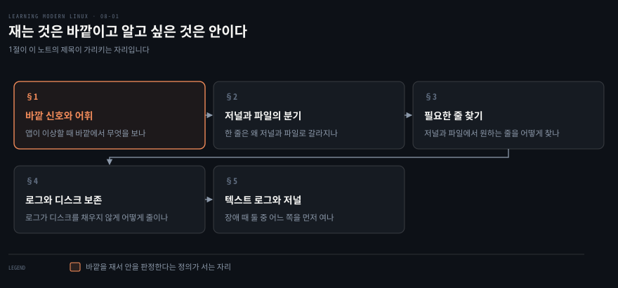


## 이 문서가 다루지 않는 것

> 저자가 스스로 그은 선과, 노트를 나누며 생긴 경계를 함께 적습니다.

- 자원별 모니터링과 그 도구들 → [다음 노트](./08-02.%EC%9E%90%EC%9B%90%EB%A7%88%EB%8B%A4%20%EC%B0%BD%EC%9D%B4%20%EB%94%B0%EB%A1%9C%20%EB%82%98%20%EC%9E%88%EC%96%B4%20%EC%96%B4%EB%8A%90%20%EC%B0%BD%EC%9D%84%20%EC%97%AC%EB%8A%90%EB%83%90%EA%B0%80%20%EA%B3%A7%20%EC%A7%84%EB%8B%A8%EC%9D%B4%EB%8B%A4.md)가 다룹니다
- 추적과 프로파일링, Prometheus 와 Grafana 구성 → 같은 다음 노트가 다룹니다
- 분산 추적 → 저자가 이 책의 범위 밖이라고 못 박습니다. 쿠버네티스의 컨테이너화된 마이크로서비스나 서버리스 앱의 람다 묶음에서 쓰는 그것을 뜻합니다
- Brendan Gregg 의 리눅스 관측 도구 전경도 → CC BY-SA 4.0 그림이라 옮기지 않고 [출처](https://www.brendangregg.com/linuxperf.html)만 남깁니다
- 로그를 받는 중앙 수집 서버 구성과 audit 규칙 작성 → 이 노트는 보내는 쪽 설정과 `audit.log` 를 읽는 도구 이름까지만 다룹니다

저자가 이 장의 성격에 관해 붙이는 단서 하나도 옮깁니다. 관측은 흔히 반응적이지만 늘 그렇지는 않다는 것입니다. 이 단서가 §1 의 내용입니다.


## 1. 느린 앱과 한 번에 하나씩 바꾸기

> 앱이 느리다는 신고가 들어왔을 때 후보가 여럿이면, 순서 없이 이것저것 만지는 순간 무엇이 들었는지 영영 알 수 없게 됩니다.

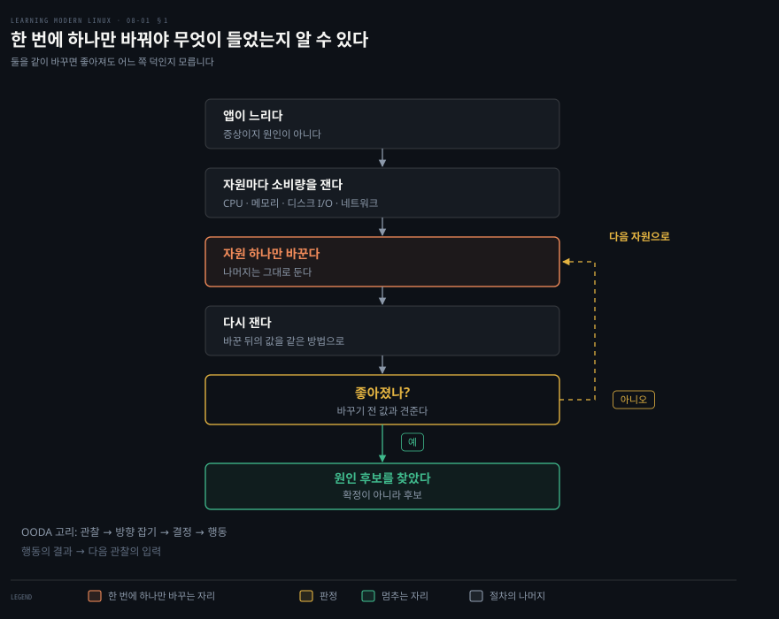

### 풀려는 문제

저자가 드는 장면은 이렇습니다. 앱이 느립니다. 그리고 그럴 만한 이유가 여럿입니다. 메모리가 모자라거나, CPU 사이클이 부족하거나, 네트워크 입출력이 못 따라가는 경우입니다.

여기서 흔히 하는 일은 의심 가는 것을 한꺼번에 올리는 것입니다. 메모리도 늘리고 CPU 도 늘리면 대개 좋아지기는 합니다. 그런데 그다음 질문에 답할 수 없습니다. 어느 쪽 덕이었나, 다음에 같은 증상이 오면 무엇부터 볼 것인가 하는 질문입니다.

### 왜 절차가 필요한가

저자가 부르는 이름은 OODA 고리입니다. 관찰하고 방향을 잡고 정하고 행동하는 네 국면의 앞 글자를 딴 것입니다. 관측된 데이터를 근거로 가설을 시험하고 그 위에서 행동하는 구조화된 방법이라고 저자가 적습니다. 신호에서 실행 가능한 통찰을 얻는 길이라는 뜻입니다.

절차의 핵심은 국면의 이름이 아니라 그 안의 한 문장에 있습니다. 자원 할당을 **하나씩 개별적으로** 바꾸라는 것입니다. 나머지는 그대로 둔 채 결과를 잽니다.

RAM 을 더 줬더니 성능이 좋아졌는지 묻습니다. 그렇다면 이유를 찾았을 수 있다고 저자는 적습니다. 아니라면 다른 자원으로 넘어가되 소비량을 계속 재면서 관측된 영향과 연결지어 봅니다.

여기서 저자가 "이유를 찾았다" 가 아니라 "찾았을 수 있다" 로 쓴 것이 정확합니다. 한 번의 변경으로 좋아진 것은 상관이지 인과의 증명이 아닙니다.

### 반응·조사·예측 세 성격

저자는 관측의 성격을 셋으로 나눕니다. 이 구분이 있어야 "장애가 나야 로그를 본다" 는 습관을 벗어날 수 있습니다.

| 성격 | 언제 움직이나 | 저자가 든 예 |
|------|--------------|-------------|
| 반응적(reactionary) | 무언가 죽거나 느려진 뒤 | 프로세스와 그 CPU·메모리 사용량을 보거나 로그를 판다 |
| 조사적(investigative) | 궁금해서 | 특정 알고리즘이 얼마나 걸리는지 알아내려 할 때 |
| 예측적(predictive) | 아직 일어나지 않은 일에 대비해 | 지금 동작을 외삽해 미래 조건에 알림을 건다 |

예측적 관측에 저자가 붙인 조건이 하나 있습니다. 부하가 예측 가능한 디스크 사용량이라면 잘 통할 것이라는 단서입니다. 뒤집으면 부하가 튀는 대상에는 외삽이 잘 안 든다는 뜻입니다.


## 2. 소스·텔레메트리·목적지

> 로그 뷰어를 열면 로그가 보이는데, 그 사이에 무엇이 있는지 모르면 "왜 이 로그만 안 보이지" 를 풀 수 없습니다.

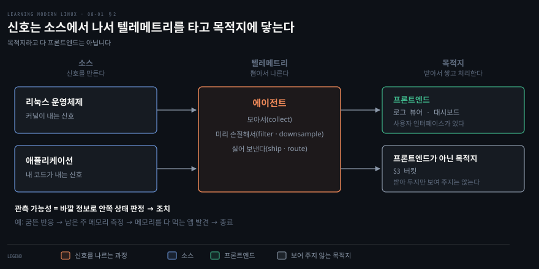

### 풀려는 문제

관측 도구를 처음 붙이면 대개 화면부터 봅니다. 그런데 화면에 무언가 빠져 있을 때 어디를 봐야 할지가 문제가 됩니다. 앱이 안 낸 것인지, 나르는 쪽이 걸러 버린 것인지, 저장은 됐는데 화면이 못 그리는 것인지가 갈립니다.

### 왜 어휘가 먼저인가

저자는 관측 분야의 용어에 형식 정의가 다 있는 것은 아니고, 단일 기계를 보느냐 네트워크로 묶인 분산 환경을 보느냐에 따라 뜻이 조금씩 달라진다고 미리 밝힙니다. 그래서 다섯 개를 자기 기준으로 정의해 두고 갑니다. 그 다섯이 곧 방금 말한 경로의 각 자리 이름입니다.

- **Observability**: 바깥 정보를 재서 시스템의 내부 상태를 판정하는 일. 대개 그 위에서 행동하는 것이 목적입니다
- **Signal types**: 시스템 상태에 관한 정보를 표현하고 내보내는 서로 다른 방식. 기호로 나르거나(로그처럼 텍스트) 수치로 나르거나(메트릭처럼) 둘을 섞습니다
- **Source**: 신호를 만드는 쪽. 리눅스 운영체제일 수도 있고 애플리케이션일 수도 있습니다
- **Destination**: 신호를 소비하고 저장하고 더 처리하는 곳
- **Telemetry**: 소스에서 신호를 뽑아 목적지로 실어 나르는 과정

### 목적지와 프론트엔드의 경계

저자가 목적지 안에 굳이 선을 하나 더 긋습니다. 사용자 인터페이스를 드러내는 목적지만 프론트엔드라고 부른다는 것입니다. GUI 든 TUI 든 CLI 든 상관없습니다.

예가 대비를 분명하게 만듭니다. 로그 뷰어나 시계열을 그리는 대시보드는 프론트엔드이고, S3 버킷은 프론트엔드가 아닙니다. 다만 S3 버킷도 로그의 목적지 노릇은 여전히 할 수 있습니다. 앞의 문제로 돌아가면, 화면에 안 보이는 신호가 어딘가에는 쌓여 있을 수 있다는 뜻이기도 합니다.

텔레메트리 쪽에도 사실 하나가 들어 있습니다. 신호를 모으거나 미리 손질하는 에이전트를 흔히 쓰는데, 그 손질에 필터와 다운샘플이 포함된다고 저자가 적습니다. 안 보이는 신호를 쫓을 때 이 자리를 먼저 의심할 근거입니다. 한 기계 안에서는 §6 에서 볼 rsyslog 의 선택자가 바로 그 필터 노릇을 합니다.

한 가지 표기 습관도 짚고 갑니다. 관측 가능성을 `o11y` 라는 축약으로도 쓰는데, `o` 와 `y` 사이에 글자가 열한 개 있어서 그렇습니다.[^o11y]


## 3. 신호 유형 셋과 메트릭 세 종류

> 로그도 메트릭도 트레이스도 다 켜라는 말은 흔한데, 셋이 무엇으로 갈리는지 모르면 무엇을 어디에 쓸지 고를 수 없습니다.

저자가 신호를 가르는 첫 축은 페이로드입니다. 크게 보아 텍스트 페이로드와 수치 페이로드로 나뉘며, 텍스트는 사람이 검색하고 해석하기에 가장 알맞고 수치는 기계에 알맞습니다. 수치도 가공하면 사람이 읽을 수 있습니다.

| 신호 유형 | 페이로드 | 주 소비자 | 저자의 정의 요지 |
|-----------|---------|----------|-----------------|
| 로그 | 텍스트 | 사람 | 텍스트 페이로드를 가진 개별 사건들. 대개 시각이 찍힙니다 |
| 메트릭 | 수치 | 기계. 가공하면 사람도 | 대개 규칙적으로 표집한 수치 데이터 점이 시계열을 이룹니다 |
| 트레이스 | — | — | 런타임 정보의 동적 수집. 어떤 시스템 콜을 쓰는지, 커널에서 어떤 사건이 이어졌는지 |

트레이스 행의 앞 두 칸을 비운 것은 저자가 그 축으로 트레이스를 분류하지 않기 때문입니다. 텍스트와 수치라는 이분법은 로그와 메트릭에만 걸리고, 트레이스는 세 번째 유형으로 따로 덧붙습니다.

저자가 로그 항목에 붙이는 관찰 하나가 이 표보다 실무적입니다. 모든 로그에는 어느 정도의 구조가 있는데도 사람들이 굳이 "구조화 로깅" 이라는 말을 쓴다는 것입니다. 그리고 그 말을 할 때 실제로 뜻하는 것은 JSON 으로 구조화한다는 것이라고 못 박습니다.

이 장의 무게가 어디로 쏠리는지도 저자가 미리 알려 줍니다. 로그 내용을 자동으로 다루기는 어렵지만 사람에게는 여전히 쓸모가 커서 한동안 지배적인 신호 유형으로 남을 것이며, 그래서 이 장의 시간 대부분을 로그에 쓰겠다는 것입니다.

### 카운터·게이지·히스토그램

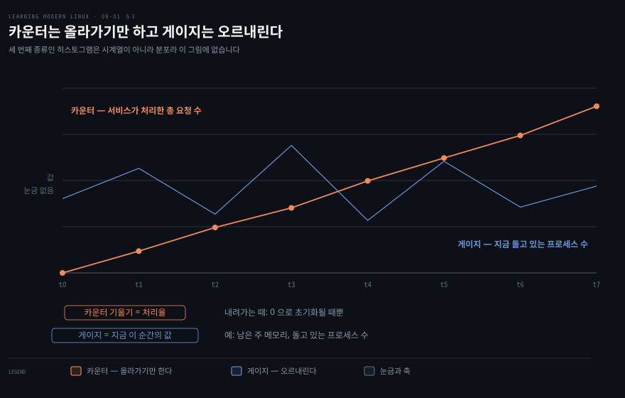

메트릭을 쓸 때 첫 실수는 종류를 안 정하고 숫자부터 내보내는 것입니다. 종류가 정해지면 그 값에 무엇을 물어도 되는지가 함께 정해집니다.

- **카운터**: 값이 올라가기만 합니다. 0 으로 초기화되는 경우만 예외입니다. 서비스가 처리한 총 요청 수나 한 인터페이스로 보낸 총 바이트가 예입니다
- **게이지**: 값이 오르내립니다. 지금 쓸 수 있는 전체 주 메모리나 지금 돌고 있는 프로세스 수가 예입니다
- **히스토그램**: 버킷을 써서 값의 분포를 만듭니다. 데이터가 전체적으로 어떻게 생겼는지를 가늠하게 해 주고, 값의 50% 나 90% 가 어느 구간에 든다는 식의 진술을 가능하게 합니다

위 도식의 두 곡선에 눈금이 없는 것은 크기가 아니라 방향을 보이려는 그림이기 때문입니다. 히스토그램은 시계열이 아니라 분포라 그 선그래프에 담기지 않습니다.

저자가 메트릭에 붙이는 소비 습관도 한 줄 있습니다. 보통 원시 메트릭을 직접 보지 않고 집계나 그래프 표현을 쓰거나, 조건이 충족되면 알림을 받는다는 것입니다.


## 4. 로그를 이루는 세 자리

> "로그를 구조화하라" 는 말을 들었을 때, 로그가 무엇으로 이루어지는지 모르면 무엇을 구조화하라는 것인지 알 수 없습니다.

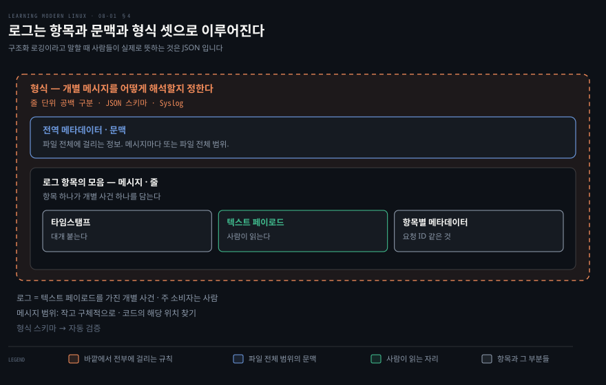

### 풀려는 문제

로그 설정을 만질 일이 생기면 대개 포맷 문자열부터 고칩니다. 그런데 고칠 자리가 셋인데 하나만 알고 있으면, 파일 전체에 걸리는 문맥을 메시지마다 반복해 넣거나 형식 정의 없이 필드만 늘리는 쪽으로 흐릅니다.

### 저자가 로그를 쪼개는 세 자리

- **로그 항목의 모음**: 항목이든 메시지든 줄이든, 개별 사건 하나에 관한 정보를 담습니다
- **메타데이터 또는 문맥**: 메시지마다 붙을 수도 있고 전역 범위로 붙을 수도 있습니다. 저자가 든 전역의 예가 로그 파일 전체입니다
- **개별 메시지를 어떻게 해석할지 정하는 형식**: 로그의 부분들과 그 뜻을 정의합니다. 줄 단위 공백 구분 메시지나 JSON 스키마가 예입니다

형식이 형식 스키마로 표현되면 검증을 자동으로 돌릴 수 있다고 저자가 덧붙입니다. 도식에서 형식을 가장 바깥에 그린 이유가 그것입니다. 형식은 안쪽 항목들과 나란히 놓인 네 번째 부분이 아니라, 안쪽 전부에 뜻을 부여하는 규칙입니다.

개별 사건이라는 말에도 저자가 조건을 답니다. 코드베이스의 맥락에서 생각하라는 것입니다. 데이터베이스 연결에 성공했다는 한 줄을 내보내거나, 파일이 없다는 오류를 표시하는 한 줄이 그것입니다. 그리고 로그 메시지의 범위를 작고 구체적으로 두라고 합니다. 메시지를 받아 보는 사람이 코드의 해당 위치를 찾기 쉬워야 하기 때문입니다.

### 흔한 로그 형식 다섯

저자가 표로 정리한 흔한 로그 형식 다섯입니다. 데이터베이스나 프로그래밍 언어를 위한 더 좁은 범위의 형식과 프레임워크는 이것 말고도 많다고 덧붙입니다.

| 형식 | 저자가 붙인 메모 |
|------|-----------------|
| Common event format | ArcSight 가 개발. 장비와 보안 용도에 씁니다 |
| Common log format | 웹 서버용. extended log format 도 함께 보라고 적습니다 |
| Graylog extended log format | Graylog 가 개발. Syslog 를 개선한 것입니다 |
| Syslog | 운영체제·앱·장비용 |
| Embedded metric format | Amazon 이 개발. 로그와 메트릭 양쪽입니다 |

로그를 오래 굴리려면 부담을 줄여야 한다는 조언도 붙습니다. 조회가 빠르고 발자국이 작아야 한다는 것이며, 그래서 `logrotate` 같은 도구로 로그 회전을 씁니다. 회전이 실제로 무엇을 하는지는 §7 에서 돌려 봅니다. 데이터 온도라는 개념도 소개하는데, 오래된 로그 파일을 더 싸고 느린 저장소로 옮기는 것입니다. 붙인 디스크나 S3 버킷이나 Glacier 가 그 예입니다.

로그 항목의 중요도나 대상 소비자를 알리려고 레벨을 정의하는 일도 흔합니다. 개발용 `DEBUG`, 정상 상태를 알리는 `INFO`, 사람의 개입이 필요할 수 있는 예상 밖 상황을 위한 `ERROR` 가 저자가 든 예입니다. Syslog 에서는 이 레벨이 심각도(severity)라는 이름으로 0 부터 7 까지 번호를 갖습니다. §6 의 선택자와 §8 의 `journalctl -p` 가 그 번호로 줄을 고릅니다.

### 로그에 넣으면 안 되는 것

저자가 이 절에서 유일하게 경고 상자로 세운 내용입니다. 특히 프로덕션 환경에서 주의하라고 못 박습니다.

앱에서 로그 한 줄을 내보내기로 할 때마다, 민감한 정보를 흘릴 여지가 있는지 자문하라는 것입니다. 비밀번호나 API 키일 수도 있고, 그냥 사용자를 식별하는 정보일 수도 있습니다. 이메일이나 계정 ID 가 여기 듭니다.

문제가 되는 이유는 로그의 수명에 있습니다. 로그는 대개 영속적인 형태로 저장되고, 로컬 디스크나 S3 버킷이 그 자리입니다. 그래서 프로세스가 끝나고 한참 뒤에도 누군가 그 민감 정보에 접근해 공격에 쓸 수 있습니다. §7 에서 볼 회전은 이 수명을 줄이지 않습니다. `.1`, `.2.gz` 로 이름만 바뀐 채 몇 주 더 남습니다.


## 5. `/var/log` 지도와 배포판별 이름

> 장애가 났을 때 첫 손이 어느 파일로 가야 하는지는 외워 두는 것이 아니라 디렉터리 구조와 배포판의 규칙이 알려 줍니다.

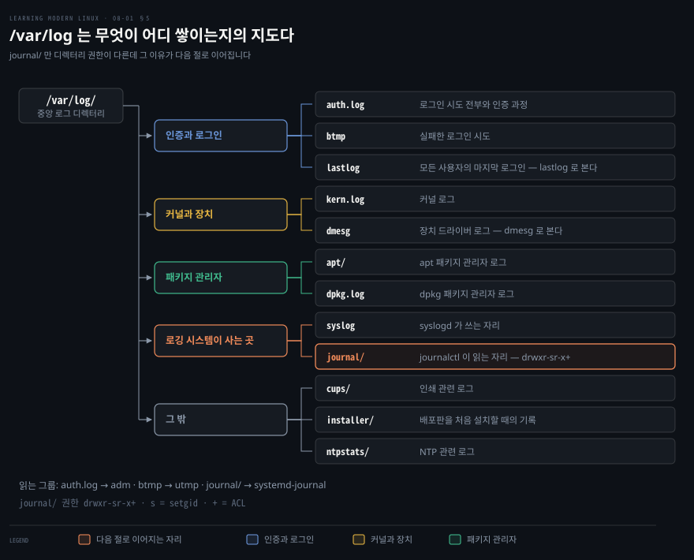

장애 대응에서 시간을 잡아먹는 것은 로그를 읽는 일이 아니라 어느 로그를 읽을지 고르는 일입니다. 인증 실패를 보려는데 커널 로그를 열고 있으면 아무것도 나오지 않습니다. 배포판이 그 선택을 미리 해 두었으므로, 자리를 알면 첫 손이 바로 갑니다.

리눅스의 중앙 로그 디렉터리를 저자가 `ls -al /var/log` 로 먼저 훑습니다.

저자는 읽기 좋게 줄인 출력이라고 밝히면서 열두 항목에 한 줄씩 주석을 답니다. 도식의 묶음 이름은 이 노트가 읽기 편하라고 붙인 것입니다.

| 자리 | 무엇이 쌓이나 |
|------|--------------|
| `auth.log` | 로그인 시도 전부와 인증 과정. 성공과 실패를 모두 담습니다 |
| `btmp` | 실패한 로그인 시도 |
| `lastlog` | 모든 사용자의 마지막 로그인. `lastlog` 명령으로 봅니다 |
| `kern.log` | 커널 로그 |
| `dmesg` | 장치 드라이버 로그. `dmesg` 명령으로 봅니다 |
| `apt/` | apt 패키지 관리자 로그 |
| `dpkg.log` | dpkg 패키지 관리자 로그 |
| `syslog` | syslogd 가 쓰는 자리 |
| `journal/` | journalctl 이 읽는 자리 |
| `cups/` | 인쇄 관련 로그 |
| `installer/` | 배포판을 처음 설치할 때의 기록 |
| `ntpstats/` | NTP 관련 로그 |

출력에서 파일 이름 못지않게 눈에 띄는 것이 소유 그룹입니다. 세 줄만 옮깁니다.

```bash
-rw-r-----   1 syslog  adm               7319 Jul 13 07:17 auth.log
-rw-rw----   1 root    utmp              1536 Sep 21 14:07 btmp
drwxr-sr-x+  3 root    systemd-journal   4096 Jan 24  2021 journal/
```

로그를 읽을 권한이 파일마다 다른 그룹에 걸려 있습니다. `auth.log` 는 `adm`, `btmp` 는 `utmp`, `journal/` 은 `systemd-journal` 입니다. 4장에서 본 원칙이 여기 그대로 적용돼 있습니다. 전부 아니면 전무 대신, 읽어도 되는 사람을 그룹 단위로 좁혀 둔 것입니다.

`journal/` 한 줄에는 표시가 둘 더 붙어 있습니다. 그룹 실행 자리의 `s` 와 권한 문자열 끝의 `+` 입니다. 앞의 것은 setgid 이고 뒤의 것은 ACL 이 걸려 있다는 뜻입니다. 두 표시는 [4장의 권한 노트](./04-01.%EC%A0%84%EB%B6%80%20%EC%95%84%EB%8B%88%EB%A9%B4%20%EC%A0%84%EB%AC%B4%EC%97%90%EC%84%9C%20%EC%9E%98%EA%B2%8C%20%EC%AA%BC%EA%B0%9C%EB%8A%94%20%EC%AA%BD%EC%9C%BC%EB%A1%9C.md#6-이분법을-쪼개는-세-장치)가 「r·w·x 말고 보이는 글자들」과 ACL 절에서 풉니다. 저널 디렉터리는 새로 생기는 파일이 `systemd-journal` 그룹을 물려받게 해 두고 그 위에 ACL 을 한 겹 더 얹은 셈입니다.

### Debian 과 RHEL 의 파일 이름

위 목록은 Debian 계열의 이름입니다. RHEL 계열에서 같은 것을 찾으면 파일 이름이 다릅니다. 이름을 정하는 것은 커널도 systemd 도 아니고 rsyslog 의 기본 규칙이라서, 두 계열의 규칙이 다르게 적혀 있을 뿐입니다. 규칙 자체는 §6 에서 봅니다.

| 무엇이 쌓이나 | Debian 12·Ubuntu | Rocky Linux 9 (RHEL 계열) |
|--------------|------------------|---------------------------|
| 대부분의 시스템 메시지 | `syslog` | `messages` |
| 인증·sudo·sshd | `auth.log` | `secure` |
| cron 실행 기록 | `cron.log` (Ubuntu 는 규칙이 주석이라 `syslog` 에 섞임) | `cron` |
| 메일 | `mail.log` | `maillog` |
| 커널 | `kern.log` | 따로 없고 `messages` 에 섞임 |
| 부팅 스크립트 메시지(`local7`) | 규칙 없음 | `boot.log` |
| 패키지 관리자 | `apt/`, `dpkg.log` | `dnf.log`, `dnf.rpm.log` |
| 감사(audit) | 패키지를 깔면 `audit/audit.log` | `audit/audit.log` |

cron 기록에는 단서가 하나 붙습니다. 이 파일에 남는 것은 cron 이 무엇을 언제 실행했다는 줄이지, 실행한 스크립트의 출력이 아닙니다. `cron(8)` 은 명령의 출력을 crontab 주인이나 `MAILTO` 로 정한 사용자에게 메일로 보낸다고 적습니다.

`dmesg` 도 이름이 같다고 같은 것이 아닙니다. `dmesg` 명령은 지금 커널 링 버퍼를 읽습니다.[^dmesg] Ubuntu 의 `/var/log/dmesg` 는 `dmesg.service` 가 부팅 때 `journalctl --boot 0 --dmesg` 출력을 저장해 둔 사본이라, 부팅 이후의 커널 메시지는 담지 않습니다. 지금까지의 커널 메시지가 필요하면 `dmesg` 나 `journalctl -k` 를 씁니다.

`audit.log` 는 auditd 가 쓰는 감사 기록이고 사람이 읽기 어려운 키=값 줄입니다. 그래서 짝이 되는 도구가 둘 있습니다. `ausearch` 는 이벤트 유형이나 사용자 같은 조건으로 이벤트를 골라 주고, `aureport` 는 감사 로그를 요약 보고서로 묶어 줍니다.[^audit]

서비스는 자기 디렉터리에 따로 쓰기도 합니다. Rocky Linux 9 에서 패키지를 깔고 그 패키지의 logrotate 설정과 기본 설정 파일에서 확인한 자리입니다.

| 서비스 | 자리 | 확인한 곳 |
|--------|------|----------|
| nginx | `/var/log/nginx/*.log` (access·error) | `/etc/logrotate.d/nginx` |
| Apache httpd | `/var/log/httpd/*log` (`access_log`·`error_log`) | `/etc/logrotate.d/httpd` |
| MariaDB | `/var/log/mariadb/mariadb.log` | `my.cnf.d/mariadb-server.cnf` 의 `log-error` |
| firewalld | `/var/log/firewalld` | `/etc/logrotate.d/firewalld` |
| Pacemaker | `/var/log/pacemaker/pacemaker.log` | `/etc/sysconfig/pacemaker` 의 `PCMK_logfile` 기본값 |
| cloud-init | `/var/log/cloud-init.log`, `cloud-init-output.log` | `/etc/cloud/cloud.cfg.d/05_logging.cfg` |
| 설치 프로그램 | `/var/log/anaconda/` | 이미지에 남은 디렉터리 |

MariaDB 의 느린 쿼리 로그는 기본으로 꺼져 있어 이 자리에 없습니다. `mariadbd --verbose --help` 가 `slow-query-log FALSE`, `long-query-time 10` 을 출력하므로, 켜야 그때부터 생깁니다.

### 바이너리 로그인 기록

`wtmp`·`btmp`·`lastlog` 셋은 `cat` 으로 열면 글자가 깨집니다. 텍스트 줄이 아니라 `utmp(5)` 가 정한 고정 크기 레코드를 이어 붙인 파일이기 때문입니다.[^utmp] 그래서 파일마다 읽는 명령이 따로 있습니다.

| 파일 | 담는 것 | 읽는 명령 |
|------|--------|----------|
| `/var/log/wtmp` | 로그인과 로그아웃 전부, 재부팅과 종료 | `last`, `last reboot`, `last -x` |
| `/var/log/btmp` | 실패한 로그인 시도 | `lastb` |
| `/var/log/lastlog` | 사용자마다 마지막 로그인 하나 | `lastlog` |

`last` 는 `wtmp` 를 거꾸로 훑어 출력합니다. 재부팅할 때마다 `reboot` 라는 가짜 사용자가 로그인한 것으로 남으므로 `last reboot` 가 곧 재부팅 이력입니다. `-x` 를 붙이면 종료와 런레벨 변경 줄까지 나옵니다.[^last] 막 띄운 Debian 12 컨테이너에서는 기록이 비어 있습니다. `last -x reboot shutdown` 은 `wtmp begins Tue Nov 10 05:03:15 2026` 한 줄만 냅니다. `lastlog` 는 사용자마다 `**Never logged in**` 을 찍습니다.

`utmp(5)` 는 이 파일들을 만드는 프로그램이 없다고 적습니다. 그래서 `wtmp` 를 지우면 그때부터 기록이 끊깁니다. 디스크를 비우려고 이 파일을 지우는 대신 §7 의 회전에 맡기는 이유입니다.

### 디스크를 먹는 로그 찾기

`/var` 가 찼다는 알림이 오면 어느 파일이 큰지부터 셉니다. `du -sh` 로 항목마다 크기를 사람이 읽는 단위로 내고, `sort -rh` 로 그 단위를 이해하며 큰 순서로 세웁니다. 아래는 `du -sh /var/log/* | sort -rh | head -3` 의 출력입니다.

```bash
25M	/var/log/user.log.2.gz
25M	/var/log/syslog.2.gz
8.0M	/var/log/journal
```

위는 컨테이너에서 로그를 일부러 채운 뒤의 출력입니다. 회전된 `.2.gz` 가 맨 위에 오고 `journal` 이 따로 한 줄을 차지합니다. 앞의 것은 §7 의 logrotate 가, 뒤의 것은 §9 의 journald 가 관리하므로 줄이는 방법도 갈립니다.

### 흐르는 로그를 따라가기

로그를 실시간으로 소비하는 흔한 패턴이 로그를 따라가는 것입니다. 새 줄이 붙는 대로 로그의 끝을 지켜보는 방식이고, `tail -f /var/log/syslog` 가 그 명령입니다.

```bash
Sep 26 15:06:41 starlite nm-applet[31555]: ... 'GTK_IS_WIDGET (widget)' fa
Sep 26 15:06:41 starlite nm-dispatcher: ... new request (3 scripts)
Sep 26 15:06:41 starlite systemd[1]: Starting PackageKit Daemon...
Sep 26 15:06:41 starlite nm-dispatcher: ... start running ordered scripts.
Sep 26 15:06:42 starlite PackageKit: daemon start
```

출력의 각 줄이 §6 에서 볼 Syslog 형식이고, 줄 끝은 지면에 맞춰 잘린 채입니다. 서비스가 자기 디렉터리에 쓰는 로그도 같은 방법으로 따라갑니다. 클러스터 노드라면 `tail -f /var/log/pacemaker/pacemaker.log` 가 그 예입니다.

프로세스의 출력을 화면으로 보면서 동시에 파일에도 남기고 싶을 때가 있습니다. 그때 `someprocess | tee -a some.log` 처럼 `tee` 를 씁니다. `-a` 를 붙이는 이유를 저자가 짚습니다. 붙이지 않으면 로그 파일이 잘려 나가기 때문입니다.


## 6. Syslog 형식과 rsyslog 라우팅

> Syslog 한 줄을 파싱하려면 어느 필드가 항상 있는지 알아야 하고, 그 줄이 어느 파일에 떨어지는지 알려면 rsyslog 의 규칙을 읽어야 합니다.

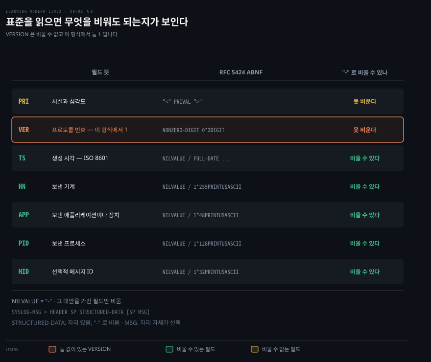

커널과 데몬과 사용자 프로그램이 저마다 다른 모양으로 줄을 쓰면, 한 줄을 읽을 때마다 출처부터 가려야 합니다. 이 소스들을 한 형식으로 아우르는 로깅 표준이 Syslog 입니다. 뿌리가 네트워크 환경에 있고, 오늘날의 프로토콜은 RFC 5424 가 정의한 텍스트 형식과 배포 시나리오와 보안 고려사항으로 이루어진다고 저자가 적습니다.[^rfc5424]

### 헤더 일곱 필드와 비울 수 있는 자리

저자는 형식을 그림 하나로 보이면서 단서를 답니다. 좀처럼 쓰이지 않는 선택적 필드가 많다는 것입니다. 이 노트의 도식은 RFC 의 ABNF 에서 직접 세운 것이라 헤더 일곱 필드만 담습니다. 저자는 그중 `TS` 와 `HN` 이 가장 자주 쓰인다고 덧붙입니다.

| 필드 | 저자가 붙인 설명 |
|------|-----------------|
| `PRI` | 메시지의 시설과 심각도 |
| `VER` | Syslog 프로토콜 번호 |
| `TS` | 메시지가 생성된 시각. ISO 8601 형식 |
| `HN` | 메시지를 보낸 기계 |
| `APP` | 메시지를 보낸 애플리케이션 또는 장비 |
| `PID` | 메시지를 보낸 프로세스 |
| `MID` | 선택적 메시지 ID |

어느 필드를 비울 수 있는지는 ABNF 가 정합니다. RFC §6 의 헤더는 `HEADER = PRI VERSION SP TIMESTAMP SP HOSTNAME SP APP-NAME SP PROCID SP MSGID` 이고, 비울 수 있는 필드는 정의에 `NILVALUE /` 대안을 가진 쪽입니다. `NILVALUE` 는 하이픈 한 글자입니다. `TIMESTAMP`·`HOSTNAME`·`APP-NAME`·`PROCID`·`MSGID` 다섯이 그 대안을 갖습니다.

`PRI` 와 `VERSION` 은 대안이 없어 늘 값이 있습니다. `VERSION` 은 `NONZERO-DIGIT 0*2DIGIT` 이고 이 RFC 형식에서는 `1` 입니다. 그래서 RFC 5424 형식의 줄을 파싱한다면 `-` 하나만 든 필드를 다섯 자리에서 만날 각오를 하되, 버전 자리에서는 만나지 않습니다.

헤더 뒤의 구조는 `SYSLOG-MSG = HEADER SP STRUCTURED-DATA [SP MSG]` 입니다. 구조화 데이터는 키와 값의 목록이고 각 요소가 대괄호로 묶인다고 저자가 적습니다. RFC §6.3 의 `SD-ELEMENT = "[" SD-ID *(SP SD-PARAM) "]"` 가 그 대괄호입니다. `[SP MSG]` 의 대괄호는 글자가 아니라 선택 사항을 뜻하는 ABNF 표기입니다. 그래서 구조화 데이터는 자리는 있되 `-` 로 비울 수 있습니다. 자유 형식 본문 `MSG` 는 통째로 없을 수 있습니다.

RFC 5424 는 2009년 3월에 나오며 표지에 `Obsoletes: 3164` 를 적었습니다. RFC 3164 는 표준이 아니라 현장에서 관찰된 형식을 기술한 정보성 문서였습니다. 위 `tail -f` 출력의 `Sep 26 15:06:41 starlite ...` 처럼 버전 필드 없이 시작하는 줄이 그 옛 형식이라, 현장에는 두 세대의 줄이 섞여 있습니다.

### journald 에서 rsyslog 로 가는 두 길

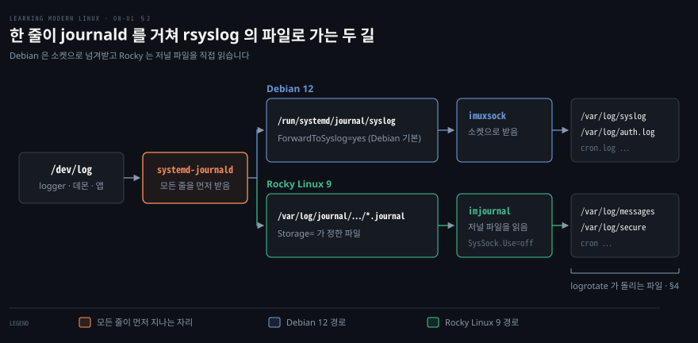

systemd 를 쓰는 배포판에서 `/dev/log` 로 들어온 줄을 먼저 받는 것은 journald 입니다. rsyslog 는 그 뒤에서 같은 줄을 받아 텍스트 파일로 나눠 씁니다. 받는 길은 배포판마다 하나씩 고른 것이고, 두 길 모두 `journald.conf(5)` 가 설명합니다.[^journald-conf]

| 계열 | rsyslog 의 입력 모듈 | 받는 길 |
|------|---------------------|--------|
| Debian 12 | `imuxsock` | journald 가 `ForwardToSyslog=yes`(기본)로 `/run/systemd/journal/syslog` 소켓에 넘깁니다 |
| Rocky Linux 9 | `imjournal` (`SysSock.Use="off"`) | rsyslog 가 저널 파일을 `journalctl` 처럼 직접 읽고 위치를 상태 파일에 적어 둡니다 |

Debian 컨테이너의 저널에는 그 연결이 한 줄로 남습니다. `rsyslogd[50]: imuxsock: Acquired UNIX socket '/run/systemd/journal/syslog' (fd 3) from systemd.` 입니다. `journald.conf(5)` 는 둘째 길이 더 흔하다고 적으면서, 그 길에서는 `ForwardToSyslog=` 가 아니라 `Storage=` 가 rsyslog 에 상관있다고 짚습니다. 저널이 파일로 남지 않으면 읽을 것이 없기 때문입니다.

### 선택자와 PRI 값

rsyslog 의 고전 규칙은 한 줄에 선택자와 동작 하나씩입니다. 선택자는 `시설.심각도` 꼴이고, 심각도를 적으면 그 수준과 더 심각한 것까지 고릅니다.[^rsyslog-conf] `*` 는 전부, `none` 은 그 시설 제외입니다. 주석과 빈 줄을 걷어 내는 `grep -vE "^\s*(#|$)" /etc/rsyslog.conf` 로 Debian 12 의 규칙만 본 결과입니다.

```bash
$FileOwner root
$FileGroup adm
$FileCreateMode 0640
$IncludeConfig /etc/rsyslog.d/*.conf
*.*;auth,authpriv.none          -/var/log/syslog
auth,authpriv.*                 /var/log/auth.log
cron.*                          -/var/log/cron.log
kern.*                          -/var/log/kern.log
mail.*                          -/var/log/mail.log
user.*                          -/var/log/user.log
```

첫 규칙이 `syslog` 의 정체입니다. 모든 시설의 모든 줄을 받되 `auth` 와 `authpriv` 만 빼서 `auth.log` 로 돌립니다. 파일 앞의 `-` 는 쓸 때마다 디스크에 동기화하지 않겠다는 표시입니다. 인증 기록에는 이 표시가 없어 한 줄마다 동기화됩니다. 같은 명령을 Rocky Linux 9 에서 돌리면 규칙 부분이 이렇습니다.

```bash
*.info;mail.none;authpriv.none;cron.none action(type="omfile" file="/var/log/messages")
authpriv.* action(type="omfile" file="/var/log/secure")
mail.* action(type="omfile" file="/var/log/maillog" sync="on")
cron.* action(type="omfile" file="/var/log/cron")
local7.* action(type="omfile" file="/var/log/boot.log")
```

§5 의 이름 차이가 여기서 나옵니다. `messages` 는 `info` 이상만 받고 메일·인증·cron 을 빼며, 커널을 따로 빼는 규칙이 없으니 커널 줄도 `messages` 에 남습니다.

선택자는 `PRI` 값의 두 성분입니다. `PRI` 는 시설 번호에 8 을 곱하고 심각도 번호를 더한 수입니다.[^logger] `local3` 은 19, `info` 는 6 이므로 `local3.info` 는 `<158>` 로 나갑니다. 심각도 번호는 0 `emerg` 부터 1 `alert`, 2 `crit`, 3 `err`, 4 `warning`, 5 `notice`, 6 `info`, 7 `debug` 까지입니다.

### 규칙 추가와 logger 시험

규칙은 `/etc/rsyslog.conf` 를 고치지 않고 `/etc/rsyslog.d/` 에 파일을 하나 넣어 더합니다. 문법 검사, 재시작, 시험 한 줄 순서입니다. `logger -p` 는 `시설.수준` 을 받고, 주지 않으면 `user.notice` 로 나갑니다.

```bash
echo "local3.*    /var/log/local3.log" > /etc/rsyslog.d/50-local3.conf
rsyslogd -N1 && systemctl restart rsyslog
logger -p local3.info "routing test"
cat /var/log/local3.log
```

```bash
2026-11-10T05:02:39.547982+00:00 4b562cba33ea root: routing test
```

같은 줄이 `syslog` 에도 한 번 남습니다. 첫 규칙 `*.*` 가 `local3` 을 빼지 않기 때문입니다. 한 줄이 여러 선택자에 맞으면 맞는 동작이 전부 실행됩니다.

다른 기계로 보내는 것도 같은 꼴의 규칙입니다. 동작 자리에 `@호스트` 를 쓰면 UDP, `@@호스트` 를 쓰면 TCP 로 보내고, 포트를 안 적으면 514 입니다. `*.* @@logs.example.internal:514` 가 모든 줄을 TCP 로 보내는 규칙입니다. `rsyslog.conf(5)` 는 UDP 로 보내면 줄이 사라질 수 있다고 적습니다.

### syslogd 다음에 온 것들

로그 관리는 보통 `syslogd` 바이너리가 맡습니다. 시간이 지나면서 알아 둘 만한 다른 선택지가 생겼다고 저자가 둘을 소개합니다.

| 도구 | 저자가 적은 내용 |
|------|-----------------|
| `syslog-ng` | `syslogd` 를 그대로 갈아 끼울 수 있는 향상된 로그 데몬. TLS·내용 기반 필터링·PostgreSQL 과 MongoDB 같은 데이터베이스로의 로깅을 추가로 지원합니다 |
| `rsyslog` | Syslog 프로토콜을 확장하며 systemd 와 함께 쓸 수도 있습니다 |

RFC 5424 의 저자는 Adiscon 의 R. Gerhards 입니다. `rsyslog` 의 ChangeLog 는 Rainer Gerhards 가 2003년 10월 sysklogd 소스를 손보며 작업을 시작했다고 기록합니다.[^rsyslog] 표준과 지금 가장 흔한 구현이 한 손에서 나왔고, 구현은 기존 syslogd 계보를 이어받았습니다.

저자는 이 절을 이렇게 닫습니다. 나이에도 불구하고 Syslog 계열의 프로토콜과 도구는 여전히 살아 있고 널리 쓰입니다. 다만 systemd 가 사실상의 init 표준이 되어 모든 주요 배포판에 들어가면서 로깅에도 새 길이 생겼습니다. 그 길이 §8 과 §9 의 저널입니다.


## 7. logrotate 와 회전된 파일

> rsyslog 가 쓰는 텍스트 파일은 저절로 줄지 않으므로, 누군가 이름을 바꿔 새 파일을 열게 하고 오래된 것을 지워야 합니다.

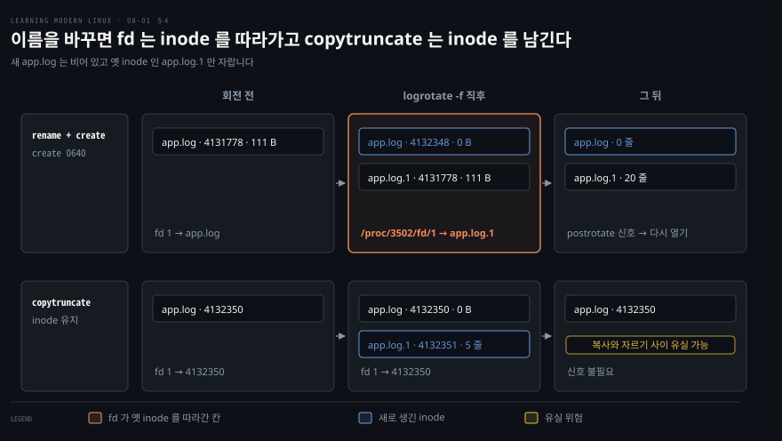

logrotate 를 손으로 부른 적이 없는데도 `/var/log` 의 파일 이름은 때가 되면 바뀝니다. Debian 12 에서는 `logrotate.timer` 가 하루 한 번 logrotate 를 돌리기 때문입니다. 전역 설정 `/etc/logrotate.conf` 는 `weekly`·`rotate 4`·`create` 를 기본으로 둡니다. 그리고 `include /etc/logrotate.d` 로 패키지마다 넣은 설정을 읽습니다.

rsyslog 패키지가 넣은 `/etc/logrotate.d/rsyslog` 는 §6 의 여섯 파일을 한 블록에 묶습니다. `syslog`·`mail.log`·`kern.log`·`auth.log`·`user.log`·`cron.log` 입니다. 그 블록의 지시어는 아래 「지시어 여덟」 표에 거의 다 있습니다. `postrotate` 는 `/usr/lib/rsyslog/rsyslog-rotate` 를 부릅니다.

### 회전된 이름과 zgrep

한 번 돌 때마다 번호가 하나씩 밀립니다. 지금 파일이 `syslog.1` 이 되고 그 전 것이 `syslog.2.gz` 가 됩니다. `rotate 4` 를 넘는 것은 지워집니다. `.1` 만 압축되지 않은 것은 `delaycompress` 때문입니다. 직전 파일의 압축을 다음 회전으로 미뤄, 아직 그 파일에 쓰고 있을지 모르는 프로그램을 배려합니다.[^logrotate] 세 세대가 있는 자리에서 `zgrep -c needle /var/log/syslog*` 를 돌린 출력입니다.

```bash
/var/log/syslog:0
/var/log/syslog.1:1
/var/log/syslog.2.gz:0
```

`grep` 은 압축 파일 안을 보지 못하지만 `zgrep` 은 필요하면 풀어서 `grep` 에 넘깁니다. 압축되지 않은 파일도 그대로 받으므로 `syslog*` 한 번으로 세 세대를 다 뒤집니다.[^zgrep]

### 지시어 여덟

패키지 설정에서 자주 보는 지시어입니다. 블록 안에 적으면 그 블록에만, 블록 밖에 적으면 뒤따르는 모든 블록에 걸립니다.

| 지시어 | 하는 일 |
|--------|--------|
| `daily`·`weekly`·`monthly` | 회전 주기 |
| `rotate 4` | 회전된 파일을 몇 세대 남길지. 넘는 것은 지웁니다 |
| `compress`·`delaycompress` | 회전된 파일을 gzip 으로 압축, 직전 세대만 다음 회전까지 미룸 |
| `missingok` | 파일이 없어도 오류로 치지 않음 |
| `notifempty` | 빈 파일은 돌리지 않음 |
| `create 0640 root adm` | 이름을 바꾼 직후, `postrotate` 전에 같은 이름의 빈 파일을 이 권한으로 만듦 |
| `sharedscripts` | 패턴에 여러 파일이 걸려도 `postrotate` 를 한 번만 실행 |
| `postrotate` … `endscript` | 회전 뒤 실행할 셸 명령. 대개 프로그램에 파일을 다시 열라는 신호 |

### 옛 inode 에 남는 쓰기와 copytruncate

회전의 기본 동작은 이름 바꾸기입니다. 그런데 열린 파일 기술자는 이름이 아니라 inode 를 가리킵니다. 그래서 `app.log` 를 `app.log.1` 로 바꾸고 새 `app.log` 를 만들어도, 쓰던 프로세스는 계속 옛 inode 에 씁니다. 0.2초마다 한 줄을 붙이는 셸 루프를 두고 컨테이너에서 `create 0640 root adm` 으로 강제 회전한 결과입니다.

```bash
# 회전 전
4043891 -rw-r--r-- root root  90 app.log
# logrotate -f 뒤
4043892 -rw-r----- root adm    0 app.log
4043891 -rw-r--r-- root root 180 app.log.1
/proc/1033/fd/1 -> /srv/demo/app.log.1
# 1초 뒤 줄 수
0 app.log
15 app.log.1
```

새 파일은 비어 있고 옛 파일만 자랍니다. 그래서 `postrotate` 에서 프로그램에 파일을 다시 열라고 알려야 하고, 그 신호는 프로그램마다 다릅니다. 시그널 자체는 [9장 첫 편의 시그널 절](./09-01.%EC%9D%B4%20%EC%9E%A5%EC%9D%84%20%EB%AC%B6%EB%8A%94%20%EA%B2%83%EC%9D%80%20%EC%A3%BC%EC%A0%9C%EA%B0%80%20%EC%95%84%EB%8B%88%EB%9D%BC%20%ED%95%84%EC%9A%94%ED%95%B4%EC%A7%80%EB%8A%94%20%EC%A1%B0%EA%B1%B4%EC%9D%B4%EB%8B%A4.md#시그널--커널이-프로세스를-두드리는-방법)이 다룹니다.

| 프로그램 | 패키지 설정의 `postrotate` | 근거 |
|----------|---------------------------|------|
| rsyslog (Debian) | `rsyslog-rotate` → `systemctl kill -s HUP rsyslog.service` | 저널에 `rsyslogd was HUPed` 가 남습니다 |
| rsyslog (Rocky) | `systemctl -s HUP kill rsyslog.service` | `/etc/logrotate.d/rsyslog` |
| nginx | ``kill -USR1 `cat /run/nginx.pid` `` | nginx 문서가 `USR1` 을 로그 파일 다시 열기로 정합니다[^nginx] |
| httpd | `systemctl reload httpd.service` | `/etc/logrotate.d/httpd` |

신호를 받을 수 없는 프로그램에는 `copytruncate` 가 있습니다. 파일을 복사한 뒤 원본을 0 바이트로 자르므로 inode 가 그대로입니다. 쓰던 프로세스는 아무것도 몰라도 됩니다. 같은 루프로 돌리면 `app.log` 의 inode 4043895 가 회전 전후 같고, 새 inode 4043896 을 받은 `app.log.1` 에 다섯 줄이 복사됩니다.

대가는 복사와 자르기 사이의 틈입니다. `logrotate(8)` 은 그 짧은 시간에 쓰인 줄이 사라질 수 있다고 적고, 이 옵션을 쓰면 `create` 는 효과가 없다고 덧붙입니다. Rocky Linux 9 의 firewalld 설정이 이 방식을 씁니다.

### 바꾸기 전에 `-d`, 지금 돌리려면 `-f`

`logrotate -d` 는 아무것도 바꾸지 않고 판정만 출력하며, 마지막 회전 시각을 적는 상태 파일도 건드리지 않습니다. 새 설정을 넣었으면 먼저 `logrotate -d /etc/logrotate.d/demo` 처럼 이것으로 봅니다.

```bash
rotating pattern: /srv/demo/app.log  1048576 bytes (3 rotations)
empty log files are not rotated, old logs are removed
considering log /srv/demo/app.log
  log does not need rotating (log size is below the 'size' threshold)
```

조건과 상관없이 지금 돌려야 하면 `-f` 입니다. 설정 파일이 그룹이나 다른 사용자에게 쓰기 권한이 열려 있거나 상위 디렉터리 권한이 느슨하면 logrotate 는 그 설정을 건너뜁니다. 실습에서 `umask 0` 으로 만든 설정이 그렇게 무시됐습니다.


## 8. journalctl 로 범위 좁히기

> `cat` 과 `grep` 이 안 통하는 로그를 처음 만나면 도구가 이상해 보입니다. 그런데 그 불편은 대가로 치른 것이고, 받은 것은 필드로 묻는 능력입니다.

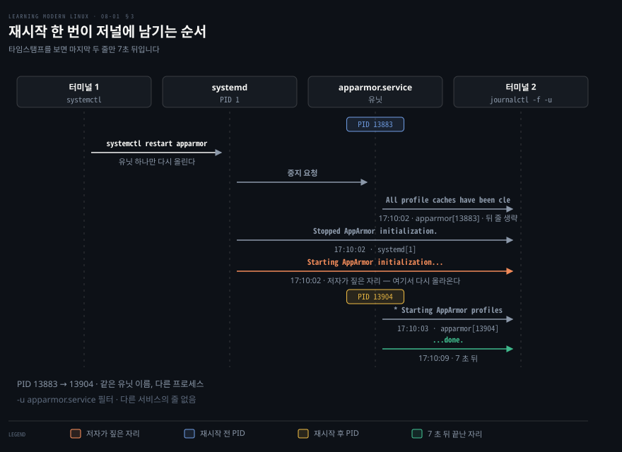

`grep` 으로 로그를 뒤지던 손이 저널 앞에서 처음 멈춥니다. 파일을 찾아 열어도 사람이 읽을 글자가 거기 없기 때문입니다. 이 절은 그 불편이 무엇과 맞바꾼 것인지부터 봅니다.

`journalctl` 은 systemd 생태계에서 로그 관리를 맡는 구성요소입니다. 지금까지 본 다른 시스템과 달리 로그 항목을 바이너리 형식으로 저장합니다. 이 선택이 더 빠른 접근과 더 나은 저장 발자국을 가능하게 한다고 저자가 적습니다.

바이너리 저장 형식은 도입 당시 비판을 받았습니다. 사람들이 익숙한 `tail` 과 `cat` 과 `grep` 으로 로그를 보고 검색하는 일을 계속할 수 없게 됐기 때문입니다. 저자는 그 비판을 인정하면서도 균형을 답니다. `journalctl` 을 쓰면 로그와 상호작용하는 새 방식을 배워야 하지만 학습 곡선이 그렇게 나쁘지는 않다는 것입니다.

인자 없이 실행하면 모든 로그에 대한 대화형 페이저로 나타납니다. 화살표 키나 스페이스 바로 넘기고 `q` 로 빠져나옵니다. 시스템 저널을 읽으려면 root 이거나 `systemd-journal`·`adm`·`wheel` 그룹 중 하나에 들어 있어야 합니다.[^journalctl]

### 시간·유닛·형식

시간 범위를 제한하는 방법은 둘입니다. `journalctl --since "3 hours ago"` 는 지난 세 시간 동안 일어난 일로 좁힙니다. `--since "2021-09-26 15:30:00" --until "2021-09-26 18:30:00"` 은 시작과 끝을 명시합니다.

특정 systemd 유닛으로 좁히려면 `-u` 를 씁니다. `-u` 는 여러 번 줄 수 있고, 그러면 두 유닛의 줄이 시간순으로 한 화면에 섞입니다. 서로 기대는 두 서비스가 같은 순간에 무엇을 했는지 볼 때 `journalctl -u pacemaker -u corosync --since "1 hour ago"` 처럼 씁니다.

출력 형식은 `--output` 또는 짧게 `-o` 로 고릅니다. 저자가 꼽은 셋에 `short-iso` 를 더했습니다. 다른 기계나 다른 시간대의 로그와 맞대 볼 때는 시간대가 붙은 ISO 시각이 낫습니다.

| 값 | 쓰임 |
|----|-----|
| `cat` | 시각도 소스도 없는 짧은 형태 |
| `short` | 기본값. Syslog 출력을 흉내 냅니다 |
| `short-iso` | `short` 에서 시각만 `2026-11-10T05:01:52+0000` 꼴로 |
| `json` | 줄마다 JSON 형식 항목 하나. 자동화용입니다 |

`tail -f` 와 같은 경험, 곧 로그를 따라가는 것도 `journalctl -f` 로 됩니다.

### 부팅과 심각도로 좁히기

"어젯밤 재부팅 전에 무슨 오류가 났나" 는 `/var/log` 의 텍스트 파일로는 시각부터 어림해야 하는 질문입니다. 저널은 항목마다 부팅 ID 를 붙여 두므로 부팅 단위로 바로 물을 수 있습니다. `-b` 는 이번 부팅, `-b -1` 은 그 전 부팅이고, `--list-boots` 가 번호와 ID 를 보여 줍니다. 여러 번 부팅한 Ubuntu VM 에서 `journalctl --list-boots | head -3` 과 `journalctl -b -1 -p err | tail -1` 을 차례로 돌린 출력입니다.

```bash
IDX BOOT ID                          FIRST ENTRY                 LAST ENTRY
-11 3deb8bacc1e24be68016ab5bee84fcf0 Thu 2026-08-27 22:21:00 KST Mon 2026-08-31 00:31:39 KST
-10 aa1689b9172947b0b42b97cba129a482 Mon 2026-08-31 10:06:13 KST Sun 2026-09-06 16:43:51 KST
Oct 26 14:09:41 ubuntu2 systemd[1]: Failed to start systemd-networkd-wait-online.service - Wait for Network to be Online.
```

`-p err` 는 §6 의 심각도 표에서 `err` 와 그보다 심각한 `crit`·`alert`·`emerg` 를 함께 고릅니다. `-p warning..err` 처럼 범위로도 줄 수 있습니다. 저널이 `/run` 에만 있는 기계나 막 띄운 컨테이너에서는 `-b -1` 이 실패합니다. 메시지는 `Data from the specified boot (-1) is not available: No such boot ID in journal` 입니다. 지난 부팅 기록이 남으려면 저장이 영속이어야 하고, 그 조건은 §9 가 다룹니다.

커널 메시지만 보려면 `-k` 입니다. `-b` 가 함께 걸리므로 이번 부팅의 커널 줄이 나오고, §5 의 `dmesg` 와 같은 것을 저널에서 읽는 셈입니다.

### 필드로 좁히기

저널 항목은 줄이 아니라 필드 묶음입니다. `-o json` 으로 한 항목을 펼치면 `MESSAGE`, `PRIORITY`, `SYSLOG_FACILITY` 옆에 `_PID`, `_COMM`, `_SYSTEMD_UNIT`, `_BOOT_ID`, `_TRANSPORT` 같은 밑줄로 시작하는 필드가 보입니다. 밑줄 필드는 보낸 쪽이 적은 것이 아니라 journald 가 붙인 것이라 위조할 수 없습니다.[^journal-fields]

`필드=값` 을 인자로 주면 그 필드로 고릅니다. `-u` 도 사실 `_SYSTEMD_UNIT=` 매치를 더하는 줄임입니다. 다른 필드끼리는 AND, 같은 필드를 두 번 주면 OR 로 묶입니다.

`journalctl _COMM=logger -b -o short-iso` 의 출력입니다.

```bash
2026-11-10T05:02:23+0000 4b562cba33ea root[409]: volatile test
2026-11-10T05:02:39+0000 4b562cba33ea root[441]: routing test
2026-11-10T05:02:40+0000 4b562cba33ea root[445]: authpriv test
```

`logger` 로 보낸 줄만 이번 부팅에서 골랐습니다. `_PID=441` 을 주면 그 프로세스 하나로 더 좁혀집니다. 텍스트 파일에서는 `grep 'root\[441\]'` 처럼 줄 모양에 기대야 하는 일을, 저널은 필드 이름으로 묻습니다.

### 배운 것을 한 장면에 합치기

저자가 앞의 정보를 전부 합쳐 구체적인 예를 하나 만듭니다. systemd 가 관리하는 보안 구성요소 AppArmor 를 다시 띄우는 장면입니다. 한 터미널에서 `systemctl restart apparmor` 를 실행하고, 다른 터미널에서 `journalctl -f -u apparmor.service` 를 실행합니다.

```bash
-- Logs begin at Sun 2021-01-24 14:36:30 GMT. --
Sep 26 17:10:02 starlite apparmor[13883]: All profile caches have been cle
                                          but no profiles have been unload
Sep 26 17:10:02 starlite apparmor[13883]: Unloading profiles will leave al
                                          running processes permanently
...
Sep 26 17:10:02 starlite systemd[1]: Stopped AppArmor initialization.
Sep 26 17:10:02 starlite systemd[1]: Starting AppArmor initialization...
Sep 26 17:10:02 starlite apparmor[13904]: * Starting AppArmor profiles
Sep 26 17:10:03 starlite apparmor[13904]: Skipping profile in
                                          /etc/apparmor.d/disable: usr.sbin.rsy
Sep 26 17:10:09 starlite apparmor[13904]:
...done.
Sep 26 17:10:09 starlite systemd[1]: Started AppArmor initialization.
```

위 출력은 지면에 맞춰 줄을 접고 줄임표로 줄인 것이고 실제로는 항목 하나가 한 줄입니다. 저자가 이 출력에서 짚는 자리는 하나입니다. systemd 가 서비스를 멈춘 다음, 여기서 다시 올라온다는 것입니다. 그 자리가 `Starting AppArmor initialization...` 줄입니다.

출력에서 두 가지를 더 읽을 수 있습니다. 첫째로 프로세스 ID 가 `13883` 에서 `13904` 로 바뀝니다. 유닛 이름은 그대로지만 프로세스는 다른 것이며, 그것이 재시작이 실제로 일어났다는 증거입니다. 둘째로 타임스탬프를 보면 대부분이 `17:10:02` 안에 몰려 있고 마지막 두 줄만 `17:10:09` 입니다. 프로파일을 올리는 데 7초가 걸렸다는 뜻입니다.

`-u` 로 유닛 하나를 걸러 두었기 때문에 이 화면에는 다른 서비스의 줄이 섞이지 않습니다. 6장에서 systemd 의 유닛을 배운 것이 여기서 조회 조건으로 돌아옵니다.


## 9. 저널의 저장 위치와 보존 한도

> 저널은 logrotate 가 돌리지 않습니다. 어디에 남는지, 얼마나 남는지, 어떻게 줄이는지를 journald 가 스스로 정하므로 그 규칙을 알아야 지난 부팅 기록을 잃지 않고 디스크도 지킵니다.

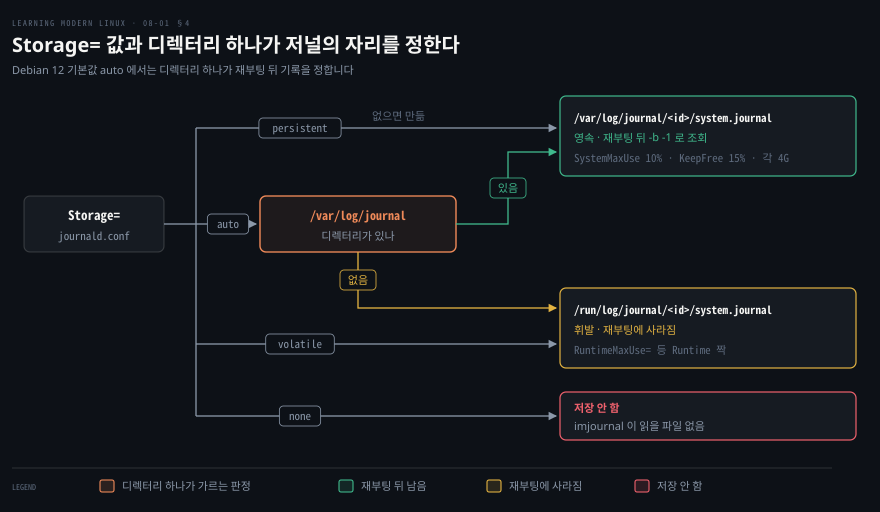

### Storage= 와 저장 위치

저널 파일의 자리는 `/etc/systemd/journald.conf` 의 `Storage=` 가 정합니다. 기본값 `auto` 는 `/var/log/journal` 디렉터리가 있으면 그 아래에 영속으로 쓰고, 없으면 `/run/log/journal` 에 휘발성으로 씁니다. `/run` 은 메모리 위의 파일시스템이라 재부팅하면 사라집니다. 그러면 §8 의 `-b -1` 이 답할 것이 없어집니다.[^journald-conf]

| 값 | 쓰는 곳 |
|----|--------|
| `auto` (기본) | `/var/log/journal` 이 있으면 그곳, 없으면 `/run/log/journal` |
| `persistent` | `/var/log/journal`. 없으면 만듭니다. 부팅 초기에는 `/run` 에 썼다가 옮깁니다 |
| `volatile` | `/run/log/journal` 만. 이미 있는 영속 파일은 지우지 않습니다 |
| `none` | 저장하지 않음. rsyslog 의 `imjournal` 같은 독자가 읽을 것이 없어집니다 |

Debian 12 컨테이너에서 디렉터리 하나로 판정이 갈리는지 봤습니다. `/var/log/journal` 을 지우고 journald 를 재시작하자 저널이 `/run/log/journal/<machine-id>/system.journal` 에만 생겼습니다.

되돌릴 때는 `mkdir -p /var/log/journal` 로 디렉터리를 만들었습니다. 이어서 `systemd-tmpfiles --create --prefix /var/log/journal` 로 §5 에서 본 그룹과 ACL 을 입혔습니다. 그리고 journald 를 재시작하고 `journalctl --flush` 를 주자 `/run` 의 항목이 `/var/log/journal` 로 옮겨졌습니다. 설정 파일을 고친 뒤에도 같은 `systemctl restart systemd-journald` 로 적용합니다. `systemctl` 의 동사들은 [6장 첫 편의 도구 절](./06-01.%EB%A8%BC%EC%A0%80%20%EC%BC%9C%EC%A7%80%EB%8A%94%20%EA%B2%83%20%ED%95%98%EB%82%98%EA%B0%80%20%EB%82%98%EB%A8%B8%EC%A7%80%20%EC%A0%84%EB%B6%80%EB%A5%BC%20%EC%BC%A0%EB%8B%A4.md#5-손으로-만지는-도구들)이 다룹니다.

### 기본 크기 상한

설정 파일의 줄이 모두 `#SystemMaxUse=` 처럼 주석이라 상한이 없어 보이지만, 주석은 기본값을 보여 줄 뿐입니다. `journald.conf(5)` 의 기본은 이렇습니다.

| 설정 | 기본값 | 뜻 |
|------|--------|---|
| `SystemMaxUse=` | 파일시스템의 10%, 최대 4G | 영속 저널 전체가 쓸 수 있는 크기 |
| `SystemKeepFree=` | 파일시스템의 15%, 최대 4G | 다른 용도로 남겨 둘 빈 공간 |
| `SystemMaxFileSize=` | `SystemMaxUse` 의 1/8, 최대 128M | 파일 하나의 크기. 넘으면 새 파일로 넘어갑니다 |
| `MaxFileSec=` | 한 달 | 파일 하나가 담는 기간 |
| `MaxRetentionSec=` | 0 (끔) | 이보다 오래된 항목을 지움 |

journald 는 앞의 두 조건 중 더 작은 쪽을 지킵니다. 넘으면 보관(archived) 파일부터 지웁니다. `/run` 쪽에는 `RuntimeMaxUse=` 같은 같은 이름의 짝이 있습니다. 보존 기간을 정하려면 `MaxRetentionSec=30d` 처럼 켜고, 크기를 정하려면 `SystemMaxUse=` 에 값을 줍니다.

### 줄일 때는 vacuum, 지우면 안 되는 이유

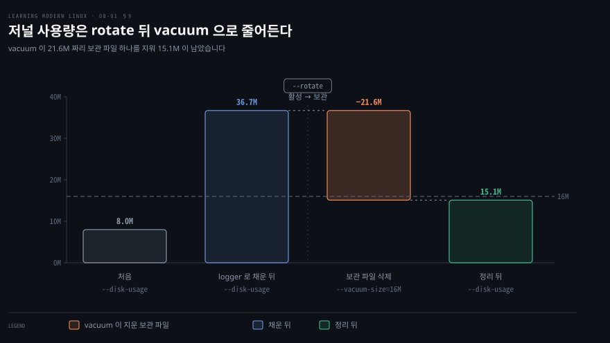

지금 얼마를 쓰는지는 `--disk-usage` 가 보관 파일과 활성 파일을 합쳐 알려 줍니다. 줄이는 명령은 셋이고 모두 보관 파일만 지웁니다. 활성 파일까지 정리 대상에 넣으려면 `--rotate` 로 활성 파일을 먼저 보관 상태로 넘깁니다.[^journalctl]

| 명령 | 지우는 기준 |
|------|------------|
| `--vacuum-size=500M` | 보관 파일 합이 이 크기 아래가 될 때까지 오래된 것부터 |
| `--vacuum-time=30d` | 이보다 오래된 항목만 든 보관 파일 |
| `--vacuum-files=5` | 보관 파일을 이 개수만 남기고 |

컨테이너에서 저널을 채운 뒤 돌린 순서입니다. 출력은 명령 아래 주석으로 옮겼습니다.

```bash
journalctl --disk-usage
# Archived and active journals take up 36.7M in the file system.
journalctl --rotate
journalctl --vacuum-size=16M
# Deleted archived journal /var/log/journal/f6c1e3bd.../system@...-....journal (21.6M).
# Vacuuming done, freed 21.6M of archived journals from /var/log/journal/f6c1e3bd....
journalctl --disk-usage
# Archived and active journals take up 15.1M in the file system.
```

`--rotate` 뒤 디렉터리에는 `system.journal` 하나와 `system@<ID>-<번호>-<시각>.journal` 꼴의 보관 파일이 남습니다.

`rm` 으로 파일을 지우는 것은 다른 결과를 냅니다. 활성 `system.journal` 을 `rm` 한 뒤 journald 의 열린 파일을 보면 `/proc/<pid>/fd/21 -> /var/log/journal/.../system.journal (deleted)` 입니다. 이름만 사라지고 journald 가 쥔 inode 는 남으므로 공간이 돌아오지 않습니다.[^unlink]

그 뒤 `logger` 로 보낸 줄은 `journalctl` 에 보이지 않았고, journald 를 재시작해야 새 `system.journal` 이 생겼습니다. 저널 파일은 journald 가 소유하고 관리하므로, 줄이는 일도 journald 에 맡깁니다.


## 결정 치트시트

> 로그를 어디서 찾고 어떻게 좁히고 어떻게 줄일지의 판단 기준을 한 표로 압축합니다.

| 상황 | 고를 것 | 왜 |
|------|--------|-----|
| systemd 유닛 하나의 최근 동작을 본다 | `journalctl -u <unit> -f` | 유닛 단위 필터가 조회 조건으로 이미 있습니다 |
| 지난 부팅의 오류를 본다 | `journalctl -b -1 -p err` | 부팅 ID 와 심각도가 필드로 붙어 있습니다. 영속 저장이 전제입니다 |
| 한 프로세스나 명령의 줄만 본다 | `journalctl _PID=…` 또는 `_COMM=…` | journald 가 붙인 필드라 줄 모양에 기대지 않습니다 |
| 텍스트 파일을 그대로 grep 해야 한다 | `/var/log/syslog`·`messages` 와 `zgrep` | 회전된 `.gz` 까지 한 번에 뒤집니다 |
| 인증 실패를 찾는다 | `auth.log` 또는 `secure`, `lastb` | 배포판마다 rsyslog 규칙이 이름을 다르게 정합니다 |
| 텍스트 로그가 디스크를 먹는다 | logrotate 설정, `logrotate -d` 로 먼저 확인 | 회전과 세대 수가 크기를 정합니다 |
| 신호를 못 받는 프로그램의 로그를 돌린다 | `copytruncate` | inode 를 유지하는 대신 복사와 자르기 사이의 줄을 잃을 수 있습니다 |
| 저널이 디스크를 먹는다 | `--vacuum-size`·`--vacuum-time`, 상한은 `SystemMaxUse=` | `rm` 은 공간을 돌려주지 않습니다 |
| 자동화가 로그를 파싱한다 | `journalctl -o json` 또는 앱의 JSON 로깅 | 줄마다 JSON 항목 하나가 자동화용이라고 저자가 적습니다 |


## 적용 관점

> 저자는 Spring 도 자바도 다루지 않습니다. 아래는 이 장의 원칙을 그 문맥에 옮겨 본 것입니다.

컨테이너 안의 앱은 파일 대신 표준 출력으로 로그를 냅니다. 6장에서 본 컨테이너의 격리가 이유입니다. 컨테이너의 파일시스템은 그 컨테이너와 함께 사라지므로 `/var/log` 에 쌓아 봐야 프로세스가 끝나면 같이 없어집니다. 표준 출력으로 내면 런타임이 그것을 받아 목적지로 나르므로, §2 의 용어로 말하면 앱은 소스 역할만 하고 텔레메트리를 런타임에 맡기는 것입니다.

VM 위에서 Spring Boot 앱이 자기 파일에 쓴다면 §7 의 inode 문제가 그대로 옵니다. 앱의 로깅 라이브러리가 스스로 파일을 돌리게 할지, logrotate 에 맡길지를 하나로 정합니다. 둘 다 켜면 서로의 이름을 밀어내고, logrotate 쪽이면 앱이 신호를 받아 파일을 다시 열 수 없으니 `copytruncate` 를 쓰게 됩니다.

MDC 에 무엇을 넣는지가 §4 의 경고가 닿는 자리입니다. 요청 ID 나 사용자 ID 를 문맥으로 붙이는 일은 흔한데, 그 자리에 토큰이나 이메일을 넣으면 모든 로그 줄에 민감 정보가 복제됩니다. 저자의 경고를 그대로 옮기면, 프로세스가 끝나고 한참 뒤에도 누군가 그것에 접근할 수 있습니다.

구조화 로깅을 켠다면 그 뜻이 JSON 인지 먼저 정합니다. 저자의 관찰대로 사람들이 그 말로 뜻하는 것은 대개 JSON 입니다. 그런데 RFC 5424 의 `STRUCTURED-DATA` 는 헤더 뒤 대괄호 요소라, 같은 단어가 두 층에서 쓰입니다. JSON 으로 바꾸는 순간 `tail -f` 로 읽기도 나빠집니다. 그래서 개발 프로필은 사람이 읽는 형식으로 두고 운영 프로필만 JSON 으로 두는 편이 §3 의 "주 소비자" 구분과 맞습니다.


## 면접에서 받을 만한 질문

1. 관측 가능성을 한 문장으로 정의하고, 그 정의 안에서 소스·텔레메트리·목적지가 각각 어느 자리인지 말해 보십시오.
2. 카운터와 게이지를 값의 움직임으로 구분하고, 각각에 어울리는 지표를 하나씩 들어 보십시오.
3. RFC 5424 헤더에서 값을 비울 수 있는 필드와 그렇지 않은 필드를 가르는 근거는 무엇입니까?
4. 같은 인증 실패가 Debian 에서는 `auth.log`, Rocky Linux 에서는 `secure` 에 남는 이유는 무엇입니까?
5. logrotate 가 이름을 바꾼 뒤 새 파일이 계속 비어 있습니다. 원인과 해결책 두 가지를 말해 보십시오.
6. 재부팅 뒤 `journalctl -b -1` 이 지난 부팅을 찾지 못합니다. 무엇을 확인하고 어떻게 고칩니까?
7. 저널이 디스크를 많이 차지할 때 `rm` 대신 무엇을 써야 하고, 왜 `rm` 은 공간을 돌려주지 않습니까?


## 정답 (자답 후 펼치기)

1. 시스템의 내부 상태를 바깥으로 드러난 정보를 재서 판정하는 일이고, 대개 그 위에서 조치하는 것이 목적입니다. 소스는 신호를 만드는 쪽으로 리눅스 운영체제나 애플리케이션입니다. 텔레메트리는 소스에서 신호를 뽑아 목적지로 나르는 과정이며 흔히 에이전트가 모으고 미리 손질합니다. 목적지는 신호를 소비하고 저장하고 더 처리하는 곳이고, 그중 사용자 인터페이스를 가진 것만 프론트엔드입니다.

2. 카운터는 0 으로 초기화되는 경우를 빼면 값이 올라가기만 합니다. 서비스가 처리한 총 요청 수나 한 인터페이스로 보낸 총 바이트가 예입니다. 게이지는 오르내립니다. 지금 쓸 수 있는 전체 주 메모리나 지금 돌고 있는 프로세스 수가 예입니다.

3. ABNF 정의에 `NILVALUE /` 대안이 있는지가 근거입니다. `NILVALUE` 는 하이픈 한 글자이고, `TIMESTAMP`·`HOSTNAME`·`APP-NAME`·`PROCID`·`MSGID` 다섯이 그 대안을 갖습니다. `PRI` 와 `VERSION` 은 갖지 않아 늘 값이 있고, `VERSION` 은 이 형식에서 1 입니다.

4. 파일 이름은 커널이나 systemd 가 아니라 rsyslog 의 기본 규칙이 정합니다. Debian 의 규칙은 `auth,authpriv.*` 를 `/var/log/auth.log` 로, Rocky 의 규칙은 `authpriv.*` 를 `/var/log/secure` 로 보냅니다. 규칙은 `grep -vE "^\s*(#|$)" /etc/rsyslog.conf` 와 `/etc/rsyslog.d/` 에서 확인합니다.

5. 쓰던 프로세스의 파일 기술자가 이름이 아니라 inode 를 가리켜, 이름이 바뀐 `.1` 파일에 계속 쓰기 때문입니다. 첫째 해결은 `postrotate` 에서 그 프로그램이 정한 신호를 보내 파일을 다시 열게 하는 것입니다. rsyslog 는 HUP, nginx 는 USR1 입니다. 둘째는 신호를 못 받는 프로그램에 `copytruncate` 를 쓰는 것인데, 복사와 자르기 사이에 쓰인 줄을 잃을 수 있습니다.

6. 저널이 `/run/log/journal` 에만 있는지 봅니다. `Storage=auto` 에서 `/var/log/journal` 이 없으면 휘발성으로 쓰여 재부팅과 함께 사라집니다. 디렉터리를 만들고 `systemd-tmpfiles --create --prefix /var/log/journal` 로 권한을 입힌 뒤 journald 를 재시작하거나 `Storage=persistent` 로 바꿉니다. `journalctl --flush` 를 주면 지금 `/run` 에 있는 항목도 옮겨집니다.

7. `journalctl --vacuum-size=` 나 `--vacuum-time=` 으로 보관 파일을 지우고, 필요하면 먼저 `--rotate` 로 활성 파일을 보관 상태로 넘깁니다. 상한은 `SystemMaxUse=` 와 `MaxRetentionSec=` 로 정합니다. `rm` 은 이름만 지우고, journald 가 그 파일을 열어 둔 동안 inode 가 남아 공간이 돌아오지 않습니다. 실습에서는 그 뒤 새 항목도 보이지 않다가 journald 재시작 뒤에야 새 파일이 생겼습니다.


## 핵심 개념 체크리스트

- [ ] 관측 가능성의 정의에서 "바깥" 과 "안" 이 각각 무엇을 가리키는지 말할 수 있는가?
- [ ] 자원을 하나씩 바꿔 재야 하는 이유를 한 문장으로 설명할 수 있는가?
- [ ] 신호 유형 셋을 페이로드와 주 소비자로 갈라 말할 수 있는가?
- [ ] "구조화 로깅" 이 실제로 무엇을 뜻하는지, RFC 5424 의 구조화 데이터와 어떻게 다른지 설명할 수 있는가?
- [ ] 로그에 민감 정보를 넣으면 안 되는 이유를 수명 관점에서 말할 수 있는가?
- [ ] Debian 과 RHEL 계열에서 시스템·인증·cron·메일 로그의 이름을 짝지을 수 있는가?
- [ ] `last`·`lastb`·`lastlog` 가 각각 어느 파일을 읽는지 댈 수 있는가?
- [ ] rsyslog 선택자 `시설.심각도` 를 읽고, `PRI` 값을 계산할 수 있는가?
- [ ] logrotate 의 이름 바꾸기와 `copytruncate` 가 inode 에 하는 일을 비교할 수 있는가?
- [ ] `journalctl` 로 부팅·심각도·유닛·필드를 좁히는 옵션을 각각 댈 수 있는가?
- [ ] `Storage=auto` 가 저널의 자리를 정하는 조건과 기본 크기 상한을 말할 수 있는가?


## 관련 문서

- [8장 둘째 편 — 자원마다 창이 따로 나 있어 어느 창을 여느냐가 곧 진단이다](./08-02.%EC%9E%90%EC%9B%90%EB%A7%88%EB%8B%A4%20%EC%B0%BD%EC%9D%B4%20%EB%94%B0%EB%A1%9C%20%EB%82%98%20%EC%9E%88%EC%96%B4%20%EC%96%B4%EB%8A%90%20%EC%B0%BD%EC%9D%84%20%EC%97%AC%EB%8A%90%EB%83%90%EA%B0%80%20%EA%B3%A7%20%EC%A7%84%EB%8B%A8%EC%9D%B4%EB%8B%A4.md) — 이 편이 미룬 모니터링과 추적이 거기 있습니다
- [6장 첫 편 — 먼저 켜지는 것 하나가 나머지 전부를 켠다](./06-01.%EB%A8%BC%EC%A0%80%20%EC%BC%9C%EC%A7%80%EB%8A%94%20%EA%B2%83%20%ED%95%98%EB%82%98%EA%B0%80%20%EB%82%98%EB%A8%B8%EC%A7%80%20%EC%A0%84%EB%B6%80%EB%A5%BC%20%EC%BC%A0%EB%8B%A4.md) — `journalctl` 이 속한 systemd 생태계와 유닛 개념
- [5장 — 모든 것이 파일이라는 말은 손잡이가 하나라는 뜻이다](./05-01.%EB%AA%A8%EB%93%A0%20%EA%B2%83%EC%9D%B4%20%ED%8C%8C%EC%9D%BC%EC%9D%B4%EB%9D%BC%EB%8A%94%20%EB%A7%90%EC%9D%80%20%EC%86%90%EC%9E%A1%EC%9D%B4%EA%B0%80%20%ED%95%98%EB%82%98%EB%9D%BC%EB%8A%94%20%EB%9C%BB%EC%9D%B4%EB%8B%A4.md) — 로그가 놓이는 `/var` 의 자리와 파일 권한
- [4장 — 전부 아니면 전무에서 잘게 쪼개는 쪽으로](./04-01.%EC%A0%84%EB%B6%80%20%EC%95%84%EB%8B%88%EB%A9%B4%20%EC%A0%84%EB%AC%B4%EC%97%90%EC%84%9C%20%EC%9E%98%EA%B2%8C%20%EC%AA%BC%EA%B0%9C%EB%8A%94%20%EC%AA%BD%EC%9C%BC%EB%A1%9C.md) — `adm`·`utmp` 그룹과 ACL 로 로그 읽기를 좁히는 근거
- [9장 첫 편 — 이 장을 묶는 것은 주제가 아니라 필요해지는 조건이다](./09-01.%EC%9D%B4%20%EC%9E%A5%EC%9D%84%20%EB%AC%B6%EB%8A%94%20%EA%B2%83%EC%9D%80%20%EC%A3%BC%EC%A0%9C%EA%B0%80%20%EC%95%84%EB%8B%88%EB%9D%BC%20%ED%95%84%EC%9A%94%ED%95%B4%EC%A7%80%EB%8A%94%20%EC%A1%B0%EA%B1%B4%EC%9D%B4%EB%8B%A4.md) — logrotate 의 `postrotate` 가 보내는 시그널
- [Learning Modern Linux 정독 인덱스](./README.md) — 이 책의 MOC


## 참고 자료

- 원서: 《Learning Modern Linux》 Michael Hausenblas, O'Reilly Media, 2022. ISBN 978-1-098-10894-6
- [Linux Performance — Brendan Gregg](https://www.brendangregg.com/linuxperf.html) — 리눅스 관측 도구 전경도의 출처
- [RFC 5424 — The Syslog Protocol](https://www.rfc-editor.org/rfc/rfc5424.txt) — 헤더 필드와 ABNF 의 1차 자료
- [rsyslog ChangeLog](https://raw.githubusercontent.com/rsyslog/rsyslog/main/ChangeLog) — 프로젝트 자신이 기록한 계보
- 실행 환경: Debian 12 컨테이너(systemd 252, rsyslog 8.2302, logrotate 3.21)와 Rocky Linux 9.3 컨테이너
- 여러 부팅 기록: Ubuntu 26.04 VM(systemd 259)

[^o11y]: 원서 8장의 각주. `observability` 에서 `o` 와 `y` 사이에 글자가 열한 개 있어 `o11y` 로 줄여 쓴다고 적습니다.
[^rfc5424]: R. Gerhards, "The Syslog Protocol", RFC 5424, Adiscon GmbH, March 2009. 표지에 `Obsoletes: 3164`, `Category: Standards Track` 이 적혀 있고, §6 이 메시지 형식의 ABNF 를, §6.2.2 가 VERSION 을, §6.3 이 STRUCTURED-DATA 를, §6.4 가 MSG 를 정의합니다. <https://www.rfc-editor.org/rfc/rfc5424.txt>
[^rsyslog]: rsyslog ChangeLog 의 가장 오래된 구획. "The following comments were left in the syslogd source ... they help to date when Rainer started work on the project (which was 2003)" 와 `\date 2003-10-17` 가 그대로 남아 있고, 저자 줄에 Rainer Gerhards 의 이름이 적혀 있습니다. <https://raw.githubusercontent.com/rsyslog/rsyslog/main/ChangeLog>
[^rsyslog-conf]: rsyslog.conf(5), Debian bookworm 판. 선택자 `facility.priority`, 시설과 심각도 목록, 파일 앞 `-` 의 동기화 생략, `@`(UDP)·`@@`(TCP)·기본 포트 514 를 설명합니다. <https://manpages.debian.org/bookworm/rsyslog/rsyslog.conf.5.en.html>
[^logger]: logger(1). `-p` 가 `facility.level` 을 받고 기본값이 `user.notice` 입니다. <https://man7.org/linux/man-pages/man1/logger.1.html> 시설·심각도 번호와 `PRI` 계산은 RFC 5424 §6.2.1 입니다.
[^logrotate]: logrotate(8), Debian bookworm 판. `rotate`·`compress`·`delaycompress`·`create`·`sharedscripts`·`postrotate`·`copytruncate` 지시어와 `-d`·`-f` 옵션. <https://manpages.debian.org/bookworm/logrotate/logrotate.8.en.html>
[^zgrep]: zgrep(1), Debian bookworm 판(gzip 패키지). <https://manpages.debian.org/bookworm/gzip/zgrep.1.en.html>
[^nginx]: nginx, "Controlling nginx" 의 시그널 표. `USR1` 이 `re-opening log files` 입니다. <https://nginx.org/en/docs/control.html>
[^dmesg]: dmesg(1). 커널 링 버퍼를 읽거나 제어하는 도구입니다. <https://man7.org/linux/man-pages/man1/dmesg.1.html>
[^audit]: ausearch(8)·aureport(8), Debian bookworm 판(auditd 패키지). <https://manpages.debian.org/bookworm/auditd/ausearch.8.en.html> · <https://manpages.debian.org/bookworm/auditd/aureport.8.en.html>
[^utmp]: utmp(5). `wtmp` 는 로그인과 로그아웃을 모두 기록하고, 이 파일들을 만드는 프로그램이 없어 지우면 기록이 꺼진다고 적습니다. <https://man7.org/linux/man-pages/man5/utmp.5.html>
[^last]: last(1)·lastb(1)와 lastlog(8). <https://man7.org/linux/man-pages/man1/last.1.html> · <https://man7.org/linux/man-pages/man8/lastlog.8.html>
[^journalctl]: journalctl(1). `-b`·`--list-boots`·`-p`·`-k`·`-u`, 필드 매치의 AND·OR 규칙, `--disk-usage`·`--rotate`·`--vacuum-size|time|files`, 읽기 권한 그룹. <https://man7.org/linux/man-pages/man1/journalctl.1.html>
[^journald-conf]: journald.conf(5). `Storage=` 네 값, `SystemMaxUse=`·`SystemKeepFree=`·`SystemMaxFileSize=`·`MaxRetentionSec=`·`MaxFileSec=` 기본값, `ForwardToSyslog=` 와 syslog 데몬이 저널을 읽는 두 방법. <https://man7.org/linux/man-pages/man5/journald.conf.5.html>
[^journal-fields]: systemd.journal-fields(7). 밑줄로 시작하는 신뢰 필드 `_PID`·`_COMM`·`_SYSTEMD_UNIT`·`_BOOT_ID`·`_TRANSPORT` 를 journald 가 붙인다고 정의합니다. <https://man7.org/linux/man-pages/man7/systemd.journal-fields.7.html>
[^unlink]: unlink(2). 마지막 이름이 지워져도 파일을 연 프로세스가 있으면 마지막 기술자가 닫힐 때까지 파일이 남는다고 적습니다. <https://man7.org/linux/man-pages/man2/unlink.2.html>
