# 자원마다 창이 따로 나 있어 어느 창을 여느냐가 곧 진단이다

---

> 8장 노트의 둘째 편입니다. 앞 편이 신호가 무엇인지와 로그를 다뤘다면, 이 편은 수치를 읽는 명령들과 그 위에 얹히는 층을 다룹니다.

## 핵심 요약

> 이 구간이 매달린 생각은 자원마다 창이 따로 나 있다는 것입니다. 어느 창을 먼저 여느냐가 곧 진단의 순서입니다.

앞 편에서 저자는 느린 앱의 원인 후보로 메모리와 CPU 사이클과 네트워크 입출력을 들었습니다. 이 편의 명령은 그 후보마다 하나씩 붙습니다. `free` 와 `/proc/meminfo` 는 메모리를, `vmstat` 는 실행 대기와 컨텍스트 전환을 봅니다. `iostat` 는 장치를, `ss` 와 `lsof` 는 소켓과 열린 파일을 봅니다.

창을 열었으면 칸 하나하나를 정확히 읽어야 합니다. 부하 평균은 CPU 수로 나뉘어 있지 않습니다. `free` 의 `used` 에는 tmpfs 에 쓴 데이터가 섞입니다. `top` 에서 메모리로 정렬하는 키는 대문자 `M` 입니다. 이 노트의 출력은 모두 Debian 12 컨테이너에서 직접 돌린 것이고, 열의 뜻은 각 도구의 man page 로 확인했습니다.

`lsof` 옆에서는 지운 로그가 디스크를 계속 차지하는 현상과 logrotate 가 파일을 돌리는 두 방식을 다룹니다. 마지막 두 절은 기본 도구 위에 얹히는 층입니다. 추적은 실행 자체를 잡고, Prometheus 와 Grafana 는 시계열을 쌓아 대시보드와 알림을 만듭니다.


## 학습 목표

> 이 구간을 읽고 나면 아래 다섯 가지를 스스로 해낼 수 있습니다.

1. 느린 앱의 원인을 자원 범주로 나누고 범주마다 칠 명령을 고를 수 있습니다.
2. `uptime` 의 부하 평균을 CPU 수와 함께 읽고, `free` 의 각 열이 `/proc/meminfo` 의 어느 필드에서 오는지 말할 수 있습니다.
3. `time` 의 `real`·`user`·`sys` 를 구분하고 CPU 밖에서 보낸 시간을 계산할 수 있습니다.
4. `iostat`·`ss`·`lsof` 가 보여 주는 것을 고르고, 지웠는데 공간이 돌아오지 않는 파일을 `lsof +L1` 로 찾을 수 있습니다.
5. `top` 을 배치 모드로 스크립트에 쓰고, 추적의 훅 지점 셋과 Prometheus 구성의 포트 셋을 짚을 수 있습니다.

아래는 이 문서 전체를 읽는 순서로 이은 지도입니다. 칸마다 절 번호와 그 절에서 칠 명령을 적었습니다. 색이 붙은 칸이 이 노트의 제목이 가리키는 자리입니다.

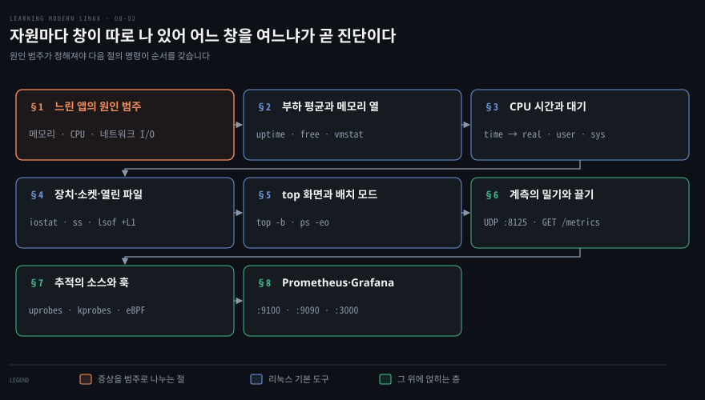


## 이 문서가 다루지 않는 것

> 저자가 스스로 그은 선과, 노트를 나누며 생긴 경계를 함께 적습니다.

- 신호 유형의 정의와 로그 전반 → [앞 노트](./08-01.%EC%9E%AC%EB%8A%94%20%EA%B2%83%EC%9D%80%20%EB%B0%94%EA%B9%A5%EC%9D%B4%EA%B3%A0%20%EC%95%8C%EA%B3%A0%20%EC%8B%B6%EC%9D%80%20%EA%B2%83%EC%9D%80%20%EC%95%88%EC%9D%B4%EB%8B%A4.md)가 다룹니다
- 분산 추적 → 저자가 이 책의 범위 밖이라고 못 박습니다
- `sar` 와 `perf` 의 상세 사용법 → 저자가 이름과 성격만 적고 넘어갑니다
- overcommit 정책과 OOM killer → [LKP 09-03 §3](../linux-kernel-programming/09-03.%EB%A9%94%EB%AA%A8%EB%A6%AC%20%ED%95%A0%EB%8B%B9%20%285%29%20%E2%80%94%20demand%20paging%EA%B3%BC%20OOM%20killer.md#3-overcommit-세-정책)이 다룹니다
- huge page 를 켜고 크기를 정하는 법 → [JPF 08-03 §2](../../../01_language/book/jpf_java-performance/08-03.large%20pages%20%E2%80%94%20TLB%EC%99%80%20OS%EB%B3%84%20huge%20page%20%EC%84%A4%EC%A0%95.md#2-linux-전통-huge-page)가 다룹니다
- Prometheus 질의 언어와 Grafana 대시보드 편집 → 저자의 구성은 화면이 뜨는 데까지입니다
- 도구의 화면 캡처 → 옮기지 않고 직접 띄워 보기를 권합니다


## 1. 느린 앱의 세 원인 범주

> 명령을 아무리 많이 외워도 순서가 없으면 소용이 없습니다. 순서를 만드는 것은 증상을 원인 범주로 나누는 일입니다.

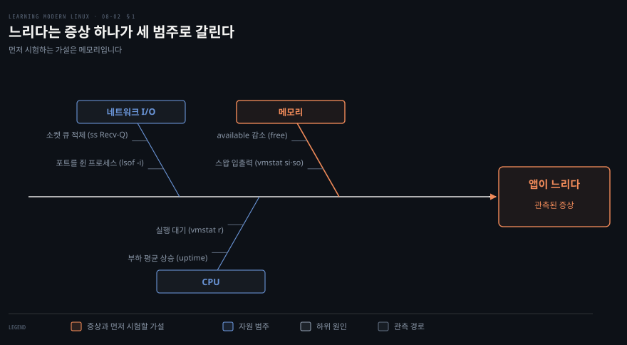

### 풀려는 문제

앞 편 §1 에서 자원을 하나씩 바꿔 재라고 했습니다. 그런데 "하나씩" 이 성립하려면 자원이 몇 개인지, 각각을 어떻게 재는지가 먼저 있어야 합니다. 그것이 없으면 하나씩 바꾸는 절차는 실행할 수 없는 조언으로 남습니다.

### 범주가 정하는 명령 순서

저자가 이름 붙인 원인은 셋입니다. 메모리 부족과 CPU 사이클 부족과 네트워크 입출력 부족이며, 위 도식의 뼈대 셋이 그것입니다.

저자는 그 뒤에 "등등" 을 붙여 나머지를 열어 두었습니다. 그 열린 자리에 디스크 입출력이 들어가고, 이 편 §4 의 `iostat` 가 그 자리를 엽니다. 도식의 뼈대가 셋인 것은 저자가 이름 붙인 원인이 셋이기 때문입니다.

범주가 서면 각 범주를 여는 창이 정해집니다. 도식의 가지 끝에 붙은 명령이 그 창이고, 이 편의 나머지 절이 그 창을 하나씩 엽니다.

### 모니터링의 두 활동

저자는 모니터링을 시스템과 애플리케이션 메트릭을 붙잡는 일이라고 정의합니다. 무언가 얼마나 걸리는지가 궁금할 수도 있고, 프로세스가 자원을 얼마나 쓰는지가 궁금할 수도 있습니다. 앞의 것이 성능 모니터링이고 뒤의 것은 건강하지 않은 시스템을 진단하는 일입니다.

그 맥락에서 가장 자주 하게 되는 활동은 둘입니다. 하나 이상의 메트릭을 시간에 걸쳐 추적하는 일과 어떤 조건에 알림을 거는 일입니다. 이 둘이 §8 의 Prometheus 와 Grafana 가 하는 일이기도 합니다. 그전까지의 절은 그 둘을 손으로 하는 방법입니다.


## 2. 부하 평균과 메모리 열

> 부하 평균 값 하나를 보고 "바쁘다" 고 판정하는 습관이 있는데, 그 값은 CPU 수를 모르면 아무것도 뜻하지 않습니다. 메모리 열도 이름만 보고 읽으면 틀리기 쉽습니다.

### `uptime` 과 CPU 수

저자가 가장 먼저 치는 명령입니다. 시스템이 얼마나 오래 돌았는지와 로그인한 사용자 수, 부하 평균 세 값을 한 줄에 보여 줍니다. 아래는 CPU 수를 함께 찍은 출력입니다.

```bash
uptime; nproc
```

```bash
 05:00:07 up  2:47,  0 user,  load average: 1.37, 1.38, 1.30
8
```

세 값은 1분·5분·15분 평균입니다. 센 것은 실행 가능(runnable) 상태이거나 인터럽트 불가(uninterruptible) 상태인 프로세스의 수입니다. 인터럽트 불가 상태는 디스크 같은 입출력을 기다리는 상태를 말합니다. `uptime(1)` 은 이 값이 CPU 수로 정규화되지 않는다고 밝힙니다. 부하 1 은 CPU 하나짜리 시스템에서는 내내 바빴다는 뜻이고 CPU 넷짜리에서는 75% 를 놀았다는 뜻입니다.[^uptime]

그래서 값을 읽기 전에 CPU 수부터 확인합니다. 위 컨테이너는 CPU 가 8개라 1.37 을 8 로 나눈 0.17 이 CPU 하나에 걸린 몫입니다. 부하가 높은데 CPU 가 한가하면 입출력 대기가 값을 올리고 있을 수 있으니 §4 의 `iostat` 로 넘어갑니다. 저자의 조언대로 값 하나로 판정하지 말고 세 구간을 견주며 시간에 걸쳐 추적합니다.

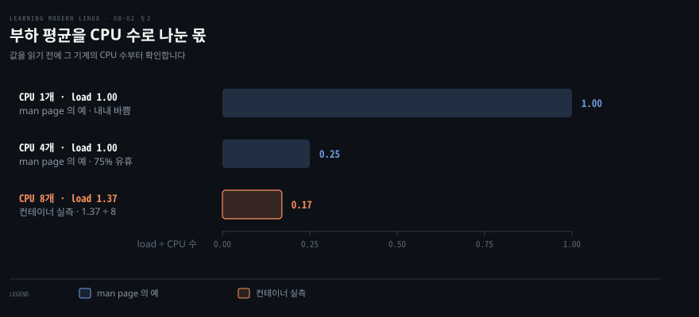

### `free` 여섯 열의 출처

메모리가 모자라 보일 때 처음 여는 창이 `free` 입니다. 여섯 열은 모두 `/proc/meminfo` 의 필드를 옮기거나 계산한 값이라, 출처를 알면 오독할 일이 줄어듭니다.

```bash
free -h
```

```bash
               total        used        free      shared  buff/cache   available
Mem:           7.8Gi       1.7Gi       5.6Gi        79Mi       761Mi       6.1Gi
Swap:          8.8Gi          0B       8.8Gi
```

`-h` 는 단위를 사람이 읽기 좋게 붙입니다. 같은 순간 `free -k` 의 값과 `/proc/meminfo` 를 나란히 놓으면 열마다 출처가 맞아떨어집니다.[^free]

| 열 | `free -k` 값 | `/proc/meminfo` 에서 오는 자리 |
|----|-------------:|-------------------------------|
| `total` | 8196284 | `MemTotal`. 물리 RAM 에서 예약된 몇 비트와 커널 바이너리 코드를 뺀 양 |
| `used` | 1817908 | `total` − `available` 로 계산한 값(8196284 − 6378376) |
| `free` | 5871592 | `MemFree`. 아무 데도 쓰이지 않은 메모리 |
| `shared` | 81076 | `Shmem`. 대부분 tmpfs 가 쓰는 메모리 |
| `buff/cache` | 780276 | `Buffers` 136 + `Cached` 700220 + `SReclaimable` 79920 |
| `available` | 6378376 | `MemAvailable`. 스왑 없이 새 프로그램을 띄울 수 있는 양의 추정치 |

`total` 이 장착한 RAM 보다 조금 작은 것은 이 정의 때문입니다. `free(1)` 과 `proc_meminfo(5)` 가 함께 `MemTotal` 을 예약분과 커널 코드를 뺀 사용 가능한 양으로 적습니다.[^meminfo]

이 출력에서 가장 실무적인 값은 `available` 입니다. 커널은 남는 메모리를 페이지 캐시로 쓰다가 새 프로그램이 메모리를 요구하면 그 캐시를 내어 줍니다. `available` 은 그 몫을 계산에 넣되, 쓰는 중이라 회수되지 않을 slab 은 빼고 어림한 값입니다.[^free] 그래서 `free` 열이 작아도 `available` 이 넉넉하면 메모리가 모자란 것이 아닙니다.

`buff/cache` 를 두 열로 갈라 보려면 `-w` 를 씁니다. 위 기계에서는 `buffers` 136Ki 와 `cache` 761Mi 로 나뉩니다. 값이 움직이는 모양을 보려면 `-s` 로 간격(초)을 주고, `-c` 로 횟수를 정합니다. `-c` 는 `-s` 와 함께 써야 합니다.

```bash
free -m -s 1 -c 3
```

위 기계에서 이 명령은 같은 표를 1초 간격으로 세 번 찍었습니다. 그동안 `used` 는 1775·1765·1749 MiB 로 움직였습니다. `Swap` 줄은 스왑 공간의 전체와 사용과 여유이며, 세 번 모두 사용이 0 이었습니다.

### `used`·`shared` 에 섞이는 tmpfs

`used` 를 프로세스가 쥔 메모리로 읽으면 틀릴 때가 있습니다. `used` 는 `total` 에서 `available` 을 뺀 값이라, 어느 프로세스도 쥐지 않았지만 내어 줄 수 없는 메모리까지 담기 때문입니다. 그 대표가 tmpfs 입니다.

`shared` 열의 출처는 `Shmem` 입니다. tmpfs 파일시스템과 System V·POSIX 공유 메모리, 공유 익명 매핑(`MAP_SHARED|MAP_ANONYMOUS`)이 쓴 메모리를 셉니다.[^meminfo] 커널 문서는 tmpfs 가 통째로 페이지 캐시 위에 살고 필요할 때 스왑으로만 밀려난다고 설명합니다.[^tmpfs] 디스크에 원본이 없으니 보통의 파일 캐시처럼 버렸다가 다시 읽을 수 없습니다. 같은 페이지가 `Cached` 에도 잡히므로 `buff/cache` 열까지 함께 커집니다.[^kproc]

직접 넣어 보면 네 열이 함께 움직입니다. `/dev/shm` 이 tmpfs 라서 그 자리를 실험에 썼습니다. 컨테이너를 `--shm-size=600m` 으로 띄우고 400MiB 를 쓴 뒤 `free -m` 을 전후로 찍었습니다.

```bash
free -m
dd if=/dev/zero of=/dev/shm/blob bs=1M count=400 status=none
free -m
rm /dev/shm/blob
free -m
```

| 열(MiB) | 쓰기 전 | 400MiB 쓴 뒤 | 지운 뒤 |
|---------|--------:|-------------:|--------:|
| `used` | 2026 | 2429 | 2036 |
| `free` | 4899 | 4495 | 4888 |
| `shared` | 79 | 479 | 79 |
| `buff/cache` | 1361 | 1762 | 1362 |
| `available` | 5977 | 5574 | 5967 |

`shared` 와 `buff/cache` 가 400 씩 오르고 `available` 은 403 줄었습니다. 같은 400MiB 가 캐시로 잡히면서도 사용 가능한 양에서는 빠졌다는 뜻이고, `used` 가 403 오른 것은 그 계산의 결과입니다. 파일을 지우자 네 열이 제자리로 돌아왔습니다.

아래 도식은 두 시점의 `total` 을 네 조각으로 나눈 것입니다. 가운데 두 조각은 `buff/cache` 를 `available` 에 들어간 몫과 나머지로 가른 계산값입니다. `used` 가 커졌을 때 `shared` 도 함께 컸다면 프로세스보다 tmpfs 와 공유 메모리를 먼저 의심합니다.

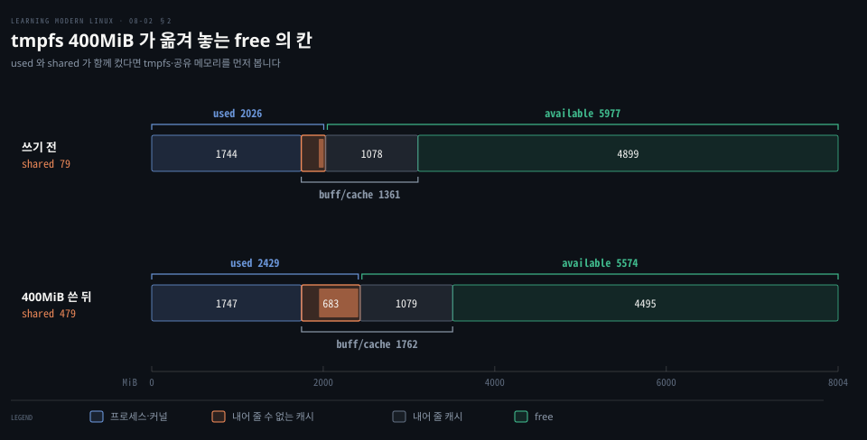

### `/proc/meminfo` 로 좁히는 원인

`free` 의 여섯 열로 부족하면 그 원천인 `/proc/meminfo` 를 직접 읽습니다. 필드가 수십 개지만 원인을 좁힐 때 자주 보는 것은 몇 개이고, 아래는 위 `free -k` 와 같은 순간의 출력에서 추린 줄입니다.

```bash
MemAvailable:    6378376 kB
Dirty:             60424 kB
Writeback:             0 kB
Shmem:             81076 kB
Slab:             166432 kB
SReclaimable:      79920 kB
SUnreclaim:        86512 kB
CommitLimit:    13342992 kB
Committed_AS:    6746520 kB
```

| 필드 | 뜻 | 원인을 좁힐 때 |
|------|----|---------------|
| `MemAvailable` | `free` 의 `available` 원천. 리눅스 3.14 부터 있음 | 새 프로그램에 줄 수 있는 양의 첫 판단 |
| `Dirty`·`Writeback` | 디스크에 다시 쓰이기를 기다리는 메모리와 지금 쓰이는 메모리 | 쓰기가 몰려 디스크가 못 따라가면 커짐 |
| `Slab` | 커널 자료구조 캐시. `SReclaimable` 과 `SUnreclaim` 의 합 | `SUnreclaim` 이 계속 크면 프로세스 밖 커널 쪽 |
| `Committed_AS` | 프로세스가 할당받은 메모리 합. 아직 만지지 않은 몫까지 셈 | `CommitLimit` 과 견줌. 한도는 overcommit 모드 2 에서만 강제 |
| `HugePages_Total`·`HugePages_Free` | huge page 풀 크기와 아직 할당되지 않은 수 | `CONFIG_HUGETLB_PAGE` 커널에만 있는 줄 |

`Committed_AS` 는 실제로 쓴 양이 아닙니다. `proc_meminfo(5)` 의 예로는 1GB 를 `malloc` 하고 300MB 만 만진 프로세스도 1GB 로 셉니다.[^meminfo] 그래서 이 값이 `MemTotal` 을 넘어도 곧바로 부족은 아니며, 어디까지 허용하는지는 overcommit 정책이 정합니다. `CommitLimit` 은 그 정책이 엄격 모드(`vm.overcommit_memory` 2)일 때만 지켜지는 한도입니다.

`HugePages_*` 줄은 이 컨테이너의 커널 출력에 없었습니다. man page 가 이 줄들에 `CONFIG_HUGETLB_PAGE` 가 필요하다고 적어 두었으므로, 없으면 그 커널이 hugetlb 풀을 제공하지 않는 것입니다. huge page 를 쓰는 JVM 이라면 `HugePages_Free` 가 풀을 다 썼는지 알려 줍니다.

### `vmstat` 한 줄의 여섯 축

메모리 사용을 더 정교하게 보는 방법으로 저자가 `vmstat` 를 듭니다. 이름은 가상 메모리 통계의 줄임말입니다. 인자로 간격(초)과 횟수를 주면 그만큼 요약 줄을 찍습니다.

```bash
vmstat 1 3
```

```bash
procs -----------memory---------- ---swap-- -----io---- -system-- ------cpu-----
 r  b   swpd   free   buff  cache   si   so    bi    bo   in   cs us sy id wa st
 2  0      0 5859660    136 818176    0    0   874    63  446  813  2  2 96  0  0
 1  0      0 5859660    136 818176    0    0  2548   444 2510 4957  1  2 97  0  0
 2  0      0 5859660    136 818176    0    0 14004   176 2746 5725  1  2 97  0  0
```

첫 줄은 부팅 이후의 평균이고, 둘째 줄부터가 직전 1초 동안의 값입니다.[^vmstat] 첫 줄의 `in` 446 과 둘째 줄의 2510 이 크게 다른 이유가 그것이라, 지금 상태는 둘째 줄부터 읽습니다.

| 열 | 뜻 |
|----|----|
| `r` | 실행 가능한 프로세스 수. 실행 중이거나 차례를 기다리는 것. 저자는 CPU 수보다 작거나 같아야 한다고 적습니다 |
| `b` | 입출력을 기다리며 막힌 프로세스 수 |
| `swpd`·`free`·`buff`·`cache` | 쓴 스왑과 유휴·버퍼·캐시 메모리(KiB) |
| `si`·`so` | 초당 스왑에서 들어오고 나간 양 |
| `bi`·`bo` | 초당 블록 장치에서 받고 보낸 블록 |
| `in`·`cs` | 초당 인터럽트(클럭 포함)와 컨텍스트 전환 수 |
| `us`·`sy`·`id`·`wa`·`st` | 전체 CPU 시간 중 사용자·커널·유휴·입출력 대기·도둑맞은 시간의 백분율 |

`r` 열에 저자가 붙인 조건은 부하 평균을 읽는 법과 같습니다. 실행 대기 수를 CPU 수와 견주라는 것이며, 위 출력의 `r` 2 는 CPU 8개에 견주면 여유가 있습니다. `si`·`so` 가 0 이 아니게 움직이기 시작하면 `free` 의 `available` 보다 더 직접적인 메모리 부족 신호입니다.


## 3. `time` 의 CPU 시간과 대기

> 어떤 작업이 오래 걸렸을 때 "CPU 가 바빴나" 와 "무언가를 기다렸나" 는 완전히 다른 진단으로 이어집니다. 그 둘을 가르는 것이 `time` 의 세 값입니다.

### 세 값의 정의

"3초 걸렸다" 는 보고만으로는 손댈 곳이 정해지지 않습니다. 그 3초가 계산이었는지 대기였는지에 따라 손댈 곳이 달라지기 때문입니다. 저자가 든 예는 디렉터리 트리 전체를 재귀로 나열하는 데 걸리는 시간입니다.

```bash
time (ls -R /usr &> /dev/null)
```

```bash
real	0m0.021s
user	0m0.002s
sys	0m0.019s
```

`&>` 는 표준 출력과 표준 오류를 함께 버립니다. 이것을 `2&>` 처럼 숫자에 붙여 쓰면 bash 는 `2` 를 `ls` 의 인자로 넘깁니다. `bash -xc 'ls /tmp 2&> /dev/null'` 을 돌리면 추적 줄이 `+ ls /tmp 2` 로 찍히고 종료 상태가 2 가 됩니다. 오류만 버리려면 `2> /dev/null` 로 씁니다.

`real` 은 벽시계로 잰 경과 시간입니다. `user` 는 프로세스가 사용자 모드에서 직접 쓴 CPU 초이고, `sys` 는 커널 모드에서 시스템이 그 프로세스를 대신해 쓴 CPU 초입니다.[^gnutime] 둘 다 CPU 위에 있던 시간이고 기다린 시간은 어느 쪽에도 들어가지 않습니다. 단일 스레드 작업이라면 `real` 에서 두 값을 뺀 나머지가 CPU 밖에서 보낸 시간입니다.

스레드가 여럿이면 여러 CPU 위에서 시간이 동시에 쌓이므로 `user` 와 `sys` 의 합이 `real` 을 넘을 수 있습니다. 그때는 빼기가 뜻을 잃고, 두 값을 별개의 축으로 읽어야 합니다.

### 네 명령의 실측

성격이 다른 네 명령을 같은 컨테이너에서 재 보면 세 값의 모양이 갈립니다.

| 명령 | `real` | `user` | `sys` | `real` − (`user`+`sys`) |
|------|-------:|-------:|------:|------------------------:|
| `ls -R /usr &> /dev/null` | 0.021 | 0.002 | 0.019 | 0.000 |
| `sleep 1` | 1.001 | 0.000 | 0.001 | 1.000 |
| bash 반복문 30만 회 | 0.511 | 0.508 | 0.001 | 0.002 |
| `dd if=/dev/zero of=/dev/null bs=1 count=400000` | 0.093 | 0.030 | 0.063 | 0.000 |

`sleep 1` 은 1초를 거의 다 CPU 밖에서 기다렸습니다. 반복문은 거의 다 사용자 모드에서 계산했습니다. `dd` 를 1바이트 단위로 돌리면 읽기와 쓰기 시스템 콜이 40만 번씩 일어나 `sys` 가 `user` 의 두 배가 됩니다. 아래 도식은 네 명령의 CPU 시간과 `real` 을 같은 시간 축에 찍은 것입니다. 두 점 사이의 거리가 기다린 시간입니다.

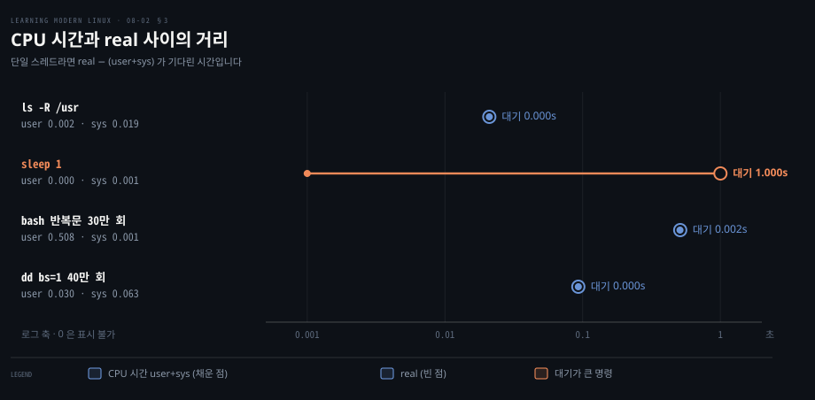

`sys` 의 비중이 크면 시스템 콜이 잦다는 뜻입니다. 그때는 [2장 첫 편](./02-01.%EC%BB%A4%EB%84%90%EC%9D%80%20%EC%A0%84%EB%B6%80%EB%A5%BC%20%ED%95%98%EC%A7%80%EB%A7%8C%20%EC%9A%B4%EC%98%81%EC%B2%B4%EC%A0%9C%EB%8A%94%20%EC%95%84%EB%8B%88%EB%8B%A4.md)에서 본 `strace -c` 로 어느 시스템 콜인지까지 좁힙니다. 기다린 시간이 크면 무엇을 기다렸는지를 §4 의 창으로 찾습니다.


## 4. 장치·소켓·열린 파일의 창

> 앱이 느린데 CPU 도 메모리도 한가하면 남은 후보는 장치와 네트워크입니다. 둘을 여는 명령은 서로 다르고, 열린 파일 목록은 디스크 공간이 사라진 이유도 알려 줍니다.

### `iostat` 의 장치별 행

블록 장치가 얼마나 바쁜지는 `iostat` 로 봅니다. `-z` 는 표집 구간에 활동이 없던 장치를 빼고, `--human` 은 단위를 사람이 읽는 형태로 붙입니다.[^iostat]

```bash
iostat -z --human
```

```bash
Linux 7.2.12-orbstack-00394-gbecdd6130068 (c1d1063a7498) 	11/10/26 	_aarch64_	(8 CPU)

avg-cpu:  %user   %nice %system %iowait  %steal   %idle
           2.0%    0.0%    2.0%    0.1%    0.0%   96.0%

Device             tps    kB_read/s    kB_wrtn/s    kB_dscd/s    kB_read    kB_wrtn    kB_dscd
vda               2.02       227.5k         0.0k         0.0k       2.2G       0.0k       0.0k
vdb             140.55         5.3M       410.9k       311.2k      52.1G       3.9G       3.0G
vdc               0.00         0.1k         0.0k       104.3k     660.0k       4.0k    1024.0M
zram0             0.00         0.1k         0.0k         0.0k     672.0k       4.0k       0.0k
```

`tps` 는 그 장치에 대한 초당 전송 수, 곧 입출력 요청 수입니다. `kB_read`·`kB_wrtn`·`kB_dscd` 는 읽은 양과 쓴 양과 버린(discard) 양이고, `/s` 가 붙은 열은 그 초당 값입니다. 인자 없이 한 번 찍은 이 출력은 부팅 이후의 누적이라, 지금의 부하를 보려면 `iostat -z --human 1` 처럼 간격을 주고 둘째 보고부터 읽습니다.

`avg-cpu` 줄의 `%iowait` 가 §1 의 디스크 입출력 범주와 이어집니다. CPU 가 유휴였는데 시스템에 처리되지 않은 디스크 입출력 요청이 있던 시간의 비율입니다.[^iostat] 이 값이 높으면 CPU 가 놀면서 디스크를 기다리고 있으므로, 장치별 행에서 `tps` 와 처리량이 몰린 장치를 찾습니다.

### `ss` 의 소켓 큐

지금 열려 있는 소켓은 `ss` 로 봅니다. 저자가 고른 옵션은 `ss -atup` 입니다. `-a` 는 듣는 소켓과 듣지 않는 소켓을 모두 고르는데, TCP 에서 뒤의 것은 확립된 연결입니다. `-t`·`-u` 는 TCP 와 UDP 를, `-p` 는 소켓을 쓰는 프로세스를 보입니다.[^ss]

출력의 두 큐 열이 §1 의 네트워크 범주를 여는 창입니다. 받을 큐(`Recv-Q`)는 커널이 받아 두었지만 앱이 아직 읽지 않은 바이트입니다. 보낼 큐(`Send-Q`)는 아직 상대에게 넘어가지 못한 바이트입니다. 큐가 쌓이는 모양을 보려고 `nc` 가 127.0.0.1:8000 에서 듣게 하고 bash 의 `/dev/tcp` 로 접속했습니다. 그다음 `nc` 를 `SIGSTOP` 으로 멈추고 5000바이트를 보냈습니다. TCP 만 보면 되므로 `-u` 대신 숫자 주소를 쓰는 `-n` 을 붙였습니다.

```bash
ss -atnp
```

```bash
State  Recv-Q Send-Q Local Address:Port  Peer Address:Port Process
LISTEN 0      1          127.0.0.1:8000       0.0.0.0:*     users:(("nc",pid=3798,fd=3))
ESTAB  5000   0          127.0.0.1:8000     127.0.0.1:40258 users:(("nc",pid=3798,fd=4))
ESTAB  0      0          127.0.0.1:40258    127.0.0.1:8000  users:(("cat",pid=3806,fd=5),("ss",pid=3805,fd=5),("bash",pid=1,fd=5))
```

서버 쪽 연결의 `Recv-Q` 가 정확히 5000 입니다. 커널은 바이트를 받아 두었는데 멈춘 `nc` 가 읽지 않았기 때문이며, `SIGCONT` 로 깨우자 0 으로 돌아갔습니다. 받을 큐가 계속 쌓이는 소켓이 있으면 그 소켓을 읽는 앱이 못 따라가고 있는 것입니다. 클라이언트 줄에 `cat` 과 `ss` 까지 붙은 것은 bash 가 연 fd 5 를 자식 프로세스가 물려받았기 때문입니다.

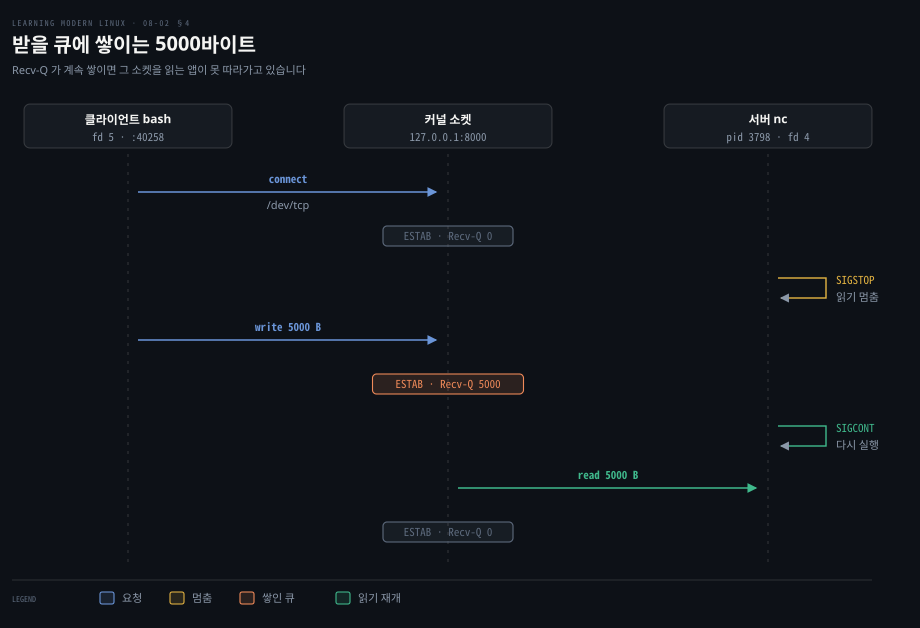

저자가 오래된 방법으로 소개하는 것이 `netstat -ctulpn` 입니다. `-c` 는 매초 계속 찍습니다. `-p` 는 소켓이 속한 프로그램의 PID 와 이름을 보이고 `-n` 은 이름 해석 대신 숫자 주소를 씁니다. 이 조합의 `-l` 은 듣고 있는 소켓만 보이므로, 확립된 연결까지 계속 보려면 `-l` 대신 `-a` 를 씁니다.[^netstat]

### `lsof` 의 두 방향

이름은 "list open files" 의 줄임말이고, 저자는 쓸모가 많은 다재다능한 도구라고 소개합니다. 5장의 "모든 것은 파일" 이 여기서 실용적인 이득으로 돌아옵니다. 소켓도 파일 디스크립터이므로 같은 도구로 보입니다.

포트에서 출발하려면 `-i` 를 씁니다. 저자는 특권 포트 범위를 보는 `sudo lsof -i TCP:1-1024` 를 예로 들고, 남의 프로세스까지 보려면 root 권한이 필요하다고 적습니다. 위 실험의 8000번 포트를 같은 방식으로 물으면 이렇게 나옵니다. `-n`·`-P` 는 호스트 이름과 포트 이름 해석을 끕니다.

```bash
lsof -nP -i TCP:8000
```

```bash
COMMAND  PID USER   FD   TYPE DEVICE SIZE/OFF NODE NAME
bash       1 root    5u  IPv4 425979      0t0  TCP 127.0.0.1:40258->127.0.0.1:8000 (ESTABLISHED)
nc      3798 root    3u  IPv4 426932      0t0  TCP 127.0.0.1:8000 (LISTEN)
nc      3798 root    4u  IPv4 426933      0t0  TCP 127.0.0.1:8000->127.0.0.1:40258 (ESTABLISHED)
```

`FD` 의 `3u` 는 파일 디스크립터 3 을 읽기·쓰기로 열었다는 뜻입니다. 소켓에서는 `NODE` 열이 프로토콜을, `NAME` 끝 괄호가 연결 상태를 담습니다. `ss -p` 가 소켓에서 출발해 프로세스를 붙인다면, `lsof -i` 는 열린 파일 목록에서 네트워크만 걸러 냅니다.

프로세스에서 출발하려면 `-p <PID>` 를 씁니다. 그 프로세스가 연 파일을 전부 보이며, 아래는 `tail -f /etc/hostname` 을 띄운 프로세스입니다.

```bash
lsof -p 225
```

```bash
COMMAND PID USER   FD      TYPE DEVICE SIZE/OFF    NODE NAME
tail    225 root  cwd       DIR  0,401       24 4100839 /
tail    225 root  rtd       DIR  0,401       24 4100839 /
tail    225 root  txt       REG  0,401   134216 3985749 /usr/bin/tail
tail    225 root  mem       REG  0,401  1651408 3986083 /usr/lib/aarch64-linux-gnu/libc.so.6
tail    225 root  mem       REG  0,401   202912 3986065 /usr/lib/aarch64-linux-gnu/ld-linux-aarch64.so.1
tail    225 root    0r      CHR    1,3      0t0       5 /dev/null
tail    225 root    1w      CHR    1,3      0t0       5 /dev/null
tail    225 root    2w     FIFO   0,15      0t0  486569 pipe
tail    225 root    3r      REG   0,43       13 4100858 /etc/hostname
tail    225 root    4r  a_inode   0,16        0    4113 inotify
```

`cwd`·`rtd`·`txt`·`mem` 은 작업 디렉터리와 루트와 실행 파일과 매핑한 라이브러리입니다. 숫자로 시작하는 줄이 파일 디스크립터이며, 3번이 따라 읽는 파일이고 4번은 파일 변화를 기다리는 inotify 입니다. 장애 대응에서 "이 포트를 누가 쥐고 있나" 와 "이 프로세스가 무엇을 열고 있나" 는 자주 이어지는 두 질문입니다. 같은 명령의 두 옵션이 그 둘에 답합니다.

저자는 성능 모니터링 도구가 더 많다고 덧붙이며 둘을 이름만 언급합니다. 여러 카운터를 아우르고 스크립트에 쓰기 좋은 `sar` 와, §7 에서 다시 나올 `perf` 입니다.

### 지워도 공간이 안 돌아오는 파일

큰 로그를 지웠는데 `df` 의 사용량이 그대로인 경우가 있습니다. `rm` 은 디렉터리에서 이름을 떼어 낼 뿐이고, 파일을 연 프로세스가 남아 있으면 마지막 파일 디스크립터가 닫힐 때까지 파일이 살아 있기 때문입니다.[^unlink] 그 공간을 쥔 프로세스를 찾는 창이 `lsof +L1` 입니다.

300MiB 짜리 tmpfs `/data` 에 200MiB 파일을 만들고, `tail -f` 로 연 채 지웠습니다.

```bash
dd if=/dev/zero of=/data/app.log bs=1M count=200 status=none
tail -f /data/app.log > /dev/null &
rm /data/app.log
ls -la /data; df -m /data | tail -1
lsof +L1
```

```bash
total 0
drwxrwxrwt 2 root root 40 Nov 10 05:01 .
drwxr-xr-x 1 root root 52 Nov 10 05:01 ..
tmpfs                300   200       100  67% /data
COMMAND  PID USER   FD   TYPE DEVICE  SIZE/OFF NLINK NODE NAME
tail    3678 root    3r   REG  0,397 209715200     0    2 /data/app.log (deleted)
```

폴더는 비었는데 `df` 는 여전히 200MiB 를 씁니다. `+L1` 은 링크 수가 1 보다 작은 열린 파일, 곧 이름이 모두 떨어져 나간 파일을 고릅니다.[^lsof] `NLINK` 0 과 `NAME` 끝의 `(deleted)` 가 그 표시입니다. 같은 줄은 `lsof | grep '(deleted)'` 로도 찾을 수 있습니다.

공간을 돌려받는 길은 둘입니다. 그 프로세스가 파일을 닫게 하거나, 재시작하거나 끝냅니다. 끝낼 수 없는 프로세스라면 `/proc/<PID>/fd/<N>` 으로 그 파일에 닿아 크기를 0 으로 자를 수 있습니다. 위 실험에서 `: > /proc/3678/fd/3` 을 치자 `df` 가 0 으로 돌아왔습니다. 잘라 낸 내용은 되살릴 수 없으므로 필요 없는 로그에만 씁니다.

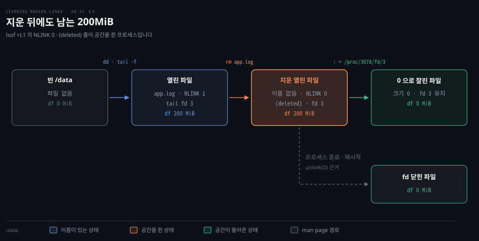

### logrotate 의 두 회전 방식

지운 파일 문제가 가장 자주 생기는 자리가 로그 회전입니다. logrotate 는 기본적으로 로그 파일 이름을 `app.log.1` 로 바꾸고, `create` 를 주면 같은 이름의 새 파일을 만듭니다.[^logrotate] 이름만 바뀌고 inode 는 그대로이므로, 열어 둔 채 쓰던 프로세스는 계속 옛 파일에 씁니다. 회전된 파일이 개수 한도를 넘어 지워지면 앞 절의 현상이 그대로 생깁니다.

0.1초마다 한 줄을 `>>` 로 덧붙이는 프로세스를 띄워 두고 `logrotate -f` 로 강제 회전했습니다. 아래 출력의 맨 앞 숫자가 inode 이고, `#` 줄은 시점을 가르려고 붙인 것입니다.

```bash
# 회전 전
4 -rw-r--r-- 1 root root 260 Nov 10 05:01 app.log
# create 로 회전한 직후
5 -rw-r--r-- 1 root root   0 Nov 10 05:01 app.log
4 -rw-r--r-- 1 root root 286 Nov 10 05:01 app.log.1
# 1초 뒤
5 -rw-r--r-- 1 root root   0 Nov 10 05:01 app.log
4 -rw-r--r-- 1 root root 520 Nov 10 05:01 app.log.1
l-wx------ 1 root root 64 Nov 10 05:01 /proc/3699/fd/1 -> /data/log/app.log.1
```

새 `app.log`(inode 5)는 0바이트 그대로이고 로그는 `app.log.1`(inode 4)에 계속 쌓였습니다. 쓰는 프로세스의 fd 1 이 옮겨진 이름을 가리키는 것이 그 증거입니다. 이 문제를 푸는 길은 쓰는 프로세스가 무엇을 할 수 있느냐에 따라 갈립니다.

| 쓰는 프로세스 | 설정 | 동작 | 대가 |
|--------------|------|------|------|
| 신호를 받으면 로그를 다시 연다 | `create` + `postrotate` 에서 신호 | 회전 뒤 스크립트가 신호를 보내 새 파일로 옮겨 가게 함. man page 의 예는 `killall -HUP syslogd` | 앱이 재열기를 지원해야 함 |
| 로그를 다시 열 수단이 없다 | `copytruncate` | 원본을 복사한 뒤 원본을 제자리에서 0 으로 자름. inode 가 그대로라 쓰던 프로세스가 같은 파일에 계속 씀 | 복사와 자르기 사이 짧은 틈의 로그는 잃을 수 있음 |

`copytruncate` 로 같은 실험을 하면 inode 6 인 `app.log` 가 0 으로 잘리고 복사본 `app.log.1` 이 inode 7 로 생깁니다. 1초 뒤 `app.log` 는 다시 260바이트로 자랐고, 쓰는 프로세스의 fd 1 은 `/data/log/app.log` 를 그대로 가리켰습니다. 실험의 쓰는 쪽은 `>>` 로 덧붙이기 모드였습니다.

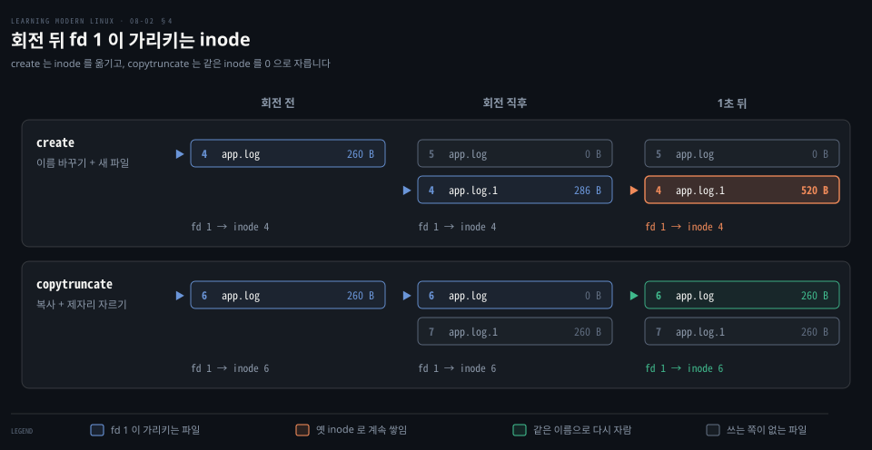


## 5. `top` 화면 구역과 배치 모드

> 개별 도구를 하나씩 치는 것과 화면 하나에서 전부 보는 것은 다른 작업입니다. 화면의 구역을 알면 같은 화면을 스크립트로 받아 갈 수도 있습니다.

### 네 구역과 정렬 키

앞 절까지의 명령은 한 번에 하나씩 칩니다. 그런데 장애 대응에서는 CPU 와 메모리와 프로세스를 동시에 보면서 무엇이 먼저 움직이는지를 봐야 할 때가 있습니다. 더 편한 모니터링을 원하면 통합 솔루션이 낫다고 저자가 적습니다. 이런 도구는 보통 텍스트 사용자 인터페이스로 세 가지를 줍니다. 첫째로 CPU 와 RAM 과 입출력을 함께 다룹니다. 둘째로 프로세스나 사용자나 자원으로 대화형 정렬과 필터링을 합니다. 셋째로 실시간으로 갱신하며 상세로 파고들고, cgroups 와 네임스페이스까지 내려가는 도구도 있습니다.

거의 모든 환경에 있는 `top` 이 그 예입니다. 아래는 nice 10 으로 띄운 무한 반복문이 CPU 하나를 다 쓰는 동안 찍은 화면입니다.

```bash
top - 05:02:54 up  2:50,  0 user,  load average: 1.82, 1.64, 1.41
Tasks:   6 total,   2 running,   4 sleeping,   0 stopped,   0 zombie
%Cpu(s):  1.4 us,  0.5 sy, 14.8 ni, 81.9 id,  0.1 wa,  0.0 hi,  1.3 si,  0.0 st
MiB Mem :   8004.2 total,   5286.1 free,   1884.1 used,   1117.6 buff/cache
MiB Swap:   9028.2 total,   9028.2 free,      0.0 used.   6120.1 avail Mem

    PID USER      PR  NI    VIRT    RES    SHR S  %CPU  %MEM     TIME+ COMMAND
   3078 root      30  10    2340   1424   1304 R 100.0   0.0   0:02.15 sh
      1 root      20   0    3784   2756   2456 S   0.0   0.0   0:00.00 bash
   3077 root      20   0    2240   1132   1024 S   0.0   0.0   0:00.00 sleep
   3080 root      20   0    8368   4528   2456 R   0.0   0.1   0:00.00 top
```

저자가 붙인 네 주석이 곧 화면의 네 구역입니다.

1. 시스템 요약: 첫 줄이며 `uptime` 출력과 같습니다.
2. 태스크 통계: 전체와 실행·수면·정지·좀비의 수입니다.
3. CPU 사용 통계: `vmstat` 의 `us`·`sy`·`id`·`wa`·`st` 와 같은 축입니다. `ni` 14.8 은 CPU 8개 중 하나를 nice 값을 올린 반복문이 다 쓴 몫입니다.
4. 동적 프로세스 목록: 프로세스별 상세를 담고 `ps aux` 출력과 견줄 수 있습니다.

3번 구역 아래 `MiB Mem`·`MiB Swap` 두 줄은 `free` 와 같은 값입니다. 소문자 `m` 은 이 두 줄의 표시 방식을 네 단계로 바꾸는 토글이고, 목록을 메모리로 정렬하는 키는 대문자 `M` 입니다.[^top] 목록의 `RES` 는 프로세스가 지금 쓰는 스왑되지 않은 물리 메모리입니다.

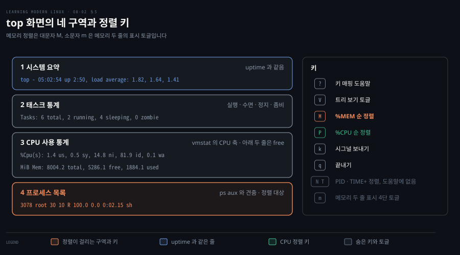

화면에서 자주 쓰는 키는 다섯입니다. `?` 는 키 매핑을 담은 도움말이고 `V` 는 프로세스 트리 보기를 켜고 끕니다. `M` 과 `P` 는 `%MEM` 과 `%CPU` 순으로 정렬하며, `k` 는 시그널을 보내고 `q` 는 끝냅니다.

`top(1)` 의 정렬 키 표에는 `M`·`P` 와 함께 `N`(PID)과 `T`(`TIME+`)가 있습니다. 이 키들은 예전 `top` 사용자를 위한 호환 수단이라 어느 도움말 화면에도 나오지 않습니다. 정렬 순서에 영향을 주는 키를 누르면 `V` 로 켜 둔 트리 보기가 꺼진다는 점도 같은 man page 에 있습니다.[^top]

### 스크립트용 `top -b` 와 `ps -eo`

대화형 화면은 사람이 보기 좋지만 스크립트로 받거나 파일로 남기기는 어렵습니다. `-b` 배치 모드에서 `top` 은 입력을 받지 않고, `-n` 으로 정한 프레임 수만큼 찍은 뒤 끝납니다.[^top] 위 화면이 이렇게 받은 것입니다.

```bash
top -b -n 2 -d 1 | awk '/^top -/{n++} n==2' | head -11
```

프레임을 둘 찍어 둘째를 쓴 데는 이유가 있습니다. 같은 컨테이너에서 `top -bn1` 로 한 프레임만 찍었을 때는 반복문이 돌고 있는데도 `%Cpu(s)` 줄이 `100.0 id` 로 나왔습니다. 첫 프레임에는 견줄 직전 표본이 없기 때문이며, `-d 1` 로 1초 간격을 준 둘째 프레임에서 `ni` 14.8 이 잡혔습니다. 정렬 열을 바꾸려면 `-o %MEM` 처럼 필드 이름을 주는데, `top(1)` 은 이 옵션이 주로 자동화와 스크립트를 위해 있다고 적습니다.

한 시점의 스냅숏에서 원하는 열만 골라 정렬하는 일은 `ps -eo` 가 더 단순합니다. `-e` 는 모든 프로세스를, `-o` 는 찍을 열을 고르고, `--sort` 는 앞에 `-` 를 붙이면 내림차순입니다.[^ps]

```bash
ps -eo pid,ni,pcpu,rss,comm --sort=-pcpu | head -4
```

```bash
    PID  NI %CPU   RSS COMMAND
   3078  10 99.5  1424 sh
      1   0  0.0  2756 bash
   3077   0  0.0  1132 sleep
```

`NI` 는 nice 값으로 19(가장 양보함)부터 −20 까지이고, 반복문은 10 으로 띄웠습니다. `%CPU` 는 프로세스가 산 시간 대비 CPU 시간의 비율이라 열을 다 더해도 100 이 맞지 않을 수 있습니다. 메모리로 고르려면 `--sort=-rss` 로 바꿉니다.

`RSS` 는 스왑되지 않은 물리 메모리(KiB)인데, 여러 프로세스가 공유하는 라이브러리 페이지를 프로세스마다 통째로 셉니다. 그래서 모든 프로세스의 `RSS` 를 더하면 실제 사용량보다 커집니다. 공유 페이지를 그것을 매핑한 프로세스 수로 나눠 세는 값이 PSS 이고, `ps(1)` 은 이를 `pss` 열로 제공합니다.[^ps]

### `top` 의 대안 도구

저자가 대안으로 든 도구들입니다. 각 줄은 저자가 붙인 성격 그대로입니다.

| 도구 | 저자가 적은 성격 |
|------|-----------------|
| `htop` | `top` 을 점진적으로 개선한 것. 더 빠르고 인터페이스가 낫습니다 |
| `atop` | 강력한 대안. CPU 와 메모리에 더해 입출력과 네트워크 통계를 상세히 다룹니다 |
| `below` | 비교적 새 도구. cgroups v2 를 이해한다는 점이 특기할 만합니다 |
| `glances` | 보통의 자원에 더해 장치까지 아우르는 하이브리드 |
| `guider` | 여러 메트릭을 표시하고 그래프로 그리는 통합 성능 분석기 |
| `neoss` | 네트워크 트래픽 모니터링용. TUI 를 갖춘 `ss` 대체재 |
| `mtr` | 네트워크 트래픽 모니터링용. `traceroute` 의 더 강력한 대안 |

`below` 에 저자가 붙인 단서가 이 표에서 가장 실무적입니다. 다른 도구들은 cgroups 를 이해하지 못해 전역 자원 뷰만 제공한다는 것입니다. 위 `top` 화면의 `MiB Mem` 도 컨테이너 안에서 찍었지만 컨테이너를 띄운 VM 전체의 8004MiB 를 보여 줍니다. 6장의 컨테이너가 cgroups 로 자원을 제한하므로, 컨테이너의 한도는 이런 화면에 나타나지 않습니다.


## 6. 계측의 밀기와 끌기

> 지금까지의 신호는 전부 커널이나 남의 앱에서 나온 것입니다. 내 코드가 신호를 내려면 그것을 어디로 보낼지부터 정해야 합니다.

내 코드가 로그처럼 메트릭을 내보내게 하려고 코드를 삽입하는 과정을 계측(instrumentation)이라고 부릅니다. 저자는 전략이 둘 있다고 적습니다. 개발자가 따로 손대지 않아도 되는 자동 계측과, 코드베이스의 특정 지점에서 메트릭을 내보내도록 조각을 직접 넣는 사용자 정의 계측입니다.

도구로는 StatsD 를 들 수 있습니다. Ruby 와 Node.js 와 Python 과 Go 를 비롯한 여러 언어에 클라이언트 라이브러리가 있습니다. StatsD 서버는 기본으로 UDP 8125 에서 받습니다. 프로젝트 README 의 예는 `echo "foo:1|c" | nc -u -w0 127.0.0.1 8125` 한 줄로 카운터를 보냅니다.[^statsd] 다만 한계가 있다고 저자가 단서를 답니다. 그 한계가 드러나는 자리가 쿠버네티스나 IoT 같은 동적 환경입니다. 이런 환경에서는 다른 접근이 대개 더 낫다고 저자가 적으며, 끌어오기 방식 또는 스크래핑이라고 부르는 것입니다.

두 방식의 차이는 화살표의 방향입니다. StatsD 에서는 앱이 메트릭을 보낼 주소를 설정으로 알고 있어야 합니다. 스크래핑에서는 애플리케이션이 메트릭을 노출하기만 하고, 보통 그 통로는 HTTP 엔드포인트입니다. 에이전트가 그 엔드포인트를 정해진 간격으로 호출해 가져갑니다.

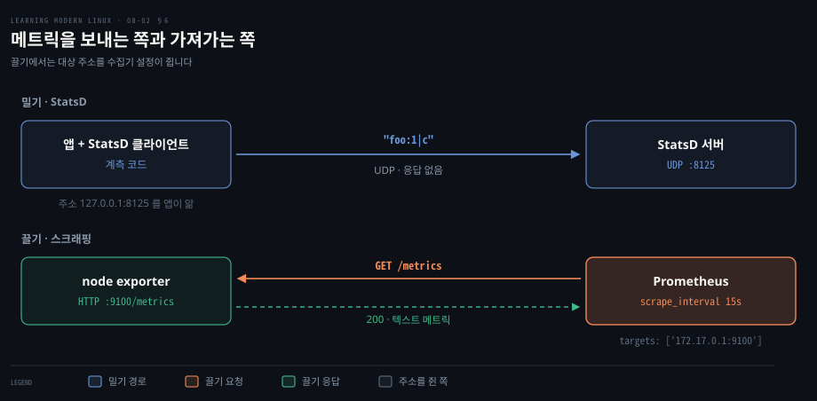

동적 환경에서 끌어가는 방향이 편한 이유는 설정이 어디에 모이느냐에 있습니다. 앱이 늘고 줄 때 앱마다 목적지 설정을 고치는 대신 에이전트의 대상 목록만 관리하면 됩니다. §8 의 `prometheus.yml` 에 대상 주소가 모여 있는 것이 그 모양입니다.


## 7. 추적의 소스와 훅

> 메트릭은 값이 얼마인지를 알려 주지만 왜 그런지는 알려 주지 않습니다. 실행 자체를 잡아야 하는 순간이 있습니다.

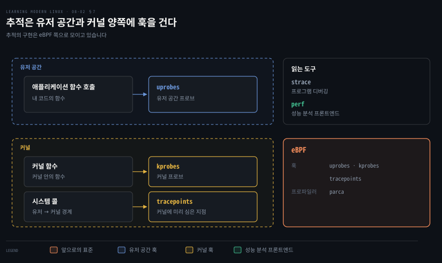

추적이라는 말은 과하게 쓰인다고 저자가 먼저 경고합니다. 리눅스 맥락에서 단일 기계 위의 추적은 프로세스 실행을 시간에 걸쳐 붙잡는 것을 뜻합니다. 유저 공간의 함수 호출과 시스템 콜 같은 것들입니다.

쿠버네티스의 컨테이너화된 마이크로서비스나 서버리스 앱의 람다 묶음 같은 분산 환경에서는 분산 추적을 줄여 그냥 추적이라고 부르기도 합니다. OpenTelemetry 와 Jaeger 가 그 예이며, 그 유형은 이 책의 범위 밖이라고 저자가 못 박습니다.

### 커널 훅과 유저 공간 훅

단일 리눅스 기계에서 추적의 소스는 둘입니다.

- 리눅스 커널: 커널의 함수에서 트레이스가 나오거나 시스템 콜이 트리거가 됩니다. 커널 프로브(kprobes)와 커널 트레이스포인트가 그 예입니다
- 유저 공간: 애플리케이션의 함수 호출이 소스가 될 수 있습니다. 유저 공간 프로브(uprobes)를 통하는 것이 그 예입니다

2장에서 시스템 콜이 커널이 기능을 드러내는 유일한 통로라고 했는데, 그 통로가 여기서는 관측의 훅 지점이 됩니다. 경계를 지나는 모든 것이 한자리를 통과하므로 그 자리에 걸면 다 보입니다.

용도는 둘로 갈립니다. `strace` 같은 추적 도구로 프로그램을 디버깅하는 것과, `perf` 를 프론트엔드 삼아 성능을 분석하는 것입니다. `sudo perf top` 은 프로세스별 요약을 만들어 줍니다.

저자가 경고 상자로 세운 내용이 하나 있습니다. `strace` 를 아무 데나 쓰고 싶어지겠지만 그것이 일으키는 오버헤드를 알아 두라는 것이고, 프로덕션 환경에서 특히 그렇다고 못 박습니다. 근거로 Brendan Gregg 의 글 "strace Wow Much Syscall" 을 읽으라고 권합니다.

### eBPF 로 모이는 추적

저자의 전망은 분명합니다. eBPF 가 추적을 구현하는 사실상의 표준이 될 것으로 보이며 사용자 정의 사례에서 특히 그렇다는 것입니다. 생태계가 두텁고 벤더 지원이 늘고 있으니, 미래에도 통할 추적 방법을 찾는다면 eBPF 를 쓰는 것을 고르라고 권합니다.

2장에서 커널을 확장하는 현대적 방법으로 eBPF 를 본 것이 여기서 이어집니다. 커널을 다시 빌드하지 않고 커널 안에서 코드를 돌릴 수 있다는 성질이, 추적처럼 커널 안 이벤트를 잡아야 하는 일에 그대로 맞습니다.

### 추적의 한 용도인 프로파일링

추적의 특정 용도 하나가 프로파일링입니다. 자주 호출되는 코드 구간을 식별하는 일입니다. 저자가 든 저수준 도구는 `pprof` 와 Valgrind 와 플레임 그래프 시각화입니다.

`perf` 출력을 대화형으로 소비하고 트레이스를 시각화하는 선택지도 많다고 저자가 적습니다. 참고로 단 글은 Mark Hansen 의 "Linux perf Profiler UIs" 입니다. 지속적 프로파일링은 그 진화된 형태입니다. 커널과 유저 공간의 트레이스를 시간에 걸쳐 붙잡습니다. 시각이 찍힌 트레이스가 모이면 그것을 그리고 견주며 흥미로운 구간으로 파고들 수 있습니다. 저자가 유망하다고 꼽은 예는 eBPF 기반의 오픈 소스 프로젝트 parca 입니다.


## 8. Prometheus·Grafana 단일 기계 구성

> 지금까지의 도구는 지금 이 순간을 봅니다. 시간에 걸친 값을 쌓고 조건에 알림을 걸려면 다른 층이 필요합니다.

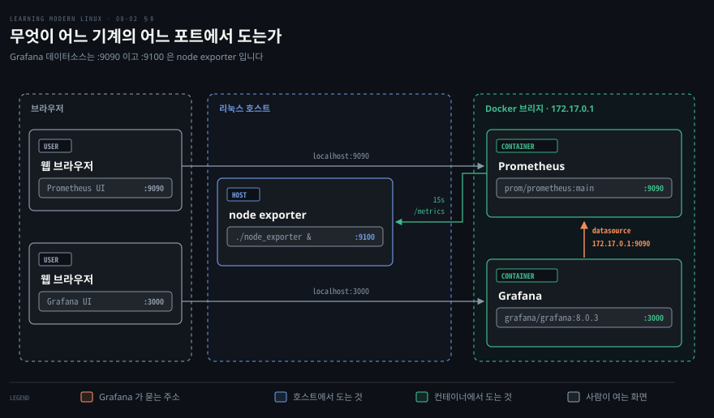

여기까지의 도구는 화면을 닫으면 값이 사라집니다. "어제 이 시각에는 어땠나" 를 물으려면 값을 어딘가에 쌓아 두어야 합니다. 시간에 걸친 메트릭, 곧 시계열 데이터를 다룬다면 Prometheus 와 Grafana 조합을 고려할 만하다고 저자가 적습니다. 보여 주는 것은 단일 기계 구성이며, 그것으로 대시보드를 만들고 알림까지 걸 수 있습니다.

### 구성의 세 조각

node exporter 가 CPU 와 메모리와 네트워크를 아우르는 시스템 메트릭을 노출합니다. Prometheus 가 그것을 긁어 갑니다. 긁는다는 것은 node exporter 가 `/metrics` 라는 URL 경로로 제공하는 HTTP 엔드포인트를 Prometheus 가 호출한다는 뜻입니다. 마지막으로 Grafana 가 Prometheus 를 데이터소스로 삼아 대시보드를 그리고 조건에 알림을 겁니다.

첫 단계는 node exporter 를 내려받아 풀고 배경에서 돌린 뒤 엔드포인트를 불러 보는 것입니다. 포트 9100 은 node exporter 의 기본값입니다.[^nodeexp]

```bash
./node_exporter &
curl localhost:9100/metrics
```

node exporter 1.12.1 에 같은 요청을 보내면 응답 본문이 이런 줄로 이어집니다. 응답 머리의 `Content-Type` 은 `text/plain; version=0.0.4; charset=utf-8; escaping=underscores` 였습니다.

```bash
# HELP go_goroutines Number of goroutines that currently exist.
# TYPE go_goroutines gauge
go_goroutines 7
```

이 형식은 Prometheus 텍스트 노출 형식입니다. `Accept` 헤더로 OpenMetrics(`application/openmetrics-text; version=1.0.0`)를 요청해도 응답 형식은 같았습니다. OpenMetrics 의 끝 표지 `# EOF` 도 없었습니다(2026-11 확인). `# TYPE` 줄이 메트릭의 종류를 밝히므로, 앞 편 §3 의 카운터와 게이지 구분이 여기서 그대로 쓰입니다.

다음은 Prometheus 설정 파일입니다.

```yaml
global:
  scrape_interval: 15s
  evaluation_interval: 15s
  external_labels:
    monitor: 'mymachine'
scrape_configs:
  - job_name: 'prometheus'
    static_configs:
      - targets: ['localhost:9090']
  - job_name: 'machine'
    static_configs:
      - targets: ['172.17.0.1:9100']
```

두 대상에 저자가 각각 주석을 답니다. 첫 번째는 Prometheus 자신이 메트릭을 노출하므로 넣은 자기 모니터링입니다. 두 번째가 node exporter 입니다. Prometheus 를 Docker 에서 돌리므로 `localhost` 로는 호스트에 닿지 않아, Docker 가 기본으로 쓰는 브리지 IP 주소를 씁니다.

이제 Prometheus 와 Grafana 를 컨테이너로 띄웁니다.

```bash
docker run --name prometheus \
  --rm -d -p 9090:9090 \
  -v /home/mh9/lml/o11y/prometheus.yml:/etc/prometheus/prometheus.yml \
  prom/prometheus:main

docker run --name grafana \
  --rm -d -p 3000:3000 \
  grafana/grafana:8.0.3
```

`--rm` 은 종료 시 컨테이너를 지우고 `-d` 는 데몬으로 돌립니다. `-p 9090:9090` 은 포트 9090 을 노출해 내 기계에서 쓸 수 있게 합니다. 설정 파일은 `-v` 로 컨테이너 안에 매핑하며 경로는 절대 경로여야 합니다. 유연하게 두려면 bash 의 `$PWD` 나 Fish 의 `(pwd)` 를 쓰라고 저자가 덧붙입니다.

### 브라우저에서 여는 주소 둘

Prometheus 웹 UI 는 `-p 9090:9090` 으로 게시한 `localhost:9090` 에 뜹니다. 긁는 대상이 살아 있는지는 `localhost:9090/targets` 나 Status 메뉴의 Target health 에서 봅니다.[^prom] `machine` 대상이 정상으로 보이면 node exporter 까지 길이 이어진 것입니다.

Grafana 는 `localhost:3000` 에 뜹니다. 거기서 Prometheus 를 데이터소스로 추가할 때 URL 은 `http://172.17.0.1:9090` 입니다. 9100 은 node exporter 의 포트라서, 그 주소를 넣으면 Grafana 가 Prometheus 가 아니라 exporter 를 가리킵니다. 데이터소스가 붙으면 저자의 다음 단계대로 Node Exporter Full 대시보드를 가져옵니다. 한 화면에 9090 과 9100 과 3000 이 함께 있고 같은 `172.17.0.1` 뒤에 붙는 포트만 다릅니다. 위 도식처럼 무엇이 어디서 도는지를 먼저 그려 두면 포트를 헷갈릴 일이 줄어듭니다.

### 이 무게가 맞는 자리

이 절을 닫으며 저자가 조건을 답니다. Prometheus 와 Grafana 구성은 더 공들여야 하고 움직이는 부품이 많으니 사소한 일에는 쓰지 않을 것이라는 말입니다. 앞에서 다룬 리눅스 기본 도구만으로도 꽤 멀리 갈 수 있다고 덧붙입니다. 그러면서 이 무게가 정당해지는 자리도 짚습니다. 홈 오토메이션이나 미디어 서버처럼 더 완전한 해법을 원하는 고급 사례입니다. 시간에 걸친 값을 계속 쌓고 조건에 알림을 걸어야 하는 상황이 그 기준입니다.


## 결정 치트시트

> 어느 창을 언제 여는지를 한 표로 압축합니다.

| 묻고 싶은 것 | 칠 명령 | 무엇을 볼 것인가 |
|-------------|--------|-----------------|
| 이 기계가 지금 바쁜가 | `uptime; nproc` | 부하 평균 세 값을 CPU 수로 나눈 몫 |
| 메모리가 모자란가 | `free -h` | `free` 가 아니라 `available` 열 |
| `used` 가 왜 컸나 | `free -h` 와 `/proc/meminfo` | `shared`(`Shmem`)가 함께 컸는지, `SUnreclaim`·`Committed_AS` |
| 실행 대기가 밀렸나 | `vmstat 1 3` | 둘째 줄부터 `r` 을 CPU 수와 견주고 `si`·`so` |
| 이 작업이 CPU 를 썼나 기다렸나 | `time` | `real` − (`user`+`sys`) |
| 디스크가 병목인가 | `iostat -z --human 1` | `%iowait` 와 장치별 `tps` |
| 받은 데이터를 앱이 못 읽고 있나 | `ss -atnp` | 확립된 연결의 `Recv-Q`·`Send-Q` |
| 이 포트를 누가 쥐었나, 이 프로세스가 무엇을 열었나 | `lsof -nP -i TCP:<포트>` · `lsof -p <PID>` | `COMMAND`·`PID`·`FD` 와 경로 |
| 지웠는데 디스크가 안 비었다 | `lsof +L1` | `NLINK` 0 과 `(deleted)` 줄의 PID |
| 회전 뒤 로그가 새 파일에 안 쌓인다 | `ls -li` 와 `/proc/<PID>/fd` | `postrotate` 신호, 안 되면 `copytruncate` |
| 한 화면에서 다 보고 싶다 | `top` · `htop` · `atop` | 네 구역. 정렬은 `M` 과 `P` |
| 상위 프로세스를 스크립트로 받고 싶다 | `top -b -n 2 -d 1` 또는 `ps -eo ... --sort=-pcpu` | 둘째 프레임, 고른 열 |
| 컨테이너의 한도까지 보고 싶다 | `below` | 표에서 cgroups v2 를 이해하는 유일한 항목 |
| 시스템 콜을 잡고 싶다 | `strace` | 오버헤드를 감수할 때만 |
| 시간에 걸쳐 쌓고 알림을 걸고 싶다 | Prometheus + Grafana | 부품이 많으니 사소한 일에는 쓰지 않습니다 |


## 적용 관점

> 이 장의 도구를 Spring 과 JVM 이 도는 운영 문맥으로 옮겨 봅니다. 아래 판단은 이 노트가 덧붙인 것이고 저자의 주장이 아닙니다.

컨테이너 안에서 `top` 을 띄우면 한도가 보이지 않습니다. JVM 이 도는 컨테이너의 메모리 한도는 cgroups 가 정하는데, `top` 의 메모리 줄은 그것을 모르고 VM 이나 호스트 전체를 보여 줍니다. 컨테이너 안에서 자원을 진단할 때는 `/sys/fs/cgroup` 아래를 직접 읽거나 cgroups 를 이해하는 도구를 씁니다.

`vmstat` 의 `cs` 열은 스레드 풀 진단의 첫 창입니다. 초당 컨텍스트 전환 수가 뛰는데 처리량은 그대로라면, 스레드가 일하는 시간보다 서로 자리를 넘기는 시간이 길다는 신호입니다. 풀 크기를 늘리면 나아질 것 같지만 이 값이 이미 높다면 반대로 가야 할 수도 있습니다.

애플리케이션 로그를 직접 파일로 쓰는 서비스는 회전 방식을 먼저 정합니다. 로그 라이브러리가 스스로 파일을 돌린다면 logrotate 를 겹쳐 걸지 않습니다. 바깥 logrotate 에 맡긴다면 앱이 신호로 파일을 다시 여는지부터 확인합니다. 다시 열 수단이 없을 때 `copytruncate` 를 고르며, 그때는 회전 순간의 몇 줄을 잃을 수 있다는 대가를 받아들입니다.

애플리케이션 메트릭도 §6 의 두 방향 중 하나를 고릅니다. Spring Boot 의 Actuator 가 `/actuator/prometheus` 엔드포인트를 여는 것이 스크래핑 쪽입니다. 앱은 목적지를 모르고 노출만 하며, 어디로 가져갈지는 에이전트가 정합니다.

메트릭 이름을 정하기 전에 종류를 정합니다. 앞 편 §3 의 카운터와 게이지 구분이 여기서 실무 규칙이 됩니다. 누적이 뜻을 갖는 값은 카운터로 두고 증가분을 질의에서 계산하며, 지금 이 순간의 값은 게이지로 둡니다. 카운터를 게이지처럼 내보내면 재시작 때마다 값이 0 으로 떨어져 그래프가 망가집니다.


## 면접에서 받을 만한 질문

1. 부하 평균 2.0 을 보고 시스템이 바쁜지 판정할 수 있습니까? 왜 그렇습니까?
2. `time` 이 내놓는 `real`·`user`·`sys` 중 무엇이 CPU 시간입니까? 셋의 관계는 어떻게 됩니까?
3. `free` 출력에서 `free` 열과 `available` 열 중 무엇을 보아야 하고 왜 그렇습니까?
4. `free` 의 `used` 가 크게 올랐는데 `shared` 도 같은 만큼 올랐다면 무엇을 먼저 의심합니까?
5. `%iowait` 가 높다는 것은 무엇을 뜻합니까? 그때 다음으로 볼 것은 무엇입니까?
6. 큰 로그 파일을 지웠는데 `df` 의 사용량이 그대로입니다. 원인과 찾는 명령, 공간을 돌려받는 길은 무엇입니까?
7. logrotate 의 `create` 회전과 `copytruncate` 는 언제 각각 고릅니까?
8. 추적의 훅 지점 셋을 대고, 각각이 유저 공간과 커널 중 어디에 걸리는지 말해 보십시오.
9. 메트릭을 밀어 보내는 방식과 끌어가는 방식 중 동적 환경에 어느 쪽이 유리하며 왜 그렇습니까?


## 정답 (자답 후 펼치기)

1. 판정할 수 없습니다. 부하 평균은 CPU 수로 정규화되지 않기 때문입니다. `uptime(1)` 의 예로는 부하 1 이 단일 CPU 시스템에서는 내내 바빴다는 뜻이고 4 CPU 시스템에서는 75% 를 놀았다는 뜻입니다. 값과 함께 그 기계의 CPU 수를 알아야 하고, 한 값이 아니라 세 구간을 견주며 시간에 걸쳐 추적해야 합니다.

2. `user` 와 `sys` 가 CPU 시간입니다. `user` 는 사용자 모드에서 프로세스가 직접 쓴 CPU 초이고 `sys` 는 커널 모드에서 시스템이 프로세스를 대신해 쓴 CPU 초입니다. `real` 은 벽시계로 잰 경과 시간이라 CPU 를 쓰지 않은 대기까지 포함합니다. 단일 스레드라면 `real` 에서 두 값을 뺀 나머지가 기다린 시간이고, `sleep 1` 은 그 나머지가 1.000초였습니다. 스레드가 여럿이면 `user`+`sys` 가 `real` 을 넘을 수 있습니다.

3. `available` 을 보아야 합니다. `free` 는 아무 데도 안 쓰인 메모리만 세는데, 커널은 남는 메모리를 페이지 캐시로 쓰기 때문에 정상 상태에서도 이 값이 작을 수 있습니다. `available` 은 스왑 없이 새 애플리케이션을 시작할 수 있는 양의 추정치이며 내어 줄 수 있는 캐시를 계산에 넣습니다.

4. tmpfs 나 공유 메모리를 먼저 의심합니다. `used` 는 `total` − `available` 이고, `shared` 의 출처 `Shmem` 은 tmpfs 와 System V·POSIX 공유 메모리, 공유 익명 매핑입니다. 이 메모리는 디스크 원본이 없어 버릴 수 없으므로 `available` 에서 빠지고 그만큼 `used` 가 오릅니다. `/dev/shm` 에 400MiB 를 쓰자 `shared` 와 `buff/cache` 가 400 씩, `used` 가 403 올랐습니다. 다음으로 `df -h` 로 tmpfs 마운트를 확인합니다.

5. CPU 가 유휴였는데 처리되지 않은 디스크 입출력 요청이 있던 시간의 비율이 높다는 뜻입니다. CPU 가 놀면서 디스크를 기다리고 있는 상태입니다. 다음으로 간격을 준 `iostat` 의 둘째 보고에서 장치별 행을 보고, `tps` 와 읽기·쓰기 양으로 어느 장치에 몰렸는지를 좁힙니다.

6. 그 파일을 아직 연 프로세스가 있어서입니다. `rm` 은 이름만 떼어 내고, 파일은 마지막 파일 디스크립터가 닫힐 때까지 남습니다. `lsof +L1` 이 링크 수 0 인 열린 파일과 그 PID 를 보여 주며, 이름 끝에 `(deleted)` 가 붙습니다. 그 프로세스가 파일을 닫게 하거나 재시작하면 공간이 돌아오고, 끝낼 수 없다면 `: > /proc/<PID>/fd/<N>` 으로 크기를 0 으로 자릅니다.

7. 쓰는 프로세스가 신호를 받아 로그를 다시 열 수 있으면 `create` 로 회전하고 `postrotate` 에서 신호를 보냅니다. 기본 회전은 이름만 바꾸므로, 신호가 없으면 프로세스가 옛 inode 인 `app.log.1` 에 계속 씁니다. 다시 열 수단이 없으면 `copytruncate` 를 고르고, 복사와 자르기 사이에 쓴 로그를 잃을 수 있다는 대가를 받아들입니다.

8. 커널 프로브(kprobes)와 커널 트레이스포인트가 커널에 걸리고, 유저 공간 프로브(uprobes)가 유저 공간에 걸립니다. 커널 쪽 트레이스는 커널 함수에서 나오거나 시스템 콜이 트리거가 되고, 유저 공간 쪽은 애플리케이션의 함수 호출이 소스가 됩니다.

9. 끌어가는 방식, 곧 스크래핑이 유리합니다. 밀어 보내는 방식에서는 앱이 목적지를 설정으로 알고 있어야 하므로, 인스턴스가 늘고 줄 때마다 앱 쪽 설정이 따라 움직여야 합니다. 스크래핑에서는 앱이 HTTP 엔드포인트로 노출만 하고 에이전트가 대상 목록을 관리하므로 앱 설정이 그대로입니다.


## 핵심 개념 체크리스트

- [ ] 느린 앱의 원인 범주 셋을 대고 각각을 여는 명령을 붙일 수 있는가?
- [ ] 부하 평균이 정규화되지 않았다는 사실이 판정에 어떤 영향을 주는지 말할 수 있는가?
- [ ] `free` 의 여섯 열이 `/proc/meminfo` 의 어느 필드에서 오는지 댈 수 있는가?
- [ ] tmpfs 에 쓴 데이터가 `used`·`shared`·`buff/cache`·`available` 을 어떻게 움직이는지 설명할 수 있는가?
- [ ] `vmstat` 의 첫 줄을 건너뛰는 이유와 `r`·`in`·`cs` 의 뜻을 말할 수 있는가?
- [ ] `real`·`user`·`sys` 로 CPU 밖에서 보낸 시간을 계산할 수 있는가?
- [ ] `iostat` 의 `%iowait` 와 `tps` 를 이어서 읽을 수 있는가?
- [ ] `ss` 의 `Recv-Q` 가 쌓이는 상황을 만들어 설명할 수 있는가?
- [ ] `lsof +L1` 로 지운 파일을 쥔 프로세스를 찾고 공간을 돌려받을 수 있는가?
- [ ] logrotate 의 `create`·`postrotate`·`copytruncate` 를 상황에 맞게 고를 수 있는가?
- [ ] `top` 화면의 네 구역과 정렬 키를 대고, `top -b` 와 `ps -eo --sort` 를 스크립트에 쓸 수 있는가?
- [ ] 추적의 훅 지점 셋과 eBPF 가 그 자리를 가져가는 이유를 말할 수 있는가?
- [ ] Prometheus 구성에서 9090 과 9100 과 3000 이 각각 무엇인지 짚을 수 있는가?


## 관련 문서

- [8장 첫 편 — 재는 것은 바깥이고 알고 싶은 것은 안이다](./08-01.%EC%9E%AC%EB%8A%94%20%EA%B2%83%EC%9D%80%20%EB%B0%94%EA%B9%A5%EC%9D%B4%EA%B3%A0%20%EC%95%8C%EA%B3%A0%20%EC%8B%B6%EC%9D%80%20%EA%B2%83%EC%9D%80%20%EC%95%88%EC%9D%B4%EB%8B%A4.md) — 신호 유형과 로그가 거기 있습니다
- [2장 — 커널은 전부를 하지만 운영체제는 아니다](./02-01.%EC%BB%A4%EB%84%90%EC%9D%80%20%EC%A0%84%EB%B6%80%EB%A5%BC%20%ED%95%98%EC%A7%80%EB%A7%8C%20%EC%9A%B4%EC%98%81%EC%B2%B4%EC%A0%9C%EB%8A%94%20%EC%95%84%EB%8B%88%EB%8B%A4.md) — 시스템 콜과 eBPF 가 여기서 추적의 훅으로 돌아옵니다
- [6장 둘째 편 — 컨테이너의 새로움은 재료가 아니라 조합에 있다](./06-02.%EC%BB%A8%ED%85%8C%EC%9D%B4%EB%84%88%EC%9D%98%20%EC%83%88%EB%A1%9C%EC%9B%80%EC%9D%80%20%EC%9E%AC%EB%A3%8C%EA%B0%80%20%EC%95%84%EB%8B%88%EB%9D%BC%20%EC%A1%B0%ED%95%A9%EC%97%90%20%EC%9E%88%EB%8B%A4.md) — cgroups 가 `below` 의 특기 사항으로 이어집니다
- [5장 — 모든 것이 파일이라는 말은 손잡이가 하나라는 뜻이다](./05-01.%EB%AA%A8%EB%93%A0%20%EA%B2%83%EC%9D%B4%20%ED%8C%8C%EC%9D%BC%EC%9D%B4%EB%9D%BC%EB%8A%94%20%EB%A7%90%EC%9D%80%20%EC%86%90%EC%9E%A1%EC%9D%B4%EA%B0%80%20%ED%95%98%EB%82%98%EB%9D%BC%EB%8A%94%20%EB%9C%BB%EC%9D%B4%EB%8B%A4.md) — 소켓이 파일이라 `lsof` 로 보이는 근거
- [LKP 09-03 — demand paging 과 OOM killer](../linux-kernel-programming/09-03.%EB%A9%94%EB%AA%A8%EB%A6%AC%20%ED%95%A0%EB%8B%B9%20%285%29%20%E2%80%94%20demand%20paging%EA%B3%BC%20OOM%20killer.md) — `Committed_AS` 가 실제 사용량과 다른 이유
- [Learning Modern Linux 정독 인덱스](./README.md) — 이 책의 MOC


## 참고 자료

- 책: 《Learning Modern Linux》 Michael Hausenblas, O'Reilly Media, 2022. ISBN 978-1-098-10894-6
- [Linux Performance — Brendan Gregg](https://www.brendangregg.com/linuxperf.html) — 저자가 기초 자료로 꼽은 곳
- [man7.org Linux man pages](https://man7.org/linux/man-pages/) — 이 노트의 열 정의와 옵션은 아래 각주의 man page 에서 확인했습니다(2026-11 확인)
- 실행 환경: OrbStack 위 `debian:12` 컨테이너(8 CPU), procps-ng 4.0.2 · sysstat 12.6.1 · iproute2 6.1.0 · lsof 4.95.0 · logrotate 3.21.0 · node exporter 1.12.1

[^uptime]: procps-ng `uptime(1)`. "System load averages is the average number of processes that are either in a runnable or uninterruptable state. A process in uninterruptible state is waiting for some I/O access, eg waiting for disk. ... Load averages are not normalized for the number of CPUs in a system, so a load average of 1 means a single CPU system is loaded all the time while on a 4 CPU system it means it was idle 75% of the time." <https://man7.org/linux/man-pages/man1/uptime.1.html> (2026-11 확인)

[^free]: procps-ng `free(1)`. used "calculated as total - available", shared "Memory used (mostly) by tmpfs (Shmem in /proc/meminfo)", cache "Cached and SReclaimable in /proc/meminfo", available "takes into account page cache and also that not all reclaimable memory slabs will be reclaimed due to items being in use", `-c` "Requires the -s option". <https://man7.org/linux/man-pages/man1/free.1.html> (2026-11 확인)

[^meminfo]: man-pages `proc_meminfo(5)`. MemTotal "Total usable RAM (i.e., physical RAM minus a few reserved bits and the kernel binary code)", Shmem "consumed in tmpfs(5) filesystems, System V, and POSIX shared memory, as well as shared anonymous mappings", Committed_AS 의 1 GB `malloc` 예와 HugePages 줄의 "(CONFIG_HUGETLB_PAGE is required.)". <https://man7.org/linux/man-pages/man5/proc_meminfo.5.html> (2026-11 확인)

[^tmpfs]: Linux 커널 문서 Tmpfs. "Since tmpfs lives completely in the page cache and optionally on swap, all tmpfs pages will be shown as "Shmem" in /proc/meminfo and "Shared" in free(1)." <https://docs.kernel.org/filesystems/tmpfs.html> (2026-11 확인)

[^kproc]: Linux 커널 문서 The /proc Filesystem 의 meminfo 절. Cached "In-memory cache for files read from the disk (the pagecache) as well as tmpfs & shmem." <https://docs.kernel.org/filesystems/proc.html> (2026-11 확인)

[^vmstat]: procps-ng `vmstat(8)`. "The first report produced gives averages since the last reboot." 와 r·b·in·cs·us·sy·id·wa·st 필드 정의. <https://man7.org/linux/man-pages/man8/vmstat.8.html> (2026-11 확인)

[^gnutime]: GNU `time(1)` 의 형식 지정자. "S — Total number of CPU-seconds used by the system on behalf of the process (in kernel mode)" · "U — Total number of CPU-seconds that the process used directly (in user mode)". <https://man7.org/linux/man-pages/man1/time.1.html> (2026-11 확인)

[^iostat]: sysstat `iostat(1)`. %iowait "Show the percentage of time that the CPU or CPUs were idle during which the system had an outstanding disk I/O request", tps "the number of transfers per second that were issued to the device", 첫 보고가 부팅 이후 통계라는 설명과 `-z`·`--human`. <https://man7.org/linux/man-pages/man1/iostat.1.html> (2026-11 확인)

[^ss]: iproute2 `ss(8)`. "-a, --all Display both listening and non-listening (for TCP this means established connections) sockets." <https://man7.org/linux/man-pages/man8/ss.8.html> (2026-11 확인)

[^netstat]: net-tools `netstat(8)`. "-l, --listening Show only listening sockets. (These are omitted by default.)" · "-c, --continuous This will cause netstat to print the selected information every second continuously." <https://man7.org/linux/man-pages/man8/netstat.8.html> (2026-11 확인)

[^lsof]: `lsof(8)`. `+L1` "will select open files that have been unlinked". <https://man7.org/linux/man-pages/man8/lsof.8.html> (2026-11 확인)

[^unlink]: man-pages `unlink(2)`. "If the name was the last link to a file but any processes still have the file open, the file will remain in existence until the last file descriptor referring to it is closed." <https://man7.org/linux/man-pages/man2/unlink.2.html> (2026-11 확인)

[^logrotate]: `logrotate(8)`. create "Immediately after rotation (before the postrotate script is run) the log file is created", copytruncate "Truncate the original log file to zero size in place after creating a copy ... there is a very small time slice between copying the file and truncating it, so some logging data might be lost", postrotate 예 `/usr/bin/killall -HUP syslogd`. <https://man7.org/linux/man-pages/man8/logrotate.8.html> (2026-11 확인)

[^top]: procps-ng `top(1)`. "-b, --batch ... In this mode, top will not accept input and runs until the iterations limit you've set with the '-n' command-line option or until killed.", "m :Memory/Swap-Usage toggle ... 4-way toggle", 정렬 절의 "M %MEM · N PID · P %CPU · T TIME+" 와 그 키들이 도움말 화면에 나오지 않는다는 설명. <https://man7.org/linux/man-pages/man1/top.1.html> (2026-11 확인)

[^ps]: procps-ng `ps(1)`. `-e` "Select all processes", `--sort spec` "[+|-]key[,[+|-]key[,...]]", rss "resident set size, the non-swapped physical memory that a task has used (in kibibytes)", pss "Proportional share size ... shared memory proportionally accounted to all tasks mapping it", ni "ranges from 19 (nicest) to -20". <https://man7.org/linux/man-pages/man1/ps.1.html> (2026-11 확인)

[^statsd]: StatsD README 와 `exampleConfig.js`. "port: port to listen for messages on [default: 8125]", 예 `echo "foo:1|c" | nc -u -w0 127.0.0.1 8125`. <https://github.com/statsd/statsd> (2026-11 확인)

[^nodeexp]: Prometheus node_exporter README. "The `node_exporter` listens on HTTP port 9100 by default." <https://github.com/prometheus/node_exporter> (2026-11 확인)

[^prom]: Prometheus 공식 문서 Getting started. "about itself at localhost:9090", "navigate to http://localhost:9090/query", "localhost:9090/targets, or open the Status menu and select Target health". <https://prometheus.io/docs/prometheus/latest/getting_started/> (2026-11 확인)
