# 이 장을 묶는 것은 주제가 아니라 필요해지는 조건이다

---

> 이 책의 마지막 장입니다. 저자 스스로 잡탕이라 부르는 구간이고, 다섯 주제를 잇는 것은 내용이 아니라 각각이 언제 필요해지는가입니다.

## 핵심 요약

> 이 장이 매달린 생각은 여기 있는 것들은 쓸 일이 생겨야 필요해진다는 것입니다. 저자가 서두에서 직접 그렇게 적습니다.

저자의 말로는 이 장의 주제들 대부분이 구체적인 용례가 있거나 업무 환경이 요구할 때에만 의미가 있습니다. 그래서 이 노트의 일도 각 주제를 남김없이 설명하기보다 필요해지는 조건을 함께 밝히는 것입니다. 프로세스 사이 통신은 3장의 파이프와 7장의 소켓을 한 기계 안으로 좁힌 것이고, 인증은 4장의 접근 제어에서 인증 부분만 떼어 낸 것입니다. 나머지 셋인 가상 머신, 현대 배포판, 아직 주류가 아닌 것들은 새 이야기입니다.

운영에서는 시그널이 가장 자주 손에 닿습니다. 서비스 중지가 90초를 끌거나 컨테이너가 137 로 끝났다는 알림은 모두 시그널로 읽어야 풀립니다. 그래서 이 노트는 시그널을 따로 한 절로 떼어 처리 방식과 번호, 도구와 종료 순서를 다룹니다. 정지와 재개까지 Debian 12 컨테이너에서 직접 돌린 출력으로 확인합니다. 시그널 핸들러는 기본 동작을 대체하므로 핸들러를 단 프로세스는 스스로 끝내야 합니다. 인증 절에는 로그인할 때 자원 한도를 거는 `pam_limits` 를 더했습니다. 한도는 로그인마다 새로 걸리고 이미 돌고 있는 프로세스에는 소급되지 않는다는 것이 그 절의 요점입니다.


## 학습 목표

> 이 장을 읽고 나면 아래 다섯 가지를 스스로 해낼 수 있습니다.

1. 시그널의 세 가지 처리 방식을 말하고, 핸들러가 기본 동작과 어떤 관계인지와 핸들할 수 없는 둘을 댈 수 있습니다.
2. 종료 코드 128+n 을 시그널 이름으로 읽고, `systemctl stop` 의 `SIGTERM` 부터 `SIGKILL` 까지 순서를 설명할 수 있습니다.
3. 명명 파이프를 만들어 두 프로세스를 붙이고, 그것이 왜 막히는지 설명할 수 있습니다.
4. 가상화 스택을 아래에서 위로 쌓아 설명하고, 내 기계가 KVM 을 쓸 수 있는지 확인할 수 있습니다.
5. Kerberos 의 네 걸음과 운영상 제약을 설명하고, `limits.conf` 의 한도가 언제 누구에게 걸리는지 판단할 수 있습니다.

아래는 이 문서 전체를 읽는 순서로 이은 지도입니다. 칸마다 절 번호와 그 절이 언제 필요해지는지를 적었습니다.

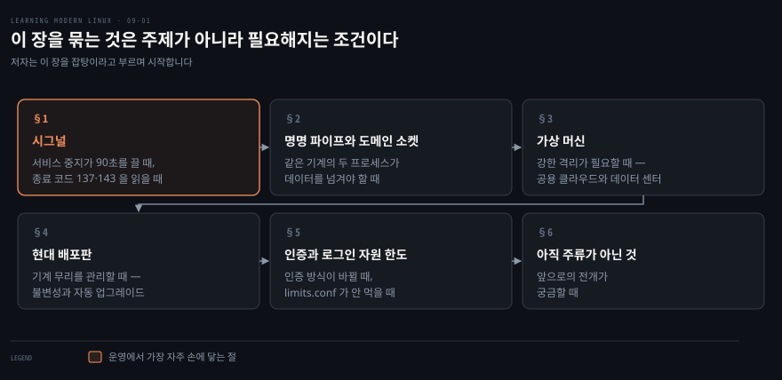


## 이 문서가 다루지 않는 것

> 저자가 스스로 그은 선을 옮깁니다.

- IPC 전반 → 저자가 파이프와 소켓과 공유 메모리까지 긴 목록이 있다고만 밝히고, 잘 자리 잡고 널리 쓰이는 셋만 고릅니다
- 도메인 소켓의 프로그래밍 → 보통 프로그램에서 쓰는 것이라 하고, 명령줄에서는 `socat` 으로 만져 보라고만 적습니다
- KVM 위에서 실제로 VM 을 띄우는 절차 → 이 장은 스택의 구성과 가용성 확인까지입니다
- 데스크톱 배포판·임베디드·클라우드 IDE 의 실습 → 저자가 소개 수준으로만 다룹니다


## 1. 시그널, 번호 하나로 오는 알림

> 돌고 있는 프로세스에 멈춰라, 끝내라, 다시 읽어라 같은 사건을 알리는 가장 짧은 길이 시그널입니다. 번호 하나만 가고 데이터는 따라가지 않습니다.

서비스를 내렸는데 프로세스가 한참 버티다 강제로 죽었거나, 컨테이너가 종료 코드 137 로 끝났거나, `kill` 에 프로세스가 반응하지 않을 때 시그널을 모르면 원인을 읽을 수 없습니다. IPC 가 맡는 일은 프로세스끼리의 통신, 활동의 동기화, 데이터 공유의 셋입니다. 리눅스 IPC 중 시그널은 데이터를 나르지 않고 사건만 비동기로 알립니다. 데이터를 나르는 둘은 §2 에서 다룹니다.

### 시그널 — 커널이 프로세스를 두드리는 방법

시그널은 커널이 유저 공간 프로세스에 특정 사건을 알리려고 만든 것이고, 저자는 비동기 알림이라 생각하면 된다고 적습니다. 도착한 시그널을 다루는 처리 방식(disposition)은 기본 동작, 무시, 핸들러 셋 중 하나이며 서로를 대체합니다.[^signal]

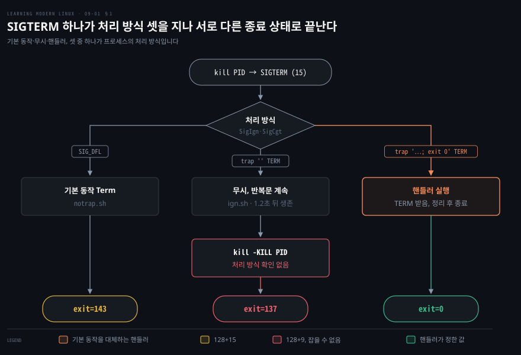

단, `SIGKILL` 과 `SIGSTOP` 은 잡을 수도 막을 수도 무시할 수도 없어 커널이 기본 동작을 바로 실행합니다.[^signal] 처리 방식은 프로세스 속성이어서 모든 스레드에 같고, `fork` 자식에게 상속됩니다. `execve` 를 부르면 핸들러는 기본 동작으로 되돌아가고 무시는 유지됩니다.[^signal] `SIGHUP` 전파와 `nohup` 원리는 3장 노트의 [터미널이 끊길 때 살아남는 잡](./03-01.%EC%85%B8%EC%9D%98%20%EC%8B%A4%EC%B2%B4%EB%8A%94%20%EC%8A%A4%ED%8A%B8%EB%A6%BC%EA%B3%BC%20%EB%B3%80%EC%88%98%EC%99%80%20%EC%A2%85%EB%A3%8C%20%EC%83%81%ED%83%9C%EB%8B%A4.md#터미널이-끊길-때-살아남는-잡)에 있습니다.

시그널을 보내는 전형적인 도구는 `kill` 이며, 기본 동작이 프로세스를 종료시키는 것이라 이런 이름이 붙었습니다.

```bash
while true ; do sleep 1 ; done &
ps
kill 17030
```

```bash
[1] 17030
  PID TTY          TIME CMD
16939 pts/2    00:00:00 bash
17030 pts/2    00:00:00 bash
17041 pts/2    00:00:00 sleep
17045 pts/2    00:00:00 ps
[1]+  Terminated              while true; do sleep 1; done
```

`ps` 에서 PID 17030 의 이름이 `sleep` 이 아니라 `bash` 입니다. 반복문 전체가 서브셸로 떴고 죽일 대상이 그 서브셸입니다. `sleep`(17041)은 그 아래에서 회차마다 새로 뜨는 별개의 프로세스입니다. `kill` 이 보낸 기본 `SIGTERM` 에 핸들러가 없어 서브셸이 기본 동작대로 종료되었습니다. 핸들러를 다는 쪽은 `trap` 이며 셸에서 커스텀 핸들러를 등록하게 해 줍니다.

```bash
trap "echo kthxbye" SIGINT ; while true ; do sleep 1 ; done
```

```bash
^Ckthxbye
```

핸들러가 종료를 대체했으므로 Ctrl+C 에 `kthxbye` 만 찍고 반복문은 계속 돕니다. 프롬프트로 가려면 핸들러에서 `exit` 를 부르거나 다른 시그널로 끝내야 합니다. 처리 방식 셋을 같은 반복문에 하나씩 걸고 `SIGTERM` 을 보내면 차이가 종료 상태로 드러납니다. Debian 12 컨테이너(bash 5.2.15)에서 스크립트 `/tmp/rerun.sh` 로 돌린 결과입니다.

```bash
# notrap.sh  : while true; do sleep 1; done
# trap.sh    : trap 'echo TERM 받음, 정리 후 종료; exit 0' TERM 를 앞에 둠
# ign.sh     : trap '' TERM 를 앞에 둠

./notrap.sh &      # 시그널 처리 없는 스크립트를 백그라운드에서 실행
p=$!
sleep 0.5; kill $p; wait $p; echo "exit=$?"

# 같은 순서로 trap.sh 와 ign.sh 를 돌린다
./trap.sh   & p=$!; sleep 0.5; kill $p; wait $p; echo "exit=$?"
./ign.sh    & p=$!; sleep 0.5; kill $p; sleep 1.2; kill -0 $p && echo "TERM 뒤에도 살아 있음"
kill -KILL $p; wait $p; echo "exit=$?"
```

```bash
exit=143
TERM 받음, 정리 후 종료
exit=0
TERM 뒤에도 살아 있음
/tmp/rerun.sh: line 11:  4324 Killed                  ./ign.sh
exit=137
```

기본 동작은 143, 핸들러가 `exit 0` 을 부른 쪽은 0, 무시하는 쪽은 `SIGKILL` 에 137 로 끝납니다. 핸들러에 `exit` 가 없으면 핸들러를 실행한 뒤 반복문으로 돌아갑니다. `trap "echo caught" KILL` 은 등록은 되지만 `SIGKILL` 이 오면 핸들러를 거치지 않고 137 로 종료됩니다.

### 번호와 기본 동작

로그의 `status=9/KILL` 이나 설정의 `KillSignal=SIGQUIT` 를 읽으려면 번호와 이름을 오갈 수 있어야 합니다. bash 내장 `kill -l` 로 둘을 확인합니다.

```bash
kill -l
#  1) SIGHUP	 2) SIGINT	 3) SIGQUIT	 4) SIGILL	 5) SIGTRAP
#  6) SIGABRT	 7) SIGBUS	 8) SIGFPE	 9) SIGKILL	10) SIGUSR1
# 11) SIGSEGV	12) SIGUSR2	13) SIGPIPE	14) SIGALRM	15) SIGTERM
# 16) SIGSTKFLT	17) SIGCHLD	18) SIGCONT	19) SIGSTOP	20) SIGTSTP
# 21) SIGTTIN	22) SIGTTOU	23) SIGURG	24) SIGXCPU	25) SIGXFSZ
# 26) SIGVTALRM	27) SIGPROF	28) SIGWINCH	29) SIGIO	30) SIGPWR
# 31) SIGSYS	34) SIGRTMIN	35) SIGRTMIN+1	36) SIGRTMIN+2	37) SIGRTMIN+3
# ...
# 63) SIGRTMAX-1	64) SIGRTMAX
kill -l 143   # TERM
kill -l TERM  # 15
```

bash 의 `kill -l` 은 숫자를 시그널 번호로도, 시그널로 죽은 프로세스의 종료 상태(128+n)로도 받아들여 143 을 넣어도 `TERM` 이 나옵니다.[^bashkill] 번호는 아키텍처마다 다를 수 있습니다. 아래 번호는 x86 과 ARM 의 것이고 Alpha·SPARC·MIPS·PARISC 에는 다른 번호를 쓰는 시그널이 있어[^signal] 스크립트와 설정에는 이름을 쓰는 편이 안전합니다. 기본 동작은 `signal(7)` 표를 따르며 Term 은 종료, Core 는 종료와 코어 덤프, Ign 은 무시, Stop 은 정지, Cont 는 재개입니다.[^signal]

| 번호 | 이름 | 기본 동작 | 언제 오고 무엇에 쓰나 |
|------|------|-----------|----------------------|
| 1 | `SIGHUP` | Term | 제어 터미널이 끊기거나 제어 프로세스가 죽을 때. nginx 같은 데몬은 설정을 다시 읽는 신호로 씁니다[^nginx] |
| 2 | `SIGINT` | Term | 터미널에서 Ctrl+C |
| 3 | `SIGQUIT` | Core | 터미널에서 Ctrl+\\. JVM 은 이 시그널에 스레드 덤프를 찍고 계속 돕니다[^jdk] |
| 6 | `SIGABRT` | Core | 프로그램이 `abort(3)` 를 부를 때 |
| 9 | `SIGKILL` | Term | 잡을 수도 막을 수도 무시할 수도 없는 종료 |
| 10, 12 | `SIGUSR1`, `SIGUSR2` | Term | 뜻이 정해지지 않은 둘. 프로그램마다 용도를 정합니다(다음 절) |
| 11 | `SIGSEGV` | Core | 잘못된 메모리 참조 |
| 13 | `SIGPIPE` | Term | 읽는 쪽이 없는 파이프에 쓸 때 |
| 14 | `SIGALRM` | Term | `alarm(2)` 타이머가 다 될 때. `timeout` 이 내부에서 씁니다 |
| 15 | `SIGTERM` | Term | `kill` 과 `systemctl stop` 이 기본으로 보내는 종료 요청 |
| 17 | `SIGCHLD` | Ign | 자식이 멈추거나 끝날 때 |
| 18 | `SIGCONT` | Cont | 멈춘 프로세스를 이어 돌릴 때 |
| 19 | `SIGSTOP` | Stop | 잡을 수 없는 정지 |
| 20 | `SIGTSTP` | Stop | 터미널에서 Ctrl+Z. 잡을 수 있습니다 |
| 24 | `SIGXCPU` | Core | CPU 시간 한도(`setrlimit(2)`)를 넘을 때 |
| 25 | `SIGXFSZ` | Core | 파일 크기 한도를 넘을 때 |
| 28 | `SIGWINCH` | Ign | 터미널 창 크기가 바뀔 때 |
| 34~64 | `SIGRTMIN`~`SIGRTMAX` | Term | 실시간 시그널. 미리 정한 뜻이 없습니다 |

`SIGPIPE` 는 `yes | head -n1` 처럼 읽는 쪽이 먼저 끝날 때 발생합니다. 3장 노트의 [파이프라인 절](./03-01.%EC%85%B8%EC%9D%98%20%EC%8B%A4%EC%B2%B4%EB%8A%94%20%EC%8A%A4%ED%8A%B8%EB%A6%BC%EA%B3%BC%20%EB%B3%80%EC%88%98%EC%99%80%20%EC%A2%85%EB%A3%8C%20%EC%83%81%ED%83%9C%EB%8B%A4.md#파이프라인이-실제로-이어지는-방식)에서 `PIPESTATUS` 의 `141 0` 으로 확인할 수 있습니다.

실시간 시그널은 표준 시그널과 두 가지가 다릅니다. 같은 시그널이 여러 번 오면 표준 시그널은 한 건만 대기하지만 실시간 시그널은 큐에 쌓입니다.[^signal] 또 `SIGRTMIN` 의 번호가 고정되어 있지 않습니다. 커널은 32 부터 64 까지 33개를 두지만 glibc 가 앞의 둘이나 셋을 써서 `SIGRTMIN` 은 34 나 35 가 됩니다.[^signal] 위 `kill -l` 출력에서 33 다음이 비고 34 가 `SIGRTMIN` 인 것이 그 결과입니다.

그래서 실시간 시그널은 `SIGRTMIN+n` 으로 적습니다. systemd 의 PID 1 은 `SIGRTMIN+0` 에 `default.target`, `SIGRTMIN+1` 에 rescue, `SIGRTMIN+3` 에 halt 로 들어갑니다.[^systemd1]

### USR1 로 쓰는 자리

프로세스를 죽이지 않고 진행 상황을 보거나 로그 파일을 다시 열게 하려면 뜻이 정해지지 않은 시그널이 필요합니다. `SIGUSR1` 과 `SIGUSR2` 는 양쪽이 의미에 합의하기만 하면 프로세스끼리 비동기 알림을 주고받는 데 쓸 수 있고, 실제로 프로그램마다 뜻이 다릅니다. nginx 는 `USR1` 에 로그 파일을 다시 열고 `USR2` 에 실행 파일을 갈아 끼웁니다.[^nginx]

HAProxy 에서 `SIGUSR1` 은 리스닝 포트를 닫고 남은 연결을 마저 처리한 뒤 나가는 얌전한 중지입니다.[^haproxy] 반면 `SIGTERM` 은 연결을 모두 끊고 즉시 나가는 강제 중지입니다.[^haproxy] GNU `dd` 는 복사 도중 `USR1` 을 받으면 입출력 통계를 표준 오류에 찍고 작업을 이어 갑니다.[^dd]

```bash
dd if=/dev/zero of=/dev/null bs=1M count=200000 & p=$!; sleep 1; kill -USR1 $p
```

```bash
26068+0 records in
26068+0 records out
27334279168 bytes (27 GB, 25 GiB) copied, 1.00066 s, 27.3 GB/s
dd: warning: partial read (266240 bytes); suggest iflag=fullblock
```

마지막 경고는 시그널이 읽기를 끊어 짧은 읽기가 생긴 흔적입니다. GNU 매뉴얼도 진행률을 주기적으로 받을 때는 `iflag=fullblock` 을 함께 쓰라고 권합니다.[^dd]

로그 교체가 `USR1` 을 쓰는 대표 자리입니다. nginx 문서의 순서는 로그 파일 이름을 먼저 바꾼 뒤 마스터에 `USR1` 을 보내는 것이고, 마스터는 열려 있던 로그 파일을 모두 다시 엽니다.[^nginx] `logrotate` 의 `postrotate` 스크립트는 로그 교체 뒤 실행되므로[^logrotate] 여기에 `kill -USR1 "$(cat /run/nginx.pid)"` 같은 줄을 둡니다. 다시 열지 않으면 프로세스가 옛 inode 에 계속 쓰는 까닭은 [08-01 옛 inode 에 남는 쓰기와 copytruncate](./08-01.재는%20것은%20바깥이고%20알고%20싶은%20것은%20안이다.md#옛-inode-에-남는-쓰기와-copytruncate)가 다룹니다.

### 코어 덤프와 자원 한도

프로세스가 비정상 종료했을 때 원인을 사후 분석하거나, 폭주하는 작업이 디스크와 CPU 를 독점하지 못하게 막아야 할 때가 있습니다. 기본 동작이 Core 라도 코어 파일이 항상 생기지는 않습니다. 코어 덤프 크기 한도(`RLIMIT_CORE`)가 0 이면 생성되지 않는 등 `core(5)` 조건이 여럿입니다.[^core] `SIGSEGV` 를 잡지 않고 죽은 프로세스가 있으면 x86 커널이 `comm[pid]: segfault at 주소 ip … sp … error …` 로그를 남깁니다. 이 로그는 `journalctl -k` 로 확인합니다.[^segv]

자원 한도 초과 시그널은 직접 확인할 수 있습니다. `ulimit -f` 의 단위는 1024 바이트입니다.

```bash
( ulimit -St 1; while :; do :; done ); echo "exit=$?"
# /tmp/rerun.sh: line 13:  4329 CPU time limit exceeded ( ulimit -St 1; while :; do ...
# exit=152
( ulimit -f 1; dd if=/dev/zero of=/tmp/big bs=1024 count=100 2>/dev/null ); echo "exit=$?"
# /tmp/rerun.sh: line 14:  4331 File size limit exceededdd if=/dev/zero of=/tmp/big ...
# exit=153
stat -c '%s %n' /tmp/big  # 1024 /tmp/big
```

CPU 한도를 넘긴 루프는 `SIGXCPU`(24, exit 152), 1024 바이트를 넘겨 쓰려던 `dd` 는 `SIGXFSZ`(25, exit 153)로 종료되었습니다. 파일 크기도 지정 한도에서 멈췄습니다. 셸에서 바로 건 `ulimit` 과 달리 로그인할 때마다 거는 자원 한도는 아래 [pam_limits](#pam_limits--로그인할-때-거는-자원-한도)가 다룹니다.

### 시그널을 보내는 세 도구 — kill·pkill·timeout

PID 를 일일이 찾지 않고 이름이나 사용자로 보내거나 명령에 시간 제한을 걸 때 쓰는 도구가 다릅니다.

| 도구 | 기본 시그널 | 대상을 고르는 법 |
|------|------------|-----------------|
| `kill PID` | `SIGTERM` | PID. 음수 PID 는 프로세스 그룹 전체입니다[^kill] |
| `pkill 패턴` | `SIGTERM` | 프로세스 이름에 패턴 매칭. `-f` 는 명령행 전체, `-u` 는 유효 사용자, `-U` 는 실제 사용자, `-t` 는 제어 터미널이며 함께 주면 모두 맞아야 합니다[^pgrep] |
| `timeout 시간 명령` | `SIGTERM` | 자기가 띄운 명령에 만료 시 전송[^timeout] |

`pkill` 은 같은 조건의 `pgrep -a` 로 대상을 먼저 확인해야 안전합니다. `-f` 가 명령행 전체를 검사하므로 엉뚱한 프로세스까지 걸릴 수 있습니다. 이름이 `worker` 인 `sleep 505` 를 찾는 실험입니다.

```bash
bash -c "exec -a worker sleep 505" & sleep 0.3; pgrep -a 505; echo "rc=$?"
# rc=1
bash -c 'bash -c "exec -a worker sleep 505" & sleep 0.3; pgrep -af "sleep 505|505"; pkill -f "^worker"'
# 4468 bash -c bash -c "exec -a worker sleep 505" & sleep 0.3; pgrep -af "sleep 505|505"; pkill -f "^worker"
# 4473 worker 505
```

이름 매칭은 걸리지 않아 1 이 나오지만, `-f` 는 목표인 4473 뿐 아니라 패턴 문자열을 품은 부모 셸 4468 까지 잡습니다. `pkill -f` 였다면 스크립트 자신을 죽였을 것입니다. `pkill` 의 종료 상태는 하나 이상 맞고 시그널을 보냈으면 0, 맞는 것이 없으면 1 입니다.[^pgrep] 한편 `timeout` 은 종료 상태로 결과를 알립니다.

```bash
timeout 1 sleep 10; echo "exit=$?"                    # exit=124
# 보낼 시그널 지정(-s)
timeout -s KILL 1 sleep 10; echo "exit=$?"            # exit=137
# 첫 시그널 뒤에도 살면 KILL(-k)
timeout -k 1 1 ./ign.sh; echo "exit=$?"               # exit=137
# 원래 종료 상태 보존
timeout --preserve-status 1 sleep 10; echo "exit=$?"  # exit=143
```

시간이 다 되면 `SIGTERM` 을 보내고 124 로 끝납니다. `-s KILL` 이면 `SIGKILL` 의 128+9 인 137 이 나옵니다. `-k 1` 은 첫 시그널을 보내고도 1초 뒤에 살아 있으면 `SIGKILL` 을 보내므로 `SIGTERM` 을 무시하는 `ign.sh` 도 137 로 끝납니다. `--preserve-status` 는 124 대신 명령 자신의 상태를 돌려줍니다.[^timeout] coreutils 9.1 의 `timeout` 은 만료되면 자기에게 `SIGALRM` 이 오도록 타이머를 걸고, 그 시그널을 받은 순간 자식에게 정한 시그널을 보냅니다.[^timeoutc]

### 종료 코드 128+n 과 systemctl stop 의 순서

컨테이너나 서비스가 137 이나 143 으로 끝나면 먼저 128 을 빼 봅니다. bash 는 시그널 n 으로 죽은 명령의 종료 상태를 128+n 으로 매기며, 세부 규칙은 3장 노트의 [종료 상태 절](./03-01.%EC%85%B8%EC%9D%98%20%EC%8B%A4%EC%B2%B4%EB%8A%94%20%EC%8A%A4%ED%8A%B8%EB%A6%BC%EA%B3%BC%20%EB%B3%80%EC%88%98%EC%99%80%20%EC%A2%85%EB%A3%8C%20%EC%83%81%ED%83%9C%EB%8B%A4.md#4-숫자로-알리는-종료-상태)이 다룹니다. 아래는 `sleep 30 &` 에 시그널을 하나씩 보내고 `wait` 로 받은 값입니다.

| 종료 상태 | 시그널 | 흔히 보는 자리 |
|-----------|--------|---------------|
| 129 | `SIGHUP`(1) | 터미널이 끊긴 세션의 잡 |
| 130 | `SIGINT`(2) | Ctrl+C 로 끊은 명령 |
| 131 | `SIGQUIT`(3) | Ctrl+\\ |
| 134 | `SIGABRT`(6) | `abort(3)` 로 끝난 프로그램 |
| 137 | `SIGKILL`(9) | 유예 시간을 넘긴 종료, `timeout -s KILL` |
| 139 | `SIGSEGV`(11) | 잘못된 메모리 참조 |
| 141 | `SIGPIPE`(13) | 읽는 쪽이 먼저 끝난 파이프라인 |
| 142 | `SIGALRM`(14) | 잡지 않은 타이머 |
| 143 | `SIGTERM`(15) | 종료 요청을 받고 끝남 |
| 152, 153 | `SIGXCPU`(24), `SIGXFSZ`(25) | CPU 시간·파일 크기 한도 초과 |

137 은 대개 기다리다 못해 `SIGKILL` 을 보냈다는 뜻입니다. 그 순서는 `systemctl stop` 에서 분명하게 드러납니다.

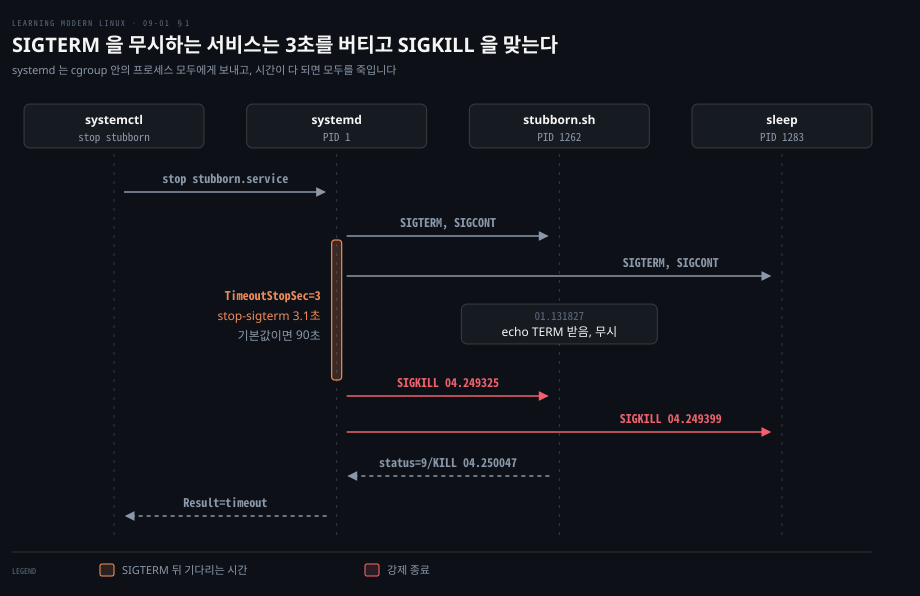

`systemd.kill(5)` 과 `systemd.service(5)` 의 중지 절차입니다.[^sdservice][^sdkill] 기본값은 Debian 12(systemd 252) `systemctl show` 기준입니다.

| 순서 | systemd 가 하는 일 | 정하는 설정과 기본값 |
|------|-------------------|---------------------|
| 1 | `ExecStop=` 명령이 있으면 먼저 실행합니다 | `ExecStop=`, 없으면 건너뜁니다[^sdservice] |
| 2 | 남은 프로세스에 종료 시그널을 보내고 곧바로 `SIGCONT` 를 보냅니다 | `KillSignal=`, 기본 `SIGTERM`(15)[^sdkill] |
| 3 | 서비스가 스스로 끝나기를 기다립니다 | `TimeoutStopSec=`, 기본은 `DefaultTimeoutStopSec=` 의 90초[^sdservice] |
| 4 | 시간이 다 되면 강제로 끝냅니다 | `FinalKillSignal=`, 기본 `SIGKILL`(9) |
| - | 2와 4의 대상은 유닛의 cgroup 에 남은 모든 프로세스입니다 | `KillMode=`, 기본 `control-group`[^sdkill] |

2단계에서 `SIGCONT` 를 함께 보내는 이유는 멈춰 있던 프로세스도 깨워 종료 시그널을 받게 하려는 것입니다.[^sdkill] 그 이유는 다음 절의 정지 실험에서 드러납니다. 아래는 `SIGTERM` 을 잡고 무시하는 서비스에 `TimeoutStopSec=3` 을 주고 멈춘 기록입니다. 같은 방식으로 띄우되 `SIGTERM` 에 `exit 0` 하는 서비스는 0.005초 만에 `Result=success` 로 멈췄습니다.

```bash
systemctl stop stubborn
journalctl -u stubborn -o short-precise
systemctl show stubborn -p Result -p ExecMainStatus
```

```bash
05:08:01.131827 stubborn.sh[1262]: TERM 받음, 무시
05:08:04.249285 systemd[1]: stubborn.service: State 'stop-sigterm' timed out. Killing.
05:08:04.249325 systemd[1]: stubborn.service: Killing process 1262 (stubborn.sh) with signal SIGKILL.
05:08:04.249399 systemd[1]: stubborn.service: Killing process 1283 (sleep) with signal SIGKILL.
05:08:04.250047 systemd[1]: stubborn.service: Main process exited, code=killed, status=9/KILL
05:08:04.250065 systemd[1]: stubborn.service: Failed with result 'timeout'.
Result=timeout
ExecMainStatus=9
```

`TimeoutStopSec=` 3초 후 `stop-sigterm` 이 만료되자 `KillMode=control-group` 에 따라 주 프로세스 1262 와 자식 `sleep` 1283 에 `SIGKILL` 이 갔습니다. 설정이 없으면 기본 90초 뒤 강제 종료됩니다. 서비스 중지가 매번 90초씩 걸린다면 그 서비스는 `SIGTERM` 에 끝나지 않는다고 보면 됩니다.

쿠버네티스가 파드를 종료할 때도 `SIGTERM` 을 보내고 유예 시간 뒤 `SIGKILL` 을 보내는 같은 절차를 따르며 [Kubernetes in Action 노트의 종료 단계](../../../08_cloud/book/kubernetes-in-action/06-03.lifecycle%20hook%EA%B3%BC%20Pod%20%EC%83%9D%EC%95%A0%EC%A3%BC%EA%B8%B0%20%EC%A0%84%EC%B2%B4.md#6-종료-단계--prestop-hook에서-sigterm까지)가 다룹니다.

### 멈춤과 재개 — STOP·TSTP·CONT

프로세스가 살아 있으나 CPU 를 쓰지 않고 `kill` 에 반응이 없으면 `ps` 의 `STAT` 열부터 봅니다. `T` 면 멈춘 상태입니다.

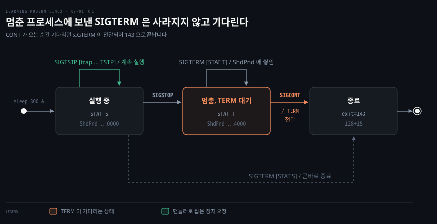

```bash
sleep 300 & p=$!
ps -o pid,stat,cmd -p $p
#     PID STAT CMD
#    4334 S    sleep 300
kill -STOP $p; ps -o pid,stat,cmd --no-headers -p $p; grep ^State /proc/$p/status
#    4334 T    sleep 300
# State:	T (stopped)
kill -TERM $p; ps -o pid,stat,cmd --no-headers -p $p; grep -E '^(SigPnd|ShdPnd)' /proc/$p/status
#    4334 T    sleep 300
# SigPnd:	0000000000000000
# ShdPnd:	0000000000004000
kill -CONT $p; wait $p; echo "exit=$?"  # exit=143
```

멈춘 프로세스에 `SIGTERM` 을 보내도 `T` 상태가 유지됩니다. 시그널은 사라지지 않고 프로세스 전체의 대기 시그널을 담는 `ShdPnd` 에 `0x4000` 으로 남습니다.[^proc] 0 부터 센 14번 비트, 비트 n-1 이 시그널 n 이므로 `SIGTERM`(15)입니다. `SIGCONT` 로 깨우는 순간 보류된 `SIGTERM` 이 전달되어 143 으로 끝납니다. 그래서 systemd 는 중지할 때 `SIGCONT` 를 함께 보냅니다.

`SIGSTOP` 과 `SIGTSTP` 는 모두 기본 동작이 정지이지만, Ctrl+Z 가 보내는 `SIGTSTP` 는 핸들러로 잡을 수 있습니다.

```bash
cat tstp.sh
# trap "echo TSTP 받았지만 멈추지 않음" TSTP
# for i in 1 2 3; do sleep 1; done
# echo 끝까지 실행
./tstp.sh & p=$!; sleep 0.5; kill -TSTP $p; wait $p; echo "exit=$?"
```

```bash
TSTP 받았지만 멈추지 않음
끝까지 실행
exit=0
```

편집기처럼 멈추기 전 화면을 복원해야 하는 프로그램은 `SIGTSTP` 를 잡습니다. 반면 `SIGSTOP` 은 무조건 멈춥니다. `fg` 와 `bg` 로 잡을 멈추고 재개하는 흐름은 3장 노트의 [잡의 상태를 옮기는 명령](./03-01.%EC%85%B8%EC%9D%98%20%EC%8B%A4%EC%B2%B4%EB%8A%94%20%EC%8A%A4%ED%8A%B8%EB%A6%BC%EA%B3%BC%20%EB%B3%80%EC%88%98%EC%99%80%20%EC%A2%85%EB%A3%8C%20%EC%83%81%ED%83%9C%EB%8B%A4.md#잡의-상태를-옮기는-명령)에서 다룹니다.

### /proc/PID/status 로 처리 방식 읽기

소스 없이 프로세스가 시그널을 어떻게 다루는지 보려면 `/proc/PID/status` 의 `SigBlk`·`SigIgn`·`SigCgt` 16진수 마스크를 확인합니다.[^proc]

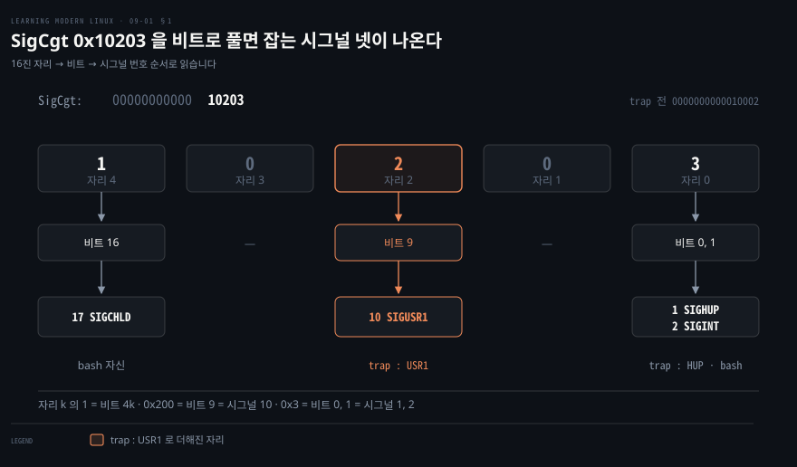

```bash
bash -c 'grep -E "^Sig(Ign|Cgt)" /proc/$$/status
         trap "" TERM; trap : USR1 HUP
         grep -E "^Sig(Ign|Cgt)" /proc/$$/status'
```

```bash
SigIgn:	0000000200000004
SigCgt:	0000000000010002
SigIgn:	0000000200004004
SigCgt:	0000000000010203
```

`trap "" TERM` 후 `SigIgn` 에 14번 비트인 `0x4000`(시그널 15)이 더해졌습니다. `SigCgt` 는 `0x10002` 에서 `0x10203` 으로 바뀌었습니다. 0번 비트인 1번 `SIGHUP` 과 9번 비트인 10번 `SIGUSR1` 은 `trap` 이 더한 것입니다. 1번 비트인 2번 `SIGINT` 와 16번 비트인 17번 `SIGCHLD` 는 trap 전부터 서 있던 것으로, bash 가 스스로 잡습니다.

`SigIgn` 의 33번 비트(`0x200000000`, 시그널 34)는 컨테이너 PID 1 에도 켜져 있어 상위에서 건 무시를 `execve` 규칙대로 물려받은 것입니다. `nohup` 도 같은 규칙을 씁니다. `nohup sleep 100 &` 의 `SigIgn`(`0000000200000007`)을 일반 `sleep`(`0000000200000006`)과 비교하면 0번 비트 `SIGHUP` 만 다릅니다.

### 세션 단위로 끝내기 — loginctl 과 pkill -t

SSH 세션에 남은 프로세스를 정리할 때는 세션이나 터미널 단위로 다룹니다. 세션과 제어 터미널 개념은 3장 노트의 [세션과 제어 터미널](./03-01.%EC%85%B8%EC%9D%98%20%EC%8B%A4%EC%B2%B4%EB%8A%94%20%EC%8A%A4%ED%8A%B8%EB%A6%BC%EA%B3%BC%20%EB%B3%80%EC%88%98%EC%99%80%20%EC%A2%85%EB%A3%8C%20%EC%83%81%ED%83%9C%EB%8B%A4.md#세션과-제어-터미널)이 다루며, systemd 에서는 `systemd-logind` 가 로그인마다 세션을 만들고 `loginctl` 로 제어합니다.

```bash
loginctl list-sessions
# SESSION  UID USER SEAT TTY
#      10 1000 bob       pts/1
#       9 1000 bob       pts/0
loginctl session-status 9
# 9 - bob (1000)
# 	  Leader: 1304 (sshd)
# 	     TTY: pts/0
# 	 Service: sshd; type tty; class user
# 	    Unit: session-9.scope
# 		  ├─1304 "sshd: bob [priv]"
# 		  ├─1323 "sshd: bob@pts/0"
# 		  └─1325 sleep 901
loginctl terminate-session 9; loginctl list-sessions
# SESSION  UID USER SEAT TTY
#      10 1000 bob       pts/1
pgrep -t pts/1 -a                       # 1326 sleep 900
# 제어 터미널로 대상 고르기(-t)
pkill -t pts/1; loginctl list-sessions  # No sessions.
```

`session-status` 는 세션 리더와 터미널, `session-9.scope` 아래 프로세스 트리를 보여 줍니다. `terminate-session` 은 세션 내 프로세스를 종료하고 자원을 회수합니다.[^loginctl] `pkill -t` 는 제어 터미널이 `pts/1` 인 프로세스에 기본 시그널 `SIGTERM` 을 보내며, 터미널 이름은 `/dev/` 없이 적습니다.[^pgrep] 원격 명령 `sleep 900` 이 죽자 SSH 연결이 끊겨 세션 10 도 정리되었습니다.


## 2. 데이터를 나르는 명명 파이프와 도메인 소켓

> 네트워크 없이 같은 기계의 프로세스에게 데이터를 넘기려면, 방향과 받는 쪽의 수에 따라 도구가 달라집니다.

같은 기계의 두 프로그램을 붙일 때 습관적으로 TCP 소켓부터 여는 경우가 있습니다. 네트워크를 거칠 이유가 없다면, 데이터를 한쪽으로만 흘리면 되는지 주고받아야 하는지에 따라 훨씬 가벼운 길이 이미 있습니다. Docker 데몬이 컨테이너를 관리할 때 쓰는 소켓이 대표적입니다.

### 명명 파이프 — 프로세스보다 오래 사는 이름

3장의 익명 파이프(`|`)와 달리 명명 파이프(FIFO)는 사용자 정의 이름을 붙일 수 있는 파이프입니다. 일반 파일 입출력으로 다루며 먼저 들어간 데이터가 먼저 나오지만, 수명이 프로세스에 묶이지 않습니다. 내부적으로는 5장에서 본 가짜 파일시스템인 `pipefs` 를 씁니다.

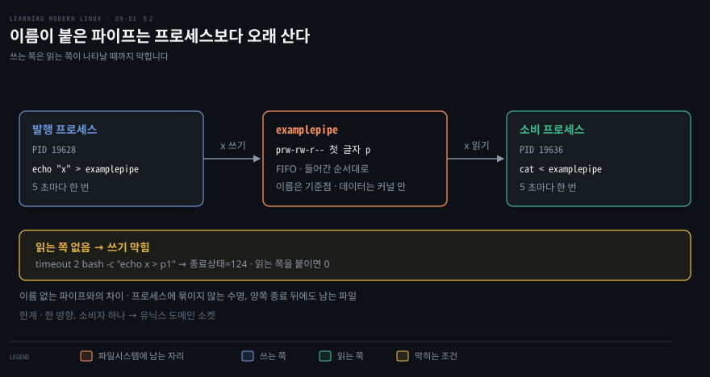

```bash
mkfifo examplepipe
ls -l examplepipe
```

```bash
prw-rw-r-- 1 mh9 mh9 0 Oct  2 14:04 examplepipe
```

첫 글자 `p` 가 명명 파이프를 나타냅니다. 파일시스템 항목은 경로 기준점일 뿐 데이터는 커널 안에서 넘어가므로 크기는 `0` 입니다.[^fifo]

```bash
while true ; do echo "x" > examplepipe ; sleep 5 ; done &
while true ; do cat < examplepipe ; sleep 5 ; done &
```

```bash
[1] 19628
[2] 19636
x
x
...
```

저자는 다른 프로세스가 읽지 않는 한 파이프가 막히고 더 쓸 수 없다고 주의를 붙입니다. PID 19636 인 프로세스가 `cat` 으로 읽을 때마다 터미널에 `x` 가 대략 5초마다 나타납니다. 막히는 동작은 `timeout` 으로 확인합니다.

```bash
mkfifo p1
timeout 2 bash -c "echo x > p1"; echo "종료상태=$?"
```

```bash
종료상태=124
```

`timeout` 은 읽는 쪽이 없어 124 로 만료되었습니다. 읽는 쪽을 붙이고 다시 치면 바로 0 으로 끝납니다. `fifo(7)` 에 따르면 FIFO 는 양끝이 모두 열려야 데이터가 오가며, 보통은 반대쪽이 열릴 때까지 열기 자체가 막힙니다.[^fifo]

저자는 명명 파이프가 단방향이고 소비자도 하나라는 한계를 짚습니다. 여러 프로세스가 읽기로 열 수는 있습니다.[^fifo] 그러나 소비자 둘에 여섯 줄을 보내면 합계는 늘 여섯이고 중복되지 않습니다. 데이터는 복제되지 않으며 어떻게 분배될지도 정해져 있지 않습니다. 여섯 번 돌리니 매번 한쪽으로 몰렸고 몰리는 쪽은 회차마다 바뀌었습니다. 다른 환경에서는 두 쪽에 나뉘었습니다. 분배 방식을 설계 근거로 삼으면 안 됩니다. 여럿에게 같은 내용을 보내려면 다른 통신 수단을 씁니다.

### 유닉스 도메인 소켓 — 양방향과 여러 소비자

7장의 네트워크 소켓과 달리 유닉스 도메인 소켓은 한 기계 안에서 돕니다. 저자의 정의로는 유닉스 도메인 소켓이 양방향·다방향 통신 종단점이며, 여러 소비자를 둘 수 있어 명명 파이프의 두 한계를 풉니다.

| 갈래 | 설명 |
|------|---------------|
| `SOCK_STREAM` | 스트림 지향 |
| `SOCK_DGRAM` | 데이터그램 지향 |
| `SOCK_SEQPACKET` | 순서 있는 패킷 |

주소 지정은 IP·포트 대신 파일시스템 경로를 씁니다. 시스템을 진단하다가 명령줄에서 소켓과 직접 주고받아야 할 때는 8장에서 본 `socat` 을 씁니다. Docker 데몬의 `/var/run/docker.sock` 이 대표적입니다. 주소가 파일이므로 컨테이너에 이 경로를 마운트하는 것만으로 컨테이너 안에서 호스트의 Docker 를 제어할 수 있습니다.


## 3. 컨테이너보다 강한 격리, 가상 머신

> 컨테이너가 있는데 왜 아직 VM 을 쓰는가 하는 물음에, 저자는 격리의 세기가 다르다고 답합니다.

컨테이너로 충분할 것 같은 자리에서도 공용 클라우드는 여전히 VM 을 나눠 줍니다. 6장의 컨테이너가 애플리케이션 수준 의존성 관리에 좋다면 VM 은 워크로드에 강한 격리를 줍니다. 저자의 대비대로 둘은 같은 문제의 두 해법이 아니라 서로 다른 문제의 답입니다. VM 을 만나는 자리는 공용 클라우드나 데이터 센터가 대표적이며, 로컬에서는 시험용이나 분산 시스템을 흉내 낼 때 쓰입니다.

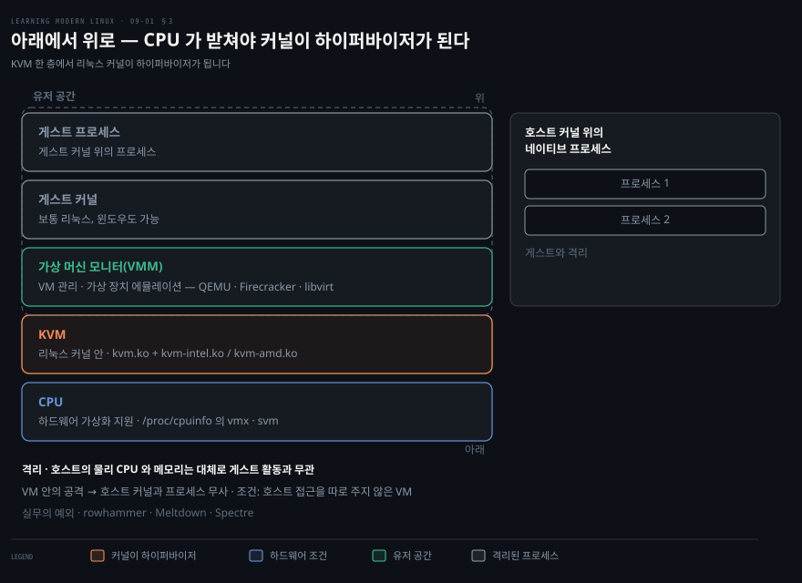

가상화 스택에서는 하드웨어 가상화를 지원하는 CPU 위에 커널의 KVM 이 놓입니다. 유저 공간의 VMM(QEMU, Firecracker)이 게스트 커널과 프로세스를 관리하며 가상 장치를 흉내 냅니다. `libvirt` 는 VMM 을 표준화하는 일반 API 라이브러리입니다. 호스트와 게스트는 격리되지만, 저자는 rowhammer 나 Meltdown·Spectre 를 실무의 예외로 듭니다. 격리가 설계상의 보장이지 물리적 보장은 아니라는 뜻입니다.

### KVM — 하이퍼바이저가 된 커널

KVM 은 AMD-V 나 Intel VT 를 갖춘 x86 용 리눅스 내장 가상화 해법입니다. 핵심 모듈 `kvm.ko` 와 아키텍처 모듈 `kvm-intel.ko` 또는 `kvm-amd.ko` 로 나뉩니다. 리눅스 커널이 직접 하이퍼바이저가 되어 대부분의 작업을 처리하며, 그 위에 입출력 가상화용 Virtio 드라이버가 붙습니다. 지원 여부는 두 명령으로 확인합니다.

```bash
grep 'svm\|vmx' /proc/cpuinfo
lsmod | grep kvm
```

```bash
flags        : fpu vme de pse tsc msr pae mce cx8 apic sep mtrr pge mca
pat pse36 clflush dts acpi mmx fxsr sse sse2 ss ht tm pbe syscall nx pdpe1
... ds_cpl vmx tm2 ssse3 sdbg cx16 xtpr pdcm sse4_1 sse4_2 x2apic movbe popcnt
...
kvm_intel   253952  0
kvm         659456  1 kvm_intel
```

CPU 정보에 `vmx` 가 있어 하드웨어 보조 가상화가 지원됩니다. CPU 마다 보고하므로 코어가 여덟이면 같은 `flags` 가 여덟 번 나옵니다. `kvm_intel` 이 올라와 있으니 KVM 을 쓸 준비도 끝났습니다. `lsmod` 의 셋째 열은 그 모듈을 쓰는 것의 수입니다. `kvm` 행의 1 은 `kvm_intel` 이 쓰고 있다는 뜻이고, `kvm_intel` 행의 0 은 아직 쓰는 VM 이 없다는 뜻이며 VM 을 띄우면 올라갑니다.

### Firecracker — HTTP 로 다루는 microVM

Firecracker 는 KVM 인스턴스를 관리하는 Rust 기반 VMM 이며, 관리 대상 VM 을 microVM 이라 부릅니다. 호스트에 HTTP API 를 열어 microVM 의 생성·조회·중지를 제어합니다.

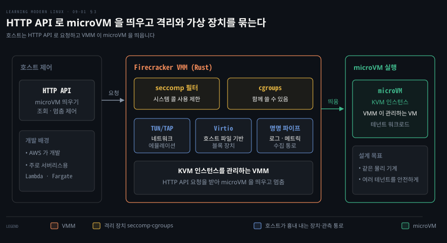

설계 목표는 한 물리 기계에서 다중 테넌트 워크로드를 안전하게 격리하는 것입니다. AWS 가 주로 서버리스 제품인 AWS Lambda 와 AWS Fargate 를 위해 개발했습니다. 네트워크는 TUN/TAP 장치로, 블록 장치는 호스트 파일과 Virtio 로 지원합니다. Firecracker 는 기본으로 4장의 seccomp 필터를 써서 호스트 시스템 콜을 제한하며, cgroups 도 함께 쓸 수 있습니다. 로그와 메트릭은 §2 의 명명 파이프로 모을 수 있습니다.


## 4. 고치지 않고 새로 만드는 현대 배포판

> 기계 한 대를 손보는 일과 수백 대를 손보는 일은 다른 문제이고, 그 차이가 배포판의 설계를 바꿨습니다.

컨테이너가 늘면서 호스트 운영체제의 역할이 바뀌었다고 저자가 적습니다. 컨테이너 맥락에서 전통 패키지 관리자는 베이스 컨테이너 이미지 안의 의존성을 `.deb` 나 `.rpm` 으로 채우는 역할을 맡고, 앱 의존성은 컨테이너 이미지가 통째로 쌉니다. 저자의 논지는 시스템을 조금씩 고쳐 나가는 방식이 규모가 커질수록, 특히 기계 무리를 관리할 때 큰 도전이 된다는 것입니다.

그래서 현대 배포판의 초점이 점점 불변성으로 옮겨 갑니다. 코드나 설정이 바뀌면 시스템을 수정하는 대신 새 산출물을 만듭니다. 저자가 정의하는 "현대 배포판" 은 컨테이너 중심이며 불변성과 자동 업그레이드를 앞세운 배포판입니다. 자동 업그레이드는 Chrome 이 개척했다고 저자는 덧붙입니다.

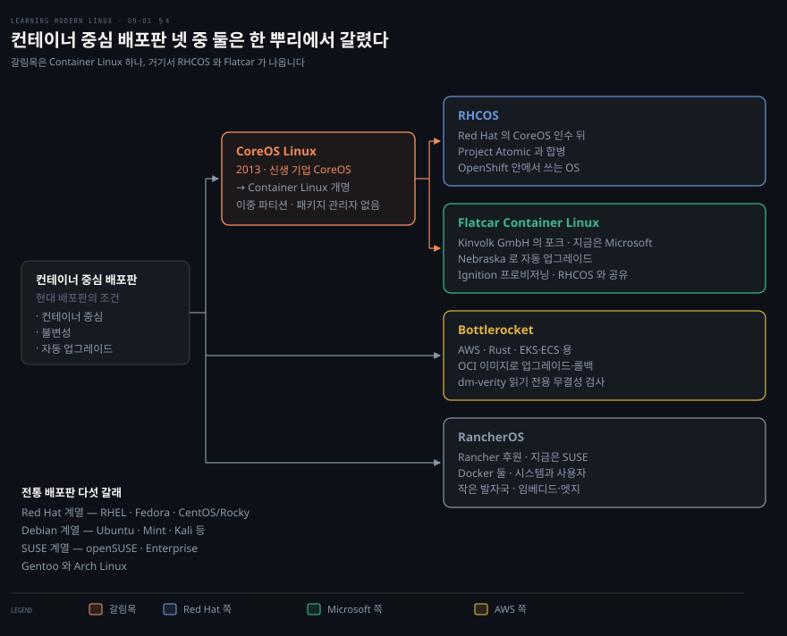

전통 배포판이 나쁜 것은 아닙니다. 설치부터 패치까지 직접 제어하는 완전 통제형과 대부분을 자동화하는 완전 관리형 가운데 환경에 맞는 쪽을 고릅니다.

| 배포판 | 누가 | 앱을 올리는 방식 | 특징 |
|--------|------|-----------------|------|
| RHCOS | Red Hat | 컨테이너 | OpenShift Container Platform 전용으로 쓰입니다 |
| Flatcar Container Linux | Kinvolk GmbH, 지금은 Microsoft | 컨테이너 | Nebraska 로 자동 업그레이드하고 Ignition 으로 부팅 장치를 제어합니다 |
| Bottlerocket | AWS | OCI 이미지 | `dm-verity` 기반의 대체로 읽기 전용인 무결성 검사 파일시스템을 씁니다 |
| RancherOS | Rancher, 지금은 SUSE | Docker 컨테이너 | 첫 프로세스로 뜨는 시스템 Docker 와 앱을 만드는 사용자 Docker 둘을 돌립니다 |

책에서 패키지 관리자가 없다고 명시한 것은 CoreOS Linux, Flatcar, Bottlerocket 셋입니다. RHCOS 와 RancherOS 는 패키지 관리자를 언급하지 않으므로 둘도 그렇다고 넘겨짚지 않습니다. Bottlerocket 제어는 별도 `containerd` 의 제어 컨테이너를 쓰며, SSH 도 가능하지만 권장하지 않는다고 저자는 덧붙입니다.

계보의 핵심 갈림목은 Container Linux 입니다. 2013년 CoreOS 가 CoreOS Linux 로 낸 뒤 이름을 바꿨습니다. 이중 파티션 업데이트와 패키지 관리자 부재가 특징입니다. 이 생태계에서 나온 `etcd` 는 지금도 쓰입니다. 저자는 설정용 `/etc` 디렉터리의 분산 버전이라 생각하면 된다고 적습니다. Red Hat 이 CoreOS 를 인수해 Project Atomic 과 합친 것이 RHCOS 이고 Kinvolk GmbH 가 포크해 이어 간 것이 Flatcar 입니다.


## 5. 인증을 프로그램 밖으로 빼는 두 방법

> 프로그램마다 인증을 따로 짜면 인증 방식이 바뀔 때마다 모든 프로그램을 고쳐야 합니다.

인증 코드를 프로그램 안에 하드코딩하면 LDAP 연동 같은 요구가 올 때마다 모든 프로그램을 다시 고쳐야 합니다. 4장의 구분대로 인증은 신원 확인이며 인가의 전제 조건입니다. 여기서는 널리 쓰이는 Kerberos 와 PAM, 로그인 자원 한도를 거는 `pam_limits` 를 다룹니다.

### Kerberos — 티켓과 세션 키로 도는 네 걸음

Kerberos 는 1980년대 MIT 가 개발한 인증 모음으로, 오늘날에는 2005년 7월의 RFC 4120 과 관련 IETF 문서가 규정합니다. RFC 4120 은 앞선 RFC 1510 을 대체했습니다.[^rfc4120] 신뢰할 수 없는 망 위에서 클라이언트와 서비스가 상호 신원을 증명하는 것이 목적이며 네 단계로 동작합니다.

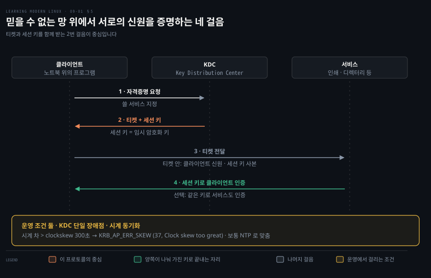

1. 클라이언트가 Key Distribution Center(KDC)에 특정 서비스용 자격증명을 요청합니다.
2. KDC 가 해당 서비스 티켓과 임시 세션 키를 발급합니다.
3. 클라이언트가 신원과 세션 키 사본이 담긴 티켓을 서비스에 전달합니다.
4. 클라이언트와 서비스가 나눠 가진 세션 키로 클라이언트를 인증합니다. 선택적으로 서비스도 같은 키로 인증할 수 있습니다.

KDC 단일 장애점(SPOF)과 엄격한 시간 동기화(NTP 필요)가 과제입니다. 운영이 단순하지 않으나 기업과 클라우드 환경에서 널리 쓰인다는 것이 저자의 총평입니다.

시간 요구의 근거는 규격에 있습니다. RFC 4120 은 인증이 서버 현재 시각 기반이라 시계가 느슨하게 동기화되어 있어야 한다고 적습니다.[^rfc4120] 서버의 시각과 클라이언트가 보낸 인증자 안의 시각이 허용 오차보다 벌어지면 서버가 `KRB_AP_ERR_SKEW`(37, "Clock skew too great") 오류를 반환합니다. 규격 예시는 5분이며 MIT krb5 의 `clockskew` 기본값도 300초입니다.[^krb5] 비밀번호가 맞는데도 인증이 거절되고 이 오류가 뜨면 양쪽 시계 오차부터 확인해야 합니다.

### PAM — 프로그램 밖에서 갈아 끼우는 인증

과거에는 프로그램이 인증을 직접 처리했으나, PAM 이 도입되면서 인증 방식과 무관하게 프로그램을 개발할 수 있게 되었습니다. Linux-PAM 의 문서는 그 뿌리로 SunSoft 의 V. Samar 와 R. Schemers 가 1995년 10월에 낸 OSF RFC 86.0 을 듭니다.[^pam] PAM 은 개발자에게는 라이브러리를 주고 관리자에게는 설정 파일로 모듈을 갈아 끼우는 유연성을 줍니다.

| 모듈 | 하는 일 |
|------|--------|
| `pam_localuser` | `/etc/passwd` 에 사용자가 존재할 것을 요구합니다 |
| `pam_keyinit` | 세션 키링을 초기화합니다 |
| `pam_krb5` | Kerberos 5 비밀번호 기반 검증을 수행합니다 |

Kerberos 연동도 프로그램을 고칠 필요 없이 PAM 설정에 `pam_krb5` 모듈을 추가하면 끝납니다. 인증을 프로그램 밖으로 분리한다는 핵심이 여기에 있습니다.

### pam_limits — 로그인할 때 거는 자원 한도

`limits.conf` 에서 파일 한도를 늘려도 실행 중인 서비스의 한도가 그대로인 경우가 흔합니다. 자원 한도를 거는 주체가 로그인 시점에만 실행되는 PAM 모듈이기 때문입니다.

`pam_limits` 는 PAM session 단계에 동작합니다. 세션 시작 시 `/etc/security/limits.conf` 와 `/etc/security/limits.d/*.conf` 를 C 로케일 이름순으로 읽으며 효과는 파일들을 그 순서대로 이어 붙인 것과 같습니다.[^pamlimits] Debian 12 는 `/etc/pam.d/login`, `su`, `runuser` 에 `session required pam_limits.so` 를 등록해 두어 `su` 로 전환할 때도 적용됩니다.

설정은 `<domain> <type> <item> <value>` 4개 필드입니다.[^limits]

| 칸 | 쓸 수 있는 값 |
|----|--------------|
| domain | 사용자 이름, `@그룹`, 전체 `*`, uid 범위 `1000:2000`, gid 범위 `@500:600`. `%` 는 `maxlogins` 전용 |
| type | `soft`(현재 한도), `hard`(soft 상한), `-`(둘 다) |
| item | `nofile`(열린 파일 수), `nproc`(프로세스 수), `core`, `fsize`, `cpu`(분), `memlock`, `as`, `maxlogins` 등 |

같은 항목을 여러 줄이 지정할 때 적용되는 우선순위 규칙입니다.[^limits]

1. 특정 사용자 지정 줄이 그룹이나 `*` 보다 우선합니다.
2. 우선순위가 같으면 나중에 읽힌 줄이 이깁니다.
3. `*` 와 그룹은 root 에 적용되지 않으므로 root 는 명시적으로 이름을 적어야 합니다.

Debian 12 컨테이너에서 `limits.d` 에 `10-a.conf` 와 `20-b.conf` 를 두고 `su alice -c 'ulimit -Sn'` 으로 확인했습니다. 이름순이라 `10-a.conf` 가 먼저 읽힙니다.

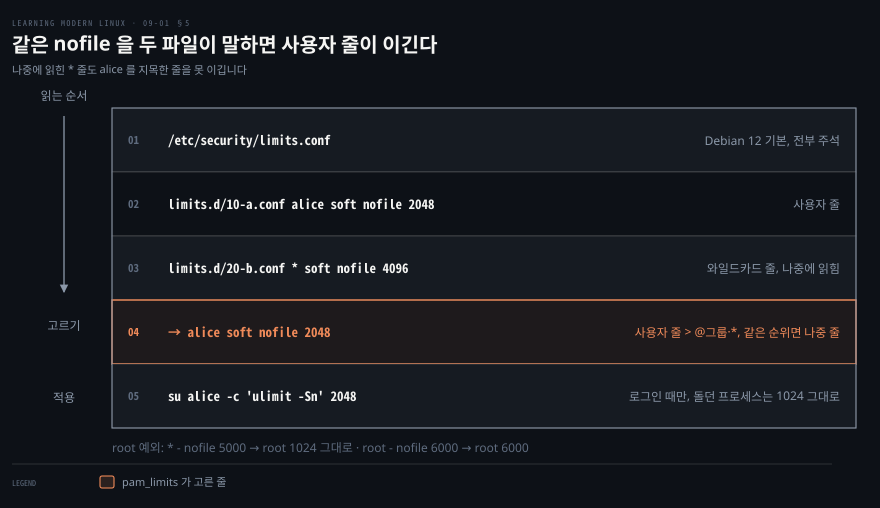

| `10-a.conf` | `20-b.conf` | 결과 |
|-------------|-------------|------|
| `alice soft nofile 2048` | `alice soft nofile 4096` | 4096. 같은 사용자라 나중 파일이 이깁니다 |
| `alice soft nofile 2048` | `* soft nofile 4096` | 2048. 나중 파일이라도 `*` 는 사용자를 못 이깁니다 |
| `* soft nofile 2048` | `alice soft nofile 4096` 과 `* soft nofile 3000` | 4096 |
| 없음 | `* - nofile 5000` | alice 는 soft·hard 5000, root 는 1024·1048576 유지 |
| 없음 | `* - nofile 5000` 과 `root - nofile 6000` | root 도 6000·6000 |

한도는 세션에만 유효하며 소급 적용되지 않습니다.[^limits] 파일 수정 전 띄운 alice 의 `sleep` 은 수정 후에도 `/proc/PID/limits` 의 `Max open files` 가 `1024 1048576` 그대로였습니다. PAM 을 거치지 않는 `docker exec` 셸은 20480 이었습니다.

systemd 서비스도 로그인을 거치지 않아 `PAMName=` 이 없으면 PAM 세션이 열리지 않습니다.[^sdexec] 서비스 한도는 `LimitNOFILE=` 같은 유닛 지시어로 설정합니다. 실험한 Debian 12 컨테이너의 기본 서비스는 `systemctl show` 로 `LimitNOFILE=1048576`, `LimitNOFILESoft=1024` 였습니다. systemd 252 문서의 기본값은 소프트 1024, 하드 524288 이므로 하드 1048576 은 이 컨테이너의 실측값입니다.[^sdsystem]

배포판 기본 파일도 있습니다. CentOS 7 의 `pam-1.1.8` 은 `/etc/security/limits.d/20-nproc.conf` 에 `* soft nproc 4096` 과 `root soft nproc unlimited` 를 둡니다. 같은 확인에서 Rocky Linux 8.9 와 9.3 컨테이너 이미지에는 그 파일이 없었습니다. 출처 모를 한도는 `limits.d` 파일부터 확인합니다.


## 6. 아직 주류가 아닌 것들

> 저자가 집필 시점에 주류가 아니라고 명시한 구간입니다. 지금 배울 것이 아니라 지켜볼 것으로 읽는 편이 맞습니다.

리눅스의 향후 변화를 가늠할 항목들로, 저자는 이 절의 주제들이 집필 시점에 아직 주류에 들어오지 않았다는 공통점을 밝힙니다. NixOS 는 패키지 관리와 시스템 설정, 업그레이드 롤백까지 함수형 접근을 취하는 소스 기반 배포판입니다. 저자는 산출물이 불변성에 기반하기 때문에 함수형이라 부른다고 밝힙니다. Nix 가 커널부터 앱까지 운영체제 전체를 빌드하고 다중 사용자 패키지 관리와 같은 패키지의 여러 버전 설치를 허용합니다.

다만 NixOS 는 다른 배포판 대부분과 달리 5장의 표준 파일시스템 배치(`/usr/bin`, `/etc`)를 따르지 않습니다. 다 받아들이고 싶지 않다면 Nix 패키지 관리자만 따로 쓸 수도 있습니다. CI 파이프라인에 유용하다고 저자는 덧붙입니다.

데스크톱 리눅스는 유닉스 전통대로 GUI 가 분리되어 있습니다. X 윈도 관리자와 디스플레이 관리자 위에 데스크톱 환경(KDE, MATE)이 올라갑니다. 저자는 Windows 11 이 그래픽 리눅스 앱을 기본 지원하는 변화가 채택 유인을 바꿀 수 있다고 봅니다.

임베디드 분야의 범용 플랫폼으로는 라즈베리 파이가 대표적입니다. Debian 기반 Raspberry Pi OS 와 microSD 카드로 다른 배포판도 간단히 설치할 수 있으며, GPIO 핀에 외부 센서와 회로를 붙여 파이썬으로 프로그래밍할 수 있습니다.

클라우드 IDE 는 웹 브라우저에서 리눅스 개발 환경을 제공합니다. IDE 는 주로 Visual Studio Code 이며 Git 과 언어 런타임을 묶습니다. 저자가 든 두 예는 관리형으로도 오픈 소스 자체 호스팅으로도 쓸 수 있는 Gitpod, 그리고 GitHub 에 통합된 Codespaces 입니다.


## 결정 치트시트

> 이 장의 주제가 각각 언제 필요해지는지를 한 표로 압축합니다.

| 상황 | 고를 것 | 왜 |
|------|--------|-----|
| 돌고 있는 프로세스에 사건만 알리면 된다 | 시그널 | 데이터를 나르지 않고 알림만 보냅니다 |
| 종료 시 정리 작업을 하고 싶다 | `SIGTERM` 에 핸들러, 끝에 `exit` | 핸들러가 기본 동작을 대체하므로 직접 끝내야 합니다 |
| 어떤 경우에도 확실히 죽여야 한다 | `SIGKILL` | 잡을 수도 막을 수도 무시할 수도 없습니다 |
| 종료 코드가 137·143 이다 | 128 을 빼서 시그널 번호로 읽기 | 137 은 `SIGKILL`, 143 은 `SIGTERM` 입니다 |
| 서비스 중지가 90초씩 걸린다 | `SIGTERM` 처리부터 확인, 필요하면 `TimeoutStopSec=` | `DefaultTimeoutStopSec=` 90초를 다 채우고 `SIGKILL` 을 맞은 것입니다 |
| `kill` 이 먹지 않고 `STAT` 이 `T` 다 | `kill -CONT` | 멈춘 프로세스에 보낸 시그널은 대기하다 재개될 때 전달됩니다 |
| 이름으로 프로세스를 골라 보낸다 | `pgrep -a` 로 먼저 본 뒤 `pkill` | `-f` 는 자기를 부른 셸의 명령행까지 맞출 수 있습니다 |
| 명령에 시간 제한을 건다 | `timeout -k` | 124 는 시간 초과, `-k` 는 무시하는 명령도 끝냅니다 |
| 데몬에 로그를 새로 열게 한다 | 이름을 바꾼 뒤 `SIGUSR1` | nginx 는 `USR1` 에 열려 있던 로그를 다시 엽니다 |
| 프로세스가 무엇을 잡는지 알고 싶다 | `/proc/PID/status` 의 `SigCgt`·`SigIgn` | 비트 n-1 이 시그널 n 입니다 |
| 한 사용자의 로그인을 통째로 끝낸다 | `loginctl terminate-session` | 세션의 프로세스를 모두 죽이고 자원을 거둡니다 |
| 두 프로세스가 데이터를 흘려보낸다 | 명명 파이프 | 파일처럼 다루고 프로세스보다 오래 삽니다 |
| 양방향이거나 소비자가 여럿이다 | 유닉스 도메인 소켓 | 파이프의 두 한계가 여기서 풀립니다 |
| 워크로드를 강하게 격리해야 한다 | VM | 컨테이너의 의존성 관리와는 다른 문제입니다 |
| 여러 테넌트를 한 기계에서 돌린다 | Firecracker microVM | 그 목적으로 설계됐고 seccomp 를 기본으로 씁니다 |
| 기계 무리를 관리한다 | 컨테이너 중심 배포판 | 조금씩 고치는 일이 규모에서 무너집니다 |
| 인증 방식이 바뀔 수 있다 | PAM | 프로그램을 고치지 않고 모듈을 갈아 끼웁니다 |
| 기업망에서 신원을 증명해야 한다 | Kerberos | KDC 의 단일 장애점을 감수하고 시계를 허용 오차 안으로 맞춥니다 |
| `limits.conf` 를 고쳤는데 그대로다 | 다시 로그인, 서비스는 유닛의 `Limit*=` | 한도는 로그인마다 걸리고 소급되지 않습니다 |


## 적용 관점

> 저자는 Spring 도 자바도 다루지 않습니다. 아래는 이 장의 원칙을 그 문맥에 옮겨 본 것입니다.

컨테이너의 종료는 시그널로 옵니다. 오케스트레이터가 파드를 내릴 때 보내는 것이 `SIGTERM` 이고 유예 시간이 지나면 `SIGKILL` 입니다. §1 의 핸들러 실험을 여기서는 실무 규칙으로 옮깁니다. 종료 훅을 달았다고 프로세스가 알아서 끝나지 않으므로 정리 작업을 마친 뒤 실제로 종료하는 경로가 있어야 합니다. `SIGKILL` 은 잡을 수 없으니 유예 시간 안에 끝내는 것이 유일한 방법입니다. 종료 코드 137 은 그 시간을 넘겼다는 기록입니다.

JVM 이 멈춘 것 같을 때 `SIGQUIT` 은 프로세스를 죽이지 않고 스레드 덤프를 받는 통로입니다. `kill -QUIT PID` 를 보내면 HotSpot 이 덤프를 표준 출력에 찍으므로 컨테이너라면 그 로그에서 찾습니다.[^jdk] 애플리케이션 이미지는 고치지 말고 새로 만듭니다. §4 의 불변성이 배포판이 아니라 애플리케이션 층에도 그대로 적용됩니다. 돌고 있는 컨테이너에 들어가 설정 파일을 고치면 다음 재배포에서 사라지고 왜 두 인스턴스가 다르게 도는지 아무도 설명할 수 없게 됩니다. 변경은 이미지 태그를 바꾸는 것으로 표현합니다.

인증은 애플리케이션 밖으로 뺄수록 바꾸기 쉽습니다. PAM 이 유닉스에서 한 일을 Spring Security 의 인증 공급자 추상이 애플리케이션 안에서 합니다. 인증 방식이 바뀔 때 고치는 자리를 한 곳으로 모아 두는 것이 두 설계의 공통 목적입니다. 로컬에서 분산 시스템을 흉내 낼 때 VM 과 컨테이너를 가립니다. 저자는 로컬 VM 의 쓸모로 시험과 분산 시스템 흉내를 듭니다. 커널 수준의 동작을 보아야 하거나 노드마다 다른 커널이 필요하면 VM 이고 애플리케이션 사이의 통신만 보면 되면 컨테이너로 충분합니다.

`/var/run/docker.sock` 을 마운트하는 일의 무게는 §2 에서 나옵니다. Testcontainers 로 통합 테스트를 돌리려면 그 경로를 컨테이너에 넘겨야 합니다. 도메인 소켓의 주소가 파일 경로라는 성질 덕분에 마운트 한 줄로 됩니다. 같은 이유로 그 소켓을 얻은 쪽은 호스트의 Docker 를 사실상 전부 부릴 수 있고 그 사이를 막는 것은 파일 권한뿐입니다.


## 면접에서 받을 만한 질문

1. 시그널에 커스텀 핸들러를 달면 기본 동작은 어떻게 됩니까. 근거는 무엇입니까.
2. 핸들할 수 없는 시그널은 무엇이고 그것이 운영에서 뜻하는 바는 무엇입니까.
3. 컨테이너가 종료 코드 137 로 끝났습니다. 143 이었다면 무엇이 달랐습니까?
4. `systemctl stop` 이 매번 90초 걸리고 `Result=timeout` 이 남습니다. 무슨 일이 일어났고 어떻게 고칩니까.
5. `kill` 을 보냈는데 프로세스가 `STAT` 이 `T` 인 채 그대로입니다. 왜 그렇고 어떻게 끝냅니까.
6. 이름 없는 파이프와 명명 파이프의 결정적인 차이는 무엇입니까.
7. 명명 파이프에 쓰는데 아무 일도 일어나지 않고 멈춰 있습니다. 무엇을 의심해야 합니까.
8. 컨테이너가 있는데 VM 을 쓰는 이유를 저자의 대비로 설명해 보십시오.
9. KVM 에서 하이퍼바이저 역할을 하는 것은 무엇입니까.
10. 현대 배포판이 말하는 불변성이란 무엇이고 왜 규모에서 중요해집니까.
11. Kerberos 의 운영상 제약 둘을 대고, 시계가 어긋났을 때 어떤 증상이 나는지 설명해 보십시오.
12. `limits.conf` 에서 `nofile` 을 올렸는데 돌고 있는 서비스의 한도가 그대로입니다. 왜 그렇습니까?


## 정답 (자답 후 펼치기)

### 정답 1 — 커스텀 핸들러와 기본 동작의 관계

기본 동작은 일어나지 않습니다. 핸들러가 기본 동작을 대체하고 핸들러가 끝나면 프로세스는 하던 일로 돌아갑니다. `signal(7)` 은 프로세스가 기본 동작, 무시, 핸들러 셋 중 하나를 고른다고 적습니다. 실험에서도 핸들러 없는 반복문은 `SIGTERM` 에 143 으로 끝났고 핸들러에서 `exit 0` 을 부른 쪽은 0 으로 끝났습니다.

### 정답 2 — 핸들할 수 없는 시그널과 운영상 의미

`SIGKILL` 과 `SIGSTOP` 입니다. 잡을 수도 막을 수도 무시할 수도 없습니다. 운영에서 뜻하는 바는 두 방향입니다. 확실히 죽이거나 멈춰야 할 때 쓸 수 있는 마지막 수단이라는 것과, `SIGKILL` 을 받은 프로세스는 정리 작업을 할 기회가 전혀 없다는 것입니다.

### 정답 3 — 종료 코드 137과 143의 차이

137 은 128+9 이므로 `SIGKILL` 로 죽었다는 뜻이고 대개 유예 시간 안에 끝나지 않아 강제로 끝났다는 기록입니다. 143 은 128+15 인 `SIGTERM` 으로, 종료 요청을 받고 끝났다는 뜻입니다. 앞의 것은 정리 기회가 없었습니다. 뒤의 것은 프로그램에 따라 다릅니다. 핸들러가 없으면 기본 동작으로 곧바로 끝나고, JVM 처럼 `SIGTERM` 을 받아 정리한 뒤 스스로 128+15 로 끝내는 프로그램도 있습니다.[^jdkterm]

### 정답 4 — systemctl stop 타임아웃과 90초 지연

systemd 는 `SIGTERM` 과 `SIGCONT` 를 보낸 뒤 `TimeoutStopSec=` 만큼 기다리고 기본값은 `DefaultTimeoutStopSec=` 의 90초입니다. 그 안에 끝나지 않으면 cgroup 에 남은 프로세스 모두에 `SIGKILL` 을 보내고 결과를 `timeout` 으로 남깁니다. 서비스가 `SIGTERM` 을 잡고 끝내지 않거나 무시하는 것이므로 핸들러가 정리 뒤 종료하게 고치는 것이 먼저입니다. 정리에 시간이 정말 필요하다면 `TimeoutStopSec=` 을 그만큼 잡습니다.

### 정답 5 — 정지 상태 프로세스와 SIGCONT

`T` 는 멈춘 상태이고 멈춘 프로세스에 보낸 `SIGTERM` 은 사라지지 않고 대기합니다. `/proc/PID/status` 의 `ShdPnd` 에 해당 비트가 섭니다. `kill -CONT` 로 깨우면 대기하던 시그널이 전달되어 끝납니다. systemd 가 종료 시그널 뒤에 `SIGCONT` 를 보내는 것도 이 때문입니다. `SIGKILL` 로 끝내는 방법도 있지만 정리 기회가 없어집니다.

### 정답 6 — 이름 없는 파이프와 명명 파이프의 차이

수명입니다. 이름 없는 파이프는 그것을 쓰는 프로세스에 수명이 묶이지만 명명 파이프는 묶이지 않습니다. 파일시스템에 항목이 남아 있어 양쪽 프로세스가 죽어도 그대로 있습니다. 이름이 있어 서로 모르는 프로세스끼리 붙을 수 있다는 것도 여기서 나옵니다.

### 정답 7 — 명명 파이프의 블로킹 조건

읽는 쪽이 없는 것을 의심합니다. `fifo(7)` 은 FIFO 가 데이터를 넘기려면 양끝이 모두 열려야 하고 보통은 다른 쪽이 열릴 때까지 열기 자체가 막힌다고 적습니다. 저자도 같은 주의를 답니다. 다른 프로세스가 읽지 않는 한 파이프가 막혀 더 쓸 수 없습니다.

### 정답 8 — 컨테이너와 가상 머신의 격리 수준 대비

목적이 다릅니다. 저자의 대비로는 컨테이너가 애플리케이션 수준의 의존성 관리에 좋고 VM 은 워크로드에 강한 격리를 줍니다. 격리의 뜻은 호스트의 물리 CPU 와 메모리가 게스트의 활동에 대체로 영향받지 않는다는 것이며 VM 안에서 공격이 나도 호스트는 무사합니다. 다만 rowhammer 나 Meltdown 과 Spectre 같은 예외가 실무에 있습니다.

### 정답 9 — KVM 과 리눅스 커널의 하이퍼바이저 역할

리눅스 커널 자신입니다. KVM 에서는 커널이 하이퍼바이저이고 무거운 일의 대부분을 맡습니다. 커널 모듈은 핵심 모듈 `kvm.ko` 와 아키텍처별 모듈 `kvm-intel.ko` 또는 `kvm-amd.ko` 로 나뉩니다.

### 정답 10 — 현대 배포판의 불변성과 인프라 규모 관리

설정이나 코드의 어떤 변경이든 돌고 있는 시스템을 바꾸는 대신 새 산출물을 만들게 하는 것입니다. 규모에서 중요해지는 이유는 조금씩 고쳐 나가는 방식이 기계 무리를 관리할 때 무너지기 때문입니다. 기계마다 고쳐 온 이력이 달라지면 같은 상태를 보장할 수 없습니다.

### 정답 11 — Kerberos 의 제약과 시계 오차 오류

KDC 가 중심 역할을 맡아 단일 장애점이 된다는 것과, 시간 요구가 엄격하다는 것입니다. RFC 4120 은 시계가 느슨하게 동기화되어 있을 것을 요구하고 서버 시각과 인증자 안의 클라이언트 시각이 허용 오차보다 벌어지면 `KRB_AP_ERR_SKEW`("Clock skew too great")로 거절합니다. MIT krb5 의 허용 오차 기본값은 300초입니다. 그래서 비밀번호가 맞는데도 인증이 거절되면 시계를 먼저 봅니다. 실무에서는 NTP 로 시계를 맞춥니다.

### 정답 12 — pam_limits 세션 범위와 서비스 한도

`pam_limits` 는 PAM 세션을 열 때, 곧 로그인이나 `su` 를 할 때만 한도를 걸고 이미 돌고 있는 프로세스에는 소급하지 않습니다. systemd 가 띄운 서비스는 `PAMName=` 이 없으면 PAM 세션을 거치지 않으므로 `limits.conf` 가 아예 닿지 않습니다. 서비스는 유닛의 `LimitNOFILE=` 로 한도를 정하고 다시 시작해야 합니다.


## 핵심 개념 체크리스트

- [ ] 시그널의 처리 방식 세 가지를 대고 핸들러가 기본 동작과 어떤 관계인지 말할 수 있는가?
- [ ] `fork` 와 `execve` 를 지날 때 핸들러와 무시가 각각 어떻게 되는지 말할 수 있는가?
- [ ] 자주 보는 시그널의 번호와 기본 동작을 대고, 번호 대신 이름을 쓰는 이유를 설명할 수 있는가?
- [ ] 종료 코드 130·137·139·141·143 을 시그널 이름으로 읽을 수 있는가?
- [ ] `systemctl stop` 이 `SIGTERM` 에서 `SIGKILL` 까지 가는 단계와 그 설정 이름을 댈 수 있는가?
- [ ] `pkill -f` 가 엉뚱한 프로세스를 맞추는 경우와 `timeout` 의 124·137 을 설명할 수 있는가?
- [ ] 멈춘 프로세스에 보낸 `SIGTERM` 이 어디서 기다리는지 `/proc` 으로 보일 수 있는가?
- [ ] `SigCgt` 16진 마스크를 비트로 풀어 잡는 시그널을 댈 수 있는가?
- [ ] `loginctl terminate-session` 과 `pkill -t` 가 대상을 고르는 기준의 차이를 말할 수 있는가?
- [ ] 명명 파이프가 막히는 조건과 그것을 푸는 방법을 말할 수 있는가?
- [ ] 유닉스 도메인 소켓이 파이프의 어떤 한계를 푸는지 설명할 수 있는가?
- [ ] 가상화 스택 다섯 층을 아래에서 위로 대고, KVM 을 쓸 수 있는지 두 명령으로 확인할 수 있는가?
- [ ] 컨테이너 중심 배포판 넷을 만든 곳과 특징으로 구분할 수 있는가?
- [ ] Kerberos 의 네 걸음을 순서대로 재현하고, 시계 오차가 내는 오류를 말할 수 있는가?
- [ ] `limits.conf` 줄의 네 칸과, 사용자 줄·`*` 줄·root 가운데 어느 것이 이기는지 판단할 수 있는가?


## 관련 문서

- [3장 첫 편 — 셸의 실체는 스트림과 변수와 종료 상태다](./03-01.%EC%85%B8%EC%9D%98%20%EC%8B%A4%EC%B2%B4%EB%8A%94%20%EC%8A%A4%ED%8A%B8%EB%A6%BC%EA%B3%BC%20%EB%B3%80%EC%88%98%EC%99%80%20%EC%A2%85%EB%A3%8C%20%EC%83%81%ED%83%9C%EB%8B%A4.md) — 이름 없는 파이프, 종료 상태 128+n, 잡 제어와 세션, `SIGHUP`
- [8장 둘째 편 — 자원마다 창이 따로 나 있어 어느 창을 여느냐가 곧 진단이다](./08-02.%EC%9E%90%EC%9B%90%EB%A7%88%EB%8B%A4%20%EC%B0%BD%EC%9D%B4%20%EB%94%B0%EB%A1%9C%20%EB%82%98%20%EC%9E%88%EC%96%B4%20%EC%96%B4%EB%8A%90%20%EC%B0%BD%EC%9D%84%20%EC%97%AC%EB%8A%90%EB%83%90%EA%B0%80%20%EA%B3%A7%20%EC%A7%84%EB%8B%A8%EC%9D%B4%EB%8B%A4.md) — `socat` 과 관측이 이 장에서 다시 쓰입니다
- [6장 첫 편 — 먼저 켜지는 것 하나가 나머지 전부를 켠다](./06-01.%EB%A8%BC%EC%A0%80%20%EC%BC%9C%EC%A7%80%EB%8A%94%20%EA%B2%83%20%ED%95%98%EB%82%98%EA%B0%80%20%EB%82%98%EB%A8%B8%EC%A7%80%20%EC%A0%84%EB%B6%80%EB%A5%BC%20%EC%BC%A0%EB%8B%A4.md) — `systemctl stop` 이 다루는 systemd 유닛
- [6장 둘째 편 — 컨테이너의 새로움은 재료가 아니라 조합에 있다](./06-02.%EC%BB%A8%ED%85%8C%EC%9D%B4%EB%84%88%EC%9D%98%20%EC%83%88%EB%A1%9C%EC%9B%80%EC%9D%80%20%EC%9E%AC%EB%A3%8C%EA%B0%80%20%EC%95%84%EB%8B%88%EB%9D%BC%20%EC%A1%B0%ED%95%A9%EC%97%90%20%EC%9E%88%EB%8B%A4.md) — VM 과 대비되는 컨테이너의 격리와 cgroups
- [5장 — 모든 것이 파일이라는 말은 손잡이가 하나라는 뜻이다](./05-01.%EB%AA%A8%EB%93%A0%20%EA%B2%83%EC%9D%B4%20%ED%8C%8C%EC%9D%BC%EC%9D%B4%EB%9D%BC%EB%8A%94%20%EB%A7%90%EC%9D%80%20%EC%86%90%EC%9E%A1%EC%9D%B4%EA%B0%80%20%ED%95%98%EB%82%98%EB%9D%BC%EB%8A%94%20%EB%9C%BB%EC%9D%B4%EB%8B%A4.md) — `pipefs` 같은 가짜 파일시스템과 표준 파일시스템 배치
- [4장 — 전부 아니면 전무에서 잘게 쪼개는 쪽으로](./04-01.%EC%A0%84%EB%B6%80%20%EC%95%84%EB%8B%88%EB%A9%B4%20%EC%A0%84%EB%AC%B4%EC%97%90%EC%84%9C%20%EC%9E%98%EA%B2%8C%20%EC%AA%BC%EA%B0%9C%EB%8A%94%20%EC%AA%BD%EC%9C%BC%EB%A1%9C.md) — 인증과 인가의 구분, Firecracker 가 쓰는 seccomp
- [Kubernetes in Action — lifecycle hook과 Pod 생애주기 전체](../../../08_cloud/book/kubernetes-in-action/06-03.lifecycle%20hook%EA%B3%BC%20Pod%20%EC%83%9D%EC%95%A0%EC%A3%BC%EA%B8%B0%20%EC%A0%84%EC%B2%B4.md) — 파드 종료의 `SIGTERM` 과 유예 시간
- [Learning Modern Linux 정독 인덱스](./README.md) — 이 책의 MOC


## 참고 자료

- 원서: 《Learning Modern Linux》 Michael Hausenblas, O'Reilly Media, 2022. ISBN 978-1-098-10894-6
- [RFC 4120 — The Kerberos Network Authentication Service (V5)](https://www.rfc-editor.org/rfc/rfc4120.txt) — Kerberos 규격의 1차 자료
- [Linux-PAM](https://github.com/linux-pam/linux-pam) — PAM 의 유래를 프로젝트 자신이 밝힌 곳
- [Firecracker](https://firecracker-microvm.github.io/) — 이 장에서 소개한 microVM VMM
- man page 는 Debian 12 패키지로 확인했습니다. 판은 manpages 6.03, procps 4.0.2, coreutils 9.1, systemd 252, libpam-modules 1.5.2 입니다
- 실험은 OrbStack 의 `debian:12` 컨테이너(arm64)에서 돌렸습니다

[^signal]: signal(7). "a process can elect one of the following behaviors to occur on delivery of the signal: perform the default action; ignore the signal; or catch the signal with a signal handler" · "The signals SIGKILL and SIGSTOP cannot be caught, blocked, or ignored." · "The signal disposition is a per-process attribute" · "During an execve(2), the dispositions of handled signals are reset to the default; the dispositions of ignored signals are left unchanged." · 표준 시그널 표와 실시간 시그널 절("Multiple instances of real-time signals can be queued.", SIGRTMIN 은 glibc 때문에 34 또는 35). <https://manpages.debian.org/bookworm/manpages/signal.7.en.html>
[^bashkill]: bash(1), `kill` 내장 명령 — "The exit_status argument to -l is a number specifying either a signal number or the exit status of a process terminated by a signal." <https://manpages.debian.org/bookworm/bash/bash.1.en.html>
[^nginx]: nginx, "Controlling nginx" — 마스터 프로세스의 `HUP`(changing configuration), `USR1`(re-opening log files), `USR2`(upgrading an executable file). 로그 교체는 "they need to be renamed first. After that USR1 signal should be sent to the master process." <https://nginx.org/en/docs/control.html>
[^jdk]: Oracle, Java SE 21 Troubleshooting Guide, Diagnostic Tools — "a thread dump is printed if the Java process receives a quit signal. Therefore, the kill -QUIT pid command causes the process with the ID pid to print a thread dump to standard output." <https://docs.oracle.com/en/java/javase/21/troubleshoot/diagnostic-tools.html>
[^haproxy]: HAProxy 2.8 Management Guide — "when the SIGTERM signal is sent to the haproxy process, it immediately quits and all established connections are closed. The graceful stop is triggered when the SIGUSR1 signal is sent". <https://github.com/haproxy/haproxy/blob/v2.8.0/doc/management.txt>
[^dd]: GNU Coreutils 매뉴얼, dd invocation — "Sending an 'INFO' signal (or 'USR1' signal where that is unavailable) to a running dd process makes it print I/O statistics to standard error and then resume copying." 예제는 "Run dd with the fullblock iflag to avoid short reads which can be triggered by reception of signals." <https://www.gnu.org/software/coreutils/manual/html_node/dd-invocation.html>
[^logrotate]: logrotate(8), `postrotate`/`endscript` — 로그를 교체한 뒤 실행할 명령을 두는 자리입니다. 기본으로는 교체한 로그마다 한 번씩 실행되고, `sharedscripts` 를 쓰면 그 블록이 맞춘 로그 전체에 한 번만 실행됩니다. logrotate 3.21.0. <https://manpages.debian.org/bookworm/logrotate/logrotate.8.en.html>
[^core]: core(5) — 코어 덤프 파일이 만들어지지 않는 경우들을 나열하며, 그중 하나가 `RLIMIT_CORE` 나 `RLIMIT_FSIZE` 한도가 0 인 경우입니다. <https://manpages.debian.org/bookworm/manpages/core.5.en.html>
[^segv]: Linux 6.1 `arch/x86/mm/fault.c` 의 `show_signal_msg()` — 프로세스가 `SIGSEGV` 를 처리하지 않을 때만 `"%s%s[%d]: segfault at %lx ip %px sp %px error %lx"` 를 찍습니다. arm64 는 다른 형식을 쓰므로 이 노트의 arm64 컨테이너에서는 재현하지 않았습니다. <https://github.com/torvalds/linux/blob/v6.1/arch/x86/mm/fault.c#L789-L802>
[^systemd1]: systemd(1), SIGNALS — "SIGRTMIN+0 Enters default mode, starts the default.target unit." · "SIGRTMIN+1 Enters rescue mode" · "SIGRTMIN+3 Halts the machine". systemd 252. <https://manpages.debian.org/bookworm/systemd/systemd.1.en.html>
[^kill]: kill(1)(procps 4.0.2) — 기본 시그널은 TERM 이고, 음수 PID 는 프로세스 그룹을 가리킵니다. `-l` 은 번호와 이름을 바꾸고 `-L` 은 표로 보입니다. 셸에는 같은 이름의 내장 명령이 있습니다. <https://manpages.debian.org/bookworm/procps/kill.1.en.html>
[^pgrep]: pgrep(1)/pkill(1)(procps 4.0.2) — pkill 의 기본 시그널은 SIGTERM, 패턴은 보통 프로세스 이름에만 맞추고 `-f` 는 "the full command line", `-u` 는 effective UID, `-U` 는 real UID, `-t` 는 "controlling terminal … without the "/dev/" prefix". 종료 상태 0 은 하나 이상 맞고 시그널을 보낸 경우, 1 은 맞는 것이 없거나 보내지 못한 경우입니다. <https://manpages.debian.org/bookworm/procps/pgrep.1.en.html>
[^timeout]: timeout(1)(coreutils 9.1) — 기본 시그널 TERM, `-s`, `-k DURATION`("also send a KILL signal if COMMAND is still running this long after the initial signal was sent"), `--preserve-status`, 시간 초과 시 종료 상태 124. <https://manpages.debian.org/bookworm/coreutils/timeout.1.en.html>
[^timeoutc]: coreutils 9.1 `src/timeout.c` — `settimeout()` 이 "Start the timeout after which we'll receive a SIGALRM" 로 `timer_create`(없으면 `alarm`)를 걸고, `SIGALRM` 을 받으면 자식에게 정한 시그널을 보내며 `-k` 가 있으면 `SIGKILL` 용 타이머를 다시 겁니다. <https://github.com/coreutils/coreutils/blob/v9.1/src/timeout.c>
[^sdservice]: systemd.service(5), `TimeoutStopSec=` — `ExecStop=` 명령마다의 대기 시간이자 서비스 자체가 멈추기를 기다리는 시간이며, 넘기면 SIGKILL 로 강제 종료합니다. 기본값은 `DefaultTimeoutStopSec=` 입니다. systemd 252. <https://manpages.debian.org/bookworm/systemd/systemd.service.5.en.html>
[^sdkill]: systemd.kill(5) — `KillMode=` 의 `control-group` 은 유닛의 control group 에 남은 모든 프로세스를 죽입니다. `KillSignal=` 의 기본은 SIGTERM 이고 "right after sending the signal specified in this setting, systemd will always send SIGCONT, to ensure that even suspended tasks can be terminated cleanly." <https://manpages.debian.org/bookworm/systemd/systemd.kill.5.en.html>
[^proc]: proc(5), `/proc/pid/status` — "SigBlk, SigIgn, SigCgt: Masks (expressed in hexadecimal) indicating signals being blocked, ignored, and caught" · "SigPnd, ShdPnd: Mask (expressed in hexadecimal) of signals pending for thread and for process as a whole". <https://manpages.debian.org/bookworm/manpages/proc.5.en.html>
[^loginctl]: loginctl(1), `terminate-session` — "Terminates a session. This kills all processes of the session and deallocates all resources attached to the session." systemd 252. <https://manpages.debian.org/bookworm/systemd/loginctl.1.en.html>
[^fifo]: fifo(7). "the FIFO special file has no contents on the filesystem; the filesystem entry merely serves as a reference point so that processes can access the pipe using a name in the filesystem." · "The FIFO must be opened on both ends (reading and writing) before data can be passed. Normally, opening the FIFO blocks until the other end is opened also." · "It can be opened by multiple processes for reading or writing." <https://manpages.debian.org/bookworm/manpages/fifo.7.en.html>
[^rfc4120]: C. Neuman, T. Yu, S. Hartman, K. Raeburn, "The Kerberos Network Authentication Service (V5)", RFC 4120, July 2005. 표지에 `Obsoletes: 1510`. 본문의 "(clocks MUST be loosely synchronized)", "If the local (server) time and the client time in the authenticator differ by more than the allowable clock skew (e.g., 5 minutes), the KRB_AP_ERR_SKEW error is returned.", 오류 코드 표의 "KRB_AP_ERR_SKEW 37 Clock skew too great". <https://www.rfc-editor.org/rfc/rfc4120.txt>
[^krb5]: MIT krb5 1.21.3, `doc/admin/conf_files/krb5_conf.rst` 의 `clockskew` — "Sets the maximum allowable amount of clockskew in seconds that the library will tolerate before assuming that a Kerberos message is invalid. The default value is 300 seconds, or five minutes." <https://github.com/krb5/krb5/blob/krb5-1.21.3-final/doc/admin/conf_files/krb5_conf.rst>
[^pam]: Linux-PAM 의 관리자 안내서(The Linux-PAM System Administrators' Guide, `doc/sag/Linux-PAM_SAG.xml`). 참고 문헌에 "The V. Samar and R. Schemers (SunSoft), ``UNIFIED LOGIN WITH PLUGGABLE AUTHENTICATION MODULES'', Open Software Foundation Request For Comments 86.0, October 1995." 를 들고 "Thanks are also due to Sun Microsystems, especially to Vipin Samar and Charlie Lai for their advice." 라고 적습니다. Linux-PAM 1.5.2. <https://github.com/linux-pam/linux-pam/blob/v1.5.2/doc/sag/Linux-PAM_SAG.xml>
[^pamlimits]: pam_limits(8)(libpam-modules 1.5.2) — limits.conf 를 읽은 뒤 `/etc/security/limits.d/` 의 `*.conf` 를 "C" 로케일 순서로 읽으며 효과는 파일들을 그 순서로 이어 붙인 것과 같습니다. session 모듈 타입만 제공합니다. <https://manpages.debian.org/bookworm/libpam-modules/pam_limits.8.en.html>
[^limits]: limits.conf(5)(libpam-modules 1.5.2) — `<domain> <type> <item> <value>` 형식, domain 의 사용자·`@group`·`*`·`%`·uid/gid 범위, "group and wildcard limits are not applied to the root user", 사용자 한도가 그룹 한도보다 우선, "all limit settings are set per login. They are not global, nor are they permanent; existing only for the duration of the session." <https://manpages.debian.org/bookworm/libpam-modules/limits.conf.5.en.html>
[^sdexec]: systemd.exec(5), `PAMName=` — "If not set, no PAM session will be opened for the executed processes." 자원 한도는 `LimitNOFILE=` 등 `Limit*=` 설정이 정합니다. systemd 252. <https://manpages.debian.org/bookworm/systemd/systemd.exec.5.en.html>
[^sdsystem]: systemd-system.conf(5), `DefaultLimitNOFILE=` — "DefaultLimitNOFILE= defaults to 1024:524288." systemd 252. <https://manpages.debian.org/bookworm/systemd/systemd-system.conf.5.en.html>
[^jdkterm]: OpenJDK 21 `Terminator.java` — HUP·INT·TERM 에 핸들러를 달고 그 핸들러가 `Shutdown.exit(sig.getNumber() + 0200);` 을 부릅니다. 0200 은 8진수 128 이므로 `SIGTERM` 을 받은 JVM 은 종료 훅을 돌린 뒤 143 으로 끝납니다. jdk-21.0.5+11. <https://github.com/openjdk/jdk21u/blob/jdk-21.0.5%2B11/src/java.base/unix/classes/java/lang/Terminator.java>
