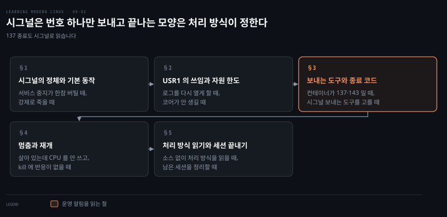
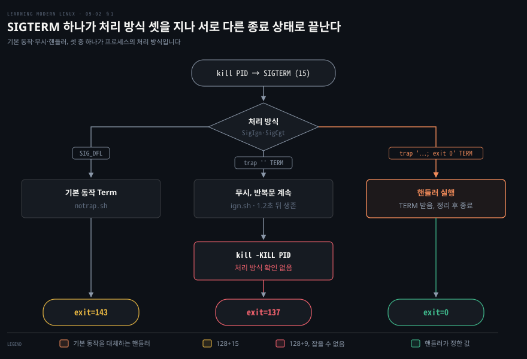
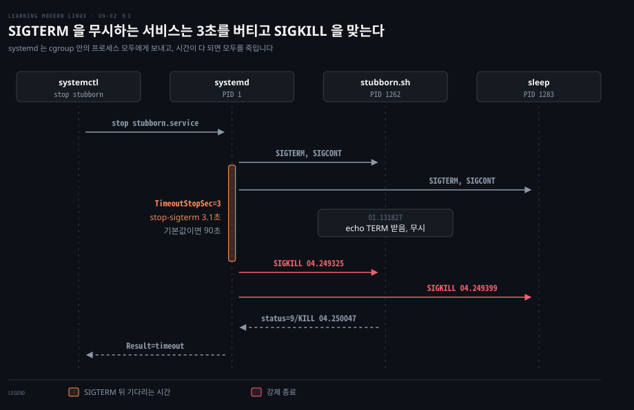
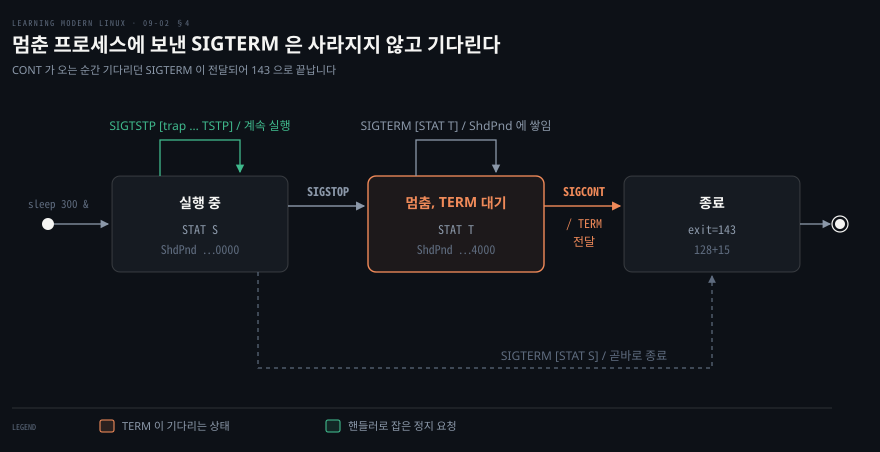
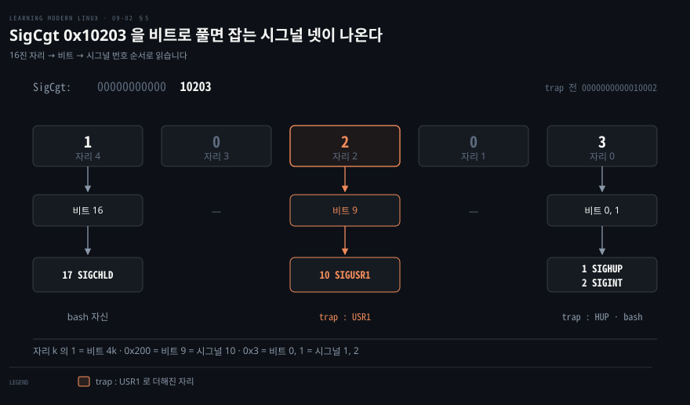

# 시그널은 번호 하나만 보내고 끝나는 모양은 처리 방식이 정한다

---

> 9장의 둘째 편입니다. 첫 편이 다루는 프로세스 간 통신 가운데 시그널만 따로 모아, 처리 방식과 번호, 도구와 종료 코드까지 이어서 봅니다.

## 핵심 요약

> 이 노트의 요점은 시그널이 번호 하나로 사건만 알리고, 끝나는 모양은 받는 쪽의 처리 방식이 정한다는 것입니다.

운영에서는 시그널이 가장 자주 손에 닿습니다. 서비스 중지가 90초를 끌거나 컨테이너가 137 로 끝났다는 알림은 모두 시그널로 읽어야 풀립니다. 이 노트는 처리 방식과 번호, 도구와 종료 순서를 다룹니다. 정지와 재개까지 Debian 12 컨테이너에서 직접 돌린 출력으로 확인합니다. 시그널 핸들러는 기본 동작을 대체하므로 핸들러를 단 프로세스는 스스로 끝내야 합니다.


## 학습 목표

> 이 노트를 읽고 나면 아래 두 가지를 스스로 해낼 수 있습니다.

1. 시그널의 세 가지 처리 방식을 말하고, 핸들러가 기본 동작과 어떤 관계인지와 핸들할 수 없는 둘을 댈 수 있습니다.
2. 종료 코드 128+n 을 시그널 이름으로 읽고, `systemctl stop` 의 `SIGTERM` 부터 `SIGKILL` 까지 순서를 설명할 수 있습니다.

아래는 이 문서 전체를 읽는 순서로 이은 지도입니다. 칸마다 절 번호와 그 절이 언제 필요해지는지를 적었습니다.




## 이 문서가 다루지 않는 것

> 이 노트가 다른 노트에 맡긴 범위입니다.

- 데이터를 나르는 프로세스 간 통신(IPC) 둘 → [첫 편](./09-01.%EC%9D%B4%20%EC%9E%A5%EC%9D%84%20%EB%AC%B6%EB%8A%94%20%EA%B2%83%EC%9D%80%20%EC%A3%BC%EC%A0%9C%EA%B0%80%20%EC%95%84%EB%8B%88%EB%9D%BC%20%ED%95%84%EC%9A%94%ED%95%B4%EC%A7%80%EB%8A%94%20%EC%A1%B0%EA%B1%B4%EC%9D%B4%EB%8B%A4.md) §2 가 명명 파이프와 도메인 소켓을 다룹니다
- `SIGHUP` 전파와 `nohup` 원리, 잡의 상태를 옮기는 `fg`·`bg`, 세션과 제어 터미널 → 3장 노트가 다룹니다
- 로그를 다시 열지 않으면 옛 inode 에 계속 쓰는 까닭 → 08-01 이 다룹니다
- 쿠버네티스가 파드를 내릴 때의 종료 단계 → Kubernetes in Action 노트가 다룹니다
- 로그인할 때 거는 자원 한도 `pam_limits` → [첫 편](./09-01.%EC%9D%B4%20%EC%9E%A5%EC%9D%84%20%EB%AC%B6%EB%8A%94%20%EA%B2%83%EC%9D%80%20%EC%A3%BC%EC%A0%9C%EA%B0%80%20%EC%95%84%EB%8B%88%EB%9D%BC%20%ED%95%84%EC%9A%94%ED%95%B4%EC%A7%80%EB%8A%94%20%EC%A1%B0%EA%B1%B4%EC%9D%B4%EB%8B%A4.md) §5 가 다룹니다


## 1. 시그널의 정체와 기본 동작

> 같은 `SIGTERM` 을 받아도 처리 방식에 따라 143 이나 0 으로 끝나고, 무시하면 살아남았다가 `SIGKILL` 을 맞아 137 로 끝납니다.

서비스를 내렸는데 프로세스가 한참 버티다 강제로 죽는 일이 있습니다. 컨테이너가 종료 코드 137 로 끝나거나 `kill` 에 프로세스가 반응하지 않기도 합니다. 시그널을 모르면 이 셋의 원인을 읽을 수 없습니다.

### 시그널 — 커널이 프로세스를 두드리는 방법

시그널은 커널이 유저 공간 프로세스에 특정 사건을 알리려고 만든 비동기 알림입니다. 도착한 시그널을 다루는 처리 방식(disposition)은 기본 동작, 무시, 핸들러 셋 중 하나이며 서로를 대체합니다.[^signal]



단, `SIGKILL` 과 `SIGSTOP` 은 잡을 수도 막을 수도 무시할 수도 없어 커널이 기본 동작을 바로 실행합니다.[^signal] 처리 방식은 프로세스 속성이어서 모든 스레드에 같고, `fork` 자식에게 상속됩니다. `execve` 를 부르면 핸들러는 기본 동작으로 되돌아가고 무시는 유지됩니다.[^signal] `SIGHUP` 전파와 `nohup` 원리는 3장 노트의 [터미널이 끊길 때 살아남는 잡](./03-01.%EC%85%B8%EC%9D%98%20%EC%8B%A4%EC%B2%B4%EB%8A%94%20%EC%8A%A4%ED%8A%B8%EB%A6%BC%EA%B3%BC%20%EB%B3%80%EC%88%98%EC%99%80%20%EC%A2%85%EB%A3%8C%20%EC%83%81%ED%83%9C%EB%8B%A4.md#터미널이-끊길-때-살아남는-잡)에 있습니다.

시그널을 보내는 전형적인 도구는 `kill` 이며, 기본 동작이 프로세스를 종료시키는 것이라 이런 이름이 붙었습니다.

```bash
while true ; do sleep 1 ; done &
ps
kill 17030
```

```bash
[1] 17030
  PID TTY          TIME CMD
16939 pts/2    00:00:00 bash
17030 pts/2    00:00:00 bash
17041 pts/2    00:00:00 sleep
17045 pts/2    00:00:00 ps
[1]+  Terminated              while true; do sleep 1; done
```

`ps` 에서 PID 17030 의 이름이 `sleep` 이 아니라 `bash` 입니다. 반복문 전체가 서브셸로 떴고 죽일 대상이 그 서브셸입니다. `sleep`(17041)은 그 아래에서 회차마다 새로 뜨는 별개의 프로세스입니다. `kill` 이 보낸 기본 `SIGTERM` 에 핸들러가 없어 서브셸이 기본 동작대로 종료되었습니다. 핸들러를 다는 쪽은 `trap` 이며 셸에서 커스텀 핸들러를 등록하게 해 줍니다.

```bash
trap "echo kthxbye" SIGINT ; while true ; do sleep 1 ; done
```

```bash
^Ckthxbye
```

핸들러가 종료를 대체했으므로 Ctrl+C 에 `kthxbye` 만 찍고 반복문은 계속 돕니다. 프롬프트로 가려면 핸들러에서 `exit` 를 부르거나 다른 시그널로 끝내야 합니다. 처리 방식 셋을 같은 반복문에 하나씩 걸고 `SIGTERM` 을 보내면 차이가 종료 상태로 드러납니다. Debian 12 컨테이너(bash 5.2.15)에서 스크립트 `/tmp/rerun.sh` 로 돌린 결과입니다.

```bash
# notrap.sh  : while true; do sleep 1; done
# trap.sh    : trap 'echo TERM 받음, 정리 후 종료; exit 0' TERM 를 앞에 둠
# ign.sh     : trap '' TERM 를 앞에 둠

./notrap.sh &      # 시그널 처리 없는 스크립트를 백그라운드에서 실행
p=$!
sleep 0.5; kill $p; wait $p; echo "exit=$?"

# 같은 순서로 trap.sh 와 ign.sh 를 돌린다
./trap.sh   & p=$!; sleep 0.5; kill $p; wait $p; echo "exit=$?"
./ign.sh    & p=$!; sleep 0.5; kill $p; sleep 1.2; kill -0 $p && echo "TERM 뒤에도 살아 있음"
kill -KILL $p; wait $p; echo "exit=$?"
```

```bash
exit=143
TERM 받음, 정리 후 종료
exit=0
TERM 뒤에도 살아 있음
/tmp/rerun.sh: line 11:  4324 Killed                  ./ign.sh
exit=137
```

기본 동작은 143, 핸들러가 `exit 0` 을 부른 쪽은 0, 무시하는 쪽은 `SIGKILL` 에 137 로 끝납니다. 핸들러에 `exit` 가 없으면 핸들러를 실행한 뒤 반복문으로 돌아갑니다. `trap "echo caught" KILL` 은 등록은 되지만 `SIGKILL` 이 오면 핸들러를 거치지 않고 137 로 종료됩니다.

### 번호와 기본 동작

로그의 `status=9/KILL` 이나 설정의 `KillSignal=SIGQUIT` 를 읽으려면 번호와 이름을 오갈 수 있어야 합니다. bash 내장 `kill -l` 로 둘을 확인합니다.

```bash
kill -l
```

```bash
 1) SIGHUP	 2) SIGINT	 3) SIGQUIT	 4) SIGILL	 5) SIGTRAP
 6) SIGABRT	 7) SIGBUS	 8) SIGFPE	 9) SIGKILL	10) SIGUSR1
11) SIGSEGV	12) SIGUSR2	13) SIGPIPE	14) SIGALRM	15) SIGTERM
16) SIGSTKFLT	17) SIGCHLD	18) SIGCONT	19) SIGSTOP	20) SIGTSTP
21) SIGTTIN	22) SIGTTOU	23) SIGURG	24) SIGXCPU	25) SIGXFSZ
26) SIGVTALRM	27) SIGPROF	28) SIGWINCH	29) SIGIO	30) SIGPWR
31) SIGSYS	34) SIGRTMIN	35) SIGRTMIN+1	36) SIGRTMIN+2	37) SIGRTMIN+3
...
63) SIGRTMAX-1	64) SIGRTMAX
```

```bash
kill -l 143   # TERM
kill -l TERM  # 15
```

bash 의 `kill -l` 은 숫자를 시그널 번호로도, 시그널로 죽은 프로세스의 종료 상태(128+n)로도 받아들입니다.[^bashkill] 그래서 143 을 넣어도 `TERM` 이 나옵니다. 번호는 아키텍처마다 다를 수 있습니다. 아래 번호는 x86 과 ARM 의 것입니다. Alpha·SPARC·MIPS·PARISC 에는 다른 번호를 쓰는 시그널이 있어[^signal] 스크립트와 설정에는 이름을 쓰는 편이 안전합니다. 기본 동작은 `signal(7)` 표를 따르며 Term 은 종료, Core 는 종료와 코어 덤프, Ign 은 무시, Stop 은 정지, Cont 는 재개입니다.[^signal]

| 번호 | 이름 | 기본 동작 | 언제 오고 무엇에 쓰나 |
|------|------|-----------|----------------------|
| 1 | `SIGHUP` | Term | 제어 터미널이 끊기거나 제어 프로세스가 죽을 때. nginx 같은 데몬은 설정을 다시 읽는 신호로 씁니다[^nginx] |
| 2 | `SIGINT` | Term | 터미널에서 Ctrl+C |
| 3 | `SIGQUIT` | Core | 터미널에서 Ctrl+\\. JVM 은 이 시그널에 스레드 덤프를 찍고 계속 돕니다[^jdk] |
| 6 | `SIGABRT` | Core | 프로그램이 `abort(3)` 를 부를 때 |
| 9 | `SIGKILL` | Term | 잡을 수도 막을 수도 무시할 수도 없는 종료 |
| 10, 12 | `SIGUSR1`, `SIGUSR2` | Term | 뜻이 정해지지 않은 둘. 프로그램마다 용도를 정합니다(§2) |
| 11 | `SIGSEGV` | Core | 잘못된 메모리 참조 |
| 13 | `SIGPIPE` | Term | 읽는 쪽이 없는 파이프에 쓸 때 |
| 14 | `SIGALRM` | Term | `alarm(2)` 타이머가 다 될 때. `timeout` 이 내부에서 씁니다 |
| 15 | `SIGTERM` | Term | `kill` 과 `systemctl stop` 이 기본으로 보내는 종료 요청 |
| 17 | `SIGCHLD` | Ign | 자식이 멈추거나 끝날 때 |
| 18 | `SIGCONT` | Cont | 멈춘 프로세스를 이어 돌릴 때 |
| 19 | `SIGSTOP` | Stop | 잡을 수 없는 정지 |
| 20 | `SIGTSTP` | Stop | 터미널에서 Ctrl+Z. 잡을 수 있습니다 |
| 24 | `SIGXCPU` | Core | CPU 시간 한도(`setrlimit(2)`)를 넘을 때 |
| 25 | `SIGXFSZ` | Core | 파일 크기 한도를 넘을 때 |
| 28 | `SIGWINCH` | Ign | 터미널 창 크기가 바뀔 때 |
| 34~64 | `SIGRTMIN`~`SIGRTMAX` | Term | 실시간 시그널. 미리 정한 뜻이 없습니다 |

`SIGPIPE` 는 `yes | head -n1` 처럼 읽는 쪽이 먼저 끝날 때 발생합니다. 3장 노트의 [파이프라인 절](./03-01.%EC%85%B8%EC%9D%98%20%EC%8B%A4%EC%B2%B4%EB%8A%94%20%EC%8A%A4%ED%8A%B8%EB%A6%BC%EA%B3%BC%20%EB%B3%80%EC%88%98%EC%99%80%20%EC%A2%85%EB%A3%8C%20%EC%83%81%ED%83%9C%EB%8B%A4.md#파이프라인이-실제로-이어지는-방식)에서 `PIPESTATUS` 의 `141 0` 으로 확인할 수 있습니다.

실시간 시그널은 표준 시그널과 두 가지가 다릅니다. 같은 시그널이 여러 번 오면 표준 시그널은 한 건만 대기하지만 실시간 시그널은 큐에 쌓입니다.[^signal] 또 `SIGRTMIN` 의 번호가 고정되어 있지 않습니다. 커널은 32 부터 64 까지 33개를 두지만 glibc 가 앞의 둘이나 셋을 써서 `SIGRTMIN` 은 34 나 35 가 됩니다.[^signal] 위 `kill -l` 출력에서 33 다음이 비고 34 가 `SIGRTMIN` 인 것이 그 결과입니다.

그래서 실시간 시그널은 `SIGRTMIN+n` 으로 적습니다. systemd 의 PID 1 은 `SIGRTMIN+0` 을 받으면 `default.target` 으로 들어갑니다.[^systemd1] `SIGRTMIN+1` 은 rescue, `SIGRTMIN+3` 은 halt 입니다.[^systemd1]


## 2. USR1 의 쓰임과 자원 한도

> `SIGUSR1` 은 프로그램마다 뜻이 다르고, 자원 한도를 넘으면 커널이 `SIGXCPU` 나 `SIGXFSZ` 를 보냅니다.

### USR1 로 쓰는 자리

프로세스를 죽이지 않고 진행 상황을 보거나 로그 파일을 다시 열게 하려면 뜻이 정해지지 않은 시그널이 필요합니다. `SIGUSR1` 과 `SIGUSR2` 는 양쪽이 의미에 합의하기만 하면 프로세스끼리 비동기 알림을 주고받는 데 쓸 수 있습니다. 실제로 프로그램마다 뜻이 다릅니다. nginx 는 `USR1` 에 로그 파일을 다시 열고 `USR2` 에 실행 파일을 갈아 끼웁니다.[^nginx]

HAProxy 에서 `SIGUSR1` 은 리스닝 포트를 닫고 남은 연결을 마저 처리한 뒤 나가는 얌전한 중지입니다.[^haproxy] 반면 `SIGTERM` 은 연결을 모두 끊고 즉시 나가는 강제 중지입니다.[^haproxy] GNU `dd` 는 복사 도중 `USR1` 을 받으면 입출력 통계를 표준 오류에 찍고 작업을 이어 갑니다.[^dd]

```bash
dd if=/dev/zero of=/dev/null bs=1M count=200000 & p=$!; sleep 1; kill -USR1 $p
```

```bash
26068+0 records in
26068+0 records out
27334279168 bytes (27 GB, 25 GiB) copied, 1.00066 s, 27.3 GB/s
dd: warning: partial read (266240 bytes); suggest iflag=fullblock
```

마지막 경고는 시그널이 읽기를 끊어 짧은 읽기가 생긴 흔적입니다. GNU 매뉴얼도 진행률을 주기적으로 받을 때는 `iflag=fullblock` 을 함께 쓰라고 권합니다.[^dd]

로그 교체가 `USR1` 을 쓰는 대표 자리입니다. nginx 문서의 순서는 로그 파일 이름을 먼저 바꾼 뒤 마스터에 `USR1` 을 보내는 것이고 마스터는 열려 있던 로그 파일을 모두 다시 엽니다.[^nginx] `logrotate` 의 `postrotate` 스크립트는 로그 교체 뒤에 실행됩니다.[^logrotate] 그래서 여기에 `kill -USR1 "$(cat /run/nginx.pid)"` 같은 줄을 둡니다. 다시 열지 않으면 프로세스가 옛 inode 에 계속 쓰는 까닭은 [08-01 옛 inode 에 남는 쓰기와 copytruncate](./08-01.재는%20것은%20바깥이고%20알고%20싶은%20것은%20안이다.md#옛-inode-에-남는-쓰기와-copytruncate)가 다룹니다.

### 코어 덤프와 자원 한도

프로세스가 비정상 종료했을 때 원인을 사후 분석하거나 폭주하는 작업이 디스크와 CPU 를 독점하지 못하게 막아야 할 때가 있습니다. 기본 동작이 Core 라도 코어 파일이 항상 생기지는 않습니다. 코어 덤프 크기 한도(`RLIMIT_CORE`)가 0 이면 생성되지 않는 등 `core(5)` 조건이 여럿입니다.[^core] 프로세스가 `SIGSEGV` 를 잡지 않고 죽으면 x86 커널이 로그를 남깁니다. 형식은 `comm[pid]: segfault at 주소 ip … sp … error …` 입니다. 이 로그는 `journalctl -k` 로 확인합니다.[^segv]

자원 한도 초과 시그널은 직접 확인할 수 있습니다. `ulimit -f` 의 단위는 1024 바이트입니다.

```bash
( ulimit -St 1; while :; do :; done ); echo "exit=$?"
# /tmp/rerun.sh: line 13:  4329 CPU time limit exceeded ( ulimit -St 1; while :; do ...
# exit=152
( ulimit -f 1; dd if=/dev/zero of=/tmp/big bs=1024 count=100 2>/dev/null ); echo "exit=$?"
# /tmp/rerun.sh: line 14:  4331 File size limit exceededdd if=/dev/zero of=/tmp/big ...
# exit=153
stat -c '%s %n' /tmp/big  # 1024 /tmp/big
```

CPU 한도를 넘긴 루프는 `SIGXCPU`(24, exit 152)로 종료되었습니다. 1024 바이트를 넘겨 쓰려던 `dd` 는 `SIGXFSZ`(25, exit 153)로 종료되었습니다. 파일 크기도 지정 한도에서 멈췄습니다. 셸에서 바로 건 `ulimit` 과 달리 로그인할 때마다 거는 자원 한도는 [첫 편의 pam_limits](./09-01.%EC%9D%B4%20%EC%9E%A5%EC%9D%84%20%EB%AC%B6%EB%8A%94%20%EA%B2%83%EC%9D%80%20%EC%A3%BC%EC%A0%9C%EA%B0%80%20%EC%95%84%EB%8B%88%EB%9D%BC%20%ED%95%84%EC%9A%94%ED%95%B4%EC%A7%80%EB%8A%94%20%EC%A1%B0%EA%B1%B4%EC%9D%B4%EB%8B%A4.md#pam_limits--로그인할-때-거는-자원-한도)가 다룹니다.


## 3. 보내는 도구와 종료 코드

> 시그널은 도구로 보내고, 시그널로 죽은 모양은 종료 코드 128+n 으로 읽습니다.

### kill·pkill·timeout 비교

PID 를 일일이 찾지 않고 이름이나 사용자로 보내거나 명령에 시간 제한을 걸 때 쓰는 도구가 다릅니다.

| 도구 | 기본 시그널 | 대상을 고르는 법 |
|------|------------|-----------------|
| `kill PID` | `SIGTERM` | PID. 음수 PID 는 프로세스 그룹 전체입니다[^kill] |
| `pkill 패턴` | `SIGTERM` | 프로세스 이름에 패턴 매칭. `-f` 는 명령행 전체, `-u` 는 유효 사용자, `-U` 는 실제 사용자, `-t` 는 제어 터미널이며 함께 주면 모두 맞아야 합니다[^pgrep] |
| `timeout 시간 명령` | `SIGTERM` | 자기가 띄운 명령에 만료 시 전송[^timeout] |

`pkill` 은 같은 조건의 `pgrep -a` 로 대상을 먼저 확인해야 안전합니다. `-f` 가 명령행 전체를 검사하므로 엉뚱한 프로세스까지 걸릴 수 있습니다. 이름이 `worker` 인 `sleep 505` 를 찾는 실험입니다.

```bash
bash -c "exec -a worker sleep 505" & sleep 0.3; pgrep -a 505; echo "rc=$?"
# rc=1
bash -c 'bash -c "exec -a worker sleep 505" & sleep 0.3; pgrep -af "sleep 505|505"; pkill -f "^worker"'
# 4468 bash -c bash -c "exec -a worker sleep 505" & sleep 0.3; pgrep -af "sleep 505|505"; pkill -f "^worker"
# 4473 worker 505
```

이름 매칭은 걸리지 않아 1 이 나오지만, `-f` 는 목표인 4473 뿐 아니라 패턴 문자열을 품은 부모 셸 4468 까지 잡습니다. `pkill -f` 였다면 스크립트 자신을 죽였을 것입니다. `pkill` 의 종료 상태는 하나 이상 맞고 시그널을 보냈으면 0, 맞는 것이 없으면 1 입니다.[^pgrep] 한편 `timeout` 은 종료 상태로 결과를 알립니다.

```bash
timeout 1 sleep 10; echo "exit=$?"                    # exit=124
# 보낼 시그널 지정(-s)
timeout -s KILL 1 sleep 10; echo "exit=$?"            # exit=137
# 첫 시그널 뒤에도 살면 KILL(-k)
timeout -k 1 1 ./ign.sh; echo "exit=$?"               # exit=137
# 원래 종료 상태 보존
timeout --preserve-status 1 sleep 10; echo "exit=$?"  # exit=143
```

시간이 다 되면 `SIGTERM` 을 보내고 124 로 끝납니다. `-s KILL` 이면 `SIGKILL` 의 128+9 인 137 이 나옵니다. `-k 1` 은 첫 시그널을 보내고도 1초 뒤에 살아 있으면 `SIGKILL` 을 보냅니다. 그래서 `SIGTERM` 을 무시하는 `ign.sh` 도 137 로 끝납니다. `--preserve-status` 는 124 대신 명령 자신의 상태를 돌려줍니다.[^timeout] coreutils 9.1 의 `timeout` 은 시간이 다 되면 자기에게 `SIGALRM` 이 오도록 타이머를 겁니다. 그 시그널을 받은 순간 자식에게 정한 시그널을 보냅니다.[^timeoutc]

### 128+n 종료 코드와 systemctl stop

컨테이너나 서비스가 137 이나 143 으로 끝나면 먼저 128 을 빼 봅니다. bash 는 시그널 n 으로 죽은 명령의 종료 상태를 128+n 으로 매기며 세부 규칙은 3장 노트의 [종료 상태 절](./03-01.%EC%85%B8%EC%9D%98%20%EC%8B%A4%EC%B2%B4%EB%8A%94%20%EC%8A%A4%ED%8A%B8%EB%A6%BC%EA%B3%BC%20%EB%B3%80%EC%88%98%EC%99%80%20%EC%A2%85%EB%A3%8C%20%EC%83%81%ED%83%9C%EB%8B%A4.md#4-숫자로-알리는-종료-상태)이 다룹니다. 아래는 작업 제어를 켠 bash(`set -m`)에서 `sleep 30 &` 에 시그널을 하나씩 보내고 `wait` 로 받은 값입니다. 작업 제어가 꺼진 스크립트에서는 백그라운드 명령이 `SIGINT`·`SIGQUIT` 를 무시합니다.[^bashsig] 그래서 130·131 대신 `sleep` 이 끝까지 돌아 0 이 나옵니다.

| 종료 상태 | 시그널 | 흔히 보는 자리 |
|-----------|--------|---------------|
| 129 | `SIGHUP`(1) | 터미널이 끊긴 세션의 잡 |
| 130 | `SIGINT`(2) | Ctrl+C 로 끊은 명령 |
| 131 | `SIGQUIT`(3) | Ctrl+\\ |
| 134 | `SIGABRT`(6) | `abort(3)` 로 끝난 프로그램 |
| 137 | `SIGKILL`(9) | 유예 시간을 넘긴 종료, `timeout -s KILL` |
| 139 | `SIGSEGV`(11) | 잘못된 메모리 참조 |
| 141 | `SIGPIPE`(13) | 읽는 쪽이 먼저 끝난 파이프라인 |
| 142 | `SIGALRM`(14) | 잡지 않은 타이머 |
| 143 | `SIGTERM`(15) | 종료 요청을 받고 끝남 |
| 152, 153 | `SIGXCPU`(24), `SIGXFSZ`(25) | CPU 시간·파일 크기 한도 초과 |

137 은 대개 기다리다 못해 `SIGKILL` 을 보냈다는 뜻입니다. 그 순서는 `systemctl stop` 에서 분명하게 드러납니다.



`systemd.kill(5)` 과 `systemd.service(5)` 의 중지 절차입니다.[^sdservice][^sdkill] 기본값은 Debian 12(systemd 252) `systemctl show` 기준입니다.

| 순서 | systemd 가 하는 일 | 정하는 설정과 기본값 |
|------|-------------------|---------------------|
| 1 | `ExecStop=` 명령이 있으면 먼저 실행합니다 | `ExecStop=`, 없으면 건너뜁니다[^sdservice] |
| 2 | 남은 프로세스에 종료 시그널을 보내고 곧바로 `SIGCONT` 를 보냅니다 | `KillSignal=`, 기본 `SIGTERM`(15)[^sdkill] |
| 3 | 서비스가 스스로 끝나기를 기다립니다 | `TimeoutStopSec=`, 기본은 `DefaultTimeoutStopSec=` 의 90초[^sdservice] |
| 4 | 시간이 다 되면 강제로 끝냅니다 | `FinalKillSignal=`, 기본 `SIGKILL`(9) |
| - | 2와 4의 대상은 유닛의 cgroup 에 남은 모든 프로세스입니다 | `KillMode=`, 기본 `control-group`[^sdkill] |

2단계에서 `SIGCONT` 를 함께 보내는 이유는 멈춰 있던 프로세스도 깨워 종료 시그널을 받게 하려는 것입니다.[^sdkill] 그 이유는 §4 의 정지 실험에서 드러납니다. 아래는 `SIGTERM` 을 잡고 무시하는 서비스에 `TimeoutStopSec=3` 을 주고 멈춘 기록입니다. 같은 방식으로 띄우되 `SIGTERM` 에 `exit 0` 하는 서비스는 0.005초 만에 `Result=success` 로 멈췄습니다.

```bash
systemctl stop stubborn
journalctl -u stubborn -o short-precise
systemctl show stubborn -p Result -p ExecMainStatus
```

```bash
05:08:01.131827 stubborn.sh[1262]: TERM 받음, 무시
05:08:04.249285 systemd[1]: stubborn.service: State 'stop-sigterm' timed out. Killing.
05:08:04.249325 systemd[1]: stubborn.service: Killing process 1262 (stubborn.sh) with signal SIGKILL.
05:08:04.249399 systemd[1]: stubborn.service: Killing process 1283 (sleep) with signal SIGKILL.
05:08:04.250047 systemd[1]: stubborn.service: Main process exited, code=killed, status=9/KILL
05:08:04.250065 systemd[1]: stubborn.service: Failed with result 'timeout'.
Result=timeout
ExecMainStatus=9
```

`TimeoutStopSec=` 에 준 3초가 지나 `stop-sigterm` 이 만료되었습니다. `KillMode=control-group` 에 따라 주 프로세스 1262 와 자식 `sleep` 1283 에 `SIGKILL` 이 갔습니다. 설정이 없으면 기본 90초 뒤 강제 종료됩니다. 서비스 중지가 매번 90초씩 걸린다면 그 서비스는 `SIGTERM` 에 끝나지 않는다고 보면 됩니다.

쿠버네티스가 파드를 종료할 때도 `SIGTERM` 을 보내고 유예 시간 뒤 `SIGKILL` 을 보내는 같은 절차를 따릅니다. 자세한 단계는 [Kubernetes in Action 노트의 종료 단계](../../../08_cloud/book/kubernetes-in-action/06-03.lifecycle%20hook%EA%B3%BC%20Pod%20%EC%83%9D%EC%95%A0%EC%A3%BC%EA%B8%B0%20%EC%A0%84%EC%B2%B4.md#6-종료-단계--prestop-hook에서-sigterm까지)가 다룹니다.


## 4. 멈춤과 재개

> 멈춘 프로세스에 보낸 `SIGTERM` 은 사라지지 않고 대기하다 재개될 때 전달됩니다.

프로세스가 살아 있으나 CPU 를 쓰지 않고 `kill` 에 반응이 없으면 `ps` 의 `STAT` 열부터 봅니다. `T` 면 멈춘 상태입니다.



```bash
sleep 300 & p=$!
ps -o pid,stat,cmd -p $p
#     PID STAT CMD
#    4334 S    sleep 300
kill -STOP $p; ps -o pid,stat,cmd --no-headers -p $p; grep ^State /proc/$p/status
#    4334 T    sleep 300
# State:	T (stopped)
kill -TERM $p; ps -o pid,stat,cmd --no-headers -p $p; grep -E '^(SigPnd|ShdPnd)' /proc/$p/status
```

```bash
   4334 T    sleep 300
SigPnd:	0000000000000000
ShdPnd:	0000000000004000
```

```bash
kill -CONT $p; wait $p; echo "exit=$?"  # exit=143
```

멈춘 프로세스에 `SIGTERM` 을 보내도 `T` 상태가 유지됩니다. 시그널은 사라지지 않고 프로세스 전체의 대기 시그널을 담는 `ShdPnd` 에 `0x4000` 으로 남습니다.[^proc] 0 부터 센 14번 비트, 비트 n-1 이 시그널 n 이므로 `SIGTERM`(15)입니다. `SIGCONT` 로 깨우는 순간 보류된 `SIGTERM` 이 전달되어 143 으로 끝납니다. 그래서 systemd 는 중지할 때 `SIGCONT` 를 함께 보냅니다. `SIGKILL` 만은 기다리지 않습니다. 같은 방식으로 멈춘 `sleep` 에 `kill -KILL` 을 보내면 깨우지 않아도 곧바로 137 로 끝납니다.

`SIGSTOP` 과 `SIGTSTP` 는 모두 기본 동작이 정지이지만, Ctrl+Z 가 보내는 `SIGTSTP` 는 핸들러로 잡을 수 있습니다.

```bash
cat tstp.sh
```

```bash
trap "echo TSTP 받았지만 멈추지 않음" TSTP
for i in 1 2 3; do sleep 1; done
echo 끝까지 실행
```

```bash
./tstp.sh & p=$!; sleep 0.5; kill -TSTP $p; wait $p; echo "exit=$?"
```

```bash
TSTP 받았지만 멈추지 않음
끝까지 실행
exit=0
```

편집기처럼 멈추기 전 화면을 복원해야 하는 프로그램은 `SIGTSTP` 를 잡습니다. 반면 `SIGSTOP` 은 무조건 멈춥니다. `fg` 와 `bg` 로 잡을 멈추고 재개하는 흐름은 3장 노트의 [잡의 상태를 옮기는 명령](./03-01.%EC%85%B8%EC%9D%98%20%EC%8B%A4%EC%B2%B4%EB%8A%94%20%EC%8A%A4%ED%8A%B8%EB%A6%BC%EA%B3%BC%20%EB%B3%80%EC%88%98%EC%99%80%20%EC%A2%85%EB%A3%8C%20%EC%83%81%ED%83%9C%EB%8B%A4.md#잡의-상태를-옮기는-명령)에서 다룹니다.


## 5. 처리 방식 읽기와 세션 끝내기

> 소스 없이도 `/proc` 마스크로 처리 방식을 읽고, 세션이나 터미널 단위로 프로세스를 끝낼 수 있습니다.

### /proc/PID/status 로 처리 방식 읽기

소스 없이 프로세스가 시그널을 어떻게 다루는지 보려면 `/proc/PID/status` 의 `SigBlk`·`SigIgn`·`SigCgt` 16진수 마스크를 확인합니다.[^proc]



```bash
bash -c 'grep -E "^Sig(Ign|Cgt)" /proc/$$/status
         trap "" TERM; trap : USR1 HUP
         grep -E "^Sig(Ign|Cgt)" /proc/$$/status'
```

```bash
SigIgn:	0000000200000004
SigCgt:	0000000000010002
SigIgn:	0000000200004004
SigCgt:	0000000000010203
```

`trap "" TERM` 후 `SigIgn` 에 14번 비트인 `0x4000`(시그널 15)이 더해졌습니다. `SigCgt` 는 `0x10002` 에서 `0x10203` 으로 바뀌었습니다. 0번 비트인 1번 `SIGHUP` 과 9번 비트인 10번 `SIGUSR1` 은 `trap` 이 더한 것입니다. 1번 비트인 2번 `SIGINT` 와 16번 비트인 17번 `SIGCHLD` 는 trap 전부터 서 있던 것으로, bash 가 스스로 잡습니다.

`SigIgn` 의 33번 비트(`0x200000000`, 시그널 34)는 컨테이너 PID 1 에도 켜져 있습니다. 상위에서 건 무시를 `execve` 규칙대로 물려받은 것입니다. `nohup` 도 같은 규칙을 씁니다. `nohup sleep 100 &` 의 `SigIgn` 은 `0000000200000007`, 일반 `sleep` 은 `0000000200000006` 입니다. 둘을 비교하면 0번 비트 `SIGHUP` 만 다릅니다. 둘 다 켜진 1·2번 비트(`SIGINT`·`SIGQUIT`)는 작업 제어가 꺼진 셸이 백그라운드 명령에 거는 무시입니다.[^bashsig]

### loginctl·pkill -t 로 세션 끝내기

SSH 세션에 남은 프로세스를 정리할 때는 세션이나 터미널 단위로 다룹니다. 세션과 제어 터미널 개념은 3장 노트의 [세션과 제어 터미널](./03-01.%EC%85%B8%EC%9D%98%20%EC%8B%A4%EC%B2%B4%EB%8A%94%20%EC%8A%A4%ED%8A%B8%EB%A6%BC%EA%B3%BC%20%EB%B3%80%EC%88%98%EC%99%80%20%EC%A2%85%EB%A3%8C%20%EC%83%81%ED%83%9C%EB%8B%A4.md#세션과-제어-터미널)이 다룹니다. systemd 에서는 `systemd-logind` 가 로그인마다 세션을 만들고 `loginctl` 로 제어합니다.

```bash
loginctl list-sessions
```

```bash
SESSION  UID USER SEAT TTY
     10 1000 bob       pts/1
      9 1000 bob       pts/0
```

```bash
loginctl session-status 9
```

```bash
9 - bob (1000)
	  Leader: 1304 (sshd)
	     TTY: pts/0
	 Service: sshd; type tty; class user
	    Unit: session-9.scope
		  ├─1304 "sshd: bob [priv]"
		  ├─1323 "sshd: bob@pts/0"
		  └─1325 sleep 901
```

```bash
loginctl terminate-session 9; loginctl list-sessions
# SESSION  UID USER SEAT TTY
#      10 1000 bob       pts/1
pgrep -t pts/1 -a                       # 1326 sleep 900
# 제어 터미널로 대상 고르기(-t)
pkill -t pts/1; loginctl list-sessions  # No sessions.
```

`session-status` 는 세션 리더와 터미널, `session-9.scope` 아래 프로세스 트리를 보여 줍니다. `terminate-session` 은 세션 내 프로세스를 종료하고 자원을 회수합니다.[^loginctl] `pkill -t` 는 제어 터미널이 `pts/1` 인 프로세스에 기본 시그널 `SIGTERM` 을 보냅니다. 터미널 이름은 `/dev/` 없이 적습니다.[^pgrep] 원격 명령 `sleep 900` 이 죽자 SSH 연결이 끊겨 세션 10 도 정리되었습니다.


## 결정 치트시트

> 시그널에 관한 결정만 한 표로 압축합니다.

| 상황 | 고를 것 | 왜 |
|------|--------|-----|
| 돌고 있는 프로세스에 사건만 알리면 된다 | 시그널 | 데이터를 나르지 않고 알림만 보냅니다 |
| 종료 시 정리 작업을 하고 싶다 | `SIGTERM` 에 핸들러, 끝에 `exit` | 핸들러가 기본 동작을 대체하므로 직접 끝내야 합니다 |
| 어떤 경우에도 확실히 죽여야 한다 | `SIGKILL` | 잡을 수도 막을 수도 무시할 수도 없습니다 |
| 종료 코드가 137·143 이다 | 128 을 빼서 시그널 번호로 읽기 | 137 은 `SIGKILL`, 143 은 `SIGTERM` 입니다 |
| 서비스 중지가 90초씩 걸린다 | `SIGTERM` 처리부터 확인, 필요하면 `TimeoutStopSec=` | `DefaultTimeoutStopSec=` 90초를 다 채우고 `SIGKILL` 을 맞은 것입니다 |
| `kill` 이 먹지 않고 `STAT` 이 `T` 다 | `kill -CONT` | 멈춘 프로세스에 보낸 `SIGTERM` 은 대기하다 재개될 때 전달됩니다 |
| 이름으로 프로세스를 골라 보낸다 | `pgrep -a` 로 먼저 본 뒤 `pkill` | `-f` 는 자기를 부른 셸의 명령행까지 맞출 수 있습니다 |
| 명령에 시간 제한을 건다 | `timeout -k` | 124 는 시간 초과, `-k` 는 무시하는 명령도 끝냅니다 |
| 데몬에 로그를 새로 열게 한다 | 이름을 바꾼 뒤 `SIGUSR1` | nginx 는 `USR1` 에 열려 있던 로그를 다시 엽니다 |
| 프로세스가 무엇을 잡는지 알고 싶다 | `/proc/PID/status` 의 `SigCgt`·`SigIgn` | 비트 n-1 이 시그널 n 입니다 |
| 한 사용자의 로그인을 통째로 끝낸다 | `loginctl terminate-session` | 세션의 프로세스를 모두 죽이고 자원을 거둡니다 |


## 적용 관점

> 이 장은 Spring 도 자바도 다루지 않습니다. 아래는 이 장의 원칙을 그 문맥에 옮겨 본 것입니다.

컨테이너의 종료는 시그널로 옵니다. 오케스트레이터가 파드를 내릴 때 보내는 것이 `SIGTERM` 이고 유예 시간이 지나면 `SIGKILL` 입니다. §1 의 핸들러 실험을 여기서는 실무 규칙으로 옮깁니다. 종료 훅을 달았다고 프로세스가 알아서 끝나지 않으므로 정리 작업을 마친 뒤 실제로 종료하는 경로가 있어야 합니다. `SIGKILL` 은 잡을 수 없으니 유예 시간 안에 끝내는 것이 유일한 방법입니다. 종료 코드 137 은 그 시간을 넘겼다는 기록입니다.

JVM 이 멈춘 것 같을 때 `SIGQUIT` 은 프로세스를 죽이지 않고 스레드 덤프를 받는 통로입니다. `kill -QUIT PID` 를 보내면 HotSpot 이 덤프를 표준 출력에 찍으므로 컨테이너라면 그 로그에서 찾습니다.[^jdk]


## 면접에서 받을 만한 질문

1. 시그널에 커스텀 핸들러를 달면 기본 동작은 어떻게 됩니까. 근거는 무엇입니까.
2. 핸들할 수 없는 시그널은 무엇이고 그것이 운영에서 뜻하는 바는 무엇입니까.
3. 컨테이너가 종료 코드 137 로 끝났습니다. 143 이었다면 무엇이 달랐습니까?
4. `systemctl stop` 이 매번 90초 걸리고 `Result=timeout` 이 남습니다. 무슨 일이 일어났고 어떻게 고칩니까.
5. `kill` 을 보냈는데 프로세스가 `STAT` 이 `T` 인 채 그대로입니다. 왜 그렇고 어떻게 끝냅니까.


## 정답 (자답 후 펼치기)

### 정답 1 — 커스텀 핸들러와 기본 동작의 관계

기본 동작은 일어나지 않습니다. 핸들러가 기본 동작을 대체하고 핸들러가 끝나면 프로세스는 하던 일로 돌아갑니다. `signal(7)` 은 프로세스가 기본 동작, 무시, 핸들러 셋 중 하나를 고른다고 적습니다. 실험에서도 핸들러 없는 반복문은 `SIGTERM` 에 143 으로 끝났고 핸들러에서 `exit 0` 을 부른 쪽은 0 으로 끝났습니다.

### 정답 2 — 핸들할 수 없는 시그널과 운영상 의미

`SIGKILL` 과 `SIGSTOP` 입니다. 잡을 수도 막을 수도 무시할 수도 없습니다. 운영에서 뜻하는 바는 두 방향입니다. 확실히 죽이거나 멈춰야 할 때 쓸 수 있는 마지막 수단이라는 것과, `SIGKILL` 을 받은 프로세스는 정리 작업을 할 기회가 전혀 없다는 것입니다.

### 정답 3 — 종료 코드 137과 143의 차이

137 은 128+9 이므로 `SIGKILL` 로 죽었다는 뜻이고 대개 유예 시간 안에 끝나지 않아 강제로 끝났다는 기록입니다. 143 은 128+15 인 `SIGTERM` 으로, 종료 요청을 받고 끝났다는 뜻입니다. 앞의 것은 정리 기회가 없었습니다. 뒤의 것은 프로그램에 따라 다릅니다. 핸들러가 없으면 기본 동작으로 곧바로 끝나고, JVM 처럼 `SIGTERM` 을 받아 정리한 뒤 스스로 128+15 로 끝내는 프로그램도 있습니다.[^jdkterm]

### 정답 4 — systemctl stop 의 90초 지연

systemd 는 `SIGTERM` 과 `SIGCONT` 를 보낸 뒤 `TimeoutStopSec=` 만큼 기다리고 기본값은 `DefaultTimeoutStopSec=` 의 90초입니다. 그 안에 끝나지 않으면 cgroup 에 남은 프로세스 모두에 `SIGKILL` 을 보내고 결과를 `timeout` 으로 남깁니다. 서비스가 `SIGTERM` 을 잡고 끝내지 않거나 무시하는 것이므로 핸들러가 정리 뒤 종료하게 고치는 것이 먼저입니다. 정리에 시간이 정말 필요하다면 `TimeoutStopSec=` 을 그만큼 잡습니다.

### 정답 5 — 정지 상태 프로세스와 SIGCONT

`T` 는 멈춘 상태이고 멈춘 프로세스에 보낸 `SIGTERM` 은 사라지지 않고 대기합니다. `/proc/PID/status` 의 `ShdPnd` 에 해당 비트가 섭니다. `kill -CONT` 로 깨우면 대기하던 시그널이 전달되어 끝납니다. systemd 가 종료 시그널 뒤에 `SIGCONT` 를 보내는 것도 이 때문입니다. `SIGKILL` 로 끝내는 방법도 있지만 정리 기회가 없어집니다.


## 핵심 개념 체크리스트

- [ ] 시그널의 처리 방식 세 가지를 대고 핸들러가 기본 동작과 어떤 관계인지 말할 수 있는가?
- [ ] `fork` 와 `execve` 를 지날 때 핸들러와 무시가 각각 어떻게 되는지 말할 수 있는가?
- [ ] 자주 보는 시그널의 번호와 기본 동작을 대고, 번호 대신 이름을 쓰는 이유를 설명할 수 있는가?
- [ ] 종료 코드 130·137·139·141·143 을 시그널 이름으로 읽을 수 있는가?
- [ ] `systemctl stop` 이 `SIGTERM` 에서 `SIGKILL` 까지 가는 단계와 그 설정 이름을 댈 수 있는가?
- [ ] `pkill -f` 가 엉뚱한 프로세스를 맞추는 경우와 `timeout` 의 124·137 을 설명할 수 있는가?
- [ ] 멈춘 프로세스에 보낸 `SIGTERM` 이 어디서 기다리는지 `/proc` 으로 보일 수 있는가?
- [ ] `SigCgt` 16진 마스크를 비트로 풀어 잡는 시그널을 댈 수 있는가?
- [ ] `loginctl terminate-session` 과 `pkill -t` 가 대상을 고르는 기준의 차이를 말할 수 있는가?


## 관련 문서

- [9장 첫 편 — 이 장을 묶는 것은 주제가 아니라 필요해지는 조건이다](./09-01.%EC%9D%B4%20%EC%9E%A5%EC%9D%84%20%EB%AC%B6%EB%8A%94%20%EA%B2%83%EC%9D%80%20%EC%A3%BC%EC%A0%9C%EA%B0%80%20%EC%95%84%EB%8B%88%EB%9D%BC%20%ED%95%84%EC%9A%94%ED%95%B4%EC%A7%80%EB%8A%94%20%EC%A1%B0%EA%B1%B4%EC%9D%B4%EB%8B%A4.md) — 시그널이 필요해지는 조건, 데이터를 나르는 IPC 둘, `pam_limits`
- [3장 첫 편 — 셸의 실체는 스트림과 변수와 종료 상태다](./03-01.%EC%85%B8%EC%9D%98%20%EC%8B%A4%EC%B2%B4%EB%8A%94%20%EC%8A%A4%ED%8A%B8%EB%A6%BC%EA%B3%BC%20%EB%B3%80%EC%88%98%EC%99%80%20%EC%A2%85%EB%A3%8C%20%EC%83%81%ED%83%9C%EB%8B%A4.md) — 종료 상태 128+n, 잡 제어와 세션, `SIGHUP`
- [6장 첫 편 — 먼저 켜지는 것 하나가 나머지 전부를 켠다](./06-01.%EB%A8%BC%EC%A0%80%20%EC%BC%9C%EC%A7%80%EB%8A%94%20%EA%B2%83%20%ED%95%98%EB%82%98%EA%B0%80%20%EB%82%98%EB%A8%B8%EC%A7%80%20%EC%A0%84%EB%B6%80%EB%A5%BC%20%EC%BC%A0%EB%8B%A4.md) — `systemctl stop` 이 다루는 systemd 유닛
- [8장 첫 편 — 재는 것은 바깥이고 알고 싶은 것은 안이다](./08-01.%EC%9E%AC%EB%8A%94%20%EA%B2%83%EC%9D%80%20%EB%B0%94%EA%B9%A5%EC%9D%B4%EA%B3%A0%20%EC%95%8C%EA%B3%A0%20%EC%8B%B6%EC%9D%80%20%EA%B2%83%EC%9D%80%20%EC%95%88%EC%9D%B4%EB%8B%A4.md) — 옛 inode 에 남는 쓰기와 `copytruncate`
- [Kubernetes in Action — lifecycle hook과 Pod 생애주기 전체](../../../08_cloud/book/kubernetes-in-action/06-03.lifecycle%20hook%EA%B3%BC%20Pod%20%EC%83%9D%EC%95%A0%EC%A3%BC%EA%B8%B0%20%EC%A0%84%EC%B2%B4.md) — 파드 종료의 `SIGTERM` 과 유예 시간
- [Learning Modern Linux 정독 인덱스](./README.md) — 이 책의 MOC


## 참고 자료

- 원서: 《Learning Modern Linux》 Michael Hausenblas, O'Reilly Media, 2022. ISBN 978-1-098-10894-6
- man page 는 Debian 12 패키지로 확인했습니다. 판은 manpages 6.03, procps 4.0.2, coreutils 9.1, systemd 252, libpam-modules 1.5.2 입니다
- 실험은 OrbStack 의 `debian:12` 컨테이너(arm64)에서 돌렸습니다

[^signal]: signal(7). "a process can elect one of the following behaviors to occur on delivery of the signal: perform the default action; ignore the signal; or catch the signal with a signal handler" · "The signals SIGKILL and SIGSTOP cannot be caught, blocked, or ignored." · "The signal disposition is a per-process attribute" · "During an execve(2), the dispositions of handled signals are reset to the default; the dispositions of ignored signals are left unchanged." · 표준 시그널 표와 실시간 시그널 절("Multiple instances of real-time signals can be queued.", SIGRTMIN 은 glibc 때문에 34 또는 35). <https://manpages.debian.org/bookworm/manpages/signal.7.en.html>
[^bashkill]: bash(1), `kill` 내장 명령 — "The exit_status argument to -l is a number specifying either a signal number or the exit status of a process terminated by a signal." <https://manpages.debian.org/bookworm/bash/bash.1.en.html>
[^bashsig]: bash(1), SIGNALS — "When job control is not in effect, asynchronous commands ignore SIGINT and SIGQUIT in addition to these inherited handlers." bash 5.2.15. <https://manpages.debian.org/bookworm/bash/bash.1.en.html>
[^nginx]: nginx, "Controlling nginx" — 마스터 프로세스의 `HUP`(changing configuration), `USR1`(re-opening log files), `USR2`(upgrading an executable file). 로그 교체는 "they need to be renamed first. After that USR1 signal should be sent to the master process." <https://nginx.org/en/docs/control.html>
[^jdk]: Oracle, Java SE 21 Troubleshooting Guide, Diagnostic Tools — "a thread dump is printed if the Java process receives a quit signal. Therefore, the kill -QUIT pid command causes the process with the ID pid to print a thread dump to standard output." <https://docs.oracle.com/en/java/javase/21/troubleshoot/diagnostic-tools.html>
[^haproxy]: HAProxy 2.8 Management Guide — "when the SIGTERM signal is sent to the haproxy process, it immediately quits and all established connections are closed. The graceful stop is triggered when the SIGUSR1 signal is sent". <https://github.com/haproxy/haproxy/blob/v2.8.0/doc/management.txt>
[^dd]: GNU Coreutils 매뉴얼, dd invocation — "Sending an 'INFO' signal (or 'USR1' signal where that is unavailable) to a running dd process makes it print I/O statistics to standard error and then resume copying." 예제는 "Run dd with the fullblock iflag to avoid short reads which can be triggered by reception of signals." <https://www.gnu.org/software/coreutils/manual/html_node/dd-invocation.html>
[^logrotate]: logrotate(8), `postrotate`/`endscript` — 로그를 교체한 뒤 실행할 명령을 두는 자리입니다. 기본으로는 교체한 로그마다 한 번씩 실행되고, `sharedscripts` 를 쓰면 그 블록이 맞춘 로그 전체에 한 번만 실행됩니다. logrotate 3.21.0. <https://manpages.debian.org/bookworm/logrotate/logrotate.8.en.html>
[^core]: core(5) — 코어 덤프 파일이 만들어지지 않는 경우들을 나열하며, 그중 하나가 `RLIMIT_CORE` 나 `RLIMIT_FSIZE` 한도가 0 인 경우입니다. <https://manpages.debian.org/bookworm/manpages/core.5.en.html>
[^segv]: Linux 6.1 `arch/x86/mm/fault.c` 의 `show_signal_msg()` — 프로세스가 `SIGSEGV` 를 처리하지 않을 때만 `"%s%s[%d]: segfault at %lx ip %px sp %px error %lx"` 를 찍습니다. arm64 는 다른 형식을 쓰므로 이 노트의 arm64 컨테이너에서는 재현하지 않았습니다. <https://github.com/torvalds/linux/blob/v6.1/arch/x86/mm/fault.c#L789-L802>
[^systemd1]: systemd(1), SIGNALS — "SIGRTMIN+0 Enters default mode, starts the default.target unit." · "SIGRTMIN+1 Enters rescue mode" · "SIGRTMIN+3 Halts the machine". systemd 252. <https://manpages.debian.org/bookworm/systemd/systemd.1.en.html>
[^kill]: kill(1)(procps 4.0.2) — 기본 시그널은 TERM 이고, 음수 PID 는 프로세스 그룹을 가리킵니다. `-l` 은 번호와 이름을 바꾸고 `-L` 은 표로 보입니다. 셸에는 같은 이름의 내장 명령이 있습니다. <https://manpages.debian.org/bookworm/procps/kill.1.en.html>
[^pgrep]: pgrep(1)/pkill(1)(procps 4.0.2) — pkill 의 기본 시그널은 SIGTERM, 패턴은 보통 프로세스 이름에만 맞추고 `-f` 는 "the full command line", `-u` 는 effective UID, `-U` 는 real UID, `-t` 는 "controlling terminal … without the "/dev/" prefix". 종료 상태 0 은 하나 이상 맞고 시그널을 보낸 경우, 1 은 맞는 것이 없거나 보내지 못한 경우입니다. <https://manpages.debian.org/bookworm/procps/pgrep.1.en.html>
[^timeout]: timeout(1)(coreutils 9.1) — 기본 시그널 TERM, `-s`, `-k DURATION`("also send a KILL signal if COMMAND is still running this long after the initial signal was sent"), `--preserve-status`, 시간 초과 시 종료 상태 124. <https://manpages.debian.org/bookworm/coreutils/timeout.1.en.html>
[^timeoutc]: coreutils 9.1 `src/timeout.c` — `settimeout()` 이 "Start the timeout after which we'll receive a SIGALRM" 로 `timer_create`(없으면 `alarm`)를 걸고, `SIGALRM` 을 받으면 자식에게 정한 시그널을 보내며 `-k` 가 있으면 `SIGKILL` 용 타이머를 다시 겁니다. <https://github.com/coreutils/coreutils/blob/v9.1/src/timeout.c>
[^sdservice]: systemd.service(5), `TimeoutStopSec=` — `ExecStop=` 명령마다의 대기 시간이자 서비스 자체가 멈추기를 기다리는 시간이며, 넘기면 SIGKILL 로 강제 종료합니다. 기본값은 `DefaultTimeoutStopSec=` 입니다. systemd 252. <https://manpages.debian.org/bookworm/systemd/systemd.service.5.en.html>
[^sdkill]: systemd.kill(5) — `KillMode=` 의 `control-group` 은 유닛의 control group 에 남은 모든 프로세스를 죽입니다. `KillSignal=` 의 기본은 SIGTERM 이고 "right after sending the signal specified in this setting, systemd will always send SIGCONT, to ensure that even suspended tasks can be terminated cleanly." <https://manpages.debian.org/bookworm/systemd/systemd.kill.5.en.html>
[^proc]: proc(5), `/proc/pid/status` — "SigBlk, SigIgn, SigCgt: Masks (expressed in hexadecimal) indicating signals being blocked, ignored, and caught" · "SigPnd, ShdPnd: Mask (expressed in hexadecimal) of signals pending for thread and for process as a whole". <https://manpages.debian.org/bookworm/manpages/proc.5.en.html>
[^loginctl]: loginctl(1), `terminate-session` — "Terminates a session. This kills all processes of the session and deallocates all resources attached to the session." systemd 252. <https://manpages.debian.org/bookworm/systemd/loginctl.1.en.html>
[^jdkterm]: OpenJDK 21 `Terminator.java` — HUP·INT·TERM 에 핸들러를 달고 그 핸들러가 `Shutdown.exit(sig.getNumber() + 0200);` 을 부릅니다. 0200 은 8진수 128 이므로 `SIGTERM` 을 받은 JVM 은 종료 훅을 돌린 뒤 143 으로 끝납니다. jdk-21.0.5+11. <https://github.com/openjdk/jdk21u/blob/jdk-21.0.5%2B11/src/java.base/unix/classes/java/lang/Terminator.java>
