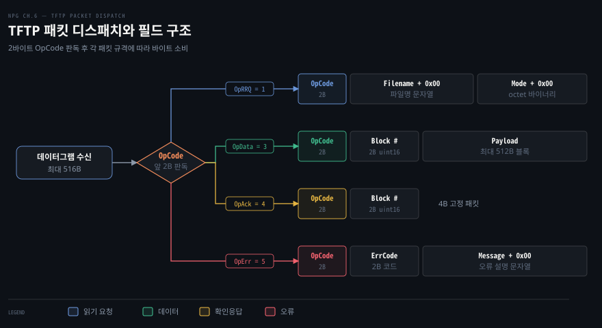
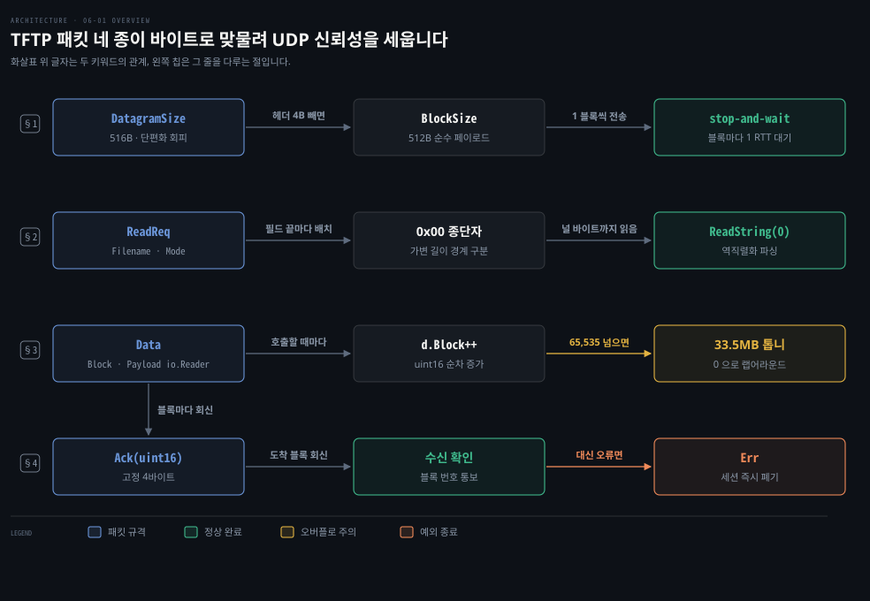
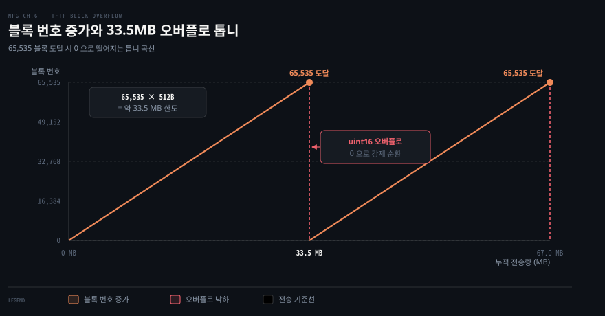

# TFTP 패킷 네 종을 바이트로 짠다

---

> 6장 앞부분은 신뢰성이 없는 UDP 위에서 파일 전송의 완결성을 보장하기 위해 애플리케이션 계층이 직접 구현해야 하는 **패킷 규격**과 **직렬화 기법**을 다룹니다. 

TFTP(RFC 1350)의 단순한 프로토콜 모델을 빌려, Go 표준 인터페이스인 `encoding.BinaryMarshaler` 와 `encoding.BinaryUnmarshaler` 로 네 가지 패킷을 바이트 슬라이스로 직렬화하고 복원하는 기반을 다집니다.

## 핵심 요약

> 이 편이 매달린 하나의 생각은, UDP 데이터그램의 손실과 순서 뒤바뀜을 극복하는 신뢰성 프로토콜의 출발점은 각 역할에 맞춰 정밀하게 바이트 단위로 설계된 패킷 타입 시스템이라는 사실입니다.

**TFTP** 는 **TCP 가 커널에서 제공하는 복잡한 신뢰성 기능 중 순서 보장, 확인응답, 타임아웃 재전송의 핵심 서브셋만 애플리케이션 계층으로 가져와 구현합니다.** 네트워크 MTU 단편화를 원천 차단하기 위해 데이터그램 최대 크기를 516바이트로 제한하고 헤더 4바이트를 뺀 512바이트 단위로 페이로드를 잘라 전송합니다.

수신 소켓에 도달한 데이터그램은 앞선 2바이트 OpCode 값에 따라 읽기 요청 RRQ, 데이터 DATA, 확인응답 ACK, 오류 ERROR 중 하나로 분기합니다. Go 의 타입 시스템을 활용해 각 패킷 구조체마다 표준 바이너리 직렬화·역직렬화 메서드를 캡슐화해 두면 네트워크 소켓은 단순 바이트 파이프로 동작하고 프로토콜 제어 로직은 각 타입 안에서 깔끔하게 정리됩니다.




## 학습 목표

> 이 편을 읽고 나면 아래 다섯 가지를 스스로 해낼 수 있습니다.

1. UDP 신뢰성 구현 예제로 TFTP 를 선정한 이유와 RFC 1350 에서 제한한 구현 범위를 설명할 수 있습니다.
2. `DatagramSize(516)` 와 `BlockSize(512)` 상수가 도출된 배경과 IP 단편화 방지 원리를 짚을 수 있습니다.
3. 읽기 요청(RRQ)의 널 바이트 구분자 구조를 파악하고 Go 의 `bytes.Buffer` 및 `binary.Read` 로 직렬화·역직렬화할 수 있습니다.
4. 데이터(DATA) 패킷의 블록 번호 증가 방식과 33.5MB 전송 시 발생하는 uint16 정수 오버플로 문제를 계산할 수 있습니다.
5. ACK 와 ERROR 패킷의 바이트 레이아웃을 비교하고 비정상 상황에서 전송을 즉시 중단하는 흐름을 설명할 수 있습니다.

아래는 이 편의 키워드를 이은 개념도입니다. §1 줄은 `DatagramSize` 에서 헤더 4바이트를 뺀 `BlockSize` 로 단편화를 피하고 stop-and-wait 로 왕복하는 규약의 기본선입니다. §2 줄은 `ReadReq` 가 필드 끝마다 0x00 종단자를 두고 `ReadString(0)` 으로 읽어 내는 읽기 요청입니다. §3 줄은 Data 구조체가 `io.Reader` 페이로드를 싣고 `d.Block++` 로 전진하다 65,535 블록을 넘기면 33.5MB 톱니를 만나는 한계입니다. §4 줄은 Ack 가 블록 번호로 수신을 확인하고 오류 시 Err 패킷으로 세션을 즉시 폐기하는 마무리입니다.




## 1. TFTP 는 UDP 위의 작은 파일 전송 규약이다

> TFTP 는 연결 설정이나 혼잡 제어 같은 TCP 의 무거운 오버헤드를 걷어내고, UDP 위에서 순서 번호와 1:1 확인응답만으로 데이터의 신뢰 전송을 달성하는 단순한 응용 규약입니다.

### UDP 신뢰성 예제로 TFTP 를 고른 이유

UDP 는 데이터그램의 도달이나 순서를 보장하지 않으므로 신뢰성이 필요한 서비스라면 애플리케이션이 손수 전송 규약을 설계해야 합니다. TCP 전체를 바닥부터 흉내 내는 대신 TCP 신뢰성의 핵심 요소인 순서 번호, 확인응답 ACK, 재전송만을 간결하게 뽑아낸 실전 사례로 TFTP(Trivial File Transfer Protocol)를 채택합니다.

TFTP 는 PXE 부팅 이미지 전송이나 라우터 펌웨어 업데이트처럼 메모리가 극도로 제한된 임베디드 환경에서 널리 쓰여 왔습니다. 이 예제는 학습의 핵심에 집중하기 위해 RFC 1350 규격 중 클라이언트의 파일 다운로드 기능만 구현합니다. 쓰기 요청 WRQ, netascii 텍스트 변환 모드, RFC 2347 후속 확장은 과감히 생략하고 octet 바이너리 읽기 전송만 다룹니다. 보안 암호화나 인증 기능이 없으므로 실제 운영망 통신에는 WireGuard 같은 보안 계층이 권장된다는 한계도 함께 짚습니다.

다운로드에서 데이터를 보내는 쪽은 서버이므로 데이터를 다시 보내는 일도 서버가 맡습니다. 서버는 ACK 가 정해진 시간 안에 오지 않으면 같은 블록을 다시 보냅니다. 클라이언트는 처음에 읽기 요청을 보낸 뒤로는 받은 블록마다 ACK 를 돌려주는 쪽입니다. 클라이언트의 ACK 가 사라지면 서버가 같은 블록을 다시 보내고, 클라이언트는 이미 받은 블록이 또 올 때 ACK 를 한 번 더 보냅니다.

**TFTP 는 블록 하나를 보내고 그 ACK 를 받은 뒤에야 다음 블록을 보냅니다.** 이 방식을 stop-and-wait 라 부릅니다. 날아가는 블록이 늘 하나뿐이라 순서가 뒤바뀔 일이 거의 없고, TCP 의 창 같은 흐름 제어도 필요하지 않습니다. 대신 블록마다 1 RTT 를 기다려야 하므로 전송이 느립니다. RTT 는 패킷을 보내고 응답이 돌아오기까지 걸리는 왕복 시간입니다.

### UDP 위에 규칙을 얹은 규약들

UDP 를 쓰는 규약은 저마다 필요한 것만 위에 얹습니다. 규약마다 다른 것은 누가 무엇을 어디까지 얹느냐입니다.

| 규약 | 기본 포트 | UDP 위에 더한 것 | 쓰임처 |
|---|---|---|---|
| DNS ([RFC 1035](https://www.rfc-editor.org/rfc/rfc1035)) | 53 | 16비트 ID 로 응답을 질의에 짝짓습니다. 이 ID 를 노린 위조는 [05-01](./05-01.UDP%20는%20연결%20없이%20보내고,%20소켓%20하나가%20누구에게서든%20받는다.md#제3자interloper의-패킷-끼어들기)에서 다룹니다. 확장 규약 EDNS 가 없으면 512바이트를 넘는 응답은 잘라 TC 비트(잘림 표시)를 세웁니다. 클라이언트는 그 응답을 받으면 TCP 로 다시 묻습니다. EDNS 의 한도는 [05-02](./05-02.net.Conn%20으로%20상대를%20고정하고%20MTU%20아래로%20보내%20단편화를%20피한다.md#1472바이트-페이로드-상한-도출)에 있습니다. 재전송은 질의하는 쪽이 정합니다 | 이름 해석. 같은 망의 기기 찾기는 mDNS(멀티캐스트 DNS, [05-01](./05-01.UDP%20는%20연결%20없이%20보내고,%20소켓%20하나가%20누구에게서든%20받는다.md#언제-udp-를-선택해야-하는가)) |
| DHCP ([RFC 2131](https://www.rfc-editor.org/rfc/rfc2131)) | 서버 67, 클라이언트 68 | 트랜잭션 ID xid 로 짝짓습니다. 응답이 없으면 클라이언트가 간격을 두 배씩 늘려 다시 보냅니다. RFC 는 4초에서 시작해 최대 64초까지 늘리기를 권하고 간격에 무작위 값을 섞게 합니다 | 망에 붙는 기기에 IP 주소 자동 할당 |
| NTP ([RFC 5905](https://www.rfc-editor.org/rfc/rfc5905)) | 123 | 요청과 응답에 실은 네 타임스탬프로 상대 시계와의 차이(오프셋)와 왕복 지연을 셈합니다. 클라이언트가 폴링(주기적으로 묻기) 주기마다 새 표본을 보냅니다. 잃은 패킷은 다시 보내지 않습니다 | PC·서버의 시계 맞춤 |
| SNMP ([RFC 3416](https://www.rfc-editor.org/rfc/rfc3416), [3417](https://www.rfc-editor.org/rfc/rfc3417)) | 질의 161, 알림 수신 162 (권고) | request-id 로 응답을 짝짓습니다. 재전송 여부는 요청하는 애플리케이션이 정합니다 | 라우터·스위치 같은 장비의 상태 조회와 장애 알림 |
| syslog ([RFC 5426](https://www.rfc-editor.org/rfc/rfc5426)) | 514 | 데이터그램 하나에 메시지 하나만 담습니다. 확인응답과 재전송은 없습니다 | 서버·장비의 로그를 한 곳으로 전달 |
| RTP ([RFC 3550](https://www.rfc-editor.org/rfc/rfc3550)) | 고정 없음, 세션마다 정함 | 순번과 타임스탬프를 붙입니다. 타임스탬프는 재생 타이밍과 지터(도착 간격의 흔들림) 계산에 씁니다. 전달과 순서는 보장하지 않습니다. 짝 규약 RTCP 가 수신 보고로 손실률과 지터를 알립니다 | 인터넷 전화(SIP 로 통화를 열고 RTP 로 음성을 전달), WebRTC 화상회의 |
| TFTP ([RFC 1350](https://www.rfc-editor.org/rfc/rfc1350)) | 첫 요청만 69 | 블록 번호, 블록마다 ACK, 타임아웃 재전송을 얹습니다. 인증과 암호화는 얹지 않았습니다 | 부팅 이미지, 펌웨어 |
| CoAP ([RFC 7252](https://www.rfc-editor.org/rfc/rfc7252)) | 5683 | 메시지마다 확인 여부를 고릅니다. 확인형(CON)은 ACK 가 올 때까지 간격을 늘려 다시 보냅니다. 비확인형(NON)은 Message ID 로 중복만 거릅니다. 기본으로 서버 하나에 답을 기다리는 요청을 하나만 둡니다(NSTART=1) | IoT 센서, 저전력 장비 |
| QUIC·HTTP/3 ([RFC 9000](https://www.rfc-editor.org/rfc/rfc9000), [9001](https://www.rfc-editor.org/rfc/rfc9001), [9114](https://www.rfc-editor.org/rfc/rfc9114), [9250](https://www.rfc-editor.org/rfc/rfc9250)) | 서버가 정함. https 의 기본은 443이고 HTTP 응답의 Alt-Svc(대체 서비스) 헤더로 알림 | 신뢰적 전달, 혼잡 제어, 연결 하나 안의 여러 스트림을 얹습니다. TLS 1.3 핸드셰이크로 키를 정하고 패킷 암호화는 QUIC 이 직접 합니다 | HTTP/3, DNS over QUIC(UDP 853) |
| WireGuard ([프로토콜 문서](https://www.wireguard.com/protocol/)) | 설정으로 지정 | 공개키 핸드셰이크(Noise_IK)로 세션 키를 정하고 IP 패킷을 통째로 암호화합니다. 64비트 카운터와 최근 약 2,000개 값을 기억하는 창으로 재생 공격(가로챈 패킷을 그대로 다시 보내는 공격)을 막습니다 | VPN 터널 |
| DTLS ([RFC 9147](https://www.rfc-editor.org/rfc/rfc9147)) | 고정 없음, 쓰는 응용이 정함 | TLS 1.3 과 같은 수준의 보안을 데이터그램에 줍니다. 핸드셰이크 메시지만 타이머로 다시 보내고 데이터는 데이터그램 그대로 둡니다. TLS 의 위치는 [CNTD 02-01 §3](../cntd_computer-networking-top-down/02-01.앱은%20무엇을%20고르고%20무엇을%20못%20고르는가.md#tls-는-세-번째-트랜스포트-프로토콜이-아닙니다)에서 다룹니다 | WebRTC 미디어 키 교환, CoAP 보안(coaps, 5684) |

표의 규약은 손실을 다루는 방식에 따라 넷으로 갈립니다. TFTP 와 QUIC 은 패킷마다 번호를 매겨 ACK 가 오지 않은 것을 찾아 다시 보냅니다. CoAP 의 확인형 메시지도 ACK 가 올 때까지 다시 보냅니다. DNS·DHCP·SNMP 는 질의 하나에 응답 하나입니다. 응답이 없으면 묻는 쪽이 질의를 통째로 다시 보냅니다. DHCP 는 그 간격까지 RFC 가 권합니다.

NTP·syslog·RTP 는 잃은 패킷을 다시 보내지 않습니다. NTP 는 잃은 표본 대신 다음 폴링의 표본을 씁니다. syslog 는 잃은 메시지를 잃은 채로 둡니다. RTP 는 순번으로 손실과 순서를 알아낼 뿐입니다. 늦게 온 패킷을 쓸지 버릴지는 받는 쪽 재생 버퍼가 정합니다. 실시간 데이터가 손실을 감수하는 이유는 [CNTD 02-01 §3](../cntd_computer-networking-top-down/02-01.앱은%20무엇을%20고르고%20무엇을%20못%20고르는가.md#네-개의-축)이 게임 위치 패킷으로 풉니다. WireGuard 의 프로토콜 문서에 있는 재시도는 핸드셰이크뿐입니다. DTLS 도 타이머로 다시 보내는 것은 핸드셰이크 메시지입니다.

표의 행이 모두 같은 층은 아닙니다. TFTP·DNS·DHCP·NTP·SNMP·syslog·CoAP 는 UDP 위에서 일을 끝내는 응용 규약입니다. QUIC 과 RTP 는 RFC 가 스스로 전송 규약이라 부릅니다. 그 위에 HTTP/3 이나 음성·영상 형식이 다시 올라갑니다. DTLS 는 TLS 를 데이터그램에 맞춘 보안 층입니다. WireGuard 는 IP 패킷을 통째로 암호화해 UDP 에 싣는 터널입니다. QUIC 의 구조는 [CNTD 02-01 §7](../cntd_computer-networking-top-down/02-01.앱은%20무엇을%20고르고%20무엇을%20못%20고르는가.md#7-quic-api-는-무엇을-감추나)과 [portal-tunnel 01-02 §5](../../project/portal-tunnel/01-02.Stream%20multiplexing%C2%B7HTTP%20Upgrade%C2%B7QUIC.md#5-quic-udp-위의-독립-스트림과-비신뢰성-데이터그램)에서 다룹니다.

### 516바이트와 512바이트 상수의 배경

아래 코드는 프로토콜의 뼈대를 이루는 크기 상수와 열거형 코드를 정의합니다. 크기 상수는 이 소절에서, `OpCode` 와 `ErrCode` 는 뒤의 소절에서 풉니다.

```go
// TFTP 크기 상수와 코드 정의 (types.go, 일부)
package tftp

const (
	// 지원하는 최대 데이터그램 크기
	DatagramSize = 516
	// 4바이트 헤더를 뺀 순수 데이터 크기 (512)
	BlockSize    = DatagramSize - 4
)

// 2바이트 작업 코드
type OpCode uint16

const (
	// 읽기 요청
	OpRRQ  OpCode = iota + 1
	// 쓰기 요청 자리, 미지원이라 생략
	_
	// 데이터 블록
	OpData
	// 확인응답
	OpAck
	// 오류
	OpErr
)

// 2바이트 오류 코드
type ErrCode uint16

const (
	ErrUnknown ErrCode = iota
	ErrNotFound
	ErrAccessViolation
	ErrDiskFull
	ErrIllegalOp
	ErrUnknownID
	ErrFileExists
	ErrNoUser
)
```

상수 `DatagramSize` 가 516바이트로 정해진 이유는 네트워크 단편화(fragmentation)를 회피하기 위함입니다. [05-02 §2](./05-02.net.Conn%20으로%20상대를%20고정하고%20MTU%20아래로%20보내%20단편화를%20피한다.md)에서 살펴보았듯 IP 계층에서 패킷이 쪼개지면 조각 하나만 유실되어도 전체 데이터그램이 폐기됩니다. IPv4 표준이 보장하는 최소 재조립 버퍼 크기인 576바이트 안에 안전하게 들어가도록 패킷 전체 크기를 516바이트로 못박았습니다.

블록 하나를 실어 보낼 때 IP 패킷 하나가 차지하는 크기는 다음과 같이 합산됩니다.

| 구성 | 바이트 |
|---|---|
| 블록 데이터 | 512 |
| TFTP 헤더(OpCode 2 + 블록 번호 2) | 4 |
| UDP 헤더 | 8 |
| IPv4 헤더 | 20 |
| 합계 | 544 (576 이하) |

576바이트는 경로에 대한 약속이 아니라 받는 쪽 호스트에 대한 약속입니다. 단편화에서 쪼개기는 보내는 쪽 커널과 경로의 라우터가 하며 MTU 와 쪼개지 말라는 표시인 DF(Don't Fragment) 비트에 달려 있습니다. 다시 합치기는 받는 쪽 호스트가 하므로 조각을 다 모을 때까지 메모리에 쥐고 있어야 합니다.

IPv4 규격은 모든 호스트에게 아무리 큰 데이터그램이라도 합치라고 요구하지 않습니다. 원래 크기 576바이트까지는 한 번에 오든 조각으로 오든 반드시 받으라고만 요구합니다([RFC 791](https://www.rfc-editor.org/rfc/rfc791), [RFC 1122 §3.3.2](https://www.rfc-editor.org/rfc/rfc1122#section-3.3.2)). 그래서 경로 MTU 를 모르는 상태에서도 받는 쪽이 반드시 받을 수 있는 크기를 고른 것입니다.

다만 576 은 손실 복구가 아닙니다. 조각이 다 도착했을 때 합칠 그릇 크기를 보장할 뿐이고, 조각 하나를 잃으면 576 이하라도 데이터그램 전체가 버려집니다([05-02 §2](./05-02.net.Conn%20으로%20상대를%20고정하고%20MTU%20아래로%20보내%20단편화를%20피한다.md)). 오늘날 리눅스와 macOS 는 64KB 까지 합치므로 단편화를 피하는 주된 이유는 조각 손실 쪽입니다.

데이터 패킷 헤더인 2바이트 OpCode 와 2바이트 블록 번호의 합 4바이트를 빼면 순수 페이로드 한도인 512바이트 `BlockSize` 가 남습니다. TFTP 는 하위 네트워크의 전송 제약을 감안하여 보수적인 고정 크기를 택합니다.

576 − 20 − 8 − 4 = 544바이트까지 블록에 실을 수 있는데도 512 를 고른 이유는 RFC 1350 에 적혀 있지 않습니다. 흔히 드는 설명은 둘입니다. 하나는 512 가 2의 거듭제곱이라 당시 512바이트 디스크 섹터 단위로 읽은 그대로 실을 수 있었다는 것이고, 다른 하나는 IPv4 헤더에 옵션이 붙으면 최대 60바이트까지 커지므로 여유를 남겼다는 것입니다. 같은 시대의 DNS 도 UDP 메시지를 512바이트 이하로 제한했습니다([RFC 1035](https://www.rfc-editor.org/rfc/rfc1035)).

작은 블록에는 대가가 따릅니다. stop-and-wait 와 겹쳐 512바이트마다 1 RTT 를 기다려야 하므로, 뒤에 나온 blksize 옵션([RFC 2348](https://www.rfc-editor.org/rfc/rfc2348))은 양쪽이 블록 크기를 협상해 키울 수 있게 했습니다.

### 패킷 종류를 가르는 OpCode

UDP 데이터그램에는 패킷 종류를 적는 자리가 따로 없습니다. 그래서 TFTP 는 모든 패킷의 맨 앞 2바이트를 OpCode 로 정했습니다. 받는 쪽은 이 값을 먼저 읽고서야 RRQ 구조로 풀지 DATA 구조로 풀지 정합니다. 핵심 요약 도식의 네 갈래도 이 2바이트 값으로 나뉩니다.

RFC 1350 은 OpCode 를 다섯 개로 정합니다([RFC 1350 §5](https://www.rfc-editor.org/rfc/rfc1350#section-5)). 이 편은 WRQ 를 뺀 네 종을 다룹니다.

| OpCode | 패킷 | 하는 일 | 이 편 |
|---|---|---|---|
| 1 | RRQ | 서버에 파일을 보내 달라고 요청합니다 | §2 |
| 2 | WRQ | 서버에 파일을 쓰겠다고 요청합니다 | 구현하지 않음 |
| 3 | DATA | 파일 블록을 싣습니다 | §3 |
| 4 | ACK | 블록 하나를 받았다고 알립니다 | §4 |
| 5 | ERROR | 오류를 알리고 전송을 끊습니다 | §4 |

위 코드의 `iota` 는 const 묶음 안에서 상수 선언마다 0 부터 하나씩 커지는 값입니다. 주석 줄은 세지 않습니다. 식을 비운 선언은 앞 선언의 식 `iota + 1` 과 타입 `OpCode` 를 그대로 되풀이합니다. 그래서 `OpRRQ` 는 0 + 1 = 1 입니다. 2번 자리의 `_` 는 값을 버리지만 `iota` 를 한 칸 넘깁니다. 덕분에 WRQ 를 구현하지 않아도 `OpData`·`OpAck`·`OpErr` 가 3·4·5 로 RFC 번호와 맞습니다.

`encoding/binary` 패키지의 `binary.Write` 는 고정 크기 값을 정해 준 바이트 순서로 씁니다. `binary.Read` 는 같은 순서로 읽어 들입니다. `OpCode` 는 `uint16` 이라 2바이트로 쓰입니다. 이 코드는 `binary.BigEndian` 을 넘기므로 큰 자릿수를 먼저 놓는 빅엔디언으로 씁니다([gonet-lab 03-01 §2](../../project/gonet-lab/03-01.DNS%20질의%20한%20장을%20바이트로%20-%20헤더·라벨·압축%20포인터·TC.md)). RRQ 의 1 은 `00 01`, DATA 의 3 은 `00 03` 으로 놓입니다.

### 오류 종류를 가르는 ErrCode

`ErrCode` 는 ERROR 패킷 안에 들어가는 2바이트 오류 종류입니다. `iota` 가 0 부터 세므로 상수 순서가 RFC 의 값과 그대로 맞습니다. 값마다의 뜻은 §4 의 표에 둡니다.


## 2. 읽기 요청은 opcode·파일명·모드를 0 바이트로 끊는다

> 읽기 요청(RRQ) 패킷은 2바이트 작업 코드 뒤에 파일명과 전송 모드 문자열을 널 바이트(0x00)로 구분하여 직렬화합니다.

### RRQ 패킷 구조와 구분자 배치

클라이언트가 파일 다운로드를 시작할 때 처음 서버로 쏘는 패킷이 읽기 요청(RRQ)입니다. [04-01](./04-01.TCP%20는%20경계%20없는%20바이트%20흐름이라%20읽는%20쪽이%20메시지를%20자른다.md)에서 다룬 길이 기반 TLV 프레이밍과 달리 RRQ 는 고정 2바이트 헤더 뒤에 가변 길이 문자열들을 0 바이트(`\x00`) 종단자로 끊어내는 방식을 취합니다.

RRQ 의 필드 배치는 다음과 같습니다.

1. **OpCode**: 2바이트 빅엔디언 부호 없는 정수 (값: `1`)
2. **Filename**: 전송받을 파일 이름 문자열
3. **Null Byte**: 1바이트 널 종단자 (`0x00`)
4. **Mode**: 전송 모드 문자열 (`"octet"` 또는 `"netascii"`)
5. **Null Byte**: 패킷의 끝을 닫는 1바이트 널 종단자 (`0x00`)

`file.txt` 를 `octet` 모드로 요청하면 바이트가 다음 순서로 놓입니다.

```pseudocode
| 00 01 | f i l e . t x t | 00 | o c t e t | 00 |
 OpCode   파일 이름          끝   모드         끝
```

받는 쪽은 0 바이트가 나올 때까지 읽으면 문자열 하나를 얻습니다(Go 의 `ReadString(0)`). 이 방식이 되는 이유는 파일 이름과 모드 이름에 0 바이트가 들어갈 일이 없기 때문입니다. 운영체제의 파일 이름에는 0 바이트를 쓸 수 없고, C 언어 문자열도 같은 방식으로 끝을 표시합니다.

같은 방식을 파일 내용에는 쓸 수 없습니다. 파일은 아무 바이트나 담으므로 어떤 종료 값을 고르든 내용 안에 같은 값이 나올 수 있기 때문입니다. 그래서 데이터 패킷의 끝은 §3 처럼 데이터그램 크기로 알립니다.

이 예제는 바이너리 모드인 `"octet"` 만 허용합니다. 만약 `"netascii"` 가 들어오면 클라이언트 운영체제에 맞춰 개행 문자 변환을 거쳐야 하므로 구현 복잡도를 줄이기 위해 거부합니다.

### 직렬화와 역직렬화 구현

아래 코드는 `ReadReq` 구조체에 `encoding.BinaryMarshaler` 와 `encoding.BinaryUnmarshaler` 인터페이스를 구현합니다.

두 인터페이스는 `encoding` 패키지가 정의하며 메서드가 하나씩입니다. `MarshalBinary() ([]byte, error)` 는 값을 바이트 슬라이스로 바꿉니다. `UnmarshalBinary([]byte) error` 는 받은 바이트로 자기 필드를 채웁니다.

`bytes.Buffer` 는 쓰는 만큼 늘어나는 바이트 버퍼이고 `Grow(cap)` 는 패킷 크기만큼 공간을 미리 잡아 둡니다.

```go
// ReadReq 구조체와 직렬화 메서드 (types.go, 일부)
type ReadReq struct {
	Filename string
	Mode     string
}

func (q ReadReq) MarshalBinary() ([]byte, error) {
	mode := "octet"
	if q.Mode != "" {
		mode = q.Mode
	}
	// OpCode 2B + 파일명 + 0x00 + 모드 + 0x00
	cap := 2 + len(q.Filename) + 1 + len(mode) + 1
	b := new(bytes.Buffer)
	b.Grow(cap)

	// OpCode 쓰기
	err := binary.Write(b, binary.BigEndian, OpRRQ)
	if err != nil {
		return nil, err
	}
	_, err = b.WriteString(q.Filename)
	if err != nil {
		return nil, err
	}
	// 0x00 구분자 쓰기
	err = b.WriteByte(0)
	if err != nil {
		return nil, err
	}
	_, err = b.WriteString(mode)
	if err != nil {
		return nil, err
	}
	err = b.WriteByte(0)
	if err != nil {
		return nil, err
	}
	return b.Bytes(), nil
}
```

역직렬화 메서드는 네트워크에서 읽어 들인 바이트 슬라이스에서 OpCode 를 확인하고 `bytes.Buffer.ReadString(0)` 을 호출하여 널 바이트 단위로 문자열을 파싱합니다.

```go
// ReadReq 역직렬화 메서드 (types.go, 일부)
func (q *ReadReq) UnmarshalBinary(p []byte) error {
	r := bytes.NewBuffer(p)
	var code OpCode
	// OpCode 읽기
	err := binary.Read(r, binary.BigEndian, &code)
	if err != nil {
		return err
	}
	if code != OpRRQ {
		return errors.New("invalid RRQ")
	}

	// 널 바이트까지 읽기
	q.Filename, err = r.ReadString(0)
	if err != nil {
		return errors.New("invalid RRQ")
	}
	// 널 종단자 제거
	q.Filename = strings.TrimRight(q.Filename, "\x00")
	if len(q.Filename) == 0 {
		return errors.New("invalid RRQ")
	}

	q.Mode, err = r.ReadString(0)
	if err != nil {
		return errors.New("invalid RRQ")
	}
	q.Mode = strings.TrimRight(q.Mode, "\x00")
	if len(q.Mode) == 0 {
		return errors.New("invalid RRQ")
	}

	actual := strings.ToLower(q.Mode)
	if actual != "octet" {
		return errors.New("only binary transfers supported")
	}
	return nil
}
```

`ReadString(0)` 은 0 바이트를 만날 때까지 읽고 그 0 바이트까지 포함해 돌려줍니다. 그래서 코드는 `TrimRight` 로 종단자를 뗍니다. 0 바이트 없이 끝나면 오류를 돌려주므로 종단자가 빠진 패킷도 `invalid RRQ` 로 걸러집니다.

패킷 타입을 판별할 때 별도의 파서 함수를 외부에 두지 않고 수신 버퍼 슬라이스를 `rrq.UnmarshalBinary(buf)` 에 넘겨 nil 이 반환되는지로 유효성을 가려냅니다.


## 3. 데이터 패킷은 블록 번호와 최대 512바이트를 싣는다

> 데이터(DATA) 패킷은 2바이트 작업 코드, 2바이트 순서 번호, 최대 512바이트의 페이로드로 구성되며 패킷 크기가 516바이트 미만이면 파일 전송이 끝났음을 알립니다.

### Data 구조체와 io.Reader 기반 설계

서버가 클라이언트의 읽기 요청에 응답하여 실제 파일 내용을 실어 나르는 그릇이 `Data` 타입입니다. 아래 `Data` 는 페이로드 필드의 타입으로 바이트 슬라이스 대신 `io.Reader` 를 선택합니다.

```go
// Data 구조체와 직렬화 메서드 (types.go, 일부)
type Data struct {
	Block   uint16
	Payload io.Reader
}

func (d *Data) MarshalBinary() ([]byte, error) {
	b := new(bytes.Buffer)
	b.Grow(DatagramSize)

	// 블록 번호는 1부터 순차 증가
	d.Block++
	err := binary.Write(b, binary.BigEndian, OpData)
	if err != nil {
		return nil, err
	}
	err = binary.Write(b, binary.BigEndian, d.Block)
	if err != nil {
		return nil, err
	}

	// 최대 512바이트 복사
	_, err = io.CopyN(b, d.Payload, BlockSize)
	if err != nil && err != io.EOF {
		return nil, err
	}
	return b.Bytes(), nil
}
```

페이로드를 `io.Reader` 로 두면 로컬 디스크 파일(`*os.File`), 인메모리 버퍼(`bytes.Reader`), 또는 다른 네트워크 소켓(`net.Conn`) 등 어떤 소스라도 수정 없이 연결할 수 있습니다. `io.CopyN` 함수가 남은 바이트 읽기와 위치 이동을 알아서 관리하므로 서버 측의 오프셋 계산 코드가 대폭 줄어듭니다.

마지막 블록에서 남은 데이터가 512바이트보다 적으면 `io.CopyN` 은 읽은 만큼만 복사하고 `io.EOF` 를 돌려줍니다. 코드가 이 오류를 무시하는 이유는 파일 끝이 정상 상황이기 때문입니다. 이때 패킷은 516바이트보다 작아집니다.

`MarshalBinary` 메서드가 값 수신자가 아닌 포인터 수신자(`*Data`)로 선언된 점도 중요합니다. 메서드를 부를 때마다 `d.Block++` 로 내부 상태를 전진시켜 다음 순서 번호를 자동으로 부여하기 때문입니다. `Block` 을 0 으로 시작하면 첫 패킷이 1번이 됩니다.

### 전송 종료 판단과 33.5MB 오버플로 톱니

TFTP 에는 파일의 전체 크기를 사전에 알리는 헤더 필드가 없습니다. 수신 측은 어떻게 전송이 끝났음을 알 수 있을까요?

규칙은 단순합니다. 모든 일반 데이터 패킷은 헤더 4바이트와 페이로드 512바이트를 꽉 채워 정확히 516바이트를 유지합니다. 파일의 마지막 조각에 도달하여 페이로드가 512바이트 미만이 되면 완성된 데이터그램의 전체 크기는 516바이트 미만이 됩니다. 클라이언트와 서버는 패킷 크기가 516바이트보다 작아지는 순간을 전송 완료의 신호로 인식합니다. 만약 파일 크기가 512바이트의 정확한 배수라면 파일 끝에서 페이로드가 0바이트인 빈 데이터 패킷(총 4바이트)을 한 번 더 전송하여 종료를 알립니다.

여기서 516바이트는 UDP 데이터 칸 안쪽의 크기입니다. 층으로 나누면 다음과 같습니다.

```pseudocode
| IP 헤더 20 | UDP 헤더 8 | TFTP 헤더 4 | 파일 데이터 0~512 |
                           (OpCode 2 + 블록 번호 2)
                           ReadFrom 이 돌려주는 부분 = 최대 516
```

UDP 헤더는 8바이트이고, 4바이트는 TFTP 가 UDP 데이터 칸 안에 넣는 TFTP 헤더입니다. `ReadFrom` 은 UDP 소켓에서 데이터그램 하나를 읽는 메서드입니다([05-01](./05-01.UDP%20는%20연결%20없이%20보내고,%20소켓%20하나가%20누구에게서든%20받는다.md)). 이 메서드는 UDP 데이터 칸만 돌려주므로 IP 헤더와 UDP 헤더는 n 에 들어가지 않습니다.

1,024바이트 파일을 받는 경우를 따라가 보면 다음과 같습니다.

| 순서 | 블록 번호 | 파일 데이터 | `ReadFrom` 의 n | 클라이언트의 판단 |
|---|---|---|---|---|
| 1 | 1 | 512 | 516 | 꽉 찼으니 더 옵니다 |
| 2 | 2 | 512 | 516 | 꽉 찼으니 더 옵니다 |
| 3 | 3 | 0 | 4 | 516 보다 작으니 끝입니다 |

빈 블록 3번이 없으면 클라이언트는 파일이 1,024바이트로 끝났는지 3번이 오는 중인지 구별할 수 없습니다.

이 방식이 통하는 이유는 UDP 가 데이터그램 경계를 지키기 때문입니다. `ReadFrom` 이 돌려주는 n 은 보낸 크기 그대로입니다([05-01](./05-01.UDP%20는%20연결%20없이%20보내고,%20소켓%20하나가%20누구에게서든%20받는다.md)). TCP 였다면 바이트가 이어 붙거나 쪼개져 도착하므로 크기로 끝을 알 수 없습니다.

여기서 16비트 부호 없는 정수(`uint16`)인 블록 번호의 한계가 드러납니다. 블록 번호는 1부터 65,535까지만 표현할 수 있습니다.

블록 번호는 2바이트라서 1바이트의 범위와 헷갈리기 쉽습니다. 둘을 나란히 놓으면 다음과 같습니다.

| 크기 | 비트 | 범위 | 16진수 |
|---|---|---|---|
| 1바이트 | 8 | 0~255 | `0x00`~`0xFF` |
| 2바이트 | 16 | 0~65,535 | `0x0000`~`0xFFFF` |

16진수 한 자리가 4비트이므로 1바이트는 두 자리, 2바이트는 네 자리로 씁니다.



전송 데이터량이 약 33.5MB(`65,535 × 512바이트 = 33,553,920바이트`, 약 32MiB)에 도달하면 다음 블록 번호는 `65535 + 1 = 0` 으로 오버플로되어 톱니처럼 바닥으로 떨어집니다. 서버 코드는 0번 블록을 계속 전송하지만 클라이언트 구현에 따라 번호 역전을 오류로 판단하고 전송을 강제 종료할 위험이 있습니다. 이 문제를 피하려면 파일 크기를 33.5MB 이하로 제한하거나 다른 프로토콜을 택해야 합니다.

블록 번호가 넘친 뒤의 처리는 RFC 1350 이 정하지 않아 구현마다 다릅니다. 0 이나 1 로 다시 세며 계속 보내는 구현도 있고, 오류로 끊는 구현도 있습니다. 한도를 넓히는 방법으로는 blksize 옵션([RFC 2348](https://www.rfc-editor.org/rfc/rfc2348))으로 블록을 키우는 길이 있습니다.

### Data 역직렬화 구현

아래 `UnmarshalBinary` 메서드는 수신 데이터그램의 기본 크기를 검증하고 페이로드를 복원합니다.

```go
// Data 역직렬화 메서드 (types.go, 일부)
func (d *Data) UnmarshalBinary(p []byte) error {
	// 기본 크기 범위 검증
	if l := len(p); l < 4 || l > DatagramSize {
		return errors.New("invalid DATA")
	}
	var opcode OpCode
	// OpCode 확인
	err := binary.Read(bytes.NewReader(p[:2]), binary.BigEndian, &opcode)
	if err != nil || opcode != OpData {
		return errors.New("invalid DATA")
	}
	// 블록 번호 복원
	err = binary.Read(bytes.NewReader(p[2:4]), binary.BigEndian, &d.Block)
	if err != nil {
		return errors.New("invalid DATA")
	}
	// 잔여 페이로드 슬라이스 적재
	d.Payload = bytes.NewBuffer(p[4:])
	return nil
}
```

패킷 길이가 헤더 최소 크기인 4바이트보다 작거나 최대 데이터그램 크기인 516바이트를 넘기면 즉시 거부합니다. 유효한 패킷이면 앞 4바이트를 떼어내 작업 코드와 블록 번호를 채우고 4번째 바이트 이후의 슬라이스를 새 버퍼(`bytes.NewBuffer(p[4:])`)로 감싸 `Payload` 에 할당합니다.

[`encoding.BinaryUnmarshaler`](https://pkg.go.dev/encoding#BinaryUnmarshaler) 문서는 `UnmarshalBinary` 가 돌려준 뒤에도 데이터를 쥐려면 복사하라고 안내합니다. 이 코드는 `p[4:]` 를 복사하지 않고 쥡니다. 받는 쪽이 수신 버퍼를 다음 읽기에 다시 쓰면 `Payload` 의 내용이 바뀝니다.


## 4. ACK 와 ERROR 패킷이 대화를 닫는다

> 확인응답(ACK)은 4바이트 고정 크기로 수신 블록을 확인하며, 오류(ERROR) 패킷은 2바이트 에러 코드와 설명 메시지를 싣고 통신을 즉시 폭파합니다.

### 고정 4바이트 ACK 패킷

클라이언트는 데이터 블록을 하나 받을 때마다 그 블록 번호를 담은 확인응답(ACK) 패킷을 서버로 돌려보냅니다. ACK 패킷의 구조는 단순합니다.

1. **OpCode**: 2바이트 빅엔디언 정수 (값: `4`)
2. **Block**: 2바이트 빅엔디언 블록 번호

부가 데이터가 없으므로 전체 패킷 크기는 항상 4바이트로 고정됩니다. ACK 에 꼭 필요한 것은 블록 번호입니다. 서버는 이 번호로 어느 블록이 도착했는지 알고, 다음 블록으로 넘어가거나 같은 블록을 다시 보냅니다.

누가 보냈는지, 어느 전송의 ACK 인지는 ACK 안에 적지 않습니다. 그 정보는 IP 헤더와 UDP 헤더의 주소와 포트가 이미 담고 있어 `ReadFrom` 이 돌려줍니다([05-01](./05-01.UDP%20는%20연결%20없이%20보내고,%20소켓%20하나가%20누구에게서든%20받는다.md)). 전송마다 포트를 나누는 방식은 [06-02](./06-02.TFTP%20서버는%20블록마다%20ACK%20를%20기다리고%20재전송해%20UDP%20위에%20신뢰성을%20올린다.md)가 다룹니다.

아래 코드는 `Ack` 타입을 `uint16` 기본 타입으로 선언합니다. 필드가 `uint16` 하나뿐인 구조체도 크기는 같으므로 메모리 차이는 없습니다. `uint16` 으로 선언한 이유는 ACK 가 블록 번호 하나뿐이라 값 자체로 다루는 편이 단순하기 때문입니다.

```go
// Ack 타입과 직렬화·역직렬화 (types.go, 일부)
// 수신 확인된 블록 번호
type Ack uint16

func (a Ack) MarshalBinary() ([]byte, error) {
	// OpCode(2B) + Block(2B)
	cap := 2 + 2
	b := new(bytes.Buffer)
	b.Grow(cap)
	err := binary.Write(b, binary.BigEndian, OpAck)
	if err != nil {
		return nil, err
	}
	err = binary.Write(b, binary.BigEndian, a)
	if err != nil {
		return nil, err
	}
	return b.Bytes(), nil
}

func (a *Ack) UnmarshalBinary(p []byte) error {
	var code OpCode
	r := bytes.NewReader(p)
	err := binary.Read(r, binary.BigEndian, &code)
	if err != nil {
		return err
	}
	if code != OpAck {
		return errors.New("invalid ACK")
	}
	return binary.Read(r, binary.BigEndian, a)
}
```

### ERROR 패킷과 예외 종료

전송 중 파일이 없거나 접근 권한이 없는 등 문제가 발생하면 양 끝점은 오류(ERROR) 패킷을 보내 대화를 즉시 중단합니다. 아래 코드는 ERROR 패킷의 배치를 `Err` 타입으로 옮긴 것입니다.

```go
// Err 타입 정의 및 직렬화·역직렬화 (types.go, 일부)
type Err struct {
	Error   ErrCode
	Message string
}

func (e Err) MarshalBinary() ([]byte, error) {
	// OpCode + ErrCode + Message + 0x00
	cap := 2 + 2 + len(e.Message) + 1
	b := new(bytes.Buffer)
	b.Grow(cap)
	_ = binary.Write(b, binary.BigEndian, OpErr)
	_ = binary.Write(b, binary.BigEndian, e.Error)
	_, _ = b.WriteString(e.Message)
	_ = b.WriteByte(0)
	return b.Bytes(), nil
}

func (e *Err) UnmarshalBinary(p []byte) error {
	r := bytes.NewBuffer(p)
	var code OpCode
	err := binary.Read(r, binary.BigEndian, &code)
	if err != nil {
		return err
	}
	if code != OpErr {
		return errors.New("invalid ERROR")
	}
	err = binary.Read(r, binary.BigEndian, &e.Error)
	if err != nil {
		return err
	}
	e.Message, err = r.ReadString(0)
	e.Message = strings.TrimRight(e.Message, "\x00")
	return err
}
```

`Err.MarshalBinary` 는 RRQ 와 달리 `_ =` 로 오류를 버립니다. `bytes.Buffer` 에 쓰는 메서드는 늘 nil 오류를 돌려주므로 이 코드는 확인을 생략합니다.

ERROR 패킷은 2바이트 작업 코드(`OpErr = 5`), 2바이트 정수 오류 코드(`ErrCode`), 가변 길이 오류 설명 문자열, 1바이트 널 종단자로 이뤄집니다.

RFC 1350 부록이 정한 여덟 가지 오류 코드의 상수와 뜻은 다음과 같습니다.

| 값 | 상수 | 뜻 |
|---|---|---|
| 0 | `ErrUnknown` | 뜻을 정하지 않았으니 메시지를 봅니다 |
| 1 | `ErrNotFound` | 파일이 없습니다 |
| 2 | `ErrAccessViolation` | 접근 권한이 없습니다 |
| 3 | `ErrDiskFull` | 디스크가 가득 찼거나 할당량을 넘었습니다 |
| 4 | `ErrIllegalOp` | 잘못된 TFTP 연산입니다 |
| 5 | `ErrUnknownID` | 알 수 없는 전송 ID 입니다 |
| 6 | `ErrFileExists` | 파일이 이미 있습니다 |
| 7 | `ErrNoUser` | 그런 사용자가 없습니다 |

0번만 뜻을 메시지 문자열에 맡깁니다. 5번의 전송 ID(TID)는 양 끝이 전송마다 하나씩 고르는 번호입니다. 이 번호는 그대로 UDP 포트 번호로 쓰입니다. 두 끝의 TID 짝이 전송 하나를 가립니다. RFC 1350 은 TID 가 맞지 않는 패킷에 ERROR 를 돌려주되 진행 중인 전송은 끊지 않게 합니다([§4](https://www.rfc-editor.org/rfc/rfc1350#section-4)). 포트를 나누는 방식은 [06-02](./06-02.TFTP%20서버는%20블록마다%20ACK%20를%20기다리고%20재전송해%20UDP%20위에%20신뢰성을%20올린다.md)가 다룹니다.

TFTP 대화에서 ERROR 패킷은 일종의 치명적 예외 통보입니다. ERROR 패킷을 수신한 노드는 재전송이나 복구를 시도하지 않고 즉시 현재 세션을 폐기합니다. 수신 소켓에 도착한 알 수 없는 데이터그램은 이처럼 정형화된 네 가지 패킷 타입의 메서드를 차례로 통과하면서 엄격하게 분류됩니다.


## 면접 대비

> 아래 질문에 답하면서 UDP 기반 응용 프로토콜의 패킷 설계 원리와 Go 직렬화 인터페이스의 활용법을 점검해 보세요.

1. TFTP 가 데이터그램 최대 크기를 516바이트로 제한하고 페이로드를 512바이트로 자르는 네트워크 수준의 이유는 무엇인가요?
2. TFTP 읽기 요청(RRQ)에서 파일명과 모드 문자열을 구분하기 위해 선택한 방식과 TLV 방식의 차이점을 설명해 주세요.
3. TFTP 데이터 전송에서 송수신 양측이 전체 전송의 완료 시점을 감지하는 원리는 무엇인가요?
4. 16비트 블록 번호 체계를 사용하는 TFTP 에서 약 33.5MB 이상의 파일을 전송할 때 어떤 문제가 발생하나요?
5. Go 의 `encoding.BinaryMarshaler` 와 `encoding.BinaryUnmarshaler` 인터페이스를 네트워크 패킷 구현에 활용할 때 얻는 구조적 이점은 무엇인가요?


## 정답 (자답 후 펼치기)

> 위 §면접 대비의 질문에 먼저 스스로 답한 뒤 읽으세요.

### 정답 1 — IP 단편화 방지와 576바이트 버퍼 안전선

하위 IP 계층에서 패킷이 MTU 한도를 초과하여 여러 조각으로 단편화되면 조각 중 단 하나만 손실되어도 전체 데이터그램이 폐기되어 손실률이 급증합니다. RFC 791 규격은 모든 인터넷 호스트가 최소 576바이트 크기의 데이터그램을 조각으로 와도 재조립해서 받을 수 있도록 규정합니다. TFTP 는 IP 헤더 20바이트와 UDP 헤더 8바이트를 더해도 544바이트 수준에 머물도록 전체 데이터그램 크기를 516바이트로 제한했습니다. 패킷 헤더 4바이트를 뺀 512바이트가 순수 데이터 페이로드 한도가 됩니다.

### 정답 2 — 널 바이트 구분자 방식 vs TLV 길이 명시 방식

RRQ 패킷은 가변 길이 문자열의 끝을 널 바이트(`\x00`) 종단자로 표시하는 구분자 기반 프레이밍을 사용합니다. 수신 측은 `ReadString(0)` 처럼 0 바이트가 나타날 때까지 바이트 스트림을 순차 스캔해야 합니다. 반면 TLV(Type-Length-Value) 방식은 값 앞에 데이터의 길이를 고정 바이트 정수로 명시하므로 수신 측이 지정된 바이트 수만큼 단번에 읽어 들이고 버퍼를 미리 할당할 수 있습니다. 널 구분자 방식은 패킷 파싱 시 문자열 내부에 의도치 않은 0 바이트가 포함되지 않도록 추가 검증이 필요합니다.

### 정답 3 — 516바이트 미만 패킷 수신 감지

TFTP 는 별도의 파일 크기 메타데이터를 사전에 주고받지 않습니다. 데이터 패킷은 항상 512바이트 페이로드를 꽉 채워 516바이트로 전송되다가 파일의 마지막 블록에 도달하면 512바이트보다 적은 데이터가 실리게 됩니다. 따라서 패킷의 전체 길이가 516바이트 미만이 되는 순간 송수신 양측은 마지막 블록임을 알아채고 전송을 마칩니다. 만약 파일 크기가 정확히 512의 배수라면 데이터가 0바이트인 4바이트짜리 빈 패킷을 마지막에 전송하여 완료를 알립니다.

### 정답 4 — uint16 블록 번호의 랩어라운드(Wrap-around)

데이터 패킷의 블록 번호는 2바이트 부호 없는 정수(`uint16`)로 최대 65,535까지만 증가할 수 있습니다. 한 블록이 512바이트이므로 `65,535 × 512 = 33,553,920` 바이트(약 33.5MB)를 초과하면 블록 번호가 `65535 + 1 = 0` 으로 오버플로됩니다. 넘친 뒤의 처리는 RFC 1350 이 정하지 않아 구현마다 다릅니다. 순서 번호 역전을 허용하지 않거나 중복 패킷으로 오인하는 보수적인 클라이언트 구현체와 통신할 경우 전송이 비정상 중단될 수 있습니다.

### 정답 5 — 비즈니스 로직과 네트워크 입출력의 관심사 분리

각 패킷 타입이 `MarshalBinary` 와 `UnmarshalBinary` 메서드를 구현하면 패킷 내부의 필드 순서, 엔디언 변환, 널 바이트 종단자 처리 같은 바이트 조작 세부사항이 타입 내부로 캡슐화됩니다. 네트워크 소켓 계층은 단순히 패킷을 읽어 바이트 슬라이스를 역직렬화 메서드에 전달하고 결과 객체의 유효성만 확인하면 되므로 코드가 간결해집니다. 또한 단위 테스트 작성 시 실제 UDP 네트워크를 띄우지 않고도 메모리 슬라이스만으로 패킷 인코딩과 디코딩의 정합성을 완벽하게 검증할 수 있습니다.


## 참고 자료

- 《Network Programming with Go》 Adam Woodbeck, No Starch Press, 2021. ISBN 978-1-7185-0088-4. Chapter 6 Ensuring UDP Reliability (p.1–14).
- [RFC 1350 — The TFTP Protocol (Revision 2)](https://www.rfc-editor.org/rfc/rfc1350): TFTP 패킷 포맷 및 상태 교환 표준 규격.
- [Go encoding 패키지 공식 문서](https://pkg.go.dev/encoding): `BinaryMarshaler` 및 `BinaryUnmarshaler` 인터페이스 정의.
- [RFC 791 — Internet Protocol](https://www.rfc-editor.org/rfc/rfc791): 최소 재조립 버퍼 576바이트 규정.


## 관련 문서

- [05-01 UDP 는 연결 없이 보내고, 소켓 하나가 누구에게서든 받는다](./05-01.UDP%20는%20연결%20없이%20보내고,%20소켓%20하나가%20누구에게서든%20받는다.md): 비연결형 UDP 소켓의 기본 동작을 다룹니다.
- [05-02 net.Conn 으로 상대를 고정하고 MTU 아래로 보내 단편화를 피한다](./05-02.net.Conn%20으로%20상대를%20고정하고%20MTU%20아래로%20보내%20단편화를%20피한다.md): IP 단편화의 위험과 MTU 제한 원리를 다룹니다.
- [04-01 TCP 는 경계 없는 바이트 흐름이라 읽는 쪽이 메시지를 자른다](./04-01.TCP%20는%20경계%20없는%20바이트%20흐름이라%20읽는%20쪽이%20메시지를%20자른다.md): TLV 프레이밍과 구분자 기반 프레이밍의 장단점을 비교합니다.
- [06-02 TFTP 서버는 블록마다 ACK 를 기다리고 재전송해 UDP 위에 신뢰성을 올린다](./06-02.TFTP%20서버는%20블록마다%20ACK%20를%20기다리고%20재전송해%20UDP%20위에%20신뢰성을%20올린다.md): 이 패킷 타입들을 조합하여 실제 신뢰 전송을 수행하는 서버 루프를 다룹니다.
- [이 책의 정독 인덱스](./README.md): NPG 전반의 구성과 학습 로드맵.
