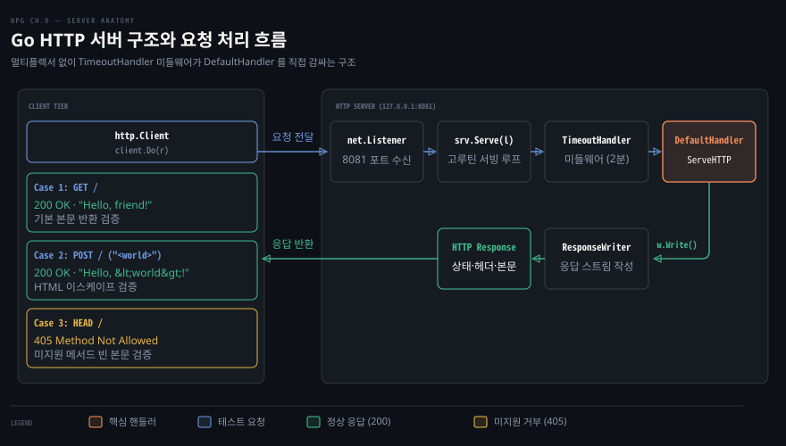
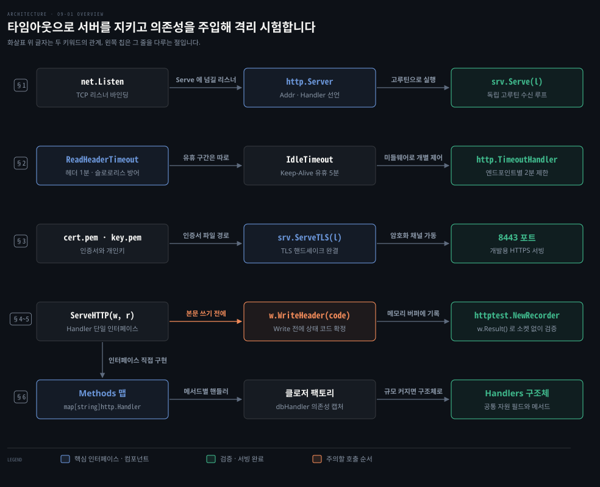
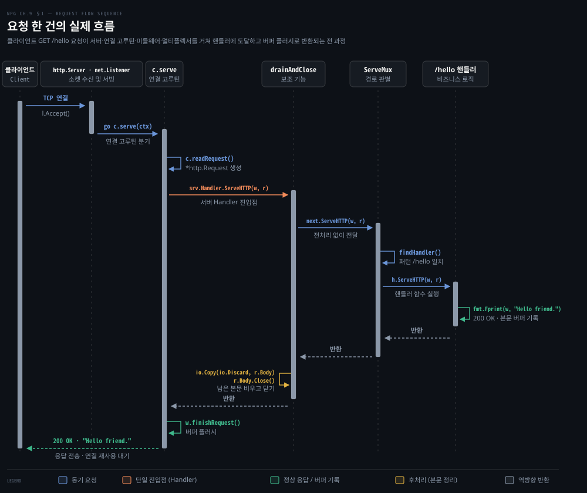
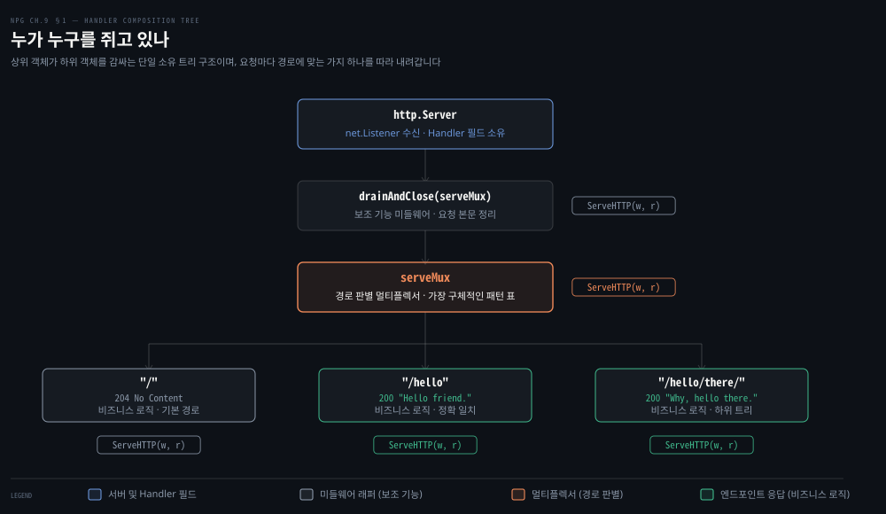
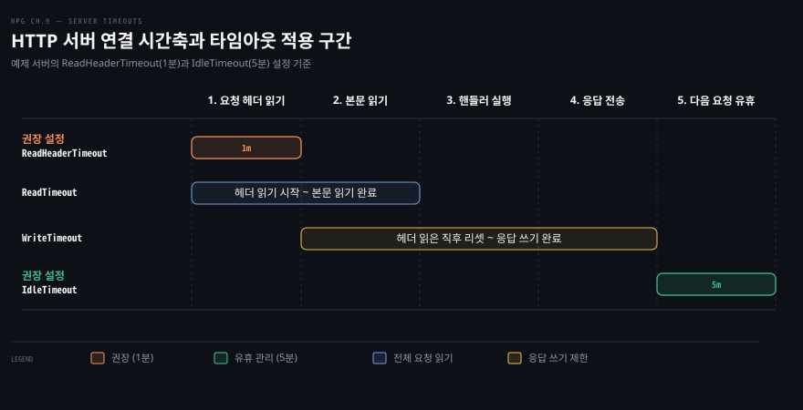

# Go HTTP 서버는 타임아웃을 정하고 핸들러에 의존성을 주입하며 httptest 로 시험한다

---

> Go 표준 라이브러리의 `net/http` 는 리스너와 라우터, 미들웨어와 핸들러를 간결한 인터페이스로 조립하고 소켓 연결 없이도 `net/http/httptest` 로 격리 검증할 수 있는 서버 기반을 제공합니다.

## 핵심 요약

> Go HTTP 서버의 안정성은 느린 클라이언트에 휘둘리지 않도록 헤더와 유휴 타임아웃을 엄격히 묶고 핸들러 동작을 가벼운 어댑터와 의존성 주입으로 독립시키는 설계에서 비롯됩니다.

서버는 `http.Server` 구조체로 리스너 주소와 타임아웃을 선언한 뒤 `srv.Serve(listener)` 로 다중 연결을 받습니다. 수신된 요청은 멀티플렉서와 미들웨어를 거쳐 최종 목적지인 핸들러에 전달됩니다. 멀티플렉서 또한 내부적으로 `http.Handler` 인터페이스를 만족하므로 계층적인 라우팅 조합이 가능합니다.

클라이언트가 전송 속도를 지연시켜 서버 자원을 고갈시키지 못하도록 `ReadHeaderTimeout` 과 `IdleTimeout` 을 명시적으로 지정해야 합니다. 핸들러 구현에서는 `ResponseWriter` 의 상태 코드를 본문 쓰기 전에 먼저 기록해야 하며 클로저나 구조체 필드를 활용해 로거와 데이터베이스 같은 외부 자원을 주입합니다. 이러한 핸들러 로직은 실제 TCP 포트를 점유하지 않고도 `httptest.NewRequest` 와 `httptest.NewRecorder` 로 빠르게 단위 시험할 수 있습니다.




## 학습 목표

> 이 편을 읽고 나면 아래 다섯 가지를 스스로 해낼 수 있습니다.

1. `http.Server` 와 멀티플렉서, 미들웨어, 핸들러 사이의 요청 전달 구조와 인터페이스 관계를 설명할 수 있습니다.
2. `ReadHeaderTimeout`, `ReadTimeout`, `WriteTimeout`, `IdleTimeout` 이 감시하는 소켓 생애주기 구간을 구분하고 선별 적용할 수 있습니다.
3. `ServeTLS` 메서드와 인증서·개인키 파일을 결합해 HTTPS 서비스를 구성할 수 있습니다.
4. `httptest` 패키지를 사용해 운영체제 네트워크 소켓 없이 핸들러 입출력과 상태 코드를 단위 검증할 수 있습니다.
5. 핸들러에 필요한 외부 의존성을 클로저와 구조체 메서드 패턴으로 주입하고 상황에 맞춰 선택할 수 있습니다.

아래는 이 편의 키워드를 이은 개념도입니다. §1 줄은 `net.Listen` 리스너에서 `srv.Serve` 로 요청을 수신하는 흐름입니다. §2 줄은 `ReadHeaderTimeout` 과 `IdleTimeout` 으로 소켓을 지키는 설정입니다. §3 줄은 인증서와 키를 받아 `srv.ServeTLS` 로 8443 포트를 여는 과정입니다. §4~5 줄은 `ServeHTTP` 에서 `WriteHeader` 를 먼저 적고 `httptest` 로 검증하는 규약입니다. §6 줄은 `Methods` 맵과 클로저·구조체로 의존성을 주입하는 확장 패턴입니다.




## 1. 요청은 서버·멀티플렉서·미들웨어를 지나 핸들러에 닿는다

> 클라이언트 요청은 `net.Listener` 소켓으로 수신되어 `http.Server` 를 거친 뒤, 경로를 판별하는 멀티플렉서와 보조 기능을 수행하는 미들웨어를 통과해 비즈니스 로직을 담은 핸들러에 도달합니다.

### 서버·멀티플렉서·미들웨어·핸들러의 네 단계 여정

요청 하나를 처리하려면 연결을 받아 경로에 맞는 코드를 고르고, 로깅·인증 같은 공통 작업을 거쳐 응답을 써야 합니다. 이 일을 함수 하나에 몰면 경로가 늘 때마다 그 함수가 커지고 공통 작업은 경로마다 복사됩니다. Go 는 이 일을 네 구성 요소에 나눠 맡깁니다. 가장 바깥에서는 `http.Server` 가 운영체제 TCP 리스너 소켓을 쥐고 클라이언트 연결을 수락합니다. 연결이 수립되면 서버는 HTTP 요청 헤더와 본문을 파싱해 `*http.Request` 객체를 구성합니다.

이 요청 객체는 **멀티플렉서(multiplexer, 줄여서 mux, 라우터)**로 넘어갑니다. 멀티플렉서는 요청 URL 경로와 HTTP 메서드를 확인해 어떤 객체가 이 요청을 처리할지 행선지를 결정합니다. 목적지 핸들러에 도달하기 직전, 요청은 하나 이상의 미들웨어(middleware) 함수를 통과할 수 있습니다. **미들웨어**는 로깅, 인증, 타임아웃 제한처럼 여러 핸들러가 공유하는 횡단 관심사를 덧붙입니다.

멀티플렉서라는 이름은 전자·통신 장치에서 왔습니다. 이 장치는 여러 신호가 한 선로를 나눠 쓰게 하거나 여러 입력 가운데 하나를 골라 출력에 잇습니다. Go 의 멀티플렉서는 들어온 요청마다 등록된 핸들러 가운데 하나를 골라 보내므로 뒤쪽 뜻에 가깝습니다. [공식 문서](https://pkg.go.dev/net/http#ServeMux)도 첫 단락에서 `ServeMux` 를 "HTTP request multiplexer" 라고 부르고, 등록된 패턴 가운데 요청 URL 과 가장 가깝게 맞는 패턴의 핸들러를 부른다고 설명합니다.

서버는 연결마다 고루틴을 띄워 `Handler` 필드 하나만 호출하며, 그 안쪽 처리 순서는 핸들러를 감싼 중첩 모양이 결정합니다. 아래 흐름은 [09-02 미들웨어와 ServeMux](./09-02.미들웨어는%20핸들러를%20감싸고%20ServeMux%20는%20경로를%20나누며%20HTTP2%20서버%20푸시는%20브라우저가%20걷어냈다.md) 의 예제(Listing 9-15)를 바탕으로 `drainAndClose` 미들웨어가 감싼 `ServeMux` 에 `GET /hello` 요청이 도달해 응답하는 과정을 나타냅니다. `drainAndClose` 는 핸들러가 끝난 뒤 남은 요청 본문을 버리고 닫는 미들웨어입니다.



### 멀티플렉서도 Handler 인터페이스를 만족하는 핸들러입니다

요청을 분기하는 멀티플렉서도, 요청 흐름을 감싸는 미들웨어도 `http.Handler` 인터페이스 하나를 구현합니다.

```go
type Handler interface {
	ServeHTTP(http.ResponseWriter, *http.Request)
}
```

`*http.Request` 는 이 절 첫 문단에서 서버가 만든 그 요청 객체입니다. `http.ResponseWriter` 는 핸들러가 응답을 써 넣는 인터페이스입니다. 핸들러는 요청을 읽고 `ResponseWriter` 에 상태 코드와 헤더와 본문을 씁니다. 쓰는 순서의 규칙은 §5 에서 봅니다.

멀티플렉서 자신이 `ServeHTTP` 메서드를 갖추고 있으므로, `http.Server` 의 `Handler` 필드에는 단일 핸들러뿐만 아니라 복잡한 라우터 객체도 그대로 대입할 수 있습니다. 멀티플렉서의 구체적인 등록 규칙과 표준 라우터의 특징은 [LGO 13-04 §2](../../../01_language/book/lgo_learning-go/13-04.net-http%20는%20타임아웃을%20직접%20정하고%20미들웨어는%20Handler%20를%20감싸며%20slog%20로%20구조화%20로그를%20남깁니다.md#2-서버--httpserver-와-handler-servemux) 에서 다룹니다.

서버 구동 시점에 한 번 조립되는 핸들러 계층은 상위 객체가 하위 객체를 감싸 쥐는 단일 소유 트리 구조를 이룹니다. 앞서 살펴본 요청 흐름은 요청마다 이 트리에서 경로에 맞는 가지 하나를 따라 내려가며 실행됩니다.



### 단위 테스트로 서버 기동부터 검증과 종료까지 완결하기

네 단계 구성 요소가 실제로 어떻게 맞물려 구동되는지는 테스트 코드로 확인하는 편이 가장 분명합니다.

이어지는 두 코드는 시험 함수 하나의 앞뒤 부분입니다. 시험 함수는 `_test.go` 파일에 `TestXxx(t *testing.T)` 꼴로 씁니다. `t` 는 시험 상태를 쥔 `*testing.T` 입니다. `t.Fatal` 은 실패를 기록하고 시험을 바로 끝냅니다. `t.Error` 는 실패를 기록하되 시험을 이어 갑니다. 아래 코드는 서버 생성과 리스너 바인딩, 그리고 비동기 서빙 루프를 구성합니다.

```go
// 서버 인스턴스 생성 및 타임아웃 선언
srv := &http.Server{
	Addr: "127.0.0.1:8081",
	Handler: http.TimeoutHandler(
		handlers.DefaultHandler(), 2*time.Minute, ""),
	IdleTimeout:       5 * time.Minute,
	ReadHeaderTimeout: time.Minute,
}

// 지정 주소로 TCP 리스너 바인딩
l, err := net.Listen("tcp", srv.Addr)
if err != nil {
	t.Fatal(err)
}

// 독립 고루틴에서 요청 수신 루프 실행
go func() {
	err := srv.Serve(l)
	if err != http.ErrServerClosed {
		t.Error(err)
	}
}()
```

`http.TimeoutHandler(h, dt, msg)` 는 핸들러 `h` 를 감쌉니다. `dt` 안에 끝나지 않으면 `503 Service Unavailable` 과 `msg` 를 응답합니다. `msg` 가 빈 문자열이면 기본 문구를 보냅니다. `handlers.DefaultHandler()` 는 핸들러를 돌려주는 함수이고 §4 에서 정의합니다. `IdleTimeout` 과 `ReadHeaderTimeout` 의 뜻은 §2 에서 봅니다.

이 구현은 몇 가지 핵심적인 초기화 원칙을 보여줍니다. 첫째, `http.Server` 구조체 리터럴로 리스너 주소와 핸들러, 타임아웃을 한 번에 정의했습니다. 이 예제의 실제 구성에는 별도의 멀티플렉서(`ServeMux`)를 두지 않고 미들웨어인 `http.TimeoutHandler` 가 기본 핸들러 `handlers.DefaultHandler()` 를 직접 감싸 2분 제한을 부여합니다.

둘째, 리스너 바인딩과 요청 서빙을 분리했습니다. `srv.ListenAndServe()` 대신 `net.Listen` 으로 리스너 `l` 을 먼저 확보한 뒤 `srv.Serve(l)` 에 전달했습니다. 리스너를 먼저 만들면 포트가 이미 쓰이고 있을 때 고루틴을 띄우기 전에 `t.Fatal` 로 멈출 수 있습니다. 클라이언트가 첫 요청을 보낼 때는 포트가 이미 열려 있으므로, 서버가 아직 듣기 전에 요청이 가는 경합도 없습니다.

이 예제는 원서 Listing 9-1 그대로 고정 포트 8081 을 쓰고, 요청 주소도 `srv.Addr` 로 만듭니다. 주소를 `127.0.0.1:0` 으로 주면 운영체제가 빈 포트를 고릅니다. 이때 `srv.Addr` 는 `:0` 으로 남으므로 요청 주소는 `l.Addr().String()` 으로 읽어야 합니다.

셋째, `srv.Serve(l)` 는 클라이언트 연결을 대기하는 블로킹 호출이므로 별도 고루틴으로 띄웠습니다. 서버가 정상 종료될 때 반환하는 `http.ErrServerClosed` 오류는 실패가 아니므로 패닉 없이 안전하게 통과시킵니다.

구동된 서버를 검증하기 위해 클라이언트는 테이블 주도 테스트(table-driven test) 방식으로 요청을 전송합니다.

테이블 주도 테스트는 입력과 기대 결과를 구조체 슬라이스에 한 줄씩 적고 반복문 하나로 돌립니다. 케이스를 늘리려면 줄 하나만 더하면 됩니다. 구조체의 `code` 는 기대 상태 코드이고 `response` 는 기대 본문입니다.

`http.MethodGet` 과 `http.StatusOK` 는 각각 `"GET"` 과 200 을 담은 상수입니다. `bytes.NewBufferString` 은 문자열을 `io.Reader` 로 감쌉니다. `http.Client{}` 는 설정을 하나도 바꾸지 않은 클라이언트입니다. 반복문은 요청을 만들어 `client.Do` 로 보냅니다. 오류가 나면 `continue` 가 다음 케이스로 건너뜁니다.

`_ =` 는 반환값을 일부러 받지 않는다는 표시입니다. `t.Errorf` 의 `%q` 는 문자열을 큰따옴표로 감싸 찍습니다.

```go
testCases := []struct {
	method   string
	body     io.Reader
	code     int
	response string
}{
	// 단순 GET 요청 검증
	{http.MethodGet, nil, http.StatusOK, "Hello, friend!"},
	// 특수문자 포함 POST 요청의 HTML 이스케이프 검증
	{http.MethodPost, bytes.NewBufferString("<world>"), http.StatusOK, "Hello, &lt;world&gt;!"},
	// 미지원 HEAD 메서드에 대한 405 상태 코드 검증
	{http.MethodHead, nil, http.StatusMethodNotAllowed, ""},
}

client := http.Client{}
path := fmt.Sprintf("http://%s/", srv.Addr)

for i, c := range testCases {
	r, err := http.NewRequest(c.method, path, c.body)
	if err != nil {
		t.Errorf("%d: %v", i, err)
		continue
	}

	resp, err := client.Do(r)
	if err != nil {
		t.Errorf("%d: %v", i, err)
		continue
	}

	if resp.StatusCode != c.code {
		t.Errorf("%d: 예상 상태 코드 %d, 수신 코드 %d", i, c.code, resp.StatusCode)
	}

	b, err := io.ReadAll(resp.Body)
	if err != nil {
		t.Errorf("%d: %v", i, err)
		continue
	}
	_ = resp.Body.Close()

	if c.response != string(b) {
		t.Errorf("%d: 예상 본문 %q, 수신 본문 %q", i, c.response, b)
	}
}

// 테스트 완료 후 서버 소켓 즉시 종료
if err := srv.Close(); err != nil {
	t.Fatal(err)
}
```

두 번째 줄인 `POST` 케이스는 본문에 `<world>` 를 담아 보냅니다. 서버는 사용자 입력을 그대로 돌려주지 않고 HTML 특수문자를 이스케이프해 `Hello, &lt;world&gt;!` 로 응답합니다. XSS(Cross-Site Scripting) 를 막기 위한 처리입니다. XSS 는 사용자가 넣은 문자열이 페이지에 그대로 실려 브라우저에서 스크립트로 실행되는 공격입니다.

세 번째 줄인 `HEAD` 케이스는 본문 없이 `HEAD` 메서드를 보냅니다. 해당 핸들러가 이를 처리하도록 구현되지 않았으므로 서버는 `405 Method Not Allowed` 상태 코드와 빈 본문을 반환합니다.

모든 시험이 끝나면 `srv.Close()` 를 호출합니다. 리스너 소켓이 닫히며 백그라운드 고루틴의 `srv.Serve(l)` 호출이 `http.ErrServerClosed` 를 반환하고 종료됩니다. 클라이언트 측에서 응답 검증 직후 `resp.Body.Close()` 를 호출한 습관은 [08-02 Go HTTP 클라이언트](./08-02.Go%20HTTP%20클라이언트는%20응답%20본문을%20닫아야%20연결을%20재사용하고%20context%20로%20요청을%20끊는다.md) 에서 다룬 기본 연결 재사용 원칙과 일치합니다.


## 2. 느린 클라이언트가 서버 자원을 붙잡지 못하게 타임아웃을 정한다

> 클라이언트가 요청 송신과 응답 수신 속도를 일방적으로 늦추면 서버의 소켓과 고루틴이 고갈되므로, `http.Server` 의 시간 감시 필드로 연결 수명을 직접 통제해야 합니다.

### 클라이언트에게 시간을 맡기면 서버 소켓이 묶입니다

HTTP 통신에서 클라이언트는 언제나 선의로만 행동하지 않습니다. 모바일 네트워크가 불안정하면 바이트가 몇 초 간격으로 끊겨 들어옵니다. 공격자가 요청 헤더를 조금씩 끊어 보내며 연결을 붙잡아 두는 **슬로로리스(Slowloris) 공격**도 있습니다.

서버가 클라이언트의 속도에 무제한으로 맞춰 주면, 완전한 요청을 수신할 때까지 연결 소켓과 고루틴, 수신 버퍼 메모리가 반납되지 못하고 잠깁니다. 응답을 보낼 때도 마찬가지입니다. 클라이언트가 TCP 윈도우 크기를 극단적으로 좁히거나 데이터를 읽어 가지 않으면 서버는 TCP 소켓 송신 버퍼에 묶인 채 대기하게 됩니다. 수신 창이 보내는 쪽의 속도를 묶는 원리는 [03-01 §3](./03-01.TCP%20세션은%20핸드셰이크로%20열고%20창으로%20속도를%20맞추고%20FIN·RST%20로%20끝난다.md#3-수신-버퍼와-창-크기가-보내는-쪽의-속도를-묶는다)에 있습니다. 따라서 서버 관리자는 연결 생애주기의 각 단계마다 명확한 마감 시한을 그어 두어야 합니다.

### 네 가지 타임아웃 필드가 감시하는 소켓 생애주기 구간

Go 표준 라이브러리의 `http.Server` 는 연결 생애주기를 나누어 감시할 수 있도록 네 가지 주요 타임아웃 필드를 제공합니다. 공식 패키지 문서(`go doc net/http.Server`)에 명시된 각 필드의 정확한 감시 구간은 아래와 같습니다.

네 필드는 모두 소켓의 데드라인으로 구현됩니다. 데드라인은 그 시각이 지나면 읽기나 쓰기가 기다리지 않고 오류를 돌려주게 하는 절대 시각입니다. 오류를 받은 서버가 연결을 닫습니다. 메서드별 동작은 [03-03 §4](./03-03.타임아웃은%20Dialer·context%20로,%20유휴%20감지는%20데드라인과%20하트비트로%20건다.md#4-데드라인은-아무-일도-없는-연결을-끊는다)에서 다룹니다.



1. **`ReadHeaderTimeout`**: 요청 헤더를 모두 읽는 데 허용되는 최대 시간입니다. 새 연결에서는 바로 재기 시작합니다. Keep-Alive 연결에서는 다음 요청의 첫 바이트가 도착한 뒤부터 잽니다([server.go#L2135-L2146](https://github.com/golang/go/blob/go1.25.1/src/net/http/server.go#L2135-L2146)). 헤더를 다 읽으면 읽기 데드라인이 다시 정해지고, 본문을 얼마나 느리게 받아도 되는지는 핸들러가 판단합니다.
2. **`ReadTimeout`**: 헤더와 본문(body)을 합쳐 요청 전체를 읽는 데 허용되는 시간입니다. 값이 0 이하이면 이 타임아웃은 작동하지 않습니다.
3. **`WriteTimeout`**: 응답 쓰기를 마칠 때까지 허용되는 최대 시간입니다. 새 요청의 헤더를 다 읽은 직후 다시 걸리므로, 본문 읽기와 핸들러 실행과 응답 쓰기를 모두 이 시간 안에 끝내야 합니다.
4. **`IdleTimeout`**: Keep-Alive 연결에서 응답을 보낸 뒤 다음 요청을 기다리는 최대 시간입니다. 이 값이 0 이면 `ReadTimeout` 값을 대신 씁니다.

TLS 연결에서는 핸드셰이크에 데드라인이 따로 걸립니다. 그 값은 `ReadHeaderTimeout`·`ReadTimeout`·`WriteTimeout` 가운데 0 보다 큰 가장 작은 값입니다. 이 데드라인은 읽기와 쓰기 양쪽에 걸립니다([server.go#L944-L964](https://github.com/golang/go/blob/go1.25.1/src/net/http/server.go#L944-L964), [#L1960-L1966](https://github.com/golang/go/blob/go1.25.1/src/net/http/server.go#L1960-L1966)). 핸드셰이크가 끝나면 위 네 필드가 평문 연결과 같은 방식으로 적용됩니다.

### 일괄 타임아웃 대신 ReadHeaderTimeout 과 미들웨어를 조합하는 이유

`http.Server` 구조체 수준에서 `ReadTimeout` 과 `WriteTimeout` 을 설정하면 운영체제 TCP 소켓의 `SetReadDeadline` 과 `SetWriteDeadline` 호출로 직결됩니다. 이는 해당 서버가 수신하는 모든 엔드포인트에 획일적인 제한 시간을 강제함을 뜻합니다.

한 서버에는 성격이 다른 엔드포인트가 섞여 있을 수 있어서 이런 일괄 제한이 맞지 않습니다. 수백 메가바이트 파일을 받는 `/upload` 가 있을 수 있습니다. 서버 센트 이벤트(SSE, Server-Sent Events)처럼 응답을 오래 흘려보내는 엔드포인트도 있을 수 있습니다. 소켓에 30초짜리 `ReadTimeout` 이나 `WriteTimeout` 이 걸려 있으면 정상적인 대용량 업로드나 스트리밍 연결도 중간에 끊깁니다.

그래서 §1 의 예제도 `http.Server` 에는 두 값만 겁니다. 슬로로리스를 막는 `ReadHeaderTimeout`(1분)과 유휴 소켓을 정리하는 `IdleTimeout`(5분)입니다. 본문을 읽는 시간과 응답을 쓰는 시간은 엔드포인트마다 따로 정합니다. `http.TimeoutHandler` 같은 미들웨어나 핸들러 안의 `context.WithTimeout` 이 그 일을 맡습니다.

`context.WithTimeout` 은 정해 둔 시간이 지나면 스스로 취소되는 context 를 만듭니다. 이 context 를 요청에 거는 방법은 [08-02 §3](./08-02.Go%20HTTP%20클라이언트는%20응답%20본문을%20닫아야%20연결을%20재사용하고%20context%20로%20요청을%20끊는다.md#httpnewrequestwithcontext-와-contextdeadlineexceeded)에서 봅니다.


## 3. TLS 는 인증서와 키를 주고 ServeTLS 로 켠다

> 평문 HTTP 통신에 암호화와 상호 인증을 입히려면 X.509 공개키 인증서와 개인키 파일을 준비한 뒤, `srv.ServeTLS` 메서드로 TLS 리스너를 가동합니다.

### 포트 8443 과 ServeTLS 호출로 암호화 채널 열기

기본 HTTP 트래픽은 암호화되지 않은 평문으로 오갑니다. 네트워크 도청이나 위변조를 막으려면 TLS 암호화 계층 위에서 동작하는 HTTPS 로 전환해야 합니다. Go 표준 `http.Server` 는 TLS 가 켜진 환경에서 자동으로 HTTP/2 프로토콜 협상(ALPN)까지 지원합니다.

ALPN 은 TLS 핸드셰이크 중에 클라이언트와 서버가 쓸 응용 프로토콜(`h2` 또는 `http/1.1`)을 정하는 확장입니다. 협상 결과가 코드에 드러나지 않는 이유는 [08-01 HTTP/2 협상](./08-01.HTTP%20는%20URL%20로%20자원을%20가리키고%20메서드로%20요청하며%20상태%20코드로%20답한다.md#http2-와-go-표준-라이브러리의-협상)에서 봤습니다.

일반 서버 코드에서 HTTPS 를 활성화하는 작업은 포트 번호 변경과 메서드 교체 두 줄로 끝납니다.

```go
srv := &http.Server{
	// 관례에 따라 HTTPS 개발 포트 8443 지정
	Addr: "127.0.0.1:8443",
	// mux 자리에는 §1 의 TimeoutHandler 같은 단일 핸들러나 http.NewServeMux() 로 만든 멀티플렉서가 들어갑니다
	Handler: mux,
	IdleTimeout: 5 * time.Minute,
	ReadHeaderTimeout: time.Minute,
}

l, err := net.Listen("tcp", srv.Addr)
if err != nil {
	t.Fatal(err)
}

go func() {
	// 인증서와 개인키 경로를 넘겨 TLS 서빙 가동
	err := srv.ServeTLS(l, "cert.pem", "key.pem")
	if err != http.ErrServerClosed {
		t.Error(err)
	}
}()
```

표준 HTTPS 포트는 443 이며 로컬 개발 환경에서는 루트 권한 없이 바인딩할 수 있는 8443 포트를 쓰는 것이 오랜 관례입니다. 코드에서 바뀌는 것은 `srv.Serve(l)` 대신 `srv.ServeTLS(l, certFile, keyFile)` 을 부르는 한 줄입니다. 서버는 받은 TCP 연결마다 이 인증서와 키로 TLS 핸드셰이크를 먼저 마치고, 암호화된 스트림을 HTTP 처리부에 넘깁니다. TLS 핸드셰이크 세부 원리와 암호 스위트 구성은 11장에서 깊이 다룹니다.

### 개발용 자체 서명 인증서와 mkcert·generate_cert.go 도구

`ServeTLS` 를 실행하려면 서버의 도메인 이름이 적힌 X.509 인증서(`cert.pem`)와 그 짝인 개인키(`key.pem`)가 파일로 있어야 합니다. X.509 는 ITU-T 가 정한 공개키 인증서 형식이고, 인터넷에서 쓰는 모양은 [RFC 5280](https://www.rfc-editor.org/rfc/rfc5280)이 정합니다.

`cert.pem` 에는 서버의 공개키, 인증서가 쓰일 도메인과 IP 주소, 발급자인 인증기관(CA, Certificate Authority)의 서명이 들어 있습니다. 이 파일은 핸드셰이크 때 클라이언트에게 그대로 보내는 파일입니다. `key.pem` 은 그 공개키와 짝인 개인키이며 서버 밖으로 나가지 않습니다.

TLS 1.3 에서 서버는 CertificateVerify 메시지를 보냅니다. 핸드셰이크 내용에 개인키로 서명한 메시지라서, 인증서 속 공개키의 주인이 자신임을 증명합니다([RFC 8446 §4.4.3](https://www.rfc-editor.org/rfc/rfc8446#section-4.4.3)). 실제 통신을 암호화하는 세션 키는 개인키로 복호화하지 않고 ECDHE 키 교환으로 따로 만듭니다. 공개키로 암호화하고 개인키로 복호화하던 모델은 TLS 1.2 의 정적 RSA 키 교환 방식이었으며 TLS 1.3 에서는 빠졌습니다([RFC 8446 §1.2](https://www.rfc-editor.org/rfc/rfc8446#section-1.2)).

ECDHE 는 양쪽이 일회용 키 쌍을 만들어 공개값만 주고받고 같은 비밀값을 각자 계산하는 키 교환입니다. 비밀값 자체는 선로에 오가지 않습니다.

인증서 속 CA 서명과 핸드셰이크의 서버 서명이 각각 무엇을 보증하는지, 세션 키가 어디서 오는지는 [인증서와 두 서명](../paw_packet-analysis-wireshark/04-02.%EC%9D%B8%EC%A6%9D%EC%84%9C%EC%99%80%20%EB%91%90%20%EC%84%9C%EB%AA%85.md)에서 자세히 다룹니다. 키 쌍의 두 용도와 CA 사슬은 [TLS로 컴포넌트 안전하게 연결하기 — 키·인증서·CA의 역할](../../../08_cloud/book/container-security/11-01.TLS%EB%A1%9C%20%EC%BB%B4%ED%8F%AC%EB%84%8C%ED%8A%B8%20%EC%95%88%EC%A0%84%ED%95%98%EA%B2%8C%20%EC%97%B0%EA%B2%B0%ED%95%98%EA%B8%B0%20%E2%80%94%20%ED%82%A4%C2%B7%EC%9D%B8%EC%A6%9D%EC%84%9C%C2%B7CA%EC%9D%98%20%EC%97%AD%ED%95%A0.md)도 함께 봅니다.

로컬 개발 환경에서는 공인 CA 의 서명을 받기 어렵습니다. 그래서 내 컴퓨터에만 신뢰 루트를 만들어 주는 오픈소스 도구 `mkcert` 를 많이 씁니다. 외부 도구 없이 Go 배포본에 든 유틸리티를 쓸 수도 있습니다. `$(go env GOROOT)/src/crypto/tls/generate_cert.go` 를 실행하면 개발용 자체 서명(self-signed) 인증서 쌍이 만들어집니다.

```bash
go run $(go env GOROOT)/src/crypto/tls/generate_cert.go --host 127.0.0.1
```

자체 서명 인증서는 CA 가 아니라 서버 자신의 키로 서명한 인증서입니다. 클라이언트가 따로 신뢰하도록 설정하지 않으면 검증에 실패합니다. 이 스크립트는 실행한 디렉터리에 `cert.pem` 과 `key.pem` 을 만들고 같은 이름의 파일이 있으면 덮어씁니다. `--host` 는 인증서에 넣을 호스트 이름과 IP 를 받습니다.

상용 서비스에서는 렛츠인크립트(Let's Encrypt) 같은 무료 공인 CA 를 씁니다. Go 에서는 `golang.org/x/crypto/acme/autocert` 패키지로 인증서 발급과 갱신을 자동화할 수 있습니다.


## 4. 핸들러는 ServeHTTP 하나이고 httptest 로 서버 없이 시험한다

> `http.Handler` 인터페이스는 `ServeHTTP` 메서드 단 하나로 정의되며 단위 시험 시에는 실제 포트를 열지 않고 `net/http/httptest` 패키지로 메모리 내에서 직접 호출합니다.

### ServeHTTP 메서드 하나와 HandlerFunc 어댑터

Go 에서 클라이언트 요청을 읽고 응답을 작성하는 모든 주체는 `http.Handler` 인터페이스 규약을 따릅니다.

매번 새 구조체를 선언하고 메서드를 붙이기가 번거로울 때를 위해 표준 라이브러리는 `http.HandlerFunc` 함수 타입을 제공합니다. 시그니처가 `func(http.ResponseWriter, *http.Request)` 인 일반 함수는 메서드가 없어서 그대로는 `http.Handler` 가 아닙니다. `http.HandlerFunc(fn)` 으로 타입을 바꾸면 `HandlerFunc` 의 `ServeHTTP` 메서드를 얻어 핸들러로 동작합니다.

Go 는 패키지 안에서 정의한 이름 붙은 타입이면 함수 타입에도 메서드를 붙일 수 있습니다. 표준 라이브러리([공식 문서](https://pkg.go.dev/net/http#HandlerFunc))의 실제 정의는 다음과 같습니다.

```go
// 함수 시그니처에 이름을 붙인 타입
type HandlerFunc func(ResponseWriter, *Request)

// 그 타입에 메서드를 붙여, 호출되면 자기 자신(함수)을 실행한다
func (f HandlerFunc) ServeHTTP(w ResponseWriter, r *Request) {
	f(w, r)
}
```

`func (f HandlerFunc) ServeHTTP` 의 `(f HandlerFunc)` 는 수신자(receiver)입니다. 수신자가 있으면 그 함수는 `HandlerFunc` 의 메서드가 됩니다. 몸체에서 `f` 는 `HandlerFunc` 값 자신, 곧 담겨 있는 함수를 가리킵니다.

### 요청 본문 비우기와 html/template 을 통한 XSS 방어

표준적인 핸들러 구현에는 연결 자원 관리와 보안을 위한 두 가지 필수 처리가 들어갑니다. 아래는 기본 핸들러 구현입니다.

코드 맨 위의 `var t` 는 패키지 변수에 담은 템플릿이고, 시험 함수의 `t` 와는 이름만 같습니다. 템플릿의 `{{.}}` 는 `t.Execute(w, 값)` 으로 넘긴 값이 들어가는 자리입니다. `template.Must` 는 `Parse` 가 오류를 내면 패닉을 일으킵니다.

```go
package handlers

import (
	"html/template"
	"io"
	"net/http"
)

var t = template.Must(template.New("hello").Parse("Hello, {{.}}!"))

func DefaultHandler() http.Handler {
	return http.HandlerFunc(
		func(w http.ResponseWriter, r *http.Request) {
			// 요청 종료 시 잔여 본문을 모두 읽어 비우고 닫기
			defer func(r io.ReadCloser) {
				_, _ = io.Copy(io.Discard, r)
				_ = r.Close()
			}(r.Body)

			// GET 메서드 처리
			if r.Method == http.MethodGet {
				_, _ = w.Write([]byte("Hello, friend!"))
				return
			}

			// POST 메서드 처리: 본문 전체 수신 후 템플릿 렌더링
			if r.Method == http.MethodPost {
				// 요청 본문을 끝까지 읽어 인사말에 사용
				b, err := io.ReadAll(r.Body)
				if err != nil {
					http.Error(w, "Internal server error", http.StatusInternalServerError)
					return
				}
				_ = t.Execute(w, string(b))
				return
			}

			// 그 외 메서드는 405 응답
			http.Error(w, "Method not allowed", http.StatusMethodNotAllowed)
		},
	)
}
```

`defer` 는 둘러싼 함수가 끝날 때 뒤로 미룬 함수를 실행합니다. 지연 함수의 매개변수 `r` 은 요청이 아니라 넘겨받은 `r.Body` 이고, 그 값은 `defer` 를 쓴 시점에 정해집니다. 지연 함수는 `io.Copy(io.Discard, r)` 로 남은 본문을 읽어 버린 뒤 닫습니다. `_, _ =` 는 앞서 본 `_ =` 처럼 바이트 수와 오류를 둘 다 버린다는 표시입니다.

`http.Error(w, msg, code)` 는 상태 코드 `code` 를 쓰고 본문에 `msg` 를 씁니다.

이 코드에서 주의 깊게 보아야 할 첫 번째 대목은 요청 본문 정리입니다. `http.Server` 는 핸들러가 끝나면 요청 본문을 닫아 주고, 읽지 않고 남은 본문도 256KiB 에 못 미치면 대신 읽어 버립니다(go1.25.1 기준). 그 이상 남으면 그 연결을 재사용하지 않습니다. 그래서 `io.Copy(io.Discard, r.Body)` 로 끝까지 읽어 두면 남은 양과 상관없이 HTTP Keep-Alive 세션을 재사용할 수 있습니다. 자세한 동작은 [08-02 §5 JSON 인코딩과 POST 요청 흐름](./08-02.Go%20HTTP%20클라이언트는%20응답%20본문을%20닫아야%20연결을%20재사용하고%20context%20로%20요청을%20끊는다.md#json-인코딩과-post-요청-흐름)에서 다룹니다.

두 번째 대목은 사용자 입력의 이스케이프입니다. POST 요청으로 들어온 본문을 응답에 그대로 이어 붙이면 §1 에서 본 XSS 통로가 열립니다. `html/template` 패키지는 템플릿 변수 치환 시 따옴표와 꺾쇠괄호(`<`, `>`)를 HTML 엔티티로 자동 변환하므로 브라우저가 스크립트로 오독하지 않도록 막아 줍니다.

### httptest 로 TCP 소켓 없이 핸들러 입출력 검증하기

핸들러의 단위 시험을 작성할 때마다 매번 `net.Listen` 으로 포트를 열고 HTTP 클라이언트로 네트워크 패킷을 쏘는 것은 비효율적입니다. 포트 충돌 위험이 있고 테스트 실행 시간도 늘어납니다.

Go 표준 `net/http/httptest` 패키지는 네트워크 소켓 없이 핸들러 함수를 메모리에서 직접 구동할 수 있는 두 가지 핵심 도구를 제공합니다.

- **`httptest.NewRequest`**: 메서드와 대상 URI, 본문 리더를 받아 테스트용 `*http.Request` 객체를 만듭니다. 일반 `http.NewRequest` 와 달리 오류 발생 시 에러를 반환하지 않고 즉시 패닉을 일으키므로, 테스트 코드의 에러 검사 보일러플레이트를 줄여 줍니다.
- **`httptest.NewRecorder`**: `http.ResponseWriter` 인터페이스를 구현한 `*httptest.ResponseRecorder` 객체를 생성합니다. 핸들러가 기록한 헤더와 상태 코드, 본문 바이트를 메모리 버퍼에 담아 둡니다.

```go
func TestDefaultHandlerWithHTTPTest(t *testing.T) {
	// 테스트용 가상 요청과 응답 기록기 생성
	r := httptest.NewRequest(http.MethodGet, "http://test/", nil)
	w := httptest.NewRecorder()

	// 소켓 없이 핸들러를 직접 함수로 호출
	handler := DefaultHandler()
	handler.ServeHTTP(w, r)

	// 결과 응답 객체 획득 및 검증
	resp := w.Result()
	defer resp.Body.Close()

	if resp.StatusCode != http.StatusOK {
		t.Fatalf("예상 상태 코드 200, 수신 코드 %d", resp.StatusCode)
	}

	body, err := io.ReadAll(resp.Body)
	if err != nil {
		t.Fatal(err)
	}

	if string(body) != "Hello, friend!" {
		t.Errorf("예상 본문 %q, 수신 본문 %q", "Hello, friend!", body)
	}
}
```

응답 기록기의 필드를 직접 꺼내 보는 대신 `w.Result()` 를 부릅니다. 공식 문서도 헤더는 `HeaderMap` 필드 대신 `Result()` 가 돌려준 응답에서 읽으라고 적습니다([recorder.go#L33-L35](https://github.com/golang/go/blob/go1.25.1/src/net/http/httptest/recorder.go#L33-L35)). `w.Result()` 는 핸들러가 끝난 시점의 응답을 `*http.Response` 로 돌려줍니다. 그래서 실제 클라이언트로 받은 응답과 같은 코드로 상태 코드·헤더·본문을 검사할 수 있습니다.


## 5. 상태 코드는 본문보다 먼저 써야 한다

> `http.ResponseWriter` 에 본문 데이터를 먼저 쓰면 그 순간 상태 코드가 `200 OK` 로 확정되므로, 다른 상태 코드는 반드시 첫 `Write` 호출 전에 지정해야 합니다.

### Write 가 암묵적으로 200 OK 를 먼저 보냅니다

HTTP 응답 스트림의 유선(wire) 규격은 반드시 상태 코드와 헤더가 먼저 전송되고 그 뒤에 본문 바이트가 이어지는 구조입니다. Go 의 `http.ResponseWriter` 는 본문 작성 메서드 `Write` 가 호출되는 순간, 아직 상태 코드를 정하지 않았다면 `200 OK` 로 확정합니다. 헤더와 본문은 곧바로 소켓으로 나가지 않고 2KB 버퍼에 먼저 쌓였다가, 버퍼가 차거나 핸들러가 끝날 때 함께 나갑니다([공식 문서](https://pkg.go.dev/net/http#ResponseWriter)).

상태 코드를 본문 뒤에 적었을 때 어떤 오류가 벌어지는지 아래 시험 코드로 확인할 수 있습니다.

```go
func TestHandlerWriteHeaderPitfall(t *testing.T) {
	// 잘못된 순서: 본문을 먼저 쓰고 뒤에 상태 코드를 기록함
	handlerBad := func(w http.ResponseWriter, r *http.Request) {
		_, _ = w.Write([]byte("Bad request"))
		// 무시됨
		w.WriteHeader(http.StatusBadRequest)
	}

	r := httptest.NewRequest(http.MethodGet, "http://test", nil)
	w := httptest.NewRecorder()
	handlerBad(w, r)
	// "200 OK" 출력
	t.Logf("잘못된 핸들러 결과 상태: %q", w.Result().Status)

	// 올바른 순서: 상태 코드를 먼저 쓰고 본문을 기록함
	handlerGood := func(w http.ResponseWriter, r *http.Request) {
		w.WriteHeader(http.StatusBadRequest)
		_, _ = w.Write([]byte("Bad request"))
	}

	r = httptest.NewRequest(http.MethodGet, "http://test", nil)
	w = httptest.NewRecorder()
	handlerGood(w, r)
	// "400 Bad Request" 출력
	t.Logf("올바른 핸들러 결과 상태: %q", w.Result().Status)
}
```

`t.Logf` 는 시험이 통과해도 `go test -v` 로 돌리면 출력이 보입니다. `w.Result().Status` 는 `200 OK` 처럼 숫자와 문구를 이은 문자열입니다. 앞서 본 `%q` 는 이 문자열을 큰따옴표로 감싸 찍습니다.

`handlerBad` 처럼 `w.Write` 를 먼저 부르고 뒤이어 `w.WriteHeader(400)` 을 호출하면, 응답 상태는 400 이 아니라 `200 OK` 가 됩니다. 실제 서버 환경에서는 표준 에러 로그에 `http: superfluous response.WriteHeader call` 경고가 찍힙니다. 바이트가 아직 버퍼에 있더라도 첫 `Write` 에서 상태가 이미 200 으로 확정됐기 때문입니다. 응답 하나에 2xx~5xx 상태 줄은 하나만 쓸 수 있습니다.

### Header·WriteHeader·Write 의 엄격한 호출 순서

이러한 특성 때문에 `ResponseWriter` 의 세 메서드는 호출 순서의 엄격한 인과율을 따릅니다.

1. **`Header()`**: 커스텀 응답 헤더나 `Content-Type` 을 조작하려면 가장 먼저 호출해야 합니다.
2. **`WriteHeader(code)`**: HTTP 상태 코드가 200 이 아닌 경우(404, 500, 400 등), 본문 쓰기 전에 명시적으로 호출합니다. 상태 코드가 200 이라면 호출을 생략해도 무방합니다.
3. **`Write([]byte)`**: 마지막으로 본문 데이터를 스트림에 작성합니다.

한 번 `WriteHeader` 나 `Write` 가 실행되어 상태 코드가 확정되면, 이후의 상태 코드 수정 시도는 조용히 무시되거나 에러 로그만 남깁니다. 에러 핸들링 분기에서는 에러 메시지 본문을 작성하기 전에 반드시 `http.Error(w, msg, code)` 함수나 `w.WriteHeader(code)` 를 먼저 실행해야 의도한 실패 코드가 전달됩니다.


## 6. 어떤 타입이든 ServeHTTP 를 가지면 핸들러가 되고 의존성은 클로저나 구조체로 넣는다

> `ServeHTTP` 메서드 규약만 충족하면 맵이나 사용자 정의 타입도 독립 핸들러가 될 수 있으며 핸들러가 필요로 하는 외부 자원은 팩토리 클로저나 구조체 수신자로 주입합니다.

### Methods 맵 타입으로 구현하는 메서드 라우팅과 OPTIONS 응답

§4 의 `DefaultHandler` 는 함수 하나 안에서 `if r.Method == ...` 로 메서드를 갈랐습니다. 메서드가 늘면 분기도 늘어납니다. 지원하지 않는 메서드에 `Allow` 헤더를 붙이고 `OPTIONS` 에 답하려면 그 코드도 핸들러마다 다시 짜야 합니다.

핸들러가 꼭 함수일 필요는 없다는 점을 쓰면 이 일을 한 타입에 모을 수 있습니다. HTTP 메서드 문자열을 키로, 자식 `http.Handler` 를 값으로 가지는 맵 타입 `Methods` 가 그 예입니다.

```go
package handlers

import (
	"fmt"
	"html"
	"io"
	"net/http"
	"sort"
	"strings"
)

// HTTP 메서드별 핸들러를 보관하는 커스텀 맵 타입 정의
type Methods map[string]http.Handler

// 맵 타입 자체가 http.Handler 인터페이스를 구현함
func (h Methods) ServeHTTP(w http.ResponseWriter, r *http.Request) {
	defer func(r io.ReadCloser) {
		_, _ = io.Copy(io.Discard, r)
		_ = r.Close()
	}(r.Body)

	// 등록된 메서드 핸들러가 있으면 위임
	if handler, ok := h[r.Method]; ok {
		if handler == nil {
			http.Error(w, "Internal server error", http.StatusInternalServerError)
		} else {
			handler.ServeHTTP(w, r)
		}
		return
	}

	// 미지원 메서드 시 Allow 헤더 추가 및 OPTIONS 처리
	w.Header().Add("Allow", h.allowedMethods())
	if r.Method != http.MethodOptions {
		http.Error(w, "Method not allowed", http.StatusMethodNotAllowed)
	}
}

func (h Methods) allowedMethods() string {
	a := make([]string, 0, len(h))
	for k := range h {
		a = append(a, k)
	}
	sort.Strings(a)
	return strings.Join(a, ", ")
}
```

`type Methods map[string]http.Handler` 는 맵에 `Methods` 라는 이름을 붙인 타입입니다. `func (h Methods) ServeHTTP` 의 `(h Methods)` 는 앞서 본 수신자입니다. 몸체에서 `h` 는 맵 자신을 가리킵니다.

`handler, ok := h[r.Method]` 는 키가 맵에 있는지를 `ok` 로 함께 돌려줍니다. 값이 `nil` 이면 키만 있고 핸들러는 비어 있으므로 500 으로 답합니다. `allowedMethods` 가 `sort.Strings` 를 부르는 것은 맵을 도는 순서를 언어가 정하지 않아서입니다.

이 `Methods` 타입은 두 가지 일을 스스로 처리합니다. 첫째, 맵 탐색을 통해 들어온 요청 메서드에 맞는 자식 핸들러를 찾아 `handler.ServeHTTP(w, r)` 로 처리를 위임합니다.

둘째, 맵에 없는 메서드가 들어왔을 때 HTTP RFC 표준에 부합하도록 허용된 메서드 목록을 정렬해 `Allow` 헤더에 심어 줍니다. 만약 클라이언트가 보낸 요청이 `OPTIONS` 라면 405 에러 대신 빈 본문과 200 상태 코드로 허용 메서드만 알려주고 정상 종료합니다. 다른 메서드라면 `405 Method Not Allowed` 를 내보냅니다.

```go
// 메서드별 핸들러만 등록하면 OPTIONS 와 405 처리는 Methods 가 맡음
func DefaultMethodsHandler() http.Handler {
	return Methods{
		http.MethodGet: http.HandlerFunc(
			func(w http.ResponseWriter, r *http.Request) {
				_, _ = w.Write([]byte("Hello, friend!"))
			},
		),
		http.MethodPost: http.HandlerFunc(
			func(w http.ResponseWriter, r *http.Request) {
				b, err := io.ReadAll(r.Body)
				if err != nil {
					http.Error(w, "Internal server error", http.StatusInternalServerError)
					return
				}
				// 사용자 입력을 그대로 출력하지 않고 HTML 이스케이프
				_, _ = fmt.Fprintf(w, "Hello, %s!", html.EscapeString(string(b)))
			},
		),
	}
}
```

`fmt.Fprintf(w, ...)` 는 `ResponseWriter` 에 서식을 채운 문자열을 씁니다. `html.EscapeString` 은 §4 의 `html/template` 처럼 `<` 와 `>` 같은 문자를 엔티티로 바꿉니다.

`DefaultMethodsHandler` 는 `GET` 과 `POST` 핸들러만 등록한 `Methods` 인스턴스를 반환합니다. `OPTIONS` 와 미지원 메서드 거부 로직은 `Methods.ServeHTTP` 가 도맡아 처리하므로 개별 핸들러는 자신의 비즈니스 로직에만 전념할 수 있습니다.

Go 1.22 이전에는 `ServeMux` 가 HTTP 메서드 분기를 지원하지 않아 위와 같은 맵 기반 디스패처가 긴요했습니다. Go 1.22 부터는 표준 `http.ServeMux` 패턴에 `"GET /path"` 처럼 메서드를 직접 적을 수 있으며 일치하지 않는 메서드에 대한 405 응답과 `Allow` 헤더도 자동 생성됩니다. 표준 멀티플렉서의 발전된 패턴 문법은 [09-02 미들웨어와 ServeMux](./09-02.미들웨어는%20핸들러를%20감싸고%20ServeMux%20는%20경로를%20나누며%20HTTP2%20서버%20푸시는%20브라우저가%20걷어냈다.md) 및 [LGO 13-04 §2](../../../01_language/book/lgo_learning-go/13-04.net-http%20는%20타임아웃을%20직접%20정하고%20미들웨어는%20Handler%20를%20감싸며%20slog%20로%20구조화%20로그를%20남깁니다.md#2-서버--httpserver-와-handler-servemux) 에서 이어집니다.

### 클로저를 활용한 가벼운 의존성 주입

핸들러가 로거, 캐시, 데이터베이스 연결 풀 같은 외부 자원에 접근해야 할 때 전역 변수를 쓰면 동시성 경합과 테스트 격리 실패를 부릅니다. 가장 가벼운 해결책은 클로저(closure)를 반환하는 팩토리 함수입니다.

```go
// 외부 의존성을 매개변수로 받아 핸들러를 반환하는 클로저 팩토리
dbHandler := func(db *sql.DB) http.Handler {
	return http.HandlerFunc(
		func(w http.ResponseWriter, r *http.Request) {
			err := db.Ping()
			if err != nil {
				http.Error(w, "Database unavailable", http.StatusServiceUnavailable)
				return
			}
			_, _ = w.Write([]byte("Database connected"))
		},
	)
}

// 생성 시점에 의존성을 캡처해 전역 http.DefaultServeMux 에 등록
http.Handle("/health", dbHandler(db))
```

`db` 는 다른 곳에서 `sql.Open` 으로 연 `*sql.DB` 라고 가정합니다. `*sql.DB` 는 `database/sql` 패키지의 연결 풀이고 `db.Ping()` 은 데이터베이스와 연결이 살아 있는지 확인합니다. `http.StatusServiceUnavailable` 은 503 입니다. `http.Handle(패턴, 핸들러)` 는 패키지 전역 mux 인 `http.DefaultServeMux` 에 핸들러를 등록합니다.

`dbHandler` 함수는 `*sql.DB` 인스턴스를 인자로 받아 내부 익명 함수로 닫아둡니다(close over). 반환된 핸들러는 고루틴 스코프 안에서 캡처된 `db` 변수를 자유롭게 참조합니다. 주입할 의존성이 한두 개로 적고 핸들러가 독립적일 때 빠르고 직관적인 방식입니다.

### 구조체 필드와 메서드로 엮는 확장 가능한 의존성 주입

서비스가 커지면 여러 핸들러가 같은 데이터베이스, 로거, 메트릭 클라이언트를 공유합니다. 클로저 방식은 팩토리마다 같은 매개변수를 되풀이해 받아야 해서 번잡해집니다. 이때는 공통 의존성을 구조체 필드로 선언하고 핸들러들을 구조체의 메서드로 정의하는 구조체 수신자 패턴이 적합합니다.

```go
// 핸들러들이 공유할 외부 자원을 구조체 필드로 묶음
type Handlers struct {
	db  *sql.DB
	log *log.Logger
}

// 첫 번째 엔드포인트 핸들러 메서드
func (h *Handlers) HealthCheck() http.Handler {
	return http.HandlerFunc(
		func(w http.ResponseWriter, r *http.Request) {
			err := h.db.Ping()
			if err != nil {
				h.log.Printf("데이터베이스 연결 실패: %v", err)
				http.Error(w, "Service Unavailable", http.StatusServiceUnavailable)
				return
			}
			_, _ = w.Write([]byte("OK"))
		},
	)
}

// 두 번째 엔드포인트 핸들러 메서드
func (h *Handlers) UserProfile() http.Handler {
	return http.HandlerFunc(
		func(w http.ResponseWriter, r *http.Request) {
			// h.db 와 h.log 를 동일하게 활용한 비즈니스 로직 수행
		},
	)
}
```

`HealthCheck` 와 `UserProfile` 은 같은 수신자 `h` 를 거쳐 같은 필드 `h.db`·`h.log` 를 씁니다. 두 필드가 포인터라서 두 메서드가 보는 DB 풀과 로거는 하나입니다. `UserProfile` 은 몸체가 주석뿐인 자리표시 메서드입니다. 이 메서드를 더할 때 구조체도 다른 메서드의 시그니처도 바뀌지 않았습니다. 두 필드 이름이 소문자로 시작하므로 아래 생성부도 같은 패키지 안에 있어야 합니다. 메서드 본문에서 `log` 는 패키지가 아니라 필드 `h.log` 로 쓰입니다.

이 패턴의 사용부는 구조체 생성과 DefaultServeMux 등록으로 깔끔하게 정리됩니다.

실제 서버에서는 전역 mux 대신 `http.NewServeMux()` 로 만든 자기 mux 에 등록하는 편이 낫습니다([LGO 13-04 §2](../../../01_language/book/lgo_learning-go/13-04.net-http%20는%20타임아웃을%20직접%20정하고%20미들웨어는%20Handler%20를%20감싸며%20slog%20로%20구조화%20로그를%20남깁니다.md#defaultservemux-를-피하고-servemux-를-중첩합니다)).

```go
// 의존성을 구조체 생성 시점에 단 한 번 주입
h := &Handlers{
	db:  db,
	log: log.New(os.Stderr, "handlers: ", log.Lshortfile),
}

// 구조체 메서드를 전역 http.DefaultServeMux 에 매핑
http.Handle("/health", h.HealthCheck())
http.Handle("/profile", h.UserProfile())
```

`log.New(os.Stderr, "handlers: ", log.Lshortfile)` 는 표준 오류로 쓰는 로거를 만듭니다. 로그 줄마다 `handlers: ` 접두사와 `파일명:줄번호` 가 붙습니다.

분산 추적용 Tracer 같은 공통 의존성이 새로 생겨도 핸들러 메서드의 시그니처는 그대로입니다. `Handlers` 구조체에 필드를 하나 더하고 생성부만 고치면 됩니다. 테스트 시에도 모의(mock) 객체가 담긴 `Handlers` 인스턴스를 통째로 만들어 여러 메서드를 일관되게 검증할 수 있습니다.


## 면접 대비

> 아래 질문에 답하면서 Go HTTP 서버의 아키텍처와 타임아웃 방어 전략, 그리고 핸들러 격리 시험 기법을 점검해 보세요.

1. `http.Server` 의 `ReadTimeout` 과 `ReadHeaderTimeout` 은 어떻게 다르며 대용량 파일 업로드나 스트리밍 환경에서 `ReadHeaderTimeout` 을 선별 적용하는 이유는 무엇인가요?
2. `http.ResponseWriter` 에서 `Write` 호출 후 `WriteHeader` 를 호출했을 때 발생하는 현상과 그 설계적 배경을 설명해 주세요.
3. `http.Handler` 인터페이스와 `http.HandlerFunc` 타입의 관계는 무엇이며 일반 함수가 핸들러로 동작할 수 있는 원리는 무엇인가요?
4. `net/http/httptest` 패키지의 `ResponseRecorder` 와 `w.Result()` 를 사용할 때 실제 네트워크 소켓 바인딩 시험 대비 어떤 이점이 있나요?


## 정답 (자답 후 펼치기)

> 위 §면접 대비의 질문에 먼저 스스로 답한 뒤 읽으세요.

### 정답 1 — 타임아웃 감시 구간의 차이와 엔드포인트별 유연성 확보

`ReadHeaderTimeout` 은 요청 헤더를 읽는 구간만 감시하며 헤더 수신이 끝나면 소켓의 읽기 마감 시간을 초기화합니다. 반면 `ReadTimeout` 은 헤더와 요청 본문 전체를 읽는 시간을 하나의 마감 시한으로 묶습니다.

`ReadTimeout` 을 서버 수준에 낮게 잡으면 수백 메가바이트의 대용량 파일을 전송하는 정상 요청이나 실시간 스트리밍 연결이 도중에 끊어집니다. 따라서 서버 수준에는 슬로로리스를 막는 `ReadHeaderTimeout` 과 유휴 연결을 정리하는 `IdleTimeout` 만 겁니다. 본문 읽기와 응답 처리는 엔드포인트별 미들웨어나 컨텍스트 타임아웃에 맡기는 설계가 안전합니다.

### 정답 2 — 암묵적 200 OK 전송과 HTTP 유선 규약

`http.ResponseWriter` 의 `Write` 메서드가 호출되면 내부 버퍼에 본문이 기록되기 전에 상태 코드가 이미 확정되었는지 확인합니다. 아직 지정되지 않았다면 `net/http` 는 상태 코드를 `200 OK` 로 확정합니다. 헤더는 버퍼에 남아 있을 수 있지만 상태는 더 바꿀 수 없습니다.

그 이후에 호출된 `WriteHeader` 는 상태가 이미 확정된 뒤이므로 효력이 없으며 표준 에러 로그에 불필요한 호출 경고(`superfluous response.WriteHeader call`)를 남깁니다. HTTP 프로토콜은 본문보다 헤더가 먼저 전달되어야 하므로, 200 이외의 상태 코드를 보낼 때는 반드시 첫 번째 `Write` 호출 전에 `WriteHeader` 를 실행해야 합니다.

### 정답 3 — 인터페이스 단일 메서드 수렴과 어댑터 패턴

`http.Handler` 는 `ServeHTTP(ResponseWriter, *Request)` 메서드 하나만을 요구하는 인터페이스입니다. `http.HandlerFunc` 는 동일한 시그니처를 가진 함수 타입으로 정의되어 있으며 자기 자신 타입에 대해 `ServeHTTP` 메서드를 구현하고 있습니다.

따라서 임의의 함수 `fn` 을 `http.HandlerFunc(fn)` 으로 타입 변환하면, `ServeHTTP` 가 호출될 때 내부에서 원래의 `fn(w, r)` 을 실행하게 됩니다. 이 어댑터 패턴 덕분에 Go 에서는 별도의 구조체 선언 없이도 일반 함수나 클로저를 즉시 `http.Handler` 를 요구하는 모든 API 에 전달할 수 있습니다.

### 정답 4 — 포트 경합 회피와 메모리 기반 고속 격리 시험

실제 TCP 포트를 열어 테스트하면 운영체제 소켓 바인딩 지연이 발생하고 병렬 테스트 실행 시 포트 충돌 위험이 생기며 방화벽이나 네트워크 환경의 영향을 받습니다.

`httptest.ResponseRecorder` 는 `http.ResponseWriter` 인터페이스를 메모리 버퍼로 구현하므로 소켓 바인딩 없이 핸들러의 `ServeHTTP` 메서드를 직접 실행할 수 있습니다. 시험 완료 후 `w.Result()` 를 호출하면 핸들러가 기록한 최종 상태 코드와 헤더, 본문을 표준 `*http.Response` 객체 형태로 반환받아 실서버 통신 결과와 동일한 방식으로 빠르고 격리된 검증을 수행할 수 있습니다.


## 참고 자료

- 《Network Programming with Go》 Adam Woodbeck, 2021. ISBN 978-1-7185-0088-4. Chapter 9 Building HTTP Services (Listing 9-1~9-10).
- [Go 표준 패키지 net/http 문서](https://pkg.go.dev/net/http): `Server`, `Handler`, `HandlerFunc`, `ResponseWriter` 공식 명세.
- [Go 표준 패키지 net/http/httptest 문서](https://pkg.go.dev/net/http/httptest): `NewRequest`, `NewRecorder`, `ResponseRecorder` 명세.


## 관련 문서

- [08-02 Go HTTP 클라이언트는 응답 본문을 닫아야 연결을 재사용하고 context 로 요청을 끊는다](./08-02.Go%20HTTP%20클라이언트는%20응답%20본문을%20닫아야%20연결을%20재사용하고%20context%20로%20요청을%20끊는다.md): 클라이언트의 본문 드레인과 리소스 반납 원리를 다룹니다.
- [09-02 미들웨어는 핸들러를 감싸고 ServeMux 는 경로를 나누며 HTTP/2 서버 푸시는 브라우저가 걷어냈다](./09-02.미들웨어는%20핸들러를%20감싸고%20ServeMux%20는%20경로를%20나누며%20HTTP2%20서버%20푸시는%20브라우저가%20걷어냈다.md): 체이닝 미들웨어와 ServeMux 패턴을 상세히 이어갑니다.
- [LGO 13-04 net/http 는 타임아웃을 직접 정하고 미들웨어는 Handler 를 감싸며 slog 로 구조화 로그를 남깁니다](../../../01_language/book/lgo_learning-go/13-04.net-http%20는%20타임아웃을%20직접%20정하고%20미들웨어는%20Handler%20를%20감싸며%20slog%20로%20구조화%20로그를%20남깁니다.md): 언어 관점의 HTTP 서버 기본기와 ResponseController 패턴을 다룹니다.
- [이 책의 정독 인덱스](./README.md): 전체 챕터 구성과 네트워크 프로그래밍 학습 진행 상황.
