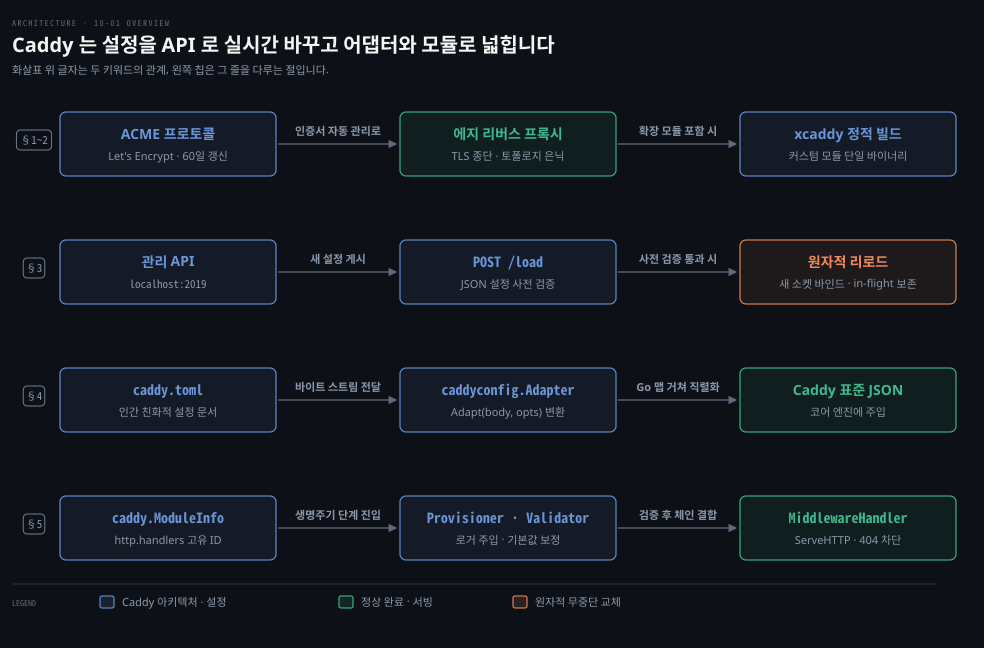
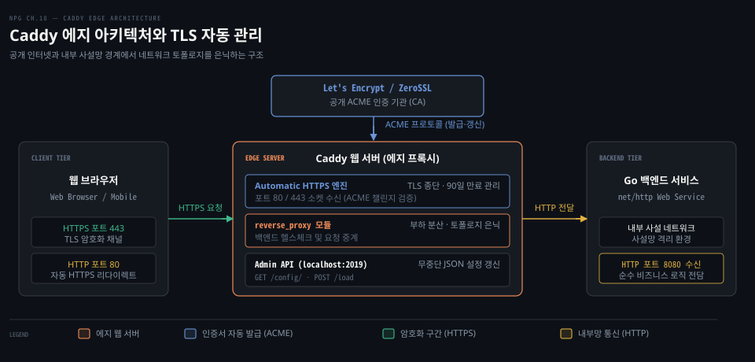
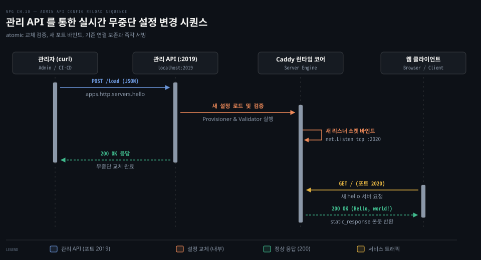
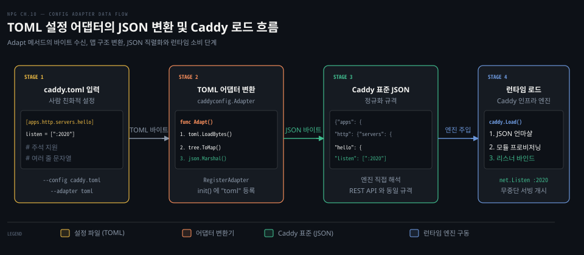
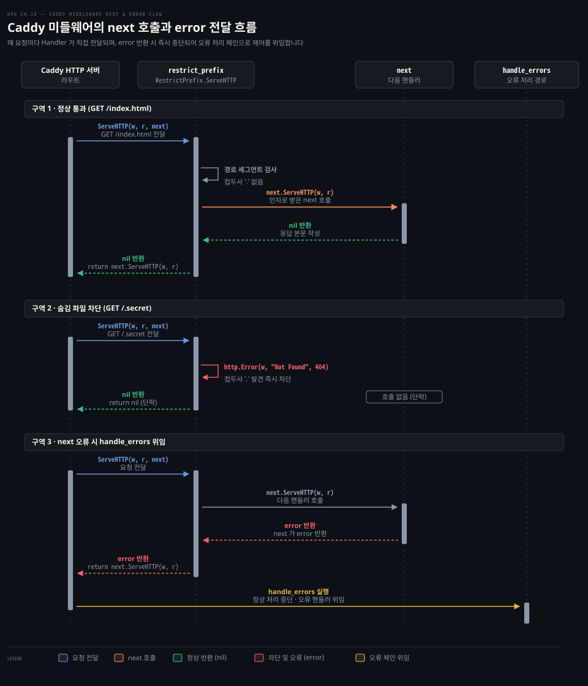
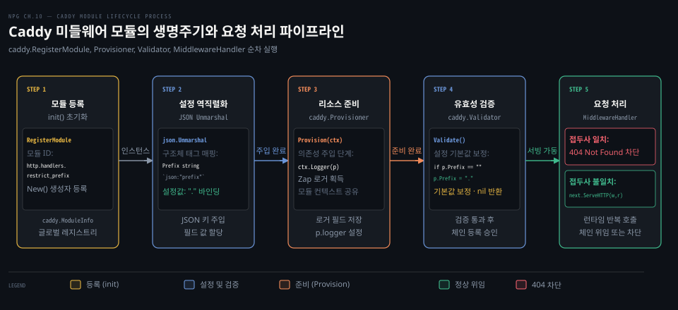

# Caddy 는 JSON 설정을 관리 API 로 실시간 바꾸고 모듈과 어댑터로 넓힌다

---

> Caddy 는 에지에서 TLS 종단과 자동 인증서 관리를 전담하는 현대적 웹 서버이며 REST 관리 API 로 런타임 중단 없이 설정을 원자적으로 교체하고 어댑터와 모듈 인터페이스로 기능을 확장합니다.

## 핵심 요약

> 이 편이 매달린 하나의 생각은, Go 표준 라이브러리로 웹 서버를 직접 구축할 수 있더라도 인증서 갱신과 에지 인프라 관리는 Caddy 에 위임하고 비즈니스 로직에 집중하는 편이 안전하다는 점입니다.

Caddy 는 공개 도메인을 감지해 Let's Encrypt 등 공개 CA 와 ACME 로 통신하며, 90일 인증서를 발급 후 약 60일째에 자동 갱신합니다. 에지 프록시로서 백엔드 토폴로지를 은닉하고 부하를 분산합니다.

런타임 설정은 2019 포트 관리 API 로 받은 JSON 을 사전 검증한 뒤 새 리스너를 열고 기존 인플라이트 요청을 보존하며 원자적으로 교체합니다. 설정 어댑터는 인간 친화적인 TOML 문서를 JSON 으로 변환합니다. Caddy 모듈은 프로비저닝과 검증을 거쳐 `caddyhttp.MiddlewareHandler` 체인에 통합됩니다.


## 학습 목표

> 이 편을 읽고 나면 아래 다섯 가지를 스스로 해낼 수 있습니다.

1. Go 표준 라이브러리 서버 앞단에 Caddy 에지 프록시를 배치하여 TLS 자동 관리와 인프라 책임을 격리하는 이유를 설명할 수 있습니다.
2. `xcaddy` 빌드 도구의 필요성을 이해하고 커스텀 모듈을 포함한 Caddy 바이너리를 정적 컴파일할 수 있습니다.
3. Caddy 관리 API 엔드포인트에 JSON 설정을 전달하여 프로세스 재시작 없이 무중단으로 소켓 리스너를 교체할 수 있습니다.
4. `caddyconfig.Adapter` 인터페이스를 구현하여 TOML 설정 문서를 Caddy 네이티브 JSON 바이트로 변환하고 등록할 수 있습니다.
5. `caddy.Module`, `Provisioner`, `Validator`, `caddyhttp.MiddlewareHandler` 인터페이스를 구현하여 경로 접두사를 차단하는 Caddy 미들웨어 모듈을 작성할 수 있습니다.

아래는 이 편의 키워드를 이은 개념도입니다. 



- §1~2 줄은 ACME 로 인증서를 자동 갱신하는 에지 리버스 프록시와 커스텀 모듈을 단일 바이너리로 묶는 xcaddy 정적 빌드의 흐름입니다. 
- §3 줄은 관리 API 엔드포인트에 JSON 설정을 전달하여 사전 검증을 거친 뒤 리스너를 원자적으로 교체하는 과정입니다. 
- §4 줄은 인간 친화적인 TOML 문서를 Caddy 표준 JSON 바이트로 변환하는 설정 어댑터 파이프라인입니다. 
- §5 줄은 고유 ID 로 등록된 모듈이 의존성 주입과 유효성 검증을 거쳐 HTTP 요청 체인에서 접두사를 가로채는 미들웨어 동작입니다.


## 1. 에지 프록시와 자동 TLS

> Caddy 는 인증서와 설정을 대신 맡는 웹 서버입니다. 클라이언트와 백엔드 서비스 사이 에지 경계에서 TLS 종단과 ACME 자동 인증서 관리를 도맡습니다.

### 에지와 TLS 종단 책임

**에지(edge)**는 외부 클라이언트의 연결을 가장 먼저 받는 내부망 바깥 경계의 서버 자리입니다. **TLS 종단(TLS termination)**은 클라이언트와 맺은 TLS 연결이 그 서버에서 끝나는 것입니다. 그 서버가 인증서와 개인키로 핸드셰이크하고 암호를 풉니다.

Go `net/http` 로 웹 서버를 짓는 방법은 [09-01 Go HTTP 서버](./09-01.Go%20HTTP%20서버는%20타임아웃을%20정하고%20핸들러에%20의존성을%20주입하며%20httptest%20로%20시험한다.md) 에서 다루었습니다. 하지만 로깅, 지표 수집, 접근 제어, 캐싱, 압축, HTTPS 를 앱마다 처음부터 구현하면 많은 시간과 운영 위험이 듭니다.

### ACME 프로토콜과 인증서 자동 갱신

인증서 유효기간과 공개 CA 는 [컨테이너 보안 11-01 TLS 로 컴포넌트 안전하게 연결하기](../../../08_cloud/book/container-security/11-01.TLS로%20컴포넌트%20안전하게%20연결하기%20—%20키·인증서·CA의%20역할.md) 에서 다루었습니다. 수동 갱신에서 만료일을 놓치면 브라우저 경고가 떠 서비스 장애로 이어집니다.

Caddy 는 **ACME** (Automated Certificate Management Environment) 를 코어 엔진에 내장해 이 문제를 풉니다. 도메인이 주어지면 인증서를 요청하고 도메인 제어권을 검증한 뒤 설치합니다. 남은 수명이 3분의 1 아래로 내려가면 자동 갱신하므로 관리자가 만료일을 추적할 필요가 없습니다. 90일 인증서라면 발급 후 약 60일째, 만료 약 30일 전입니다(certmagic `DefaultRenewalWindowRatio = 1.0 / 3.0`).

[기본 ACME 발급자](https://caddyserver.com/docs/automatic-https#issuers)는 **Let's Encrypt** 입니다. 

- v2.8.0 부터는 설정에 이메일 주소가 있을 때만 ZeroSSL 을 둘째 발급자로 덧붙입니다(`caddytls.DefaultIssuers`). 
- ZeroSSL 의 ACME 는 EAB(External Account Binding)를 요구하고 Caddy 가 이 자격 증명을 이메일로 받아 오기 때문입니다.
- EAB 는 CA 계정과 ACME 계정을 묶는 자격 증명입니다. 발급자가 둘 이상이면 앞 발급자가 실패할 때 다음 발급자로 넘어갑니다.

로컬 호스트(`localhost`)나 내부 IP 주소 환경에서는 자체 내부 CA(Internal CA)를 자동으로 구동하여 로컬 신뢰 저장소에 루트 인증서를 주입합니다.



### 에지 리버스 프록시와 터널의 차이

Caddy 는 에지에서 HTTPS 를 받아 TLS 를 종단한 뒤 사설망 Go 백엔드로 요청을 넘기는 **역방향 중계(Reverse Proxy)** 를 맡습니다. 이 구조 덕분에 내부 토폴로지가 외부에 노출되지 않고 백엔드 인스턴스를 늘려도 클라이언트 중단 없이 부하를 분산합니다.

TLS 종단은 클라이언트가 연 TLS 연결이 프록시에서 끝나는 방식입니다. Caddy 가 TLS 서버로서 인증서와 개인키로 핸드셰이크하고 암호를 풉니다. 개인키 소유 증명인 서버 서명은 [04-02 인증서와 두 서명](../paw_packet-analysis-wireshark/04-02.%EC%9D%B8%EC%A6%9D%EC%84%9C%EC%99%80%20%EB%91%90%20%EC%84%9C%EB%AA%85.md) 에서 다루었습니다. 백엔드로는 Caddy 가 새 연결을 따로 엽니다. 그래서 연결이 둘이고 서로 독립입니다. 앞 연결은 TLS 이고 뒤 연결은 평문 HTTP 이거나 새 TLS 입니다. 평문 요청을 읽은 Caddy 는 [경로·헤더 매처](https://caddyserver.com/docs/caddyfile/matchers)로 요청을 가릅니다.

터널은 프록시가 클라이언트 쪽 연결과 백엔드 쪽 연결을 이어 붙여 바이트를 그대로 옮기는 방식입니다. TLS 핸드셰이크는 클라이언트와 백엔드가 직접 하고 프록시는 TLS 당사자가 아닙니다. 암호화된 연결 하나가 프록시를 뚫고 지나가므로 프록시는 경로·헤더로 라우팅하거나 헤더를 덧붙일 수 없습니다. [RFC 9110 §3.7](https://www.rfc-editor.org/rfc/rfc9110#section-3.7) 은 터널을 "a blind relay" 로 정의하며 [§9.3.6](https://www.rfc-editor.org/rfc/rfc9110#section-9.3.6) 은 CONNECT 터널이 닫힐 때까지 양방향 데이터만 넘긴다고 씁니다.

둘의 갈림길은 TLS 연결이 어디서 끝나는가 하나입니다. 이 하나가 인증서를 누가 갖는지와 프록시가 평문을 읽는지를 정합니다. 종단은 봉투를 열어 읽고 새 봉투에 담아 보내는 중계이고 터널은 봉투째 넘기는 중계입니다.

| | TLS 종단 | 터널 |
|---|---|---|
| 암호가 풀리는 곳 | 에지(Caddy) | 백엔드 |
| 인증서·개인키 | Caddy 가 가짐 | 백엔드가 가짐 |
| 프록시가 보는 것 | 평문 요청의 경로·헤더 | 암호화된 바이트 |
| 백엔드가 받는 것 | 사설망의 평문 HTTP | 클라이언트의 TLS 연결 |

[Caddy 공식 문서](https://caddyserver.com/docs/caddyfile/directives/reverse_proxy) 는 평문 HTTP 로 넘기는 구성을 "terminating TLS in caddy and proxying via HTTP" 로 부릅니다.

에지 종단을 고르는 이유는 인증서 관리를 한 곳에 모으기 때문입니다. 인증서는 에지에서 ACME 로 갱신하고 백엔드는 TLS 를 몰라도 됩니다. 대가는 사설 구간이 평문이라는 점이므로 믿을 수 없는 망이면 업스트림 주소를 `https://` 로 써서 [`tls` 를 켠 `http` 전송](https://caddyserver.com/docs/caddyfile/directives/reverse_proxy#upstream-addresses)으로 암호화합니다.


## 2. Caddy 바이너리와 빌드

> Caddy 는 사전 컴파일된 바이너리로 즉시 실행할 수 있으며 커스텀 모듈을 주입할 때는 런타임 동적 로딩 대신 정적 소스 빌드를 거칩니다.

### 사전 빌드 바이너리와 정적 링크

Caddy 는 공식 사이트, Docker, APT, Copr 로 사전 빌드된 정적 바이너리를 배포합니다.

동적 로딩은 실행 중인 프로그램이 공유 라이브러리(`.so`)로 기능을 더하는 방식입니다. Go 에서는 `go build -buildmode=plugin` 바이너리를 `plugin` 패키지로 엽니다(`go doc plugin`). 반면 정적 링크는 필요한 코드를 빌드 때 실행 파일 하나에 넣습니다.

[Go plugin 패키지 문서](https://pkg.go.dev/plugin#hdr-Warnings) 는 프로그램과 플러그인을 다른 툴체인 버전이나 빌드 설정으로 컴파일하면 런타임 충돌이 나기 쉽다고 경고합니다.

> "Runtime crashes are likely to occur unless all parts of the program (the application and all its plugins) are compiled using exactly the same version of the toolchain, the same build tags, and the same values of certain flags"

[Caddy 아키텍처 문서](https://caddyserver.com/docs/architecture) 역시 단일 정적 바이너리 원칙을 따릅니다. Caddy 는 이런 충돌을 막으려고 `.so` 로딩 대신 모든 확장을 단일 바이너리에 정적으로 링크합니다. 공식 권장 빌드 도구는 [`xcaddy`](https://caddyserver.com/docs/build#xcaddy) 입니다. `go install` 로 설치하고 `--with` 로 모듈을 선언하면 Go 도구 체인이 소스를 내려받아 통합 바이너리를 만듭니다.
```bash
# xcaddy 빌드 도구를 최신 버전으로 설치합니다
go install github.com/caddyserver/xcaddy/cmd/xcaddy@latest

# 커스텀 모듈을 포함하여 Caddy 바이너리를 정적 컴파일합니다
xcaddy build --with github.com/caddyserver/nginx-adapter
```

### 빈 임포트와 모듈 주입

표준 바이너리는 Caddy 저장소를 복제해 `caddy/cmd/caddy` 에서 `go build` 만 하면 나옵니다. 커스텀 모듈은 저장소를 고치지 않고 새 디렉터리의 `main.go` 에서 Caddy 의 `cmd` 패키지와 모듈을 빈 식별자(`_`)로 임포트해 빌드합니다.

빈 임포트는 패키지의 `init()` 만 실행시키고 각 모듈은 그 `init()` 에서 자신을 Caddy 레지스트리에 등록합니다. §4 의 TOML 어댑터와 §5 의 미들웨어도 §5 끝 `main.go` 로 주입합니다. `xcaddy` 도 내부에서 같은 `main.go` 를 만들어 빌드합니다.


## 3. 관리 API

> Caddy 는 TCP 2019 포트 관리 API 로 JSON 설정을 받아 서버 재시작 없이 리스너 소켓을 실시간으로 안전하게 교체합니다.

### 관리 엔드포인트와 설정 로드

전통적인 웹 서버는 설정을 바꾸면 시그널로 리로드하거나 데몬을 재시작해야 했습니다. Caddy 는 시작과 동시에 로컬 TCP 2019 포트에 관리 엔드포인트(Admin API)를 엽니다. 관리자는 HTTP POST 로 JSON 을 보내 실행 중인 서버의 동작을 즉시 바꿀 수 있습니다.

Caddy 를 백그라운드로 실행하면 관리 엔드포인트가 열립니다.
```bash
# Caddy 프로세스를 백그라운드로 시작합니다
caddy start
```

초기 Caddy 는 빈 설정을 가집니다. `curl` 로 `localhost:2019/load` 에 JSON 설정을 보내 포트 2020 서버를 가동합니다.
```bash
# 2020 포트에서 Hello world 를 응답하는 서버 설정을 관리 API 에 로드합니다
curl localhost:2019/load \
  -X POST \
  -H "Content-Type: application/json" \
  -d '{
    "apps": {
      "http": {
        "servers": {
          "hello": {
            "listen": ["localhost:2020"],
            "routes": [{
              "handle": [{
                "handler": "static_response",
                "body": "Hello, world!"
              }]
            }]
          }
        }
      }
    }
  }'
```

- `-X POST` — 요청 메서드를 POST 로 지정한다
- `-H` — 요청에 헤더를 붙인다. 여기서는 보내는 바디가 JSON 이라고 알리는 컨텐트 타입 헤더다
- `-d` — 요청 바디를 보낸다. 위 JSON 이 Caddy 전체 설정이고 `apps.http.servers` 아래에 서버를 정의한다

`apps` 는 구동할 앱을, `http` 앱의 `servers` 는 하나 이상의 가상 서버를 선언합니다. `listen` 은 소켓 주소 배열입니다. 포트 범위(`localhost:2020-2025`)나 Unix 도메인 소켓(`unix//tmp/caddy.sock`)도 받습니다. `routes` 의 `handle` 은 요청을 순차 처리하는 핸들러 체인이고 예제는 `static_response` 로 응답합니다.

설정이 수락되면 Caddy 는 즉시 새 소켓을 엽니다. `lsof` 로 소켓 점유를 확인합니다.
```bash
# 2019 관리 포트와 2020 서비스 포트의 TCP 수신 소켓 상태를 확인합니다
lsof -Pi :2019-2025
```

Caddy 단일 프로세스가 2019 관리 포트와 2020 서빙 포트에서 LISTEN 소켓을 점유합니다.
```bash
COMMAND   PID USER   FD   TYPE DEVICE SIZE/OFF NODE NAME
caddy   24587 user   3u   IPv4 811511      0t0 TCP localhost:2019 (LISTEN)
caddy   24587 user   9u   IPv4 915742      0t0 TCP localhost:2020 (LISTEN)
```

### 설정 조회와 경로 탐색

활성 설정은 GET 요청으로 봅니다. 끝에 슬래시를 붙인 `/config/` 여야 하며 `/config` 는 관리 리소스 트리에 없어 404 를 반환합니다.
```bash
# 활성화된 전체 설정을 JSON 형식으로 조회합니다
curl localhost:2019/config/

# 설정 경로 순회(Traversal)를 통해 특정 서버의 listen 값만 조회합니다
curl localhost:2019/config/apps/http/servers/hello/listen
```

### 원자적 리로드와 Graceful 전환

[Caddy 공식 아키텍처 문서](https://caddyserver.com/docs/architecture#graceful-reloads)에 명시된 원자적 리로드(Atomic Reload) 절차는 설정을 교체하는 동안에도 기존 서비스를 중단시키지 않습니다.

1. 새 JSON 을 구문 분석하고 내부 모듈의 프로비저닝과 유효성 검사를 거칩니다.
2. 문법 오류나 잘못된 포트가 있으면 기존 설정을 건드리지 않고 오류 로그를 남긴 뒤 요청을 거절합니다.
3. 통과하면 새 소켓 리스너를 바인드해 새 트래픽을 받습니다.
4. 교체 대상이 된 이전 리스너는 우아한 종료(Graceful shutdown) 단계로 진입하여 이미 처리 중인 인플라이트(in-flight) 요청이 안전하게 완료될 때까지 소켓 연결을 보존합니다.



파일 기반 설정은 JSON 파일을 시작 옵션으로 지정할 수 있습니다.
```bash
# JSON 설정 파일을 읽어 Caddy 를 시작합니다
caddy start --config caddy.json
```


## 4. 설정 어댑터

> 설정 어댑터는 인간 친화적인 TOML 등의 문서를 Caddy 네이티브 JSON 으로 변환해 코어 엔진에 주입합니다.

### 어댑터 인터페이스와 Caddyfile

JSON 은 주석과 여러 줄 문자열을 지원하지 않아 사람이 큰 설정 파일을 직접 쓰기 어렵습니다. Caddy 는 다른 형식을 런타임 직전에 JSON 으로 바꾸는 **설정 어댑터(Configuration Adapter)** 계층을 둡니다.

대표 설정 언어인 [Caddyfile](https://caddyserver.com/docs/caddyfile) 도 코어가 직접 읽지 않고 내장 `caddyfile` 어댑터가 JSON 으로 바꿔 코어에 넘깁니다. 공식 배포판에 없는 형식은 아래 어댑터 인터페이스를 직접 구현해야 합니다.
```go
type Adapter interface {
	Adapt(body []byte, options map[string]any) ([]byte, []Warning, error)
}
```

### TOML 어댑터 구현과 등록

`github.com/pelletier/go-toml` 라이브러리로 TOML 문서를 Caddy JSON 으로 변환하는 어댑터 구현체입니다.
```go
package tomladapter

import (
	"encoding/json"

	"github.com/caddyserver/caddy/v2/caddyconfig"
	"github.com/pelletier/go-toml"
)

func init() {
	// toml 이라는 식별자로 어댑터를 Caddy 전역 레지스트리에 등록합니다
	caddyconfig.RegisterAdapter("toml", Adapter{})
}

// Adapter 는 TOML 문서를 Caddy JSON 바이트로 변환하는 어댑터입니다
type Adapter struct{}

// Adapt 는 입력받은 TOML 바이트를 맵으로 디코딩한 뒤 JSON 바이트로 직렬화합니다
func (a Adapter) Adapt(body []byte, _ map[string]any) ([]byte, []caddyconfig.Warning, error) {
	// TOML 바이트 스트림을 트리 구조로 파싱합니다
	tree, err := toml.LoadBytes(body)
	if err != nil {
		return nil, nil, err
	}

	// 파싱된 트리를 Go 맵으로 변환한 뒤 JSON 규격 바이트로 직렬화합니다
	b, err := json.Marshal(tree.ToMap())
	return b, nil, err
}

// 컴파일 타임에 caddyconfig.Adapter 인터페이스 구현 여부를 검증합니다
var _ caddyconfig.Adapter = Adapter{}
```

`Adapt` 메서드는 입력 본문 `body` 를 받아 트리로 읽어 들인 후 `ToMap()` 메서드로 `map[string]any` 구조로 변환합니다. 그 후 표준 `json.Marshal` 을 호출하여 Caddy 코어가 요구하는 JSON 바이트 슬라이스를 생성합니다.



`init` 에서 `caddyconfig.RegisterAdapter` 를 호출하면 Caddy 시작 때 어댑터가 등록됩니다. 컴파일한 바이너리는 `--adapter` 옵션으로 TOML 파일을 즉시 로드할 수 있습니다.
```bash
# toml 어댑터를 지정하여 TOML 설정 파일로 Caddy 를 구동합니다
caddy start --config caddy.toml --adapter toml
```


## 5. restrict prefix 모듈

> restrict prefix 미들웨어를 Caddy 모듈로 만듭니다. Caddy 모듈은 고유 ID 네임스페이스와 의존성 주입 생명주기를 따르며 MiddlewareHandler 인터페이스로 HTTP 요청 체인을 가로챕니다.

### MiddlewareHandler 인터페이스

[09-02 미들웨어 §3](./09-02.미들웨어는%20핸들러를%20감싸고%20ServeMux%20는%20경로를%20나누며%20HTTP2%20서버%20푸시는%20브라우저가%20걷어냈다.md#3-restrictprefix-는-경로-세그먼트의-숨김-파일-접근을-막는다) 의 `RestrictPrefix` 는 `.` 으로 시작하는 숨김 파일 경로를 막습니다. 이 함수는 `func(http.Handler) http.Handler` 형태로 다음 핸들러를 클로저에 캡처해 감쌌습니다. Caddy 의 HTTP 파이프라인은 이 구조를 따르지 않습니다. Caddy 는 핸들러와 미들웨어의 책임을 나누려고 [`caddyhttp.MiddlewareHandler`](https://pkg.go.dev/github.com/caddyserver/caddy/v2/modules/caddyhttp#MiddlewareHandler) 인터페이스를 정의합니다.
```go
type MiddlewareHandler interface {
	ServeHTTP(http.ResponseWriter, *http.Request, Handler) error
}
```

표준 라이브러리와의 핵심 차이는 둘입니다.

1. `ServeHTTP` 의 세 번째 매개변수로 다운스트림 `Handler` 가 직접 전달됩니다.
2. `error` 를 반환해 오류가 나면 Caddy 중앙 오류 처리 체인으로 제어를 넘길 수 있습니다.

요청 경로에 따라 `next` 핸들러를 호출하거나 단락하고, 반환된 `error` 가 오류 처리 경로로 전달되는 흐름은 다음과 같습니다.



### restrictprefix 모듈 구현

기능을 더하려면 `caddy.Module` 인터페이스를 만족하는 구조체를 정의합니다. 아래는 특정 접두사가 든 URI 요청을 404 로 막는 모듈입니다.
```go
package restrictprefix

import (
	"fmt"
	"net/http"
	"strings"

	"github.com/caddyserver/caddy/v2"
	"github.com/caddyserver/caddy/v2/modules/caddyhttp"
	"go.uber.org/zap"
)

func init() {
	// 모듈을 Caddy 런타임에 등록합니다
	caddy.RegisterModule(RestrictPrefix{})
}

// RestrictPrefix 는 URL 경로에 특정 접두사가 포함된 요청을 차단하는 Caddy 미들웨어입니다
type RestrictPrefix struct {
	// JSON 설정의 prefix 키를 구조체 필드에 바인딩합니다
	Prefix string `json:"prefix,omitempty"`

	// 프로비저닝 단계에서 주입받을 Zap 구조화 로거입니다
	logger *zap.Logger
}

// CaddyModule 은 모듈 고유 식별자와 인스턴스 생성자를 반환합니다
func (RestrictPrefix) CaddyModule() caddy.ModuleInfo {
	return caddy.ModuleInfo{
		// HTTP 미들웨어 네임스페이스 하위에 고유 모듈 이름을 지정합니다
		ID:  "http.handlers.restrict_prefix",
		New: func() caddy.Module { return new(RestrictPrefix) },
	}
}

// Provision 은 모듈이 동작하는 데 필요한 로거 등의 의존성을 컨텍스트에서 주입받습니다
func (p *RestrictPrefix) Provision(ctx caddy.Context) error {
	// 원서 코드 그대로입니다. 지금 Caddy 는 인자 없는 ctx.Logger() 를 권장합니다
	p.logger = ctx.Logger(p)
	return nil
}

// Validate 는 설정값의 유효성을 검사하고 누락된 기본값을 보정합니다
func (p *RestrictPrefix) Validate() error {
	// 접두사가 지정되지 않았으면 마침표를 기본 숨김 접두사로 지정합니다
	if p.Prefix == "" {
		p.Prefix = "."
	}
	return nil
}

// ServeHTTP 는 caddyhttp.MiddlewareHandler 인터페이스를 구현하여 요청을 검사합니다
func (p RestrictPrefix) ServeHTTP(w http.ResponseWriter, r *http.Request, next caddyhttp.Handler) error {
	// URL 경로의 슬래시 분할 세그먼트를 순회하며 제한 접두사를 확인합니다
	for _, part := range strings.Split(r.URL.Path, "/") {
		if strings.HasPrefix(part, p.Prefix) {
			// 일치하는 세그먼트가 발견되면 즉시 404 Not Found 상태를 기록합니다
			http.Error(w, "Not Found", http.StatusNotFound)
			if p.logger != nil {
				p.logger.Debug(fmt.Sprintf("restricted prefix: %q in %s", part, r.URL.Path))
			}
			return nil
		}
	}

	// 검사를 통과한 요청은 다음 핸들러로 제어를 위임합니다
	return next.ServeHTTP(w, r)
}

// 모듈이 필수 인터페이스를 모두 만족하는지 컴파일 타임에 단언합니다
var (
	_ caddy.Provisioner           = (*RestrictPrefix)(nil)
	_ caddy.Validator             = (*RestrictPrefix)(nil)
	_ caddyhttp.MiddlewareHandler = (*RestrictPrefix)(nil)
)
```

### 모듈 생명주기와 실행 단계

모듈 실행 단계는 다음과 같습니다.

- **모듈 식별과 생성**: `CaddyModule()` 은 `http.handlers.restrict_prefix` 라는 모듈 ID 를 반환합니다. `http.handlers.*` 네임스페이스의 모듈은 HTTP 라우팅 체인의 미들웨어로 인식됩니다.
- **프로비저닝 (`Provision`)**: Caddy 는 JSON 설정을 채운 직후 `caddy.Provisioner` 의 `Provision` 을 부릅니다. 모듈은 여기서 `ctx.Logger(p)` 로 Zap 로거를 받습니다. 모듈을 인자로 넘기는 이 형태는 v2.11.7 `context.go` 에 부분 폐기(PARTIALLY DEPRECATED)로 표시돼 있습니다. 인자 없는 `ctx.Logger()` 는 컨텍스트에 가장 최근 연결된 모듈을 씁니다. 시그니처가 가변 인자 `Logger(module ...Module)` 라 `ctx.Logger(p)` 도 경고 없이 컴파일됩니다.
- **유효성 검증 (`Validate`)**: `caddy.Validator` 는 설정값의 정합성을 검증합니다. 위 예제는 `Prefix` 가 비면 기본값 `"."` 을 채웁니다.
- **요청 처리 (`ServeHTTP`)**: 요청마다 호출됩니다. 금지 접두사가 든 URL 세그먼트가 있으면 404 로 단락(short-circuit)하고 없으면 `next.ServeHTTP(w, r)` 로 위임합니다.

CoreDNS 는 Caddy v1 플러그인 체계 위에서 체인의 한 칸을 구현했습니다. 그 방식은 [CoreDNS 09-02 네 함수를 구현하면 체인의 한 칸이 된다](../../../08_cloud/book/learning-coredns/09-02.네%20함수를%20구현하면%20체인의%20한%20칸이%20된다.md) 에서 다루었습니다. Caddy v2 는 이 체계를 모듈 ID 와 생명주기 인터페이스로 더욱 정교하게 발전시켰습니다.



### 커스텀 바이너리 빌드와 검증

새 `main.go` 에서 모듈과 어댑터를 빈 식별자로 임포트해 빌드합니다.
```go
package main

import (
	// Caddy 의 메인 실행 진입점 패키지입니다
	cmd "github.com/caddyserver/caddy/v2/cmd"

	// Caddy 표준 모듈 전체를 임포트합니다
	_ "github.com/caddyserver/caddy/v2/modules/standard"

	// 커스텀 접두사 차단 미들웨어 모듈을 등록합니다
	_ "github.com/awoodbeck/caddy-restrict-prefix"

	// 커스텀 TOML 설정 어댑터를 등록합니다
	_ "github.com/awoodbeck/caddy-toml-adapter"
)

func main() {
	cmd.Main()
}
```

모듈 목록에서 `caddy.adapters.toml` 과 `http.handlers.restrict_prefix` 를 확인합니다.
```bash
# main.go 가 있는 디렉터리를 caddy 라는 Go 모듈로 초기화하고 빌드합니다
go mod init caddy
go build

# 빌드된 바이너리에서 커스텀 어댑터와 핸들러 모듈 목록을 검증합니다
./caddy list-modules | grep "toml\|restrict_prefix"
```

출력에 두 모듈이 나타나면 빌드가 완료된 것입니다.


## 결정 치트시트

> Caddy 를 띄우거나 넓힐 때 목적별로 고를 수단입니다.

| 상황 | 쓸 수단 | 이유 |
|---|---|---|
| 표준 기능만으로 프록시·정적 파일 서빙 | 배포판 바이너리 | 모듈 추가가 없으면 빌드할 필요 없음 |
| 커스텀 모듈·어댑터 추가 바이너리 | `xcaddy build --with` 또는 빈 임포트 `main.go` + `go build` | 런타임 `.so` 대신 단일 바이너리로 정적 링크 |
| 무중단 설정 교체 | 관리 API `POST /load` | 사전 검증 실패 시 기존 설정을 유지 |
| 설정의 일부만 조회·수정 | `/config/` 뒤에 JSON 경로를 붙인 URL | 전체 문서를 다시 보내지 않아도 됨 |
| 주석을 지원하는 설정 파일 | `caddyconfig.Adapter` 구현 + `--adapter` | 코어는 JSON 만 읽고 어댑터가 실행 전에 JSON 으로 변환 |
| 요청 경로를 검사해 막거나 통과 | `caddyhttp.MiddlewareHandler` + `Provisioner`·`Validator` | `next` 미호출 시 단락, `Validate` 에서 기본값 보정 |


## 면접 대비

> 아래 질문에 답하면서 Caddy 의 에지 아키텍처, 무중단 관리 API, 그리고 Go 모듈 확장 메커니즘을 설명해 보세요.

1. Go 표준 라이브러리(`net/http`) 기반 웹 서버 앞단에 Caddy 에지 프록시를 배치하는 아키텍처적 이점과 ACME 자동 TLS 동작 방식을 설명해 주세요.
2. Caddy 관리 API (기본 포트 2019)로 새 JSON 설정을 전송했을 때 무중단으로 리스너가 교체되는 원리와 기존 활성 연결 처리 방식을 설명해 주세요.
3. Caddy 설정 어댑터(Configuration Adapter)의 역할과 Caddyfile 및 커스텀 TOML 어댑터가 코어에서 처리되는 과정을 설명해 주세요.
4. net/http 표준 미들웨어(`func(http.Handler) http.Handler`)와 Caddy `caddyhttp.MiddlewareHandler` 인터페이스 차이를 비교하고 Provisioner 와 Validator 의 역할을 설명해 주세요.


## 정답 (자답 후 펼치기)

> 위 §면접 대비의 질문에 먼저 스스로 답한 뒤 읽으세요.

### 정답 1 — 에지 격리와 ACME 자동 갱신

Caddy 를 에지에 두면 TLS 종단·접근 제어·압축 같은 공통 인프라 기능을 비즈니스 로직과 격리할 수 있습니다. 내부 토폴로지는 노출되지 않고 무중단 증설과 부하 분산이 수월해집니다. 내장 ACME 는 Let's Encrypt(기본) 등에서 인증서를 자동 발급하고 남은 수명이 3분의 1 아래면(90일 기준 약 60일째) 자동 갱신합니다.

### 정답 2 — 원자적 사전 검증과 Graceful 리스너 전환

Caddy 는 새 설정을 받아도 활성 서버를 바로 재시작하지 않습니다. 먼저 모듈 프로비저닝과 `Validate` 검증을 거칩니다. 결함이 있으면 기존 설정을 보존한 채 오류를 반환하므로 서비스가 중단되지 않습니다. 통과하면 새 리스너가 신규 트래픽을 받습니다. 이전 리스너는 우아한 종료(Graceful stop)로 인플라이트(in-flight) 연결이 끝날 때까지 남습니다.

### 정답 3 — 인간 친화적 설정의 JSON 변환

Caddy 코어는 네이티브 JSON 만 소비하지만 JSON 은 주석과 여러 줄 문자열이 없어 사람이 쓰기 어렵습니다. 설정 어댑터(`caddyconfig.Adapter`)가 TOML, YAML, Caddyfile 을 `Adapt` 로 JSON 바이트로 번역합니다. 커스텀 어댑터는 `caddyconfig.RegisterAdapter("toml", ...)` 로 등록하고 `--adapter toml` 로 적재합니다.

### 정답 4 — Handler 직접 전달, 오류 반환과 의존성 주입

표준 미들웨어는 다음 핸들러를 클로저에 감싸고 반환값이 없습니다. `caddyhttp.MiddlewareHandler` 는 `ServeHTTP(w, r, next Handler) error` 로 `next` 를 매개변수로 받습니다. `error` 를 반환해 상위에서 오류를 통합 처리하게 합니다. Caddy 모듈은 생명주기 인터페이스를 갖는 구조체입니다. `caddy.Provisioner` 로 Zap 로거 같은 의존성을 주입받고 `caddy.Validator` 로 설정값을 검증·보정합니다.


## 참고 자료

- 《Network Programming with Go》 Adam Woodbeck, 2021. ISBN 978-1-7185-0088-4. Chapter 10 Caddy: A Contemporary Web Server (Listing 10-1~10-8).
- [Caddy 공식 문서](https://caddyserver.com/docs/): Caddy 웹 서버 아키텍처 및 시작 안내서.
- [Caddy REST API 명세](https://caddyserver.com/docs/api): `/load` 및 `/config/` 엔드포인트와 설정 경로 탐색(Traversal) 명세.
- [Caddy 아키텍처 및 무중단 리로드 명세](https://caddyserver.com/docs/architecture#graceful-reloads): 원자적 설정 교체 및 우아한 리스너 종료 원리.
- [Caddy 모듈 확장 가이드](https://caddyserver.com/docs/extending-caddy): `ModuleInfo`, `Provisioner`, `Validator`, `MiddlewareHandler` 인터페이스 명세.
- [Caddy 빌드 및 xcaddy 공식 가이드](https://caddyserver.com/docs/build#xcaddy): 커스텀 모듈 정적 컴파일 절차.
- [Caddy 자동 HTTPS 및 기본 발급자 명세](https://caddyserver.com/docs/automatic-https#issuers): 기본 발급자(Let's Encrypt)와 발급자 목록.


## 관련 문서

- [09-02 미들웨어는 핸들러를 감싸고 ServeMux 는 경로를 나누며 HTTP/2 서버 푸시는 브라우저가 걷어냈다](./09-02.미들웨어는%20핸들러를%20감싸고%20ServeMux%20는%20경로를%20나누며%20HTTP2%20서버%20푸시는%20브라우저가%20걷어냈다.md): 표준 net/http 미들웨어와 `RestrictPrefix` 구현 원리.
- [09-01 Go HTTP 서버는 타임아웃을 정하고 핸들러에 의존성을 주입하며 httptest 로 시험한다](./09-01.Go%20HTTP%20서버는%20타임아웃을%20정하고%20핸들러에%20의존성을%20주입하며%20httptest%20로%20시험한다.md): Go 표준 HTTP 서버 생성과 타임아웃 구성.
- [CoreDNS 09-02 네 함수를 구현하면 체인의 한 칸이 된다](../../../08_cloud/book/learning-coredns/09-02.네%20함수를%20구현하면%20체인의%20한%20칸이%20된다.md): Caddy v1 플러그인 체계를 계승한 CoreDNS 생명주기.
- [Learning Go 13-04 net/http 는 타임아웃을 직접 정하고 미들웨어는 Handler 를 감싸며 slog 로 구조화 로그를 남깁니다](../../../01_language/book/lgo_learning-go/13-04.net-http%20는%20타임아웃을%20직접%20정하고%20미들웨어는%20Handler%20를%20감싸며%20slog%20로%20구조화%20로그를%20남깁니다.md): Go HTTP 미들웨어 함수 래핑 구조.
- [컨테이너 보안 11-01 TLS 로 컴포넌트 안전하게 연결하기 — 키·인증서·CA의 역할](../../../08_cloud/book/container-security/11-01.TLS로%20컴포넌트%20안전하게%20연결하기%20—%20키·인증서·CA의%20역할.md): 공개 CA, Let's Encrypt 와 90일 인증서 유효기간의 보안 원리.
- [Network Programming with Go 정독 인덱스](./README.md): 전체 챕터 구성과 학습 진행 상황.
