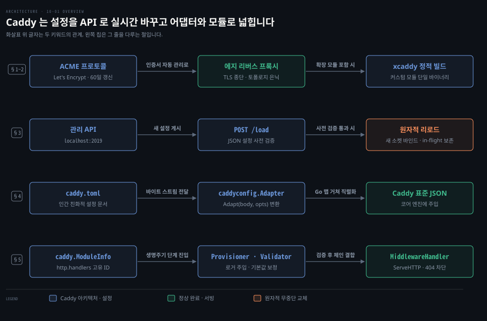
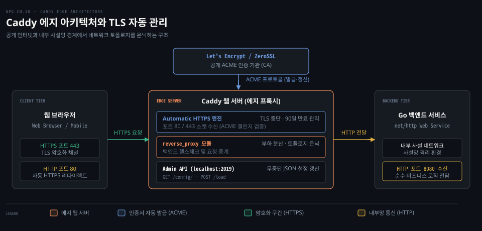
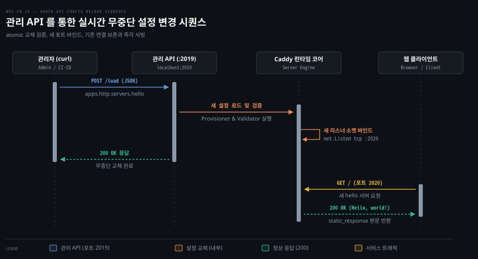
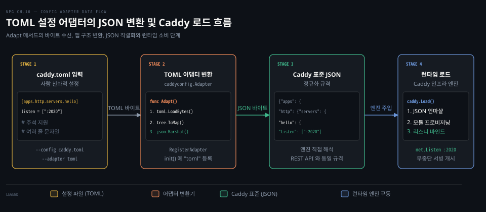
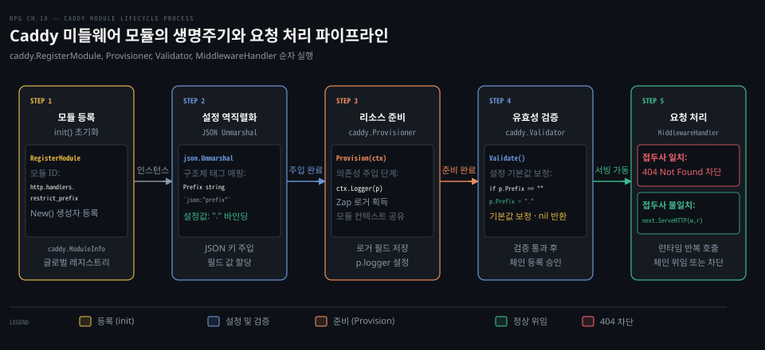

# Caddy 는 JSON 설정을 관리 API 로 실시간 바꾸고 모듈과 어댑터로 넓힌다

---

> Caddy 는 에지에서 TLS 종단과 자동 인증서 관리를 전담하는 현대적 웹 서버이며 REST 관리 API 로 런타임 중단 없이 설정을 원자적으로 교체하고 어댑터와 모듈 인터페이스로 기능을 확장합니다.

## 핵심 요약

> 이 편이 매달린 하나의 생각은, Go 표준 라이브러리로 웹 서버를 직접 구축할 수 있더라도 인증서 갱신과 에지 인프라 관리는 Caddy 에 위임하고 비즈니스 로직에 집중하는 편이 안전하다는 점입니다.

Caddy 는 공개 도메인을 감지하여 Let's Encrypt 및 ZeroSSL 과 ACME 프로토콜로 통신하고 90일 만료 인증서를 60일 주기로 자동 갱신합니다. 에지 프록시로서 백엔드 서비스의 네트워크 토폴로지를 은닉하고 클라이언트 요청을 부하 분산합니다.

런타임 설정은 2019 포트의 관리 API 를 통해 JSON 으로 제어합니다. 새로운 설정을 게시하면 유효성을 사전 검증한 뒤 새 소켓 리스너를 열고 기존 인플라이트 요청을 안전하게 보존하며 원자적으로 교체합니다.

또한 설정 어댑터는 인간 친화적인 TOML 문서를 Caddy 표준 JSON 으로 변환하며 Caddy 모듈은 프로비저닝과 유효성 검증 단계를 거쳐 `caddyhttp.MiddlewareHandler` 체인에 완벽히 통합됩니다.


## 학습 목표

> 이 편을 읽고 나면 아래 다섯 가지를 스스로 해낼 수 있습니다.

1. Go 표준 라이브러리 서버 앞단에 Caddy 에지 프록시를 배치하여 TLS 자동 관리와 인프라 책임을 격리하는 이유를 설명할 수 있습니다.
2. `xcaddy` 빌드 도구의 필요성을 이해하고 커스텀 모듈을 포함한 Caddy 바이너리를 정적 컴파일할 수 있습니다.
3. Caddy 관리 API 엔드포인트에 JSON 설정을 전달하여 프로세스 재시작 없이 무중단으로 소켓 리스너를 교체할 수 있습니다.
4. `caddyconfig.Adapter` 인터페이스를 구현하여 TOML 설정 문서를 Caddy 네이티브 JSON 바이트로 변환하고 등록할 수 있습니다.
5. `caddy.Module`, `Provisioner`, `Validator`, `caddyhttp.MiddlewareHandler` 인터페이스를 구현하여 경로 접두사를 차단하는 Caddy 미들웨어 모듈을 작성할 수 있습니다.

아래는 이 편의 키워드를 이은 개념도입니다. §1~2 줄은 ACME 로 인증서를 자동 갱신하는 에지 리버스 프록시와 커스텀 모듈을 단일 바이너리로 묶는 xcaddy 정적 빌드의 흐름입니다. §3 줄은 관리 API 엔드포인트에 JSON 설정을 전달하여 사전 검증을 거친 뒤 리스너를 원자적으로 교체하는 과정입니다. §4 줄은 인간 친화적인 TOML 문서를 Caddy 표준 JSON 바이트로 변환하는 설정 어댑터 파이프라인입니다. §5 줄은 고유 ID 로 등록된 모듈이 의존성 주입과 유효성 검증을 거쳐 HTTP 요청 체인에서 접두사를 가로채는 미들웨어 동작입니다.




## 1. Caddy 는 인증서와 설정을 대신 맡는 웹 서버다

> Caddy 는 클라이언트와 백엔드 서비스 사이 에지 경계에서 TLS 종단과 ACME 자동 인증서 관리를 도맡아 처리하는 현대 웹 서버입니다.

Go 표준 라이브러리의 `net/http` 패키지로 독자적인 웹 서버를 구축하는 방법은 [09-01 Go HTTP 서버](./09-01.Go%20HTTP%20서버는%20타임아웃을%20정하고%20핸들러에%20의존성을%20주입하며%20httptest%20로%20시험한다.md) 에서 살펴보았습니다. 하지만 실제 프로덕션 환경에서 로깅, 지표 수집, 접근 제어, 정적 파일 캐싱, 압축, 그리고 HTTPS 암호화 채널 구축을 애플리케이션마다 매번 처음부터 구현하는 작업은 많은 시간과 운영 위험을 초래합니다.

공개 CA 와 Let's Encrypt 의 역할 및 90일 인증서 유효기간의 의미는 [컨테이너 보안 11-01 TLS 로 컴포넌트 안전하게 연결하기](../../../08_cloud/book/container-security/11-01.TLS로%20컴포넌트%20안전하게%20연결하기%20—%20키·인증서·CA의%20역할.md) 에서 다루었습니다. 전통적인 웹 서버 환경에서는 인증서 발급 후 만료일을 사람이 달력에 기록하고 갱신 스크립트의 크론 작업을 점검해야 했습니다. 갱신 시점을 놓치면 브라우저 경고가 발생하여 서비스 장애로 이어집니다.

Caddy 는 **ACME** (Automated Certificate Management Environment) 프로토콜을 코어 엔진에 내장하여 이 문제를 근본적으로 해소합니다. 호스팅할 도메인 주소가 주어지면 Caddy 가 자동으로 인증서를 요청하고 도메인 제어권을 검증한 뒤 인증서를 설치합니다. 만료일이 도래하기 전 60일 주기마다 백그라운드에서 인증서를 자동 갱신하므로 관리자가 만료일을 추적할 필요가 없습니다.

현대 Caddy 는 공개 인터넷 도메인에 대해 [Let's Encrypt 와 ZeroSSL 을 기본 ACME 발급자](https://caddyserver.com/docs/automatic-https#issuers)로 활용하며 다중 발급자 폴백을 지원합니다. 로컬 호스트(`localhost`)나 내부 IP 주소 환경에서는 자체 내부 CA(Internal CA)를 자동으로 구동하여 로컬 신뢰 저장소에 루트 인증서를 주입합니다.



Caddy 는 네트워크 최전선인 에지(Edge)에 위치하여 외부 클라이언트의 HTTPS 연결을 수신하고 TLS 를 종단합니다. 이후 사설망 내부의 Go 백엔드 웹 서비스로 요청을 역방향 중계(Reverse Proxy)합니다. 이 구조 덕분에 외부 인터넷에 내부 네트워크 토폴로지가 노출되지 않으며 백엔드 서버 인스턴스가 증설되더라도 Caddy 가 클라이언트 중단 없이 트래픽 부하를 고르게 분산합니다.


## 2. Caddy 를 받거나 소스에서 빌드한다

> Caddy 는 사전 컴파일된 바이너리로 즉시 실행할 수 있으며 커스텀 모듈을 주입할 때는 런타임 동적 로딩 대신 정적 소스 빌드를 거칩니다.

Caddy 는 공식 웹사이트의 다운로드 페이지와 Docker 이미지, Debian 계열 APT 저장소, Red Hat 계열 Copr 빌드 시스템을 통해 사전 빌드된 정적 바이너리를 제공합니다. 일반적인 정적 파일 서빙이나 표준 리버스 프록시 작업은 설치 즉시 사용 가능합니다.

하지만 Caddy 에 독자적인 미들웨어나 비표준 설정 포맷 어댑터를 추가하려면 컴파일 타임에 소스코드를 결합해야 합니다. Caddy 는 런타임 공유 라이브러리(`.so`) 동적 로딩 방식을 채택하지 않습니다. 대신 Go 의 모듈 생태계 위에서 모든 확장을 단일 바이너리에 정적으로 링크합니다. 플러그인 의존성 충돌과 런타임 바이너리 불일치를 방지하고 단일 배포 실행 파일의 안전성을 확보하기 위한 선택입니다.

현대 Caddy 생태계에서 공식적으로 권장하는 사용자 지정 빌드 도구는 [`xcaddy`](https://caddyserver.com/docs/build#xcaddy) 입니다. `go install` 로 설치한 뒤 `--with` 플래그로 필요한 모듈을 선언하면 Go 도구 체인이 자동으로 소스를 내려받아 통합 바이너리를 만듭니다.

```bash
# xcaddy 빌드 도구를 최신 버전으로 설치합니다
go install github.com/caddyserver/xcaddy/cmd/xcaddy@latest

# 커스텀 모듈을 포함하여 Caddy 바이너리를 정적 컴파일합니다
xcaddy build --with github.com/caddyserver/nginx-adapter
```

직접 소스 코드를 내려받아 빌드할 수도 있습니다. Caddy 저장소를 복제한 뒤 `cmd/caddy` 디렉터리의 `main.go` 파일에 커스텀 모듈을 빈 식별자(`_`)로 임포트하고 `go build` 를 수행합니다. §4 와 §5 에서 직접 작성할 TOML 어댑터와 접두사 제한 미들웨어 역시 이 컴파일 파이프라인을 거쳐 Caddy 바이너리 내부로 주입됩니다.


## 3. 관리 API 로 설정을 실시간으로 바꾼다

> Caddy 는 TCP 2019 포트의 관리 API 엔드포인트로 JSON 설정을 전달받아 서버 재시작 없이 리스너 소켓을 실시간으로 안전하게 교체합니다.

전통적인 웹 서버는 설정을 바꿀 때마다 설정 파일을 저장하고 프로세스에 시그널을 보내 리로드하거나 데몬을 재시작해야 했습니다. 반면 Caddy 는 시작과 동시에 로컬 TCP 2019 포트에 관리 엔드포인트(Admin API)를 엽니다. 관리자는 HTTP POST 메서드로 JSON 문서를 전송하여 실행 중인 서버의 동작을 즉시 바꿀 수 있습니다.

Caddy 를 백그라운드 프로세스로 실행하면 관리 엔드포인트가 초기화됩니다.

```bash
# Caddy 프로세스를 백그라운드로 시작합니다
caddy start
```

초기 상태의 Caddy 는 빈 설정을 갖고 있습니다. 아래 명령은 `curl` 도구로 JSON 본문을 `localhost:2019/load` 리소스에 게시하여 포트 2020 에서 정적 응답을 반환하는 서버를 가동합니다.

```bash
# 2020 포트에서 Hello world 를 응답하는 서버 설정을 관리 API 에 로드합니다
curl localhost:2019/load \
  -X POST -H "Content-Type: application/json" \
  -d '{
    "apps": {
      "http": {
        "servers": {
          "hello": {
            "listen": ["localhost:2020"],
            "routes": [{
              "handle": [{
                "handler": "static_response",
                "body": "Hello, world!"
              }]
            }]
          }
        }
      }
    }
  }'
```

최상위 `apps` 네임스페이스는 Caddy 가 런타임에 구동할 애플리케이션을 선언합니다. `http` 앱 내부의 `servers` 객체는 하나 이상의 가상 서버를 정의합니다. `listen` 속성은 소켓 주소 배열을 받으며 포트 범위(`localhost:2020-2025`)나 Unix 도메인 소켓(`unix//tmp/caddy.sock`)도 지정할 수 있습니다. `routes` 배열의 `handle` 목록은 들어오는 요청을 순차 처리할 핸들러 체인을 정의하며 위 예제는 내장 `static_response` 핸들러로 응답 본문을 작성합니다.

설정이 수락되면 Caddy 는 즉시 새 소켓을 엽니다. `lsof` 명령으로 시스템의 활성 파일 디스크립터 상태를 확인해 보겠습니다.

```bash
# 2019 관리 포트와 2020 서비스 포트의 TCP 수신 소켓 상태를 확인합니다
lsof -Pi :2019-2025
```

출력 결과는 Caddy 단일 프로세스가 2019 관리 포트와 2020 서빙 포트 두 곳에서 LISTEN 상태의 TCP 소켓을 정상적으로 점유하고 있음을 증명합니다.

```bash
COMMAND   PID USER   FD   TYPE DEVICE SIZE/OFF NODE NAME
caddy   24587 user   3u   IPv4 811511      0t0 TCP localhost:2019 (LISTEN)
caddy   24587 user   9u   IPv4 915742      0t0 TCP localhost:2020 (LISTEN)
```

현재 활성화된 설정은 GET 요청으로 확인할 수 있습니다. 이때 `/config/` 처럼 반드시 끝에 슬래시를 붙여야 합니다. 슬래시가 빠진 `/config` 는 Caddy 관리 리소스 트리에 존재하지 않아 404 응답을 반환합니다.

```bash
# 활성화된 전체 설정을 JSON 형식으로 조회합니다
curl localhost:2019/config/

# 설정 경로 순회(Traversal)를 통해 특정 서버의 listen 값만 조회합니다
curl localhost:2019/config/apps/http/servers/hello/listen
```

설정을 교체하는 동안 기존 클라이언트의 연결은 어떻게 될까요? [Caddy 공식 아키텍처 문서](https://caddyserver.com/docs/architecture#graceful-reloads)에 명시된 원자적 리로드(Atomic Reload) 절차는 기존 서비스를 중단시키지 않습니다.

1. Caddy 는 새 JSON 을 받으면 먼저 구문 분석을 수행하고 내부 모듈의 프로비저닝과 유효성 검사를 거칩니다.
2. 설정에 문법 오류나 잘못된 포트가 있으면 기존 운영 설정을 전혀 건드리지 않은 채 오류 로그를 남기고 요청을 거절합니다.
3. 검증을 통과하면 새 소켓 리스너를 바인드하여 새 트래픽을 즉시 수용합니다.
4. 교체 대상이 된 이전 리스너는 우아한 종료(Graceful shutdown) 단계로 진입하여 이미 처리 중인 인플라이트(in-flight) 요청이 안전하게 완료될 때까지 소켓 연결을 보존합니다.



파일 기반 설정이 필요하다면 완성된 JSON 문서를 디스크에 저장하고 시작 옵션으로 지정할 수 있습니다.

```bash
# JSON 설정 파일을 읽어 Caddy 를 시작합니다
caddy start --config caddy.json
```


## 4. 설정 어댑터는 다른 형식을 JSON 으로 바꾼다

> 설정 어댑터는 인간 친화적인 TOML 등의 문서를 Caddy 의 네이티브 JSON 규격으로 변환하여 코어 엔진에 주입하는 어댑터입니다.

JSON 은 기계가 직렬화하고 파싱하기에 최적화된 표준 형식이지만 주석을 지원하지 않고 여러 줄 문자열 처리가 까다로워 사람이 대규모 설정 파일을 직접 작성하기에는 가독성이 떨어집니다. Caddy 는 다양한 포맷의 문서를 런타임 직전에 JSON 으로 변환하는 **설정 어댑터(Configuration Adapter)** 계층을 둡니다.

Caddy 의 대표적인 설정 언어인 [Caddyfile](https://caddyserver.com/docs/caddyfile) 역시 Caddy 코어가 직접 읽는 형식이 아닙니다. 내장된 `caddyfile` 어댑터가 내부적으로 Caddyfile 문법을 Caddy JSON 구조로 변환한 뒤 코어 엔진에 전달하는 구조입니다.

공식 배포판에 포함되지 않은 새로운 설정 형식을 지원하려면 어댑터 인터페이스를 직접 구현해야 합니다. Caddy 의 어댑터 인터페이스는 아래와 같이 정의되어 있습니다.

```go
type Adapter interface {
	Adapt(body []byte, options map[string]any) ([]byte, []Warning, error)
}
```

아래 코드는 `github.com/pelletier/go-toml` 라이브러리를 사용하여 TOML 문서를 Caddy JSON 으로 변환하는 어댑터 구현체입니다.

```go
package tomladapter

import (
	"encoding/json"

	"github.com/caddyserver/caddy/v2/caddyconfig"
	"github.com/pelletier/go-toml"
)

func init() {
	// toml 이라는 식별자로 어댑터를 Caddy 전역 레지스트리에 등록합니다
	caddyconfig.RegisterAdapter("toml", Adapter{})
}

// Adapter 는 TOML 문서를 Caddy JSON 바이트로 변환하는 어댑터입니다
type Adapter struct{}

// Adapt 는 입력받은 TOML 바이트를 맵으로 디코딩한 뒤 JSON 바이트로 직렬화합니다
func (a Adapter) Adapt(body []byte, _ map[string]any) ([]byte, []caddyconfig.Warning, error) {
	// TOML 바이트 스트림을 트리 구조로 파싱합니다
	tree, err := toml.LoadBytes(body)
	if err != nil {
		return nil, nil, err
	}

	// 파싱된 트리를 Go 맵으로 변환한 뒤 JSON 규격 바이트로 직렬화합니다
	b, err := json.Marshal(tree.ToMap())
	return b, nil, err
}

// 컴파일 타임에 caddyconfig.Adapter 인터페이스 구현 여부를 검증합니다
var _ caddyconfig.Adapter = Adapter{}
```

`Adapt` 메서드는 입력 본문 `body` 를 받아 트리로 읽어 들인 후 `ToMap()` 메서드로 `map[string]any` 구조로 변환합니다. 그 후 표준 `json.Marshal` 을 호출하여 Caddy 코어가 요구하는 JSON 바이트 슬라이스를 생성합니다.



`init` 함수 안에서 `caddyconfig.RegisterAdapter` 를 호출하면 Caddy 가 시작될 때 해당 어댑터가 메모리에 등록됩니다. 모듈을 바이너리에 컴파일한 후에는 아래 명령처럼 `--adapter` 옵션으로 TOML 파일을 즉시 로드할 수 있습니다.

```bash
# toml 어댑터를 지정하여 TOML 설정 파일로 Caddy 를 구동합니다
caddy start --config caddy.toml --adapter toml
```


## 5. restrict prefix 미들웨어를 Caddy 모듈로 만든다

> Caddy 모듈은 고유 ID 네임스페이스와 의존성 주입 생명주기를 따르며 MiddlewareHandler 인터페이스로 HTTP 요청 체인을 가로챕니다.

[09-02 미들웨어 §3](./09-02.미들웨어는%20핸들러를%20감싸고%20ServeMux%20는%20경로를%20나누며%20HTTP2%20서버%20푸시는%20브라우저가%20걷어냈다.md#3-restrictprefix-는-경로-세그먼트의-숨김-파일-접근을-막는다) 에서는 `.` 으로 시작하는 숨김 파일 경로를 차단하기 위해 `func(http.Handler) http.Handler` 형태의 `RestrictPrefix` 함수를 작성했습니다. 표준 `net/http` 에서 미들웨어는 다음 핸들러를 클로저 변수로 캡처하여 감싸는 방식으로 동작했습니다.

하지만 Caddy 의 HTTP 파이프라인은 이 구조를 따르지 않습니다. Caddy 는 핸들러와 미들웨어의 명확한 책임을 분리하기 위해 [`caddyhttp.MiddlewareHandler`](https://pkg.go.dev/github.com/caddyserver/caddy/v2/modules/caddyhttp#MiddlewareHandler) 인터페이스를 정의합니다.

```go
type MiddlewareHandler interface {
	ServeHTTP(http.ResponseWriter, *http.Request, Handler) error
}
```

표준 라이브러리와 비교할 때 두 가지 핵심 차이가 있습니다. 첫째, `ServeHTTP` 메서드의 세 번째 매개변수로 다운스트림 핸들러인 `Handler` 가 직접 전달됩니다. 둘째, 메서드가 `error` 를 반환하여 오류 발생 시 Caddy 의 중앙 집중식 오류 처리 체인으로 제어를 넘길 수 있습니다.

Caddy 에 새로운 기능을 추가하려면 `caddy.Module` 인터페이스를 만족하는 구조체를 정의해야 합니다. 아래 코드는 특정 접두사가 포함된 URI 요청을 404 로 차단하는 Caddy 미들웨어 모듈입니다.

```go
package restrictprefix

import (
	"fmt"
	"net/http"
	"strings"

	"github.com/caddyserver/caddy/v2"
	"github.com/caddyserver/caddy/v2/modules/caddyhttp"
	"go.uber.org/zap"
)

func init() {
	// 모듈을 Caddy 런타임에 등록합니다
	caddy.RegisterModule(RestrictPrefix{})
}

// RestrictPrefix 는 URL 경로에 특정 접두사가 포함된 요청을 차단하는 Caddy 미들웨어입니다
type RestrictPrefix struct {
	// JSON 설정의 prefix 키를 구조체 필드에 바인딩합니다
	Prefix string `json:"prefix,omitempty"`

	// 프로비저닝 단계에서 주입받을 Zap 구조화 로거입니다
	logger *zap.Logger
}

// CaddyModule 은 모듈 고유 식별자와 인스턴스 생성자를 반환합니다
func (RestrictPrefix) CaddyModule() caddy.ModuleInfo {
	return caddy.ModuleInfo{
		// HTTP 미들웨어 네임스페이스 하위에 고유 모듈 이름을 지정합니다
		ID:  "http.handlers.restrict_prefix",
		New: func() caddy.Module { return new(RestrictPrefix) },
	}
}

// Provision 은 모듈이 동작하는 데 필요한 로거 등의 의존성을 컨텍스트에서 주입받습니다
func (p *RestrictPrefix) Provision(ctx caddy.Context) error {
	p.logger = ctx.Logger(p)
	return nil
}

// Validate 는 설정값의 유효성을 검사하고 누락된 기본값을 보정합니다
func (p *RestrictPrefix) Validate() error {
	// 접두사가 지정되지 않았으면 마침표를 기본 숨김 접두사로 지정합니다
	if p.Prefix == "" {
		p.Prefix = "."
	}
	return nil
}

// ServeHTTP 는 caddyhttp.MiddlewareHandler 인터페이스를 구현하여 요청을 검사합니다
func (p RestrictPrefix) ServeHTTP(w http.ResponseWriter, r *http.Request, next caddyhttp.Handler) error {
	// URL 경로의 슬래시 분할 세그먼트를 순회하며 제한 접두사를 확인합니다
	for _, part := range strings.Split(r.URL.Path, "/") {
		if strings.HasPrefix(part, p.Prefix) {
			// 일치하는 세그먼트가 발견되면 즉시 404 Not Found 상태를 기록합니다
			http.Error(w, "Not Found", http.StatusNotFound)
			if p.logger != nil {
				p.logger.Debug(fmt.Sprintf("restricted prefix: %q in %s", part, r.URL.Path))
			}
			return nil
		}
	}

	// 검사를 통과한 요청은 다음 핸들러로 제어를 위임합니다
	return next.ServeHTTP(w, r)
}

// 모듈이 필수 인터페이스를 모두 만족하는지 컴파일 타임에 단언합니다
var (
	_ caddy.Provisioner           = (*RestrictPrefix)(nil)
	_ caddy.Validator             = (*RestrictPrefix)(nil)
	_ caddyhttp.MiddlewareHandler = (*RestrictPrefix)(nil)
)
```

모듈의 실행 단계는 정밀하게 나뉩니다.

- **모듈 식별과 생성**: `CaddyModule()` 메서드는 `http.handlers.restrict_prefix` 라는 모듈 ID 를 반환합니다. `http.handlers.*` 네임스페이스에 속한 모듈은 Caddy 의 HTTP 라우팅 체인에서 호출 가능한 미들웨어로 인식됩니다.
- **프로비저닝 (`Provision`)**: `caddy.Provisioner` 인터페이스를 구현하면 Caddy 가 모듈 인스턴스를 생성한 직후 `ctx.Logger(p)` 를 호출하여 해당 모듈 전용으로 이름이 지정된 Zap 구조화 로거를 주입합니다.
- **유효성 검증 (`Validate`)**: `caddy.Validator` 인터페이스는 설정 파일에서 언마샬링된 값의 정합성을 검증합니다. 위 예제에서는 `Prefix` 가 비어 있을 때 기본값인 `"."` 을 설정합니다.
- **요청 처리 (`ServeHTTP`)**: 실제 HTTP 트래픽이 들어올 때마다 호출됩니다. URL 세그먼트에 금지된 접두사가 있으면 404 를 반환하고 단락(short-circuit)하며 이상이 없으면 `next.ServeHTTP(w, r)` 로 다음 핸들러에 위임합니다.

플러그인을 등록하여 체인을 조립하는 구조는 CoreDNS 의 설계 철학과 맞닿아 있습니다. CoreDNS 가 Caddy v1 플러그인 체계 위에서 체인의 한 칸을 구현한 방식은 [CoreDNS 09-02 네 함수를 구현하면 체인의 한 칸이 된다](../../../08_cloud/book/learning-coredns/09-02.네%20함수를%20구현하면%20체인의%20한%20칸이%20된다.md) 에서 다루었습니다. Caddy v2 는 이 체계를 모듈 ID 와 생명주기 인터페이스로 더욱 정교하게 발전시켰습니다.



작성한 모듈과 어댑터를 Caddy 에 포함하려면 메인 패키지에서 임포트해야 합니다. 아래는 커스텀 모듈을 포함하는 `main.go` 파일 예제입니다.

```go
package main

import (
	// Caddy 의 메인 실행 진입점 패키지입니다
	cmd "github.com/caddyserver/caddy/v2/cmd"

	// Caddy 표준 모듈 전체를 임포트합니다
	_ "github.com/caddyserver/caddy/v2/modules/standard"

	// 커스텀 접두사 차단 미들웨어 모듈을 등록합니다
	_ "github.com/awoodbeck/caddy-restrict-prefix"

	// 커스텀 TOML 설정 어댑터를 등록합니다
	_ "github.com/awoodbeck/caddy-toml-adapter"
)

func main() {
	cmd.Main()
}
```

빌드를 마친 후 모듈 목록을 조회하면 컴파일된 바이너리에 새 기능이 올바르게 포함되었는지 확인할 수 있습니다.

```bash
# 빌드된 바이너리에서 커스텀 어댑터와 핸들러 모듈 목록을 검증합니다
./caddy list-modules | grep "toml\|restrict_prefix"
```

출력 결과에 `caddy.adapters.toml` 과 `http.handlers.restrict_prefix` 가 나타나면 커스텀 Caddy 바이너리 구축이 완료된 것입니다.


## 면접 대비

> 아래 질문에 답하면서 Caddy 의 에지 아키텍처, 무중단 관리 API, 그리고 Go 모듈 확장 메커니즘을 설명해 보세요.

1. Go 표준 라이브러리(`net/http`) 기반 자체 웹 서버 대신 Caddy 같은 리버스 프록시를 웹 서비스 앞단에 배치하는 아키텍처적 이점과 ACME 자동 TLS 의 동작 방식을 설명해 주세요.
2. Caddy 관리 API (기본 포트 2019)에 새로운 JSON 설정을 전송했을 때 무중단으로 리스너가 교체되는 원리와 기존 활성 연결 처리 방식을 설명해 주세요.
3. Caddy 설정 어댑터(Configuration Adapter)의 역할과 Caddyfile 및 커스텀 TOML 어댑터가 Caddy 코어에서 처리되는 과정을 설명해 주세요.
4. net/http 표준 미들웨어(`func(http.Handler) http.Handler`)와 Caddy 모듈의 `caddyhttp.MiddlewareHandler` 인터페이스 설계 차이를 비교하고 Provisioner 와 Validator 의 역할을 설명해 주세요.


## 정답 (자답 후 펼치기)

> 위 §면접 대비의 질문에 먼저 스스로 답한 뒤 읽으세요.

### 정답 1 — 에지 격리, 보안 캡슐화와 ACME 무중단 자동 갱신

Caddy 를 에지에 배치하면 TLS 종단, 접근 제어, 데이터 압축, 정적 자원 서빙 같은 공통 인프라 기능을 비즈니스 로직과 격리할 수 있습니다. 내부 서비스의 IP 와 포트 등 토폴로지가 외부로 노출되지 않으며 서비스 인스턴스를 무중단으로 증설하고 부하를 분산하기 수월해집니다.

또한 Caddy 는 ACME 프로토콜을 내장하여 호스팅 도메인에 대해 Let's Encrypt 나 ZeroSSL 등 공개 CA 로부터 인증서를 자동 발급받고 도메인 제어권을 자율 검증합니다. 90일 만료 인증서를 만료 전 60일 주기마다 백그라운드에서 자동 갱신하므로 관리자가 만료일을 수동 추적하고 갱신 작업을 수행해야 하는 운영 부담과 장애 위험을 완전히 제거합니다.

### 정답 2 — 원자적 유효성 사전 검증과 Graceful 리스너 전환

Caddy 는 관리 API 포트(`localhost:2019/load`)로 새 설정을 받으면 즉시 활성 서버를 재시작하지 않습니다. 먼저 메모리에서 새 JSON 을 역직렬화하고 포함된 모든 모듈의 프로비저닝과 유효성 검증(`Validate`)을 수행합니다. 설정에 결함이 있으면 기존 실행 상태를 보존한 채 즉시 오류를 반환하므로 서비스 중단이 발생하지 않습니다.

설정이 완벽히 검증되면 새 소켓 리스너를 열어 들어오는 신규 트래픽을 수용하기 시작합니다. 교체 대상이 된 이전 소켓 리스너는 우아한 종료(Graceful stop) 단계에 진입하여 처리 중인 기존 인플라이트(in-flight) 연결이 정상 응답을 완료할 때까지 안전하게 유지된 뒤 자원을 반환합니다.

### 정답 3 — 인간 친화적 설정 언어의 JSON 중간 표현 변환

Caddy 코어 엔진은 내부적으로 모든 구성을 정규화된 네이티브 JSON 규격으로만 소비합니다. 하지만 JSON 은 주석과 여러 줄 문자열을 지원하지 않아 사람이 직접 작성하기 어렵습니다. 설정 어댑터(`caddyconfig.Adapter`)는 TOML, YAML, Caddyfile 등의 인간 친화적 문서를 입력받아 `Adapt` 메서드를 통해 Caddy 네이티브 JSON 바이트 슬라이스로 번역하는 역할을 담당합니다.

Caddy 의 대표 설정 형식인 `Caddyfile` 역시 코어가 직접 실행하는 것이 아니라 내장된 `caddyfile` 어댑터가 내부적으로 JSON 구조로 컴파일하여 엔진에 주입합니다. 커스텀 TOML 어댑터 또한 `caddyconfig.RegisterAdapter("toml", ...)` 로 등록되어 시작 시 `--adapter toml` 옵션을 통해 JSON 으로 정규화되어 코어에 적재됩니다.

### 정답 4 — 다운스트림 핸들러 직접 전달, 오류 반환과 모듈 의존성 주입

표준 `net/http` 미들웨어는 `func(http.Handler) http.Handler` 형태로 다음 핸들러를 클로저에 감싸서 실행하며 반환값이 없습니다. 반면 Caddy 의 `caddyhttp.MiddlewareHandler` 는 `ServeHTTP(w, r, next Handler) error` 시그니처를 가집니다. 다음 핸들러인 `next` 가 실행 시점의 매개변수로 명시적으로 전달되며 `error` 를 반환하여 체인 상위에서 통합 오류 처리를 수행할 수 있습니다.

또한 Caddy 모듈은 단순 함수가 아니라 생명주기 인터페이스를 갖는 구조체입니다. `caddy.Provisioner` 의 `Provision(ctx)` 단계에서는 Zap 로거나 데이터베이스 연결 등 런타임 의존성을 컨텍스트로부터 주입받습니다. 이어지는 `caddy.Validator` 의 `Validate()` 단계에서는 설정값 정합성을 검증하고 누락된 기본값을 보정하여 안전한 런타임 실행을 보장합니다.


## 참고 자료

- 《Network Programming with Go》 Adam Woodbeck, 2021. ISBN 978-1-7185-0088-4. Chapter 10 Caddy: A Contemporary Web Server (Listing 10-1~10-8).
- [Caddy 공식 문서](https://caddyserver.com/docs/): Caddy 웹 서버 아키텍처 및 시작 안내서.
- [Caddy REST API 명세](https://caddyserver.com/docs/api): `/load` 및 `/config/` 엔드포인트와 설정 경로 탐색(Traversal) 명세.
- [Caddy 아키텍처 및 무중단 리로드 명세](https://caddyserver.com/docs/architecture#graceful-reloads): 원자적 설정 교체 및 우아한 리스너 종료 원리.
- [Caddy 모듈 확장 가이드](https://caddyserver.com/docs/extending-caddy): `ModuleInfo`, `Provisioner`, `Validator`, `MiddlewareHandler` 인터페이스 명세.
- [Caddy 빌드 및 xcaddy 공식 가이드](https://caddyserver.com/docs/build#xcaddy): 커스텀 모듈 정적 컴파일 절차.
- [Caddy 자동 HTTPS 및 기본 발급자 명세](https://caddyserver.com/docs/automatic-https#issuers): Let's Encrypt 및 ZeroSSL 자동 연동.


## 관련 문서

- [09-02 미들웨어는 핸들러를 감싸고 ServeMux 는 경로를 나누며 HTTP/2 서버 푸시는 브라우저가 걷어냈다](./09-02.미들웨어는%20핸들러를%20감싸고%20ServeMux%20는%20경로를%20나누며%20HTTP2%20서버%20푸시는%20브라우저가%20걷어냈다.md): 표준 net/http 의 `RestrictPrefix` 구현과 미들웨어 체인 원리를 다룹니다.
- [09-01 Go HTTP 서버는 타임아웃을 정하고 핸들러에 의존성을 주입하며 httptest 로 시험한다](./09-01.Go%20HTTP%20서버는%20타임아웃을%20정하고%20핸들러에%20의존성을%20주입하며%20httptest%20로%20시험한다.md): Go 표준 HTTP 서버 생성과 타임아웃 구성 기법을 다룹니다.
- [CoreDNS 09-02 네 함수를 구현하면 체인의 한 칸이 된다](../../../08_cloud/book/learning-coredns/09-02.네%20함수를%20구현하면%20체인의%20한%20칸이%20된다.md): Caddy v1 플러그인 등록 아키텍처를 계승한 CoreDNS 체인 플러그인 생명주기를 비교합니다.
- [Learning Go 13-04 net/http 는 타임아웃을 직접 정하고 미들웨어는 Handler 를 감싸며 slog 로 구조화 로그를 남깁니다](../../../01_language/book/lgo_learning-go/13-04.net-http%20는%20타임아웃을%20직접%20정하고%20미들웨어는%20Handler%20를%20감싸며%20slog%20로%20구조화%20로그를%20남깁니다.md): Go HTTP 미들웨어의 함수 래핑 구조를 다룹니다.
- [컨테이너 보안 11-01 TLS 로 컴포넌트 안전하게 연결하기 — 키·인증서·CA의 역할](../../../08_cloud/book/container-security/11-01.TLS로%20컴포넌트%20안전하게%20연결하기%20—%20키·인증서·CA의%20역할.md): 공개 CA, Let's Encrypt 의 역할 및 90일 인증서 유효기간의 네트워크 보안 원리를 다룹니다.
- [Network Programming with Go 정독 인덱스](./README.md): 전체 챕터 구성과 학습 진행 상황.
