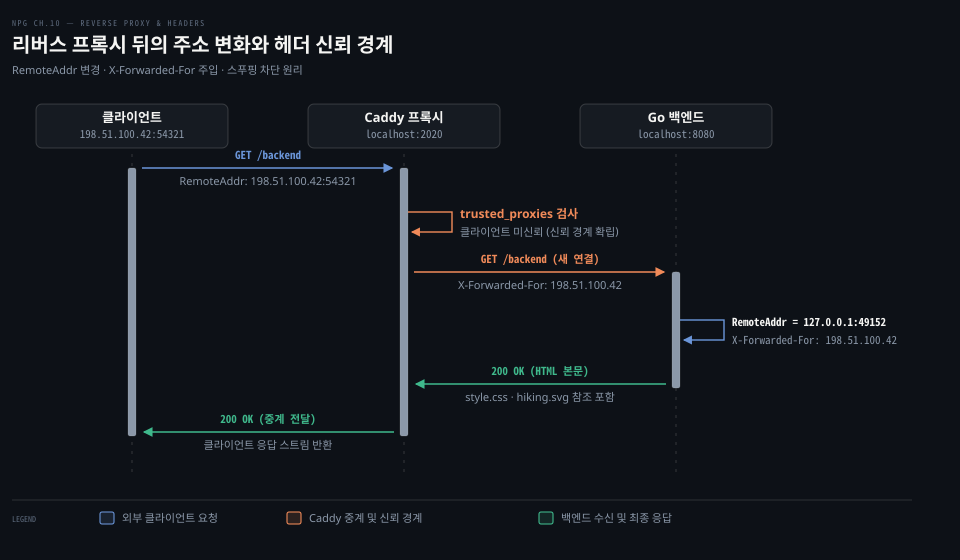
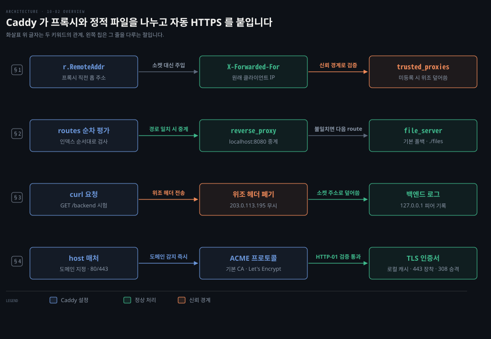
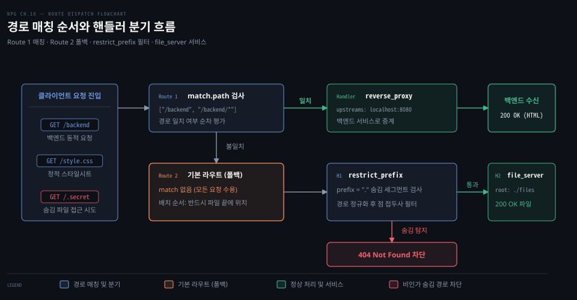
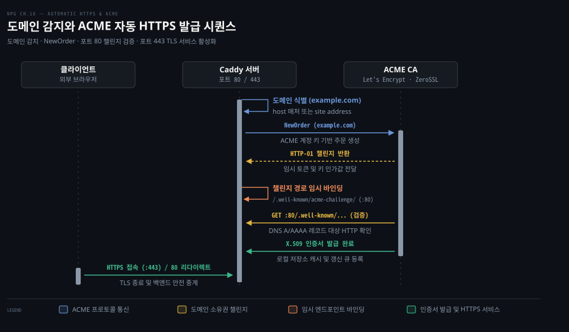

# Caddy 를 앞단에 두고 백엔드로 리버스 프록시하며 정적 파일과 자동 HTTPS 를 붙인다

---

> Caddy 를 백엔드 앞단에 두면 L7 리버스 프록시로 트래픽을 중계하고 정적 파일 서빙과 자동 HTTPS 를 위임하여 백엔드 애플리케이션의 복잡도를 낮출 수 있습니다.

## 핵심 요약

> 이 편이 매달린 하나의 생각은, 네트워크 경계에 선 Caddy 가 리버스 프록시와 정적 파일 서빙, 자동 HTTPS 를 도맡음으로써 백엔드 웹 서비스는 순수한 비즈니스 로직에만 집중할 수 있다는 점입니다.

프록시 뒤의 백엔드는 소켓 수준에서 프록시 주소만 보게 됩니다. 따라서 원래 클라이언트 IP 를 식별하기 위해 `X-Forwarded-For` 헤더를 참조해야 합니다. 이때 Caddy 가 외부의 위조된 헤더를 걸러내는 신뢰 경계 역할을 수행합니다.

Caddy 설정의 라우트 배열은 등록된 순서대로 평가됩니다. 구체적인 경로 매처를 가진 리버스 프록시 라우트를 앞에 두고 매처가 없는 정적 파일 기본 라우트를 뒤에 배치해야 라우팅 간섭을 방지할 수 있습니다.

또한 Caddy 는 도메인 이름을 감지하는 즉시 ACME 프로토콜을 통해 인증서를 자동으로 발급받고 갱신합니다. HTTP 트래픽을 HTTPS 로 자동 전환하여 전송 계층 보안을 무중단으로 유지합니다.




## 학습 목표

> 이 편을 읽고 나면 아래 다섯 가지를 스스로 해낼 수 있습니다.

1. 리버스 프록시 환경에서 `r.RemoteAddr` 와 `X-Forwarded-For` 헤더의 차이를 구별하고 클라이언트 주소를 올바르게 식별할 수 있습니다.
2. 프록시 경계에서 `X-Forwarded-For` 위조 공격을 방어하기 위한 신뢰 경계 설정 원리를 설명할 수 있습니다.
3. Caddy 의 JSON 설정에서 경로 매처와 핸들러 체인을 조립하여 리버스 프록시와 정적 파일 서버를 분기할 수 있습니다.
4. 라우트 평가 순서가 뒤바뀌었을 때 발생하는 라우팅 음영 현상과 404 오류의 원인을 진단할 수 있습니다.
5. Caddy 의 자동 HTTPS 활성화 조건과 ACME 챌린지 검증 절차 및 로컬 자체 CA 동작 방식을 설명할 수 있습니다.

아래는 이 편의 키워드를 이은 개념도입니다. §1 줄은 `X-Forwarded-For` 헤더로 클라이언트를 식별하고 `trusted_proxies` 로 위조를 막는 신뢰 경계입니다. §2 줄은 `routes` 순차 평가로 `reverse_proxy` 와 기본 `file_server` 를 가르는 경로 분기입니다. §3 줄은 `curl` 시험 시 위조 헤더를 폐기하고 실제 소켓 IP 로 덮어쓰는 신뢰 검증입니다. §4 줄은 `host` 감지 시 ACME 프로토콜로 인증서를 받아 포트 443 에 붙이는 자동 HTTPS 입니다.




## 1. 프록시 뒤의 백엔드는 원래 클라이언트를 헤더로 안다

> 리버스 프록시를 거친 백엔드에서 소켓 주소는 프록시의 주소로 바뀌므로, 원격 클라이언트 식별은 프록시가 주입하는 헤더와 신뢰 경계 검증에 의존해야 합니다.

백엔드 웹 서비스를 공용 인터넷에 직접 노출하면 정적 자원 전송과 TLS 인증서 관리, 보안 위협 대응 부담이 애플리케이션 코드로 고스란히 넘어옵니다. 네트워크 경계에서 이 책임을 분리하기 위해 앞단에 중계 서버를 두는 구성을 **리버스 프록시(reverse proxy)** 라고 부릅니다. 쿠버네티스 환경에서 Ingress 컨트롤러가 클러스터 외부 트래픽을 받아 파드로 중계하는 구조는 [Kubernetes in Action 12-01 §1](../../../08_cloud/book/kubernetes-in-action/12-01.Ingress로%20여러%20서비스를%20한%20IP에%20노출하기.md) 과 [Ingress 와 Service Mesh 05-03 §1](../../../08_cloud/book/networking-and-kubernetes/05-03.Ingress와%20Service%20Mesh%20—%20L7의%20두%20층.md) 에서 다루었습니다.

백엔드 서버가 클라이언트와 직접 TCP 연결을 맺지 않고 Caddy 와 연결을 맺으면 중요한 변화가 발생합니다. 백엔드의 HTTP 핸들러가 참조하는 `r.RemoteAddr` 는 원래 요청을 보낸 브라우저의 IP 가 아닙니다. 백엔드로 TCP 소켓을 연결한 Caddy 의 루프백 주소와 임시 포트(예: `127.0.0.1:49152`)가 됩니다. 백엔드가 속도 제한이나 접근 제어, 로깅을 위해 `r.RemoteAddr` 만 조회한다면 모든 클라이언트가 동일한 단일 주소로 인식되어 정상적인 통제가 불가능해집니다.

이를 해결하기 위해 Caddy 는 요청을 백엔드로 중계할 때 원래 클라이언트의 IP 주소를 담은 [`X-Forwarded-For`](https://caddyserver.com/docs/caddyfile/directives/reverse_proxy) 헤더를 주입합니다. 백엔드는 이 헤더를 읽어 실제 요청 발신자를 식별합니다.

```go
package main

import (
	"flag"
	"fmt"
	"log"
	"net/http"
	"os"
	"os/signal"
	"time"
)

var addr = flag.String("listen", "localhost:8080", "listen address")

// 백엔드가 반환하는 HTML 은 Caddy 가 제공할 정적 자원의 상대 경로를 가리킵니다
var index = []byte(`<!DOCTYPE html>
<html lang="en">
<head>
<meta charset="UTF-8">
<title>Caddy Backend Test</title>
<link href="/style.css" rel="stylesheet">
</head>
<body>
<p></p>
</body>
</html>`)

func main() {
	flag.Parse()
	c := make(chan os.Signal, 1)
	signal.Notify(c, os.Interrupt)

	err := run(*addr, c)
	if err != nil {
		log.Fatal(err)
	}
	log.Println("Server stopped")
}

func run(addr string, c chan os.Signal) error {
	mux := http.NewServeMux()
	mux.Handle("/",
		http.HandlerFunc(func(w http.ResponseWriter, r *http.Request) {
			// Caddy 가 주입한 원래 클라이언트의 IP 주소를 확인합니다
			clientAddr := r.Header.Get("X-Forwarded-For")
			// 원래 클라이언트 IP 와 직전 홉 소켓 주소 및 요청 URL 을 함께 기록합니다
			log.Printf("%s -> %s -> %s", clientAddr, r.RemoteAddr, r.URL)
			_, _ = w.Write(index)
		}),
	)
	srv := &http.Server{
		Addr:              addr,
		Handler:           mux,
		IdleTimeout:       time.Minute,
		ReadHeaderTimeout: 30 * time.Second,
	}
	go func() {
		for {
			if <-c == os.Interrupt {
				_ = srv.Close()
				return
			}
		}
	}()
	fmt.Printf("Listening on %s ...\n", srv.Addr)
	err := srv.ListenAndServe()
	if err == http.ErrServerClosed {
		err = nil
	}
	return err
}
```

백엔드가 반환하는 HTML 템플릿의 자원 경로에는 스키마나 도메인, 포트 번호가 포함되어 있지 않습니다. 백엔드 서비스는 자신이 Caddy 뒤에서 구동 중인지, 외부 클라이언트가 어떤 도메인과 포트로 Caddy 에 접근했는지 알 필요가 없습니다. 브라우저는 상대 루트 경로(`/style.css`, `/hiking.svg`)를 만나면 원래 HTML 을 요청했던 주소(예: `http://localhost:2020`)를 접두사로 붙여 Caddy 에게 후속 요청을 전송합니다.

여기서 핵심적인 보안 질문이 발생합니다. 백엔드는 `X-Forwarded-For` 헤더를 언제 믿어도 될까요?

악의적인 클라이언트가 임의의 IP(예: `203.0.113.195`)를 담아 위조된 `X-Forwarded-For` 헤더를 직접 전송할 수 있습니다. 만약 프록시가 클라이언트가 보낸 헤더를 그대로 통과시킨다면 백엔드는 위조된 신원을 신뢰하게 됩니다.

Caddy 는 이 문제를 막기 위해 **X-Forwarded-For 신뢰 경계**를 엄격하게 관리합니다. Caddy 의 `reverse_proxy` 모듈은 기본적으로 신뢰할 수 있는 상위 프록시 목록(`trusted_proxies`)이 비어 있습니다. 따라서 외부 클라이언트가 위조된 헤더를 실어 보내더라도 Caddy 는 이를 무시하고 직전 TCP 소켓에서 확인한 실제 클라이언트 주소(`127.0.0.1`)로 헤더를 덮어씁니다.

Caddy 앞단에 CDN 이나 클라우드 로드밸런서 같은 상위 프록시가 실제로 존재하는 경우에만 해당 프록시의 IP 대역을 `trusted_proxies` 에 등록해야 합니다. 그래야만 상위 프록시가 전달한 이전 IP 체인을 신뢰하고 자신의 직전 홉 주소를 덧붙이는 안전한 동작이 성립합니다.


## 2. 경로별로 프록시와 정적 파일을 가른다

> Caddy 는 설정 파일에 정의된 라우트 배열을 순차 평가하므로, 구체적인 매처를 가진 프록시 라우트 뒤에 매처가 없는 기본 파일 라우트를 배치해야 합니다.

단일 포트로 들어오는 요청을 전부 백엔드 프로세스로 넘기면 CSS 나 이미지 같은 정적 파일까지 Go 런타임이 감당해야 하므로 서버 자원이 낭비됩니다. 동적 요청은 백엔드로 넘기고 정적 파일은 웹 서버가 직접 디스크에서 읽어 반환해야 효율적입니다. Caddy 는 기본 설정 형식인 JSON 을 통해 경로 패턴별로 핸들러를 분기합니다. Caddy 의 관리 API 와 설정 구조의 기본 원리는 [10-01 Caddy 는 JSON 설정을 관리 API 로 실시간 바꾸고 모듈과 어댑터로 넓힌다](./10-01.Caddy%20는%20JSON%20설정을%20관리%20API%20로%20실시간%20바꾸고%20모듈과%20어댑터로%20넓힌다.md) 에서 다루었습니다.

HTTP 서버를 구성할 때는 `apps.http.servers` 네임스페이스 아래에 서버 객체를 정의하고 수신 주소와 라우트 목록을 지정합니다. 목표는 `/backend` 및 그 하위 경로로 들어오는 요청은 백엔드 서비스로 중계하고, 그 외의 요청은 로컬 디스크의 정적 파일로 응답하는 것입니다.

```json
{
  "apps": {
    "http": {
      "servers": {
        "test_server": {
          "listen": [
            "localhost:2020"
          ],
          "routes": [
            {
              "match": [
                {
                  "path": [
                    "/backend",
                    "/backend/*"
                  ]
                }
              ],
              "handle": [
                {
                  "handler": "reverse_proxy",
                  "upstreams": [
                    {
                      "dial": "localhost:8080"
                    }
                  ]
                }
              ]
            },
            {
              "handle": [
                {
                  "handler": "restrict_prefix",
                  "prefix": "."
                },
                {
                  "handler": "file_server",
                  "root": "./files",
                  "index_names": [
                    "index.html"
                  ]
                }
              ]
            }
          ]
        }
      }
    }
  }
}
```

첫 번째 라우트(`routes[0]`)는 경로 매처(`match`)를 가집니다. 정확한 경로인 `/backend` 나 하위 경로 와일드카드인 `/backend/*` 에 일치하는 요청만 선별합니다. 일치한 요청은 `reverse_proxy` 핸들러로 전달되며, 설정된 업스트림 소켓 주소(`localhost:8080`)로 전송됩니다. 이때 Caddy 의 리버스 프록시는 백엔드와의 TCP 연결을 풀링하여 지속 연결(Keep-Alive)로 재사용합니다. Go 클라이언트의 연결 재사용 원리는 [08-02 Go HTTP 클라이언트는 응답 본문을 닫아야 연결을 재사용하고 context 로 요청을 끊는다 §1](./08-02.Go%20HTTP%20클라이언트는%20응답%20본문을%20닫아야%20연결을%20재사용하고%20context%20로%20요청을%20끊는다.md) 에서 다루었습니다.

두 번째 라우트(`routes[1]`)는 매처가 없습니다. 이전 라우트에서 처리되지 않은 모든 요청이 이 라우트로 흘러 들어오므로 일종의 기본(fallback) 라우트 역할을 합니다. 이 라우트의 핸들러 배열에는 두 개의 모듈이 순서대로 연결됩니다.

첫째 핸들러는 숨김 파일 접근을 방지하는 `restrict_prefix` 미들웨어입니다. 정적 파일 디렉터리 내에 점(`.`)으로 시작하는 민감한 설정 파일이나 디렉터리가 있을 때, URL 경로 세그먼트를 검사하여 404 Not Found 로 차단합니다. 이 모듈의 내부 구현 원리는 [10-01 §3](./10-01.Caddy%20는%20JSON%20설정을%20관리%20API%20로%20실시간%20바꾸고%20모듈과%20어댑터로%20넓힌다.md) 과 [09-02 §3](./09-02.미들웨어는%20핸들러를%20감싸고%20ServeMux%20는%20경로를%20나누며%20HTTP2%20서버%20푸시는%20브라우저가%20걷어냈다.md) 에서 다루었습니다.

둘째 핸들러는 표준 `file_server` 모듈입니다. `./files` 디렉터리를 루트로 삼아 디스크에서 파일을 찾아 응답합니다. 파일명이 지정되지 않은 폴더 요청에는 `index.html` 을 기본 반환합니다.



여기서 매칭 순서가 바뀌면 무엇이 깨질까요?

Caddy 는 라우트 배열을 등록된 순서대로 앞에서부터 검사합니다. 만약 매처가 없는 기본 라우트(`routes[1]`)를 배열 맨 앞으로 옮기면 심각한 장애가 발생합니다. 매처가 없는 라우트는 들어오는 모든 요청과 무조건 일치합니다. 따라서 `/backend` 요청조차 첫 번째 라우트에 잡혀 `file_server` 로 전달됩니다. 파일 서버는 디스크의 `./files/backend` 경로를 찾다가 파일이 없으므로 404 Not Found 를 반환합니다. 결과적으로 뒤에 있는 `reverse_proxy` 라우트는 어떤 요청도 도달하지 못하는 죽은 코드가 됩니다.

따라서 조건이 구체적인 매처를 가진 라우트를 항상 배열 앞쪽에 배치해야 합니다. 조건이 없는 폴백 라우트는 반드시 배열의 맨 마지막에 두어야 합니다.


## 3. 결과를 요청으로 확인한다

> 실제 요청을 보내어 정적 파일 서빙, 리버스 프록시 중계, 숨김 파일 차단, 그리고 프록시 헤더 덮어쓰기 동작이 의도대로 동작하는지 검증합니다.

리버스 프록시와 파일 서버, 보안 미들웨어가 복합 구성되었을 때는 설정 문법 검증만으로 실제 트래픽 분기와 헤더 주입이 올바른지 확신하기 어렵습니다. 준비된 구성 요소를 실행하여 네트워크 동작을 단계별로 검증합니다. 정적 파일 디렉터리(`./files`)에는 `index.html`, `style.css`, `sage.svg`, `hiking.svg`, `.secret`, `.dir/secret` 파일을 준비합니다. 백엔드 서버는 `8080` 포트에서, Caddy 는 `2020` 포트에서 각각 구동합니다.

```bash
# 백엔드 서버를 백그라운드에서 실행합니다
go run backend/main.go &

# Caddy 를 준비된 JSON 설정으로 실행합니다
caddy run --config caddy.json
```

첫째, 루트 경로(`http://localhost:2020/`)로 요청을 보냅니다.

```bash
curl -i http://localhost:2020/
```

요청 경로는 `/backend` 가 아니므로 Route 1 매처를 통과하여 Route 2 로 넘어갑니다. `restrict_prefix` 검사를 거친 후 `file_server` 가 200 OK 상태 코드와 함께 `index.html` 을 반환합니다. 웹 브라우저는 응답에 포함된 `/style.css` 와 `/sage.svg` 를 Caddy 로부터 차례로 내려받아 화면을 렌더링합니다.

둘째, 백엔드 엔드포인트(`http://localhost:2020/backend`)로 요청을 전송합니다.

```bash
curl -i http://localhost:2020/backend
```

이 요청은 Route 1 의 경로 매처와 일치하므로 `reverse_proxy` 핸들러가 백엔드 소켓(`localhost:8080`)으로 요청을 포워딩합니다. 백엔드 서버 표준 출력에는 아래와 같은 로그가 기록됩니다.

```bash
2026/10/07 11:16:21 127.0.0.1 -> 127.0.0.1:60481 -> /backend
```

로그의 첫째 값은 `X-Forwarded-For` 헤더에서 읽어낸 클라이언트 주소(`127.0.0.1`)입니다. 둘째 값은 백엔드가 직접 확인한 소켓 피어 주소(`127.0.0.1:60481`)로, 백엔드에 접속한 주체가 브라우저가 아니라 Caddy 의 임시 포트임을 명확히 보여줍니다.

백엔드가 반환한 HTML 에는 `/style.css` 와 `/hiking.svg` 가 명시되어 있습니다. 브라우저는 이 주소를 Caddy(`http://localhost:2020/style.css`, `http://localhost:2020/hiking.svg`)로 요청하고, Caddy 의 정적 파일 서버가 이를 응답합니다. 백엔드 서비스는 정적 파일을 직접 디스크에서 읽어 제공하는 부담 없이 오직 HTML 응답만 생성합니다.

셋째, 클라이언트가 악의적으로 위조된 헤더를 실어 보낼 때의 동작을 시험합니다.

```bash
curl -i -H "X-Forwarded-For: 203.0.113.195" http://localhost:2020/backend
```

백엔드 로그를 확인하면 클라이언트가 전송한 `203.0.113.195` 는 흔적도 없이 사라집니다. 실제 Caddy 에 접속한 피어 주소인 `127.0.0.1` 만 기록됩니다. Caddy 가 신뢰할 수 없는 클라이언트의 헤더를 강제로 덮어씀으로써 신뢰 경계를 방어했음을 증명합니다. 반면 Caddy 설정에 `trusted_proxies: ["127.0.0.1/32"]` 를 명시하면, Caddy 가 해당 피어를 상위 프록시로 인정하여 `203.0.113.195, 127.0.0.1` 처럼 체인으로 덧붙여 전송합니다.

넷째, 숨김 파일 접근(`http://localhost:2020/.secret`, `http://localhost:2020/.dir/secret`)을 시도합니다.

```bash
curl -i http://localhost:2020/.secret
```

이 요청은 Route 2 의 `restrict_prefix` 미들웨어에 의해 점 접두사가 감지되어 404 Not Found 로 즉시 차단됩니다. 뒤따르는 `file_server` 핸들러는 호출조차 되지 않습니다.

| 요청 경로 및 조건 | 매칭 라우트 | 처리 핸들러 | 기대 상태 코드 | 검증 목적 |
|---|---|---|---|---|
| `GET /` | Route 2 (기본) | `file_server` | 200 OK | 정적 `index.html` 기본 반환 |
| `GET /style.css` | Route 2 (기본) | `file_server` | 200 OK | 백엔드 대신 정적 파일 서빙 |
| `GET /backend` | Route 1 (매칭) | `reverse_proxy` | 200 OK | 백엔드 중계 및 헤더 주입 |
| `GET /backend` (위조 헤더) | Route 1 (매칭) | `reverse_proxy` | 200 OK | 위조 헤더 폐기 및 신뢰 경계 확립 |
| `GET /.secret` | Route 2 (기본) | `restrict_prefix` | 404 Not Found | 숨김 설정 파일 노출 차단 |


## 4. 자동 HTTPS 는 도메인과 열린 포트를 조건으로 인증서를 받아 온다

> Caddy 는 도메인을 감지하면 ACME 프로토콜을 통해 Let's Encrypt 및 ZeroSSL 로부터 인증서를 자동 발급받고 갱신하며 포트 80 트래픽을 안전하게 리다이렉트합니다.

인증서 만료 사고는 웹 서비스 장애의 흔한 원인 중 하나이며, 외부 스크립트나 크론 작업에 의존하는 수동 TLS 관리는 갱신 누락 위험을 안고 있습니다. 전송 계층 보안의 기본 원리와 인증서, CA 의 역할은 [컨테이너 보안 11-01 §1](../../../08_cloud/book/container-security/11-01.TLS로%20컴포넌트%20안전하게%20연결하기%20—%20키·인증서·CA의%20역할.md) 과 [Kubernetes in Action 12-02 §1](../../../08_cloud/book/kubernetes-in-action/12-02.Ingress%20TLS·설정·IngressClass.md) 에서 다루었습니다.

Caddy 의 특징은 웹 서버 자체에 완전 자동화된 HTTPS 관리 엔진이 내장되어 있다는 점입니다. 외부 도구 없이 서버 스스로 인증서를 획득하고 만료 전에 갱신합니다. 이를 통해 TLS 를 종료하고 백엔드로 트래픽을 안전하게 중계하는 **TLS 종료(TLS termination)** 를 완성합니다.

공식 문서에 따른 자동 HTTPS 의 활성화 조건은 네 가지입니다.

1. **도메인 이름 또는 호스트 식별**: JSON 설정의 최상위 라우트에 `host` 매처가 있거나, Caddyfile 에 사이트 주소가 명시되어 있어야 합니다. 단순히 `localhost:2020` 처럼 소켓에만 바인딩하면 Caddy 는 서비스할 도메인을 알 수 없어 자동 HTTPS 를 켜지 않습니다.
2. **공용 DNS 레코드 일치**: 대상 도메인의 A 또는 AAAA 레코드가 Caddy 서버의 공용 IP 를 가리키고 있어야 합니다.
3. **외부 포트 개방**: 공용 인터넷에서 표준 HTTP 포트(80)와 HTTPS 포트(443)로 들어오는 트래픽이 Caddy 서버에 도달할 수 있어야 합니다.
4. **영속적 쓰기 가능 저장소**: 인증서와 개인키를 저장할 로컬 데이터 디렉터리(`$HOME/.local/share/caddy` 등)에 쓰기 권한이 있어야 합니다.

```json
{
  "apps": {
    "http": {
      "servers": {
        "secure_server": {
          "routes": [
            {
              "match": [
                {
                  "host": [
                    "example.com"
                  ]
                }
              ],
              "handle": [
                {
                  "handler": "reverse_proxy",
                  "upstreams": [
                    {
                      "dial": "localhost:8080"
                    }
                  ]
                }
              ]
            }
          ]
        }
      }
    }
  }
}
```

위 설정처럼 `host: ["example.com"]` 매처가 부여되면, Caddy 는 기동 즉시 백그라운드에서 [ACME 프로토콜(RFC 8555)](https://www.rfc-editor.org/rfc/rfc8555) 을 시작합니다.



인증서 발급 절차는 챌린지 검증을 거칩니다.

첫째, Caddy 는 CA 에게 `NewOrder` 요청을 보냅니다. 기본 설정에서 Caddy 는 **Let's Encrypt** 와 **ZeroSSL** 두 개의 공용 CA 를 이중화 발급자로 등록해 둡니다. Let's Encrypt 에서 속도 제한(rate limit)이나 네트워크 장애가 발생하면 즉시 ZeroSSL 로 장애 조치(failover)하여 인증서 발급 중단을 방지합니다.

둘째, CA 는 해당 도메인의 소유권을 증명하도록 **HTTP-01 챌린지**를 발행합니다. CA 는 일회용 암호화 토큰과 인가 키를 전달합니다.

셋째, Caddy 는 포트 80 에서 `/.well-known/acme-challenge/<token>` 경로로 들어오는 요청을 가로채 정답 토큰을 응답하는 임시 핸들러를 자동으로 활성화합니다.

넷째, CA 는 도메인(`example.com:80`)으로 직접 HTTP 접속을 시도하여 토큰을 검증합니다. 검증이 완료되면 Caddy 는 로컬에서 생성한 개인키 기반의 CSR(인증서 서명 요청)을 전송합니다. CA 는 서명된 X.509 인증서를 발행합니다.

다섯째, Caddy 는 인증서를 로컬 스토리지에 캐시하고 포트 443 에서 안전한 TLS 핸드셰이크를 시작합니다. 동시에 포트 80 으로 들어오는 일반 HTTP 요청은 308 영구 리다이렉트를 통해 `https://example.com` 으로 자동 승격시킵니다.

방화벽 제약 등으로 포트 80 을 열 수 없는 환경에서는 포트 443 상에서 특수 TLS 핸드셰이크를 주고받는 **TLS-ALPN-01 챌린지**가 자동으로 대안으로 사용됩니다. 와일드카드 도메인(`*.example.com`) 발급이나 포트 개방이 불가능한 폐쇄망 환경에서는 DNS 공급자 API 로 TXT 레코드를 제어하는 **DNS-01 챌린지**를 플러그인과 함께 구성할 수 있습니다.

로컬 개발 환경(`localhost` 또는 `127.0.0.1`)을 호스트로 지정하면 공용 CA 대신 Caddy 의 **자체 내부 CA(Internal CA)** 가 동작합니다. Smallstep 라이브러리 기반으로 루트 및 중간 CA 를 로컬에서 생성합니다. Caddy 기동 시 운영체제 트러스트 스토어에 "Caddy Local Authority" 루트 인증서를 자동 등록하여 브라우저의 보안 경고 없이 HTTPS 환경을 시험할 수 있습니다.


## 면접 대비

> 아래 질문에 답하면서 Caddy 의 리버스 프록시 중계, 라우팅 우선순위, 그리고 자동 HTTPS 동작 원리를 설명해 보세요.

1. 리버스 프록시 환경에서 백엔드 서버의 `r.RemoteAddr` 가 변경되는 이유를 설명하고, `X-Forwarded-For` 헤더를 다룰 때 신뢰 경계를 어떻게 확보해야 하는지 말씀해 주세요.
2. Caddy 의 JSON 설정에서 라우트 평가 순서가 갖는 의미를 설명하고, 매처가 없는 기본 라우트와 특정 경로 매처 라우트의 배치 순서가 뒤바뀌면 어떤 문제가 생기는지 설명해 주세요.
3. Caddy 가 외부 도메인에 대해 자동 HTTPS 를 활성화하기 위해 요구하는 필수 조건과 인증서 발급 프로세스를 설명해 주세요.
4. ACME 프로토콜에서 HTTP-01 챌린지와 TLS-ALPN-01 챌린지의 검증 방식 차이를 설명하고, Caddy 가 기본적으로 다중 발급자(Let's Encrypt · ZeroSSL)를 운용하는 이유를 말씀해 주세요.


## 정답 (자답 후 펼치기)

> 위 §면접 대비의 질문에 먼저 스스로 답한 뒤 읽으세요.

### 정답 1 — 소켓 프록시 주소 치환과 X-Forwarded-For 위조 방어

리버스 프록시 구성에서 백엔드는 클라이언트와 직접 TCP 연결을 맺지 않고 프록시와 연결을 맺습니다. 따라서 `r.RemoteAddr` 는 소켓 수준에서 프록시 서버의 IP 와 포트로 치환됩니다. 이로 인해 백엔드는 원래 클라이언트를 알 수 없게 되며 프록시가 주입하는 `X-Forwarded-For` 헤더에 의존해야 합니다.

악의적인 클라이언트가 가짜 IP 를 실어 헤더를 위조할 수 있습니다. 따라서 최외곽 프록시는 클라이언트가 보낸 헤더를 무조건 신뢰하지 않고 실제 소켓 피어 IP 로 덮어써야 합니다. 오직 사전에 승인된 `trusted_proxies` 대역에서 온 요청에만 이전 IP 체인을 보존하는 신뢰 경계를 확립해야 합니다.

### 정답 2 — 라우트 순차 평가 규칙과 기본 라우트 라우팅 음영

Caddy 는 등록된 라우트 배열을 인덱스 순서대로 앞에서부터 순차 평가합니다. 매처가 없는 라우트는 들어오는 모든 요청과 무조건 일치하므로 일종의 와일드카드 폴백 라우트 역할을 합니다. 만약 매처가 없는 기본 파일 서버 라우트를 구체적인 `/backend` 매처 라우트보다 앞에 배치하면, `/backend` 요청을 포함한 모든 트래픽이 파일 서버로 우선 전달됩니다. 파일 서버는 해당 이름의 정적 파일을 디스크에서 찾다가 실패하여 404 를 반환합니다. 뒤에 위치한 리버스 프록시 라우트는 절대 실행되지 못하는 라우팅 음영 결함이 발생합니다.

### 정답 3 — 도메인 식별 및 외부 포트 개방과 백그라운드 발급

자동 HTTPS 가 켜지려면 설정 내에 대상 도메인(`host` 매처)이 명시되어 있어야 합니다. 또한 도메인 DNS A/AAAA 레코드가 서버 IP 를 가리키고, 포트 80 과 443 이 외부에 개방되어 있으며 영속적인 스토리지 쓰기 권한이 있어야 합니다. Caddy 는 기동 시 이 조건을 확인하고 백그라운드에서 ACME 클라이언트를 구동합니다. CA 에 주문을 접수한 뒤 챌린지 경로를 임시 바인딩하여 소유권을 입증하고 인증서를 받아 443 포트에 장착합니다.

### 정답 4 — 챌린지 포트 차이와 무중단 고가용성 발급자 장애 조치

HTTP-01 챌린지는 포트 80 에서 `/.well-known/acme-challenge/` 경로로 일회용 토큰을 검증하는 방식입니다. TLS-ALPN-01 은 포트 443 의 TLS 핸드셰이크에서 특수 ALPN 토큰을 검증하여 포트 80 개방 없이 소유권을 증명합니다. Caddy 는 단일 CA 장애나 속도 제한으로 인한 갱신 중단을 막기 위해 Let's Encrypt 와 ZeroSSL 을 기본 이중화 발급자로 둡니다. 주 발급자가 실패하면 보조 발급자로 즉시 자동 전환됩니다.


## 참고 자료

- 《Network Programming with Go》 Adam Woodbeck, 2021. ISBN 978-1-7185-0088-4. Chapter 10 Caddy: A Contemporary Web Server (Listing 10-9~10-14).
- [Caddy 공식 문서: Automatic HTTPS](https://caddyserver.com/docs/automatic-https): 자동 HTTPS 요구 조건, 발급자 정책, 로컬 CA 동작 명세.
- [Caddy 공식 문서: reverse_proxy](https://caddyserver.com/docs/caddyfile/directives/reverse_proxy): 업스트림 설정 및 `trusted_proxies` 신뢰 경계 동작 규격.
- [RFC 8555: Automatic Certificate Management Environment (ACME)](https://www.rfc-editor.org/rfc/rfc8555): ACME 프로토콜 표준 규격.
- [RFC 7239: Forwarded HTTP Extension](https://www.rfc-editor.org/rfc/rfc7239): 프록시 전달 헤더 표준 규격.


## 관련 문서

- [10-01 Caddy 는 JSON 설정을 관리 API 로 실시간 바꾸고 모듈과 어댑터로 넓힌다](./10-01.Caddy%20는%20JSON%20설정을%20관리%20API%20로%20실시간%20바꾸고%20모듈과%20어댑터로%20넓힌다.md): Caddy 구조, 관리 API, 설정 어댑터 및 restrict prefix 모듈 구현을 다룹니다.
- [09-02 미들웨어는 핸들러를 감싸고 ServeMux 는 경로를 나누며 HTTP/2 서버 푸시는 브라우저가 걷어냈다](./09-02.미들웨어는%20핸들러를%20감싸고%20ServeMux%20는%20경로를%20나누며%20HTTP2%20서버%20푸시는%20브라우저가%20걷어냈다.md): Go 표준 HTTP 미들웨어 체인과 restrict prefix 패턴을 다룹니다.
- [08-02 Go HTTP 클라이언트는 응답 본문을 닫아야 연결을 재사용하고 context 로 요청을 끊는다](./08-02.Go%20HTTP%20클라이언트는%20응답%20본문을%20닫아야%20연결을%20재사용하고%20context%20로%20요청을%20끊는다.md): 지속 연결(Keep-Alive)과 업스트림 연결 재사용 원리를 다룹니다.
- [Kubernetes in Action 12-01 Ingress 로 여러 서비스를 한 IP에 노출하기](../../../08_cloud/book/kubernetes-in-action/12-01.Ingress로%20여러%20서비스를%20한%20IP에%20노출하기.md): L7 리버스 프록시와 단일 진입점 트래픽 분기 아키텍처를 다룹니다.
- [Kubernetes in Action 12-02 Ingress TLS·설정·IngressClass](../../../08_cloud/book/kubernetes-in-action/12-02.Ingress%20TLS·설정·IngressClass.md): 인그레스 수준의 TLS 종료와 인증서 시크릿 구성을 다룹니다.
- [Ingress 와 Service Mesh 05-03 Ingress 와 Service Mesh — L7 의 두 층](../../../08_cloud/book/networking-and-kubernetes/05-03.Ingress와%20Service%20Mesh%20—%20L7의%20두%20층.md): L7 트래픽 중계와 게이트웨이 경계를 다룹니다.
- [컨테이너 보안 11-01 TLS 로 컴포넌트 안전하게 연결하기 — 키·인증서·CA 의 역할](../../../08_cloud/book/container-security/11-01.TLS로%20컴포넌트%20안전하게%20연결하기%20—%20키·인증서·CA의%20역할.md): 공개키 암호화와 X.509 인증서 및 CA 신뢰 체인을 다룹니다.
- [Network Programming with Go 정독 인덱스](./README.md): 전체 챕터 구성과 학습 진행 상황.
