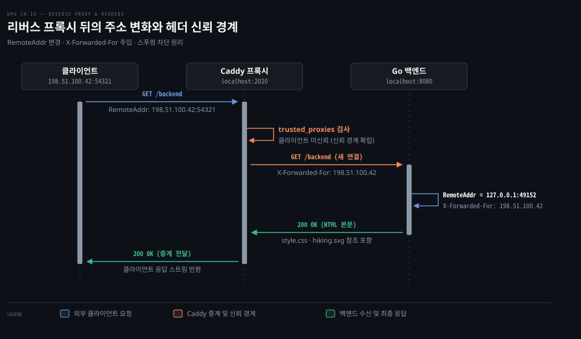
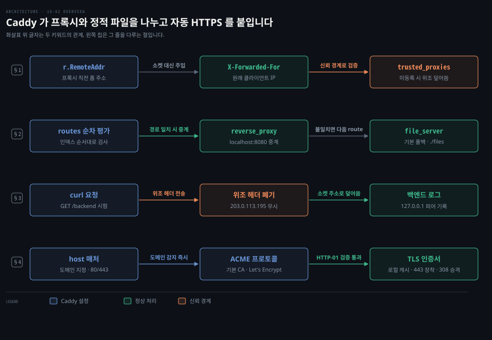
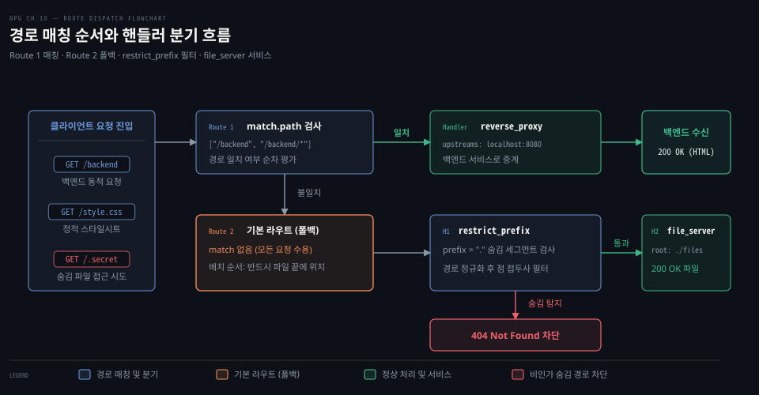
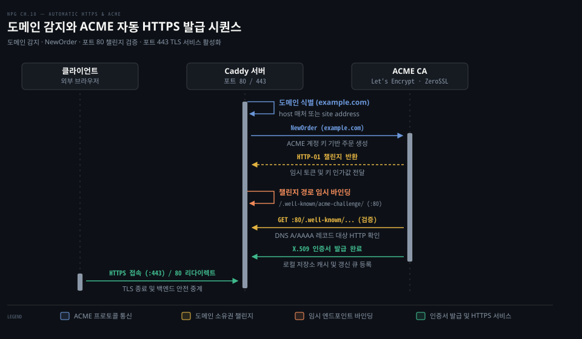

# Caddy 를 앞단에 두고 백엔드로 리버스 프록시하며 정적 파일과 자동 HTTPS 를 붙인다

---

> Caddy 를 백엔드 앞단에 두면 L7 리버스 프록시로 트래픽을 중계하고 정적 파일 서빙과 자동 HTTPS 를 위임하여 백엔드 애플리케이션의 복잡도를 낮출 수 있습니다.

## 핵심 요약

> 네트워크 경계의 Caddy 가 리버스 프록시와 정적 파일 서빙, 자동 HTTPS 를 도맡음으로써 백엔드는 순수한 비즈니스 로직에만 집중할 수 있습니다.

프록시 뒤 백엔드는 소켓 수준에서 프록시 주소만 보므로 원래 클라이언트 IP 는 `X-Forwarded-For` 헤더로 식별해야 합니다. 이때 Caddy 가 외부의 위조된 헤더를 걸러내는 신뢰 경계 역할을 합니다.

Caddy 설정의 라우트 배열은 등록된 순서대로 평가됩니다. 구체적인 경로 매처를 가진 프록시 라우트를 앞에, 매처 없는 정적 파일 기본 라우트를 뒤에 두어야 라우팅 간섭을 막을 수 있습니다.

또한 Caddy 는 도메인 이름을 감지하는 즉시 ACME 프로토콜을 통해 인증서를 자동으로 발급받고 갱신합니다. HTTP 트래픽을 HTTPS 로 자동 전환하여 전송 계층 보안을 무중단으로 유지합니다.




## 학습 목표

> 이 편을 읽고 나면 아래 다섯 가지를 스스로 해낼 수 있습니다.

1. `r.RemoteAddr` 와 `X-Forwarded-For` 차이를 구별하고 클라이언트 주소를 올바르게 식별할 수 있습니다.
2. `X-Forwarded-For` 위조를 방어하기 위한 신뢰 경계 설정 원리를 설명할 수 있습니다.
3. 경로 매처와 핸들러 체인으로 리버스 프록시와 정적 파일 서버를 분기할 수 있습니다.
4. 라우트 평가 순서 역전에 따른 라우팅 음영과 404 오류 원인을 진단할 수 있습니다.
5. 자동 HTTPS 활성화 조건, ACME 챌린지 절차, 로컬 자체 CA 동작을 설명할 수 있습니다.

아래는 이 편의 키워드를 이은 개념도입니다. §1 줄은 `X-Forwarded-For` 헤더로 클라이언트를 식별하고 `trusted_proxies` 로 위조를 막는 신뢰 경계입니다. §2 줄은 `routes` 순차 평가로 `reverse_proxy` 와 기본 `file_server` 를 가르는 경로 분기입니다. §3 줄은 `curl` 시험 시 위조 헤더를 폐기하고 실제 소켓 IP 로 덮어쓰는 신뢰 검증입니다. §4 줄은 `host` 감지 시 ACME 프로토콜로 인증서를 받아 포트 443 에 붙이는 자동 HTTPS 입니다.




## 1. 리버스 프록시와 클라이언트 식별

> 리버스 프록시를 거친 백엔드에서 소켓 주소는 프록시의 주소로 바뀌므로, 원격 클라이언트 식별은 프록시가 주입하는 헤더와 신뢰 경계 검증에 의존해야 합니다.

### 리버스 프록시와 소켓 주소 치환

백엔드 웹 서비스를 공용 인터넷에 직접 노출하면 정적 자원 전송과 TLS 인증서 관리, 보안 위협 대응 부담이 애플리케이션 코드로 넘어옵니다. 네트워크 경계에서 이 책임을 분리하려고 앞단에 중계 서버를 두는 구성을 **리버스 프록시(reverse proxy)** 라고 부릅니다. Ingress 컨트롤러가 클러스터 외부 트래픽을 받아 파드로 중계하는 구조는 [Kubernetes in Action 12-01 §1](../../../08_cloud/book/kubernetes-in-action/12-01.Ingress로%20여러%20서비스를%20한%20IP에%20노출하기.md) 과 [Ingress 와 Service Mesh 05-03 §1](../../../08_cloud/book/networking-and-kubernetes/05-03.Ingress와%20Service%20Mesh%20—%20L7의%20두%20층.md) 에서 다루었습니다.

백엔드가 클라이언트가 아니라 Caddy 와 TCP 연결을 맺으면 핸들러의 `r.RemoteAddr` 는 브라우저 IP 가 아닙니다. 백엔드로 소켓을 연 Caddy 의 루프백 주소와 임시 포트(예: `127.0.0.1:49152`)가 됩니다. 백엔드가 속도 제한이나 접근 제어, 로깅에 `r.RemoteAddr` 만 쓴다면 모든 클라이언트가 같은 주소로 인식되어 정상적인 통제가 불가능해집니다.

이를 해결하려고 Caddy 는 요청을 백엔드로 중계할 때 원래 클라이언트 IP 를 담은 [`X-Forwarded-For`](https://caddyserver.com/docs/caddyfile/directives/reverse_proxy) 헤더를 주입합니다. 백엔드는 이 헤더를 읽어 실제 요청 발신자를 식별합니다.

```go
package main

import (
	"flag"
	"fmt"
	"log"
	"net/http"
	"os"
	"os/signal"
	"time"
)

var addr = flag.String("listen", "localhost:8080", "listen address")

// 백엔드가 반환하는 HTML 은 Caddy 가 제공할 정적 자원의 상대 경로를 가리킵니다
var index = []byte(`<!DOCTYPE html>
<html lang="en">
<head>
<meta charset="UTF-8">
<title>Caddy Backend Test</title>
<link href="/style.css" rel="stylesheet">
</head>
<body>
<p></p>
</body>
</html>`)

func main() {
	flag.Parse()
	c := make(chan os.Signal, 1)
	signal.Notify(c, os.Interrupt)

	err := run(*addr, c)
	if err != nil {
		log.Fatal(err)
	}
	log.Println("Server stopped")
}

func run(addr string, c chan os.Signal) error {
	mux := http.NewServeMux()
	mux.Handle("/",
		http.HandlerFunc(func(w http.ResponseWriter, r *http.Request) {
			// Caddy 가 주입한 원래 클라이언트의 IP 주소를 확인합니다
			clientAddr := r.Header.Get("X-Forwarded-For")
			// 원래 클라이언트 IP 와 직전 홉 소켓 주소 및 요청 URL 을 함께 기록합니다
			log.Printf("%s -> %s -> %s", clientAddr, r.RemoteAddr, r.URL)
			_, _ = w.Write(index)
		}),
	)
	srv := &http.Server{
		Addr:              addr,
		Handler:           mux,
		IdleTimeout:       time.Minute,
		ReadHeaderTimeout: 30 * time.Second,
	}
	go func() {
		for {
			if <-c == os.Interrupt {
				_ = srv.Close()
				return
			}
		}
	}()
	fmt.Printf("Listening on %s ...\n", srv.Addr)
	err := srv.ListenAndServe()
	if err == http.ErrServerClosed {
		err = nil
	}
	return err
}
```

백엔드가 반환하는 HTML 의 자원 경로에는 스키마나 도메인, 포트 번호가 없습니다. 백엔드는 자신이 Caddy 뒤에서 도는지, 클라이언트가 어떤 도메인과 포트로 Caddy 에 접근했는지 알 필요가 없습니다. 브라우저는 상대 루트 경로(`/style.css`, `/hiking.svg`)에 HTML 을 요청한 주소(예: `http://localhost:2020`)를 붙여 Caddy 에 후속 요청을 보냅니다.

### X-Forwarded-For 위조와 신뢰 경계

악의적인 클라이언트는 임의의 IP(예: `203.0.113.195`)를 담은 위조 `X-Forwarded-For` 헤더를 직접 보낼 수 있습니다. 프록시가 이 헤더를 그대로 통과시킨다면 백엔드는 위조된 신원을 신뢰하게 됩니다.

Caddy 는 이 문제를 막으려고 **X-Forwarded-For 신뢰 경계**를 엄격하게 관리합니다. `reverse_proxy` 모듈은 신뢰할 상위 프록시 목록(`trusted_proxies`)이 기본적으로 비어 있습니다. 따라서 위조 헤더가 와도 Caddy 는 이를 무시하고 직전 TCP 소켓에서 확인한 실제 클라이언트 주소(`127.0.0.1`)로 덮어씁니다.

Caddy 앞단에 CDN 이나 클라우드 로드밸런서 같은 상위 프록시가 실제로 있을 때만 그 IP 대역을 `trusted_proxies` 에 등록해야 합니다. 그래야 상위 프록시가 넘긴 이전 IP 체인을 신뢰하고 자신의 직전 홉 주소를 덧붙이는 안전한 동작이 성립합니다.

리버스 프록시가 `X-Forwarded-For` 헤더를 다루는 방식은 크게 덮어쓰기(A)와 덧붙이기(B)로 나뉩니다. 두 방식 모두 널리 쓰이지만 안전을 확보하는 조건이 다릅니다.

| 방식 | 누가 헤더를 쓰나 | 백엔드가 어디서 읽나 | 안전 조건 |
|------|------------------|----------------------|-----------|
| 덮어쓰기 (A, Caddy 기본) | 최외곽 프록시가 기존 헤더를 버리고 직전 소켓 주소로 새로 씀 | 헤더 값(유일한 값)을 그대로 읽음 | 최외곽 프록시가 들어온 헤더를 반드시 덮어써야 함 |
| 덧붙이기 (B, nginx·Envoy 일반 설정) | 각 프록시가 기존 헤더 뒤에 직전 소켓 주소를 덧붙임 (nginx `$proxy_add_x_forwarded_for`) | 오른쪽부터 읽으며 신뢰 프록시를 건너뛴 첫 값을 읽음 (nginx `real_ip_recursive on`, Envoy `xff_num_trusted_hops`) | 백엔드가 오른쪽부터 역순으로 읽고 신뢰 프록시 목록이 정확해야 함 |


## 2. 경로별 라우팅

> Caddy 는 경로별로 프록시와 정적 파일을 가릅니다. 설정의 라우트 배열을 순차 평가하므로, 구체적인 매처를 가진 프록시 라우트 뒤에 매처가 없는 기본 파일 라우트를 배치해야 합니다.

### 경로 매처와 핸들러 체인 구성

단일 포트로 들어오는 요청을 전부 백엔드로 넘기면 CSS 나 이미지 같은 정적 파일까지 Go 런타임이 감당해야 하므로 서버 자원이 낭비됩니다. 동적 요청은 백엔드로 넘기고 정적 파일은 웹 서버가 디스크에서 직접 읽어 반환해야 효율적입니다. Caddy 는 기본 설정 형식인 JSON 으로 경로 패턴별 핸들러를 분기합니다. 관리 API 와 설정 구조는 [10-01](./10-01.Caddy%20는%20JSON%20설정을%20관리%20API%20로%20실시간%20바꾸고%20모듈과%20어댑터로%20넓힌다.md) 에 나옵니다.

10-01 §4 의 TOML 어댑터는 TOML 을 그대로 JSON 으로 옮기므로 결과는 아래 JSON 과 같은 구조입니다. 그래서 `caddy.toml` 에도 `[apps.http.servers.test_server]` 처럼 Caddy 가 기대하는 네임스페이스를 써야 합니다.

서버 객체는 `apps.http.servers` 아래에 두고 수신 주소와 라우트 목록을 지정합니다. 목표는 `/backend` 와 그 하위 경로 요청은 백엔드로 중계하고, 그 외 요청은 로컬 디스크의 정적 파일로 응답하는 것입니다.

```json
{
  "apps": {
    "http": {
      "servers": {
        "test_server": {
          "listen": [
            "localhost:2020"
          ],
          "routes": [
            {
              "match": [
                {
                  "path": [
                    "/backend",
                    "/backend/*"
                  ]
                }
              ],
              "handle": [
                {
                  "handler": "reverse_proxy",
                  "upstreams": [
                    {
                      "dial": "localhost:8080"
                    }
                  ]
                }
              ]
            },
            {
              "handle": [
                {
                  "handler": "restrict_prefix",
                  "prefix": "."
                },
                {
                  "handler": "file_server",
                  "root": "./files",
                  "index_names": [
                    "index.html"
                  ]
                }
              ]
            }
          ]
        }
      }
    }
  }
}
```

`routes[0]` 은 경로 매처(`match`)를 가집니다. 정확한 경로 `/backend` 나 하위 경로 와일드카드 `/backend/*` 에 일치하는 요청만 골라 `reverse_proxy` 핸들러로 넘깁니다. 핸들러는 업스트림 소켓 주소(`localhost:8080`)로 보냅니다. 이때 Caddy 의 리버스 프록시는 백엔드와의 TCP 연결을 풀링해 지속 연결(Keep-Alive)로 재사용합니다. Go 클라이언트의 연결 재사용 원리는 [08-02 §2](./08-02.Go%20HTTP%20클라이언트는%20응답%20본문을%20닫아야%20연결을%20재사용하고%20context%20로%20요청을%20끊는다.md#2-응답-본문을-끝까지-읽고-닫아야-연결이-재사용된다) 에서 다루었습니다.

`routes[1]` 은 매처가 없습니다. 앞선 라우트에서 처리되지 않은 모든 요청이 흘러 들어오므로 일종의 기본(fallback) 라우트 역할을 합니다. 이 라우트의 핸들러 배열에는 두 모듈이 순서대로 연결됩니다.

첫째 핸들러는 숨김 파일 접근을 막는 `restrict_prefix` 미들웨어입니다. URL 경로 세그먼트를 검사해 점(`.`)으로 시작하는 민감한 설정 파일이나 디렉터리 요청을 404 Not Found 로 차단합니다. 이 모듈의 내부 구현 원리는 [10-01 §5](./10-01.Caddy%20는%20JSON%20설정을%20관리%20API%20로%20실시간%20바꾸고%20모듈과%20어댑터로%20넓힌다.md#5-restrict-prefix-모듈) 과 [09-02 §3](./09-02.미들웨어는%20핸들러를%20감싸고%20ServeMux%20는%20경로를%20나누며%20HTTP2%20서버%20푸시는%20브라우저가%20걷어냈다.md) 에서 다루었습니다.

둘째 핸들러는 표준 `file_server` 모듈입니다. `./files` 디렉터리를 루트로 삼아 디스크에서 파일을 찾아 응답합니다. 파일명이 지정되지 않은 폴더 요청에는 `index.html` 을 기본 반환합니다.



### 라우트 순차 평가와 음영 방지

Caddy 는 라우트 배열을 등록된 순서대로 앞에서부터 검사합니다. 기본 라우트(`routes[1]`)를 배열 맨 앞으로 옮기면 심각한 장애가 납니다. 매처가 없는 라우트는 들어오는 모든 요청과 무조건 일치하므로 `/backend` 요청조차 첫 라우트에 잡혀 `file_server` 로 갑니다. 파일 서버는 디스크의 `./files/backend` 를 찾다가 파일이 없으므로 404 Not Found 를 반환합니다. 결과적으로 뒤의 `reverse_proxy` 라우트는 어떤 요청도 도달하지 못하는 죽은 코드가 됩니다.

따라서 구체적인 매처를 가진 라우트는 항상 배열 앞쪽에, 조건이 없는 폴백 라우트는 반드시 맨 마지막에 두어야 합니다.


## 3. 동작 검증

> 실제 요청을 보내어 결과를 확인합니다. 정적 파일 서빙, 리버스 프록시 중계, 숨김 파일 차단, 프록시 헤더 덮어쓰기가 의도대로 동작하는지 단계별로 검증합니다.

리버스 프록시와 파일 서버, 보안 미들웨어를 함께 구성하면 설정 문법 검증만으로는 실제 트래픽 분기와 헤더 주입이 올바른지 확신하기 어렵습니다. 정적 디렉터리(`./files`)에 `index.html`·`style.css`·`sage.svg`·`hiking.svg`·`.secret`·`.dir/secret` 을 둡니다. 백엔드는 `8080`, Caddy 는 `2020` 포트에서 띄웁니다.

```bash
# 백엔드 서버를 백그라운드에서 실행합니다
go run backend/main.go &

# Caddy 를 준비된 JSON 설정으로 실행합니다
caddy run --config caddy.json
```

첫째, 루트 경로(`http://localhost:2020/`)로 요청을 보냅니다.

```bash
curl -i http://localhost:2020/
```

요청 경로가 `/backend` 가 아니므로 Route 1 매처를 지나 Route 2 로 넘어갑니다. `restrict_prefix` 검사를 거친 뒤 `file_server` 가 200 OK 와 함께 `index.html` 을 반환합니다. 브라우저는 응답에 든 `/style.css` 와 `/sage.svg` 를 Caddy 에서 차례로 내려받아 화면을 그립니다.

둘째, 백엔드 엔드포인트(`http://localhost:2020/backend`)로 요청을 보냅니다.

```bash
curl -i http://localhost:2020/backend
```

Route 1 의 경로 매처와 일치하므로 `reverse_proxy` 핸들러가 백엔드 소켓(`localhost:8080`)으로 요청을 넘깁니다. 백엔드 서버 표준 출력에는 아래 로그가 남습니다.

```bash
2026/10/07 11:16:21 127.0.0.1 -> 127.0.0.1:60481 -> /backend
```

로그의 첫째 값은 `X-Forwarded-For` 헤더에서 읽은 클라이언트 주소(`127.0.0.1`)입니다. 둘째 값은 백엔드가 직접 확인한 소켓 피어 주소(`127.0.0.1:60481`)입니다. 이 값은 백엔드에 접속한 주체가 브라우저가 아니라 Caddy 의 임시 포트임을 보여 줍니다.

HTML 이 가리키는 `/style.css`·`/hiking.svg` 는 Caddy 의 정적 파일 서버가 응답합니다. 백엔드는 정적 파일을 읽는 부담 없이 HTML 응답만 생성합니다.

셋째, 클라이언트가 위조된 헤더를 실어 보낼 때의 동작을 시험합니다.

```bash
curl -i -H "X-Forwarded-For: 203.0.113.195" http://localhost:2020/backend
```

백엔드 로그에서 클라이언트가 보낸 `203.0.113.195` 는 사라지고 Caddy 에 실제로 접속한 피어 주소 `127.0.0.1` 만 기록됩니다. Caddy 가 신뢰할 수 없는 클라이언트의 헤더를 덮어써 신뢰 경계를 지켰다는 증거입니다. 반면 Caddy 에 `trusted_proxies: ["127.0.0.1/32"]` 를 설정하면 Caddy 는 그 피어를 상위 프록시로 인정해 `203.0.113.195, 127.0.0.1` 처럼 체인으로 덧붙입니다.

넷째, 숨김 파일 접근(`http://localhost:2020/.secret`, `http://localhost:2020/.dir/secret`)을 시도합니다.

```bash
curl -i http://localhost:2020/.secret
```

Route 2 의 `restrict_prefix` 가 점 접두사를 감지해 404 Not Found 로 즉시 차단합니다. 뒤따르는 `file_server` 는 호출조차 되지 않습니다.

| 요청 경로 및 조건 | 매칭 라우트 | 처리 핸들러 | 기대 상태 코드 | 검증 목적 |
|---|---|---|---|---|
| `GET /` | Route 2 (기본) | `file_server` | 200 OK | 정적 `index.html` 기본 반환 |
| `GET /style.css` | Route 2 (기본) | `file_server` | 200 OK | 백엔드 대신 정적 파일 서빙 |
| `GET /backend` | Route 1 (매칭) | `reverse_proxy` | 200 OK | 백엔드 중계 및 헤더 주입 |
| `GET /backend` (위조 헤더) | Route 1 (매칭) | `reverse_proxy` | 200 OK | 위조 헤더 폐기 및 신뢰 경계 확립 |
| `GET /.secret` | Route 2 (기본) | `restrict_prefix` | 404 Not Found | 숨김 설정 파일 노출 차단 |


## 4. 자동 HTTPS

> Caddy 는 도메인과 열린 포트를 조건으로 인증서를 받아 옵니다. 도메인을 감지하면 ACME 프로토콜을 통해 Let's Encrypt 같은 공개 CA 로부터 인증서를 자동 발급받고 갱신하며 포트 80 트래픽을 안전하게 리다이렉트합니다.

### 자동 HTTPS 활성화 조건

인증서 만료 사고는 웹 서비스 장애의 흔한 원인 중 하나입니다. 외부 스크립트나 크론 작업에 의존하는 수동 TLS 관리는 갱신 누락 위험을 안고 있습니다. TLS 의 기본 원리와 인증서, CA 의 역할은 [컨테이너 보안 11-01 §1](../../../08_cloud/book/container-security/11-01.TLS로%20컴포넌트%20안전하게%20연결하기%20—%20키·인증서·CA의%20역할.md) 과 [Kubernetes in Action 12-02 §1](../../../08_cloud/book/kubernetes-in-action/12-02.Ingress%20TLS·설정·IngressClass.md) 에서 다루었습니다.

Caddy 는 웹 서버 자체에 완전 자동화된 HTTPS 관리 엔진을 내장해, 외부 도구 없이 스스로 인증서를 획득하고 만료 전에 갱신합니다. 이를 통해 TLS 를 종료하고 백엔드로 트래픽을 안전하게 중계하는 **TLS 종료(TLS termination)** 를 완성합니다. 공식 문서에 따른 활성화 조건은 네 가지입니다.

1. **도메인 이름 또는 호스트 식별**: JSON 설정의 최상위 라우트에 `host` 매처가 있거나 Caddyfile 에 사이트 주소가 있어야 합니다. 단순히 `localhost:2020` 처럼 소켓에만 바인딩하면 Caddy 는 서비스할 도메인을 알 수 없어 자동 HTTPS 를 켜지 않습니다.
2. **공용 DNS 레코드 일치**: 대상 도메인의 A 또는 AAAA 레코드가 Caddy 서버의 공용 IP 를 가리켜야 합니다.
3. **외부 포트 개방**: 공용 인터넷에서 표준 HTTP 포트(80)와 HTTPS 포트(443)로 들어오는 트래픽이 Caddy 서버에 도달할 수 있어야 합니다.
4. **영속 저장소**: 인증서와 개인키를 저장할 로컬 데이터 디렉터리(`$HOME/.local/share/caddy` 등)에 쓰기 권한이 있어야 합니다.

```json
{
  "apps": {
    "http": {
      "servers": {
        "secure_server": {
          "routes": [
            {
              "match": [
                {
                  "host": [
                    "example.com"
                  ]
                }
              ],
              "handle": [
                {
                  "handler": "reverse_proxy",
                  "upstreams": [
                    {
                      "dial": "localhost:8080"
                    }
                  ]
                }
              ]
            }
          ]
        }
      }
    }
  }
}
```

위 설정처럼 `host: ["example.com"]` 매처가 부여되면, Caddy 는 기동 즉시 백그라운드에서 [ACME 프로토콜(RFC 8555)](https://www.rfc-editor.org/rfc/rfc8555) 을 시작합니다.



### ACME 챌린지와 인증서 발급 절차

인증서 발급은 챌린지 검증을 거칩니다.

첫째, Caddy 가 CA 에 `NewOrder` 요청을 보냅니다. 기본 발급자는 Let's Encrypt 하나입니다. 설정에 이메일 주소를 적으면 Caddy v2.8.0 부터 ZeroSSL 이 두 번째 발급자로 붙습니다. 발급자가 둘이면 앞 발급자가 속도 제한(rate limit)이나 장애로 실패해도 다음 발급자로 넘어가 발급을 이어 갑니다. 버전별 차이는 [10-01 §1](./10-01.Caddy%20는%20JSON%20설정을%20관리%20API%20로%20실시간%20바꾸고%20모듈과%20어댑터로%20넓힌다.md#1-에지-프록시와-자동-tls)에 있습니다.

공개 CA 가 확인하는 것은 서버가 안전한지가 아니라 신청자가 이 이름을 제어하는가입니다([RFC 8555 §8](https://www.rfc-editor.org/rfc/rfc8555#section-8)). 일회용 토큰을 그 이름의 서버나 공개 DNS 에 놓을 수 있는 쪽만 통과합니다. 그래서 공개 DNS 에 없는 사내 전용 이름은 공개 CA 로 인증서를 받을 수 없습니다.

둘째, CA 가 해당 도메인의 소유권을 증명하도록 **HTTP-01 챌린지**를 발행하고 일회용 암호화 토큰과 인가 키를 전달합니다.

셋째, Caddy 가 포트 80 의 `/.well-known/acme-challenge/<token>` 요청을 가로채 토큰을 돌려주는 임시 핸들러를 자동으로 켭니다.

넷째, CA 가 도메인(`example.com:80`)으로 직접 HTTP 접속을 시도해 토큰을 검증합니다. 검증이 끝나면 Caddy 는 로컬에서 만든 개인키 기반의 CSR(인증서 서명 요청)을 보내고, CA 는 서명된 X.509 인증서를 발행합니다.

다섯째, Caddy 가 인증서를 로컬 스토리지에 캐시하고 포트 443 에서 안전한 TLS 핸드셰이크를 시작합니다. 동시에 포트 80 으로 들어오는 일반 HTTP 요청은 308 영구 리다이렉트로 `https://example.com` 으로 자동 승격시킵니다.

### 대체 챌린지

방화벽 제약 등으로 포트 80 을 열 수 없으면 포트 443 에서 특수 TLS 핸드셰이크를 나누는 **TLS-ALPN-01 챌린지**가 자동으로 대안이 됩니다. 와일드카드 도메인(`*.example.com`) 발급이나 포트를 열 수 없는 폐쇄망에서는 **DNS-01 챌린지**를 플러그인과 함께 구성할 수 있습니다. 이 챌린지는 DNS 공급자 API 로 TXT 레코드를 다룹니다.

### 내부 CA 와 IP 주소 인증서

로컬 개발 호스트(`localhost`·`127.0.0.1`)에는 공용 CA 대신 Caddy 의 **자체 내부 CA(Internal CA)** 가 동작합니다. Smallstep 라이브러리 기반으로 루트 및 중간 CA 를 로컬에서 만듭니다. Caddy 는 기동할 때 운영체제 트러스트 스토어에 "Caddy Local Authority" 루트 인증서를 자동 등록합니다. 그래서 브라우저 보안 경고 없이 HTTPS 환경을 시험할 수 있습니다.

도메인 없이 IP 주소만으로 공인 인증서를 받는 길도 생겼습니다. [Let's Encrypt 는 2026년 1월 15일](https://letsencrypt.org/2026/01/15/6day-and-ip-general-availability) IP 주소 인증서와 유효기간 160시간(6일 남짓)짜리 단기 인증서를 정식으로 내놓았습니다. [IP 주소 인증서는 반드시 단기 인증서여야 하고](https://letsencrypt.org/2025/07/01/issuing-our-first-ip-address-certificate) 제어권 증명도 HTTP-01·TLS-ALPN-01 챌린지로만 할 수 있습니다. IP 주소는 DNS 이름이 아니므로 DNS-01 챌린지는 쓸 수 없습니다.

Caddy 의 기본 동작은 이와 다릅니다. [자동 HTTPS 문서](https://caddyserver.com/docs/automatic-https)는 IP 주소와 내부 호스트 이름을 Caddy 가 직접 만든 자체 서명 인증서로 서빙한다고 적습니다. 위 `127.0.0.1` 이 내부 CA 로 가는 것도 이 규칙입니다.


## 결정 치트시트

> Caddy 를 백엔드 앞단에 둘 때 상황별로 고를 설정입니다.

| 상황 | 쓸 설정 | 이유 |
|---|---|---|
| 백엔드가 원래 클라이언트 IP 를 알아야 함 | `X-Forwarded-For` 헤더를 읽음 | `r.RemoteAddr` 엔 프록시가 연 소켓 주소가 찍힘 |
| Caddy 가 인터넷에 바로 노출된 최외곽 | `trusted_proxies` 를 비워 둠(기본값) | 클라이언트가 보낸 `X-Forwarded-For` 를 버리고 피어 IP 로 덮어씀 |
| Caddy 앞에 CDN·로드밸런서가 있음 | 그 대역만 `trusted_proxies` 에 등록 | 신뢰한 홉이 보낸 체인만 보존하고 직전 홉 IP 를 덧붙임 |
| 동적 경로와 정적 파일을 한 포트에서 나눔 | 매처 있는 `reverse_proxy` 라우트를 앞, 매처 없는 `file_server` 라우트를 뒤 | 앞 라우트부터 평가해 매처 없는 라우트가 앞에 오면 뒤를 가림 |
| 정적 디렉터리에 숨김 파일이 섞여 있음 | `restrict_prefix` 를 `file_server` 앞 칸에 둠 | `.` 으로 시작하는 세그먼트를 404 로 끊어 파일 서버 호출을 막음 |
| 공개 도메인에 HTTPS | `host` 매처 + DNS 레코드 + 80·443 개방 + 영속 저장소 | ACME 로 자동 발급·갱신하고 80 을 443 으로 넘김 |
| 와일드카드 인증서이거나 포트를 열 수 없음 | DNS-01 챌린지(DNS 공급자 모듈) | HTTP-01·TLS-ALPN-01 은 CA 가 80·443 으로 들어와야 검증됨 |


## 면접 대비

> 아래 질문에 답하면서 Caddy 의 리버스 프록시 중계, 라우팅 우선순위, 그리고 자동 HTTPS 동작 원리를 설명해 보세요.

1. 리버스 프록시 환경에서 백엔드 서버의 `r.RemoteAddr` 가 변경되는 이유를 설명하고, `X-Forwarded-For` 헤더를 다룰 때 신뢰 경계를 어떻게 확보해야 하는지 말씀해 주세요.
2. Caddy 의 JSON 설정에서 라우트 평가 순서가 갖는 의미를 설명하고, 매처가 없는 기본 라우트와 특정 경로 매처 라우트의 배치 순서가 뒤바뀌면 어떤 문제가 생기는지 설명해 주세요.
3. Caddy 가 외부 도메인에 대해 자동 HTTPS 를 활성화하기 위해 요구하는 필수 조건과 인증서 발급 프로세스를 설명해 주세요.
4. ACME 프로토콜에서 HTTP-01 챌린지와 TLS-ALPN-01 챌린지의 검증 방식 차이를 설명하고, Caddy 의 기본 발급자와 발급자를 둘 이상 두었을 때 달라지는 점을 말씀해 주세요.


## 정답 (자답 후 펼치기)

> 위 §면접 대비의 질문에 먼저 스스로 답한 뒤 읽으세요.

### 정답 1 — 주소 치환과 X-Forwarded-For 위조 방어

리버스 프록시 뒤 백엔드는 프록시와 TCP 연결을 맺어 `r.RemoteAddr` 가 프록시의 IP 와 포트로 바뀝니다. 원래 클라이언트는 프록시가 주입하는 `X-Forwarded-For` 헤더에 의존해 알아내야 합니다.

악의적인 클라이언트의 위조를 막으려면 최외곽 프록시가 클라이언트가 보낸 헤더를 무조건 신뢰하지 않고 실제 소켓 피어 IP 로 덮어써야 합니다. 이전 IP 체인은 사전에 승인된 `trusted_proxies` 대역 요청에만 보존해야 합니다.

### 정답 2 — 라우트 순차 평가 규칙과 기본 라우트 라우팅 음영

Caddy 는 라우트 배열을 앞에서부터 순서대로 평가합니다. 매처가 없는 라우트는 모든 요청과 무조건 일치하는 와일드카드 폴백 역할을 합니다. 이 기본 파일 서버 라우트가 `/backend` 매처 라우트보다 앞에 오면 `/backend` 요청까지 파일 서버로 가서, 파일 서버가 그 이름의 정적 파일을 찾다가 실패해 404 가 납니다. 뒤의 리버스 프록시 라우트는 절대 실행되지 못하는 라우팅 음영 결함이 생깁니다.

### 정답 3 — 도메인 식별 및 외부 포트 개방과 백그라운드 발급

자동 HTTPS 가 켜지려면 설정에 대상 도메인(`host` 매처)이 있어야 합니다. 또한 DNS A/AAAA 레코드가 서버 IP 를 가리키고 포트 80·443 이 외부에 열려 있으며 영속 스토리지 쓰기 권한이 있어야 합니다. Caddy 는 기동 시 이 조건을 확인하고 백그라운드에서 ACME 클라이언트를 돌립니다. CA 에 주문을 넣고 챌린지 경로를 임시로 바인딩해 소유권을 입증한 뒤 인증서를 받아 443 포트에 붙입니다.

### 정답 4 — 챌린지 포트 차이와 발급자 장애 조치

HTTP-01 은 포트 80 의 `/.well-known/acme-challenge/` 경로로 일회용 토큰을 검증합니다. TLS-ALPN-01 은 포트 443 TLS 핸드셰이크에서 ALPN 토큰을 검증해 포트 80 개방 없이 소유권을 증명합니다. Caddy 기본 발급자는 Let's Encrypt 이며, v2.8.0 부터는 이메일을 설정했을 때만 ZeroSSL 이 두 번째 발급자로 붙습니다. 발급자가 둘 이상이면 앞 발급자가 장애나 속도 제한으로 실패해도 다음 발급자로 넘어가므로, CA 하나의 문제로 발급·갱신이 멈추지 않습니다.


## 참고 자료

- 《Network Programming with Go》 Adam Woodbeck, 2021. ISBN 978-1-7185-0088-4. Chapter 10 Caddy: A Contemporary Web Server (Listing 10-9~10-14).
- [Caddy 공식 문서: Automatic HTTPS](https://caddyserver.com/docs/automatic-https): 자동 HTTPS 요구 조건, 발급자 정책, 로컬 CA 동작.
- [Caddy 공식 문서: reverse_proxy](https://caddyserver.com/docs/caddyfile/directives/reverse_proxy): 업스트림 설정과 `trusted_proxies` 신뢰 경계 동작.
- [RFC 8555: Automatic Certificate Management Environment (ACME)](https://www.rfc-editor.org/rfc/rfc8555): ACME 프로토콜 표준.
- [RFC 7239: Forwarded HTTP Extension](https://www.rfc-editor.org/rfc/rfc7239): 프록시 전달 헤더 표준.


## 관련 문서

- [10-01 Caddy 는 JSON 설정을 관리 API 로 실시간 바꾸고 모듈과 어댑터로 넓힌다](./10-01.Caddy%20는%20JSON%20설정을%20관리%20API%20로%20실시간%20바꾸고%20모듈과%20어댑터로%20넓힌다.md): Caddy 구조·관리 API·설정 어댑터·restrict prefix 모듈 구현.
- [09-02 미들웨어는 핸들러를 감싸고 ServeMux 는 경로를 나누며 HTTP/2 서버 푸시는 브라우저가 걷어냈다](./09-02.미들웨어는%20핸들러를%20감싸고%20ServeMux%20는%20경로를%20나누며%20HTTP2%20서버%20푸시는%20브라우저가%20걷어냈다.md): Go 표준 HTTP 미들웨어 체인과 restrict prefix 패턴.
- [08-02 Go HTTP 클라이언트는 응답 본문을 닫아야 연결을 재사용하고 context 로 요청을 끊는다](./08-02.Go%20HTTP%20클라이언트는%20응답%20본문을%20닫아야%20연결을%20재사용하고%20context%20로%20요청을%20끊는다.md): 지속 연결·업스트림 연결 재사용.
- [Kubernetes in Action 12-01 Ingress 로 여러 서비스를 한 IP에 노출하기](../../../08_cloud/book/kubernetes-in-action/12-01.Ingress로%20여러%20서비스를%20한%20IP에%20노출하기.md): L7 리버스 프록시·단일 진입점 분기.
- [Kubernetes in Action 12-02 Ingress TLS·설정·IngressClass](../../../08_cloud/book/kubernetes-in-action/12-02.Ingress%20TLS·설정·IngressClass.md): Ingress 수준 TLS 종료·인증서 시크릿.
- [Ingress 와 Service Mesh 05-03 Ingress 와 Service Mesh — L7 의 두 층](../../../08_cloud/book/networking-and-kubernetes/05-03.Ingress와%20Service%20Mesh%20—%20L7의%20두%20층.md): L7 트래픽 중계·게이트웨이 경계.
- [컨테이너 보안 11-01 TLS 로 컴포넌트 안전하게 연결하기 — 키·인증서·CA 의 역할](../../../08_cloud/book/container-security/11-01.TLS로%20컴포넌트%20안전하게%20연결하기%20—%20키·인증서·CA의%20역할.md): 공개키 암호화·X.509 인증서·CA 신뢰 체인.
- [Network Programming with Go 정독 인덱스](./README.md): 전체 챕터 구성·학습 진행 상황.
