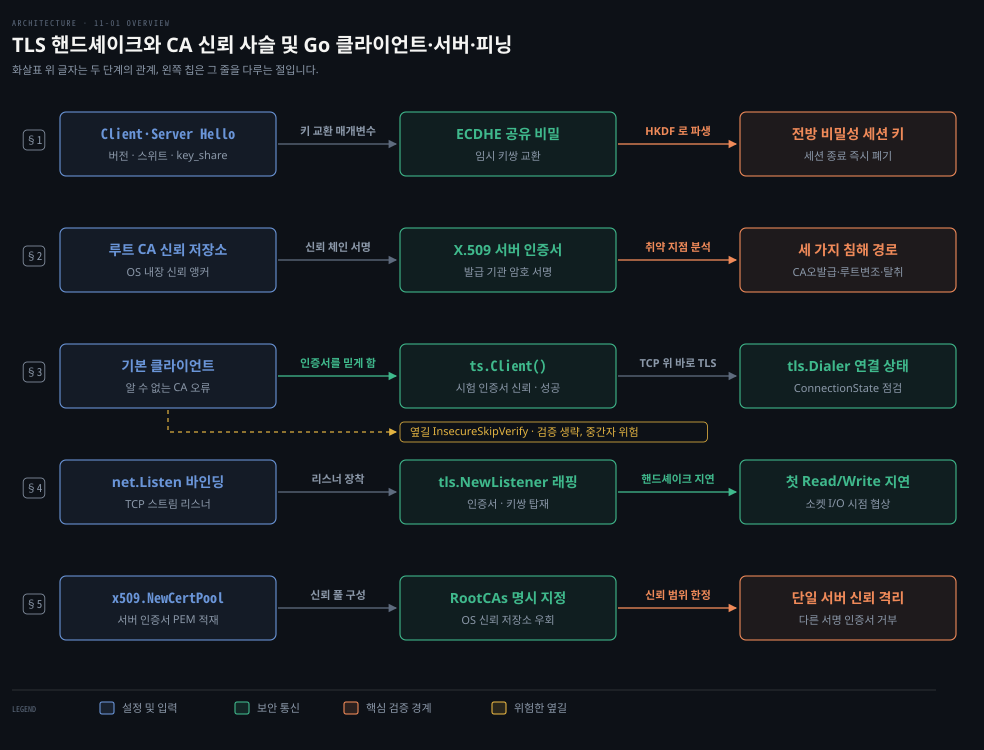
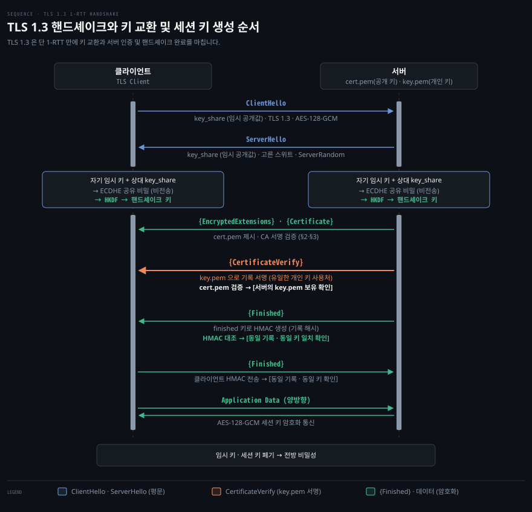
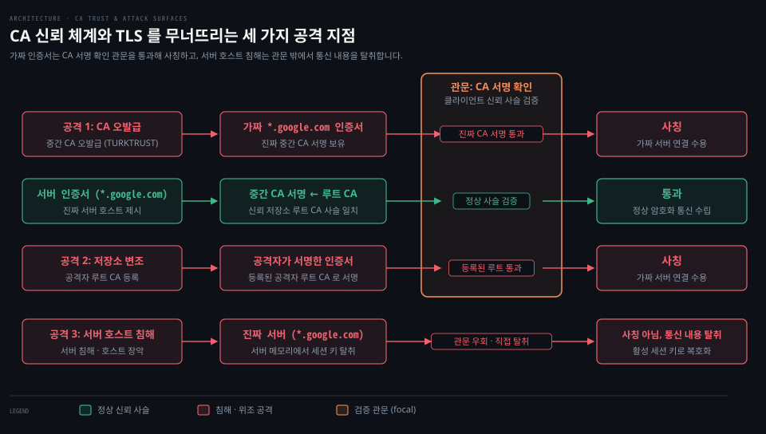
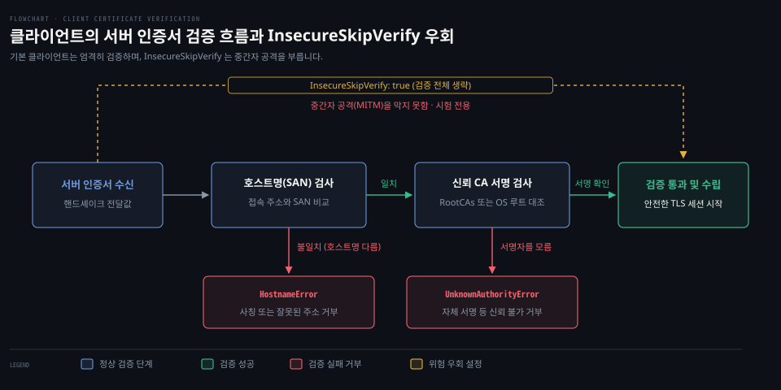
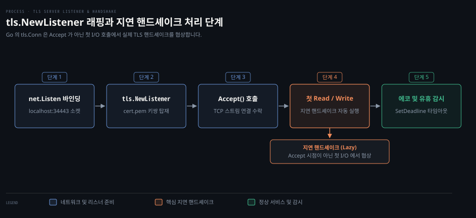
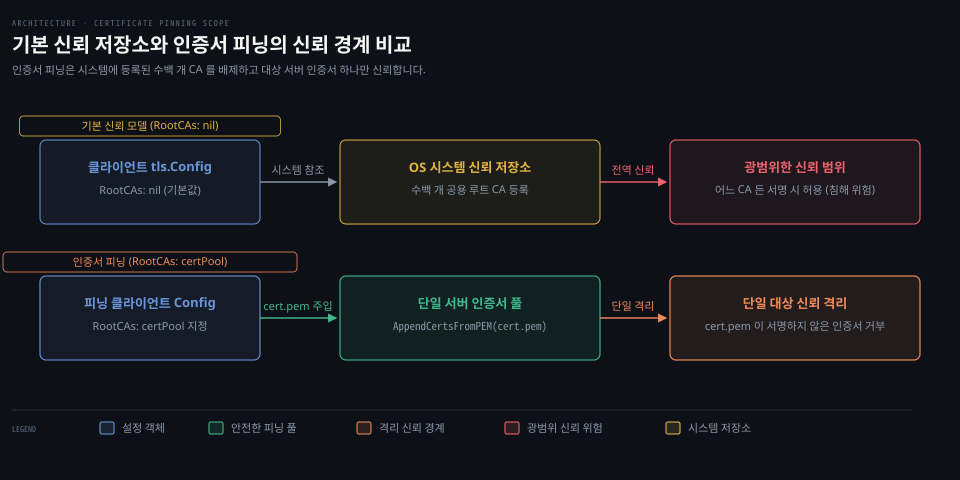

# TLS 클라이언트는 CA 서명으로 서버를 확인하고 서버는 리스너를 감싸며 피닝은 믿을 인증서를 좁힌다

---

> TLS 는 TCP 연결 위에서 핸드셰이크로 세션마다 새 대칭 키를 만들고, 클라이언트는 믿는 CA 의 서명과 호스트명으로 서버를 확인합니다. 자체 서명 서버라면 인증서 피닝으로 믿을 인증서를 그 서버 하나로 좁힙니다.

## 핵심 요약

> 전송 계층 보안(TLS)은 믿을 수 없는 네트워크 위에서 핸드셰이크로 만든 키로 내용을 암호화해 도청을 막고, CA 서명을 확인해 사칭한 서버를 걸러 냅니다.

클라이언트와 서버는 핸드셰이크에서 이번 연결에만 쓸 임시 키쌍의 공개키를 주고받아 세션 대칭 키를 만듭니다. 세션 키는 서버의 장기 개인 키에서 나오지 않고 세션이 끝나면 버려지므로 나중에 장기 키가 새어도 지난 통신은 풀리지 않습니다. 이 성질을 전방 비밀성이라고 합니다.

클라이언트는 서버 인증서에서 발급자를 따라 운영체제 신뢰 저장소의 루트 CA 까지 올라가며 서명을 확인합니다. 인증서에 적힌 호스트명이 접속한 주소와 맞는지도 봅니다. 자체 서명 인증서를 다룬다고 `InsecureSkipVerify` 로 검증을 끄면 중간자 공격을 막을 길이 없습니다.

Go 서버는 일반 TCP 리스너를 `tls.NewListener` 로 감쌉니다. 핸드셰이크는 `Accept` 가 아니라 연결의 첫 `Read`·`Write` 에서 일어납니다. 자체 서명 서버에 붙는 클라이언트는 `RootCAs` 에 그 서버 인증서만 담아 믿을 대상을 좁힙니다. 이것이 인증서 피닝입니다.


## 학습 목표

> 이 편을 읽고 나면 아래 다섯 가지를 스스로 해낼 수 있습니다.

1. TLS 1.3 핸드셰이크에서 양측이 교환하는 메시지, 키 유도 과정, 다운그레이드 방어 메커니즘을 설명할 수 있습니다.
2. 공개키 인증서가 신분증 노릇을 하는 원리와 TLS 신뢰 모델을 위협하는 세 가지 공격 경로를 구별할 수 있습니다.
3. Go HTTP 클라이언트의 인증서 검증 절차와 `InsecureSkipVerify` 의 결함을 진단하고 `tls.Dialer` 로 연결 상태를 점검할 수 있습니다.
4. `tls.NewListener` 로 TCP 리스너를 TLS 리스너로 확장하고, 첫 `Read` 또는 `Write` 에서 일어나는 지연 핸드셰이크와 유휴 데드라인을 구현할 수 있습니다.
5. `x509.NewCertPool` 을 활용해 특정 서버 인증서만 신뢰하는 인증서 피닝 클라이언트를 구성하고 트레이드오프를 평가할 수 있습니다.

아래는 이 편의 키워드를 이은 개념도입니다. 줄마다 한 절을 맡습니다.

- §1 줄: 핸드셰이크와 임시 키 교환으로 전방 비밀성 세션 키를 만드는 과정
- §2 줄: 루트 CA 신뢰 저장소, 서버 인증서 서명 체계, 세 가지 침해 경로
- §3 줄: 기본 클라이언트의 검증 실패, 시험 서버 인증서를 믿는 `ts.Client()`, 위험한 옆길인 `InsecureSkipVerify`, `tls.Dialer` 로 TCP 위에 바로 TLS 를 열어 연결 상태를 확인하는 흐름
- §4 줄: `tls.NewListener` 래핑과 첫 I/O 시점의 지연 핸드셰이크
- §5 줄: `RootCAs` 풀에 서버 인증서를 직접 넣어 믿을 대상을 그 서버 하나로 좁히는 인증서 피닝




## 1. TLS 핸드셰이크와 세션 키

> TLS 는 전송 계층 소켓과 애플리케이션 프로토콜 사이에서 동작하며, 한 번 왕복하는 동안 임시 공개키를 주고받아 세션 키를 만들고 그 키를 세션이 끝나면 버립니다.

네트워크를 오가는 데이터는 암호화하지 않으면 전송 경로에 놓인 모든 스위치와 라우터, 악의적 도청자에게 평문 그대로 노출됩니다. 이름과 달리 **전송 계층 보안(TLS)** 은 엄밀한 L4 전송 계층 프로토콜이 아닙니다. TCP 와 HTTP 같은 애플리케이션 프로토콜 사이에 놓이는 보안 계층입니다. 보내는 쪽 TLS 는 애플리케이션 데이터를 암호화해 TLS 레코드로 감싼 뒤 TCP 에 넘깁니다. 받는 쪽 TLS 는 TCP 에서 받은 레코드를 풀어 애플리케이션에 건넵니다.



### key_share 교환과 1-RTT

TLS 1.3 핸드셰이크는 [RFC 8446 §2](https://www.rfc-editor.org/rfc/rfc8446#section-2) 규격에 따라 1-RTT, 즉 한 번 왕복으로 암호화 세션을 엽니다.

클라이언트는 연결을 열자마자 `ClientHello` 메시지를 서버로 보냅니다. 여기에 지원하는 TLS 버전 목록(TLS 1.3)과 암호 스위트 목록(`TLS_AES_128_GCM_SHA256` 등)을 싣습니다. 키 교환에 필요한 임시 공개키 파라미터인 `key_share` 확장 필드도 함께 보냅니다.

서버는 `ClientHello` 를 확인하고 `ServerHello` 로 응답합니다. 자신이 선택한 암호 스위트와 서버 측 임시 공개키 파라미터(`key_share`), 그리고 서버 난수(Server Random)를 보냅니다.

### ServerHello 난수의 다운그레이드 표지

서버 난수에는 [RFC 8446 §4.1.3](https://www.rfc-editor.org/rfc/rfc8446#section-4.1.3) 의 **다운그레이드 공격 방어** 표지가 들어갈 수 있습니다. 공격자가 중간에서 `ClientHello` 를 고쳐 TLS 1.2 이하로 협상하게 만들려 한다고 해 봅시다.

TLS 1.3 을 지원하는 서버가 TLS 1.2 로 협상하게 되면 32바이트 `ServerHello.random` 의 마지막 8바이트를 `44 4F 57 4E 47 52 44 01` 로 채웁니다. ASCII 로 읽으면 `DOWNGRD` 와 `01` 입니다. TLS 1.1 이하로 협상하면 마지막 바이트가 `00` 인 값을 씁니다.

TLS 1.3 클라이언트는 TLS 1.2 이하를 알리는 `ServerHello` 를 받으면 마지막 8바이트가 이 두 값 중 하나인지 봅니다. 맞으면 `illegal_parameter` 경고와 함께 핸드셰이크를 끊습니다. Go 의 `crypto/tls` 도 서버 핸드셰이크에서 이 표지를 넣고 클라이언트 핸드셰이크에서 확인합니다.

### ECDHE 세션 키와 상대 확인

양측은 자기 임시 개인 키와 상대의 `key_share` 공개키를 결합해 **ECDHE(임시 키를 쓰는 타원곡선 디피-헬만)** 공유 비밀을 각자 계산합니다. 이 공유 비밀 자체는 네트워크로 오가지 않습니다. 디피-헬만 키 교환의 수학적 원리와 중간자 개입 차단 원리는 [컴퓨터 네트워킹 하향식 접근 08-02 §1](../cntd_computer-networking-top-down/08-02.열쇠를%20나눠%20갖지%20않고%20어떻게%20비밀을%20만드는가.md) 과 [08-03 §1](../cntd_computer-networking-top-down/08-03.살아%20있는%20상대를%20확인하고%20메일과%20TCP%20에%20붙입니다.md) 에 정리되어 있습니다.

TLS 1.3 에서는 이 공유 비밀을 [HKDF(HMAC 기반 키 유도 함수, RFC 8446 §7.1)](https://www.rfc-editor.org/rfc/rfc8446#section-7.1) 에 통과시켜 핸드셰이크 암호화 키와 애플리케이션 데이터 암호화용 세션 대칭 키를 유도합니다.

서버는 `ServerHello` 바로 뒤부터 핸드셰이크 키로 메시지를 암호화해 보냅니다. 보내는 것은 `{EncryptedExtensions}`, `{Certificate}`, `{CertificateVerify}`, `{Finished}` 입니다.

여기서 `CertificateVerify` 는 서버가 인증서에 적힌 공개키의 짝인 개인 키로 지금까지의 핸드셰이크 기록에 한 서명입니다. 이 서명으로 서버가 그 개인 키를 정말 가졌음을 보입니다([RFC 8446 §4.4.3](https://www.rfc-editor.org/rfc/rfc8446#section-4.4.3)). `{Finished}` 메시지는 지금까지 오간 전체 핸드셰이크 트랜스크립트 해시값에 대한 HMAC 값입니다. HMAC 키로는 핸드셰이크 비밀에서 유도한 finished 키를 씁니다([RFC 8446 §4.4.4](https://www.rfc-editor.org/rfc/rfc8446#section-4.4.4)).

서버 개인 키(`key.pem`)는 핸드셰이크에서 이 `CertificateVerify` 서명에만 쓰입니다. 세션 키는 ECDHE 공유 비밀에서 나오므로 개인 키로 복호화하는 값이 없습니다. 개인 키로 클라이언트의 비밀 값을 푸는 것은 TLS 1.2 정적 RSA 방식입니다. 그 차이와 서명이 필요한 이유는 [패킷 분석 입문 04-02 §1·§2](../paw_packet-analysis-wireshark/04-02.인증서와%20두%20서명.md) 에서 다룹니다.

클라이언트는 서버 인증서의 CA 서명과 `CertificateVerify` 서명을 확인하고 Finished HMAC 을 대조합니다. 그 뒤 자기 `{Finished}` 를 보냅니다. 그때부터 애플리케이션 데이터를 세션 키로 암호화해 주고받습니다. 메시지 형식과 Wireshark 캡처는 [패킷 분석 입문 04-01 §1](../paw_packet-analysis-wireshark/04-01.TLS%20핸드셰이크%20읽기.md) 과 [portal-tunnel 실습 02-01 §1](../../project/portal-tunnel/02-01.TLS%201.3%20handshake·SNI·ECDHE.md) 에서 다룹니다.

이렇게 만든 임시 키쌍과 세션 키는 그 세션 동안만 쓰고 세션이 끝나면 클라이언트와 서버가 버립니다. 그래서 **전방 비밀성(Forward Secrecy)** 이 생깁니다. 공격자가 나중에 서버의 장기 개인 키를 훔치거나 어느 한 세션의 키를 얻어도, 다른 세션의 트래픽은 풀 수 없습니다.


## 2. CA 서명 인증서와 신뢰의 한계

> 인증서는 CA 가 서버의 신원을 보증하는 여권 같은 문서입니다. CA 가 잘못 발급하거나, 클라이언트 신뢰 저장소가 조작되거나, 서버가 뚫리면 TLS 가 지키던 것도 무너집니다.

암호화만으로는 보안이 완성되지 않습니다. 도청자가 중간에서 목적지 서버 행세를 하며 가짜 공개키를 건네면 클라이언트는 공격자와 암호화 통신을 맺게 되기 때문입니다. 그래서 암호화 통신을 열기 전에 *지금 대화하는 상대가 진짜 그 서버인가* 를 먼저 확인해야 합니다.

인증서는 국가가 발급하는 여권과 비슷하게 작동합니다. 출입국 심사관이 여행자의 말을 그대로 믿지 않고 여권을 확인하는 이유는, 여권을 발행한 국가 정부의 신원 검증 권위를 신뢰하기 때문입니다. 누구나 집에서 종이에 자신의 이름을 적고 사진을 붙여 가짜 여권을 만들 수 있지만 심사관은 이를 인정하지 않습니다.

웹에서도 서버 관리자가 혼자 서명한 **자체 서명 인증서(Self-signed Certificate)** 는 어떤 브라우저나 운영체제도 기본으로 신뢰하지 않습니다.

```pseudocode
[OS / 브라우저 신뢰 저장소의 루트 CA]
         │ (디지털 서명)
         ▼
[중간 인증 기관 (Intermediate CA)]
         │ (도메인 소유권 심사 후 서명)
         ▼
[서버 인증서 (woodbeck.net / google.com)]
```

서버 소유자는 도메인을 제어한다는 것을 인증 기관(CA)에 입증하고 **X.509 인증서**를 받습니다. CA 는 확인을 마치면 자기 개인 키로 서버 인증서에 서명합니다.

클라이언트는 서버 인증서의 서명을 그 발급자인 중간 CA 의 공개키로 확인하고 중간 CA 인증서의 서명은 다시 루트 CA 의 공개키로 확인합니다. 사슬 끝의 루트 CA 인증서가 운영체제나 브라우저 신뢰 저장소에 들어 있으면 검증이 끝납니다. 이 경로 검증 절차는 [RFC 5280 §6](https://www.rfc-editor.org/rfc/rfc5280#section-6) 이 정합니다. X.509 인증서 구조와 서명 사슬 검증은 [컨테이너 보안 11-01 §2](../../../08_cloud/book/container-security/11-01.TLS로%20컴포넌트%20안전하게%20연결하기%20—%20키·인증서·CA의%20역할.md) 와 [패킷 분석 입문 04-02 §1](../paw_packet-analysis-wireshark/04-02.인증서와%20두%20서명.md) 에서 자세히 다룹니다.



이 신뢰 체계는 세 군데서 깨질 수 있습니다.

첫째는 **CA 의 잘못된 인증서 발급(CA Misissuance)** 입니다. CA 가 침해당하거나 실수하면 가짜 인증서가 진짜 CA 서명을 달고 돌아다닙니다. 터키 CA 인 TURKTRUST 는 2011년 8월, 일반 SSL 인증서를 받아야 할 두 기관에 실수로 중간 CA 인증서를 발급했습니다. 이 일은 2012년 12월 24일 늦게 Chrome 이 `*.google.com` 용 무단 인증서를 탐지해 막으면서 드러났습니다.

중간 CA 인증서는 CA 의 권한을 그대로 가집니다. 그것을 가진 쪽은 어느 웹사이트의 인증서든 만들 수 있고 그렇게 만든 인증서는 정상 신뢰 사슬을 통과합니다. 탐지된 `*.google.com` 인증서도 그 중간 CA 가 발급한 것이었습니다.

Google 은 12월 25일 Chrome 의 인증서 폐기 메타데이터를 갱신해 그 중간 CA 를 막았습니다. 12월 26일에는 두 번째 중간 CA 도 막았습니다. 경위는 2013년 1월 3일 [Enhancing digital certificate security](https://security.googleblog.com/2013/01/enhancing-digital-certificate-security.html) 에 공개했습니다. 같은 글에서 Google 은 1월 중 Chrome 이 TURKTRUST 발급 인증서에 EV 표시를 하지 않도록 바꾸겠다고 밝혔습니다.

둘째는 **클라이언트 신뢰 저장소 변조**입니다. 공격자가 악성코드나 관리자 권한을 이용해 사용자의 운영체제나 브라우저 루트 저장소에 공격자 소유의 사설 루트 CA 인증서를 등록하는 경우입니다. 그러면 클라이언트는 공격자 루트 CA 를 신뢰 앵커로 삼으므로 공격자가 서명한 인증서라면 어느 사이트 것이든 받아들입니다. 공격자는 그 컴퓨터의 TLS 트래픽을 모두 가로챌 수 있습니다.

셋째는 **서버 호스트 침해**입니다. CA 와 신뢰 저장소가 멀쩡해도 서버가 뚫리면 소용없습니다. 서버를 장악한 공격자는 오가는 TLS 트래픽을 모두 잡고 그 트래픽을 풀 세션 키를 서버 메모리에서 꺼낼 수 있습니다.

세 경우 모두 흔하지는 않습니다. TLS 1.3 자체는 핸드셰이크 전체에 대한 서명, 다운그레이드 방어, 전방 비밀성, 강한 암호 덕분에 깨기 어렵습니다. 약한 곳은 프로토콜보다 프로토콜이 믿는 대상인 CA·신뢰 저장소·서버입니다.


## 3. 클라이언트의 서버 인증서 검증

> 자체 서명 인증서를 쓰는 서버에 기본 클라이언트로 붙으면 검증에 실패하고, 그 인증서를 믿는 클라이언트로 바꾸면 성공합니다. InsecureSkipVerify 는 검증을 통째로 끄는 옆길이라 디버깅에만 씁니다.

자체 서명 인증서를 쓰는 서버에 기본 HTTP 클라이언트로 요청을 보내면 알 수 없는 CA 오류가 나며 연결이 끊어집니다. `tls.Config` 의 `RootCAs` 를 비워 두면 `crypto/tls` 는 서버가 건넨 인증서를 운영체제의 루트 인증서 모음으로 확인합니다. 자체 서명 인증서의 서명자는 그 모음에 없기 때문입니다.

이 루트 모음의 사본은 [`x509.SystemCertPool`](https://pkg.go.dev/crypto/x509#SystemCertPool) 로 얻습니다. macOS 가 아닌 Unix 에서는 환경 변수 `SSL_CERT_FILE`·`SSL_CERT_DIR` 로 그 위치를 바꿀 수 있습니다. 공용 CA 가 서명한 서버는 보낸 사슬이 이 모음의 루트에서 끝나므로 통과합니다(사슬 검증은 §2).

```go
package main

import (
	"crypto/tls"
	"net/http"
	"net/http/httptest"
	"strings"
	"testing"
)

func TestTLSClient(t *testing.T) {
	// 내장된 시험용 자체 서명 인증서로 HTTPS 서버를 엶
	ts := httptest.NewTLSServer(http.HandlerFunc(func(w http.ResponseWriter, r *http.Request) {
		// 평문 HTTP 요청은 TLS 필드가 nil 이므로 HTTPS 로 돌려보냄
		if r.TLS == nil {
			u := "https://" + r.Host + r.RequestURI
			http.Redirect(w, r, u, http.StatusMovedPermanently)
			return
		}
		w.WriteHeader(http.StatusOK)
	}))
	defer ts.Close()

	// ts.Client() 는 시험용 인증서를 RootCAs 에 넣어 둔 클라이언트
	resp, err := ts.Client().Get(ts.URL)
	if err != nil {
		t.Fatal(err)
	}
	defer resp.Body.Close()

	if resp.StatusCode != http.StatusOK {
		t.Errorf("expected status %d; actual %d", http.StatusOK, resp.StatusCode)
	}

	// 별도 Transport 로 클라이언트 생성
	tp := &http.Transport{
		TLSClientConfig: &tls.Config{
			// 현대 Go 의 MinVersion 기본값은 TLS 1.2
			MinVersion: tls.VersionTLS12,
		},
	}
	client2 := &http.Client{Transport: tp}

	// 자체 서명 인증서라 신뢰 체인 검증에서 실패함
	_, err = client2.Get(ts.URL)
	if err == nil || !strings.Contains(err.Error(), "certificate signed by unknown authority") {
		t.Fatalf("expected unknown authority error; actual: %v", err)
	}

	// 검증을 우회하지만 중간자 공격에 노출됨
	tp.TLSClientConfig.InsecureSkipVerify = true
	resp2, err := client2.Get(ts.URL)
	if err != nil {
		t.Fatal(err)
	}
	defer resp2.Body.Close()

	if resp2.StatusCode != http.StatusOK {
		t.Errorf("expected status %d; actual %d", http.StatusOK, resp2.StatusCode)
	}
}
```

위 테스트에서 `httptest.NewTLSServer` 는 `net/http/internal/testcert` 에 고정으로 들어 있는 자체 서명 인증서(127.0.0.1·::1·example.com 용)로 HTTPS 서버를 시작합니다([09-01 §4](./09-01.Go%20HTTP%20서버는%20타임아웃을%20정하고%20핸들러에%20의존성을%20주입하며%20httptest%20로%20시험한다.md)).

`ts.Client()` 는 이 인증서를 `RootCAs` 에 넣은 클라이언트를 돌려주므로 요청이 성공합니다. 반면 Transport 를 새로 만든 `client2` 는 운영체제 신뢰 저장소로 확인합니다. 그래서 `x509.UnknownAuthorityError`("certificate signed by unknown authority")로 실패합니다. 이 인증서에 서명한 쪽이 신뢰 저장소에 없기 때문입니다.



`tp.TLSClientConfig.InsecureSkipVerify = true` 를 지정하면 클라이언트는 CA 서명 검사와 SAN(Subject Alternative Name) 도메인 일치 검사를 모두 건너뜁니다. 자체 서명 서버에도 붙지만 누가 건넨 인증서든 받아들인다는 뜻이기도 합니다. 공격자가 중간에서 연결을 가로채 자기 인증서를 내밀어도(중간자 공격, MITM) 클라이언트는 알아채지 못합니다. Go 문서도 이 옵션은 시험용이거나 `VerifyConnection`·`VerifyPeerCertificate` 로 검증을 직접 할 때만 쓰라고 적습니다. 배포 코드에 켜 두면 안 됩니다.

### 최소 버전과 키 교환 곡선 기본값

TLS 클라이언트 설정에서 두 기본값을 알아 두면 직접 지정할 일이 줄어듭니다([crypto/tls#Config](https://pkg.go.dev/crypto/tls#Config)).

`MinVersion` 을 비워 두어도 최소 버전은 TLS 1.2 입니다. 클라이언트는 Go 1.18, 서버는 Go 1.22 부터 이 기본값이라 TLS 1.0·1.1 은 따로 막지 않아도 협상되지 않습니다. 서버 쪽은 `GODEBUG=tls10server=1` 로 예전 기본값으로 되돌릴 수 있습니다.

키 교환 곡선을 `CurvePreferences: []tls.CurveID{tls.CurveP256}` 하나로 묶던 설정은 이유가 사라졌습니다.

Go 1.17 이전에는 P-256 만 타이밍 공격에 강한 상수 시간 구현이라 P-384·P-521 을 빼라는 권고가 있었습니다. 그 뒤 Go 1.17 에서 P-521, Go 1.18 에서 나머지 곡선까지 상수 시간 구현으로 바뀌었습니다.

지금 P-256 하나만 지정하면 X25519 와, Go 1.24 부터 기본에 들어간 포스트 퀀텀 하이브리드 키 교환 X25519MLKEM768 까지 빠집니다. 비워 두면 Go 1.25 기본 목록(X25519MLKEM768·X25519·P-256·P-384·P-521)에서 고릅니다.

### tls.DialWithDialer 로 여는 TLS 연결

HTTP 없이 TCP 위에 바로 TLS 연결을 열 때는 `crypto/tls` 의 다이얼러를 씁니다. `tls.DialWithDialer` 도 동작하지만 내부에서 `context.Background` 를 씁니다. context 로 취소·타임아웃을 걸려면 문서 안내대로 [`tls.Dialer`](https://pkg.go.dev/crypto/tls#Dialer) 의 `DialContext` 를 씁니다([08-02 §1](./08-02.Go%20HTTP%20클라이언트는%20응답%20본문을%20닫아야%20연결을%20재사용하고%20context%20로%20요청을%20끊는다.md)).

```go
package main

import (
	"context"
	"crypto/tls"
	"net"
	"testing"
	"time"
)

func TestClientTLSGoogle(t *testing.T) {
	// context 를 받는 tls.Dialer
	dialer := &tls.Dialer{
		NetDialer: &net.Dialer{Timeout: 30 * time.Second},
		Config: &tls.Config{
			MinVersion: tls.VersionTLS12,
		},
	}

	ctx, cancel := context.WithTimeout(context.Background(), 10*time.Second)
	defer cancel()

	// www.google.com 443 포트로 TLS 연결
	conn, err := dialer.DialContext(ctx, "tcp", "www.google.com:443")
	if err != nil {
		t.Fatal(err)
	}
	defer conn.Close()

	tlsConn, ok := conn.(*tls.Conn)
	if !ok {
		t.Fatal("net.Conn is not a *tls.Conn")
	}

	// ConnectionState 로 협상된 버전·암호 스위트·발급자 확인
	state := tlsConn.ConnectionState()
	var ver string
	switch state.Version {
	case tls.VersionTLS13:
		ver = "TLS 1.3"
	case tls.VersionTLS12:
		ver = "TLS 1.2"
	default:
		ver = "other"
	}

	t.Logf("Version: %s", ver)
	t.Logf("CipherSuite: %s", tls.CipherSuiteName(state.CipherSuite))
	if len(state.VerifiedChains) > 0 && len(state.VerifiedChains[0]) > 0 {
		t.Logf("Issuer: %s", state.VerifiedChains[0][0].Issuer.Organization[0])
	}
}
```

2026년 10월 19일 go1.25.1(macOS)에서 위 테스트를 `go test -v` 로 돌린 결과입니다.

```pseudocode
=== RUN   TestClientTLSGoogle
    google_test.go:47: Version: TLS 1.3
    google_test.go:48: CipherSuite: TLS_AES_128_GCM_SHA256
    google_test.go:50: Issuer: Google Trust Services
--- PASS: TestClientTLSGoogle (0.13s)
PASS
```

클라이언트는 시스템 루트 저장소를 통해 `Google Trust Services` 가 구글의 인증서에 서명했음을 확인했습니다. 연결은 TLS 1.3 버전 위에서 `TLS_AES_128_GCM_SHA256` 대칭 암호 스위트로 맺었습니다.


## 4. TLS 서버와 지연 핸드셰이크

> 서버 소켓에 TLS 를 올리려면 리스너를 감싸야 하며, Go 는 Accept 시점이 아닌 첫 소켓 Read 또는 Write 에서 핸드셰이크를 지연 실행합니다.

인증서 없이 TLS 서버를 열면 핸드셰이크에서 내밀 것이 없어 연결이 실패합니다. 그래서 `tls.NewListener` 문서도 설정에 인증서가 하나 이상 있거나 `GetCertificate` 가 지정돼 있어야 한다고 적습니다. 운영 환경에서는 Caddy 나 LEGO 같은 ACME 클라이언트로 Let's Encrypt 인증서를 받아 씁니다. 시험용으로는 Go 소스에 들어 있는 `generate_cert.go` 로 만듭니다([09-01 §3](./09-01.Go%20HTTP%20서버는%20타임아웃을%20정하고%20핸들러에%20의존성을%20주입하며%20httptest%20로%20시험한다.md)).

```bash
# GOROOT 의 generate_cert.go 로 localhost 용 임시 인증서와 개인키 생성
go run $(go env GOROOT)/src/crypto/tls/generate_cert.go -host localhost -ecdsa-curve P256
```

이 명령은 호스트명이 `localhost` 인 `cert.pem` 과 P-256 타원곡선 개인 키 `key.pem` 을 현재 디렉터리에 만듭니다.



아래 코드는 받은 데이터를 그대로 돌려주는 TLS 전용 에코 서버입니다.

```go
package main

import (
	"context"
	"crypto/tls"
	"fmt"
	"net"
	"time"
)

type Server struct {
	ctx       context.Context
	ready     chan struct{}
	addr      string
	maxIdle   time.Duration
	tlsConfig *tls.Config
}

func NewTLSServer(ctx context.Context, address string, maxIdle time.Duration, tlsConfig *tls.Config) *Server {
	return &Server{
		ctx:       ctx,
		ready:     make(chan struct{}),
		addr:      address,
		maxIdle:   maxIdle,
		tlsConfig: tlsConfig,
	}
}

// Ready 는 소켓 바인딩을 마치고 수락 준비가 됐음을 알림
func (s *Server) Ready() {
	if s.ready != nil {
		<-s.ready
	}
}

// ListenAndServeTLS 는 TCP 소켓을 바인딩하고 ServeTLS 로 넘김
func (s *Server) ListenAndServeTLS(certFn, keyFn string) error {
	if s.addr == "" {
		s.addr = "localhost:443"
	}

	// 1. 일반 TCP 리스너 생성
	l, err := net.Listen("tcp", s.addr)
	if err != nil {
		return fmt.Errorf("binding to tcp %s: %w", s.addr, err)
	}

	if s.ctx != nil {
		go func() {
			<-s.ctx.Done()
			_ = l.Close()
		}()
	}

	return s.ServeTLS(l, certFn, keyFn)
}

// ServeTLS 는 리스너에 TLS 설정을 씌우고 연결을 수락
func (s *Server) ServeTLS(l net.Listener, certFn, keyFn string) error {
	if s.tlsConfig == nil {
		s.tlsConfig = &tls.Config{
			MinVersion: tls.VersionTLS12,
		}
	}

	// 2. 서버 인증서와 개인키 로드
	if len(s.tlsConfig.Certificates) == 0 && s.tlsConfig.GetCertificate == nil {
		cert, err := tls.LoadX509KeyPair(certFn, keyFn)
		if err != nil {
			return fmt.Errorf("loading key pair: %w", err)
		}
		s.tlsConfig.Certificates = []tls.Certificate{cert}
	}

	// 3. net.Listener 를 감싸는 tlsListener 생성
	tlsListener := tls.NewListener(l, s.tlsConfig)
	if s.ready != nil {
		close(s.ready)
	}

	for {
		// 4. Accept 는 TLS 연결 객체를 반환
		conn, err := tlsListener.Accept()
		if err != nil {
			return fmt.Errorf("accept: %w", err)
		}

		go func() {
			defer func() { _ = conn.Close() }()
			for {
				// 유휴 연결 회수를 위해 데드라인 갱신
				if s.maxIdle > 0 {
					err := conn.SetDeadline(time.Now().Add(s.maxIdle))
					if err != nil {
						return
					}
				}

				buf := make([]byte, 1024)
				// 5. 첫 Read 또는 Write 때 TLS 핸드셰이크 실행
				n, err := conn.Read(buf)
				if err != nil {
					return
				}

				_, err = conn.Write(buf[:n])
				if err != nil {
					return
				}
			}
		}()
	}
}
```

이 코드에서 볼 곳은 세 군데입니다.

첫째, 리스너를 감싸는 방식입니다. TLS 용 리스너를 따로 열지 않고 이미 만든 `net.Listener` 를 `tls.NewListener` 에 넘겨 감쌉니다. 미들웨어처럼 기존 리스너에 기능을 덧씌우는 구조입니다([03-02 §1](./03-02.Go%20의%20TCP%20연결은%20Listen·Accept·Dial%20세%20호출로%20맺는다.md)). `tlsListener.Accept()` 는 안쪽 리스너의 `Accept` 를 부른 뒤 받은 연결을 `tls.Server` 로 감싼 `*tls.Conn` 을 돌려줍니다.

둘째, **지연 핸드셰이크(Lazy Handshake)** 입니다. `tlsListener.Accept()` 가 반환되는 순간에는 아직 TLS 핸드셰이크가 일어나지 않았습니다.

고루틴 안에서 첫 `conn.Read(buf)` 나 `conn.Write()` 를 부르는 순간 `*tls.Conn` 이 `Handshake()` 를 스스로 부릅니다. 그래서 버전·암호 스위트 협상 실패 같은 핸드셰이크 오류도 `Accept` 가 아니라 첫 `Read`·`Write` 의 에러로 나옵니다. 핸드셰이크를 먼저 끝내고 싶으면 I/O 전에 `conn.(*tls.Conn).Handshake()` 를 직접 부릅니다. 시간 제한까지 걸려면 `HandshakeContext` 를 씁니다.

`Accept` 가 돌려주는 연결은 커널이 TCP 핸드셰이크까지만 마친 상태입니다. TLS 핸드셰이크는 `crypto/tls` 가 프로세스 안에서 그 연결 위로 주고받고 첫 I/O 때 저절로 시작하도록 설계되어 있습니다. [`Conn.Handshake`](https://pkg.go.dev/crypto/tls#Conn.Handshake) 문서도 같은 내용을 적습니다. "Most uses of this package need not call Handshake explicitly: the first Conn.Read or Conn.Write will call it automatically."

셋째, 기본 설정에서 `PreferServerCipherSuites` 를 뺐습니다. 이 필드는 예전에 서버가 클라이언트 대신 자기 암호 스위트 선호를 따르게 하던 설정입니다. 지금은 폐기되어 아무 효과가 없습니다([crypto/tls#Config.PreferServerCipherSuites](https://pkg.go.dev/crypto/tls#Config.PreferServerCipherSuites)). 서버는 클라이언트와 서버의 하드웨어(추정한 값)와 보안 강도를 따져 스위트를 고릅니다.

서버는 루프를 돌 때마다 `conn.SetDeadline` 으로 데드라인을 `maxIdle` 만큼 뒤로 밉니다([03-03 §1](./03-03.타임아웃은%20Dialer·context%20로,%20유휴%20감지는%20데드라인과%20하트비트로%20건다.md)). 그동안 아무것도 오지 않으면 `Read` 가 타임아웃 에러를 돌려주고 고루틴은 연결을 닫고 끝납니다.


## 5. 인증서 피닝

> 인증서 피닝은 운영체제 신뢰 저장소 대신 믿을 인증서를 클라이언트에 직접 지정해, 그 인증서가 아닌 서명은 거부합니다. CA 오발급이나 신뢰 저장소 변조가 있어도 그 클라이언트는 속지 않습니다.

자체 서명 인증서를 쓰는 내부 서비스나 장비에 기본 클라이언트로 붙으면 인증서를 받자마자 연결이 끊어집니다. 어떤 공용 CA 도 그 인증서에 서명하지 않았기 때문입니다. `InsecureSkipVerify: true` 로 넘길 수는 있지만 검증을 버리는 셈입니다. 검증을 유지한 채 붙는 방법이 **인증서 피닝(Certificate Pinning)** 입니다.

인증서 피닝은 클라이언트가 믿는 인증서 풀(`RootCAs`)을 직접 만들어 대상 서버 인증서(`cert.pem`)를 넣는 기법입니다. 풀에는 인증서를 여러 장 넣을 수도 있습니다.



```go
package main

import (
	"bytes"
	"context"
	"crypto/tls"
	"crypto/x509"
	"io"
	"os"
	"strings"
	"testing"
	"time"
)

func TestEchoServerTLS(t *testing.T) {
	ctx, cancel := context.WithCancel(context.Background())
	defer cancel()

	serverAddress := "localhost:34443"
	maxIdle := time.Second
	server := NewTLSServer(ctx, serverAddress, maxIdle, nil)
	done := make(chan struct{})

	// 백그라운드에서 TLS 에코 서버 실행
	go func() {
		err := server.ListenAndServeTLS("cert.pem", "key.pem")
		if err != nil && !strings.Contains(err.Error(), "use of closed network connection") {
			t.Error(err)
			return
		}
		done <- struct{}{}
	}()
	server.Ready()

	// 1. 서버 공개 인증서(cert.pem) 읽기
	cert, err := os.ReadFile("cert.pem")
	if err != nil {
		t.Fatal(err)
	}

	// 2. 빈 인증서 풀에 서버 인증서 추가
	certPool := x509.NewCertPool()
	if ok := certPool.AppendCertsFromPEM(cert); !ok {
		t.Fatal("failed to append certificate to pool")
	}

	// 3. RootCAs 에 풀을 지정해 신뢰 대상을 이 인증서 하나로 좁힘
	tlsConfig := &tls.Config{
		MinVersion: tls.VersionTLS12,
		RootCAs:    certPool,
	}

	// 4. 피닝한 tls.Config 로 다이얼 (InsecureSkipVerify 불필요)
	conn, err := tls.Dial("tcp", serverAddress, tlsConfig)
	if err != nil {
		t.Fatal(err)
	}

	// 5. 데이터를 보내고 에코 확인
	hello := []byte("hello")
	_, err = conn.Write(hello)
	if err != nil {
		t.Fatal(err)
	}

	b := make([]byte, 1024)
	n, err := conn.Read(b)
	if err != nil {
		t.Fatal(err)
	}

	if actual := b[:n]; !bytes.Equal(hello, actual) {
		t.Fatalf("expected %q; actual %q", hello, actual)
	}

	// 6. maxIdle 을 넘겨 대기해 데드라인 만료 확인
	time.Sleep(2 * maxIdle)
	_, err = conn.Read(b)
	if err != io.EOF && !strings.Contains(err.Error(), "i/o timeout") {
		t.Fatalf("expected timeout or EOF; actual %v", err)
	}

	_ = conn.Close()
	cancel()
	<-done
}
```

피닝은 세 단계입니다. 먼저 `x509.NewCertPool()` 로 빈 풀을 만듭니다. 다음으로 `certPool.AppendCertsFromPEM(cert)` 로 읽어 온 PEM 인증서를 넣습니다. PEM(Privacy-Enhanced Mail)은 바이너리 인증서를 Base64 텍스트로 감싼 형식입니다. 마지막으로 그 풀을 `tls.Config.RootCAs` 에 지정합니다. 파일은 Go 1.16 부터 폐기 표시가 붙은 `ioutil.ReadFile` 대신 `os.ReadFile` 로 읽습니다.

`RootCAs` 가 `nil` 이면 클라이언트는 운영체제의 루트 CA 모음을 쓰지만 풀을 지정하면 그 풀에 든 인증서와 그 인증서가 서명한 인증서만 믿습니다. 호스트명 검사는 그대로 하므로 인증서에 적힌 `localhost` 로 접속해야 합니다.

그래서 `InsecureSkipVerify` 없이 자체 서명 서버를 검증합니다. 공용 CA 하나가 뚫려 가짜 `localhost` 인증서를 발급해도, 그 인증서는 `cert.pem` 이 서명한 것이 아니므로 이 클라이언트는 거부합니다.

풀에 `cert.pem` 하나만 두면 `RootCAs` 가 운영체제 모음을 대신하므로 공용 CA 가 서명한 정상 서버에도 이 클라이언트는 붙지 못합니다. 서버 자체가 장악되면(§2 셋째) 진짜 인증서와 개인 키가 그대로 쓰이므로 피닝도 막지 못합니다.

대가는 인증서 교체입니다. 서버가 만료나 키 갱신으로 인증서를 바꿨는데 클라이언트의 풀이 그대로면, 그 클라이언트는 새 인증서를 믿지 못해 연결하지 못합니다. 그래서 교체 기간에는 옛 인증서와 새 인증서를 `certPool` 에 함께 넣어 두고 서버가 모두 새 인증서로 바뀐 뒤 옛것을 뺍니다.

서버가 클라이언트의 신원까지 함께 검증하는 상호 TLS(mTLS)와 동적 핸드셰이크 제어는 다음 편인 11-02 에서 이어집니다.


## 결정 치트시트

> Go 로 TLS 클라이언트와 서버를 만들 때 상황별로 고를 설정입니다.

| 상황 | 적용할 Go 설정 및 API | 이유 및 장단점 |
|---|---|---|
| 공용 인터넷 웹 서버 연결 | `tls.Dialer` + `RootCAs: nil` | 운영체제 신뢰 저장소의 공용 루트 CA 를 통해 도메인과 서명을 표준 검증함 |
| 내부 자체 서명 서비스 통신 | `x509.NewCertPool` + `RootCAs: certPool` | `InsecureSkipVerify` 없이 지정한 인증서와 그것이 서명한 인증서만 믿음 |
| 개발 및 테스트 환경 디버깅 | `InsecureSkipVerify: true` | 인증서 검증을 생략해 시험할 수 있으나 상용 코드에 노출되면 중간자 공격에 취약함 |
| TCP 소켓에 TLS 서버 구축 | `net.Listen` + `tls.NewListener` | 기존 L4 리스너를 미들웨어처럼 래핑하여 첫 I/O 시점에 지연 핸드셰이크를 처리함 |
| 서버 키쌍 파일 로드 | `tls.LoadX509KeyPair("cert.pem", "key.pem")` | PEM 인증서와 개인 키를 읽어 `tls.Certificate` 하나를 돌려주고, 이것을 `Config.Certificates` 슬라이스에 넣음 |
| 암호 스위트 우선순위 설정 | 명시 설정 생략 (Go 런타임 기본값 위임) | `PreferServerCipherSuites` 는 폐기되어 효과가 없고, 서버가 하드웨어와 보안 강도를 따져 고름 |
| 암호화 키 교환 곡선 선택 | `CurvePreferences` 생략 (기본값 유지) | 기본 목록에 X25519MLKEM768·X25519·P-256·P-384·P-521 이 들어 있음 |


## 면접 대비

> 아래 질문에 답하면서 TLS 핸드셰이크 원리와 인증서 신뢰 체계 및 Go 소켓 프로그래밍 기법을 점검해 보세요.

1. TLS 1.3 핸드셰이크가 TLS 1.2 대비 단축된 왕복 횟수(1-RTT)를 달성하는 원리와 전방 비밀성(Forward Secrecy)이 보장되는 이유를 설명해 주세요.
2. TLS 통신을 무력화할 수 있는 세 가지 대표적인 보안 침해 경로(CA 오발급, 신뢰 저장소 변조, 서버 메모리 탈취)를 각각 설명해 주세요.
3. Go HTTP 클라이언트에서 `InsecureSkipVerify: true` 옵션의 위험성을 설명하고 자체 서명 인증서 환경에서 이를 대체할 수 있는 올바른 보안 구현 방식을 설명해 주세요.
4. `tls.NewListener` 가 연결을 처리할 때 실제 핸드셰이크가 발생하는 시점(지연 핸드셰이크)과 그에 따른 예외 처리 특성을 설명해 주세요.


## 정답 (자답 후 펼치기)

> 위 §면접 대비의 질문에 먼저 스스로 답한 뒤 읽으세요.

### 정답 1 — 1-RTT 핸드셰이크와 전방 비밀성

TLS 1.3 은 클라이언트가 첫 번째 패킷인 `ClientHello` 에 자신이 지원하는 버전과 암호 스위트뿐만 아니라 키 교환에 쓸 임시 공개키(`key_share`)까지 함께 실어 보냅니다. 서버가 `ServerHello` 로 자기 임시 공개키와 고른 암호 스위트를 돌려주면 그 순간부터 양쪽 모두 ECDHE 공유 비밀을 계산할 수 있습니다. 서버는 이 공유 비밀에서 HKDF 로 핸드셰이크 키를 만들어 인증서와 서명, Finished 메시지를 암호화해 같은 응답에 이어 보냅니다. 그래서 한 번 왕복으로 키 교환과 서버 인증이 끝납니다.

전방 비밀성은 세션마다 새 임시 키쌍(Ephemeral Key Pair)으로 대칭 키를 만들고 세션이 끝나면 버리기 때문에 생깁니다. 서버의 장기 개인 키가 나중에 새어도 그 키로는 지난 세션의 임시 키쌍을 되살릴 수 없으므로 지난 트래픽은 풀리지 않습니다.

### 정답 2 — 세 가지 신뢰 침해 경로

CA 오발급은 인증 기관 자체가 공격당하거나 관리 소홀로 중간 CA 권한 또는 사칭 도메인 인증서를 잘못 발행하는 경우입니다. TURKTRUST 사고처럼 잘못 발급된 중간 CA 로 만든 인증서는 정상 사슬을 통과하므로 클라이언트는 그 인증서를 내미는 서버를 진짜로 받아들입니다.

신뢰 저장소 변조는 공격자가 클라이언트 운영체제나 브라우저의 루트 CA 저장소에 자신의 사설 CA 인증서를 강제로 주입하는 경로입니다. 클라이언트가 공격자의 CA 를 신뢰 앵커로 삼으므로 공격자가 서명한 인증서라면 어느 도메인 것이든 받아들입니다.

서버 메모리 탈취는 전송 구간이나 CA 의 신뢰성과 무관하게 서버 호스트 자체가 침해당하는 경우입니다. 공격자가 서버 메모리에서 세션 키를 꺼내면 그 세션의 통신을 풀 수 있습니다.

### 정답 3 — InsecureSkipVerify 와 피닝

`InsecureSkipVerify: true` 는 클라이언트가 서버 인증서의 CA 서명 검사와 호스트명(SAN) 검사를 모두 건너뛰게 합니다. 서버가 내민 인증서를 무엇이든 받아들이므로 공격자가 중간에서 자기 인증서를 내미는 중간자 공격(MITM)을 막지 못합니다.

올바른 대안은 인증서 피닝(Certificate Pinning)입니다. `x509.NewCertPool()` 로 독립된 인증서 풀을 생성하고 서버의 공개 인증서(`cert.pem`)를 `AppendCertsFromPEM` 으로 풀에 적재한 뒤 `tls.Config.RootCAs` 에 지정합니다. 클라이언트는 운영체제의 CA 모음 대신 그 인증서만 신뢰 앵커로 삼아 자체 서명 서버를 검증합니다.

### 정답 4 — 지연 핸드셰이크와 I/O 시점 예외 처리

`tls.NewListener` 는 기존 TCP `net.Listener` 를 감싸는 래퍼입니다. `tlsListener.Accept()` 가 반환되는 시점에는 하부 TCP 3-way 핸드셰이크만 완료되었을 뿐 TLS 핸드셰이크는 아직 실행되지 않은 상태입니다.

실제 TLS 핸드셰이크는 지연 협상(Lazy Handshake) 방식이라 수락된 `net.Conn` 의 첫 번째 `Read()` 나 `Write()` 를 고루틴에서 호출하는 순간 내부에서 자동으로 실행됩니다. 그래서 버전·암호 스위트 협상 실패나 프로토콜 위반 같은 핸드셰이크 오류는 `Accept()` 가 아니라 첫 번째 소켓 I/O 호출의 반환 에러로 전달됩니다.


## 참고 자료

- 《Network Programming with Go》 Adam Woodbeck, 2021. ISBN 978-1-7185-0088-4.
- 원문 범위: Chapter 11 Securing Communications with TLS — Chapter Introduction ~ Certificate Pinning (Listing 11-1~11-11).
- [RFC 8446: The Transport Layer Security (TLS) Protocol Version 1.3](https://www.rfc-editor.org/rfc/rfc8446): 핸드셰이크 프로토콜 규격(§2), ServerHello 및 다운그레이드 방어(§4.1.3), 인증 메시지(§4.4), 키 스케줄(§7.1).
- [Google Online Security Blog: Enhancing digital certificate security (2013-01-03)](https://security.googleblog.com/2013/01/enhancing-digital-certificate-security.html): TURKTRUST 중간 CA 오발급 사고와 사칭 인증서 차단 조치 명세.
- [Go crypto/tls 공식 패키지 문서](https://pkg.go.dev/crypto/tls): `Config`, `Dialer`, `NewListener`, `LoadX509KeyPair` 및 `PreferServerCipherSuites` 동작 명세.
- [Go crypto/x509 공식 패키지 문서](https://pkg.go.dev/crypto/x509): `CertPool`, `NewCertPool`, `AppendCertsFromPEM` 인증서 풀 명세.


## 관련 문서

- [10-02 Caddy 를 앞단에 두고 백엔드로 리버스 프록시하며 정적 파일과 자동 HTTPS 를 붙인다](./10-02.Caddy%20를%20앞단에%20두고%20백엔드로%20리버스%20프록시하며%20정적%20파일과%20자동%20HTTPS%20를%20붙인다.md): Caddy 의 ACME 기반 자동 HTTPS 와 프록시 신뢰 경계를 다룹니다.
- [09-01 Go HTTP 서버는 타임아웃을 정하고 핸들러에 의존성을 주입하며 httptest 로 시험한다](./09-01.Go%20HTTP%20서버는%20타임아웃을%20정하고%20핸들러에%20의존성을%20주입하며%20httptest%20로%20시험한다.md): httptest 서버와 cert.pem·key.pem 기반 서버 구성을 다룹니다.
- [08-02 Go HTTP 클라이언트는 응답 본문을 닫아야 연결을 재사용하고 context 로 요청을 끊는다](./08-02.Go%20HTTP%20클라이언트는%20응답%20본문을%20닫아야%20연결을%20재사용하고%20context%20로%20요청을%20끊는다.md): Transport 설정과 HTTP 연결 재사용을 다룹니다.
- [03-02 Go 의 TCP 연결은 Listen·Accept·Dial 세 호출로 맺는다](./03-02.Go%20의%20TCP%20연결은%20Listen·Accept·Dial%20세%20호출로%20맺는다.md): TCP 리스너와 소켓 연결 생애주기를 다룹니다.
- [03-03 타임아웃은 Dialer·context 로, 유휴 감지는 데드라인과 하트비트로 건다](./03-03.타임아웃은%20Dialer·context%20로,%20유휴%20감지는%20데드라인과%20하트비트로%20건다.md): 소켓 데드라인 설정과 유휴 자원 회수를 다룹니다.
- [패킷 분석 입문 04-01 TLS 핸드셰이크 읽기](../paw_packet-analysis-wireshark/04-01.TLS%20핸드셰이크%20읽기.md): Wireshark 로 패킷 레벨의 TLS 핸드셰이크 프레임을 분석합니다.
- [패킷 분석 입문 04-02 인증서와 두 서명](../paw_packet-analysis-wireshark/04-02.인증서와%20두%20서명.md): X.509 인증서 구조와 서명 체인 검증을 다룹니다.
- [컴퓨터 네트워킹 하향식 접근 08-02 열쇠를 나눠 갖지 않고 어떻게 비밀을 만드는가](../cntd_computer-networking-top-down/08-02.열쇠를%20나눠%20갖지%20않고%20어떻게%20비밀을%20만드는가.md): 디피-헬만 키 교환의 암호학적 수학 원리를 다룹니다.
- [컴퓨터 네트워킹 하향식 접근 08-03 살아 있는 상대를 확인하고 메일과 TCP 에 붙입니다](../cntd_computer-networking-top-down/08-03.살아%20있는%20상대를%20확인하고%20메일과%20TCP%20에%20붙입니다.md): 공개키 암호화와 종단 인증의 결합을 다룹니다.
- [컨테이너 보안 11-01 TLS 로 컴포넌트 안전하게 연결하기 — 키·인증서·CA 의 역할](../../../08_cloud/book/container-security/11-01.TLS로%20컴포넌트%20안전하게%20연결하기%20—%20키·인증서·CA의%20역할.md): 분산 시스템의 TLS 인증서와 CA 역할 모델을 다룹니다.
- [portal-tunnel 02-01 TLS 1.3 handshake·SNI·ECDHE](../../project/portal-tunnel/02-01.TLS%201.3%20handshake·SNI·ECDHE.md): Go 언어로 구현한 TLS 1.3 SNI 라우팅과 ECDHE 핸드셰이크 터널을 다룹니다.
- [Network Programming with Go 정독 인덱스](./README.md): NPG 서가 전체 챕터 구성과 학습 진행 상황.
