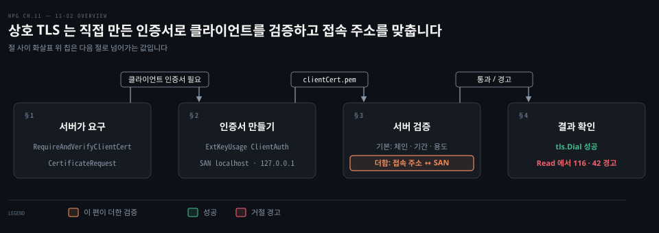
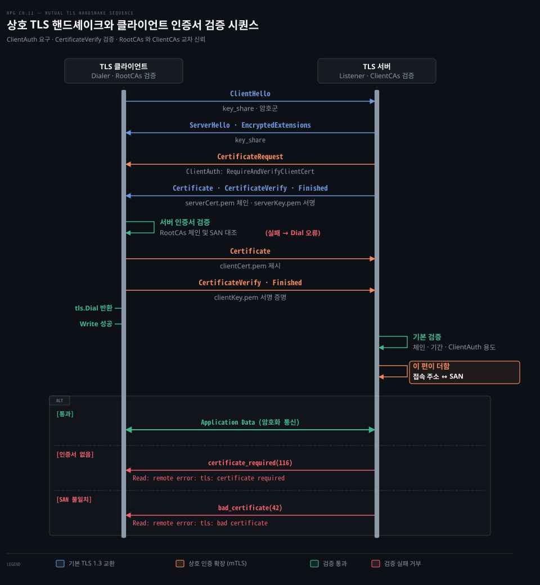
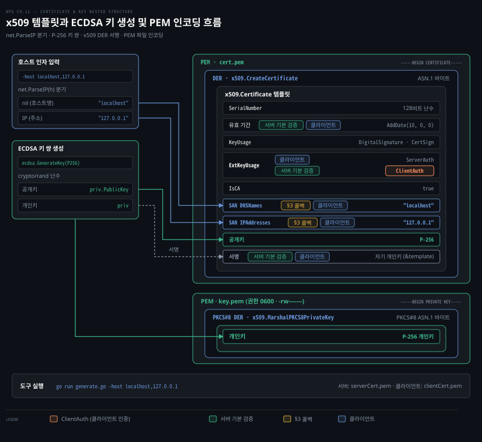
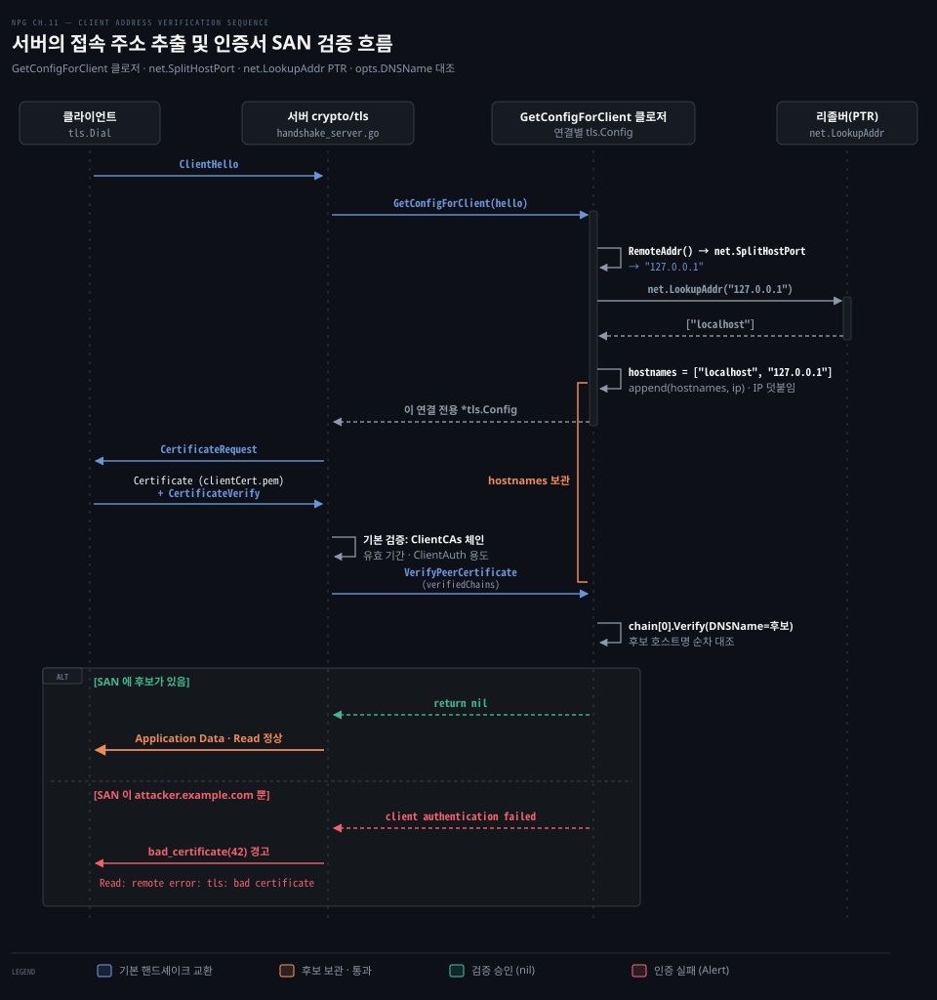

# 상호 TLS 는 직접 만든 인증서로 클라이언트도 검증하고 서버는 접속 주소를 인증서 이름과 맞춘다

---

> 상호 TLS 에서 서버는 클라이언트 인증서를 요구해 발급 체인을 검증하고, 접속한 IP 와 그 IP 의 역방향 DNS 이름을 인증서의 주체 대체 이름과 맞춰 봅니다.

## 핵심 요약

> 이 편이 매달린 하나의 생각은, 제로 트러스트 네트워크에서 서버와 클라이언트는 서로의 암호학적 신원을 모두 검증해야 하며, 서버는 체인 서명뿐 아니라 실제 접속 소켓 주소와 인증서 식별자의 일치까지 확인해야 한다는 점입니다.

통상적인 단방향 TLS 에서 클라이언트는 서버 인증서를 신뢰하지만 서버는 연결해 온 클라이언트가 누구인지 알지 못합니다. 상호 TLS 는 서버가 핸드셰이크 도중 인증서 요청 메시지를 보내 클라이언트에게도 X.509 인증서와 개인키 서명 증명을 요구합니다.

사설 서비스끼리 쓸 인증서는 표준 라이브러리의 템플릿과 타원곡선 키 생성기로 직접 만듭니다. 이때 확장 키 용도에 클라이언트 인증을 넣고 주체 대체 이름에 접속 주소를 넣어야 합니다.

서버가 클라이언트의 접속 주소를 인증서와 대조하려면 ClientHello 를 받은 뒤 연결마다 설정을 돌려주는 콜백에서 주소를 얻고 그 주소를 피어 검증 콜백에 넘겨야 합니다. 클라이언트의 `tls.Dial` 은 자기 쪽 핸드셰이크를 마치고 돌아오므로, 서버가 클라이언트 인증서를 거절했다는 사실은 클라이언트의 다음 읽기에서 경고로 드러납니다.


## 학습 목표

> 이 편을 읽고 나면 아래 다섯 가지를 스스로 해낼 수 있습니다.

1. 상호 TLS 와 단방향 TLS 의 핸드셰이크 메시지 교환 차이를 설명하고 필수 인증서 요청 흐름을 구분할 수 있습니다.
2. Go 의 5가지 클라이언트 인증 모드 동작 차이를 식별하고 상호 인증에 맞는 모드를 선택할 수 있습니다.
3. 표준 패키지로 타원곡선 키 쌍과 클라이언트 인증용 주체 대체 이름을 담은 자체 서명 X.509 인증서를 생성할 수 있습니다.
4. 핸드셰이크 도중 소켓 연결 주소를 추출하여 역방향 DNS 및 인증서 대체 이름과 대조하는 서버 검증 로직을 구현할 수 있습니다.
5. 클라이언트 인증서 거절이 `tls.Dial` 이 아니라 첫 읽기에서 드러나는 이유를 설명하고, 인증서 누락과 이름 불일치가 내는 TLS 경고를 구분할 수 있습니다.

아래는 이 편의 키워드를 이은 개념도입니다. §1 줄은 클라이언트 인증 모드와 인증서 요청으로 서버가 클라이언트에게 신원 증명을 요구하는 상호 인증 원리입니다. §2 줄은 템플릿과 타원곡선 키로 자체 서명 인증서와 개인키 파일을 만드는 흐름입니다. §3 줄은 클라이언트 설정 콜백에서 소켓 주소를 꺼내고 피어 검증 콜백에서 인증서 대체 이름과 맞춰 보는 서버 검증입니다. §4 줄은 `tls.Dial` 이 돌아온 뒤 첫 쓰기와 읽기로 서버의 판정을 받아 보는 시험입니다.




## 1. 상호 TLS 는 서버도 클라이언트에게 인증서를 요구한다

> 일반 TLS 에서 익명으로 머물던 클라이언트는 상호 TLS 환경에서 서버의 요청에 응해 자신의 인증서와 개인키 서명을 증명해야 합니다.

웹 브라우저가 HTTPS 웹 사이트에 접속하는 통상적인 단방향 TLS 환경에서 서버는 공인 CA 가 서명한 인증서를 제시하여 자신의 신원을 증명합니다. 클라이언트는 이 인증서를 확인해 피싱 사이트가 아님을 알지만, 서버는 접속해 온 클라이언트가 누구인지 모릅니다. 인증서와 신뢰 체인의 기본 원리는 [인증서와 두 서명 04-02 §1](../paw_packet-analysis-wireshark/04-02.인증서와%20두%20서명.md) 에서 다루었습니다.

제로 트러스트 네트워크에서는 사정이 다릅니다. 네트워크 안쪽이라는 이유로 상대를 믿지 않으므로 클라이언트와 서버가 각자 신원을 증명해야 합니다. 예를 들어 바깥에 있는 클라이언트는 프록시에 인증서를 내야 안쪽 자원에 닿을 수 있고, 클라이언트도 프록시의 인증서를 확인해 공격자가 세운 가짜 프록시가 아닌지 봅니다.

같은 호스트 안이라면 [피어 자격 증명으로 접속한 프로세스를 인증하는 서비스 07-02 §1](./07-02.피어%20자격%20증명으로%20접속한%20프로세스를%20인증하는%20서비스.md) 처럼 유닉스 도메인 소켓의 피어 자격 증명으로 커널이 알려 주는 상대 프로세스의 UID 와 GID 를 확인할 수 있습니다. 호스트를 넘는 연결에는 그 방법을 쓸 수 없으므로, TLS 핸드셰이크 안에서 양쪽이 인증서로 신원을 증명하는 **상호 TLS(Mutual TLS, mTLS)** 를 씁니다.

상호 TLS 핸드셰이크는 [앞 편 11-01 §1](./11-01.TLS%20클라이언트는%20CA%20서명으로%20서버를%20확인하고%20서버는%20리스너를%20감싸며%20피닝은%20믿을%20인증서를%20좁힌다.md) 의 단방향 핸드셰이크에 서버의 인증서 요구가 더해진 모양입니다. 클라이언트는 암호군과 임시 키 공유 값을 담아 `ClientHello` 를 보냅니다. 서버는 `ServerHello` 와 `EncryptedExtensions` 다음에 `CertificateRequest` 를 보내 클라이언트 인증서를 요구합니다. 이어서 자기 인증서 체인(`Certificate`)과 핸드셰이크 서명(`CertificateVerify`), 완료 메시지(`Finished`)를 보냅니다.

클라이언트는 서버 인증서가 자기 신뢰 풀로 이어지는지 확인한 뒤, 서버의 요구에 따라 자기 인증서 체인(`Certificate`)을 보냅니다. 이어서 그때까지의 핸드셰이크 메시지를 자기 개인키로 서명한 `CertificateVerify` 와 `Finished` 를 보냅니다. 서버는 받은 클라이언트 인증서를 신뢰 풀과 대조하고 인증서의 공개키로 서명을 검증해 클라이언트가 그 인증서의 개인키를 가진 쪽인지 확인합니다.



Go 의 [`crypto/tls`](https://pkg.go.dev/crypto/tls) 패키지에서 이 동작은 [`tls.Config`](https://pkg.go.dev/crypto/tls#Config) 의 두 필드로 제어합니다.

- `ClientAuth`: 서버가 핸드셰이크 중 클라이언트 인증서를 어떻게 취급할지 결정하는 [`tls.ClientAuthType`](https://pkg.go.dev/crypto/tls#ClientAuthType) 열거형 값입니다.
- `ClientCAs`: 서버가 클라이언트 인증서 체인을 검증할 때 신뢰하는 인증 기관(CA) 인증서 풀([`*x509.CertPool`](https://pkg.go.dev/crypto/x509#CertPool))입니다. 클라이언트 쪽 `RootCAs` 와 짝을 이루는 서버 쪽 신뢰 앵커입니다.

`ClientAuth` 값은 다섯 가지이고 값마다 인증서를 요구하는지와 받은 인증서를 `ClientCAs` 로 검증하는지가 다릅니다.

- `NoClientCert`: 기본값입니다. 서버가 클라이언트 인증서를 요구하지 않습니다.
- `RequestClientCert`: 클라이언트에게 인증서를 요청하지만, 보내지 않아도 핸드셰이크를 계속합니다. 인증서를 보내도 `ClientCAs` 로 검증하지 않습니다.
- `RequireAnyClientCert`: 클라이언트는 반드시 인증서를 내야 하지만, 서버는 그 인증서를 `ClientCAs` 로 검증하지 않습니다.
- `VerifyClientCertIfGiven`: 클라이언트가 인증서를 제공한 경우에만 `ClientCAs` 풀을 기반으로 체인을 검증합니다. 인증서가 없으면 검증 없이 통과합니다.
- `RequireAndVerifyClientCert`: 상호 TLS 에서 쓰는 값입니다. 클라이언트는 반드시 인증서를 내야 하고 서버는 그 인증서가 `ClientCAs` 풀로 이어지는지, 유효 기간 안인지, 클라이언트 인증 용도가 있는지 확인합니다. 하나라도 어긋나면 핸드셰이크를 멈춥니다.

상호 인증을 강제하려면 서버는 `ClientAuth` 에 `RequireAndVerifyClientCert` 를 지정하고 클라이언트 인증서를 서명한 신뢰 루트를 `ClientCAs` 에 등록해야 합니다.


## 2. x509 템플릿으로 인증서와 키 쌍을 직접 만든다

> x509 템플릿과 ECDSA 키 생성기만으로 클라이언트 인증 용도를 담은 자체 서명 인증서와 개인키 PEM 파일을 만듭니다.

상호 TLS 를 시험하려면 클라이언트와 서버가 각자 쓸 인증서와 키 쌍이 필요합니다. Go 배포판의 `$(go env GOROOT)/src/crypto/tls/generate_cert.go` 가 만드는 인증서는 확장 키 용도에 서버 인증만 넣으므로, 클라이언트 인증서로 내면 서버의 검증에서 거부됩니다. 그래서 클라이언트 인증 용도와 접속 주소를 담은 인증서를 직접 만듭니다.

X.509 인증서 생성의 핵심은 [`crypto/x509.Certificate`](https://pkg.go.dev/crypto/x509#Certificate) 구조체 템플릿을 채운 뒤 타원곡선 키로 서명해 DER 바이트를 얻고, 이를 PEM 형식으로 파일에 저장하는 과정입니다.

DER 는 인증서를 담는 ASN.1 바이너리 인코딩이고, PEM 은 그 DER 를 Base64 텍스트로 바꿔 `-----BEGIN …-----` 줄로 두른 형식입니다.



템플릿 설정 시 아래 필드들을 목적에 맞게 지정합니다.

- `SerialNumber`: 암호학적으로 안전한 난수 생성기([`crypto/rand`](https://pkg.go.dev/crypto/rand))를 사용해 128비트 크기의 부호 없는 큰 정수([`big.Int`](https://pkg.go.dev/math/big#Int))로 발급합니다.
- `NotBefore` 와 `NotAfter`: 인증서 유효 기간입니다. `10 * 365 * 24 * time.Hour` 처럼 시간을 곱하면 윤년만큼 어긋나므로, 달력 단위로 더하는 [`time.Time.AddDate`](https://pkg.go.dev/time#Time.AddDate) 로 10년을 더합니다.
- `KeyUsage`: 이 키로 할 수 있는 일을 정합니다. 인증서 키는 핸드셰이크의 `CertificateVerify` 서명을 만드는 데 쓰이므로 [`x509.KeyUsageDigitalSignature`](https://pkg.go.dev/crypto/x509#KeyUsage) 를 줍니다. 이 템플릿은 자기 자신에 서명하는 CA 인증서이기도 해서 `x509.KeyUsageCertSign` 을 함께 넣습니다. [RFC 5280 §4.2.1.3](https://www.rfc-editor.org/rfc/rfc5280#section-4.2.1.3) 은 keyCertSign 을 켠 인증서라면 기본 제약의 CA 표시도 켜도록 정하므로 아래 `IsCA` 와 짝입니다. `KeyUsageKeyEncipherment` 는 넣지 않습니다. 이 값은 RSA 공개키로 대칭키를 암호화해 넘기는 키 수송 용도이고, 타원곡선 공개키 인증서에 허용되는 값 목록([RFC 5480 §3](https://www.rfc-editor.org/rfc/rfc5480#section-3))에 없습니다.
- `ExtKeyUsage`: 응용 계층에서 쓸 용도를 정합니다. 서버 인증용 [`x509.ExtKeyUsageServerAuth`](https://pkg.go.dev/crypto/x509#ExtKeyUsage) 와 클라이언트 인증용 `x509.ExtKeyUsageClientAuth` 를 모두 넣습니다. 클라이언트 인증서에 `ExtKeyUsageClientAuth` 가 빠지면 서버의 기본 검증에서 거부됩니다.
- `BasicConstraintsValid` 와 `IsCA`: 기본 제약 확장을 켜고 `IsCA` 를 `true` 로 두어 이 인증서를 다른 인증서에 서명할 수 있는 CA 인증서로 표시합니다.
- `IPAddresses` 와 `DNSNames`: 인증서가 유효한 주소와 이름을 담는 **주체 대체 이름(Subject Alternative Name, SAN)** 입니다. Go 1.15 에서 SAN 이 없을 때 `CommonName` 을 호스트 이름으로 보던 옛 동작이 기본으로 꺼졌고, 지금의 [호스트명 검증](https://pkg.go.dev/crypto/x509#Certificate.VerifyHostname)은 `CommonName` 을 무시합니다. 그래서 IP 는 `IPAddresses` 에, 도메인 이름은 `DNSNames` 에 나눠 넣어야 이름 검증을 통과합니다.

키 쌍과 인증서 파일을 생성하는 도구 코드는 아래와 같습니다.

```go
package main

import (
	"crypto/ecdsa"
	"crypto/elliptic"
	"crypto/rand"
	"crypto/x509"
	"crypto/x509/pkix"
	"encoding/pem"
	"flag"
	"log"
	"math/big"
	"net"
	"os"
	"strings"
	"time"
)

var (
	host   = flag.String("host", "localhost", "Certificate's comma-separated host names and IPs")
	certFn = flag.String("cert", "cert.pem", "certificate file name")
	keyFn  = flag.String("key", "key.pem", "private key file name")
)

func main() {
	flag.Parse()

	// 128비트 난수로 인증서 일련번호를 생성합니다
	serial, err := rand.Int(rand.Reader, new(big.Int).Lsh(big.NewInt(1), 128))
	if err != nil {
		log.Fatal(err)
	}

	notBefore := time.Now()
	template := x509.Certificate{
		SerialNumber: serial,
		Subject: pkix.Name{
			Organization: []string{"Adam Woodbeck"},
		},
		NotBefore: notBefore,
		// 시간을 곱하지 않고 달력 단위로 10년을 더해 윤년 오차를 피합니다
		NotAfter: notBefore.AddDate(10, 0, 0),
		// ECDSA 키에는 RSA 전용인 키 수송 용도(KeyEncipherment)를 넣지 않습니다
		KeyUsage: x509.KeyUsageDigitalSignature | x509.KeyUsageCertSign,
		ExtKeyUsage: []x509.ExtKeyUsage{
			x509.ExtKeyUsageServerAuth,
			x509.ExtKeyUsageClientAuth,
		},
		BasicConstraintsValid: true,
		IsCA:                  true,
	}

	// 쉼표로 구분된 호스트 목록을 검사하여 IP 와 도메인 이름을 SAN 슬라이스로 나눕니다
	for _, h := range strings.Split(*host, ",") {
		if ip := net.ParseIP(h); ip != nil {
			template.IPAddresses = append(template.IPAddresses, ip)
		} else {
			template.DNSNames = append(template.DNSNames, h)
		}
	}

	// P-256 타원곡선 비대칭 개인키를 생성합니다
	priv, err := ecdsa.GenerateKey(elliptic.P256(), rand.Reader)
	if err != nil {
		log.Fatal(err)
	}

	// 부모 인증서와 템플릿에 동일 객체를 전달하여 자체 서명 DER 인증서를 만듭니다
	der, err := x509.CreateCertificate(rand.Reader, &template, &template, &priv.PublicKey, priv)
	if err != nil {
		log.Fatal(err)
	}

	certFile, err := os.Create(*certFn)
	if err != nil {
		log.Fatal(err)
	}
	// DER 바이트를 CERTIFICATE 타입 PEM 블록으로 인코딩하여 저장합니다
	err = pem.Encode(certFile, &pem.Block{Type: "CERTIFICATE", Bytes: der})
	if err != nil {
		log.Fatal(err)
	}
	_ = certFile.Close()
	log.Println("wrote", *certFn)

	// 개인키 파일은 소유자만 읽고 쓸 수 있도록 0600 권한으로 생성합니다
	keyFile, err := os.OpenFile(*keyFn, os.O_WRONLY|os.O_CREATE|os.O_TRUNC, 0600)
	if err != nil {
		log.Fatal(err)
	}
	// 개인키를 PKCS#8 DER 형식으로 마샬링합니다
	privKey, err := x509.MarshalPKCS8PrivateKey(priv)
	if err != nil {
		log.Fatal(err)
	}
	// PKCS#8 DER 의 PEM 레이블은 "PRIVATE KEY" 입니다 ("EC PRIVATE KEY" 는 SEC 1 형식용)
	err = pem.Encode(keyFile, &pem.Block{Type: "PRIVATE KEY", Bytes: privKey})
	if err != nil {
		log.Fatal(err)
	}
	_ = keyFile.Close()
	log.Println("wrote", *keyFn)
}
```

[`x509.MarshalPKCS8PrivateKey`](https://pkg.go.dev/crypto/x509#MarshalPKCS8PrivateKey) 가 내는 PKCS#8 바이트에는 [RFC 7468 §10](https://www.rfc-editor.org/rfc/rfc7468#section-10) 이 정한 `"PRIVATE KEY"` 레이블을 붙입니다. `"EC PRIVATE KEY"` 레이블은 SEC 1 형식을 내는 `x509.MarshalECPrivateKey` 의 짝입니다. Go 의 [`tls.LoadX509KeyPair`](https://pkg.go.dev/crypto/tls#LoadX509KeyPair) 는 `"PRIVATE KEY"` 로 감싼 PKCS#8 타원곡선 키를 그대로 읽습니다. 키 쌍과 CSR 및 CA 신뢰의 전체 구조는 [TLS로 컴포넌트 안전하게 연결하기 11-01 §2](../../../08_cloud/book/container-security/11-01.TLS로%20컴포넌트%20안전하게%20연결하기%20—%20키·인증서·CA의%20역할.md) 에서 다루었습니다.

이 도구로 서버용과 클라이언트용 인증서·키를 한 쌍씩 만듭니다.

```bash
go run generate.go -cert serverCert.pem -key serverKey.pem -host localhost,127.0.0.1
go run generate.go -cert clientCert.pem -key clientKey.pem -host localhost,127.0.0.1
```

서버는 `localhost` 에서 듣고 클라이언트도 `localhost` 에서 접속하므로 두 인증서 모두 `-host localhost,127.0.0.1` 이면 됩니다. 클라이언트를 다른 호스트로 옮기거나 서버를 다른 IP 에 묶으면 `-host` 값도 그 주소로 바꿔야 합니다. 개인키 파일은 `0600` 으로 만들었으므로 `ls -l` 로 보면 `-rw-------` 입니다.


## 3. 서버는 클라이언트 인증서를 CA 풀로 검증하고 접속 주소와 인증서 이름을 맞춘다

> Go 의 TLS 서버는 클라이언트 인증서의 체인·유효 기간·용도는 확인하지만 이름은 대조하지 않으므로, 접속 주소와 인증서 이름이 맞는지는 콜백으로 직접 확인합니다.

서버와 클라이언트는 상대의 인증서를 자기 신뢰 풀에 넣습니다. 서버의 풀에는 `clientCert.pem` 이, 클라이언트의 풀에는 `serverCert.pem` 이 들어갑니다. 아래 `caCertPool` 은 PEM 파일 하나를 [`os.ReadFile`](https://pkg.go.dev/os#ReadFile) 로 읽어 풀을 만드는 보조 함수이고 §4 의 시험 파일(`tls_mutual_test.go`) 끝에 함께 둡니다.

```go
func caCertPool(caCertFn string) (*x509.CertPool, error) {
	caCert, err := os.ReadFile(caCertFn)
	if err != nil {
		return nil, err
	}
	certPool := x509.NewCertPool()
	if ok := certPool.AppendCertsFromPEM(caCert); !ok {
		return nil, errors.New("failed to add certificate to pool")
	}
	return certPool, nil
}
```

서버 설정에 `ClientAuth: tls.RequireAndVerifyClientCert` 와 `ClientCAs` 를 넣으면 Go 가 들어온 클라이언트 인증서를 세 가지로 확인합니다. `ClientCAs` 풀로 이어지는지, 유효 기간 안인지, 클라이언트 인증 용도가 있는지입니다.

이 기본 검증은 이름을 보지 않습니다. 클라이언트는 다이얼한 주소에서 서버 이름(`localhost`)을 알기 때문에 서버 인증서의 SAN 과 맞춰 볼 수 있습니다. 서버는 클라이언트가 어느 주소에서 올지 미리 알 수 없어서 기본 검증에서 클라이언트 인증서의 SAN 과 접속 IP 를 비교하지 않습니다. 그래서 `ClientCAs` 풀이 믿는 CA 가 발급한 인증서만 있으면 어느 IP 에서 접속해도 검증을 통과합니다. 이 편의 서버는 그 비교를 직접 더합니다.



이 검증을 구현하려면 두 가지 문제를 풀어야 합니다.

첫째, 인증서 검증이 시작되기 전에 클라이언트의 원격 주소를 알아야 합니다. [`GetConfigForClient`](https://pkg.go.dev/crypto/tls#Config.GetConfigForClient) 콜백은 클라이언트의 `ClientHello` 를 받은 직후 [`*tls.ClientHelloInfo`](https://pkg.go.dev/crypto/tls#ClientHelloInfo) 를 받아 호출됩니다. 이 구조체의 `Conn` 필드에서 [`RemoteAddr`](https://pkg.go.dev/net#Conn.RemoteAddr) 로 원격 주소를 꺼낼 수 있습니다.

`ClientHelloInfo` 는 [`GetCertificate`](https://pkg.go.dev/crypto/tls#Config.GetCertificate) 도 받습니다. 그래도 `GetConfigForClient` 를 쓰는 까닭은 이 연결에만 쓸 `tls.Config` 를 새로 돌려줄 수 있어서입니다. 그 `Config` 의 검증 콜백은 방금 꺼낸 주소를 클로저로 쥐고 있게 됩니다.

주소 문자열에서 IP 와 포트를 나눌 때는 IPv4 와 IPv6 표기를 모두 다루는 [`net.SplitHostPort`](https://pkg.go.dev/net#SplitHostPort) 를 씁니다. `[::1]:52314` 를 `":"` 로 자르면 첫 조각이 `[` 가 되어 IP 를 잃습니다.

둘째, 그 IP 에 붙은 호스트 이름을 알아내 인증서 leaf 의 SAN 과 비교해야 합니다. [`net.LookupAddr`](https://pkg.go.dev/net#LookupAddr) 로 역방향 조회를 하면 IP 의 PTR 레코드에 적힌 이름 목록을 받습니다. 이 기기(macOS)에서 `127.0.0.1` 을 조회하면 `[localhost]` 가 나왔습니다. 역방향 DNS 조회의 동작 원리는 [Resolver 05-01 §1](../../../01_language/docs/go/net/05-01.Resolver.md) 에서 다루었습니다. 조회로 얻은 이름들에 IP 자체를 더해 후보 목록을 만듭니다.

조회가 실패하거나 빈 목록이 오면 어떻게 할지는 정책에 달렸습니다. 클라이언트 인증서에 IP 만 넣었다면 조회 실패는 상관없지만, 호스트 이름으로 인증한다면 조회가 실패한 클라이언트는 인증할 수 없습니다. 아래 코드는 오류를 로그로 남기고 IP 하나로 비교를 이어 갑니다.

후보 목록은 `GetConfigForClient` 가 돌려주는 `Config` 의 [`VerifyPeerCertificate`](https://pkg.go.dev/crypto/tls#Config.VerifyPeerCertificate) 가 클로저로 받아 씁니다. 이 콜백은 기본 검증을 통과한 뒤에 호출됩니다. 인자 `verifiedChains` 에서 각 체인의 0번이 클라이언트의 leaf 인증서입니다.

콜백은 leaf 를 후보 이름마다 `opts.DNSName` 에 넣어 다시 `Verify` 하고 하나라도 맞으면 통과시킵니다. `opts.Roots` 에는 `ClientCAs` 와 같은 `serverPool` 을 넣습니다. `clientCert.pem` 을 읽어 만든 풀입니다.

```go
serverConfig := &tls.Config{
	Certificates: []tls.Certificate{cert},
	GetConfigForClient: func(hello *tls.ClientHelloInfo) (*tls.Config, error) {
		// 클라이언트 소켓 주소에서 안전하게 IP 주소만 분리합니다
		ip, _, err := net.SplitHostPort(hello.Conn.RemoteAddr().String())
		if err != nil {
			ip = hello.Conn.RemoteAddr().String()
		}

		// 역방향 DNS 조회를 통해 클라이언트 IP 에 매핑된 호스트명을 조회합니다
		hostnames, err := net.LookupAddr(ip)
		if err != nil {
			log.Printf("PTR lookup error: %v", err)
		}
		for i, h := range hostnames {
			hostnames[i] = strings.TrimSuffix(h, ".")
		}
		// IP 주소 자체도 검증 후보군에 추가합니다
		hostnames = append(hostnames, ip)

		return &tls.Config{
			Certificates: []tls.Certificate{cert},
			ClientAuth:   tls.RequireAndVerifyClientCert,
			ClientCAs:    serverPool,
			MinVersion:   tls.VersionTLS13,
			VerifyPeerCertificate: func(rawCerts [][]byte, verifiedChains [][]*x509.Certificate) error {
				opts := x509.VerifyOptions{
					KeyUsages: []x509.ExtKeyUsage{
						x509.ExtKeyUsageClientAuth,
					},
					Roots: serverPool,
				}

				// 검증된 체인들의 중간 인증서 풀을 복원하고 호스트명 일치 여부를 대조합니다
				for _, chain := range verifiedChains {
					opts.Intermediates = x509.NewCertPool()
					for _, c := range chain[1:] {
						opts.Intermediates.AddCert(c)
					}
					// 후보 호스트명이나 IP 중 하나라도 인증서 SAN 과 일치하면 검증을 승인합니다
					for _, hostname := range hostnames {
						opts.DNSName = hostname
						_, err = chain[0].Verify(opts)
						if err == nil {
							return nil
						}
					}
				}
				// 모든 후보군이 불일치하면 클라이언트 인증을 거부합니다
				return errors.New("client authentication failed")
			},
		}, nil
	},
}
```

§4 의 시험에는 같은 설정이 `log.Printf` 대신 `t.Logf` 로 들어갑니다.

Go 1.15 에 생긴 [`VerifyConnection`](https://pkg.go.dev/crypto/tls#Config.VerifyConnection) 은 세션 재개(session resumption)를 포함한 모든 연결에서 호출되고 [`tls.ConnectionState`](https://pkg.go.dev/crypto/tls#ConnectionState) 를 받습니다. 반면 `VerifyPeerCertificate` 는 재개된 연결에서 인증서를 다시 검증하지 않으므로 호출되지 않습니다. `ConnectionState` 에는 원격 주소가 없어서 검증을 `VerifyConnection` 으로 옮기더라도 주소는 `GetConfigForClient` 클로저로 받아 와야 합니다.

위 설정에는 `PreferServerCipherSuites` 와 `CurvePreferences` 를 넣지 않았습니다. [`PreferServerCipherSuites`](https://pkg.go.dev/crypto/tls#Config.PreferServerCipherSuites) 는 지금 아무 효과가 없는 폐기(Deprecated) 필드이고, 암호군은 서버가 양쪽 하드웨어와 보안성을 따져 고릅니다. [`CurvePreferences`](https://pkg.go.dev/crypto/tls#Config.CurvePreferences) 는 목록의 순서를 무시하고 Go 내부 선호 순서로 키 교환 방식을 고릅니다.


## 4. 시험으로 상호 인증 핸드셰이크를 끝까지 확인한다

> `tls.Dial` 은 클라이언트 쪽 핸드셰이크를 마치고 돌아오지만, TLS 1.3 에서 서버가 클라이언트 인증서를 거절한 결과는 클라이언트의 첫 읽기에서 경고로 드러납니다.

§3 의 설정이 클라이언트를 제대로 가려내는지는 실제로 접속해 봐야 압니다. 아래 시험은 서버를 고루틴으로 띄우고 클라이언트가 서버 인증서를 피닝한 채 자기 인증서를 실어 접속해 `hello` 가 그대로 돌아오는지 봅니다. `NewTLSServer` 와 `Server` 는 [앞 편 11-01 §4](./11-01.TLS%20클라이언트는%20CA%20서명으로%20서버를%20확인하고%20서버는%20리스너를%20감싸며%20피닝은%20믿을%20인증서를%20좁힌다.md) 의 TLS 에코 서버를 같은 패키지(`ch11`)에 두고 씁니다.

소켓 데드라인 관리와 서버 라이프사이클 동기화 패턴은 [타임아웃은 Dialer·context 로, 유휴 감지는 데드라인과 하트비트로 건다 03-03 §1](./03-03.타임아웃은%20Dialer·context%20로,%20유휴%20감지는%20데드라인과%20하트비트로%20건다.md) 에서 다룬 방식을 따릅니다.

```go
package ch11

import (
	"bytes"
	"context"
	"crypto/tls"
	"crypto/x509"
	"errors"
	"net"
	"os"
	"strings"
	"testing"
)

func TestMutualTLSAuthentication(t *testing.T) {
	ctx, cancel := context.WithCancel(context.Background())
	defer cancel()

	// 서버 신뢰 풀에는 클라이언트 인증서를 넣습니다
	serverPool, err := caCertPool("clientCert.pem")
	if err != nil {
		t.Fatal(err)
	}

	cert, err := tls.LoadX509KeyPair("serverCert.pem", "serverKey.pem")
	if err != nil {
		t.Fatalf("loading key pair: %v", err)
	}

	serverConfig := &tls.Config{
		Certificates: []tls.Certificate{cert},
		GetConfigForClient: func(hello *tls.ClientHelloInfo) (*tls.Config, error) {
			ip, _, err := net.SplitHostPort(hello.Conn.RemoteAddr().String())
			if err != nil {
				ip = hello.Conn.RemoteAddr().String()
			}
			hostnames, err := net.LookupAddr(ip)
			if err != nil {
				t.Logf("PTR lookup: %v", err)
			}
			for i, h := range hostnames {
				hostnames[i] = strings.TrimSuffix(h, ".")
			}
			hostnames = append(hostnames, ip)

			return &tls.Config{
				Certificates: []tls.Certificate{cert},
				ClientAuth:   tls.RequireAndVerifyClientCert,
				ClientCAs:    serverPool,
				MinVersion:   tls.VersionTLS13,
				VerifyPeerCertificate: func(rawCerts [][]byte, verifiedChains [][]*x509.Certificate) error {
					opts := x509.VerifyOptions{
						KeyUsages: []x509.ExtKeyUsage{
							x509.ExtKeyUsageClientAuth,
						},
						Roots: serverPool,
					}
					for _, chain := range verifiedChains {
						opts.Intermediates = x509.NewCertPool()
						for _, c := range chain[1:] {
							opts.Intermediates.AddCert(c)
						}
						for _, hostname := range hostnames {
							opts.DNSName = hostname
							_, err = chain[0].Verify(opts)
							if err == nil {
								return nil
							}
						}
					}
					return errors.New("client authentication failed")
				},
			}, nil
		},
	}

	serverAddress := "localhost:44443"
	server := NewTLSServer(ctx, serverAddress, 0, serverConfig)
	done := make(chan struct{})

	go func() {
		err := server.ListenAndServeTLS("serverCert.pem", "serverKey.pem")
		if err != nil && !strings.Contains(err.Error(), "use of closed network connection") {
			t.Error(err)
			return
		}
		done <- struct{}{}
	}()
	server.Ready()

	// 클라이언트는 서버 인증서만 믿도록 피닝하고, 서버에 낼 자기 인증서를 싣습니다
	clientPool, err := caCertPool("serverCert.pem")
	if err != nil {
		t.Fatal(err)
	}
	clientCert, err := tls.LoadX509KeyPair("clientCert.pem", "clientKey.pem")
	if err != nil {
		t.Fatal(err)
	}

	// tls.Dial 은 클라이언트 쪽 핸드셰이크를 마치고 돌아옵니다
	conn, err := tls.Dial("tcp", serverAddress, &tls.Config{
		Certificates: []tls.Certificate{clientCert},
		MinVersion:   tls.VersionTLS13,
		RootCAs:      clientPool,
	})
	if err != nil {
		t.Fatal(err)
	}

	// 서버가 클라이언트 인증서를 거절해도 이 쓰기는 성공하고, 거절은 다음 Read 에서 드러납니다
	hello := []byte("hello")
	_, err = conn.Write(hello)
	if err != nil {
		t.Fatal(err)
	}

	// 에코가 돌아오면 서버가 클라이언트 인증서를 받아들인 것입니다
	b := make([]byte, 1024)
	n, err := conn.Read(b)
	if err != nil {
		t.Fatal(err)
	}

	if actual := b[:n]; !bytes.Equal(hello, actual) {
		t.Fatalf("expected %q; actual %q", hello, actual)
	}

	_ = conn.Close()
	cancel()
	<-done
}
```

이 시험에서 볼 곳은 [`tls.Dial`](https://pkg.go.dev/crypto/tls#Dial) 이 돌아오는 시점입니다. `tls.Dial` 은 TCP 연결을 맺은 뒤 핸드셰이크까지 하고 돌아옵니다. 그래서 서버 인증서를 믿을 수 없으면 이 자리에서 `tls: failed to verify certificate: x509: certificate signed by unknown authority` 오류가 납니다.

클라이언트 인증서 거절은 다른 자리에서 드러납니다. TLS 1.3 에서 클라이언트는 자기 `Certificate`·`CertificateVerify`·`Finished` 를 보내는 순간 핸드셰이크가 끝난 것으로 봅니다. 서버는 그 메시지를 받은 뒤에야 클라이언트 인증서를 검증합니다. 그래서 거절당해도 `tls.Dial` 과 첫 `Write` 는 성공하고 서버의 경고는 클라이언트의 다음 `Read` 에서 오류로 돌아옵니다. 서버 쪽 핸드셰이크는 [앞 편 11-01 §4](./11-01.TLS%20클라이언트는%20CA%20서명으로%20서버를%20확인하고%20서버는%20리스너를%20감싸며%20피닝은%20믿을%20인증서를%20좁힌다.md) 에서 본 것처럼 `Accept` 가 아니라 연결의 첫 읽기에서 일어납니다.

클라이언트 쪽을 바꿔 실패 두 가지를 돌려 보면 받는 경고가 다릅니다. 아래 오류 문자열은 go1.25.1 에서 직접 돌려 얻은 값입니다.

첫째, 클라이언트 설정의 `Certificates` 를 비운 채 접속하면 `tls.Dial` 과 `Write` 는 성공하고 `Read` 가 아래 오류를 돌려줍니다.

```bash
remote error: tls: certificate required
```

`RequireAndVerifyClientCert` 서버는 받은 인증서가 비어 있으면 TLS 1.3 에서 [RFC 8446 §B.2](https://www.rfc-editor.org/rfc/rfc8446#appendix-B.2) 의 `certificate_required(116)` 경고를 보내고 핸드셰이크를 멈춥니다. TLS 1.2 연결이었다면 같은 상황에서 `handshake_failure` 경고를 보냅니다.

둘째, 서버 풀이 믿는 인증서지만 SAN 에 `attacker.example.com` 만 있고 실제 접속 주소인 `localhost`·`127.0.0.1` 은 없는 경우입니다. 체인·기간·용도를 보는 기본 검증은 통과하고 `VerifyPeerCertificate` 에서 후보 `[localhost 127.0.0.1]` 중 어느 것도 맞지 않아 `client authentication failed` 를 돌려줍니다. 클라이언트의 `Read` 는 다음 오류를 받습니다.

```bash
remote error: tls: bad certificate
```

`VerifyPeerCertificate` 가 오류를 돌려주면 서버는 [RFC 8446 §B.2](https://www.rfc-editor.org/rfc/rfc8446#appendix-B.2) 의 `bad_certificate(42)` 경고를 보내고 핸드셰이크를 멈춥니다. 서버 쪽 핸드셰이크 오류는 콜백이 돌려준 `client authentication failed` 그대로입니다.

TLS 1.3 은 상호 인증과 별개로 **순방향 비밀성(Forward Secrecy)** 을 줍니다. 클라이언트와 서버는 세션마다 임시 키 쌍을 만들어 공유 비밀을 정하고 세션이 끝나면 버립니다. 그래서 한 세션의 비밀을 빼앗겨도 그 세션의 트래픽만 풀리고, 다른 세션은 풀리지 않습니다.

TLS 를 무너뜨리는 길은 주로 프로토콜 밖에 있습니다. CA 가 속아 남의 도메인 인증서를 발급하거나, 공격자가 클라이언트의 신뢰 저장소에 자기 인증서를 넣으면, 그 인증서는 정상 검증을 통과합니다. 서버를 장악해 세션 키를 빼내거나, 서버가 복호화한 뒤의 애플리케이션 데이터를 가로채는 길도 있습니다. 이 편의 구성은 신뢰 풀을 공용 CA 대신 직접 만든 인증서 하나로 좁히므로 다른 CA 의 오발급이 통하지 않고, 접속 주소 대조를 더해 훔친 인증서를 다른 호스트에서 쓰기 어렵게 합니다.


## 결정 치트시트

| 요구 상황 | 권장 선택 | 핵심 이유 및 주의점 |
|---|---|---|
| 서비스 간 통신에서 양방향 신원 증명 강제 | `ClientAuth: tls.RequireAndVerifyClientCert` | 인증서가 없으면 `certificate_required` 로 멈추고, 있으면 `ClientCAs` 풀로 체인·기간·용도를 검증 |
| 내부 사설 통신용 인증서 생성 | `ecdsa.GenerateKey(P-256)` + `ExtKeyUsageClientAuth` | 타원곡선 키에는 `KeyUsageKeyEncipherment` 를 넣지 않고(RFC 5480 §3), 클라이언트 인증 용도는 반드시 넣음 |
| 호스트명 검증을 통과할 인증서 | SAN(`IPAddresses`, `DNSNames`)에 주소 등록 | Go 는 `CommonName` 을 이름 검증에 쓰지 않으므로 SAN 이 비면 이름 불일치로 실패 |
| 서버에서 클라이언트 접속 IP·도메인 일치 검증 | `GetConfigForClient` + `VerifyPeerCertificate` | 연결마다 `Config` 를 돌려주는 자리에서 `hello.Conn` 의 IP 와 PTR 이름을 얻어 검증 콜백 클로저로 넘김 |
| 개인키의 디스크 저장 형식 | PKCS#8 DER + PEM 레이블 `"PRIVATE KEY"` | RFC 7468 §10 의 레이블이고, 파일 권한은 소유자 전용 `0600` |
| 세션 재개까지 포함한 연결 검증 | `VerifyConnection: func(tls.ConnectionState) error` | `VerifyPeerCertificate` 와 달리 재개 연결에서도 호출되나, 원격 주소가 없으므로 IP 대조에는 `GetConfigForClient` 클로저가 여전히 필요 |


## 면접 대비

> 아래 질문에 답하면서 상호 TLS 의 동작 메커니즘, Go 의 인증 모드, 그리고 접속 주소 검증 절차를 설명해 보세요.

1. 상호 TLS(mTLS)가 일반 단방향 TLS 와 다른 점을 핸드셰이크 메시지 흐름 관점에서 설명하고, Go 의 `ClientAuthType` 옵션 5가지의 동작 차이를 설명해 주세요.
2. 타원곡선(ECDSA) 키 쌍을 사용하여 X.509 인증서 템플릿을 정의할 때 `KeyUsage` 와 `ExtKeyUsage` 에 어떤 값을 설정해야 하며, `KeyUsageKeyEncipherment` 를 제외해야 하는 이유를 설명해 주세요.
3. TLS 서버에서 클라이언트의 접속 IP 나 역방향 호스트명을 인증서의 SAN 과 대조하려면 왜 `GetConfigForClient` 콜백이 필요한지, 그리고 `VerifyPeerCertificate` 와 `VerifyConnection` 의 차이를 설명해 주세요.
4. 서버가 클라이언트 인증서를 거절해도 Go 의 `tls.Dial` 이 오류 없이 돌아오는 이유를 TLS 1.3 메시지 순서로 설명하고, 클라이언트 인증서가 없을 때와 호스트명이 맞지 않을 때 각각 어떤 TLS 경고가 오는지 말씀해 주세요.


## 정답 (자답 후 펼치기)

> 위 §면접 대비의 질문에 먼저 스스로 답한 뒤 읽으세요.

### 정답 1 — 핸드셰이크 CertificateRequest 와 ClientAuthType 동작 차이

단방향 TLS 에서는 서버만 인증서를 제시하고 클라이언트는 익명으로 통신하지만, 상호 TLS 에서는 서버가 `CertificateRequest` 를 보내 클라이언트 인증서와 서명 증명을 요구합니다. 클라이언트는 자신의 `Certificate` 와 함께 핸드셰이크 트랜스크립트 서명을 담은 `CertificateVerify` 를 서버로 보내야 합니다.

Go 의 `ClientAuthType` 5가지는 다음과 같이 동작합니다.
- `NoClientCert`: 클라이언트 인증서를 요구하지 않습니다.
- `RequestClientCert`: 인증서를 요청하지만 없어도 연결을 허용하고, 받은 인증서도 `ClientCAs` 로 검증하지 않습니다.
- `RequireAnyClientCert`: 인증서는 반드시 내야 하지만 `ClientCAs` 로 검증하지 않습니다.
- `VerifyClientCertIfGiven`: 인증서를 냈을 때만 `ClientCAs` 풀로 체인을 검증하고 없으면 통과시킵니다.
- `RequireAndVerifyClientCert`: 인증서를 반드시 내게 하고 `ClientCAs` 풀로 체인·유효 기간·클라이언트 인증 용도를 검증해, 어긋나면 핸드셰이크를 멈춥니다.

### 정답 2 — ECDSA 키 특성에 따른 KeyUsage 제약과 ExtKeyUsage 요건

ECDSA 키는 서명을 만들고 검증하는 데만 씁니다. 그래서 `KeyUsage` 에는 핸드셰이크의 `CertificateVerify` 서명에 필요한 `KeyUsageDigitalSignature` 를 넣습니다. 이 인증서는 자기 자신에 서명하는 CA 인증서이기도 하므로 `KeyUsageCertSign` 도 넣습니다. RFC 5280 §4.2.1.3 은 keyCertSign 을 켠 인증서라면 CA 표시도 켜도록 정하므로 `IsCA` 를 `true` 로 둡니다.

같은 절은 keyEncipherment 를 RSA 공개키로 세션 키를 암호화해 넘기는 키 수송 용도로 정의합니다. ECDSA 공개키로는 그 일을 할 수 없고 RFC 5480 §3 이 정한 타원곡선 공개키 인증서의 허용 값에도 없으므로 `KeyUsageKeyEncipherment` 는 넣지 않습니다.

상호 인증에 쓰려면 `ExtKeyUsage` 에 서버용 `ExtKeyUsageServerAuth` 와 함께 클라이언트 인증용 `ExtKeyUsageClientAuth` 를 넣어야 합니다. 이 값이 빠진 클라이언트 인증서는 서버의 기본 검증에서 거부됩니다.

### 정답 3 — GetConfigForClient 필요성과 검증 콜백 비교

서버의 기본 검증은 클라이언트 인증서가 `ClientCAs` 풀로 이어지는지, 유효 기간 안인지, 클라이언트 인증 용도가 있는지만 봅니다. 주체 대체 이름(SAN)과 접속 주소는 대조하지 않습니다. 이를 대조하려면 클라이언트의 IP 를 알아야 합니다.

`GetConfigForClient` 는 ClientHello 를 받은 직후 `hello.Conn` 이 든 `ClientHelloInfo` 를 받고 이 연결에만 쓸 `Config` 를 돌려줄 수 있습니다. 여기서 `net.SplitHostPort` 로 IP 를 나누고 `net.LookupAddr` 로 호스트명을 조회해 후보 목록을 만듭니다. 돌려주는 `Config` 의 검증 콜백이 그 목록을 클로저로 씁니다.

`VerifyPeerCertificate` 는 기본 검증을 통과한 뒤 원시 인증서 바이트와 검증된 체인을 받아 leaf 인증서를 더 검사할 때 씁니다. 재개된 연결에서는 인증서를 다시 검증하지 않으므로 호출되지 않습니다. Go 1.15 에 생긴 `VerifyConnection` 은 세션 재개를 포함한 모든 연결에서 호출되지만, 인자인 `ConnectionState` 에 원격 주소가 없습니다. 그래서 IP 대조를 하려면 어느 콜백을 쓰든 `GetConfigForClient` 클로저로 주소를 받아 와야 합니다.

### 정답 4 — tls.Dial 이 끝난 뒤에 오는 TLS 경고

`tls.Dial` 은 TCP 연결을 맺고 핸드셰이크까지 마친 뒤 돌아옵니다. 서버 인증서 검증 실패는 `tls.Dial` 의 오류로 바로 드러납니다. 그러나 TLS 1.3 에서 클라이언트는 자기 `Certificate`·`CertificateVerify`·`Finished` 를 보내면 핸드셰이크를 끝낸 것으로 보고, 서버는 그 뒤에 클라이언트 인증서를 검증합니다. 그래서 서버의 거절은 `tls.Dial` 이 아니라 클라이언트의 다음 `Read` 에서 경고로 돌아옵니다.

받는 경고는 원인에 따라 다릅니다.
- 클라이언트 인증서가 없는 경우: 서버가 `certificate_required(116)` 경고를 보내고 클라이언트의 `Read` 는 `remote error: tls: certificate required` 를 돌려줍니다.
- 인증서 이름이 맞지 않는 경우: 기본 검증은 통과하지만 `VerifyPeerCertificate` 의 IP·역방향 호스트명 대조가 실패합니다. 서버는 `bad_certificate(42)` 경고를 보내고 클라이언트의 `Read` 는 `remote error: tls: bad certificate` 를 돌려줍니다.


## 참고 자료

- 《Network Programming with Go》 Adam Woodbeck, 2021. ISBN 978-1-7185-0088-4. Ch.11 Securing Communications with TLS (Listing 11-12~11-22).
- [Go 공식 패키지 문서: crypto/tls](https://pkg.go.dev/crypto/tls): TLS 설정 구조체 `tls.Config`, `ClientAuthType`, `GetConfigForClient`, `VerifyPeerCertificate`, `VerifyConnection` 명세.
- [Go 공식 패키지 문서: crypto/x509](https://pkg.go.dev/crypto/x509): X.509 인증서 구조체 `x509.Certificate`, `VerifyOptions`, 타원곡선 키 마샬링 규격.
- [RFC 8446: The Transport Layer Security (TLS) Protocol Version 1.3](https://www.rfc-editor.org/rfc/rfc8446): TLS 1.3 상호 인증 핸드셰이크 프로토콜 및 경고(Alert) 코드 표준.
- [RFC 5280: X.509 PKI 및 CRL 프로파일](https://www.rfc-editor.org/rfc/rfc5280): 인증서 키 용도(`KeyUsage`) 및 주체 대체 이름(`SubjectAltName`) 표준 규격.
- [RFC 5480: Elliptic Curve Cryptography Subject Public Key Information](https://www.rfc-editor.org/rfc/rfc5480): §3 에 타원곡선 공개키 인증서에 허용되는 `keyUsage` 값 목록.
- [RFC 7468: Textual Encodings of PKIX, PKCS, and CMS Structures](https://www.rfc-editor.org/rfc/rfc7468): PEM 인코딩 블록 타입 표준 규격.
- [Go 1.15 Release Notes](https://go.dev/doc/go1.15): `CommonName` 을 호스트 이름으로 보던 동작을 기본으로 끈 변경, `VerifyConnection` 추가.


## 관련 문서

- [11-01 TLS 클라이언트는 CA 서명으로 서버를 확인하고 서버는 리스너를 감싸며 피닝은 믿을 인증서를 좁힌다](./11-01.TLS%20클라이언트는%20CA%20서명으로%20서버를%20확인하고%20서버는%20리스너를%20감싸며%20피닝은%20믿을%20인증서를%20좁힌다.md): 단방향 핸드셰이크, 이 편 시험이 쓰는 TLS 에코 서버(`NewTLSServer`), 서버 인증서 피닝을 다룹니다.
- [10-02 Caddy 를 앞단에 두고 백엔드로 리버스 프록시하며 정적 파일과 자동 HTTPS 를 붙인다](./10-02.Caddy%20를%20앞단에%20두고%20백엔드로%20리버스%20프록시하며%20정적%20파일과%20자동%20HTTPS%20를%20붙인다.md): 네트워크 경계에서 Caddy 리버스 프록시와 자동 HTTPS 를 통한 TLS 종료 구성을 다룹니다.
- [09-01 Go HTTP 서버는 타임아웃을 정하고 핸들러에 의존성을 주입하며 httptest 로 시험한다](./09-01.Go%20HTTP%20서버는%20타임아웃을%20정하고%20핸들러에%20의존성을%20주입하며%20httptest%20로%20시험한다.md): Go 표준 HTTP 서버 구성과 TLS 테스트 환경을 다룹니다.
- [07-02 피어 자격 증명으로 접속한 프로세스를 인증하는 서비스](./07-02.피어%20자격%20증명으로%20접속한%20프로세스를%20인증하는%20서비스.md): 단일 호스트 내에서 유닉스 도메인 소켓 피어 자격 증명(SO_PEERCRED)으로 프로세스를 식별하는 로컬 인증 방식을 다룹니다.
- [03-03 타임아웃은 Dialer·context 로, 유휴 감지는 데드라인과 하트비트로 건다](./03-03.타임아웃은%20Dialer·context%20로,%20유휴%20감지는%20데드라인과%20하트비트로%20건다.md): 네트워크 소켓의 타임아웃 제어와 유휴 연결 데드라인 관리 기법을 다룹니다.
- [인증서와 두 서명 04-02](../paw_packet-analysis-wireshark/04-02.인증서와%20두%20서명.md): X.509 공개키 인증서 구조와 CA 서명 검증 원리를 패킷 분석 관점에서 다룹니다.
- [TLS 핸드셰이크 읽기 04-01](../paw_packet-analysis-wireshark/04-01.TLS%20핸드셰이크%20읽기.md): TLS 핸드셰이크의 패킷 단위 메시지 교환 흐름을 다룹니다.
- [열쇠와 실패 04-03](../paw_packet-analysis-wireshark/04-03.열쇠와%20실패.md): TLS 핸드셰이크 실패 원인과 Alert 패킷 분석을 다룹니다.
- [열쇠를 나눠 갖지 않고 어떻게 비밀을 만드는가 08-02](../cntd_computer-networking-top-down/08-02.열쇠를%20나눠%20갖지%20않고%20어떻게%20비밀을%20만드는가.md): 디피-헬먼 키 교환과 비대칭 암호화 수학적 원리를 다룹니다.
- [살아 있는 상대를 확인하고 메일과 TCP 에 붙입니다 08-03](../cntd_computer-networking-top-down/08-03.살아%20있는%20상대를%20확인하고%20메일과%20TCP%20에%20붙입니다.md): 암호학적 신원 인증과 무결성 보호 메커니즘을 다룹니다.
- [Resolver 05-01](../../../01_language/docs/go/net/05-01.Resolver.md): Go net 패키지의 DNS 주소 해석기와 역방향 PTR 조회 동작을 다룹니다.
- [컨테이너 보안 11-01 TLS 로 컴포넌트 안전하게 연결하기 — 키·인증서·CA 의 역할](../../../08_cloud/book/container-security/11-01.TLS로%20컴포넌트%20안전하게%20연결하기%20—%20키·인증서·CA의%20역할.md): 분산 컴포넌트 간 안전한 상호 통신을 위한 키·인증서·CA 계층 아키텍처를 다룹니다.
- [TLS 1.3 handshake·SNI·ECDHE 02-01](../../project/portal-tunnel/02-01.TLS%201.3%20handshake·SNI·ECDHE.md): TLS 1.3 핸드셰이크 상세 절차와 SNI, ECDHE 키 교환 실습을 다룹니다.
- [Network Programming with Go 정독 인덱스](./README.md): 전체 챕터 구성과 학습 진행 상황.
