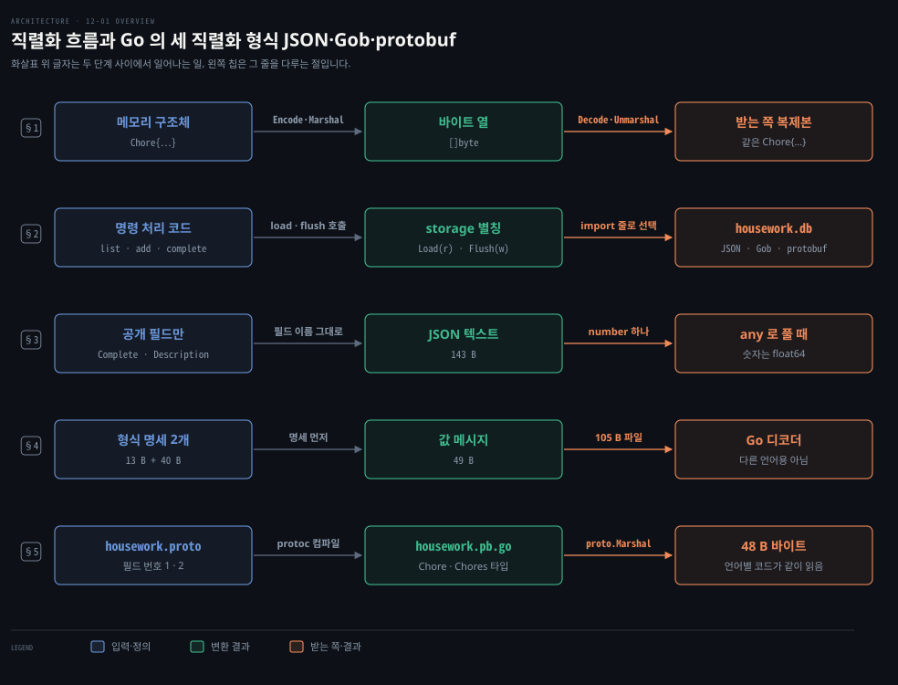
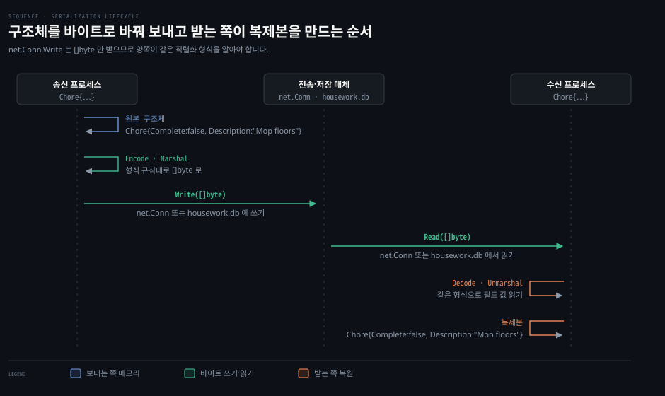
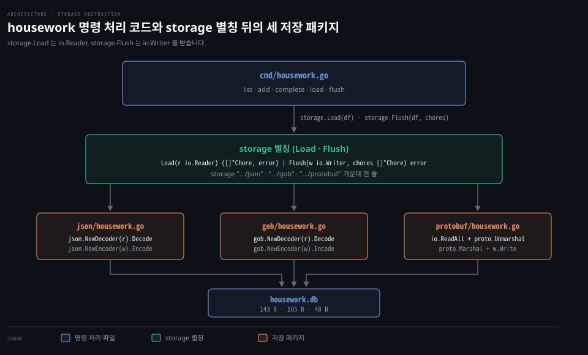
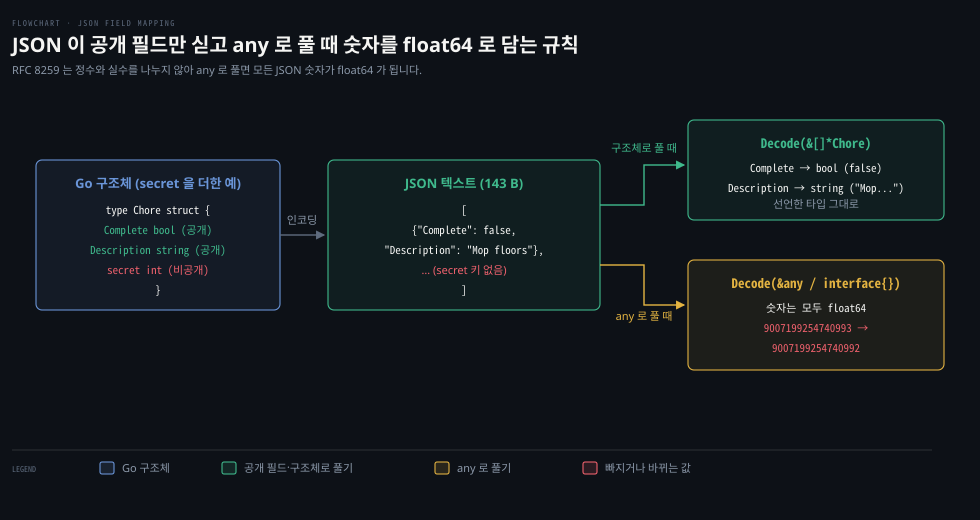
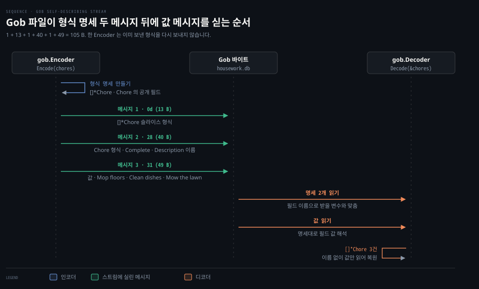
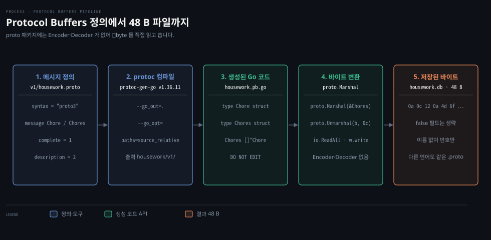
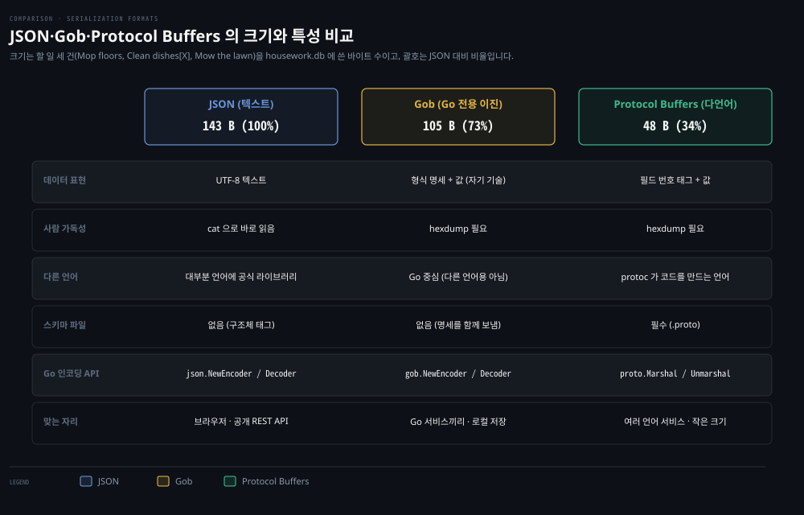

# 직렬화는 구조체를 바이트로 바꾸고 JSON 은 사람이, Gob 은 Go 가, protobuf 는 여러 언어가 읽는다

---

> 네트워크 연결은 바이트 슬라이스만 받으므로 메모리의 구조체는 바이트로 바꿔(직렬화) 보냅니다. JSON 은 사람이 읽는 텍스트, Gob 은 Go 전용 이진 형식, Protocol Buffers 는 `.proto` 정의로 여러 언어가 함께 읽는 이진 형식입니다.


## 핵심 요약

> 직렬화는 메모리의 구조체를 바이트 열로 바꿔 네트워크로 보내거나 파일에 남기는 일입니다. 같은 형식을 아는 쪽만 그 바이트에서 원래 값을 되살립니다.

`net.Conn` 의 `Write` 는 `[]byte` 만 받기 때문에 구조체를 그대로 넘길 수 없습니다. 보내는 쪽이 값을 바이트로 인코딩하면 받는 쪽은 같은 형식으로 디코딩해 복제본을 만듭니다.

housework 예제는 저장 코드를 `io.Reader`·`io.Writer` 를 받는 `Load`·`Flush` 두 함수 뒤에 둡니다. 그래서 import 줄만 바꿔 JSON·Gob·protobuf 를 오갑니다. 같은 할 일 세 건은 JSON 으로 143 B, Gob 으로 105 B, protobuf 로 48 B 입니다. JSON 은 어느 언어든 읽지만 `any` 로 풀면 숫자가 모두 `float64` 가 됩니다. Gob 은 Go 끼리는 설정 없이 쓰지만 다른 언어를 위한 형식이 아닙니다.

protobuf 는 `.proto` 정의를 `protoc` 로 컴파일해 언어별 코드를 만듭니다. 바이트에는 필드 이름 대신 필드 번호가 실리고 proto3 는 기본값인 필드를 싣지 않아 셋 중 가장 작습니다. 한 번 쓴 필드의 번호와 타입을 바꾸지 않는 한 옛 코드와 새 코드가 서로의 바이트를 읽습니다.


## 학습 목표

> 이 편을 읽고 나면 아래 다섯 가지를 스스로 해낼 수 있습니다.

1. `net.Conn.Write` 가 `[]byte` 만 받는다는 사실에서 직렬화와 역직렬화가 왜 필요한지 설명할 수 있습니다.
2. `io.Reader`·`io.Writer` 를 받는 `Load`·`Flush` 로 명령 처리 코드와 저장 형식을 떼어 놓을 수 있습니다.
3. JSON 이 공개 필드만 싣고 `any` 로 풀 때 숫자를 `float64` 로 담는 이유를 RFC 8259 로 설명할 수 있습니다.
4. Gob 이 형식 정보를 값보다 먼저 보내는 방식과 Go 전용이라 생기는 득실을 말할 수 있습니다.
5. `.proto` 를 쓰고 `protoc` 로 만든 Go 코드의 덤프로 필드 번호·기본값 생략·`reserved` 가 크기와 호환성에 주는 영향을 보일 수 있습니다.

아래는 이 편의 키워드를 이은 개념도이며 줄마다 한 절을 맡습니다.

- §1 줄: `Chore{…}` 를 `[]byte` 로 바꿔 보내고 받는 쪽이 복제본을 만드는 흐름입니다.
- §2 줄: `storage` import 줄만 바꿔 저장 형식을 고르는 housework 앱입니다.
- §3 줄: 143 B 텍스트로 저장되지만 `any` 로 풀면 숫자가 `float64` 가 되는 JSON 입니다.
- §4 줄: 형식 정보를 값보다 먼저 싣는 105 B 의 Gob 입니다.
- §5 줄: `.proto` 를 `protoc` 로 컴파일해 여러 언어가 같은 48 B 를 읽는 protobuf 입니다.




## 1. 직렬화와 역직렬화

> `net.Conn` 은 구조체나 포인터를 실어 보내지 못하므로 보내는 쪽은 값을 바이트 슬라이스로 인코딩하고, 받는 쪽은 같은 형식으로 디코딩해 복제본을 만듭니다.

네트워크는 Go 프로그램의 힙에 있는 구조체나 포인터를 알지 못합니다. `net.Conn` 의 `Write` 메서드가 `[]byte` 하나만 받는 것도 그래서입니다. 메모리의 구조체를 다른 장비로 보내거나 디스크에 남기려면 먼저 바이트 열로 바꿔야 합니다.

**직렬화(Serialization)** 는 메모리 안의 구조체를 연속된 바이트 열로 바꾸는 일입니다. 그 바이트를 읽어 구조체로 되돌리는 일은 **역직렬화(Deserialization)** 입니다. 형식을 아는 프로그램이라면 바이트가 네트워크에서 왔든 파일에서 왔든 원래 값의 복제본을 되살립니다.

Go 에서는 이름에 `Encode`·`Marshal` 이 든 함수·메서드가 대개 직렬화를, `Decode`·`Unmarshal` 이 든 쪽이 역직렬화를 맡습니다. 앞 장에서도 직렬화를 여러 번 썼습니다.

[04-01 TCP 는 경계 없는 바이트 흐름이라 읽는 쪽이 메시지를 자른다](./04-01.TCP%20는%20경계%20없는%20바이트%20흐름이라%20읽는%20쪽이%20메시지를%20자른다.md) 에서는 데이터 앞에 타입과 길이를 붙여 이진으로 묶는 TLV 인코딩을 만들었습니다. [08-02 Go HTTP 클라이언트는 응답 본문을 닫아야 연결을 재사용하고 context 로 요청을 끊는다](./08-02.Go%20HTTP%20클라이언트는%20응답%20본문을%20닫아야%20연결을%20재사용하고%20context%20로%20요청을%20끊는다.md) 에서는 HTTP 요청 본문에 JSON 객체를 실어 보냈습니다. [11-02 상호 TLS 는 직접 만든 인증서로 클라이언트도 검증하고 서버는 접속 주소를 인증서 이름과 맞춘다](./11-02.상호%20TLS%20는%20직접%20만든%20인증서로%20클라이언트도%20검증하고%20서버는%20접속%20주소를%20인증서%20이름과%20맞춘다.md) 에서는 X.509 인증서와 개인 키를 파일에 쓰려고 PEM 으로 인코딩했습니다.

직렬화는 보내는 쪽과 받는 쪽의 약속이라, 받는 쪽이 같은 규칙을 모르면 바이트는 아무 뜻이 없습니다. 텍스트·이진 형식의 비교와 스키마 변경, 하위 호환성 같은 일반론은 [데이터 중심 애플리케이션 설계 05-02 JSON·XML·이진 변형](../../../05_data/book/designing-data-intensive-applications/05-02.JSON·XML·이진%20변형.md) 에 있습니다. 이 편은 같은 할 일 목록을 JSON, Gob, Protocol Buffers 세 형식으로 저장해 결과 바이트를 견줍니다. 원서가 차례로 소개하는 세 형식입니다.




## 2. housework 앱과 Load·Flush

> housework 명령줄 도구는 파일 읽기·쓰기와 직렬화를 `Load`·`Flush` 두 함수 뒤에 두어, 명령 처리 코드는 그대로 두고 import 줄만 바꿔 저장 형식을 바꿉니다.

집안일 목록을 관리하는 작은 명령줄 앱으로 직렬화를 살펴봅니다. 계속 떠 있는 서비스와 달리 명령줄 도구는 명령을 마치면 프로세스가 끝납니다. 다음 실행 때 목록이 남아 있으려면 할 일을 디스크 파일에 직렬화해 두어야 합니다.

먼저 할 일 하나를 나타내는 구조체를 정의합니다. 아래는 `housework` 패키지의 `housework/housework.go` 입니다.

```go
package housework

// Chore 는 할 일의 완료 여부와 설명
type Chore struct {
	Complete    bool
	Description string
}
```

`encoding/json` 과 `encoding/gob` 은 대문자로 시작하는 공개 필드(exported field)만 직렬화합니다. 그래서 `Complete` 와 `Description` 을 대문자로 씁니다. JSON 은 구조체 태그로 필드 이름을 바꾸거나 필드를 뺄 수 있습니다. 예를 들어 `Complete` 에 `json:"-"` 를 달면 JSON 인코더가 이 필드를 건너뜁니다. 원서는 두 인코더를 한 문장에 묶어 태그를 말하지만, go1.25.1 로 돌려 보니 Gob 은 태그를 무시하고 필드를 그대로 실었습니다. 여기서는 두 필드를 모두 저장하므로 태그를 달지 않습니다.

앱은 할 일 목록을 보여 주고 할 일 추가와 완료 표시를 받습니다. 아래는 플래그와 사용법을 정하는 `cmd/housework.go` 의 앞부분입니다.

```go
package main

import (
	"flag"
	"fmt"
	"log"
	"os"
	"path/filepath"
	"strconv"
	"strings"

	"example.com/housework/housework"
	// 저장 형식은 아래 storage 줄 중 주석을 풀 줄로 고름
	storage "example.com/housework/json"
	// storage "example.com/housework/gob"
	// storage "example.com/housework/protobuf"
)

var dataFile string

func init() {
	flag.StringVar(&dataFile, "file", "housework.db", "data file")

	flag.Usage = func() {
		fmt.Fprintf(flag.CommandLine.Output(),
			`Usage: %s [flags] [add chore, ...|complete #]
add        add comma-separated chores
complete   complete designated chore

Flags:
`, filepath.Base(os.Args[0]))
		flag.PrintDefaults()
	}
}
```

핵심은 `storage` 라는 패키지 별칭입니다. JSON·Gob·protobuf 패키지가 모두 같은 시그니처의 `Load`·`Flush` 를 내놓습니다. 그래서 명령 처리 코드는 두고, 주석을 풀 `storage` 줄만 바꿔 저장 형식을 고릅니다. JSON 과 Gob 사이는 이 한 줄이면 됩니다. protobuf 로 갈 때는 생성된 `Chore` 타입을 쓰려고 `housework` import 줄도 함께 바꿉니다(§5). 모듈 경로는 로컬 실습용 이름 `example.com/housework` 로 통일했습니다.

디스크에서 할 일을 읽고 다시 쓰는 두 함수입니다.

```go
// load 는 파일이 있으면 역직렬화하고 없으면 빈 슬라이스를 돌려줌
func load() ([]*housework.Chore, error) {
	if _, err := os.Stat(dataFile); os.IsNotExist(err) {
		return make([]*housework.Chore, 0), nil
	}

	df, err := os.Open(dataFile)
	if err != nil {
		return nil, err
	}
	defer func() {
		if err := df.Close(); err != nil {
			fmt.Printf("closing data file: %v", err)
		}
	}()

	return storage.Load(df)
}

// flush 는 할 일을 직렬화해 파일에 씀
func flush(chores []*housework.Chore) error {
	df, err := os.Create(dataFile)
	if err != nil {
		return err
	}
	defer func() {
		if err := df.Close(); err != nil {
			fmt.Printf("closing data file: %v", err)
		}
	}()

	return storage.Flush(df, chores)
}
```

`load` 는 `os.Stat` 과 `os.IsNotExist` 로 데이터 파일이 없는지(첫 실행인지) 확인하고, 없으면 오류 없이 빈 슬라이스를 돌려줍니다. 파일이 있으면 열어서 `storage.Load` 에 넘깁니다. `flush` 는 `os.Create` 로 파일을 새로 만들거나 기존 내용을 비운 뒤 `storage.Flush` 에 파일과 슬라이스를 넘깁니다.

`storage.Load` 는 `io.Reader` 를, `storage.Flush` 는 `io.Writer` 를 받습니다. `*os.File` 을 넘기든 `net.Conn` 이나 `bytes.Buffer` 를 넘기든 저장 패키지는 바이트를 읽고 쓰기만 하면 됩니다.

목록 출력, 할 일 추가, 완료 처리는 아래와 같습니다.

```go
// list 는 할 일 목록을 표준 출력에 찍음
func list() error {
	chores, err := load()
	if err != nil {
		return err
	}

	if len(chores) == 0 {
		fmt.Println("You're all caught up!")
		return nil
	}

	fmt.Println("#\t[X]\tDescription")
	for i, chore := range chores {
		c := " "
		if chore.Complete {
			c = "X"
		}
		fmt.Printf("%d\t[%s]\t%s\n", i+1, c, chore.Description)
	}

	return nil
}

// add 는 쉼표로 나눈 조각마다 할 일을 추가
func add(s string) error {
	chores, err := load()
	if err != nil {
		return err
	}

	for _, chore := range strings.Split(s, ",") {
		if desc := strings.TrimSpace(chore); desc != "" {
			chores = append(chores, &housework.Chore{
				Description: desc,
			})
		}
	}

	return flush(chores)
}

// complete 는 지정한 번호의 할 일을 완료로 표시
func complete(s string) error {
	i, err := strconv.Atoi(s)
	if err != nil {
		return err
	}

	chores, err := load()
	if err != nil {
		return err
	}

	if i < 1 || i > len(chores) {
		return fmt.Errorf("chore %d not found", i)
	}

	// 표시 번호(1-based)를 인덱스(0-based)로 맞춤
	chores[i-1].Complete = true
	return flush(chores)
}

func main() {
	flag.Parse()

	var err error

	switch strings.ToLower(flag.Arg(0)) {
	case "add":
		err = add(strings.Join(flag.Args()[1:], " "))
	case "complete":
		err = complete(flag.Arg(1))
	}

	if err != nil {
		log.Fatal(err)
	}

	err = list()
	if err != nil {
		log.Fatal(err)
	}
}
```

명령 한 번은 이렇게 흐릅니다. `add`·`complete` 가 `load` 로 목록을 읽어 고친 뒤 `flush` 로 쓰고, 마지막에 `list` 가 다시 `load` 해서 표를 찍습니다. 하위 명령이 없으면 `list` 만 돕니다.




## 3. JSON

> JSON 은 사람이 읽는 텍스트 형식이라 어느 언어와도 주고받기 쉽지만, RFC 8259 가 숫자를 정수와 실수로 나누지 않아 Go 에서 `any` 로 풀면 정수도 `float64` 가 됩니다.

JSON(JavaScript Object Notation)은 [RFC 8259 §1](https://www.rfc-editor.org/rfc/rfc8259#section-1) 이 정한 텍스트 데이터 교환 형식입니다. 시스템 사이에 주고받을 때는 UTF-8 로 씁니다([§8.1](https://www.rfc-editor.org/rfc/rfc8259#section-8.1)). 키-값 쌍의 객체와 순서 있는 배열로 구조를 나타내며 요즘 대부분의 언어가 공식 라이브러리로 지원합니다. 그래서 REST API 에서 관례처럼 쓰입니다.

첫 번째 저장 패키지는 `encoding/json` 을 쓰는 `json/housework.go` 입니다.

```go
package json

import (
	"encoding/json"
	"io"

	"example.com/housework/housework"
)

// Load 는 JSON 을 읽어 할 일 슬라이스로 역직렬화
func Load(r io.Reader) ([]*housework.Chore, error) {
	var chores []*housework.Chore

	return chores, json.NewDecoder(r).Decode(&chores)
}

// Flush 는 할 일을 JSON 텍스트로 인코딩해 Writer 에 씀
func Flush(w io.Writer, chores []*housework.Chore) error {
	return json.NewEncoder(w).Encode(chores)
}
```

`json.NewDecoder(r)` 와 `json.NewEncoder(w)` 는 `io.Reader`·`io.Writer` 를 직접 받습니다. 그래서 호출하는 쪽이 `[]byte` 를 따로 다루지 않습니다. 다만 `Decode` 는 JSON 값 하나를 통째로 읽은 뒤 풉니다(`encoding/json/stream.go` 의 "Read whole value into buffer."). 이 때문에 할 일 배열 전체가 한 번은 메모리에 올라옵니다.

JSON 패키지를 연결한 채 앱을 실행해 할 일 세 건을 넣고 두 번째를 완료합니다.

```bash
go run cmd/housework.go
go run cmd/housework.go add "Mop floors, Clean dishes, Mow the lawn"
go run cmd/housework.go complete 2
```

첫 실행은 `You're all caught up!` 을 찍고 마지막 명령 뒤에는 아래 표가 찍힙니다.

```pseudocode
#	[X]	Description
1	[ ]	Mop floors
2	[X]	Clean dishes
3	[ ]	Mow the lawn
```

`housework.db` 의 내용과 크기를 봅니다.

```bash
cat housework.db
wc -c housework.db
```

```json
[{"Complete":false,"Description":"Mop floors"},{"Complete":true,"Description":"Clean dishes"},{"Complete":false,"Description":"Mow the lawn"}]
```

```pseudocode
     143 housework.db
```

`housework.db` 는 143바이트 텍스트 파일입니다. 마지막 1바이트는 `Encoder.Encode` 가 값 뒤에 붙이는 줄바꿈입니다. 할 일마다 `"Complete"`·`"Description"` 이름이 텍스트로 되풀이되지만 `cat` 이나 편집기로 바로 열어 볼 수 있어 디버깅하기 편합니다.

구조체 태그(`json:"complete"`)로 JSON 의 필드 이름을 소문자로 바꾸거나 필드를 뺄 수 있습니다. 태그 문법은 [Learning Go 13-03 encoding-json 은 구조체 태그로 이름을 정하고 Decoder 와 Encoder 로 스트림을 다룹니다](../../../01_language/book/lgo_learning-go/13-03.encoding-json%20은%20구조체%20태그로%20이름을%20정하고%20Decoder%20와%20Encoder%20로%20스트림을%20다룹니다.md) 에 있습니다.

주의할 점은 숫자입니다. [RFC 8259 §6](https://www.rfc-editor.org/rfc/rfc8259#section-6) 은 정수와 실수를 나누지 않고 숫자 하나(`number`)로 정의합니다. [encoding/json 문서](https://pkg.go.dev/encoding/json#Unmarshal) 대로 구체 타입 없이 `any`(`interface{}`)나 그런 슬라이스·맵으로 풀면 숫자는 모두 `float64` 가 됩니다.

`float64` 는 2^53 을 넘는 정수 가운데 정확히 담지 못하는 것이 있습니다. go1.25.1 에서 `{"id":9007199254740993}` 을 `any` 로 풀면 값이 `9007199254740992` 가 됩니다. 큰 정수 ID 를 다룰 때는 구조체 필드를 `int64` 처럼 명시하거나 `Decoder.UseNumber` 로 `json.Number` 를 받습니다. `UseNumber` 를 켜면 같은 입력이 `json.Number` 값 `9007199254740993` 그대로 남습니다.




## 4. Gob

> Gob 은 Go 전용 이진 형식으로, 값을 보내기 전에 그 타입의 형식 정보를 스트림에 먼저 실어 별도 스키마 파일 없이 구조체를 그대로 인코딩합니다.

Go 서비스끼리 주고받는 데이터를 JSON 으로 쓰면 할 일마다 필드 이름이 텍스트로 되풀이되어 세 건이 143바이트가 됩니다. Gob 은 "gobs of binary data(이진 데이터 덩어리)" 에서 이름을 딴 Go 전용 직렬화 형식으로, Go 끼리 주고받는 경우를 겨냥했습니다. Rob Pike 의 [Go 블로그 글 "Gobs of data"](https://go.dev/blog/gob) 는 설계 목표를 이렇게 적습니다. XML·JSON 같은 텍스트 표현은 효율적인 통신망의 중심에 두기에 너무 느려 이진 인코딩이 필요했습니다. 동시에 데이터 구조 자체만 보고 인코딩할 만큼 쓰기 쉬워야 했습니다.

두 번째 저장 패키지는 `encoding/gob` 을 쓰는 `gob/housework.go` 입니다.

```go
package gob

import (
	"encoding/gob"
	"io"

	"example.com/housework/housework"
)

// Load 는 Gob 스트림을 읽어 할 일 슬라이스로 역직렬화
func Load(r io.Reader) ([]*housework.Chore, error) {
	var chores []*housework.Chore

	return chores, gob.NewDecoder(r).Decode(&chores)
}

// Flush 는 할 일을 Gob 이진 스트림으로 인코딩해 Writer 에 씀
func Flush(w io.Writer, chores []*housework.Chore) error {
	return gob.NewEncoder(w).Encode(chores)
}
```

`json/housework.go` 에서 `json` 을 `gob` 으로 바꾼 것이 전부입니다. 스키마를 따로 정의하지 않아도 인코더가 구조체를 보고 무엇을 인코딩할지 알아냅니다.

[encoding/gob 문서](https://pkg.go.dev/encoding/gob) 에 따르면 Gob 스트림은 **자기 기술(self-describing)** 형식입니다. 스트림의 각 데이터 항목 앞에 그 타입의 명세가 옵니다. 구현은 타입마다 코덱을 만들며, 한 `Encoder` 가 보낸 타입은 다시 보내지 않습니다(`encoding/gob/encoder.go` 의 `sent` 맵). 그래서 한 인코더로 값을 여러 개 보낼 때 가장 효율적입니다. JSON 과 마찬가지로 공개 필드만 실립니다.

`cmd/housework.go` 의 import 를 `storage "example.com/housework/gob"` 로 바꾸고 같은 명령을 다시 실행합니다. 이전 JSON 파일이 남아 있으면 Gob 디코더가 `gob: duplicate type received` 오류로 멈춥니다. 먼저 `housework.db` 를 지웁니다.

```bash
rm housework.db
go run cmd/housework.go
go run cmd/housework.go add "Mop floors, Clean dishes, Mow the lawn"
go run cmd/housework.go complete 2
```

출력은 JSON 때와 같습니다.

```pseudocode
#	[X]	Description
1	[ ]	Mop floors
2	[X]	Clean dishes
3	[ ]	Mow the lawn
```

저장된 바이트와 크기를 봅니다.

```bash
hexdump -C housework.db
wc -c housework.db
```

```pseudocode
00000000  0d ff 81 02 01 02 ff 82  00 01 ff 80 00 00 28 7f  |..............(.|
00000010  03 01 02 ff 80 00 01 02  01 08 43 6f 6d 70 6c 65  |..........Comple|
00000020  74 65 01 02 00 01 0b 44  65 73 63 72 69 70 74 69  |te.....Descripti|
00000030  6f 6e 01 0c 00 00 00 31  ff 82 00 03 02 0a 4d 6f  |on.....1......Mo|
00000040  70 20 66 6c 6f 6f 72 73  00 01 01 01 0c 43 6c 65  |p floors.....Cle|
00000050  61 6e 20 64 69 73 68 65  73 00 02 0c 4d 6f 77 20  |an dishes...Mow |
00000060  74 68 65 20 6c 61 77 6e  00                       |the lawn.|
00000069
     105 housework.db
```

파일은 105바이트이고 Gob 메시지 세 개로 이뤄집니다. 이 파일에서는 메시지마다 첫 바이트가 뒤따르는 길이입니다(길이가 128 이상이면 여러 바이트를 씁니다). 길이가 `0d` 인 첫 메시지 13바이트는 `[]*Chore` 슬라이스 타입의 명세입니다. 길이가 `28` 인 둘째 메시지 40바이트는 `Chore` 구조체의 명세라 `Complete`·`Description` 이름이 여기에 한 번 들어갑니다.

길이가 `31` 인 마지막 49바이트가 값이며 `Mop floors`·`Clean dishes`·`Mow the lawn` 이 이어집니다. 필드 이름은 명세에만 있고 값 쪽에는 없어서 JSON 의 143바이트보다 작습니다. 다만 명세가 값보다 먼저 실리므로 값이 적으면 오히려 커집니다. 할 일 한 건만 저장해 보니 JSON 은 48바이트, Gob 은 73바이트였습니다.

Gob 의 한계는 언어입니다. 같은 블로그 글도 Gob 이 다른 언어에서는 Go 만큼 잘 맞지 않겠지만, 대놓고 Go 중심 형식이니 괜찮다고 적습니다. Python·Java 서비스가 이 파일을 읽으려면 Go 의 형식을 따로 구현해야 합니다.

그래서 Gob 은 Go 프로세스끼리 주고받는 내부 통신이나 로컬 저장에 맞고, 다른 언어가 붙는 인터페이스에는 JSON 이나 protobuf 를 씁니다. 언어 고유 직렬화가 버전 불일치를 낳는 사례는 [자바 트러블슈팅 12-02 직렬화·버전 불일치](../../../01_language/book/tsj_troubleshooting-java/12-02.직렬화·버전%20불일치.md) 에서 다룹니다.




## 5. protobuf 와 필드 번호

> Protocol Buffers 는 언어 중립적인 `.proto` 정의를 컴파일해 언어별 코드를 만듭니다. 필드 번호 태그와 기본값 생략으로 같은 할 일 세 건을 48바이트에 담고, 번호를 바꾸지 않는 한 옛 코드와 새 코드가 서로의 바이트를 읽습니다.

서로 다른 언어로 쓴 서비스끼리 통신할 때 Gob 은 Go 밖에서 쓰기 어렵습니다. JSON 은 크기가 크고 숫자 타입이 모호합니다. Protocol Buffers(이하 protobuf)는 구글이 만든 언어 중립·플랫폼 중립 직렬화 형식입니다. Gob 처럼 이진이지만 특정 언어에 묶이지 않습니다. [protobuf.dev 개요](https://protobuf.dev/overview/) 에 따르면 `protoc` 가 C++·C#·Java·Kotlin·Objective-C·PHP·Python·Ruby 코드를 직접 만듭니다. Dart·Go 코드는 구글이 관리하는 플러그인이 만듭니다.

protobuf 는 `.proto` 파일에 메시지를 정의하는 데서 시작합니다. 아래는 housework 의 할 일 구조를 정의한 `housework/v1/housework.proto` 입니다.

```protobuf
syntax = "proto3";

package housework;

option go_package = "example.com/housework/housework/v1;housework";

// Chore 는 할 일 하나
message Chore {
  bool complete = 1;
  string description = 2;
}

// Chores 는 Chore 목록
message Chores {
  repeated Chore chores = 1;
}
```

첫 줄 `syntax = "proto3"` 은 proto3 문법으로 쓴다는 선언입니다. 지금 protobuf.dev 는 `edition = "2023"` 같은 에디션 문법도 함께 안내합니다. `package housework` 는 다른 `.proto` 의 메시지와 이름이 부딪히지 않게 하는 이름 공간입니다. `option go_package` 는 생성될 Go 패키지의 import 경로이고, `;` 뒤의 `housework` 는 Go 패키지 이름입니다. 이 이름을 빼면 경로 끝에서 이름을 따와 `package v1` 이 생성됩니다.

[protobuf 스타일 가이드](https://protobuf.dev/programming-guides/style/) 대로 메시지 이름은 TitleCase(`Chore`), 필드 이름은 `lower_snake_case` 로 씁니다. `repeated` 는 Go 의 슬라이스에 해당하는 반복 필드입니다.

필드 정의 끝의 `= 1`, `= 2` 는 기본값이 아니라 **필드 번호(field number)** 입니다. 메시지 안에서 겹치지 않는 이 번호가 바이트 속에서 필드를 가려냅니다.

[protobuf 인코딩 문서](https://protobuf.dev/programming-guides/encoding/) 에 따르면 각 필드 앞의 태그는 `(field_number << 3) | wire_type` 을 varint 로 쓴 값입니다. 와이어 타입은 뒤따르는 값이 `bool`·`int32` 같은 varint 인지, `string`·하위 메시지처럼 길이를 앞세운 바이트(LEN)인지 등을 알려 줍니다.

받는 쪽은 필드 이름이 아니라 이 번호와 와이어 타입으로 필드를 찾습니다. 그래서 한 번 쓴 필드의 번호나 타입을 바꾸면 하위 호환성이 깨집니다. 필드를 없앨 때는 [proto3 가이드](https://protobuf.dev/programming-guides/proto3/#reserved) 의 `reserved`(예: `reserved 2;`)로 그 번호를 막습니다. 나중에 같은 번호를 다른 필드에 다시 써서 옛 데이터를 잘못 읽는 일을 막으려는 것입니다. 스키마 변경과 호환성의 일반 원리는 [데이터 중심 애플리케이션 설계 05-03 Protocol Buffers와 Avro](../../../05_data/book/designing-data-intensive-applications/05-03.Protocol%20Buffers와%20Avro.md) 에 있습니다.

다른 팀이나 외부가 이 정의로 통신한다면 `.proto` 를 API 처럼 다룹니다. `housework/v1/` 처럼 경로에 버전을 넣어 두면 호환성을 깨야 할 때 `v2` 를 새로 만들 수 있습니다. 클라이언트는 옮길 준비가 될 때까지 `v1` 을 씁니다.

`.proto` 에서 Go 코드를 만들려면 컴파일러 `protoc` 와 Go 플러그인이 필요합니다. macOS 에서는 Homebrew 로 컴파일러를 설치합니다.

```bash
brew install protobuf
```

Go 플러그인은 [protobuf Go 튜토리얼](https://protobuf.dev/getting-started/gotutorial/) 대로 `go install` 로 받습니다.

```bash
go install google.golang.org/protobuf/cmd/protoc-gen-go@latest
```

`protoc` 가 플러그인을 찾도록 `protoc-gen-go` 가 들어간 `$GOPATH/bin` 이 `PATH` 에 있어야 합니다. 그다음 컴파일합니다.

```bash
protoc --go_out=. --go_opt=paths=source_relative housework/v1/housework.proto
```

`--go_out=.` 은 생성한 Go 코드를 현재 디렉터리 아래에 두라는 뜻입니다. `--go_opt=paths=source_relative` 는 `.proto` 와 같은 상대 디렉터리(`housework/v1/`)에 출력하라는 옵션입니다. 빌드할 때 `go generate` 로 `protoc` 를 돌리는 방법은 [Learning Go 11-03 embed 지시어는 파일을 바이너리에 넣고 go generate 는 코드를 만들어 냅니다](../../../01_language/book/lgo_learning-go/11-03.embed%20지시어는%20파일을%20바이너리에%20넣고%20go%20generate%20는%20코드를%20만들어%20냅니다.md) 에서 다룹니다.

컴파일하면 `housework/v1/housework.pb.go` 가 생깁니다. 아래는 이 기기(go1.25.1, libprotoc 33.2)에서 만든 파일의 앞 일곱 줄입니다. 버전 숫자는 플러그인을 받은 시점에 따라 달라집니다. 2026-10-19 에 `@latest` 로 새로 받으면 `protoc-gen-go v1.36.12` 가 찍힙니다.

```go
// Code generated by protoc-gen-go. DO NOT EDIT.
// versions:
// 	protoc-gen-go v1.36.11
// 	protoc        v6.33.2
// source: housework/v1/housework.proto

package housework
```

주석대로 생성된 파일은 손으로 고치지 않습니다. 바꿀 일이 있으면 `.proto` 를 고쳐 다시 컴파일합니다.

생성된 코드로 세 번째 저장 패키지 `protobuf/housework.go` 를 씁니다.

```go
package protobuf

import (
	"io"

	"google.golang.org/protobuf/proto"

	housework "example.com/housework/housework/v1"
)

// Load 는 바이트를 모두 읽어 protobuf 메시지로 역직렬화
func Load(r io.Reader) ([]*housework.Chore, error) {
	b, err := io.ReadAll(r)
	if err != nil {
		return nil, err
	}

	var chores housework.Chores

	return chores.Chores, proto.Unmarshal(b, &chores)
}

// Flush 는 할 일을 protobuf 바이트로 마샬링해 Writer 에 씀
func Flush(w io.Writer, chores []*housework.Chore) error {
	b, err := proto.Marshal(&housework.Chores{Chores: chores})
	if err != nil {
		return err
	}

	_, err = w.Write(b)

	return err
}
```

JSON·Gob 판과 두 군데가 다릅니다.

첫째, 읽는 쪽이 `io.ReadAll` 로 바이트를 모두 읽습니다. 원서는 `ioutil.ReadAll` 을 씁니다. [io/ioutil 문서](https://pkg.go.dev/io/ioutil) 는 Go 1.16 부터 이 함수가 `io.ReadAll` 을 부르기만 한다며 사용 중단(Deprecated)으로 표시합니다.

둘째, `google.golang.org/protobuf/proto` 패키지에는 JSON·Gob 같은 `Encoder`·`Decoder` 가 없습니다. 대신 `[]byte` 를 주고받는 `proto.Marshal`·`proto.Unmarshal` 이 있습니다. 그래서 `io.ReadAll` 로 바이트를 모두 읽어 언마샬하고, 마샬한 바이트는 `w.Write` 로 직접 씁니다.

생성된 `housework.Chores` 구조체에는 `repeated Chore chores = 1` 에서 나온 `Chores` 필드(`[]*Chore`)가 있습니다. 그래서 `chores.Chores` 로 포인터 슬라이스를 꺼냅니다.

이제 `cmd/housework.go` 의 import 를 protobuf 쪽으로 바꿉니다. `housework` 줄도 생성된 v1 패키지로 바꿔야 `Chore` 가 protobuf 메시지 타입이 됩니다.

```go
import (
	// … flag·fmt·log·os·path/filepath·strconv·strings 줄은 그대로

	// 손으로 쓴 housework 대신 protoc 가 만든 v1 패키지
	housework "example.com/housework/housework/v1"
	// storage "example.com/housework/json"
	// storage "example.com/housework/gob"
	storage "example.com/housework/protobuf"
)
```

파일을 지우고 같은 명령을 실행합니다.

```bash
rm housework.db
go run cmd/housework.go add "Mop floors, Clean dishes, Mow the lawn"
go run cmd/housework.go complete 2
```

그다음 바이트와 크기를 봅니다.

```bash
hexdump -C housework.db
wc -c housework.db
```

```pseudocode
00000000  0a 0c 12 0a 4d 6f 70 20  66 6c 6f 6f 72 73 0a 10  |....Mop floors..|
00000010  08 01 12 0c 43 6c 65 61  6e 20 64 69 73 68 65 73  |....Clean dishes|
00000020  0a 0e 12 0c 4d 6f 77 20  74 68 65 20 6c 61 77 6e  |....Mow the lawn|
00000030
      48 housework.db
```

파일은 48바이트로 JSON(143바이트)의 34%, Gob(105바이트)의 절반이 안 됩니다.

48바이트를 앞에서부터 읽으면 이렇게 나뉩니다.

- `0a 0c`: 첫 번째 할 일의 시작입니다. `0a` 는 `Chores` 메시지의 필드 1(`chores`, repeated)을 가리키는 태그(`1 << 3 | 2`, 와이어 타입 LEN)입니다. `0c` 는 뒤따르는 `Chore` 메시지가 12바이트라는 뜻입니다.
- `12 0a 4d 6f 70 20 66 6c 6f 6f 72 73`: 필드 2(`description`) 태그 `12`, 길이 10, 문자열 "Mop floors" 입니다.
- 첫 번째 할 일의 필드 1(`complete`)은 바이트에 아예 없습니다. proto3 에서 `optional` 을 붙이지 않은 필드는 `false`·`0`·빈 문자열 같은 기본값이면 싣지 않습니다.
- 두 번째 할 일(`Clean dishes`)은 `complete` 가 `true` 라서 `08 01`(필드 1 태그와 varint 값 1)이 들어갑니다. 그래서 길이가 16바이트(`0a 10`)입니다. 세 번째는 `0a 0e`, 14바이트입니다.

2+12+2+16+2+14 를 더하면 48입니다. JSON 은 할 일마다 필드 이름을 텍스트로 되풀이합니다. Gob 은 이름을 형식 명세에 한 번 싣습니다. protobuf 바이트에는 이름이 없고 1바이트 태그만 있습니다.




### 세 형식의 실측 크기 비교

같은 할 일 세 건을 세 형식으로 저장한 크기와 형식별 특성입니다.



다음 편(12-02)은 이 protobuf 메시지를 HTTP/2 위의 gRPC 로 주고받는 서비스로 이어집니다.


## 결정 치트시트

> 통신 상대와 요구사항에 따라 세 형식 가운데 하나를 고르는 기준입니다.

| 상황 | 고를 형식 | 근거와 대가 |
|---|---|---|
| 브라우저·외부 공개 REST API | JSON (`encoding/json`) | 텍스트라 사람이 읽고 디버깅하기 쉽고 대부분의 언어가 공식 라이브러리로 지원함. 이진 형식보다 크고(143 B), `any` 로 풀면 숫자가 `float64` 가 됨 |
| Go 로만 쓴 서비스끼리 주고받는 데이터·로컬 저장 | Gob (`encoding/gob`) | 스키마 컴파일 없이 구조체를 그대로 인코딩하고 이 예(세 건)에서는 JSON 보다 작음(105 B). 값이 적으면 명세 몫 때문에 더 클 수 있음. Go 중심 형식이라 다른 언어 쪽에서 쓰기 어려움 |
| 여러 언어가 섞인 서비스·크기가 중요한 통신 | Protocol Buffers (`proto3`) | `.proto` 하나로 언어별 코드를 만들고 필드 번호 태그로 크기를 줄임(48 B). `.proto` 관리와 `protoc` 빌드 단계가 늘어남 |
| 필드를 없애거나 바꾸는 스키마 변경 | Protocol Buffers (`reserved`) | 바이트에 이름 대신 번호가 실리므로 번호와 타입을 고정하면 옛 코드와 새 코드가 서로의 바이트를 읽음. 없앤 번호는 `reserved` 로 막아 다른 필드에 다시 쓰는 사고를 컴파일 때 막음 |
| `io.Reader`·`io.Writer` 에 바로 붙이고 싶을 때 | JSON / Gob (`NewEncoder`·`NewDecoder`) | 인코더·디코더가 스트림을 직접 받음. 값 하나는 통째로 메모리에 올리므로 메모리를 아끼는 방법은 아님. protobuf 는 `proto.Marshal` 로 `[]byte` 를 따로 다룸 |


## 면접 대비

> 아래 질문에 답하면서 직렬화가 필요한 이유와 세 형식의 차이를 점검해 보세요.

1. 네트워크 통신에 직렬화가 꼭 필요한 이유와, 저장 코드가 `io.Reader`·`io.Writer` 를 받게 했을 때 얻는 이점을 설명해 주세요.
2. JSON 을 Go 의 `any`(`interface{}`)로 풀 때 생길 수 있는 정밀도 문제와 그 대처를 설명해 주세요.
3. Gob 이 스키마 파일 없이 이진 직렬화를 하는 원리(자기 기술 스트림)와 그에 따른 장단점을 설명해 주세요.
4. Protocol Buffers(proto3)가 같은 데이터를 JSON·Gob 보다 작게 담는 원리(필드 태그, 와이어 타입, 기본값 생략)와 하위 호환성을 지키는 필드 번호 규칙을 설명해 주세요.


## 정답 (자답 후 펼치기)

> 위 §면접 대비의 질문에 먼저 스스로 답한 뒤 읽으세요.

### 정답 1 — 직렬화의 필요성과 I/O 인터페이스 분리

`net.Conn.Write` 는 `[]byte` 만 받고 힙의 구조체나 포인터는 보낼 수 없습니다. 그래서 보내는 쪽이 값을 바이트 열로 직렬화하고, 받는 쪽은 같은 형식으로 역직렬화해 복제본을 만듭니다.

저장 패키지가 `io.Reader`·`io.Writer` 를 받게 하면 파일(`*os.File`), 네트워크 연결(`net.Conn`), 메모리 버퍼(`bytes.Buffer`)를 같은 코드로 다룹니다. 직렬화 형식도 같은 시그니처의 `Load`·`Flush` 뒤에 있으므로, housework 처럼 호출하는 코드는 그대로 두고 import 줄만 바꿔 형식을 바꿉니다.

### 정답 2 — JSON 숫자 타입 모호성과 float64 매핑

RFC 8259 의 JSON 숫자는 정수와 실수를 나누지 않는 `number` 하나입니다. `encoding/json` 은 구체 타입 없이 `any`(`interface{}`)로 풀 때 숫자를 모두 `float64` 로 담습니다.

`float64` 는 2^53 을 넘는 정수를 정확히 담지 못해 `9007199254740993` 이 `9007199254740992` 로 바뀌고, `.(int64)` 같은 타입 단언도 실패합니다. 받을 구조체에 `int64`·`uint64` 필드를 명시하거나, `Decoder.UseNumber()` 로 숫자를 `json.Number` 문자열로 받아 직접 파싱해 막습니다.

### 정답 3 — Gob 의 자기 기술 스트림 원리와 실무적 득실

Gob 스트림은 자기 기술 형식이라 `.proto` 같은 스키마 파일이 필요 없습니다. 인코더는 구조체의 공개 필드로 형식 명세를 만들어 값보다 먼저 보내고, 한 인코더가 같은 타입을 다시 보낼 때는 명세를 생략합니다. 디코더는 먼저 받은 명세로 뒤따르는 값 바이트를 해석합니다. housework 파일 105바이트 가운데 앞의 두 메시지(13·40바이트)가 명세, 마지막 49바이트가 값입니다.

장점은 빌드 단계 없이 Go 구조체를 바로 이진으로 주고받는다는 점입니다. 값이 여럿이면 크기도 JSON 보다 작습니다(세 건이 143바이트에서 105바이트로). 값이 적으면 명세 몫 때문에 오히려 커집니다. 단점은 Go 중심 형식이라 다른 언어 쪽에서 쓰기 어렵다는 점입니다. 그래서 Go 서비스끼리의 내부 통신이나 로컬 저장에 맞고, 여러 언어가 붙는 공개 API 에는 맞지 않습니다.

### 정답 4 — protobuf 압축과 호환성

protobuf 는 필드 이름 대신 `(field_number << 3) | wire_type` 을 varint 로 쓴 태그로 필드를 가립니다. proto3 는 기본값(`false`, `0`, 빈 문자열)인 필드를 싣지 않습니다. housework 에서 완료되지 않은 두 할 일에는 `complete` 바이트가 아예 없어 세 건이 48바이트가 됩니다.

호환성을 지키려면 한 번 쓴 필드 번호와 타입을 바꾸지 않습니다. 없앤 필드는 `reserved` 로 번호와 이름을 막습니다. 그러면 옛 바이너리는 새 필드를 모르는 필드(unknown field)로 넘기고, 새 바이너리는 옛 데이터에 없는 필드를 기본값으로 읽어 두 버전이 함께 돌아갑니다.


## 참고 자료

- 《Network Programming with Go》 Adam Woodbeck, 2021. ISBN 978-1-7185-0088-4.
- 원문 범위: Chapter 12 Data Serialization — Chapter Introduction ~ Protocol Buffers (Listing 12-1~12-19).
- [RFC 8259: The JavaScript Object Notation (JSON) Data Interchange Format](https://www.rfc-editor.org/rfc/rfc8259): JSON 텍스트 교환 형식 규격(§1), 숫자 규격(§6).
- [Go encoding/json 공식 패키지 문서](https://pkg.go.dev/encoding/json): `Decoder`, `Encoder`, `Unmarshal` 동작 및 동적 인터페이스 매핑 규칙.
- [Go encoding/gob 공식 패키지 문서](https://pkg.go.dev/encoding/gob): Gob 자기 기술 스트림 명세, 공개 필드 전송 규칙.
- [Go 공식 블로그: Gobs of Data (Rob Pike)](https://go.dev/blog/gob): Gob 직렬화 형식 설계 동기와 동작 원리.
- [Protocol Buffers 공식 문서 (protobuf.dev)](https://protobuf.dev): [개요(지원 언어)](https://protobuf.dev/overview/), [Go 생성 코드 가이드(`go_package`·`paths=source_relative`)](https://protobuf.dev/reference/go/go-generated/), [Proto3 언어 가이드](https://protobuf.dev/programming-guides/proto3/), [인코딩 와이어 포맷](https://protobuf.dev/programming-guides/encoding/), [스타일 가이드](https://protobuf.dev/programming-guides/style/), [Go 튜토리얼](https://protobuf.dev/getting-started/gotutorial/).
- [Go google.golang.org/protobuf 공식 패키지 문서](https://pkg.go.dev/google.golang.org/protobuf): `proto.Marshal`, `proto.Unmarshal` 명세.
- [Go io/ioutil 공식 패키지 문서](https://pkg.go.dev/io/ioutil): `ioutil.ReadAll` 폐기(Deprecated) 및 `io.ReadAll` 대체 안내.


## 관련 문서

- [11-02 상호 TLS 는 직접 만든 인증서로 클라이언트도 검증하고 서버는 접속 주소를 인증서 이름과 맞춘다](./11-02.상호%20TLS%20는%20직접%20만든%20인증서로%20클라이언트도%20검증하고%20서버는%20접속%20주소를%20인증서%20이름과%20맞춘다.md): PEM 인코딩과 인증서 직렬화를 다룹니다.
- [11-01 TLS 클라이언트는 CA 서명으로 서버를 확인하고 서버는 리스너를 감싸며 피닝은 믿을 인증서를 좁힌다](./11-01.TLS%20클라이언트는%20CA%20서명으로%20서버를%20확인하고%20서버는%20리스너를%20감싸며%20피닝은%20믿을%20인증서를%20좁힌다.md): 네트워크 암호화 터널과 바이트 전송 보호를 다룹니다.
- [08-02 Go HTTP 클라이언트는 응답 본문을 닫아야 연결을 재사용하고 context 로 요청을 끊는다](./08-02.Go%20HTTP%20클라이언트는%20응답%20본문을%20닫아야%20연결을%20재사용하고%20context%20로%20요청을%20끊는다.md): HTTP 본문 JSON 직렬화와 역직렬화를 다룹니다.
- [04-01 TCP 는 경계 없는 바이트 흐름이라 읽는 쪽이 메시지를 자른다](./04-01.TCP%20는%20경계%20없는%20바이트%20흐름이라%20읽는%20쪽이%20메시지를%20자른다.md): 스트림 상에서의 메시지 경계 분리와 TLV 이진 인코딩을 다룹니다.
- [데이터 중심 애플리케이션 설계 05-02 JSON·XML·이진 변형](../../../05_data/book/designing-data-intensive-applications/05-02.JSON·XML·이진%20변형.md): 텍스트 포맷과 이진 직렬화의 이론적 트레이드오프를 다룹니다.
- [데이터 중심 애플리케이션 설계 05-03 Protocol Buffers와 Avro](../../../05_data/book/designing-data-intensive-applications/05-03.Protocol%20Buffers와%20Avro.md): 스키마 발전과 필드 번호 기반 하위 호환성을 다룹니다.
- [Learning Go 13-03 encoding-json 은 구조체 태그로 이름을 정하고 Decoder 와 Encoder 로 스트림을 다룹니다](../../../01_language/book/lgo_learning-go/13-03.encoding-json%20은%20구조체%20태그로%20이름을%20정하고%20Decoder%20와%20Encoder%20로%20스트림을%20다룹니다.md): JSON 구조체 태그와 스트림 인터페이스 활용을 다룹니다.
- [Learning Go 11-03 embed 지시어는 파일을 바이너리에 넣고 go generate 는 코드를 만들어 냅니다](../../../01_language/book/lgo_learning-go/11-03.embed%20지시어는%20파일을%20바이너리에%20넣고%20go%20generate%20는%20코드를%20만들어%20냅니다.md): `go generate` 지시어를 통한 코드 생성 자동화를 다룹니다.
- [자바 트러블슈팅 12-02 직렬화·버전 불일치](../../../01_language/book/tsj_troubleshooting-java/12-02.직렬화·버전%20불일치.md): 언어 고유 직렬화 방식이 초래하는 버전 불일치와 유지보수 문제를 다룹니다.
- [Network Programming with Go 정독 인덱스](./README.md): NPG 서가 전체 챕터 구성과 학습 진행 상황.
