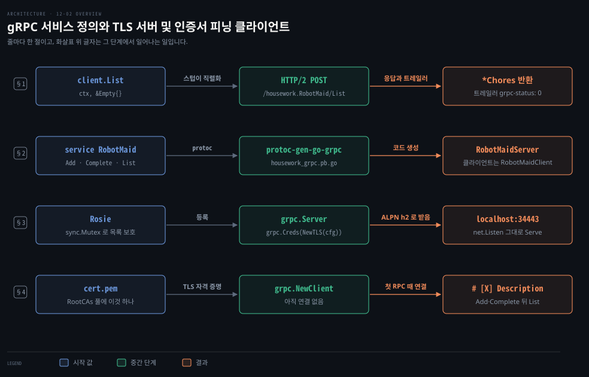
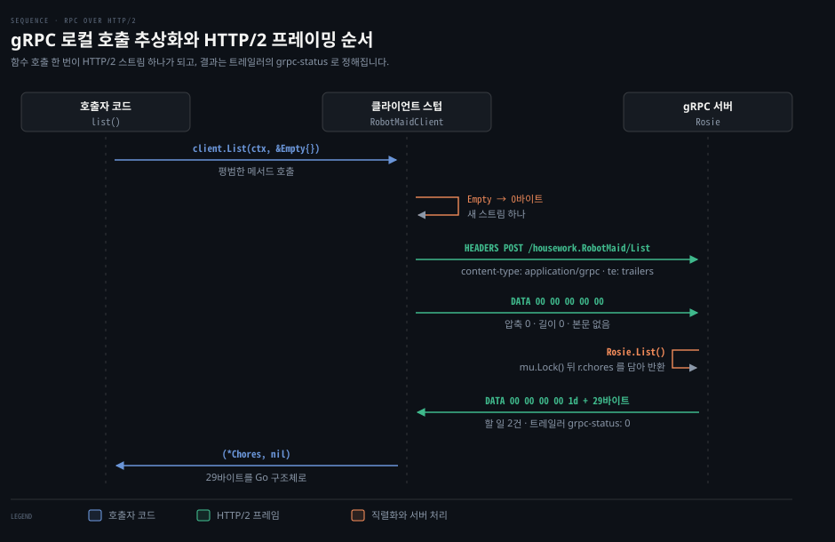
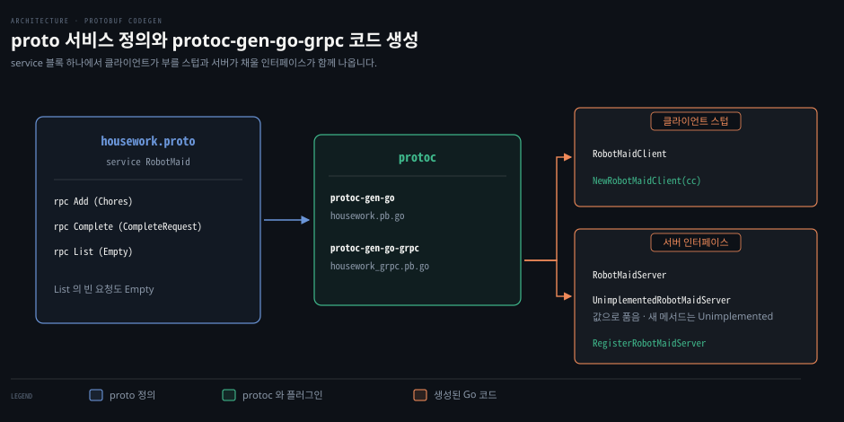
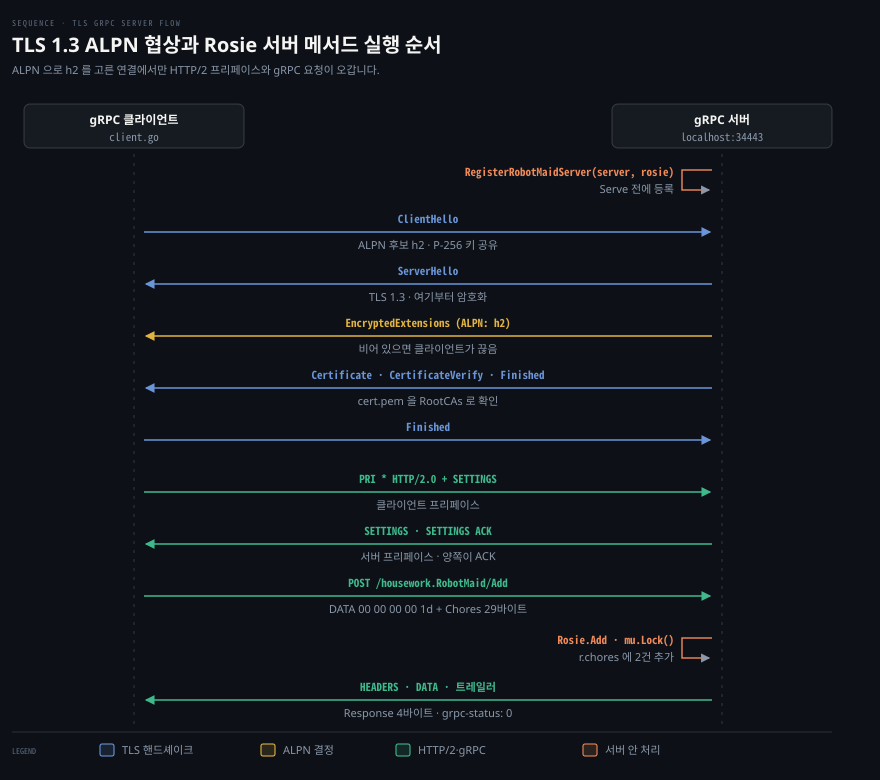
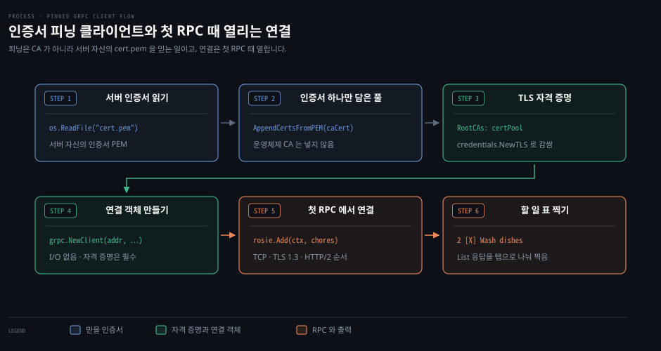

# gRPC 는 proto 서비스 정의로 원격 호출을 로컬 함수처럼 만들고 TLS 와 인증서 피닝으로 서버를 확인한다

---

> gRPC 는 `.proto` 에 적은 서비스 정의로 원격 호출을 함수 호출처럼 만들고 그 호출을 HTTP/2 연결 위의 protobuf 메시지로 보내며, 서버는 TLS 자격 증명을 걸고 클라이언트는 서버 인증서 하나만 믿도록 피닝합니다.

## 핵심 요약

> 서비스를 여러 서버로 나누면 메모리를 같이 쓸 수 없으므로, gRPC 는 원격 서버의 함수를 로컬 함수처럼 부르게 하고 그 뒤의 직렬화와 네트워크 전송은 생성된 코드와 라이브러리가 맡습니다.

`housework.proto` 파일에 `service` 블록과 메서드를 정의하고 `protoc-gen-go-grpc` 를 돌리면 클라이언트용 호출 스텁과 서버용 구현 인터페이스가 자동으로 만들어집니다.

서버는 생성된 인터페이스대로 `Rosie` 를 구현해 할 일 목록을 `sync.Mutex` 로 지키고, `credentials.NewTLS` 로 만든 자격 증명을 건 `grpc.Server` 로 연결을 받습니다. 이 자격 증명이 ALPN 후보에 `h2` 를 넣어 주므로 지금의 grpc-go 클라이언트가 연결을 끊지 않습니다.

클라이언트는 서버 인증서(`cert.pem`) 하나만 담은 `x509.CertPool` 을 `RootCAs` 로 넘겨 그 서버만 믿습니다(인증서 피닝). 그리고 `grpc.NewClient` 로 만든 연결에서 생성된 스텁의 `Add`·`Complete`·`List` 를 부릅니다.


## 학습 목표

> 이 편을 읽고 나면 아래 다섯 가지를 스스로 해낼 수 있습니다.

1. 서버를 나누면 왜 RPC 가 필요한지와 gRPC 호출 하나가 HTTP/2 요청(경로·헤더·5바이트 머리·트레일러)으로 어떻게 실리는지 설명할 수 있습니다.
2. `.proto` 에 `service` 와 요청·응답 메시지를 선언하고 `protoc-gen-go-grpc` 로 클라이언트 스텁과 서버 인터페이스를 만들 수 있습니다.
3. `UnimplementedRobotMaidServer` 를 값으로 품고 `sync.Mutex` 로 목록을 지키는 gRPC 서버를 구현할 수 있습니다.
4. `tls.NewListener` 로 감싼 gRPC 서버가 왜 지금의 grpc-go 클라이언트에게 끊기는지 설명하고, `grpc.Creds(credentials.NewTLS(cfg))` 로 TLS 를 거는 서버를 만들 수 있습니다.
5. `os.ReadFile` 과 `x509.NewCertPool` 로 자체 서명 서버 인증서를 피닝하고, 첫 RPC 때 연결을 맺는 `grpc.NewClient` 로 원격 메서드를 부를 수 있습니다.

아래는 이 편의 키워드를 이은 개념도입니다. 줄마다 한 절을 맡습니다.

§1 줄은 `client.List` 호출이 경로 `/housework.RobotMaid/List` 의 HTTP/2 요청이 되어 돌아오는 길입니다.

§2 줄은 `service RobotMaid` 한 블록에서 클라이언트 쪽 `RobotMaidClient` 와 서버 쪽 `RobotMaidServer` 가 갈라져 생성되는 모습입니다.

§3 줄은 `RegisterRobotMaidServer` 로 등록한 `Rosie` 와 `credentials.NewTLS` 를 건 서버가 `localhost:34443` 에서 ALPN `h2` 로 연결을 받는 모습입니다.

§4 줄은 `cert.pem` 하나를 담은 `RootCAs` 와 `grpc.NewClient` 로 연결해 할 일 표를 찍기까지입니다.




## 1. RPC 와 gRPC

> 서비스를 여러 서버로 나누면 메모리를 같이 쓸 수 없으므로, RPC 는 원격 서버의 함수를 로컬 함수처럼 부르게 하고 gRPC 는 그 호출을 TCP 연결 하나 위의 HTTP/2 스트림에 protobuf 메시지로 싣습니다.

한 서버에서 도는 애플리케이션은 모든 모듈이 한 프로세스의 메모리를 같이 씁니다. 함수에 포인터를 넘기면 받는 쪽이 같은 데이터를 바로 읽고 고칩니다. 온라인 상점이 커져 재고·회원 계정·청구·배송·알림 서비스를 더 큰 서버 한 대 대신 각자 다른 서버에 올리면, 서비스끼리는 서로의 메모리를 볼 수 없습니다. 이때부터 데이터는 네트워크로 보내야 합니다.

**원격 프로시저 호출(RPC, Remote Procedure Call)** 은 다른 서버에 있는 함수를 같은 컴퓨터의 함수처럼 부르게 하는 기법입니다. 클라이언트 코드가 함수를 부르면 그 뒤에서 인자가 바이트로 직렬화되어 서버로 갑니다. 서버는 그 함수를 자기 쪽에서 실행해 결과를 돌려보내고 클라이언트 코드는 그 결과를 함수의 반환값으로 받습니다. 호출하는 코드는 함수가 같은 컴퓨터에서 도는지 네트워크 너머에서 도는지에 따라 달라지지 않습니다.



문법은 같아도 실패하는 방식이 다릅니다. 로컬 함수 호출은 같은 프로세스 안에서 끝나므로 상대가 답하지 않는 일이 없습니다. 원격 호출은 네트워크를 건너므로 패킷이 사라지거나 늦게 오고, 서버가 바빠 답하지 않을 수도 있습니다.

그래서 gRPC 는 호출마다 기한(deadline)을 걸라고 권합니다. [gRPC Deadlines 가이드](https://grpc.io/docs/guides/deadlines/)는 gRPC 가 기본으로 기한을 두지 않아 클라이언트가 답을 끝없이 기다릴 수 있다고 적습니다. Go 에서는 `context.WithTimeout` 이나 `context.WithDeadline` 으로 만든 `ctx` 를 스텁 메서드에 넘깁니다. 기한이 지나면 클라이언트는 그 호출을 `codes.DeadlineExceeded` 로 끝냅니다.

기한은 `grpc-timeout` 헤더로 서버에도 전해지고 서버는 기한이 지난 호출을 취소합니다. 하던 일을 멈추는 것은 서버 코드의 몫이라 Go 서버는 받은 `ctx` 의 `Done()` 을 보고 멈춥니다.

REST 가 자원과 HTTP 메서드(GET·POST·PUT·DELETE)로 API 를 짜는 데 비해 RPC 는 부를 동작을 함수 이름으로 드러냅니다. 두 방식의 비교는 [가상 면접 사례로 배우는 대규모 시스템 설계 기초 03-02 §1](../../../03_architecture/book/bytebytego-system-design/03-02.API%20는%20SOAP·REST·GraphQL·RPC%20로%20갈리고%20토큰·HMAC·SSO·솔트%20해시가%20접근과%20비밀번호를%20지킨다.md) 과 [데이터 중심 애플리케이션 설계 05-04 §3](../../../05_data/book/designing-data-intensive-applications/05-04.데이터플로우%20—%20DB·REST·RPC.md) 에 있고, 서비스 사이 통신 방식을 고르는 기준은 [REST, gRPC, Messaging 선택 기준](../../../03_architecture/03_distributed/01-03.REST,%20gRPC,%20Messaging%20선택%20기준.md) 이 다룹니다.

gRPC 는 HTTP/2 위에서 도는 RPC 프레임워크입니다. [gRPC 소개 문서](https://grpc.io/docs/what-is-grpc/introduction/)에 따르면 gRPC 는 Protocol Buffers 를 서비스를 적는 인터페이스 정의 언어(IDL, Interface Definition Language)이자 메시지 형식으로 씁니다. HTTP/2 는 TCP 연결 하나 위에 스트림 여러 개를 열고 스트림마다 데이터를 프레임으로 쪼개 섞어 보내며(다중화, multiplexing), 헤더는 HPACK 으로 압축합니다. HTTP/2 의 프레임과 다중화는 [컴퓨터 네트워킹: 하향식 접근 02-02 §6](../cntd_computer-networking-top-down/02-02.웹은%20어떻게%20주고받는가.md) 이, 그 다중화를 쓰던 서버 푸시는 [같은 서가 09-02 §5](./09-02.미들웨어는%20핸들러를%20감싸고%20ServeMux%20는%20경로를%20나누며%20HTTP2%20서버%20푸시는%20브라우저가%20걷어냈다.md) 가 다룹니다.

gRPC 호출 하나가 HTTP/2 요청으로 어떻게 실리는지는 [gRPC PROTOCOL-HTTP2.md](https://github.com/grpc/grpc/blob/master/doc/PROTOCOL-HTTP2.md) 가 정합니다.

- 메서드는 언제나 `POST` 입니다.
- 경로는 `/{패키지}.{서비스}/{메서드}` 꼴입니다. 패키지 `housework`, 서비스 `RobotMaid`, 메서드 `List` 면 `/housework.RobotMaid/List` 입니다. 생성 코드의 상수 `RobotMaid_List_FullMethodName` 에도 이 문자열이 그대로 들어 있습니다.
- 헤더에는 `content-type: application/grpc`(또는 `application/grpc+proto`)와 `te: trailers` 가 들어갑니다. `te: trailers` 는 트레일러를 넘기지 못하는 중간 프록시를 가려내려고 붙입니다.
- DATA 프레임에 실리는 메시지마다 5바이트 머리가 앞에 붙습니다. 1바이트는 압축 여부, 4바이트는 메시지 길이(빅엔디언)이고, 그 뒤에 protobuf 로 직렬화한 바이트가 옵니다.
- 응답 메시지를 다 보낸 서버는 트레일러(trailers)를 HEADERS 프레임에 실어 `END_STREAM` 플래그와 함께 보냅니다. 트레일러의 `grpc-status` 가 호출 결과이고(`0` 이 `codes.OK`), 실패하면 `grpc-message` 에 이유가 담깁니다.


## 2. .proto 서비스 정의와 코드 생성

> `.proto` 에 `service` 블록과 `rpc` 메서드를 적고 `protoc-gen-go-grpc` 로 컴파일하면, 클라이언트가 부를 `RobotMaidClient` 와 서버가 구현할 `RobotMaidServer` 가 생깁니다.

[앞 편 12-01](./12-01.직렬화는%20구조체를%20바이트로%20바꾸고%20JSON%20은%20사람이,%20Gob%20은%20Go%20가,%20protobuf%20는%20여러%20언어가%20읽는다.md) 의 `housework/v1/housework.proto` 에는 할 일 하나를 나타내는 `Chore` 와 그 목록 `Chores` 가 있습니다. 여기에 로봇 가사도우미 서비스 `RobotMaid` 와 명령줄 도구의 add·complete·list 에 맞춘 메서드 `Add`·`Complete`·`List` 를 더합니다. 아래는 더한 뒤의 파일 전체이고, 모듈 경로는 앞 편과 같은 `example.com/housework` 입니다.

```protobuf
syntax = "proto3";

package housework;

// 세미콜론 뒤의 이름이 생성 코드의 Go 패키지 이름이 됩니다.
option go_package = "example.com/housework/housework/v1;housework";

// 앞 편에서 선언한 두 메시지입니다.
message Chore {
    bool complete = 1;
    string description = 2;
}

message Chores {
    repeated Chore chores = 1;
}

// 여기부터 이 편에서 더하는 서비스와 메시지입니다.

// 로봇 가사도우미 원격 서비스 인터페이스를 정의합니다.
service RobotMaid {
    rpc Add (Chores) returns (Response);
    rpc Complete (CompleteRequest) returns (Response);
    rpc List (Empty) returns (Chores);
}

// 완료 처리할 집안일 번호를 지정하는 요청 메시지입니다.
message CompleteRequest {
    int32 chore_number = 1;
}

// 매개변수가 필요 없는 호출에 사용할 빈 요청 메시지입니다.
message Empty {}

// 작업 성공 여부를 알리는 서버 응답 메시지입니다.
message Response {
    string message = 1;
}
```

메서드는 `rpc` 로 시작하고 이름은 단어 첫 글자를 대문자로 쓰는 파스칼 표기(PascalCase)로 짓습니다. 괄호 안에 요청 메시지 타입을, `returns` 뒤 괄호 안에 응답 메시지 타입을 씁니다.

`List` 는 받을 입력이 없지만 요청 타입 자리를 비울 수 없습니다. `rpc List () returns (Chores);` 처럼 괄호를 비우면 protoc 가 `Expected type name.` 으로 컴파일을 멈춥니다. 그래서 필드가 없는 `Empty` 메시지를 요청 타입으로 둡니다.

직접 만든 빈 메시지는 나중에 쓸모가 생깁니다. 목록에 페이지 번호나 정렬 조건을 받고 싶어지면 `Empty` 에 필드를 더하면 되고 메서드 시그니처는 그대로입니다. 새 필드를 모르는 옛 클라이언트는 그 필드를 비운 채 계속 부르며 서버는 빈 필드를 기본값으로 읽습니다. 필드 번호가 이런 호환을 어떻게 받치는지는 [데이터 중심 애플리케이션 설계 05-03 §1](../../../05_data/book/designing-data-intensive-applications/05-03.Protocol%20Buffers와%20Avro.md) 이 다룹니다.

Protocol Buffers 가 함께 주는 `google.protobuf.Empty` 를 가져다 써도 됩니다. 파일은 `google/protobuf/empty.proto`, Go 패키지는 `google.golang.org/protobuf/types/known/emptypb` 입니다. 다만 남이 정한 타입이라 위처럼 필드를 더할 수는 없습니다.



`.proto` 를 Go 코드로 바꾸려면 컴파일러 `protoc` 와 Go 플러그인 두 개가 있어야 합니다. 플러그인은 [gRPC Go 퀵스타트](https://grpc.io/docs/languages/go/quickstart/)대로 `go install` 로 설치합니다.

```bash
go install google.golang.org/protobuf/cmd/protoc-gen-go@latest
go install google.golang.org/grpc/cmd/protoc-gen-go-grpc@latest
```

`$(go env GOPATH)/bin` 이 `PATH` 에 있으면 모듈 루트에서 아래 명령 하나로 두 파일을 만듭니다.

```bash
protoc --go_out=. --go_opt=paths=source_relative \
       --go-grpc_out=. --go-grpc_opt=paths=source_relative \
       housework/v1/housework.proto
```

`--go_out` 은 `protoc-gen-go` 를 불러 메시지 구조체와 직렬화 코드를 담은 `housework.pb.go` 를 만듭니다. `--go-grpc_out` 은 `protoc-gen-go-grpc` 를 불러 서비스 코드를 담은 `housework_grpc.pb.go` 를 만듭니다. `paths=source_relative` 라서 두 파일은 `.proto` 옆 `housework/v1/` 에 생깁니다. 생성 파일 머리에는 만든 도구의 버전(`protoc-gen-go-grpc v1.6.1`, `protoc v6.33.2`)이 적힙니다.

`housework_grpc.pb.go` 에서 이 편이 쓰는 이름은 넷입니다.

- 클라이언트 스텁 `RobotMaidClient`:
  ```go
  type RobotMaidClient interface {
      Add(ctx context.Context, in *Chores, opts ...grpc.CallOption) (*Response, error)
      Complete(ctx context.Context, in *CompleteRequest, opts ...grpc.CallOption) (*Response, error)
      List(ctx context.Context, in *Empty, opts ...grpc.CallOption) (*Chores, error)
  }
  ```
  연결을 받아 이 인터페이스의 구현을 돌려주는 `NewRobotMaidClient(cc grpc.ClientConnInterface) RobotMaidClient` 도 함께 생깁니다.

- 서버 인터페이스 `RobotMaidServer`:
  ```go
  type RobotMaidServer interface {
      Add(context.Context, *Chores) (*Response, error)
      Complete(context.Context, *CompleteRequest) (*Response, error)
      List(context.Context, *Empty) (*Chores, error)
      mustEmbedUnimplementedRobotMaidServer()
  }
  ```
  서버에서 실제 일을 하는 타입이 이 인터페이스를 채웁니다.

- 기본 구현 `UnimplementedRobotMaidServer`:
  모든 메서드가 `codes.Unimplemented` 에러를 돌려주는 빈 구조체입니다. 서버 인터페이스의 소문자 메서드 `mustEmbedUnimplementedRobotMaidServer()` 는 패키지 밖에서 직접 쓸 수 없습니다. 그래서 서버 타입은 이 구조체(또는 권하지 않는 `UnsafeRobotMaidServer`)를 품어야 인터페이스를 만족합니다.

- 등록 함수 `RegisterRobotMaidServer`:
  ```go
  func RegisterRobotMaidServer(s grpc.ServiceRegistrar, srv RobotMaidServer)
  ```
  서버에 구현을 등록합니다. `UnimplementedRobotMaidServer` 를 포인터로 품고 `nil` 로 두면 이 함수가 바로 패닉을 일으켜, 미구현 메서드가 실행 중에 불릴 때 터질 문제를 시작할 때 드러냅니다.

이 강제는 전방 호환(forward compatibility)을 위한 것입니다. `.proto` 에 메서드를 하나 더하고 코드를 다시 만들면 `RobotMaidServer` 의 메서드도 하나 늘어납니다. 서버 타입이 `UnimplementedRobotMaidServer` 를 품고 있으면 새 메서드 자리는 그 구조체의 메서드가 채우므로 서버 코드는 고치지 않아도 컴파일되고 클라이언트가 새 메서드를 부르면 `codes.Unimplemented` 를 받습니다. [protoc-gen-go-grpc README](https://github.com/grpc/grpc-go/blob/cmd/protoc-gen-go-grpc/v1.6.1/cmd/protoc-gen-go-grpc/README.md)는 이 구조체를 포인터가 아니라 값으로 품으라고 적습니다.


## 3. gRPC 서버와 TLS 자격 증명

> `Rosie` 는 `RobotMaidServer` 를 구현하며 메모리에 둔 할 일 목록을 뮤텍스로 지키고, 서버는 `credentials.NewTLS` 자격 증명을 건 `grpc.Server` 에 `Rosie` 를 등록한 뒤 `localhost:34443` 에서 연결을 받습니다.

요청을 실제로 처리할 타입은 `Rosie` 입니다(애니메이션 「젯슨 가족」의 로봇 가정부 이름). gRPC 서버는 들어온 호출마다 고루틴을 따로 띄워 메서드를 부르므로, 클라이언트 여럿이 동시에 할 일을 더하거나 완료 표시를 하면 같은 슬라이스를 동시에 고치는 데이터 경합(race condition)이 생깁니다. 그래서 세 메서드 모두 `r.chores` 를 만지기 전에 `r.mu.Lock()` 을 겁니다. 아래 코드가 `server/rosie.go` 입니다.

```go
package main

import (
	"context"
	"sync"

	"google.golang.org/grpc/codes"
	"google.golang.org/grpc/status"

	housework "example.com/housework/housework/v1"
)

// 전방 호환성을 위해 Unimplemented 구현체를 값으로 임베딩합니다.
type Rosie struct {
	housework.UnimplementedRobotMaidServer
	mu     sync.Mutex
	chores []*housework.Chore
}

// 클라이언트가 보낸 집안일 목록을 내부 슬라이스에 추가합니다.
func (r *Rosie) Add(_ context.Context, chores *housework.Chores) (*housework.Response, error) {
	r.mu.Lock()
	r.chores = append(r.chores, chores.Chores...)
	r.mu.Unlock()
	return &housework.Response{Message: "ok"}, nil
}

// 지정한 번호의 집안일을 완료 처리합니다.
func (r *Rosie) Complete(_ context.Context, req *housework.CompleteRequest) (*housework.Response, error) {
	r.mu.Lock()
	defer r.mu.Unlock()
	// 범위를 벗어난 번호는 NotFound 상태로 돌려줍니다.
	if r.chores == nil || req.ChoreNumber < 1 || int(req.ChoreNumber) > len(r.chores) {
		return nil, status.Errorf(codes.NotFound, "chore %d not found", req.ChoreNumber)
	}
	r.chores[req.ChoreNumber-1].Complete = true
	return &housework.Response{Message: "ok"}, nil
}

// 현재 저장된 모든 집안일 목록을 반환합니다.
func (r *Rosie) List(_ context.Context, _ *housework.Empty) (*housework.Chores, error) {
	r.mu.Lock()
	defer r.mu.Unlock()
	if r.chores == nil {
		r.chores = make([]*housework.Chore, 0)
	}
	return &housework.Chores{Chores: r.chores}, nil
}
```

`Complete` 는 없는 번호를 받으면 `status.Errorf(codes.NotFound, …)` 로 에러를 만듭니다. 서버는 상태 코드가 없는 에러(예: `fmt.Errorf` 로 만든 에러)를 `codes.Unknown` 으로 바꿔 보내고, context 취소·기한 초과 에러만 `Canceled`·`DeadlineExceeded` 로 바꿉니다. 클라이언트가 원인별로 나눠 처리하게 하려면 서버가 [status](https://pkg.go.dev/google.golang.org/grpc/status) 패키지로 [codes](https://pkg.go.dev/google.golang.org/grpc/codes) 의 코드를 붙여야 합니다. §4 끝에서 없는 번호를 완료하려 하면 클라이언트에 이 `NotFound` 가 그대로 찍힙니다.

`Rosie` 가 `RobotMaidServer` 를 그대로 만족하므로 메서드를 따로 묶는 타입 없이 `Rosie` 값을 `housework.RegisterRobotMaidServer(server, rosie)` 에 바로 넘깁니다. 아래 `server/server.go` 가 `Rosie` 를 TLS 를 건 gRPC 서버에 올립니다.

```go
package main

import (
	"crypto/tls"
	"flag"
	"fmt"
	"log"
	"net"

	"google.golang.org/grpc"
	"google.golang.org/grpc/credentials"

	housework "example.com/housework/housework/v1"
)

var (
	addr   string
	certFn string
	keyFn  string
)

func init() {
	flag.StringVar(&addr, "address", "localhost:34443", "listen address")
	flag.StringVar(&certFn, "cert", "cert.pem", "certificate file")
	flag.StringVar(&keyFn, "key", "key.pem", "private key file")
}

func main() {
	flag.Parse()

	cert, err := tls.LoadX509KeyPair(certFn, keyFn)
	if err != nil {
		log.Fatal(err)
	}

	// 곡선을 P-256 하나로 좁히고 TLS 1.2 미만은 받지 않습니다.
	creds := credentials.NewTLS(&tls.Config{
		Certificates:     []tls.Certificate{cert},
		CurvePreferences: []tls.CurveID{tls.CurveP256},
		MinVersion:       tls.VersionTLS12,
	})

	// 자격 증명이 ALPN 후보에 h2 를 넣으므로 리스너는 감싸지 않습니다.
	server := grpc.NewServer(grpc.Creds(creds))
	rosie := new(Rosie)
	// Serve 가 연결을 받기 전에 등록해야 합니다.
	housework.RegisterRobotMaidServer(server, rosie)

	listener, err := net.Listen("tcp", addr)
	if err != nil {
		log.Fatal(err)
	}

	fmt.Printf("Listening for TLS connections on %s ...\n", addr)
	log.Fatal(server.Serve(listener))
}
```

`cert.pem`·`key.pem` 은 [같은 서가 11-02 §2](./11-02.상호%20TLS%20는%20직접%20만든%20인증서로%20클라이언트도%20검증하고%20서버는%20접속%20주소를%20인증서%20이름과%20맞춘다.md) 에서 만든 `generate.go` 로 `go run generate.go -cert cert.pem -key key.pem -host localhost,127.0.0.1` 처럼 만듭니다. 클라이언트가 `localhost` 로 접속하므로 인증서 이름에 `localhost` 가 있어야 검증을 통과합니다.

`tls.Config` 에 `PreferServerCipherSuites` 는 넣지 않습니다. [`crypto/tls` 문서](https://pkg.go.dev/crypto/tls#Config)는 이 필드가 아무 효과가 없고, 서버가 양쪽 하드웨어와 보안을 따져 암호 스위트를 고른다고 적습니다. 서버 TLS 설정의 나머지 필드는 [같은 서가 11-01 §4](./11-01.TLS%20클라이언트는%20CA%20서명으로%20서버를%20확인하고%20서버는%20리스너를%20감싸며%20피닝은%20믿을%20인증서를%20좁힌다.md) 가 다룹니다.



TCP 서버에 TLS 를 걸 때는 [11-01 §4](./11-01.TLS%20클라이언트는%20CA%20서명으로%20서버를%20확인하고%20서버는%20리스너를%20감싸며%20피닝은%20믿을%20인증서를%20좁힌다.md) 처럼 `net.Listen` 이 준 리스너를 `tls.NewListener` 로 감쌉니다. gRPC 서버를 `grpc.NewServer()` 로 만들고 이렇게 감싼 리스너를 `Serve` 에 넘기면, 서버는 문제없이 뜨지만 클라이언트의 첫 호출이 실패합니다.

원인은 ALPN(Application-Layer Protocol Negotiation)입니다. ALPN 은 TLS 핸드셰이크 안에서 그 연결 위에 올릴 프로토콜을 정하는 확장으로, 클라이언트가 후보(`h2`)를 내밀면 서버가 하나를 고릅니다. `tls.Config` 에 `NextProtos` 가 없는 서버는 아무것도 고르지 않습니다. grpc-go 1.67 부터 클라이언트는 서버가 ALPN 을 고르지 않은 TLS 연결을 끊습니다(환경 변수 `GRPC_ENFORCE_ALPN_ENABLED` 의 기본값이 `true`). 이 편의 클라이언트로 그런 서버에 접속하면 grpc v1.84.0 에서 아래 줄이 찍힙니다.

```bash
rpc error: code = Unavailable desc = connection error: desc = "transport: authentication handshake failed: credentials: cannot check peer: missing selected ALPN property. If you upgraded from a grpc-go version earlier than 1.67, your TLS connections may have stopped working due to ALPN enforcement. For more details, see: https://github.com/grpc/grpc-go/issues/434"
```

`credentials.NewTLS(cfg)` 는 받은 설정을 복사해 `NextProtos` 에 `h2` 를 더합니다. `MinVersion` 이 비어 있으면 TLS 1.2 도 넣습니다([grpc-go `credentials/tls.go` 의 `applyDefaults`](https://github.com/grpc/grpc-go/blob/v1.84.0/credentials/tls.go)). 그래서 위 서버는 이 자격 증명을 `grpc.NewServer(grpc.Creds(creds))` 로 걸고 리스너는 `net.Listen` 이 준 그대로 `Serve` 에 넘깁니다.

핸드셰이크는 grpc 가 연결마다 직접 하며, ALPN 을 내밀지 않은 클라이언트는 서버 쪽에서도 같은 이유로 끊습니다. 위 서버를 띄우고 `openssl s_client -connect localhost:34443 -alpn h2` 로 붙어 보면 `Protocol: TLSv1.3` 과 `ALPN protocol: h2` 가 찍힙니다.

`server.Serve` 는 리스너가 닫힐 때까지 돌아오지 않으므로 `housework.RegisterRobotMaidServer` 는 그 전에 불러야 합니다.


## 4. 피닝한 클라이언트와 스텁 호출

> 클라이언트는 서버 인증서 `cert.pem` 하나만 담은 풀을 `RootCAs` 로 넘겨 그 서버만 믿게 하고, `grpc.NewClient` 로 만든 연결은 첫 RPC 때 TCP 연결과 TLS 핸드셰이크를 엽니다.

클라이언트(`client/client.go`)는 `-address`·`-ca-cert` 플래그로 서버 주소와 인증서 파일을 받고, 첫 인자 `add`·`complete` 에 따라 RPC 를 부른 뒤 언제나 목록을 찍습니다.

grpc-go 클라이언트는 전송 자격 증명 없이는 연결을 만들지 않습니다. 옵션 없이 `grpc.NewClient("localhost:34443")` 를 부르면 아래 에러가 돌아옵니다.

```bash
grpc: no transport security set (use grpc.WithTransportCredentials(insecure.NewCredentials()) explicitly or set credentials)
```

암호화하지 않으려면 [insecure](https://pkg.go.dev/google.golang.org/grpc/credentials/insecure) 패키지의 `insecure.NewCredentials()` 를, TLS 를 쓰려면 `credentials.NewTLS` 로 만든 자격 증명을 `grpc.WithTransportCredentials` 로 넘깁니다.

이 서버의 인증서는 직접 만든 자체 서명 인증서라 운영체제가 믿는 CA 목록에 없습니다. 그래서 [같은 서가 11-01 §5](./11-01.TLS%20클라이언트는%20CA%20서명으로%20서버를%20확인하고%20서버는%20리스너를%20감싸며%20피닝은%20믿을%20인증서를%20좁힌다.md) 의 **인증서 피닝(certificate pinning)** 을 씁니다. 서버 인증서 파일을 그대로 `x509.CertPool` 에 넣어 `RootCAs` 로 주면, 클라이언트는 이 인증서를 신뢰의 뿌리로 삼고 운영체제의 CA 는 쓰지 않습니다.

```go
package main

import (
	"context"
	"crypto/tls"
	"crypto/x509"
	"flag"
	"fmt"
	"log"
	"os"
	"path/filepath"
	"strconv"
	"strings"

	"google.golang.org/grpc"
	"google.golang.org/grpc/credentials"

	housework "example.com/housework/housework/v1"
)

var (
	addr     string
	caCertFn string
)

func init() {
	flag.StringVar(&addr, "address", "localhost:34443", "server address")
	flag.StringVar(&caCertFn, "ca-cert", "cert.pem", "CA certificate")
	flag.Usage = func() {
		fmt.Fprintf(flag.CommandLine.Output(),
			`Usage: %s [flags] [add chore, ...|complete #]
add        add comma-separated chores
complete   complete designated chore

Flags:
`, filepath.Base(os.Args[0]))
		flag.PrintDefaults()
	}
}

// 입력이 없어도 빈 Empty 메시지를 보냅니다.
func list(ctx context.Context, client housework.RobotMaidClient) error {
	chores, err := client.List(ctx, new(housework.Empty))
	if err != nil {
		return err
	}
	if len(chores.Chores) == 0 {
		fmt.Println("You have nothing to do!")
		return nil
	}
	fmt.Println("#\t[X]\tDescription")
	for i, chore := range chores.Chores {
		c := " "
		if chore.Complete {
			c = "X"
		}
		fmt.Printf("%d\t[%s]\t%s\n", i+1, c, chore.Description)
	}
	return nil
}

// 쉼표로 나눈 할 일을 Chores 하나에 담아 한 번에 보냅니다.
func add(ctx context.Context, client housework.RobotMaidClient, s string) error {
	chores := new(housework.Chores)
	for _, chore := range strings.Split(s, ",") {
		if desc := strings.TrimSpace(chore); desc != "" {
			chores.Chores = append(chores.Chores, &housework.Chore{
				Description: desc,
			})
		}
	}
	var err error
	if len(chores.Chores) > 0 {
		_, err = client.Add(ctx, chores)
	}
	return err
}

// ChoreNumber 가 int32 라서 Atoi 결과를 바꿔 넣습니다.
func complete(ctx context.Context, client housework.RobotMaidClient, s string) error {
	i, err := strconv.Atoi(s)
	if err == nil {
		_, err = client.Complete(ctx, &housework.CompleteRequest{
			ChoreNumber: int32(i),
		})
	}
	return err
}

func main() {
	flag.Parse()

	// 피닝할 서버 인증서(PEM)를 읽습니다.
	caCert, err := os.ReadFile(caCertFn)
	if err != nil {
		log.Fatal(err)
	}

	// 시스템 CA 는 넣지 않고 이 인증서 하나만 담습니다.
	certPool := x509.NewCertPool()
	if ok := certPool.AppendCertsFromPEM(caCert); !ok {
		log.Fatal("failed to add certificate to pool")
	}

	// RootCAs 에 풀을 지정해 신뢰 대상을 이 서버 하나로 좁힙니다(피닝).
	conn, err := grpc.NewClient(
		addr,
		grpc.WithTransportCredentials(
			credentials.NewTLS(
				&tls.Config{
					CurvePreferences: []tls.CurveID{tls.CurveP256},
					MinVersion:       tls.VersionTLS12,
					RootCAs:          certPool,
				},
			),
		),
	)
	if err != nil {
		log.Fatal(err)
	}
	defer conn.Close()

	// 여기까지 TCP 연결은 아직 없습니다.
	rosie := housework.NewRobotMaidClient(conn)
	ctx := context.Background()

	switch strings.ToLower(flag.Arg(0)) {
	case "add":
		err = add(ctx, rosie, strings.Join(flag.Args()[1:], " "))
	case "complete":
		err = complete(ctx, rosie, flag.Arg(1))
	}
	if err != nil {
		log.Fatal(err)
	}

	err = list(ctx, rosie)
	if err != nil {
		log.Fatal(err)
	}
}
```



연결은 `grpc.NewClient` 로 만듭니다. `grpc.Dial` 은 [grpc 문서](https://pkg.go.dev/google.golang.org/grpc#Dial)에 Deprecated 로 표시되어 있고 `NewClient` 를 쓰라고 안내합니다. [`NewClient` 문서](https://pkg.go.dev/google.golang.org/grpc#NewClient)는 이 함수가 I/O 를 하지 않고 채널(`*grpc.ClientConn`)만 만들며, 그 연결로 RPC 를 부르면 그때 연결한다고 적습니다.

그래서 이 클라이언트의 TCP 연결과 TLS 핸드셰이크는 `grpc.NewClient` 줄이 아니라 처음 부르는 `rosie.Add` 나 `rosie.List` 안에서 일어납니다. 서버를 띄우지 않고 클라이언트를 돌리면 `grpc.NewClient` 는 에러 없이 지나가고 첫 RPC 인 `List` 가 아래 에러를 돌려줍니다.

```bash
rpc error: code = Unavailable desc = connection error: desc = "transport: Error while dialing: dial tcp 127.0.0.1:34443: connect: connection refused"
```

모듈 루트에서 서버를 띄웁니다.

서버 실행:
```bash
go run server/server.go server/rosie.go -cert cert.pem -key key.pem
```

서버 출력:
```bash
Listening for TLS connections on localhost:34443 ...
```

다른 터미널에서 목록을 봅니다. 아직 아무것도 없습니다.
```bash
go run client/client.go -ca-cert cert.pem
```

클라이언트 출력:
```bash
You have nothing to do!
```

바닥 청소와 설거지를 추가합니다.
```bash
go run client/client.go -ca-cert cert.pem add Mop floors, Wash dishes
```

클라이언트 출력:
```bash
#	[X]	Description
1	[ ]	Mop floors
2	[ ]	Wash dishes
```

2번(설거지)을 완료로 표시합니다.
```bash
go run client/client.go -ca-cert cert.pem complete 2
```

클라이언트 출력:
```bash
#	[X]	Description
1	[ ]	Mop floors
2	[X]	Wash dishes
```

없는 번호를 주면 §3 의 `Rosie.Complete` 가 만든 `NotFound` 가 그대로 오고, 클라이언트는 `log.Fatal` 로 끝납니다.
```bash
go run client/client.go -ca-cert cert.pem complete 9
```

클라이언트 출력:
```bash
rpc error: code = NotFound desc = chore 9 not found
```

클라이언트를 한 번 돌릴 때마다 TCP 연결 하나가 열립니다. 그 위에서 피닝한 인증서로 서버를 확인하는 TLS 1.3 핸드셰이크가 한 번 일어납니다. `add` 를 준 실행이면 그 연결 위에서 `Add` 와 `List` 두 호출이 각자 HTTP/2 스트림으로 오갑니다.

목록은 서버 프로세스 메모리의 `r.chores` 에만 있으므로 서버를 다시 띄우면 사라집니다. 남기려면 앞 편처럼 서버가 시작할 때 파일에서 목록을 읽고, `Add`·`Complete` 뒤에 JSON·Gob·protobuf 중 하나로 파일에 써 두면 됩니다.


## 결정 치트시트

> 이 편의 코드를 짤 때 갈림길마다 고를 API 와 그 이유입니다.

| 상황 | 고를 API·설정 | 이유 |
|---|---|---|
| 클라이언트 연결 채널 수립 | `grpc.NewClient(addr, opts...)` | `grpc.Dial` 은 Deprecated. I/O 없이 채널만 만들고 첫 RPC 때 연결함 |
| 로컬 개발용 평문 통신 | `grpc.WithTransportCredentials(insecure.NewCredentials())` | 자격 증명이 없으면 연결을 만들지 않으므로 평문도 명시해야 함. 운영 환경에서는 쓰지 않음 |
| 사설 자체 서명 gRPC 서버 연결 | `x509.NewCertPool()` + `RootCAs: pool` | 운영체제 CA 대신 서버 인증서 `cert.pem` 하나만 믿음(피닝) |
| gRPC 서버 전송 보안 적용 | `grpc.NewServer(grpc.Creds(credentials.NewTLS(cfg)))` | `credentials.NewTLS` 가 ALPN 후보에 `h2` 를 넣음. `NextProtos` 없는 `tls.NewListener` 서버는 grpc-go 1.67 이후 클라이언트가 끊음 |
| 암호 스위트 선호 지정 | 설정하지 않음 | `PreferServerCipherSuites` 는 효과가 없음. Go 가 양쪽 하드웨어와 보안을 따져 고름 |
| gRPC 에러 반환 | `status.Errorf(codes.<Code>, format, a...)` | 코드 없는 에러는 `codes.Unknown` 으로 감. 코드를 붙여야 클라이언트가 원인별로 나눔 |
| 입력 없는 RPC 정의 | `rpc Method(Empty) returns (Response)` | 요청 타입 자리는 비울 수 없음. 직접 만든 `Empty` 는 나중에 필드를 더할 수 있음 |
| 서버 인터페이스 구현 | `Unimplemented<Service>Server` 값 임베딩 | 메서드가 늘어도 서버가 그대로 컴파일되고 새 메서드는 `Unimplemented` 를 돌려줌 |


## 면접 대비

> 아래 질문에 먼저 스스로 답해 보세요.

1. 서비스 사이 통신에 JSON 을 주고받는 REST API 대신 gRPC 를 고르면 무엇을 얻는지 세 가지를 설명해 주세요.
2. gRPC 호출 하나가 HTTP/2 요청으로 실릴 때의 메서드, 경로 규칙, 트레일러의 역할을 설명해 주세요.
3. gRPC Go 서버 타입이 `Unimplemented<Service>Server` 를 품어야 하는 이유를 설명해 주세요.
4. `grpc.NewServer` 에 `credentials.NewTLS` 자격 증명을 거는 방식과 `tls.NewListener` 로 리스너를 감싸는 방식이 ALPN 에서 어떻게 다른지 설명해 주세요.
5. `grpc.NewClient` 는 언제 서버에 연결하고, 서버가 꺼져 있으면 에러가 어디서 나는지 설명해 주세요.


## 정답 (자답 후 펼치기)

> 위 §면접 대비의 질문에 먼저 스스로 답한 뒤 읽으세요.

### 정답 1 — gRPC 를 고르면 얻는 것

첫째, 메시지가 protobuf 이진 형식이라 필드 이름 대신 필드 번호와 값만 실려 같은 내용의 JSON 보다 작습니다. [앞 편 12-01](./12-01.직렬화는%20구조체를%20바이트로%20바꾸고%20JSON%20은%20사람이,%20Gob%20은%20Go%20가,%20protobuf%20는%20여러%20언어가%20읽는다.md) 에서 같은 할 일 목록을 JSON 과 protobuf 로 저장해 크기를 견주었습니다.

둘째, 여러 호출이 TCP 연결 하나를 나눠 씁니다. 호출마다 스트림이 따로 열려 한 응답이 늦어도 다른 호출의 응답이 그 뒤에 줄 서지 않고, 호출마다 TCP·TLS 핸드셰이크를 다시 하지도 않습니다. 다만 TCP 패킷 하나가 사라지면 그 연결의 모든 스트림이 재전송을 기다리며 멈춥니다([RFC 9114 §1](https://www.rfc-editor.org/rfc/rfc9114#section-1)).

셋째, `.proto` 하나에서 언어마다 스텁과 서버 인터페이스를 만듭니다. 서버는 Go, 클라이언트는 다른 언어여도 같은 정의에서 나온 타입을 쓰므로 메서드 이름이나 필드 타입이 어긋나면 컴파일 단계에서 드러납니다.

### 정답 2 — HTTP/2 위에서의 gRPC 프레이밍

메서드는 언제나 `POST` 이고 경로는 `/{패키지}.{서비스}/{메서드}` 꼴입니다. 경로에 서비스 이름이 들어 있으므로 HTTP/2 를 이해하는 프록시는 경로만 보고 요청을 어느 서비스로 보낼지 정할 수 있습니다.

트레일러는 응답 메시지 뒤, 스트림의 마지막 HEADERS 프레임에 실립니다. 응답 첫 헤더는 메시지보다 먼저 나가므로 메시지를 보내는 도중 생긴 실패를 담을 수 없습니다. 메시지가 끝난 뒤 가는 트레일러의 `grpc-status` 와 `grpc-message` 가 호출의 최종 결과를 알립니다. 바로 실패하는 호출은 메시지 없이 트레일러만 보내기도 합니다(Trailers-Only).

### 정답 3 — Unimplemented 임베딩과 전방 호환성

생성된 서버 인터페이스에는 소문자 메서드 `mustEmbedUnimplemented<Service>Server()` 가 들어 있어, 패키지 밖의 서버 타입은 `Unimplemented<Service>Server` 를 품어야 인터페이스를 만족합니다.

그러면 `.proto` 에 메서드가 늘어 코드를 다시 만들어도 새 메서드 자리는 품은 구조체의 메서드가 채웁니다. 서버는 그대로 컴파일되고 클라이언트가 새 메서드를 부르면 `codes.Unimplemented` 를 받습니다. 구조체는 값으로 품어야 하며 포인터로 품고 `nil` 로 두면 `Register<Service>Server` 에서 패닉이 납니다.

### 정답 4 — NewTLS 와 NewListener 의 ALPN

gRPC 는 TLS 위에서 HTTP/2 를 쓰므로 핸드셰이크 안에서 ALPN 으로 `h2` 를 정해야 합니다.

`tls.NewListener` 에 넘긴 설정에 `NextProtos` 가 없으면 서버는 ALPN 에서 아무것도 고르지 않고, grpc-go 1.67 이후 클라이언트는 그런 연결을 `missing selected ALPN property` 에러로 끊습니다. `credentials.NewTLS` 는 설정을 복사해 `NextProtos` 에 `h2` 를 더하므로, 이 자격 증명을 `grpc.Creds` 로 건 서버는 `h2` 를 고릅니다. 이때 리스너는 감싸지 않고 `net.Listen` 이 준 그대로 넘깁니다.

### 정답 5 — grpc.NewClient 가 연결하는 때

`grpc.NewClient` 는 I/O 를 하지 않고 `*grpc.ClientConn` 만 만들어 바로 돌려줍니다. TCP 연결과 TLS 핸드셰이크는 그 연결로 첫 RPC 를 부를 때 일어납니다.

그래서 서버가 꺼져 있어도 `NewClient` 는 에러를 내지 않습니다. 실패는 첫 RPC 가 `codes.Unavailable` 에러(`connect: connection refused`)로 알립니다. Deprecated 된 `grpc.Dial` 은 `NewClient` 를 부른 뒤 바로 연결을 시작하며 `WithBlock(true)` 를 주면 연결이 준비될 때까지 기다립니다.


## 참고 자료

- 《Network Programming with Go》 Adam Woodbeck, 2021. ISBN 978-1-7185-0088-4.
- 원문 범위: Chapter 12 Data Serialization — Transmitting Serialized Objects ~ What You've Learned (Listing 12-20~12-28).
- [gRPC 소개 문서](https://grpc.io/docs/what-is-grpc/introduction/): protobuf 를 IDL 과 메시지 형식으로 쓰는 gRPC 의 구조.
- [gRPC Go 퀵스타트](https://grpc.io/docs/languages/go/quickstart/): protoc-gen-go·protoc-gen-go-grpc 설치 명령.
- [gRPC Deadlines 가이드](https://grpc.io/docs/guides/deadlines/): 기한을 거는 이유와 서버 쪽 취소.
- [gRPC over HTTP2 (PROTOCOL-HTTP2.md)](https://github.com/grpc/grpc/blob/master/doc/PROTOCOL-HTTP2.md): 메서드·경로·헤더·5바이트 머리·트레일러 규격.
- [grpc 패키지 문서](https://pkg.go.dev/google.golang.org/grpc): `NewClient`·`Dial`·`NewServer`·`WithTransportCredentials`.
- [grpc/status 패키지 문서](https://pkg.go.dev/google.golang.org/grpc/status): `status.Errorf` 와 `FromError`.
- [grpc/codes 패키지 문서](https://pkg.go.dev/google.golang.org/grpc/codes): `NotFound`·`Unknown`·`Unavailable`·`DeadlineExceeded` 같은 상태 코드.
- [grpc-go 이슈 #434](https://github.com/grpc/grpc-go/issues/434): ALPN 강제로 끊긴 연결의 에러 메시지가 가리키는 이슈.
- [grpc-go v1.84.0 `credentials/tls.go`](https://github.com/grpc/grpc-go/blob/v1.84.0/credentials/tls.go): `NewTLS`·`applyDefaults` 가 `NextProtos` 에 `h2` 를 더하고, 양쪽 핸드셰이크가 ALPN 없는 연결을 끊는 코드.
- [protoc-gen-go-grpc v1.6.1 README](https://github.com/grpc/grpc-go/blob/cmd/protoc-gen-go-grpc/v1.6.1/cmd/protoc-gen-go-grpc/README.md): `Unimplemented<Service>Server` 를 값으로 품으라는 안내.
- [RFC 9114 §1](https://www.rfc-editor.org/rfc/rfc9114#section-1): HTTP/2 다중화가 TCP 패킷 손실에 따른 멈춤은 없애지 못한다는 설명.
- [RFC 8446 §4.3.1](https://www.rfc-editor.org/rfc/rfc8446#section-4.3.1): TLS 1.3 에서 서버가 고른 ALPN 이 실리는 `EncryptedExtensions`.
- [RFC 9113 §3.4](https://www.rfc-editor.org/rfc/rfc9113#section-3.4): HTTP/2 연결 프리페이스와 SETTINGS 교환.


## 관련 문서

- [11-01 TLS 클라이언트는 CA 서명으로 서버를 확인하고 서버는 리스너를 감싸며 피닝은 믿을 인증서를 좁힌다](./11-01.TLS%20클라이언트는%20CA%20서명으로%20서버를%20확인하고%20서버는%20리스너를%20감싸며%20피닝은%20믿을%20인증서를%20좁힌다.md): TLS 핸드셰이크, CA 신뢰 사슬, 서버의 `tls.NewListener`, 인증서 피닝을 다룹니다.
- [11-02 상호 TLS 는 직접 만든 인증서로 클라이언트도 검증하고 서버는 접속 주소를 인증서 이름과 맞춘다](./11-02.상호%20TLS%20는%20직접%20만든%20인증서로%20클라이언트도%20검증하고%20서버는%20접속%20주소를%20인증서%20이름과%20맞춘다.md): x509 템플릿으로 인증서와 키를 직접 만드는 `generate.go` 를 다룹니다.
- [09-02 미들웨어는 핸들러를 감싸고 ServeMux 는 경로를 나누며 HTTP2 서버 푸시는 브라우저가 걷어냈다](./09-02.미들웨어는%20핸들러를%20감싸고%20ServeMux%20는%20경로를%20나누며%20HTTP2%20서버%20푸시는%20브라우저가%20걷어냈다.md): HTTP/2 다중화를 쓰던 서버 푸시와 그 퇴장을 다룹니다.
- [데이터 중심 애플리케이션 설계 05-04 데이터플로우 — DB·REST·RPC](../../../05_data/book/designing-data-intensive-applications/05-04.데이터플로우%20—%20DB·REST·RPC.md): REST 와 RPC 의 차이와 위치 투명성 문제를 다룹니다.
- [데이터 중심 애플리케이션 설계 05-03 Protocol Buffers와 Avro](../../../05_data/book/designing-data-intensive-applications/05-03.Protocol%20Buffers와%20Avro.md): 바이너리 인코딩 포맷과 스키마 진화 원리를 다룹니다.
- [가상 면접 사례로 배우는 대규모 시스템 설계 기초 03-02 API 는 SOAP·REST·GraphQL·RPC 로 갈리고 토큰·HMAC·SSO·솔트 해시가 접근과 비밀번호를 지킨다](../../../03_architecture/book/bytebytego-system-design/03-02.API%20는%20SOAP·REST·GraphQL·RPC%20로%20갈리고%20토큰·HMAC·SSO·솔트%20해시가%20접근과%20비밀번호를%20지킨다.md): API 아키텍처 스타일 비교와 보안 모델을 다룹니다.
- [REST, gRPC, Messaging 선택 기준](../../../03_architecture/03_distributed/01-03.REST,%20gRPC,%20Messaging%20선택%20기준.md): 서비스 사이 통신 방식을 고르는 기준을 다룹니다.
- [Network Programming with Go 정독 인덱스](./README.md): NPG 서가 전체 챕터 구성과 학습 진행 상황.
