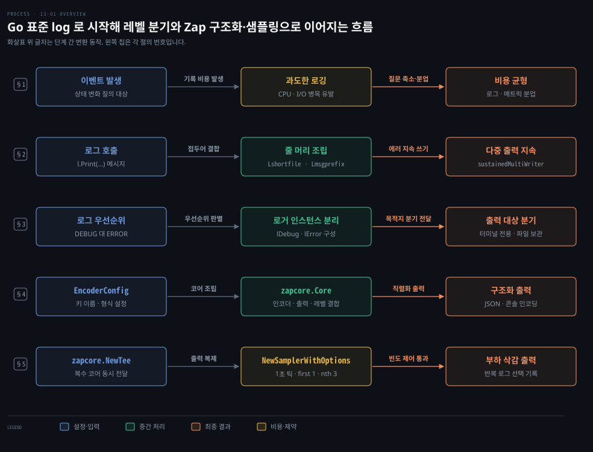
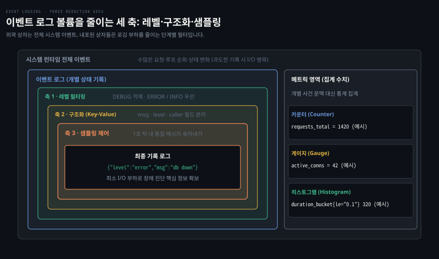
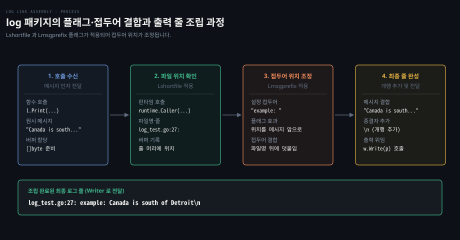
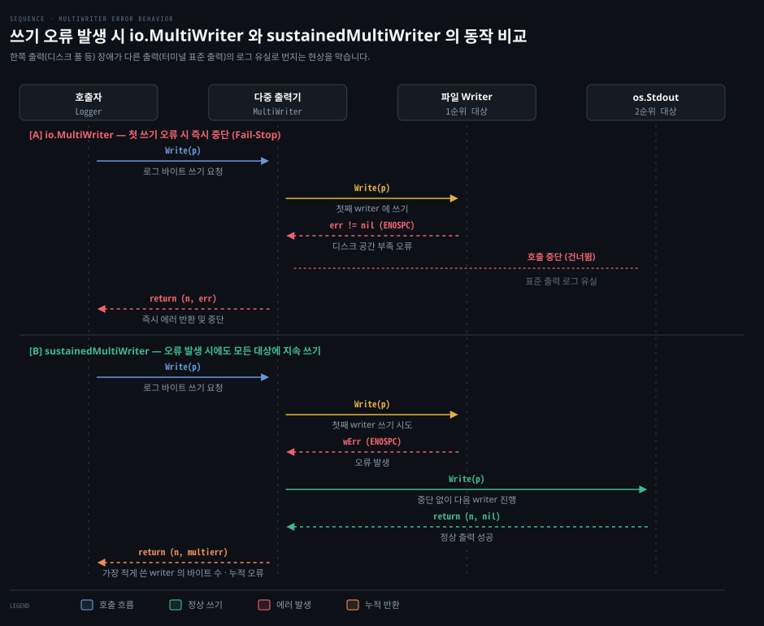
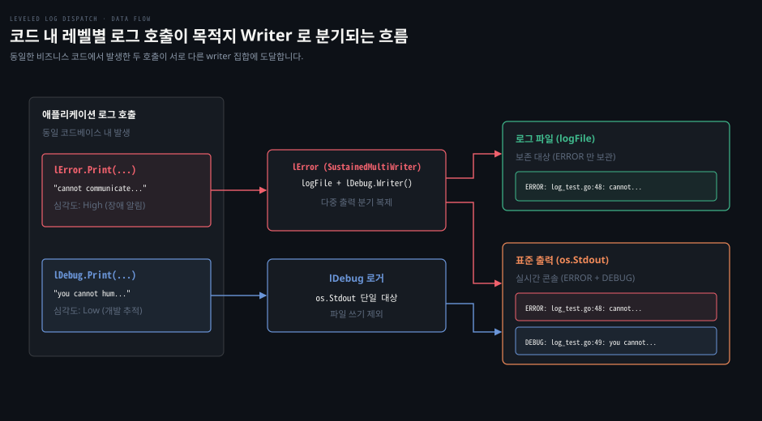
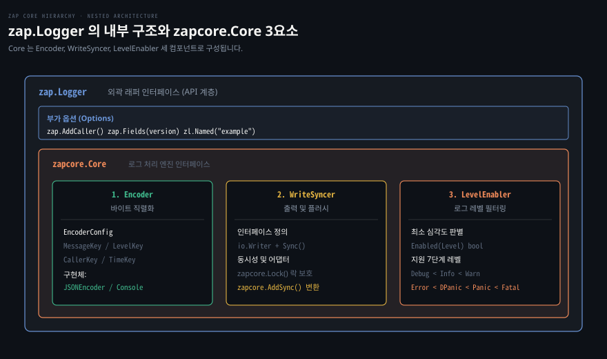
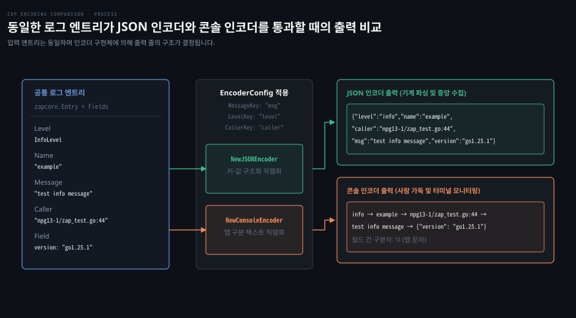
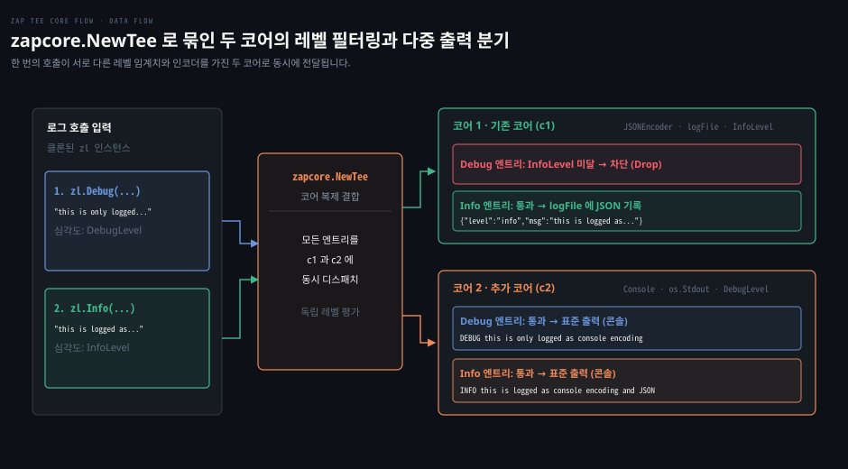
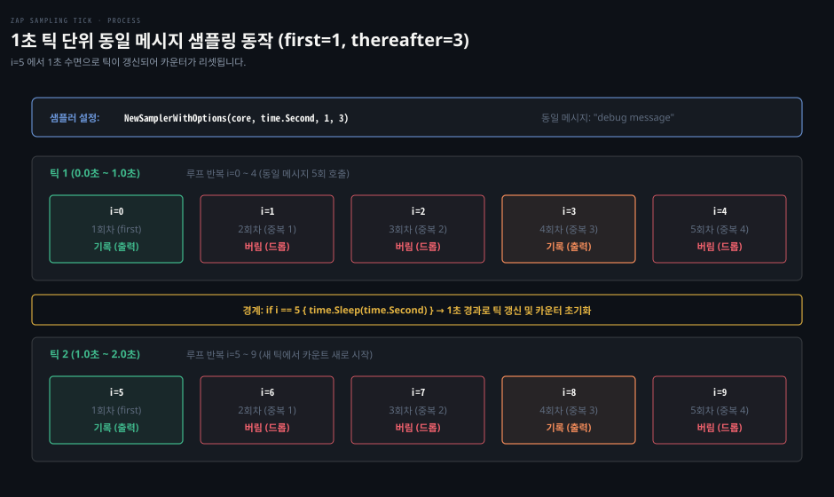

# Go 로그는 log 패키지로 시작해 레벨로 거르고 Zap 은 인코더·출력·레벨을 묶어 구조화하며 샘플링으로 줄인다

---

> 네트워크 서비스에서 로그는 사후 장애 원인을 밝히는 이벤트 기록이며 과도한 출력은 디스크 I/O 와 CPU 병목을 유발하므로 레벨 필터링과 구조화 및 샘플링으로 통제해야 합니다. Go 표준 `log` 패키지는 접두어와 플래그 기반의 단순한 줄 머리를 조립하고 Uber 의 `zap` 라이브러리는 인코더·출력·레벨을 하나의 코어로 묶어 무할당에 가까운 고성능 JSON 구조화 로그와 주기별 샘플링을 제공합니다.


## 핵심 요약

> 로그는 나중에 장애가 터졌을 때 무슨 일이 일어났는지 되짚는 이벤트 답안지이며 부하와 노이즈를 줄이기 위해 레벨과 구조화와 샘플링 세 축으로 정밀하게 다듬어야 합니다.

개발 환경에서 무심코 루프 안에 넣은 로그는 운영 환경에서 심각한 I/O 병목과 디스크 고갈을 부릅니다. 표준 `log` 패키지는 `log.New` 로 파일 위치와 접두어를 제어할 수 있지만 레벨 기능이 없어 로거 인스턴스를 따로 두어야 합니다. 또한 표준 `io.MultiWriter` 는 첫 번째 출력에서 오류가 나면 후속 쓰기를 즉시 중단하므로 끝까지 쓰는 다중 출력기를 직접 구현해야 합니다.

Uber 의 `zap` 은 `Encoder`, `WriteSyncer`, `LevelEnabler` 세 컴포넌트를 `zapcore.Core` 하나로 결합합니다. 동일한 설정으로 기계 파싱용 JSON 과 터미널용 콘솔 인코딩을 자유롭게 오갑니다. 나아가 `zapcore.NewTee` 로 파일과 표준 출력을 서로 다른 레벨로 묶고 `zapcore.NewSamplerWithOptions` 로 1초 틱 단위 동일 메시지의 폭주를 효과적으로 솎아냅니다.


## 학습 목표

> 이 편을 읽고 나면 아래 다섯 가지를 스스로 해낼 수 있습니다.

1. 이벤트 로그가 답해야 할 질문과 집계 중심 메트릭의 차이를 구분하고 과도한 로깅이 초래하는 CPU 와 I/O 비용을 설명할 수 있습니다.
2. `log.New` 의 플래그와 접두어 조립 방식을 파악하고 `io.MultiWriter` 의 장애 중단 한계를 극복하는 지속 쓰기 다중 출력기를 구현할 수 있습니다.
3. 표준 `log` 로거를 분리해 에러와 디버그 출력을 서로 다른 목적지로 보내는 레벨 라우팅 구조를 구성할 수 있습니다.
4. `zapcore.EncoderConfig` 와 `zapcore.Core` 의 3요소를 조립해 JSON 및 콘솔 형식의 고성능 구조화 로거를 생성할 수 있습니다.
5. `zapcore.NewTee` 로 복수 코어를 결합하고 `zapcore.NewSamplerWithOptions` 로 반복 로그를 솎아내어 시스템 부하를 억제할 수 있습니다.

아래는 이 편의 핵심 로깅 기법 흐름을 요약한 개념도입니다. 줄마다 한 절을 맡습니다.

§1 줄은 시스템 런타임 이벤트에서 비용과 질문을 가려 로그와 메트릭으로 역할을 나누는 흐름입니다. §2 줄은 `log` 패키지의 줄 머리 플래그 조립과 쓰기 오류를 견디는 다중 출력기입니다.

§3 줄은 심각도에 따라 로거 인스턴스를 분리하고 파일과 터미널로 목적지를 가르는 레벨 분기입니다. §4 줄은 `zapcore.Core` 로 인코더·출력·레벨을 결합해 구조화 출력을 만드는 과정입니다.

§5 줄은 `NewTee` 로 다중 코어를 묶고 `NewSamplerWithOptions` 로 루프 내 반복 로그 폭주를 억제하는 흐름입니다.




## 1. 로그는 나중에 무슨 일이 있었는지 물을 답이라 무엇을 남길지와 얼마나 남길지를 먼저 정한다

> 무작정 모든 동작을 기록하면 디스크 I/O 와 CPU 병목이 발생하고 수많은 로그 속에서 정작 필요한 장애 원인을 찾기 어려워지므로 무엇을 어떤 수준으로 남길지 설계해야 합니다.

실제 운영 환경의 네트워크 서비스는 악의적인 입력, 하드웨어 성능 저하, 네트워크 단절, 예기치 못한 동시성 버그에 늘 노출됩니다. 장애가 터진 직후 엔지니어가 시스템을 진단하려면 "그 시점에 정확히 어떤 요청과 에러가 발생했는가"를 파악해야 합니다. 이 질문에 답을 주는 핵심 도구가 **이벤트 로그(Event Log)** 입니다.

하지만 혹시 모를 상황에 대비해 모든 요청과 변수 값을 남기려는 유혹은 경계해야 합니다. 개발 환경에서는 호출 수가 적어 모든 줄을 상세히 출력해도 시스템이 버티지만 운영 환경에서는 로깅 자체가 심각한 성능 저하의 주원인이 됩니다. 디스크 쓰기와 CPU 문자열 조립에 자원이 소모되어 본래 처리해야 할 네트워크 패킷 처리가 지연되기 때문입니다.



관측 가능성 체계에서 로그와 메트릭은 상호 보완적이면서도 서로 다른 질문을 전담합니다. 로그는 특정한 시점에 발생한 개별 사건의 문맥과 세부 정보를 담아 "무엇이 일어났는가"에 답합니다. 반면 메트릭은 수치 데이터를 시간 흐름에 따라 통계적으로 집계하여 "현재 처리량과 지연 시간이 얼마인가", "어디에 병목이 있는가"에 답합니다.

관측 가능성의 전체 구조와 메트릭 데이터 모델은 [Mastering Prometheus 01-01 관측 가능성·모니터링·Prometheus의 자리](../../../06_observability/book/mastering_prometheus/01-01.관측%20가능성·모니터링·Prometheus의%20자리.md) 와 [03-01 데이터 모델](../../../06_observability/book/mastering_prometheus/03-01.데이터%20모델.md) 에 기술돼 있습니다. 다중 로그 포맷과 계측 표준은 [Grafana 02-01 계측 — 로그 형식·메트릭 타입·트레이싱 프로토콜·인프라 표준](../../../06_observability/book/observability_with_grafana/02-01.계측%20—%20로그%20형식·메트릭%20타입·트레이싱%20프로토콜·인프라%20표준.md) 에서 다루며 자바 생태계의 메트릭 분업 원리는 [Spring Actuator 01-02 마이크로미터와 메트릭](../../../06_observability/05_SpringActuator/01-02.마이크로미터와%20메트릭%20—%20Counter·Gauge·Timer.md) 에 정리돼 있습니다.

| 관측 축 | 담당 질문 | 데이터 형태 | 저장 및 처리 비용 | 대표 사례 |
| :--- | :--- | :--- | :--- | :--- |
| **이벤트 로그** | 특정 시점에 구체적으로 무슨 일이 일어났는가? | 개별 텍스트 줄 또는 JSON 객체 (문맥 포함) | 발생 빈도에 비례해 증가 (I/O 및 저장 비용 큼) | 데이터베이스 연결 실패, 사용자 인증 오류 |
| **메트릭** | 현재 시스템의 처리량·지연·자원 소모는 어떠한가? | 시계열 숫자 집계 (카운터, 게이지, 히스토그램) | 일정한 주기별 집계값만 저장 (비용이 일정함) | 초당 HTTP 요청 수, 활성 고루틴 개수 |

따라서 로깅의 핵심은 서비스 처리 성능을 해치지 않으면서도 장애 조치에 필요한 최소 정보만 남기는 균형점을 찾는 일입니다. 이를 위해 심각도별 레벨 필터링, 기계 검색을 돕는 구조화, 반복 폭주를 줄이는 샘플링 세 축이 활용됩니다.


## 2. log 패키지는 접두어와 플래그로 줄 머리를 붙이고 쓰기 실패에도 멈추지 않는 다중 출력은 직접 만든다

> Go 표준 `log` 패키지는 간단한 함수 호출로 로그 줄 머리를 포맷할 수 있지만 여러 대상에 동시에 쓸 때 표준 `io.MultiWriter` 를 쓰면 중간 오류 시 전체 쓰기가 중단되는 결함이 있습니다.

Go 표준 라이브러리의 `log` 패키지는 패키지 레벨 함수인 `log.Print`, `log.Fatal`, `log.Panic` 을 제공합니다. 기본 로거는 표준 에러(`os.Stderr`)로 출력하며 날짜와 시간을 찍습니다. 하지만 네트워크 서비스를 만들 때는 메모리 버퍼, 네트워크 소켓, 특정 파일 등 다양한 `io.Writer` 로 출력을 돌리고 파일명과 줄 번호 같은 진단 정보를 붙여야 합니다. 이때 `log.New` 함수로 전용 `*log.Logger` 인스턴스를 생성합니다.

```go
func New(out io.Writer, prefix string, flag int) *Logger
```

### 접두어와 플래그를 결합한 줄 머리 조립

`log.New` 는 출력 대상인 `io.Writer`, 각 줄 머리에 붙을 문자열 접두어(`prefix`), 그리고 로거의 출력 모양을 바꾸는 플래그 비트마스크(`flag`)를 인자로 받습니다. 표준 `log` 패키지가 지원하는 대표 플래그 상수는 다음과 같습니다.

- `log.Ldate`: 로컬 시간대 기준 날짜(`2009/01/23`)를 출력합니다.
- `log.Ltime`: 로컬 시간대 기준 시각(`01:23:23`)을 출력합니다.
- `log.Lmicroseconds`: 마이크로초 단위 정밀도(`01:23:23.123123`)를 추가합니다.
- `log.Llongfile`: 소스 코드의 전체 절대 경로와 줄 번호(`/a/b/c/d.go:23`)를 출력합니다.
- `log.Lshortfile`: 경로의 마지막 파일명과 줄 번호(`d.go:23`)를 출력하여 `Llongfile` 을 덮어씁니다.
- `log.Lmsgprefix`: 접두어를 줄 맨 앞이 아니라 파일 위치 뒤이자 메시지 바로 앞으로 이동시킵니다(Go 1.14+).
- `log.LstdFlags`: 기본 로거의 초기 설정값으로 `log.Ldate | log.Ltime` 과 같습니다.



아래 예제 코드는 표준 출력(`os.Stdout`)을 대상으로 하고 접두어 `"example: "` 와 파일 위치 플래그 `log.Lshortfile` 을 지정해 로거를 생성하고 테스트합니다. 이 편의 모든 테스트 코드는 스크래치 패키지 `example.com/npg13-1` 모듈의 `ch13` 패키지 기준으로 작성되었습니다. `log` 예제 셋은 import 를 합친 `log_test.go` 한 파일에, Zap 예제는 `zap_test.go` 한 파일에 노트 순서대로 둔 기준이라 `// Output:` 의 줄 번호도 그 배치에서 나온 값입니다.

```go
package ch13

import (
	"log"
	"os"
)

func Example_log() {
	// 표준 출력을 목적지로 삼고 짧은 파일 위치를 표시하는 로거를 생성합니다.
	l := log.New(os.Stdout, "example: ", log.Lshortfile)
	l.Print("logging to standard output")

	// Output:
	// example: log_test.go:13: logging to standard output
}
```

실행 결과를 보면 접두어 `"example: "` 가 줄의 맨 앞에 오고 그 뒤에 `Lshortfile` 이 만든 `"log_test.go:13: "` 가 붙은 뒤 최종 메시지가 출력됩니다.

### 쓰기 실패에도 중단되지 않는 sustainedMultiWriter

`log.New` 가 임의의 `io.Writer` 를 인자로 받는다는 점을 보면 로그를 파일에 저장함과 동시에 표준 출력에도 내보내고 싶어집니다. [04-02 io 의 Copy·MultiWriter·TeeReader 로 연결을 잇고 엿본다](./04-02.io%20의%20Copy·MultiWriter·TeeReader%20로%20연결을%20잇고%20엿본다.md) 에서 다룬 표준 라이브러리의 `io.MultiWriter` 가 자연스레 떠오릅니다.

하지만 로깅 용도로 `io.MultiWriter` 를 그대로 쓰는 것은 위험합니다. 공식 문서(`go doc io.MultiWriter`)에 명시되어 있듯 `io.MultiWriter` 는 등록된 writer 들에 순차적으로 쓰기를 수행하다가 어느 하나라도 오류를 반환하면 그 즉시 전체 쓰기 작업을 중단하고 에러를 반환합니다. 다음 대상 writer 로 쓰기를 이어가지 않습니다.

만약 로그 파일과 표준 출력 순서로 `io.MultiWriter` 를 구성했는데 디스크 공간 부족으로 파일 쓰기가 실패하면 표준 출력에는 로그 메시지가 전달되지 못하고 유실됩니다. 장애 상황에서 터미널 화면의 에러 로그까지 함께 사라지는 위험이 따릅니다.



따라서 앞선 writer 에서 오류가 발생하더라도 뒤따르는 모든 writer 에게 끝까지 쓰기를 시도하고 발생한 모든 오류를 누적하여 반환하는 지속 다중 출력기(`sustainedMultiWriter`)를 만들어야 합니다. 에러 결합에는 Uber 의 `go.uber.org/multierr` 패키지를 활용합니다.

```go
package ch13

import (
	"io"

	"go.uber.org/multierr"
)

// sustainedMultiWriter 는 쓰기 오류가 발생해도 다음 writer 로의 전송을 멈추지 않습니다.
type sustainedMultiWriter struct {
	writers []io.Writer
}

// Write 는 모든 슬라이스 내 writer 에 차례로 바이트를 쓰고 누적된 오류를 반환합니다.
func (s *sustainedMultiWriter) Write(p []byte) (n int, err error) {
	n = len(p)
	for _, w := range s.writers {
		i, wErr := w.Write(p)
		// io.Writer 는 len(p) 보다 큰 n 을 돌려주면 안 되므로 가장 적게 쓴 writer 의 값을 돌려줍니다.
		n = min(n, i)
		err = multierr.Append(err, wErr)
	}

	return n, err
}

// SustainedMultiWriter 는 전달받은 writer 들을 평탄화하여 하나의 다중 출력기로 묶습니다.
func SustainedMultiWriter(writers ...io.Writer) io.Writer {
	mw := &sustainedMultiWriter{writers: make([]io.Writer, 0, len(writers))}

	for _, w := range writers {
		// 전달된 인자가 이미 sustainedMultiWriter 인 경우 내부 슬라이스를 풀어서 평탄화합니다.
		if m, ok := w.(*sustainedMultiWriter); ok {
			mw.writers = append(mw.writers, m.writers...)
			continue
		}

		mw.writers = append(mw.writers, w)
	}

	return mw
}
```

`Write` 가 돌려주는 `n` 은 writer 마다 쓴 바이트의 합이 아니라 가장 적게 쓴 값입니다. [`io.Writer`](https://pkg.go.dev/io#Writer) 는 `0 <= n <= len(p)` 를 지켜야 해서, writer 가 둘 이상일 때 합을 돌려주면 `io.Copy(w, strings.NewReader("hello"))` 가 `invalid WriteString count` 로 패닉합니다.

이제 `SustainedMultiWriter` 를 이용해 표준 출력과 파일 역할을 하는 버퍼(`*bytes.Buffer`)에 동시에 로그를 쓰는 예제를 작성합니다. 여기에 `log.Lmsgprefix` 플래그를 추가하면 접두어가 파일명 뒤, 메시지 앞으로 이동하는 차이를 확인할 수 있습니다.

```go
package ch13

import (
	"bytes"
	"fmt"
	"log"
	"os"
)

func Example_logMultiWriter() {
	logFile := new(bytes.Buffer)
	// 표준 출력과 파일 버퍼를 지속 다중 출력기로 묶습니다.
	w := SustainedMultiWriter(os.Stdout, logFile)
	// Lmsgprefix 플래그를 결합해 접두어가 메시지 바로 앞에 위치하도록 설정합니다.
	l := log.New(w, "example: ", log.Lshortfile|log.Lmsgprefix)

	fmt.Println("standard output:")
	l.Print("Canada is south of Detroit")
	fmt.Print("\nlog file contents:\n", logFile.String())

	// Output:
	// standard output:
	// log_test.go:27: example: Canada is south of Detroit
	//
	// log file contents:
	// log_test.go:27: example: Canada is south of Detroit
}
```

Go 1.21 에 도입된 표준 구조화 로깅 패키지인 `log/slog` 에서는 이러한 단순 텍스트 출력을 `slog.New(slog.NewTextHandler(w, nil))` 가 담당합니다. `slog` 의 핸들러와 미들웨어 연동 원리는 [Learning Go 13-04 net-http 는 타임아웃을 직접 정하고 미들웨어는 Handler 를 감싸며 slog 로 구조화 로그를 남깁니다](../../../01_language/book/lgo_learning-go/13-04.net-http%20는%20타임아웃을%20직접%20정하고%20미들웨어는%20Handler%20를%20감싸며%20slog%20로%20구조화%20로그를%20남깁니다.md) 에 기술돼 있습니다.


## 3. 레벨은 같은 코드에서 디버그와 오류를 다른 곳으로 보내는 거름망이다

> 개발 과정에서 필요한 상세 디버그 정보와 운영자가 즉각 조치해야 할 오류 정보는 중요도가 완전히 다르므로 레벨에 따라 저장 대상과 출력 여부를 다르게 분기해야 합니다.

실무에서 모든 로그를 단일한 우선순위로 기록하면 데이터베이스 연결 오류 같은 핵심 장애 로그가 일상적인 연결 수립 안내 로그 속에 묻히게 됩니다. 이를 방지하는 방법이 **로그 레벨(Log Level)** 의 도입입니다.

시작 단계에서는 복잡하게 많은 단계를 두기보다 `ERROR` 와 `DEBUG`, 그리고 필요에 따라 일반 상태를 알리는 `INFO` 정도의 소수 레벨로 출발하는 것이 효과적입니다. `ERROR` 는 데이터베이스 접속 불가나 외부 API 응답 실패처럼 엔지니어의 즉각적인 개입이 필요한 장애에 사용합니다. `INFO` 는 리스너 바인딩 성공처럼 주요 상태 변경을 확인하는 비오류성 이벤트에 쓰며 `DEBUG` 는 상세 흐름을 추적하는 진단용으로 평시 운영에서는 선별해야 합니다.



표준 `log` 패키지 자체에는 로그 레벨이라는 개념이 내장되어 있지 않습니다. 따라서 표준 라이브러리만으로 레벨별 동작을 구현하려면 용도별로 독립된 로거 인스턴스를 만들고 각기 다른 `io.Writer` 와 접두어를 연결해야 합니다.

아래 예제 코드는 디버그 로거(`lDebug`)는 콘솔 표준 출력에만 기록하고 에러 로거(`lError`)는 `SustainedMultiWriter` 를 거쳐 영구 보관용 파일 버퍼와 표준 출력 둘 다로 동시에 전송하도록 구성합니다.

```go
package ch13

import (
	"bytes"
	"fmt"
	"log"
	"os"
)

func Example_logLevels() {
	// 디버그 로거는 표준 출력으로만 내보냅니다.
	lDebug := log.New(os.Stdout, "DEBUG: ", log.Lshortfile)

	logFile := new(bytes.Buffer)
	// 에러 로거는 파일과 디버그 로거의 출력 대상(표준 출력) 모두에 지속 쓰기를 수행합니다.
	w := SustainedMultiWriter(logFile, lDebug.Writer())
	lError := log.New(w, "ERROR: ", log.Lshortfile)

	fmt.Println("standard output:")
	lError.Print("cannot communicate with the database")
	lDebug.Print("you cannot hum while holding your nose")
	fmt.Print("\nlog file contents:\n", logFile.String())

	// Output:
	// standard output:
	// ERROR: log_test.go:48: cannot communicate with the database
	// DEBUG: log_test.go:49: you cannot hum while holding your nose
	//
	// log file contents:
	// ERROR: log_test.go:48: cannot communicate with the database
}
```

표준 출력에는 두 로거의 출력이 모두 나타나지만 파일 버퍼에는 `lError` 의 한 줄만 보관됩니다. 만약 `lDebug.Print` 호출을 조건문(`if debug`)으로 일일이 감싸지 않고 끄고 싶다면 출력을 버리는 writer 를 연결하면 됩니다. Go 1.16+ 표준 라이브러리의 `io.Discard`(`io/ioutil.Discard` 의 대체재)를 로거 출력으로 넘겨주면 불필요한 출력을 무비용으로 폐기할 수 있습니다.

Go 표준 `log/slog` 에서는 이러한 레벨 처리를 로거 인스턴스를 여럿 쪼개지 않고도 `slog.Level` 타입과 `slog.LevelVar` 를 이용해 단일 로거 안에서 전역 또는 동적으로 통제합니다.


## 4. Zap 은 인코더와 출력과 레벨을 묶은 코어 하나로 JSON 이나 콘솔 형식의 구조화 로그를 쓴다

> 일반 텍스트 로그는 사람이 읽기는 편하지만 대규모 분산 환경에서 특정 필드를 기계적으로 검색하기 불가능하므로 키-값 쌍 메타데이터를 담는 구조화 로그와 고성능 코어 아키텍처가 필요합니다.

사람 눈으로 읽는 텍스트 로그는 서비스가 커질수록 검색의 한계에 부딪힙니다. 수백 대의 노드가 뿜어내는 로그 속에서 특정 사용자 ID 나 IP 주소, 요청 경로에 해당하는 에러만 추려내려면 `grep` 정규식에 의존해야 하며 형식이 조금만 달라져도 파싱이 깨집니다.

이 문제를 해결하기 위해 로그에 정형화된 메타데이터를 키-값 쌍 형태로 덧붙이는 기법이 **구조화 로깅(Structured Logging)** 입니다. 발생 시각, 로거 이름, 로그 레벨, 소스코드 위치 등을 정형화된 필드로 기록하면 Elasticsearch 나 Loki 같은 중앙 수집 서버가 이를 색인화하여 특정 필드 기준의 고속 쿼리와 필터링을 수행할 수 있습니다.

### zapcore.Core 의 3요소와 EncoderConfig

Uber 가 개발한 `go.uber.org/zap` 은 고성능 네트워크 서비스에 널리 쓰이는 구조화 로거입니다. 웹 서버 Caddy 가 내부 로깅 엔진으로 채택한 것으로도 잘 알려져 있습니다([10-01 Caddy 는 JSON 설정을 관리 API 로 실시간 바꾸고 모듈과 어댑터로 넓힌다](./10-01.Caddy%20는%20JSON%20설정을%20관리%20API%20로%20실시간%20바꾸고%20모듈과%20어댑터로%20넓힌다.md)). Zap 은 리플렉션과 빈번한 힙 할당을 배제하여 고빈도 호출부에서도 성능 부담을 적게 줍니다.

Zap 의 내부 핵심은 `zapcore.Core` 입니다. `zap.Logger` 는 편의 메서드를 제공하는 래퍼이며 실제 로그의 필터링과 직렬화는 코어가 수행합니다. 코어는 다음 세 컴포넌트로 구성됩니다.
1. `zapcore.Encoder`: 로그 엔트리와 필드들을 최종 바이트 열로 직렬화합니다(JSON 인코더, 콘솔 인코더 등).
2. `zapcore.WriteSyncer`: 직렬화된 바이트를 실제 목적지에 쓰고 버퍼를 비우는 인터페이스로 `io.Writer` 에 `Sync() error` 메서드가 결합된 형태입니다.
3. `zapcore.LevelEnabler`: 해당 코어가 처리할 최소 심각도 임계치를 결정하며 기준 미만의 로그는 즉시 무시합니다.



인코더의 동작은 `zapcore.EncoderConfig` 구조체로 정의합니다. 이 설정은 인코더 구현체와 분리되어 있어 동일한 설정을 JSON 인코더와 콘솔 인코더에 그대로 공유할 수 있습니다.

```go
package ch13

import (
	"go.uber.org/zap/zapcore"
)

// encoderCfg 는 메시지, 로거 이름, 레벨, 호출자 정보의 키 이름과 인코딩 방식을 정의합니다.
var encoderCfg = zapcore.EncoderConfig{
	MessageKey:   "msg",
	NameKey:      "name",
	LevelKey:     "level",
	EncodeLevel:  zapcore.LowercaseLevelEncoder,
	CallerKey:    "caller",
	EncodeCaller: zapcore.ShortCallerEncoder,
}
```

`EncoderConfig` 에서 `MessageKey` 는 본문 메시지가 들어갈 JSON 키 이름이며 `LevelKey` 는 레벨이 들어갈 키 이름을 지정합니다. `EncodeLevel` 에 `zapcore.LowercaseLevelEncoder` 를 지정하면 `"level":"info"` 처럼 소문자로 기록됩니다.

`CallerKey` 와 `zapcore.ShortCallerEncoder` 는 호출자 파일 위치를 마지막 폴더 이름과 파일 이름만 남긴 짧은 경로(`npg13-1/zap_test.go:43`)로 인코딩합니다. 예제의 출력 일관성을 위해 시간 필드(`TimeKey`)는 생략되었으나 실제 운영 환경에서는 `TimeKey: "time"` 과 `zapcore.ISO8601TimeEncoder` 등을 지정해야 합니다.

이제 `zapcore.NewCore` 와 `zap.New` 를 조합하여 JSON 로거를 생성합니다. 동시성 안전하지 않은 writer 라도 `zapcore.Lock` 을 감싸면 스레드 안전한 `WriteSyncer` 로 변환됩니다.

```go
package ch13

import (
	"os"
	"runtime"

	"go.uber.org/zap"
	"go.uber.org/zap/zapcore"
)

func Example_zapJSON() {
	zl := zap.New(
		zapcore.NewCore(
			zapcore.NewJSONEncoder(encoderCfg),
			// 표준 출력을 락으로 보호하여 WriteSyncer 로 등록합니다.
			zapcore.Lock(os.Stdout),
			zapcore.DebugLevel,
		),
		// 호출 소스코드 파일 및 줄 번호를 엔트리에 추가합니다.
		zap.AddCaller(),
		// 모든 로그에 런타임 Go 버전을 정적 필드로 추가합니다.
		zap.Fields(
			zap.String("version", runtime.Version()),
		),
	)
	// 버퍼링된 모든 로그 바이트가 목적지로 플러시되도록 defer 로 보장합니다.
	defer func() { _ = zl.Sync() }()

	example := zl.Named("example")
	example.Debug("test debug message")
	example.Info("test info message")

	// Output:
	// {"level":"debug","name":"example","caller":"npg13-1/zap_test.go:43","msg":"test debug message","version":"go1.25.1"}
	// {"level":"info","name":"example","caller":"npg13-1/zap_test.go:44","msg":"test info message","version":"go1.25.1"}
}
```

`caller` 의 `npg13-1` 은 테스트 파일이 든 폴더 이름이고 `version` 은 테스트를 돌린 Go 버전이라, 다른 폴더나 다른 Go 버전에서 돌리면 이 두 값이 달라져 Output 비교가 실패합니다.

Zap 은 심각도 순서대로 7단계 레벨을 지원합니다: `DebugLevel` < `InfoLevel` < `WarnLevel` < `ErrorLevel` < `DPanicLevel` < `PanicLevel` < `FatalLevel`.

`PanicLevel` 은 로그 기록 후 패닉을 일으키고 `DPanicLevel` 은 개발 모드([`zap.Development()`](https://pkg.go.dev/go.uber.org/zap#Development))일 때만 패닉하며 `FatalLevel` 은 기록 후 `os.Exit(1)` 로 프로세스를 종료합니다. 따라서 프로세스 즉시 종료가 불가피한 초기 기동 시점의 설정 오류를 제외하면 일상적인 운영 코드에서는 `Debug`, `Info`, `Error` 세 레벨 위주로 설계하는 것이 안전합니다. 로거를 종료하기 전에는 반드시 `zl.Sync()` 를 호출해 내부 버퍼를 비워야 합니다.

### JSON 인코더와 콘솔 인코더의 직렬화 비교

개발 중에 터미널 화면에서 사람이 읽기 쉬운 포맷이 필요하다면 JSON 인코더 자리에 `zapcore.NewConsoleEncoder` 를 끼워 넣으면 됩니다. 탭 문자(`\t`)로 구분된 가독성 높은 텍스트를 출력합니다.



```go
package ch13

import (
	"os"

	"go.uber.org/zap"
	"go.uber.org/zap/zapcore"
)

func Example_zapConsole() {
	zl := zap.New(
		zapcore.NewCore(
			zapcore.NewConsoleEncoder(encoderCfg),
			zapcore.Lock(os.Stdout),
			// InfoLevel 이상의 로그만 통과시킵니다.
			zapcore.InfoLevel,
		),
	)
	defer func() { _ = zl.Sync() }()

	console := zl.Named("[console]")
	console.Info("this is logged by the logger")
	console.Debug("this is below the logger's threshold and won't log")
	console.Error("this is also logged by the logger")

	// Output:
	// info	[console]	this is logged by the logger
	// error	[console]	this is also logged by the logger
}
```

`Debug` 로그는 코어의 최소 임계치인 `InfoLevel` 에 미치지 못하므로 출력되지 않고 무시됩니다.

Go 표준 `log/slog` 에서는 Zap 의 인코더와 출력 싱커 역할을 `slog.Handler` 인터페이스가 도맡으며 각각 `slog.NewJSONHandler` 와 `slog.NewTextHandler` 로 생성합니다.


## 5. 여러 출력은 코어를 겹쳐 묶고 샘플링은 같은 메시지가 몰릴 때 앞 몇 개와 그 뒤 일부만 남긴다

> 단일 출력만으로는 파일용 JSON 로그와 터미널용 콘솔 로그를 동시에 지원하기 어렵고 루프 안에서 동일한 에러가 폭주하면 디스크 I/O 가 마비되므로 코어 결합과 샘플링이 필요합니다.

단일 출력만으로는 운영 분석용 파일 저장과 개발 디버깅용 터미널 모니터링을 동시에 만족하기 어렵고, 고빈도 루프에서 동일한 에러가 폭주하면 디스크 I/O 가 마비되는 문제가 생깁니다. 파일에는 운영 분석용으로 `Info` 이상의 JSON 로그만 기록하고 표준 출력에는 개발 디버깅용으로 `Debug` 이상의 콘솔 로그를 내보내는 구성이 대표적입니다.

### NewTee 를 통한 복수 코어 결합과 출력 분기

먼저 메모리 버퍼(`*bytes.Buffer`)처럼 `Sync()` 메서드가 없는 일반 `io.Writer` 를 Zap 의 `WriteSyncer` 로 쓰려면 `zapcore.AddSync` 헬퍼 함수를 호출합니다. 빈 `Sync()` 메서드를 덧붙여 인터페이스를 맞춰 줍니다.

```go
logFile := new(bytes.Buffer)
writeSyncer := zapcore.Lock(zapcore.AddSync(logFile))
```

이미 생성된 로거의 코어를 확장할 때는 `zl.WithOptions` 와 `zap.WrapCore` 를 사용합니다. 그리고 두 개 이상의 코어를 하나로 묶어 복제 전송할 때 `zapcore.NewTee` 함수를 사용합니다. 이는 앞서 본 `io.MultiWriter` 와 유사하지만 바이트가 아니라 완성된 로그 엔트리 수준에서 다중 코어로 전달된다는 점이 다릅니다.



```go
package ch13

import (
	"bytes"
	"fmt"
	"os"

	"go.uber.org/zap"
	"go.uber.org/zap/zapcore"
)

func Example_zapInfoFileDebugConsole() {
	logFile := new(bytes.Buffer)
	// 기본 로거는 파일에 InfoLevel 이상의 JSON 을 기록합니다.
	zl := zap.New(
		zapcore.NewCore(
			zapcore.NewJSONEncoder(encoderCfg),
			zapcore.Lock(zapcore.AddSync(logFile)),
			zapcore.InfoLevel,
		),
	)
	defer func() { _ = zl.Sync() }()

	zl.Debug("this is below the logger's threshold and won't log")
	zl.Error("this is logged by the logger")

	// WithOptions 와 WrapCore 로 기존 코어에 콘솔 출력 코어를 Tee 로 결합합니다.
	zl = zl.WithOptions(
		zap.WrapCore(
			func(c zapcore.Core) zapcore.Core {
				ucEncoderCfg := encoderCfg
				ucEncoderCfg.EncodeLevel = zapcore.CapitalLevelEncoder
				return zapcore.NewTee(
					c,
					zapcore.NewCore(
						zapcore.NewConsoleEncoder(ucEncoderCfg),
						zapcore.Lock(os.Stdout),
						zapcore.DebugLevel,
					),
				)
			},
		),
	)

	fmt.Println("standard output:")
	zl.Debug("this is only logged as console encoding")
	zl.Info("this is logged as console encoding and JSON")
	fmt.Print("\nlog file contents:\n", logFile.String())

	// Output:
	// standard output:
	// DEBUG	this is only logged as console encoding
	// INFO	this is logged as console encoding and JSON
	//
	// log file contents:
	// {"level":"error","msg":"this is logged by the logger"}
	// {"level":"info","msg":"this is logged as console encoding and JSON"}
}
```

Tee 로 결합된 이후에는 `zl.Debug` 호출이 표준 출력에만 콘솔 포맷으로 나가고 파일에는 들어가지 않습니다. 반면 `zl.Info` 는 양쪽 코어의 레벨 기준을 모두 만족하므로 표준 출력과 파일 양쪽에 각자의 형식으로 동시에 기록됩니다.

### NewSamplerWithOptions 를 통한 틱 단위 동일 메시지 샘플링

하지만 코어를 아무리 효율적으로 분기하더라도 고빈도 루프나 대량 워커 고루틴 처리부에서 동일한 에러나 디버그 로그가 쏟아져 나오면 디스크와 CPU 가 순식간에 고갈됩니다. 이런 상황에서 로깅 부하를 억제하는 실무적 해법이 **로그 샘플링(Log Sampling)** 입니다.

Zap 은 `zapcore.NewSamplerWithOptions` 함수로 코어를 감싸 샘플링을 적용합니다.

```go
func NewSamplerWithOptions(core Core, tick time.Duration, first, thereafter int, opts ...SamplerOption) Core
```

이 함수는 네 가지 주요 인자를 받습니다.
- `core`: 샘플링 결정을 통과한 엔트리를 실제로 처리할 원본 코어입니다.
- `tick`: 중복 카운터를 초기화할 시간 간격(주기)입니다.
- `first`: 매 `tick` 마다 동일한 레벨과 메시지를 가진 엔트리 중 최초로 기록할 개수입니다.
- `thereafter`: `first` 개수를 초과한 뒤 몇 번째 중복 엔트리마다 한 번씩 기록할지 지정하는 배수입니다. 만약 0 이면 최초 `first` 개 이후의 모든 중복 엔트리를 버립니다.



아래 예제 코드는 1초 주기(`time.Second`) 동안 동일 메시지의 첫 1개(`first=1`)를 기록하고 이후에는 매 3번째(`thereafter=3`)마다 한 개씩만 기록하도록 설정하고 10회 루프를 수행합니다.

```go
package ch13

import (
	"fmt"
	"os"
	"time"

	"go.uber.org/zap"
	"go.uber.org/zap/zapcore"
)

func Example_zapSampling() {
	zl := zap.New(
		zapcore.NewSamplerWithOptions(
			zapcore.NewCore(
				zapcore.NewJSONEncoder(encoderCfg),
				zapcore.Lock(os.Stdout),
				zapcore.DebugLevel,
			),
			time.Second,
			1,
			3,
		),
	)
	defer func() { _ = zl.Sync() }()

	for i := 0; i < 10; i++ {
		// 6번째 반복(i=5)에서 1초간 대기하여 샘플러의 tick 을 강제로 넘깁니다.
		if i == 5 {
			time.Sleep(time.Second)
		}
		// 매 루프마다 바뀌는 숫자는 항상 최초 1회차이므로 모두 기록됩니다.
		zl.Debug(fmt.Sprintf("%d", i))
		// 모든 루프에서 동일한 문자열 메시지는 샘플링 규칙에 따라 걸러집니다.
		zl.Debug("debug message")
	}

	// Output:
	// {"level":"debug","msg":"0"}
	// {"level":"debug","msg":"debug message"}
	// {"level":"debug","msg":"1"}
	// {"level":"debug","msg":"2"}
	// {"level":"debug","msg":"3"}
	// {"level":"debug","msg":"debug message"}
	// {"level":"debug","msg":"4"}
	// {"level":"debug","msg":"5"}
	// {"level":"debug","msg":"debug message"}
	// {"level":"debug","msg":"6"}
	// {"level":"debug","msg":"7"}
	// {"level":"debug","msg":"8"}
	// {"level":"debug","msg":"debug message"}
	// {"level":"debug","msg":"9"}
}
```

출력 결과를 보면 루프 인덱스 `0`부터 `9`까지의 메시지는 매번 문자열이 달라지므로 10건 모두 기록됩니다. 반면 내용이 완전히 같은 `"debug message"` 는 다음과 같이 선별됩니다.
- 첫 번째 틱(i=0~4): i=0 에서 최초 1회 기록(`first=1`), i=1 과 i=2 는 탈락, 3번째 중복인 i=3 에서 1회 기록(`thereafter=3`), i=4 는 탈락. 총 2건만 기록.
- 1초 경과 후 두 번째 틱(i=5~9): 카운터가 초기화되어 i=5 에서 최초 1회 기록, i=6 과 i=7 은 탈락, 3번째 중복인 i=8 에서 1회 기록, i=9 는 탈락. 총 2건만 기록.

샘플링을 적용하면 반복 로그로 인한 CPU 소모와 I/O 병목을 효과적으로 낮출 수 있습니다. 다만 중간에 버려진 이벤트의 정확한 발생 횟수를 놓칠 수 있다는 기회비용이 존재합니다. 따라서 발생 횟수 집계는 메트릭 카운터에 위임하고 로그에는 샘플링된 대표 문맥만 남기는 식의 아키텍처 분업이 권장됩니다.

이어지는 다음 편(13-02)에서는 파일 시스템 알림과 HTTP 핸들러를 이용해 런타임에 동적으로 로그 레벨을 바꾸는 기법과 디스크 고갈을 방지하는 파일 로테이션 기법을 다룹니다.


## 결정 치트시트

| 요구 상황 | 권장 방식 | 핵심 구현 컴포넌트 | 주의점 및 트레이드오프 |
| :--- | :--- | :--- | :--- |
| **단순 명령줄 도구 및 스크립트** | Go 표준 `log` 패키지 | `log.New(os.Stdout, "prefix: ", flags)` | 레벨 구분이 없어 로거를 개별 생성해야 하며 구조화 검색이 어려움 |
| **다중 출력기 대상 로그 전송** | 지속 다중 출력기 (`sustainedMultiWriter`) | `for _, w := range writers { multierr.Append(...) }` | 표준 `io.MultiWriter` 는 첫 오류 시 후속 출력을 즉시 중단하므로 사용 금지 |
| **고성능 분산 서비스 구조화 로깅** | `go.uber.org/zap` (JSON 인코더) | `zapcore.NewCore` + `zapcore.NewJSONEncoder` | 고속 직렬화를 위해 인코더 설정을 사전에 고정해야 하며 종료 전 `Sync()` 필수 |
| **로컬 디버깅 및 터미널 모니터링** | `go.uber.org/zap` (콘솔 인코더) | `zapcore.NewConsoleEncoder(encoderCfg)` | 탭 문자 구분 텍스트로 가독성은 좋으나 기계 파서 연동 시 필드 분리가 불안정함 |
| **출력처별 상이한 레벨 및 포맷** | Zap 코어 복제 결합 | `zapcore.NewTee(coreA, coreB)` | 한 엔트리가 복수 코어에서 평가되므로 코어 개수에 비례해 I/O 비용이 증가함 |
| **고빈도 루프 내 중복 로그 제어** | Zap 주기별 샘플러 | `zapcore.NewSamplerWithOptions(c, tick, 1, 3)` | I/O 병목을 억제하는 대신 버려진 로그의 정확한 발생 건수를 놓치므로 메트릭 병행 필수 |


## 면접 대비

> 아래 질문에 답하면서 로그의 목적과 구조화 및 샘플링 원리를 점검해 보세요.

1. 대규모 분산 시스템에서 무분별한 로깅이 초래하는 성능 병목과, 이벤트 로그와 메트릭이 각각 분담해야 하는 관측 책임의 차이를 설명해 주세요.
2. Go 표준 라이브러리의 `io.MultiWriter` 를 다중 로깅 목적지로 직접 사용할 때 발생하는 문제점과 이를 해결하기 위한 구현 방식을 설명해 주세요.
3. Uber Zap 이 표준 `log` 나 여타 로거에 비해 고성능을 내는 아키텍처 원리(`zapcore.Core` 구성 3요소)와 구조화 로깅의 이점을 설명해 주세요.
4. `zapcore.NewSamplerWithOptions` 의 세 가지 파라미터(`tick`, `first`, `thereafter`)가 동작하는 방식과, 로그 샘플링 도입 시 발생하는 트레이드오프를 설명해 주세요.


## 정답 (자답 후 펼치기)

> 위 §면접 대비의 질문에 먼저 스스로 답한 뒤 읽으세요.

### 정답 1 — 로깅의 I/O 병목과 관측 축의 역할 분담

과도한 로깅은 문자열 포맷팅에 따른 CPU 연산과 버퍼 복사, 그리고 디스크 및 네트워크 소켓 쓰기에 따른 동기식 I/O 지연을 초래합니다. 이는 본래 처리해야 할 서비스 트랜잭션의 레이턴시를 증가시키고 디스크 공간을 조기에 고갈시킵니다.

관측 가능성 체계에서 이벤트 로그는 특정 시점에 발생한 사건의 상세 문맥(사용자 ID, 요청 파라미터, 에러 스택)을 정밀하게 기록해 "무엇이 일어났는가"에 답합니다. 반면 메트릭은 개별 사건을 기록하지 않고 카운터나 히스토그램 형태로 수치를 집계하여 "시스템이 현재 정상 속도로 동작하는가", "병목이 어디에 있는가"를 최소한의 고정 비용으로 진단합니다. 따라서 발생 횟수와 처리율은 메트릭으로 측정하고 장애 원인 규명에 필요한 최소한의 대표 이벤트만 로그로 남겨야 합니다.

### 정답 2 — io.MultiWriter 의 조기 중단 결함과 지속 다중 출력기

표준 `io.MultiWriter` 는 등록된 writer 슬라이스를 순회하다가 어느 하나라도 오류(`err != nil`)를 반환하면 즉시 루프를 멈추고 에러를 반환합니다. 만약 파일과 표준 출력 순으로 묶여 있을 때 디스크 공간 부족(`ENOSPC`)으로 파일 쓰기가 실패하면 뒤에 있는 표준 출력에는 로그가 전혀 전달되지 않아 터미널에서 실시간 에러를 놓치는 장애가 발생합니다.

이를 해결하기 위해 `sustainedMultiWriter` 는 첫 writer 에서 오류가 나더라도 순회를 멈추지 않고 슬라이스 내의 모든 writer 에게 끝까지 `Write` 를 호출합니다. 각 단계에서 발생한 에러는 `multierr.Append` 로 누적 결합하여 최종 반환함으로써 모든 목적지에 대한 전송을 보장합니다.

### 정답 3 — Zap Core 3요소와 구조화 로깅의 장점

Zap 은 리플렉션과 동적 인터페이스 할당을 배제하고 메모리 풀링을 적극 활용하여 로그 기록 시 힙 할당을 거의 일으키지 않습니다. 그 중심에 있는 `zapcore.Core` 는 세 컴포넌트로 나뉩니다.
1. `Encoder`: 정해진 바이트 버퍼에 직접 JSON 이나 콘솔 텍스트 형태로 필드를 직렬화합니다.
2. `WriteSyncer`: `io.Writer` 와 버퍼 플러시용 `Sync()` 를 결합해 안전하게 목적지에 씁니다.
3. `LevelEnabler`: 요청된 레벨이 처리 임계치에 미치지 못하면 문자열 직렬화 연산을 시작하기도 전에 즉시 반환(Fast-path)합니다.

구조화 로깅은 비정형 문자열 대신 `level`, `caller`, `msg`, 사용자 정의 필드 등을 엄격한 키-값 구조로 남기므로 중앙 로그 수집기에서 정규식 파싱 없이 필드 기반으로 고속 인덱싱과 조건부 검색을 수행할 수 있습니다.

### 정답 4 — Zap 샘플러의 파라미터 동작 방식과 득실

`zapcore.NewSamplerWithOptions(core, tick, first, thereafter)` 는 동일한 레벨과 동일한 메시지를 가진 엔트리를 한 묶음으로 취급합니다. 매 `tick` 시간 윈도우마다 최초 `first` 개의 중복 엔트리는 무조건 기록하고 그 이후에 들어오는 중복 엔트리는 `thereafter` 번째마다 1개씩만 통과시키며 나머지는 버립니다. `tick` 시간이 지나면 카운터가 리셋됩니다.

이 방식의 장점은 루프나 재시도 로직에서 수만 건씩 쏟아지는 동일 에러 메시지를 수 건 수준으로 압축해 CPU 와 디스크 I/O 고갈을 막는다는 점입니다. 반면 버려진 로그의 정확한 총 발생 횟수를 로그 파일만 보고는 알 수 없다는 단점이 있습니다. 이 결손은 카운터 메트릭을 병행 수집함으로써 보완할 수 있습니다.


## 참고 자료

- 《Network Programming with Go》 Adam Woodbeck, 2021. ISBN 978-1-7185-0088-4.
- 원문 범위: Chapter 13 Logging and Metrics — Chapter Introduction ~ Sampling Log Entries (Listing 13-1~13-11).
- [Go log 공식 패키지 문서](https://pkg.go.dev/log): `Logger`, `Lshortfile`, `Lmsgprefix` 플래그 및 출력 줄 머리 포맷 규칙.
- [Go io 공식 패키지 문서](https://pkg.go.dev/io#MultiWriter): `io.MultiWriter` 동작 방식 및 에러 조기 중단(Fail-Stop) 명세.
- [Uber Zap 공식 패키지 문서](https://pkg.go.dev/go.uber.org/zap): `zap.Logger`, `New`, `AddCaller`, `Fields`, `Named`, `Sync` 명세.
- [Uber zapcore 공식 패키지 문서](https://pkg.go.dev/go.uber.org/zap/zapcore): `Core`, `EncoderConfig`, `NewTee`, `NewSamplerWithOptions` 인터페이스 및 샘플링 알고리즘.
- [Go log/slog 공식 패키지 문서](https://pkg.go.dev/log/slog): Go 1.21 표준 구조화 로깅, `Handler`, `LevelVar` 설계.


## 관련 문서

- [04-02 io 의 Copy·MultiWriter·TeeReader 로 연결을 잇고 엿본다](./04-02.io%20의%20Copy·MultiWriter·TeeReader%20로%20연결을%20잇고%20엿본다.md): 스트림 복제 및 표준 `io.MultiWriter` 의 기본 동작을 다룹니다.
- [09-01 Go HTTP 서버는 타임아웃을 정하고 핸들러에 의존성을 주입하며 httptest 로 시험한다](./09-01.Go%20HTTP%20서버는%20타임아웃을%20정하고%20핸들러에%20의존성을%20주입하며%20httptest%20로%20시험한다.md): 네트워크 서버 아키텍처와 핸들러 단위 의존성 주입을 다룹니다.
- [09-02 미들웨어는 핸들러를 감싸고 ServeMux 는 경로를 나누며 HTTP2 서버 푸시는 브라우저가 걷어냈다](./09-02.미들웨어는%20핸들러를%20감싸고%20ServeMux%20는%20경로를%20나누며%20HTTP2%20서버%20푸시는%20브라우저가%20걷어냈다.md): HTTP 미들웨어를 활용한 요청 단위 로깅 래핑을 다룹니다.
- [10-01 Caddy 는 JSON 설정을 관리 API 로 실시간 바꾸고 모듈과 어댑터로 넓힌다](./10-01.Caddy%20는%20JSON%20설정을%20관리%20API%20로%20실시간%20바꾸고%20모듈과%20어댑터로%20넓힌다.md): 프로덕션 수준에서 Zap 로거를 기반 프레임워크로 채택한 실제 Caddy 설계를 다룹니다.
- [Learning Go 13-04 net-http 는 타임아웃을 직접 정하고 미들웨어는 Handler 를 감싸며 slog 로 구조화 로그를 남깁니다](../../../01_language/book/lgo_learning-go/13-04.net-http%20는%20타임아웃을%20직접%20정하고%20미들웨어는%20Handler%20를%20감싸며%20slog%20로%20구조화%20로그를%20남깁니다.md): Go 1.21 표준 구조화 로깅 패키지인 `slog` 와 `LevelVar` 핸들러 설계를 다룹니다.
- [Mastering Prometheus 01-01 관측 가능성·모니터링·Prometheus의 자리](../../../06_observability/book/mastering_prometheus/01-01.관측%20가능성·모니터링·Prometheus의%20자리.md): 메트릭 기반 관측 가능성과 이벤트 로그의 경계를 다룹니다.
- [Mastering Prometheus 03-01 데이터 모델](../../../06_observability/book/mastering_prometheus/03-01.데이터%20모델.md): 카운터, 게이지, 히스토그램 메트릭 타입의 구조와 집계 원리를 다룹니다.
- [Observability with Grafana 02-01 계측 — 로그 형식·메트릭 타입·트레이싱 프로토콜·인프라 표준](../../../06_observability/book/observability_with_grafana/02-01.계측%20—%20로그%20형식·메트릭%20타입·트레이싱%20프로토콜·인프라%20표준.md): 다양한 로그 형식 및 시계열 메트릭 표준 규격을 다룹니다.
- [Spring Actuator 01-02 마이크로미터와 메트릭 — Counter·Gauge·Timer](../../../06_observability/05_SpringActuator/01-02.마이크로미터와%20메트릭%20—%20Counter·Gauge·Timer.md): 자바 생태계에서 로그와 메트릭을 분업하는 공통 설계 패턴을 다룹니다.
- [Network Programming with Go 정독 인덱스](./README.md): NPG 서가 전체 챕터 구성과 학습 진행 상황.
