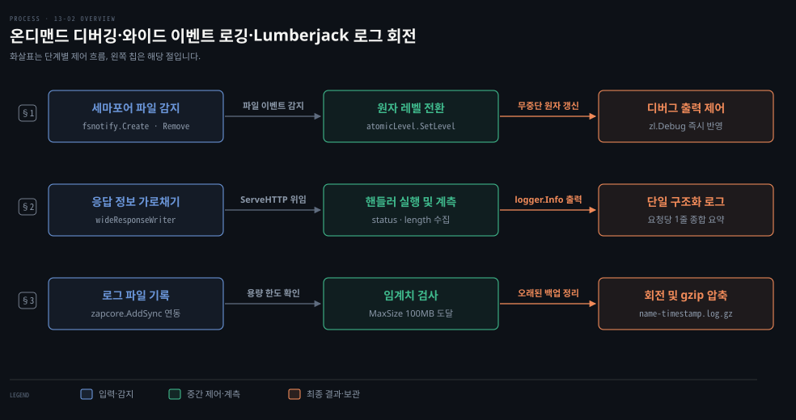
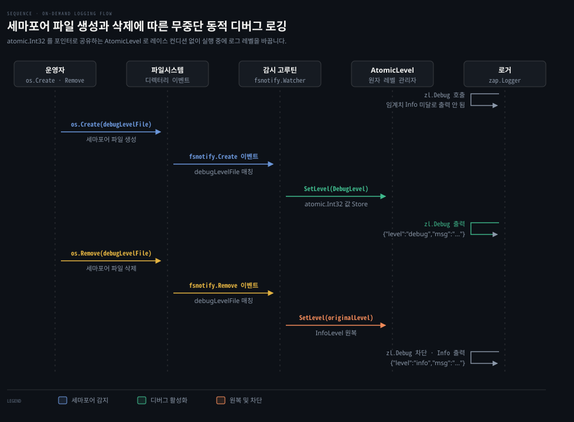
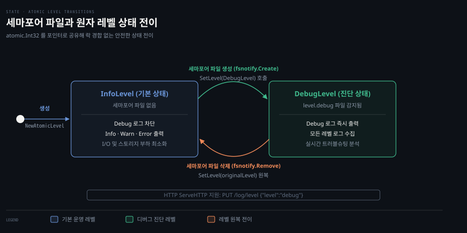
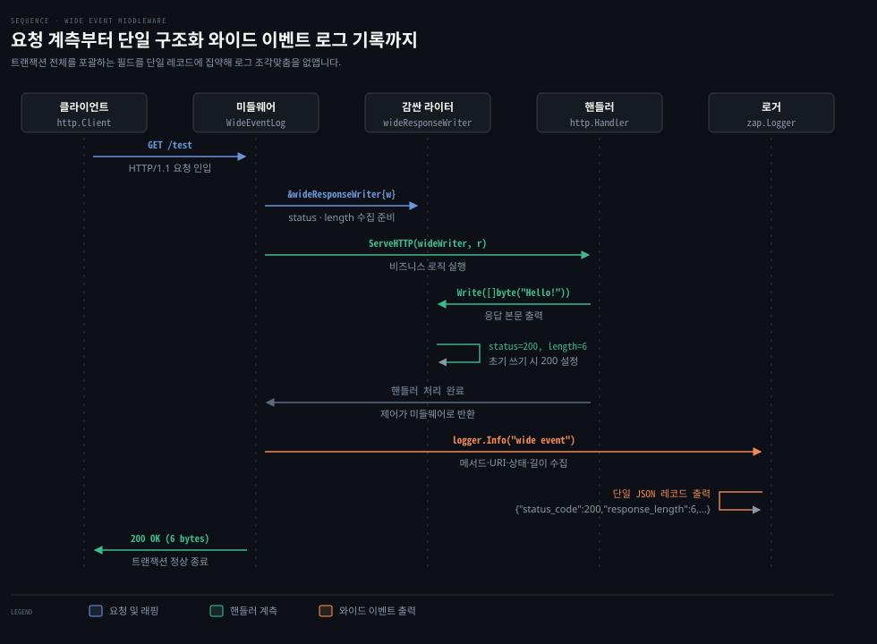
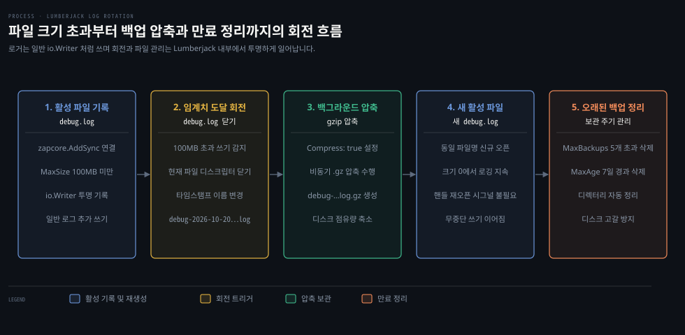

# Zap 은 원자 레벨로 실행 중에 디버그 로그를 켜고 와이드 이벤트 미들웨어는 요청마다 한 줄을 남기며 Lumberjack 은 로그 파일을 돌린다

---

> 디버그 로그는 상시 활성화 비용이 크므로 세마포어 파일이나 HTTP 관리 엔드포인트로 원자 레벨을 실시간 제어하고, HTTP 계층에서는 요청마다 트랜잭션 전반을 요약하는 와이드 이벤트를 한 줄로 남기며, 파일 로깅 시에는 Lumberjack 으로 크기와 기간에 따라 무중단 회전과 압축을 처리합니다.


## 핵심 요약

> 운영 환경 로깅은 평상시 I/O 부하와 디스크 낭비를 줄이면서도 장애 발생 시점의 세부 맥락을 손실 없이 확보하도록 설계해야 합니다.

Zap 의 `AtomicLevel` 은 `sync/atomic` 의 `atomic.Int32` 를 포인터로 공유해 락 경합 없이 실행 중 로그 레벨을 바꿉니다. `fsnotify` 로 세마포어 파일 생성을 감지하면 프로세스 재시작 없이 즉시 디버그 모드로 진입하고, 파일이 지워지면 원래 레벨로 복귀합니다.

와이드 이벤트 로깅은 트랜잭션 도중 로그를 분산해 찍지 않고, `http.ResponseWriter` 를 감싼 미들웨어에서 상태 코드·응답 바이트 수·지연 시간 등을 모아 단일 JSON 레코드로 남깁니다. 동시 요청이 몰려도 고루틴 간 로그 조각맞춤을 할 필요가 없습니다.

파일 출력에는 `lumberjack.Logger` 를 `zapcore.AddSync` 로 결합합니다. 외부 도구와 시그널 통신을 거칠 필요 없이 설정한 크기(MB)와 기간(일)에 따라 이전 파일을 타임스탬프 이름으로 회전하고 gzip 압축하며 오래된 백업을 자동으로 정리합니다.


## 학습 목표

> 이 편을 읽고 나면 아래 다섯 가지를 스스로 해낼 수 있습니다.

1. `zap.NewAtomicLevel` 과 `fsnotify.Watcher` 로 세마포어 파일 유무에 따라 로그 레벨을 원자적으로 전환하는 고루틴을 구성할 수 있습니다.
2. `fsnotify` 에서 파일이 아닌 부모 디렉터리를 감시해야 하는 이유를 파일시스템의 원자적 파일 교체 특성으로 설명할 수 있습니다.
3. `http.ResponseWriter` 를 감싸 응답 상태 코드와 길이를 가로채고 Go 1.20+ `net/http.ResponseController` 지원을 위해 `Unwrap` 을 구현할 수 있습니다.
4. HTTP 요청 처리 흐름 전반의 필드를 단일 구조화 레코드로 취합하는 와이드 이벤트 미들웨어를 구현할 수 있습니다.
5. `zapcore.AddSync` 로 `lumberjack.Logger` 를 연동하여 크기·보관 일수·최대 백업 수에 따른 파일 자동 회전과 압축을 설정할 수 있습니다.

아래는 이 편의 세 절 핵심 흐름을 정리한 개념도입니다.

§1 줄은 세마포어 파일의 생성과 삭제를 `fsnotify` 로 감지해 원자 레벨을 무중단 갱신하는 흐름입니다. §2 줄은 `http.ResponseWriter` 를 감싸 계측한 뒤 요청당 단 한 줄의 구조화 로그를 남기는 와이드 이벤트 미들웨어입니다. §3 줄은 파일 용량 임계치를 검사해 백업본을 회전하고 압축하며 오래된 파일을 비우는 Lumberjack 로그 회전입니다.




## 1. 디버그 로그는 늘 켜 두면 비싸서 원자 레벨을 두고 세마포어 파일이 생기면 켠다

> 프로덕션 환경에서 디버그 로그를 항상 켜 두면 초당 수천 줄의 I/O 가 발생해 디스크 공간이 빠르게 고갈되고 CPU 부하가 치솟습니다. 그렇다고 로그 레벨을 바꾸려고 프로세스를 재시작하면 서비스 중단이 일어나고 버그가 발생하던 실시간 메모리와 연결 상태가 사라집니다.

동시에 수많은 고루틴이 로그를 남기는 환경에서 비동기로 로그 레벨을 바꾸면 데이터 레이스 충돌 위험이 생깁니다. Zap 은 이를 방지하기 위해 `sync/atomic` 기반의 레벨 관리자인 **AtomicLevel** 구조체를 제공합니다. `zap.NewAtomicLevel()` 로 생성한 인스턴스는 레벨을 담은 `*atomic.Int32` 를 품고 원자 연산(`Load`·`Store`)으로 다뤄 뮤텍스 락 없이도 안전하게 레벨을 읽고 씁니다([level.go](https://github.com/uber-go/zap/blob/v1.28.0/level.go)). 기본 레벨은 `zap.InfoLevel` 입니다.

온디맨드 디버그 로깅은 **세마포어 파일(Semaphore File)** 로 구현합니다. 내용이 없는 빈 파일이지만 파일시스템상에 존재하는 것 자체로 로거에 동작 모드를 바꾸라는 신호가 됩니다. 파일이 생성되면 디버그 레벨로 전환하고 파일이 삭제되면 평상시 레벨로 되돌립니다.

아래 시퀀스 다이어그램은 운영자가 세마포어 파일을 조작할 때 파일시스템 이벤트가 전달되어 로거 레벨이 바뀌는 순서를 보여 줍니다.



파일시스템 변경 감지에는 `github.com/fsnotify/fsnotify` 패키지를 사용합니다. 여기서 파일 경로를 직접 `watcher.Add` 에 넘기지 않고 부모 디렉터리를 감시해야 합니다. `fsnotify` [공식 패키지 문서](https://pkg.go.dev/github.com/fsnotify/fsnotify)에 따르면 텍스트 에디터나 도구는 파일 덮어쓰기 시 임시 파일을 만든 뒤 이름을 바꾸는(Rename) 방식으로 원자적 교체를 수행합니다. 이 과정에서 파일 단위 감시 핸들이 유실됩니다.

또한 아직 생성되지 않은 파일 경로는 `watcher.Add` 호출 시 에러를 반환합니다. 따라서 부모 디렉터리를 등록한 뒤 이벤트의 `Name` 필드가 목표 세마포어 파일 경로와 일치하는지 선별해야 합니다.

아래 코드는 임시 디렉터리에 `level.debug` 세마포어 파일이 생성되고 삭제되는 흐름을 고루틴으로 감시하며 로거 레벨을 실시간으로 바꾸는 예제입니다. 스크래치 모듈 경로 `example.com/npg13/part2` 기준으로 동작합니다.

```go
package part2

import (
	"os"
	"path/filepath"

	"github.com/fsnotify/fsnotify"
	"go.uber.org/zap"
	"go.uber.org/zap/zapcore"
)

var encoderCfg = zapcore.EncoderConfig{
	MessageKey:  "msg",
	NameKey:     "name",
	LevelKey:    "level",
	EncodeLevel: zapcore.LowercaseLevelEncoder,
}

func Example_zapDynamicDebugging() {
	// 임시 디렉터리를 생성해 감시 대상으로 지정
	tempDir, err := os.MkdirTemp("", "")
	if err != nil {
		panic(err)
	}
	defer func() { _ = os.RemoveAll(tempDir) }()

	debugLevelFile := filepath.Join(tempDir, "level.debug")

	// 기본 InfoLevel 로 설정된 원자 레벨 핸들러 생성
	atomicLevel := zap.NewAtomicLevel()

	zl := zap.New(
		zapcore.NewCore(
			zapcore.NewJSONEncoder(encoderCfg),
			zapcore.Lock(os.Stdout),
			atomicLevel,
		),
	)
	defer func() { _ = zl.Sync() }()

	// 파일시스템 변경 이벤트를 수신할 watcher 생성
	watcher, err := fsnotify.NewWatcher()
	if err != nil {
		panic(err)
	}
	defer func() { _ = watcher.Close() }()

	// 파일이 아닌 부모 디렉터리를 감시 대상에 등록
	err = watcher.Add(tempDir)
	if err != nil {
		panic(err)
	}

	ready := make(chan struct{})
	go func() {
		defer close(ready)
		originalLevel := atomicLevel.Level()

		for {
			select {
			case event, ok := <-watcher.Events:
				if !ok {
					return
				}
				// 세마포어 파일 경로와 일치하는 이벤트만 선별 처리
				if event.Name == debugLevelFile {
					switch {
					case event.Op&fsnotify.Create == fsnotify.Create:
						atomicLevel.SetLevel(zapcore.DebugLevel)
						ready <- struct{}{}
					case event.Op&fsnotify.Remove == fsnotify.Remove:
						atomicLevel.SetLevel(originalLevel)
						ready <- struct{}{}
					}
				}
			case err, ok := <-watcher.Errors:
				if !ok {
					return
				}
				zl.Error(err.Error())
			}
		}
	}()

	// 세마포어 파일이 없으므로 Info 임계치 아래인 Debug 로그는 출력되지 않음
	zl.Debug("this is below the logger's threshold")

	// 세마포어 파일 생성으로 Debug 레벨 활성화
	df, err := os.Create(debugLevelFile)
	if err != nil {
		panic(err)
	}
	err = df.Close()
	if err != nil {
		panic(err)
	}
	<-ready

	// 임계치가 Debug 로 낮아졌으므로 정상 출력됨
	zl.Debug("this is now at the logger's threshold")

	// 세마포어 파일 삭제로 원래 Info 레벨로 복귀
	err = os.Remove(debugLevelFile)
	if err != nil {
		panic(err)
	}
	<-ready

	// 다시 Info 임계치로 올라갔으므로 Debug 는 무시되고 Info 만 출력됨
	zl.Debug("this is below the logger's threshold again")
	zl.Info("this is at the logger's current threshold")

	// Output:
	// {"level":"debug","msg":"this is now at the logger's threshold"}
	// {"level":"info","msg":"this is at the logger's current threshold"}
}
```

### 원자 레벨 상태 전이와 HTTP 관리 인터페이스

`zap.AtomicLevel` 은 파일 감시 외에도 Go 표준 `http.Handler` 인터페이스(`ServeHTTP`)를 자체 구현하고 있습니다. 관리용 내부 포트에 `atomicLevel.ServeHTTP` 를 연결하면 `GET` 으로 현재 레벨(`{"level":"info"}`)을 읽습니다. `PUT` 으로 JSON 페이로드(`{"level":"debug"}`)를 보내면 원격에서 레벨을 바꿀 수 있습니다([ServeHTTP](https://pkg.go.dev/go.uber.org/zap#AtomicLevel.ServeHTTP)).

Go 표준 라이브러리인 `log/slog`(Go 1.21+)에서도 같은 역할을 `slog.LevelVar` 가 담당합니다. `slog.LevelVar` 는 레벨을 포인터가 아닌 `atomic.Int64` 값 필드에 보관하여([level.go](https://github.com/golang/go/blob/go1.25.1/src/log/slog/level.go)) `levelVar.Set(slog.LevelDebug)` 호출로 동시성 안전한 레벨 전환을 지원합니다. 표준 `slog` 의 레벨 변수 사용법은 [13-04 net-http 는 타임아웃을 직접 정하고 미들웨어는 Handler 를 감싸며 slog 로 구조화 로그를 남깁니다](../../../01_language/book/lgo_learning-go/13-04.net-http%20는%20타임아웃을%20직접%20정하고%20미들웨어는%20Handler%20를%20감싸며%20slog%20로%20구조화%20로그를%20남깁니다.md) 를 참고하세요.

아래 상태 다이어그램은 `InfoLevel` 과 `DebugLevel` 간의 전이 조건과 각 상태의 동작 특성을 나타냅니다.




## 2. 와이드 이벤트는 요청 하나를 필드 많은 로그 한 줄로 남겨 흩어진 줄을 이어 붙일 일을 없앤다

> 동시 요청이 수백 건씩 쏟아지는 웹 서비스에서 트랜잭션 진행 단계마다 로그를 흩뿌리면, 수많은 고루틴이 출력한 로그 줄이 시간 순서대로 뒤섞여 버립니다. 특정 사용자의 결제 요청이 왜 실패했는지 추적하려면 타임스탬프와 세션 ID 를 대조하며 수십 줄의 흩어진 로그를 일일이 조각맞춤해야 합니다.

**와이드 이벤트(Wide Event)** 로깅은 트랜잭션 진행 중에 로그를 여러 번 찍는 대신, 요청 라이프사이클의 끝에서 트랜잭션 전체를 요약하는 넓은 구조화 이벤트 레코드를 단 한 줄로 작성하는 패턴입니다. 메서드, 경로, 프로토콜 버전, 클라이언트 주소, 사용자 에이전트, HTTP 상태 코드, 응답 바이트 수, 소요 시간 등을 단일 로그에 담습니다.

이렇게 하면 검색 엔진이나 로그 분석 파이프라인에서 복잡한 조인 연산 없이 특정 트랜잭션의 전후 맥락을 한 번에 조회할 수 있습니다. 이는 분산 시스템 관측 가능성에서 메트릭과 구조화 로그의 장점을 결합하는 핵심 기법입니다([01-01 관측 가능성·모니터링·Prometheus의 자리](../../../06_observability/book/mastering_prometheus/01-01.관측%20가능성·모니터링·Prometheus의%20자리.md) 참조).

아래 시퀀스 다이어그램은 클라이언트 요청 인입부터 핸들러 실행, 래퍼의 메트릭 기록, 미들웨어의 최종 와이드 이벤트 출력까지의 과정을 보여 줍니다.



Go 의 `net/http` 표준 라이브러리에서 와이드 이벤트를 수집하려면 미들웨어 계층이 필요합니다. 미들웨어의 기본 설계 방식은 [09-02 미들웨어는 핸들러를 감싸고 ServeMux 는 경로를 나누며 HTTP2 서버 푸시는 브라우저가 걷어냈다](./09-02.미들웨어는%20핸들러를%20감싸고%20ServeMux%20는%20경로를%20나누며%20HTTP2%20서버%20푸시는%20브라우저가%20걷어냈다.md) 를 따릅니다.

하지만 표준 `http.ResponseWriter` 인터페이스는 `Header()`, `Write([]byte)`, `WriteHeader(int)` 세 가지만 선언되어 있습니다. 핸들러가 최종적으로 설정한 상태 코드나 본문 크기를 외부에서 꺼내 볼 수 있는 게터 메서드가 없습니다.

따라서 응답 정보를 가로채기 위해 `http.ResponseWriter` 를 감싸는 커스텀 타입인 `wideResponseWriter` 를 정의합니다. 이 구조체는 원본 `http.ResponseWriter` 를 임베딩하고 `status` 와 `length` 필드를 유지합니다.

`WriteHeader(status int)` 를 오버라이드하여 상태 코드를 기록하고, `Write(b []byte)` 에서는 작성된 바이트 수를 누적합니다. 만약 핸들러가 `WriteHeader` 를 명시적으로 호출하지 않고 곧바로 `Write` 를 실행하면 Go 표준 스펙에 따라 `status` 를 `http.StatusOK`(200)로 자동 설정합니다.

여기서 Go 1.20 이상 현대적인 환경에서 반드시 고려해야 할 점이 있습니다. `http.ResponseWriter` 를 다른 구조체로 감싸면, 원본 라이터가 구현하고 있던 `http.Flusher`, `http.Hijacker` 같은 선택적(Optional) 인터페이스가 가려집니다.

Go 1.20 에 추가된 [net/http.ResponseController](https://pkg.go.dev/net/http#ResponseController) 는 감싸진 래퍼 체인을 순회하며 원본 인터페이스를 찾아내기 위해 `Unwrap() http.ResponseWriter` 메서드를 확인합니다. 따라서 커스텀 래퍼에 `Unwrap()` 메서드를 제공해야 스트리밍(`Flush`)이나 웹소켓 업그레이드(`Hijack`) 같은 제어가 깨지지 않습니다.

아래 코드는 `wideResponseWriter` 와 단일 로그 레코드를 남기는 `WideEventLog` 미들웨어, 그리고 이를 테스트하는 예제입니다.

```go
package part2

import (
	"io"
	"net"
	"net/http"
	"net/http/httptest"
	"os"

	"go.uber.org/zap"
	"go.uber.org/zap/zapcore"
)

// http.ResponseWriter 를 감싸 상태 코드와 응답 길이를 가로채는 래퍼
type wideResponseWriter struct {
	http.ResponseWriter
	length, status int
}

func (w *wideResponseWriter) WriteHeader(status int) {
	w.ResponseWriter.WriteHeader(status)
	w.status = status
}

func (w *wideResponseWriter) Write(b []byte) (int, error) {
	n, err := w.ResponseWriter.Write(b)
	w.length += n
	// WriteHeader 가 사전에 호출되지 않은 경우 암묵적 200 설정
	if w.status == 0 {
		w.status = http.StatusOK
	}
	return n, err
}

// Go 1.20+ ResponseController 호환을 위한 언래핑 메서드
func (w *wideResponseWriter) Unwrap() http.ResponseWriter {
	return w.ResponseWriter
}

// 요청 처리 완료 시 단일 구조화 와이드 이벤트를 작성하는 미들웨어
func WideEventLog(logger *zap.Logger, next http.Handler) http.Handler {
	return http.HandlerFunc(
		func(w http.ResponseWriter, r *http.Request) {
			wideWriter := &wideResponseWriter{ResponseWriter: w}

			// 다음 핸들러 실행 (응답 생성 위임)
			next.ServeHTTP(wideWriter, r)

			// 원격 클라이언트 주소에서 호스트 추출
			addr, _, _ := net.SplitHostPort(r.RemoteAddr)

			// 트랜잭션 전반의 메트릭과 컨텍스트를 한 줄의 JSON 로그로 기록
			logger.Info("example wide event",
				zap.Int("status_code", wideWriter.status),
				zap.Int("response_length", wideWriter.length),
				zap.Int64("content_length", r.ContentLength),
				zap.String("method", r.Method),
				zap.String("proto", r.Proto),
				zap.String("remote_addr", addr),
				zap.String("uri", r.RequestURI),
				zap.String("user_agent", r.UserAgent()),
			)
		},
	)
}

func Example_wideLogEntry() {
	zl := zap.New(
		zapcore.NewCore(
			zapcore.NewJSONEncoder(encoderCfg),
			zapcore.Lock(os.Stdout),
			zapcore.DebugLevel,
		),
	)
	defer func() { _ = zl.Sync() }()

	ts := httptest.NewServer(
		WideEventLog(zl, http.HandlerFunc(
			func(w http.ResponseWriter, r *http.Request) {
				defer func(r io.ReadCloser) {
					_, _ = io.Copy(io.Discard, r)
					_ = r.Close()
				}(r.Body)
				_, _ = w.Write([]byte("Hello!"))
			},
		)),
	)
	defer ts.Close()

	resp, err := http.Get(ts.URL + "/test")
	if err != nil {
		zl.Fatal(err.Error())
	}
	_ = resp.Body.Close()

	// Output:
	// {"level":"info","msg":"example wide event","status_code":200,"response_length":6,"content_length":0,"method":"GET","proto":"HTTP/1.1","remote_addr":"127.0.0.1","uri":"/test","user_agent":"Go-http-client/1.1"}
}
```


## 3. Lumberjack 은 크기와 나이로 로그 파일을 돌려 디스크가 차지 않게 한다

> 로그를 표준 출력이 아닌 로컬 파일에 직접 남기기 시작하면, 유입 트래픽에 비례해 단일 파일 크기가 무한정 커지면서 머신의 디스크 용량을 전부 집어삼키는 장애가 발생합니다. 운영체제의 `logrotate` 같은 외부 프로그램을 붙여 파일을 돌리면, 파일 이름이 바뀐 뒤 Go 프로세스가 기존 파일 디스크립터를 계속 쥐고 있어 시그널을 보내 파일 핸들을 다시 열어야 하는 번거로움과 누락 위험이 따릅니다.

외부 프로세스가 파일 이름을 바꿔 회전해도 이미 열린 파일 디스크립터는 경로가 아니라 열어 둔 파일을 가리키므로([rename(2)](https://man7.org/linux/man-pages/man2/rename.2.html)), 애플리케이션은 이름이 바뀐 옛 파일에 계속 쓰기를 수행합니다. 따라서 `SIGHUP` 등의 POSIX 시그널을 수신하여 파일 핸들을 닫고 다시 열도록(`reopen`) 별도의 신호 처리 고루틴을 작성해야 합니다.

반면 애플리케이션 내부에서 로테이션을 직접 관장하는 `gopkg.in/natefinch/lumberjack.v2` 패키지를 사용하면 이러한 시그널 동기화 복잡성을 없앨 수 있습니다. `lumberjack.Logger` 는 내부적으로 파일 크기를 추적하다가 설정된 한계에 도달하면 스스로 기존 파일을 닫고 새 파일을 열어 줍니다. 상위 로거 입장에서는 일반적인 `io.Writer` 를 대하듯 쓰기만 호출하면 되므로 로테이션이 완전히 투명하게 일어납니다.

아래 프로세스 다이어그램은 활성 파일 쓰기부터 용량 임계치 도달, 타임스탬프 이름 변경, 백그라운드 gzip 압축 및 만료 파일 삭제까지의 전체 회전 과정을 도식화한 것입니다.



Zap 로거의 코어(`zapcore.NewCore`)는 출력 대상으로 `zapcore.WriteSyncer` 인터페이스를 요구합니다. 하지만 `*lumberjack.Logger` 는 `io.WriteCloser`(`Write`, `Close`)만 구현할 뿐 버퍼를 비우는 `Sync()` 메서드가 없습니다. 따라서 `zapcore.AddSync(&lumberjack.Logger{...})` 함수를 통해 `WriteSyncer` 로 감싸 주어야 합니다.

`lumberjack.Logger` 구조체에서 제어하는 주요 필드와 동작 단위는 [패키지 공식 문서](https://pkg.go.dev/gopkg.in/natefinch/lumberjack.v2)에 따라 다음과 같이 정의됩니다.

- `Filename`: 로그를 기록할 대상 파일 경로입니다. 비워 둘 경우 `os.TempDir()` 아래 `<프로세스이름>-lumberjack.log` 를 기본값으로 사용합니다.
- `MaxSize`: 파일이 회전되기 전 허용되는 최대 크기이며 단위는 **메가바이트(MB)** 입니다. 기본값은 100MB 입니다.
- `MaxAge`: 파일명에 인코딩된 타임스탬프를 기준으로 오래된 백업 파일을 보관할 최대 기간이며 단위는 **일(day)** 입니다. 1일은 24시간으로 계산됩니다.
- `MaxBackups`: 보관할 최대 백업 파일의 개수입니다. 0으로 두면 개수 제한 없이 보관합니다.
- `LocalTime`: 백업 파일명의 타임스탬프를 컴퓨터의 로컬 시간대로 포맷할지 여부입니다. 기본값은 false(UTC)입니다.
- `Compress`: 회전된 백업 로그 파일을 `gzip` 으로 압축할지 여부입니다. 기본값은 false 이며, true 로 설정하면 `.gz` 압축 파일이 생성됩니다.

회전된 백업 파일의 이름은 `<파일명-확장자제외>-<타임스탬프>.<확장자>` 규칙을 따릅니다. 타임스탬프 포맷은 `2006-01-02T15-04-05.000` 입니다.

예를 들어 `debug.log` 파일이 회전되고 `Compress: true` 가 켜져 있다면, 디스크에는 `debug-2026-10-20T10-49-49.772.log.gz` 와 같은 보관본이 만들어집니다. 활성 파일은 크기 0의 새로운 `debug.log` 로 중단 없이 이어집니다.

아래 코드는 Lumberjack 과 Zap 을 결합하여 파일 로깅 및 자동 회전을 구성하는 단위 테스트 예제입니다.

```go
package part2

import (
	"os"
	"path/filepath"
	"testing"

	"go.uber.org/zap"
	"go.uber.org/zap/zapcore"
	"gopkg.in/natefinch/lumberjack.v2"
)

func TestZapLogRotation(t *testing.T) {
	tempDir, err := os.MkdirTemp("", "")
	if err != nil {
		t.Fatal(err)
	}
	defer func() { _ = os.RemoveAll(tempDir) }()

	logPath := filepath.Join(tempDir, "debug.log")

	// Lumberjack 회전 로거 설정
	lumber := &lumberjack.Logger{
		Filename: logPath,
		// 파일당 최대 100MB
		MaxSize: 100,
		// 최대 7일간 보관
		MaxAge: 7,
		// 백업 파일 최대 5개 유지
		MaxBackups: 5,
		// 로컬 시간대 타임스탬프 사용
		LocalTime: true,
		// 회전된 파일 gzip 압축
		Compress: true,
	}

	zl := zap.New(
		zapcore.NewCore(
			zapcore.NewJSONEncoder(encoderCfg),
			// Sync() 메서드가 없는 Lumberjack 을 WriteSyncer 로 래핑
			zapcore.AddSync(lumber),
			zapcore.DebugLevel,
		),
	)
	defer func() { _ = zl.Sync() }()

	zl.Debug("debug message written to the log file")

	// 로그 파일이 실제로 생성되고 내용이 올바르게 기록되었는지 검증
	content, err := os.ReadFile(logPath)
	if err != nil {
		t.Fatalf("failed to read log file: %v", err)
	}
	expected := `{"level":"debug","msg":"debug message written to the log file"}` + "\n"
	if string(content) != expected {
		t.Fatalf("expected %q, got %q", expected, string(content))
	}
}
```


## 결정 치트시트

> 실행 환경과 트래픽 규모에 따라 적합한 동적 제어, 계측 방식, 로그 보관 전략을 선택하는 기준입니다.

| 상황 | 권장 선택 | 핵심 구현 및 설정 | 트레이드오프 |
| :--- | :--- | :--- | :--- |
| 컨테이너·서버리스 환경에서 빠른 디버그 토글 | `zap.AtomicLevel` + HTTP Handler | `atomicLevel.ServeHTTP` 를 내부 관리 포트에 바인딩하고 `PUT {"level":"debug"}` 호출 | 별도의 관리용 HTTP 엔드포인트와 내부 네트워크 보안 제어가 요구됨 |
| 컨테이너 외부 볼륨 마운트 기반의 디버그 토글 | `zap.AtomicLevel` + `fsnotify` | 부모 디렉터리 감시 후 `level.debug` 파일 생성 감지 시 `SetLevel(DebugLevel)` | 볼륨 파일시스템 알림(kqueue/inotify) 지원 여부 확인 필요 |
| 동시 요청이 많은 웹 API 의 트랜잭션 추적 | 와이드 이벤트 미들웨어 | `http.ResponseWriter` 를 감싸 상태·길이를 기억하고 핸들러 종료 후 단일 레코드 작성 | 트랜잭션 도중 발생하는 비정상 패닉이나 실시간 중간 과정은 즉시 남지 않음 |
| 대용량 파일 로깅 및 디스크 용량 관리 | `lumberjack.Logger` + `zapcore.AddSync` | `MaxSize: 100`, `MaxAge: 7`, `MaxBackups: 5`, `Compress: true` 설정 | 애플리케이션 내부에서 I/O 및 gzip 압축 CPU 비용을 직접 부담함 |
| 중앙 집중형 로그 수집기(Promtail, Fluentbit) 운영 | 표준 출력(`stdout`) JSON 로깅 | 컨테이너 런타임에 stdout 으로 스트리밍하고 외부 에이전트가 회전 처리 | 파일 시스템 I/O 부담은 없으나 파이프 버퍼 지연 및 수집 에이전트 의존성 생김 |


## 면접 대비

> 아래 네 가지 질문을 통해 온디맨드 디버깅, HTTP 래퍼 계측, 파일 회전의 원리를 스스로 점검해 보세요.

1. 로깅 프레임워크에서 `sync/atomic` 기반의 원자 레벨(`AtomicLevel`)을 사용하는 이유와, 일반 뮤텍스 방식 대비 어떤 장점이 있는지 설명해 주세요.
2. `fsnotify` 로 특정 파일의 변경을 감시할 때 파일 경로를 직접 등록하지 않고 부모 디렉터리를 감시해야 하는 이유를 파일시스템의 원자적 교체 원리와 연관 지어 설명해 주세요.
3. HTTP 미들웨어에서 `http.ResponseWriter` 를 감싸 상태 코드와 길이를 가로챌 때, Go 1.20+ 의 `net/http.ResponseController` 와의 호환성을 유지하기 위해 어떤 메서드를 구현해야 하는지 설명해 주세요.
4. 외부 `logrotate` 도구 대비 애플리케이션 내부의 `Lumberjack` 로깅이 가지는 신뢰성 측면의 장점과, Zap 로거에 연결할 때 `zapcore.AddSync` 가 필요한 이유를 설명해 주세요.


## 정답 (자답 후 펼치기)

> 위 §면접 대비의 질문에 먼저 스스로 답한 뒤 읽으세요.

### 정답 1 — AtomicLevel 원리와 동시성 락 프리 설계

로그 레벨 확인은 로거가 메시지를 기록할 때마다 매번 호출되는 극도로 빈번한 연산입니다. 만약 레벨 변경을 일반 `sync.RWMutex` 로 보호한다면, 수많은 고루틴이 로그를 남길 때마다 읽기 락을 획득하고 해제하는 락 경합(Contention)이 발생해 애플리케이션 전체 처리량이 떨어집니다.

Zap 의 `AtomicLevel` 은 내부적으로 레벨 값을 `sync/atomic` 의 `atomic.Int32` 에 담고 그 포인터(`*atomic.Int32`)를 보관합니다([level.go](https://github.com/uber-go/zap/blob/v1.28.0/level.go)). 읽기 작업은 락 없이 원자적 읽기(`Load`)로 수행되며, 레벨을 변경하는 쓰기 작업 역시 원자적 저장(`Store`)으로 처리되므로 데이터 레이스 없이 극도로 낮은 오버헤드로 실시간 레벨 전환이 가능합니다.

### 정답 2 — 파일시스템 원자적 교체와 fsnotify 디렉터리 감시

많은 운영체제 도구와 텍스트 에디터는 파일 수정 시 원본 파일에 직접 내용을 덮어쓰지 않고, 임시 파일을 만든 뒤 `rename` 시스템 호출을 통해 목적지 경로로 원자적 교체(Atomic Replacement)를 수행합니다. 이 과정에서 파일의 inode 가 바뀌고 기존 파일 디스크립터 감시 핸들이 닫혀 `fsnotify` 의 감시 대상이 파일시스템에서 사라집니다.

또한 `fsnotify.Watcher.Add` 는 호출 시점에 파일시스템에 아직 존재하지 않는 경로를 등록할 수 없습니다. 따라서 세마포어 파일처럼 동적으로 생성되고 삭제되는 대상을 안정적으로 추적하려면 부모 디렉터리를 등록한 뒤, 디렉터리 내에서 발생하는 `fsnotify.Create` 와 `fsnotify.Remove` 이벤트를 수신하여 파일명을 매칭하는 방식으로 구현해야 합니다.

### 정답 3 — ResponseWriter 래핑과 ResponseController Unwrap 구현

Go 표준 `http.ResponseWriter` 인터페이스는 `Header()`, `Write()`, `WriteHeader()` 세 메서드만 정의되어 있어 상태 코드와 바이트 수를 외부에서 읽으려면 래퍼 구조체로 감싸야 합니다. 그러나 구조체 임베딩으로 라이터를 감싸면 원본 구현체가 만족하고 있던 `http.Flusher`(스트리밍 응답)나 `http.Hijacker`(웹소켓 등 커넥션 제어) 같은 선택적 인터페이스들이 감춰집니다.

Go 1.20 부터 도입된 `net/http.ResponseController` 는 요청 핸들러가 이러한 부가 인터페이스를 안전하게 사용할 수 있도록 표준화된 제어기를 제공합니다. `ResponseController` 는 전달받은 `ResponseWriter` 가 `Unwrap() http.ResponseWriter` 메서드를 구현하고 있다면 체인을 따라 언래핑하여 기저의 원본 라이터를 탐색합니다. 따라서 커스텀 래퍼에 `Unwrap()` 을 구현해 감싼 원본 라이터를 반환해 주어야 선택 인터페이스가 깨지지 않고 유지됩니다.

### 정답 4 — Lumberjack 내부 회전의 장점과 zapcore.AddSync 래핑

외부 `logrotate` 도구는 파일 크기를 주기적으로 확인하고 파일 이름을 바꾸지만, 이미 실행 중인 프로세스는 기존에 열려 있는 파일 디스크립터를 계속 쥐고 있어 이름이 변경된 옛 파일에 로그를 계속 씁니다. 이를 해결하려면 `logrotate` 가 프로세스에 `SIGHUP` 등의 시그널을 보내고 프로세스가 파일 핸들을 다시 열도록 수동 구현해야 하므로 운영 누락과 복잡성이 커집니다. 반면 `Lumberjack` 은 프로세스 내부에서 쓰기 바이트 수를 직접 계산하다가 한계에 도달하면 스스로 파일을 닫고 새 파일을 열므로 시그널 연동이 필요 없습니다.

Zap 의 코어 엔진인 `zapcore.Core` 는 로그 플러시를 보장하기 위해 `Write` 외에도 `Sync() error` 메서드를 갖춘 `zapcore.WriteSyncer` 인터페이스를 요구합니다. 하지만 `*lumberjack.Logger` 는 표준 `io.WriteCloser` 만 만족할 뿐 `Sync()` 메서드가 정의되어 있지 않습니다. 따라서 `zapcore.AddSync` 헬퍼 함수로 감싸 `Sync()` 호출 시 아무 동작 없이 성공을 반환하는(No-op) `WriteSyncer` 어댑터로 변환해 주어야 합니다.


## 참고 자료

- 《Network Programming with Go》 Adam Woodbeck, 2021. ISBN 978-1-7185-0088-4.
- 원문 범위: Chapter 13 Logging and Metrics — Performing On-Demand Debug Logging ~ Log Rotation with Lumberjack (Listing 13-12~13-18).
- [Go zap 공식 패키지 문서](https://pkg.go.dev/go.uber.org/zap): `AtomicLevel`, `NewAtomicLevel`, `ServeHTTP` 명세.
- [Go zapcore 공식 패키지 문서](https://pkg.go.dev/go.uber.org/zap/zapcore): `WriteSyncer`, `AddSync`, `NewCore` 동작 규격.
- [Go fsnotify 공식 패키지 문서](https://pkg.go.dev/github.com/fsnotify/fsnotify): `Watcher`, 파일 감시 대신 부모 디렉터리 감시 권고 사항, 플랫폼별 이벤트 명세.
- [Go lumberjack.v2 공식 패키지 문서](https://pkg.go.dev/gopkg.in/natefinch/lumberjack.v2): `Logger` 구조체 필드 단위(`MaxSize` MB, `MaxAge` 일), 백업 파일명 포맷 명세.
- [Go net/http ResponseController 공식 패키지 문서](https://pkg.go.dev/net/http#ResponseController): Go 1.20+ `Unwrap` 인터페이스 기반 래퍼 체인 순회 및 부가 인터페이스 감지 규격.
- [Go log/slog 공식 패키지 문서](https://pkg.go.dev/log/slog): `LevelVar` 원자 레벨 변경 명세.


## 관련 문서

- [13-01 Go 로그는 log 패키지로 시작해 레벨로 거르고 Zap 은 인코더·출력·레벨을 묶어 구조화하며 샘플링으로 줄인다](./13-01.Go%20로그는%20log%20패키지로%20시작해%20레벨로%20거르고%20Zap%20은%20인코더·출력·레벨을%20묶어%20구조화하며%20샘플링으로%20줄인다.md): Zap 코어 구조와 샘플러를 통한 로그 볼륨 조절을 다룹니다.
- [13-03 메트릭은 카운터·게이지·히스토그램으로 서버를 재고 Prometheus 가 그 값을 긁어 간다](./13-03.메트릭은%20카운터·게이지·히스토그램으로%20서버를%20재고%20Prometheus%20가%20그%20값을%20긁어%20간다.md): 메트릭 수집과 익스포터 구성을 다룹니다.
- [10-01 Caddy 는 JSON 설정을 관리 API 로 실시간 바꾸고 모듈과 어댑터로 넓힌다](./10-01.Caddy%20는%20JSON%20설정을%20관리%20API%20로%20실시간%20바꾸고%20모듈과%20어댑터로%20넓힌다.md): Caddy 내부에서 Zap 로거와 구조화 로그를 활용하는 방식을 다룹니다.
- [09-02 미들웨어는 핸들러를 감싸고 ServeMux 는 경로를 나누며 HTTP2 서버 푸시는 브라우저가 걷어냈다](./09-02.미들웨어는%20핸들러를%20감싸고%20ServeMux%20는%20경로를%20나누며%20HTTP2%20서버%20푸시는%20브라우저가%20걷어냈다.md): Go HTTP 미들웨어 래핑 체인과 컨텍스트 전달 방식을 다룹니다.
- [04-02 io 의 Copy·MultiWriter·TeeReader 로 연결을 잇고 엿본다](./04-02.io%20의%20Copy·MultiWriter·TeeReader%20로%20연결을%20잇고%20엿본다.md): 스트림 복제와 다중 출력 결합 원리를 다룹니다.
- [Learning Go 13-04 net-http 는 타임아웃을 직접 정하고 미들웨어는 Handler 를 감싸며 slog 로 구조화 로그를 남깁니다](../../../01_language/book/lgo_learning-go/13-04.net-http%20는%20타임아웃을%20직접%20정하고%20미들웨어는%20Handler%20를%20감싸며%20slog%20로%20구조화%20로그를%20남깁니다.md): Go 표준 slog 와 `LevelVar` 원자 레벨 제어를 다룹니다.
- [Grafana 관측 가능성 02-01 계측 — 로그 형식·메트릭 타입·트레이싱 프로토콜·인프라 표준](../../../06_observability/book/observability_with_grafana/02-01.계측%20—%20로그%20형식·메트릭%20타입·트레이싱%20프로토콜·인프라%20표준.md): 구조화 로그와 원격 수집 파이프라인 표준을 다룹니다.
- [Mastering Prometheus 01-01 관측 가능성·모니터링·Prometheus의 자리](../../../06_observability/book/mastering_prometheus/01-01.관측%20가능성·모니터링·Prometheus의%20자리.md): 와이드 이벤트와 분산 추적의 관측 가능성 역할을 다룹니다.
- [Network Programming with Go 정독 인덱스](./README.md): NPG 서가 전체 챕터 구성과 학습 진행 상황.
